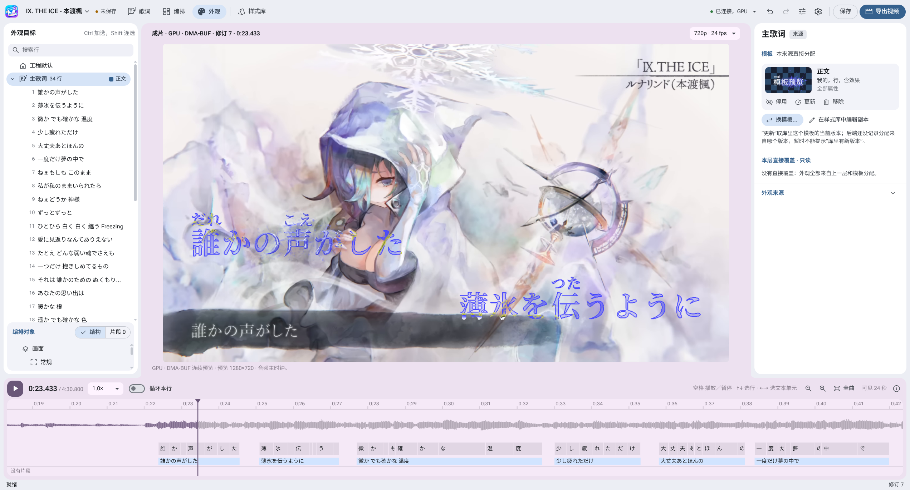
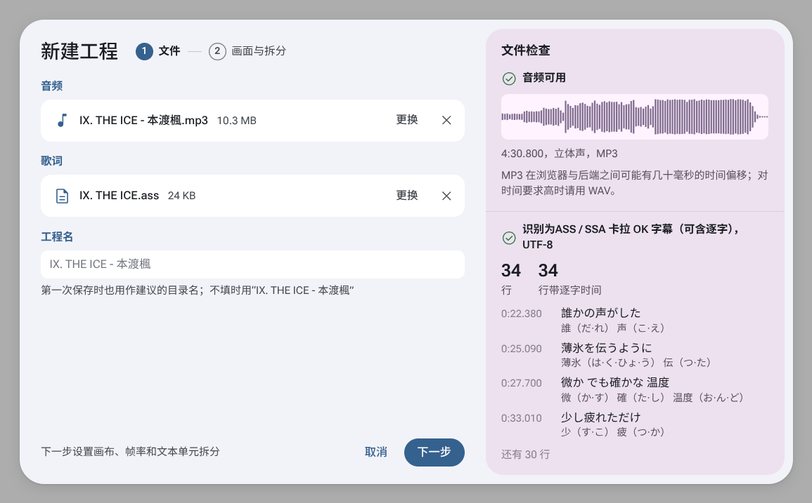
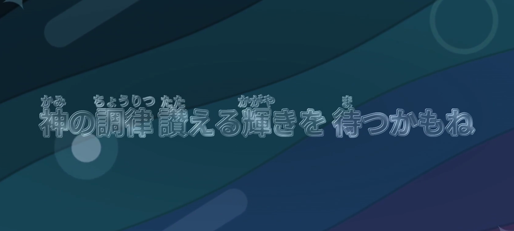
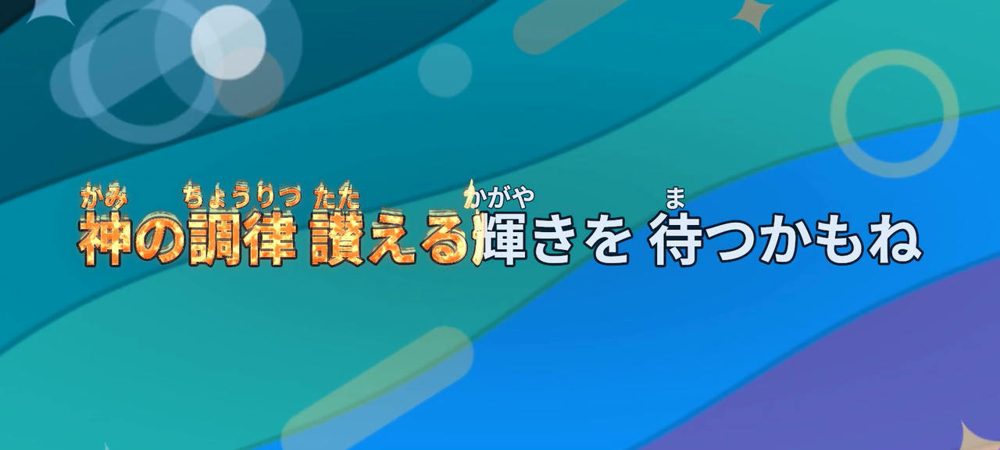
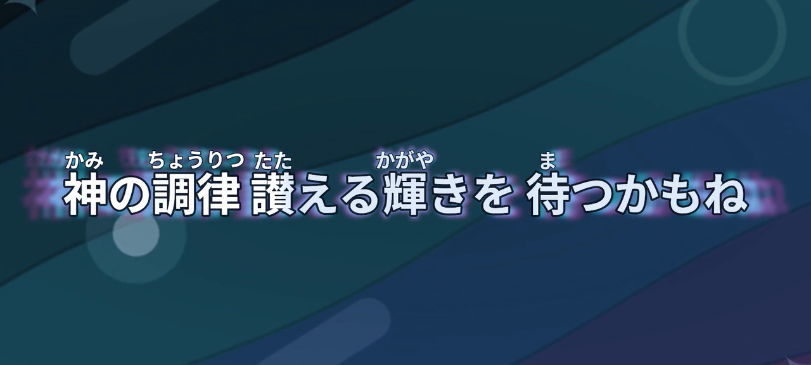
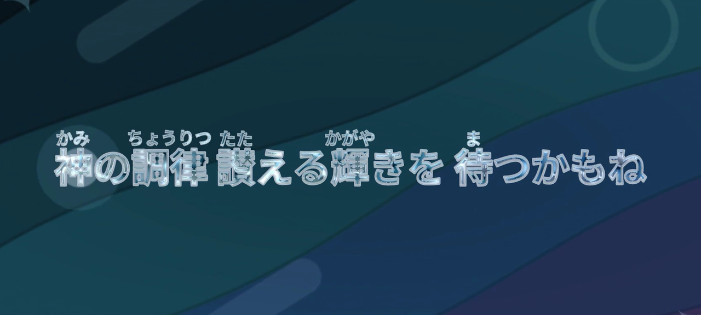
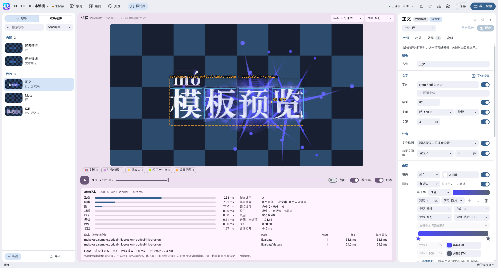

<p align="center">
  <a href="https://mako.talium.site/">
    
  </a>
</p>

<p align="center">
  <strong>跨平台卡拉 OK 歌词动画制作与可编程字幕视频渲染引擎</strong><br />
  <sub>从微秒级逐字 / 注音打轴、多槽位画面编排、双态分层样式到可编程 GPU 模板特效（<code>.mkfx</code>）与透明通道视频直出</sub>
</p>

<p align="center">
  <a href="https://mako.talium.site/">
    
  </a>
  <a href="https://github.com/Zydr114/MakoKaraGenerator-OfficialMkfxSamples">
    
  </a>
  <a href="https://github.com/Zydr114/MakoKaraGenerator-App/releases">
    
  </a>
  
  <a href="LICENSE">
    
  </a>
</p>

<p align="center">
  <strong><a href="https://mako.talium.site/">在线文档中心（mako.talium.site）</a></strong>
  &nbsp;·&nbsp;
  <strong><a href="https://mako.talium.site/getting-started/overview/">10 分钟快速上手</a></strong>
  &nbsp;·&nbsp;
  <strong><a href="https://github.com/Zydr114/MakoKaraGenerator-OfficialMkfxSamples">官方 .mkfx 特效示例库</a></strong>
  &nbsp;·&nbsp;
  <strong><a href="https://github.com/Zydr114/MakoKaraGenerator-App/releases">Releases 下载</a></strong>
</p>

---

**MakoKara Generator** 是一款专为音乐视频（MV）、翻唱投稿、歌回字幕与卡拉 OK 歌词动画打造的一体化创作与渲染工具。你可以在同一个 `.mkgproj` 工程里完成**音频与多格式歌词导入**、**微秒级逐字 / Ruby 注音打轴**、**多槽位卡拉 OK 画面编排**、**双态分层样式与 `.mkfx` 可编程 GPU 特效制作**，直至**硬件加速实时预览**与 **MP4 / ProRes 4444 透明背景视频直出**，告别在多个打轴软件、字幕工具与后期软件之间反复折腾。

<p align="center">
  
</p>
<p align="center">
  <sub>主工作区：硬件加速实时预览、Ruby 注音排版、样式模板指派与音频波形时间轴</sub>
</p>

---

## 快速导航与配套资源

| 资源入口 | 内容亮点 | 适合人群 |
| --- | --- | --- |
| **[官方文档与使用指南 (`mako.talium.site`)](https://mako.talium.site/)** | [10 分钟快速上手](https://mako.talium.site/getting-started/overview/) · [下载安装](https://mako.talium.site/getting-started/installation/) · [打轴与 TTML 互通](https://mako.talium.site/lyrics/workspace-and-modes/) · [多槽位画面编排](https://mako.talium.site/orchestration/concepts/) · [五层样式继承](https://mako.talium.site/styling/inheritance/) · [`.mkfx` 特效开发教程](https://mako.talium.site/authoring/mkfx-overview/) · [快捷键与 FAQ](https://mako.talium.site/reference/shortcuts/) | 所有新老用户、MV 创作者与字幕组 |
| **[官方 `.mkfx` 效果包示例仓库](https://github.com/Zydr114/MakoKaraGenerator-OfficialMkfxSamples)** | 收录 **24 套** SDK v2 效果包：提供 `dist/` **预打包 `.mkfx` 归档（下载即可导入使用）**、`packages/` 完整源码与资源、SDK v2 API 对照文档、本地校验打包脚本与 Vulkan 真机验证器 | 想直接套用炫酷特效的创作者、以及编写自定义特效的开发者 |
| **[GitHub Releases](https://github.com/Zydr114/MakoKaraGenerator-App/releases)** | 开箱即用的 Windows x64 便携压缩包与 Linux x64 AppImage 安装包（亦支持按下方说明从源码构建桌面端 / 浏览器端） | 桌面端用户与开发者 |

---

## 核心工作流一览

| 阶段 | 核心能力 | 对应文档 |
| --- | --- | --- |
| **1. 工程与导入** | 独立 `.mkgproj` 工程目录与备份恢复；导入音频与 ASS / TTML（兼容 AMLL）/ ELRC / LRC / SRT / VTT / UltraStar 时即时波形与注音预检 | [新建工程与素材导入](https://mako.talium.site/getting-started/first-project/) |
| **2. 逐字打轴** | 微秒级时间轴、`J`/`K` 轮指连打、`Q`/`W` 保调变速、字素级无损 Diff 全文快编、日语自动注音与 `F2` 原地注音浮窗 | [歌词工作区与三种模式](https://mako.talium.site/lyrics/workspace-and-modes/) |
| **3. 画面编排** | 层级化场景结构树、经典卡拉 OK 双行轮换槽位状态机、片段（Clip）分轨上下文保持、自动前奏倒计时提示（支持自定义 SVG） | [画面编排系统](https://mako.talium.site/orchestration/concepts/) |
| **4. 样式与特效** | 未唱 / 已唱双态、4 层渐变描边、硬边/渐变阴影与静态外辉光、开关式五层模板继承（`.mktpl`）及 C# 14 + ImageGraph + SkSL 特效引擎（`.mkfx`） | [样式继承](https://mako.talium.site/styling/inheritance/) · [`.mkfx` 入门](https://mako.talium.site/authoring/mkfx-overview/) |
| **5. 预览与导出** | Skia + Vulkan GPU 实时预览；导出带音轨 **MP4（H.264）** 或完整半透明通道 **MOV（ProRes 4444）**，支持导出前自动检查与 600 帧正式验证 | [视频导出与透明通道指南](https://mako.talium.site/reference/video-export/) |

---

## 功能详解

### 1. 工程管理与智能导入预检

- **独立工程与安全恢复**：每个作品保存为独立的 `.mkgproj` 工程目录，集中收纳工程设置、歌词与媒体引用；首页提供“最近打开”与“从备份恢复”，避免误改或意外关闭丢失进度。
- **新建向导即时预检**：选入音频与歌词后，右侧面板立即完成解码并展示音频波形、时长与声道信息，同时自动识别歌词编码、格式与逐字时间标记，并预览前几句歌词与注音解析结果。
- **主流格式双向互通**（详见文档：[TTML 格式与跨工具互通](https://mako.talium.site/lyrics/ttml-and-formats/)）：
  - **歌词导入**：支持 **ASS / SSA**（含卡拉 OK `\k` / `\kf` / `\ko` 逐字时间与 MakoLrcStudio 打轴注释）、**TTML / XML**（完整兼容 TTML2 `media` 与 Apple Music / AMLL 逐字及 Ruby 结构）、**增强 LRC（`.elrc` / `.lrc`）**、**普通 LRC**、**SRT**、**WebVTT**、**UltraStar** 与**纯文本**。
  - **歌词导出**：支持导出为 Plain LRC、Enhanced LRC，以及 **TTML（AMLL 兼容 / 全工程无损双 Profile）**；导出前会生成结构化**损失评估计划**，明确列出差异而绝不静默丢弃数据。
  - **音频输入**：支持 WAV、MP3、FLAC、AAC、MOV、OGG。

<p align="center">
  
</p>

---

### 2. 逐字歌词编辑、Ruby 注音与波形打轴（歌词页）

- **多分支歌词轨道**：左侧列出全部歌词行并标记时间轴完成度与起始时刻；同一工程内可自由创建并管理主歌词、翻译、罗马音等多条歌词分支，并在画布中联动展示伴随参考行。
- **三种高效工作模式**（详见文档：[歌词工作区与三种模式](https://mako.talium.site/lyrics/workspace-and-modes/)）：
  - **打轴**：以动态滚动卡拉 OK 画布为核心，直观呈现字簇与 Mora 拍点标记；支持随音乐播放用 `J` / `K` 轮指连打逐拍推进、`L` 收尾、退格 / `G` 撤回一拍、可配置按键延迟补偿，以及“跟随播放 / 锁定当前行 / 自由滚动”三种视图。
  - **编辑**：在画布中直接拆分字词、与后词合并、微调单个词元或单句起止时间，支持整行平移与缺失时间自动补全。
  - **全文快编**：带行号的多行文本编辑器（支持切换 `二人[ふ・た・り]` 内联注音语法），实时预览行级与**字素级 Diff**，提交后无损保留未改动字符的已有时间戳、注音与样式覆写——**改错字不再毁掉整行轴**。
- **日语自动注音与原生 Ruby 避让排版**（详见文档：[Ruby 注音与日语自动注音](https://mako.talium.site/lyrics/ruby-and-phonetics/)）：集成 `@patdx/kuromoji` 与按需缓存的 `NAIST-jdic` 词典引擎；按 `F2` 可呼出原地注音浮窗（罗马音实时转平/片假名预览，或 `Shift+Enter` 原样提交拼音、音标等多语种注音）；后端基于 HarfBuzz 真实字形墨迹自动求解相邻长注音字距避让，避免挤叠重叠。
- **音频波形时间轴与保调变速**：底部时间轴同轴呈现完整音频波形与歌词行、词元及注音块，提供 `Q` / `W` **保调变速（`0.25x` ~ `2.0x`）**、单行循环试听与吸附到帧。

<p align="center">
  
</p>

---

### 3. 可视化画面结构与多槽位卡拉 OK 编排（编排页）

- **层级化画面结构树**（详见文档：[编排核心概念与画面结构树](https://mako.talium.site/orchestration/concepts/)）：自由构建普通组、自动布局容器与**卡拉 OK 轮换槽位容器（`SlotSequence`）**，自定义槽位数量、排列方向、间距与调度策略（揭示时机、可见行数上限、冲突处理与滞留策略），让连续演唱的两行歌词自然交替预显。
- **片段（Clip）分轨与前奏提示**：可将副歌、合唱或过场段落划为独立**片段**并指派到指定容器，同时自动保持前后句轮换节奏上下文；支持按开场与长间奏阈值**自动生成前奏倒计时提示**，内置圆点、阶梯柱、胶囊、菱形、星形、文字及**自定义内联 SVG** 等 7 种图形与首字上方自动避让注音附着模式。
- **所见即所得画布与快速布局**：内置 4 套**快速布局**预设一键套用；开启**布局参考**后，直接在预览画布上叠加真实墨迹角点、字簇边界与参考框，配合右侧检查器精调坐标、锚点、旋转与缩放。

<p align="center">
  
</p>

---

### 4. 双态分层样式与可编程 GPU 模板特效（样式库 / 外观页）

#### 静态外观与开关式五层模板继承（`.mktpl`）

- **丰富的卡拉 OK 排版与视觉质感**（详见文档：[未唱 / 已唱双态与视觉质感](https://mako.talium.site/styling/states-and-visuals/)）：
  - **文字与注音**：自由配置系统字体、回退字体链、字号、字重、斜体与字距，并独立调整 Ruby 注音比例与间距。
  - **未唱 / 已唱双态外观**：分别为两态配置纯色 / 线性与径向渐变填充（支持 OKLCH / HSV / 线性 RGB 插值）或程序化包材质、**最多 4 层由内向外独立渐变描边**、支持无模糊硬边 / 外扩张 / 渐变的**投影阴影**、透明填充亦可完整发光且不被扫字游标切分的**独立静态外辉光**，以及扫字羽化与前沿高亮带。
- **开关式属性继承与精准溯源**（详见文档：[模板继承与五层优先级](https://mako.talium.site/styling/inheritance/)）：每个外观参数右侧均设有独立写入开关——开启即写入模板，关闭则透传继承。支持导出/导入 `.mktpl` 模板，按**工程默认 → 歌词轨道 → 节点 → 片段 → 单行 → 文本单元**逐层覆盖，改一处全局模板自动同步全曲，同时安全保留局部特写样式。

#### 可编程 GPU 模板特效引擎（`.mkfx` / SDK v2）

**MakoKara Generator** 内置确定性、纯函数求值的可编程特效渲染管线，支持在同一 `.mkfx` 效果包中自由组合：
- **纯 JSON + SkSL 材质与声明式图像图（ImageGraph）**：无需编写一行 C#，即可直接实现折射玻璃、磨砂、半调网点、全息色散等 GPU 着色器质感；
- **Roslyn 受控编译的 C# 14 控制器**：精确控制逐字 / 注音 / 字簇（HarfBuzz）局部变换、最高 **`32×32` 网格变形（`GridWarp`）**、`line.exit` 退场副本（`ExitReplica`）、声明式粒子发射与 SVG 图集绘制；
- **音频节拍与背景画面视觉感知（`media.features`）**：原生读取低频能量、鼓点脉冲与背景视频色彩/亮度/局部光流，让字幕随音乐律动、随画面光影自然融入 MV。

以下是基于官方示例仓库的 **实机 GPU 渲染截图**（均来自软件实机输出，对应 24 套官方 `.mkfx` 示例包中的代表作）：

<table>
  <tr>
    <td width="50%" align="center" valign="top">
      <br />
      <strong><a href="https://github.com/Zydr114/MakoKaraGenerator-OfficialMkfxSamples/tree/main/packages/LiquidGlassMaterial">LiquidGlassMaterial（液态玻璃）</a></strong><br />
      <sub>零 C# 纯 SkSL 程序化材质：背景折射模糊、轮廓梯度 Fresnel 边缘与色散高光</sub>
    </td>
    <td width="50%" align="center" valign="top">
      <br />
      <strong><a href="https://github.com/Zydr114/MakoKaraGenerator-OfficialMkfxSamples/tree/main/packages/EmberIgniteBurn">EmberIgniteBurn（炽焰灼烧）</a></strong><br />
      <sub>C# 14 + ImageGraph：<code>SungCoverage</code> 梯度燃烧前沿与音频调制 FBM 火焰热浪</sub>
    </td>
  </tr>
  <tr>
    <td width="50%" align="center" valign="top">
      <br />
      <strong><a href="https://github.com/Zydr114/MakoKaraGenerator-OfficialMkfxSamples/tree/main/packages/BeatKineticEcho">BeatKineticEcho（律动残影）</a></strong><br />
      <sub>音频节拍驱动：3 路并行 <code>Transform</code> + <code>Blur</code> + <code>Blend(plus)</code> 放射与斜切残影</sub>
    </td>
    <td width="50%" align="center" valign="top">
      <br />
      <strong><a href="https://github.com/Zydr114/MakoKaraGenerator-OfficialMkfxSamples/tree/main/packages/AdaptiveChromeFoil">AdaptiveChromeFoil（自适应镀铬箔）</a></strong><br />
      <sub><code>media.features</code> 背景视觉感知：实时采样背景天光 / 地反色并注入镀铬金属反射材质</sub>
    </td>
  </tr>
</table>

> [!TIP]
> **获取更多特效 & 学习编写 `.mkfx`**：
> - 前往官方示例仓库 **[Zydr114/MakoKaraGenerator-OfficialMkfxSamples](https://github.com/Zydr114/MakoKaraGenerator-OfficialMkfxSamples)**，直接下载 `dist/` 中 **24 套预打包 `.mkfx` 效果包** 导入软件，或浏览 `packages/` 源码（还包含 `OpticalInkErosion` 光流墨迹、`MangaHalftonePop` 漫画半调、`BeatEmberStorm` 鼓点余烬、`StarTrail` 跨行星轨、`AcousticRippleRain` 雨滴涟漪、`WordFlipTransition` 翻转退场等）。
> - 在文档站阅读 **[动态特效包（.mkfx）入门导览](https://mako.talium.site/authoring/mkfx-overview/)** 与 **[样式库草稿工坊](https://mako.talium.site/authoring/draft-workshop/)**，或查阅本仓库完整的 **[脚本 SDK v2 API 参考](docs/style-reference/script-sdk-v2.md)**。

#### 应用内特效工坊与单帧成本剖析

样式库内置 CodeMirror 6 在线编辑器、12 秒固定样本棋盘格试样、**可视化检查叠加层**（字簇、注音归属、播放头、粒子出生点与效果范围）以及**单帧分阶段成本剖析面板**（精确拆解准备 / 脚本 / 图像图 / 材质 / 粒子 / 栅格 / 读回耗时与内存分配），让创作者与特效作者直观调优渲染性能。

<p align="center">
  
</p>

---

### 5. 实时预览、透明通道直出与个性化界面

- **GPU 硬件加速实时预览与背景合成**：支持设置纯色、图片或视频作为背景媒体（可配置适配模式与播放同步）；桌面端采用原生共享纹理 / 共享内存管线实现低延迟连续帧预览，同时保留跨平台浏览器入口。
- **双格式视频直出与自动降级兜底**（详见文档：[视频导出与透明通道指南](https://mako.talium.site/reference/video-export/)）：
  - **MP4（H.264）**：输出带背景与音轨的常规成片，方便直接播放或上传视频平台。
  - **MOV 透明（ProRes 4444）**：保留完整的 Alpha 半透明通道（包含描边、阴影、外辉光与半透明粒子细节），可直接拖入 DaVinci Resolve、Premiere Pro、After Effects 等非编软件叠在 MV 画面上；导出透明通道时，依赖背景像素的材质与图效果会自动触发声明式渐变 / 旁路兜底，确保画面干净无黑块。
  - **导出前预检与正式验证**：自动校验画布尺寸、帧率、歌词时间完整性、音轨与背景媒体，并支持在正式输出前对开头片段（最多 600 帧）分别执行普通与透明双通道逐帧验证。
- **Material 3 动态主题与快捷键**：内置跟随系统 / 浅色 / 深色外观模式，默认从应用标志自动提取配色方案，亦提供精选色板、自定义取色与柔和 / 鲜明色彩强度切换。

<p align="center">
  
</p>
<p align="center">
  <sub>透明通道直出预览（棋盘格背景）：完整保留动态灼烧、外辉光与半透明边缘 Alpha，直接叠加至任意 MV 轨道</sub>
</p>

<table>
  <tr>
    <td width="50%" align="center" valign="top">
      <br />
      <sub>视频导出：支持 MP4 与 ProRes 4444 透明通道，附带导出前检查与 600 帧正式验证</sub>
    </td>
    <td width="50%" align="center" valign="top">
      <br />
      <sub>界面外观：支持深浅切换、软件标志自动取色与多种 Material 3 色板</sub>
    </td>
  </tr>
</table>

---

## 从源码构建与运行

> 如果你只是希望直接安装并使用软件，请前往 **[GitHub Releases](https://github.com/Zydr114/MakoKaraGenerator-App/releases)** 下载安装包，并参考文档站的 **[下载、安装与界面导览](https://mako.talium.site/getting-started/installation/)**。

### 环境要求

- **Node.js** `>= 24` 与 **pnpm**（可通过 Corepack 启用）
- **.NET 10 SDK**（遵循 [`backend/global.json`](backend/global.json)，当前锁定 `10.0.112`）
- **Python** `>= 3.10`
- **FFmpeg / FFprobe**（开发运行由本机 `PATH` 或 Windows WinGet 安装目录发现）
- **Linux 额外要求**：`flock`、Skia 所需系统字体与 Vulkan 运行库，以及允许非特权 Electron sandbox

> 如需通过代理下载 npm / NuGet 依赖或 Electron，可先设置 `HTTPS_PROXY=http://127.0.0.1:<代理端口>`（及 `ELECTRON_GET_USE_PROXY=1`），本机回环地址保持直连。

### 快速启动

在仓库根目录依次执行：

```bash
# 1. 安装前端依赖
pnpm run setup

# 2. 构建 Web 与匹配版本后端（Server / Worker）
pnpm build

# 3. 启动桌面端（自动检测并构建所需的桌面原生库与产物，访问 http://127.0.0.1:5180）
pnpm desktop
```

若希望在浏览器中使用或进行前端开发调试：

```bash
# 启动生产构建后的 Web 入口（默认 http://127.0.0.1:5173，可传 --port 指定端口）
pnpm start

# 或启动 Vite 热重载开发页面 + 匹配后端
pnpm dev
```

### 打包发布包

```bash
# Linux x64 AppImage（输出至 .local/release/MakoKaraGenerator-<版本>-x86_64.AppImage）
pnpm build:desktop
pnpm package:appimage
```

```powershell
# Windows x64 自包含便携包（需在 Windows x64 环境按 backend/native/media-presentation/README.md 准备媒体工具链）
pwsh -NoProfile -File scripts/build-windows-export-tools.ps1
pnpm package:windows --build
# 输出至 .local/release/MakoKaraGenerator-<版本>-windows-x64.zip，解压即用
```

<details>
<summary>仓库目录速览与技术文档索引</summary>

- [`backend/`](backend)：.NET 10 后端源码（领域模型、歌词导入导出、Skia / Vulkan 渲染、Roslyn C# 脚本编译器、FFmpeg 导出与 HTTP Server / Worker）
- [`frontend/`](frontend)：React 19 + TypeScript + Vite 前端编辑器与协议客户端
- [`desktop/`](desktop)：Electron 桌面主进程、共享纹理 / 共享内存预览消费端与运行时路径管理
- [`native/`](native)：桌面连续预览原生桥接库（`gpu-preview` / `shm-preview`）
- [`scripts/`](scripts) & [`tests/`](tests)：构建、打包、冒烟与集成验证脚本
- 配套站点与文档：
  - [官方使用文档中心（mako.talium.site）](https://mako.talium.site/)
  - [官方 `.mkfx` 效果包示例仓库（GitHub）](https://github.com/Zydr114/MakoKaraGenerator-OfficialMkfxSamples)
  - [脚本 SDK v2 完整 API 参考](docs/style-reference/script-sdk-v2.md)
  - [GPU 预览流 v1 合同](docs/architecture/gpu-preview-stream-v1.md)

</details>

---

## 引用与致谢项目

本项目在渲染、排版、音视频处理与桌面交互方面构建于以下优秀的开源项目与开放标准之上：

### 桌面端与前端界面

| 项目 | 用途 | 许可证 |
| --- | --- | --- |
| [Electron](https://www.electronjs.org/) (`45.2.1`) | 跨平台桌面应用容器与原生纹理/共享内存窗口呈现 | MIT |
| [React](https://react.dev/) (`19.x`) | 编辑器用户界面框架 | MIT |
| [React Aria Components](https://react-spectrum.adobe.com/react-aria/) | 无障碍交互组件基础 | Apache-2.0 |
| [Material Color Utilities](https://github.com/material-foundation/material-color-utilities) | 从软件标志与主题色动态推导 Material 配色方案 | Apache-2.0 |
| [Material Symbols](https://fonts.google.com/icons) | 界面矢量图标集 | Apache-2.0 |
| [CodeMirror 6](https://codemirror.net/) | 特效包脚本在线编辑器与语法高亮 | MIT |
| [wanakana](https://wanakana.com/) (`^5.3.1`) | 原地注音浮窗罗马音实时转平/片假名预览（[第三方声明](docs/third-party/phonetics/README.md)） | MIT |
| [@patdx/kuromoji](https://github.com/patdx/kuromoji) (`^1.0.4`) | 日语形态素分词引擎（构建时剔除内置词典，[第三方声明](docs/third-party/phonetics/README.md)） | Apache-2.0（内嵌 `doublearray` 为 MIT） |
| `NAIST-jdic` (`0.6.3b`) | 按需下载或本地导入的裁剪日语词典资产（未打入安装包，[第三方声明](docs/third-party/phonetics/README.md)） | BSD-3-Clause |
| [Roboto Flex](https://github.com/TypeNetwork/Roboto-Flex) | 界面拉丁字母与数字展示字体（[许可原文](frontend/src/editor/theme/fonts/RobotoFlex-OFL.txt)） | OFL-1.1 |
| [TypeScript](https://www.typescriptlang.org/) / [Vite](https://vite.dev/) / [Vitest](https://vitest.dev/) | 前端类型检查、构建打包与单元测试 | Apache-2.0 / MIT |

### 图形渲染、文字排版与脚本编译（后端）

| 项目 | 用途 | 许可证 |
| --- | --- | --- |
| [SkiaSharp](https://github.com/mono/SkiaSharp) (`3.119.4`) & `SkiaSharp.Vulkan.SharpVk` | 跨平台 2D 图形绘制、图像滤镜与 Vulkan GPU 渲染 | MIT |
| [HarfBuzzSharp](https://github.com/mono/SkiaSharp) (`8.3.1.5`) & `SkiaSharp.HarfBuzz` | 复杂文字整形、字符边界测量与 Ruby 注音字距计算 | MIT |
| [SharpVk](https://github.com/FacticiusVir/SharpVk) (`0.4.2`) | .NET Vulkan 互操作绑定 | [LICENSE](https://github.com/FacticiusVir/SharpVk/blob/master/LICENSE) |
| [Svg.Skia](https://github.com/wieslawsoltes/Svg.Skia) (`4.9.1`) & [ExCSS](https://github.com/TylerBrinks/ExCSS) (`4.3.1`) | SVG 矢量图形解析与渲染（[第三方声明](backend/docs/third-party/svg-skia/README.md)） | MIT（其中 `Svg.Custom` 为 MS-PL） |
| [Roslyn (`Microsoft.CodeAnalysis.CSharp`)](https://github.com/dotnet/roslyn) (`5.0.0`) | C# 14 脚本特效包受控动态编译 | MIT |
| [CliWrap](https://github.com/Tyrrrz/CliWrap) (`3.10.5`) | 外部媒体进程封装与调度 | MIT |
| [xUnit.net](https://xunit.net/) | .NET 单元测试框架 | Apache-2.0 |

### 媒体编解码与原生桥接

| 项目 | 用途 | 说明 |
| --- | --- | --- |
| [FFmpeg](https://ffmpeg.org/) / [x264](https://www.videolan.org/developers/x264.html) / [zlib](https://zlib.net/) | 音频解码分析、视频背景帧解码与成片编码导出 | Windows 便携工具配方见 [`build-windows-export-tools.ps1`](scripts/build-windows-export-tools.ps1) 与 [`media-presentation/README.md`](backend/native/media-presentation/README.md) |
| [Vulkan-Headers](https://github.com/KhronosGroup/Vulkan-Headers) | Linux 原生 GPU 共享纹理桥接头文件 | Apache-2.0 / MIT |
| [llvm-mingw](https://github.com/mstorsjo/llvm-mingw) | Windows 原生媒体探针跨平台编译工具链 | ISC / Apache-2.0 with LLVM Exception |

### 歌词格式、生态兼容与设计参考

- **ASS / SSA**（含 **MakoLrcStudio** 逐字打轴与注音注释兼容）
- **TTML**（含 **AMLL / Apple Music-like Lyrics** 逐字与翻译、Ruby 注音结构兼容）
- **Enhanced LRC / LRC**、**SRT**、**WebVTT**、**UltraStar**
- **[StrangeUtaGame](https://github.com/karaoke-studio/StrangeUtaGame)**（GPL-3.0）：歌词页动态滚动打轴画布、连打交互与注音工作流的界面设计灵感参考（仅参考交互设计思路，未引入或分发其源代码）

---

## 许可证

本项目基于 **[GNU Affero General Public License v3.0（AGPL-3.0）](LICENSE)** 开源发布。上述所引用第三方组件的许可与声明文件均随仓库及打包产物一并保留。
