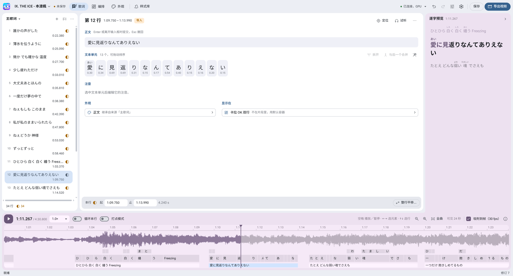
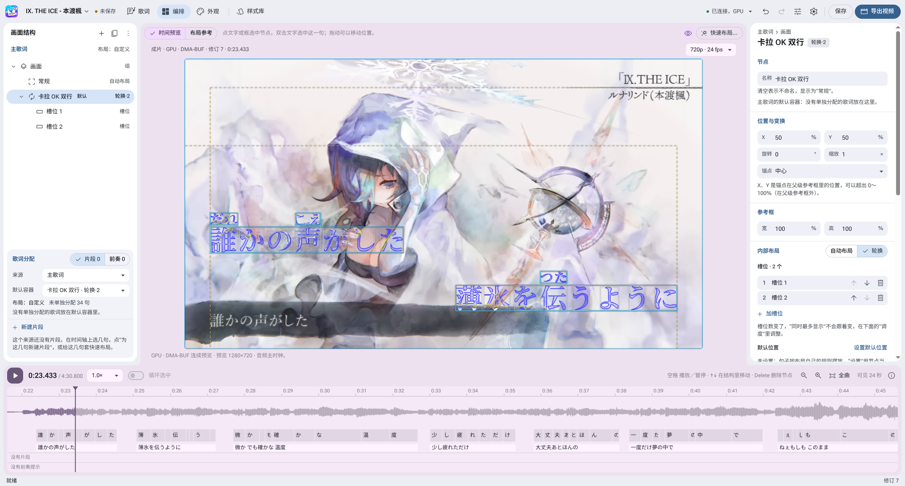
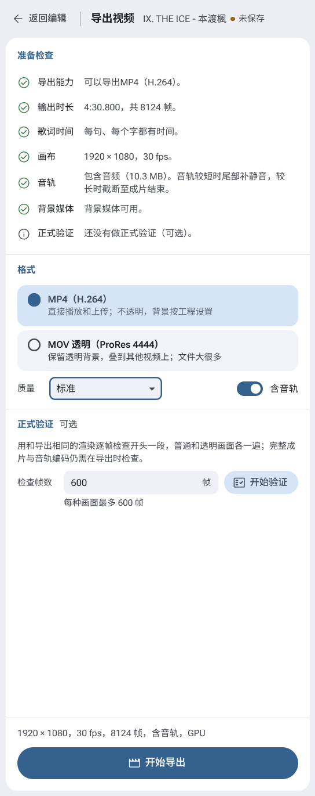
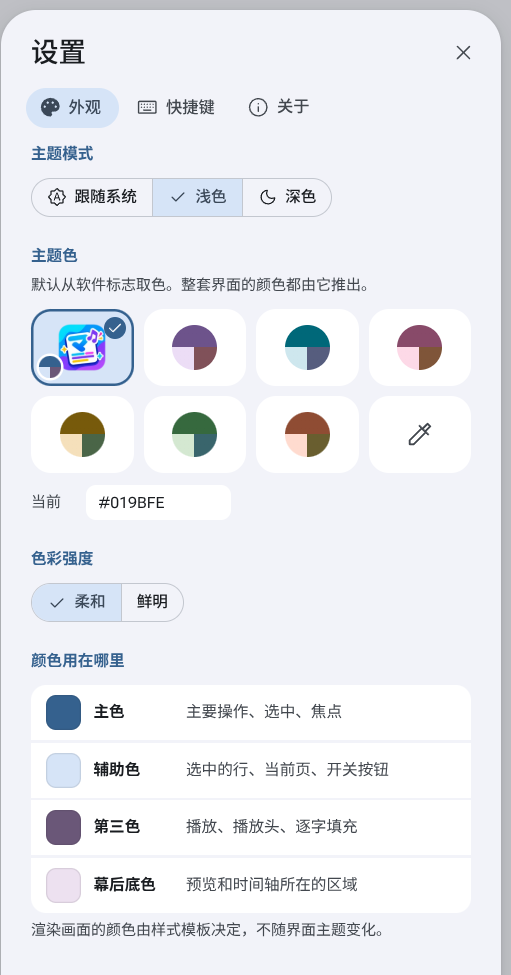

<p align="center">
  
</p>

<p align="center">
  <strong>跨平台卡拉 OK 歌词动画制作与字幕视频渲染工具</strong><br />
  <sub>版本 <code>0.117.0</code> · 支持 Windows x64 &amp; Linux x64 · 桌面端 &amp; 浏览器端</sub>
</p>

---

**MakoKara Generator** 是一款专为音乐视频（MV）、翻唱投稿与卡拉 OK 字幕打造的创作软件。你可以把音频、歌词和背景画面放在同一个工程里，从**歌词导入与逐字打轴**、**多槽位画面编排**、**样式与动态特效创作**，一路做到**实时流畅预览**和 **MP4 / 透明背景视频导出**，无需在多个工具之间反复倒腾字幕和渲染参数。

<p align="center">
  
</p>
<p align="center">
  <sub>主工作区：实时预览卡拉 OK 渲染画面、Ruby 注音效果、样式模板分配与音频波形时间轴</sub>
</p>

## 功能介绍

### 1. 工程管理与智能导入预检

- **独立工程管理**：每个作品保存为独立的 `.mkgproj` 工程目录，集中收纳工程设置、歌词与媒体引用；首页提供“最近打开”与“从备份恢复”，避免误改或意外关闭丢失进度。
- **新建向导即时检查**：选入音频与歌词后，右侧面板会立即完成解码并展示音频波形、时长、声道信息，同时自动识别歌词编码、格式与逐字时间标记，并列出前几句的歌词与注音解析预览。
- **丰富的格式兼容**：
  - **歌词导入**：支持 **ASS / SSA**（含卡拉 OK `\k`/`\kf`/`\ko` 逐字时间与 MakoLrcStudio 打轴注释）、**TTML / XML**（兼容 AMLL 与 Ruby 注音）、**增强 LRC（`.elrc` / `.lrc`）**、**普通 LRC**、**SRT**、**WebVTT**、**UltraStar** 以及**纯文本**。
  - **歌词导出**：支持导出为 Plain LRC、Enhanced LRC 与 TTML，方便跨工具复用。
  - **音频输入**：支持 WAV、MP3、FLAC、AAC、MOV、OGG。

<p align="center">
  
</p>

---

### 2. 逐字歌词编辑与波形打轴（歌词页）

- **多轨道歌词管理**：左侧列出全部歌词行并直观标记每句的时间轴完成度与起始时刻；支持创建与关联多个歌词分支（如主歌词、翻译、罗马音），并在画布中联动显示伴随参考行。
- **三种工作模式（打轴 / 编辑 / 全文快编）**：
  - **打轴**：以动态滚动卡拉 OK 画布为核心，直观呈现字簇与 Mora 拍点标记；支持随音乐播放使用 `J` / `K` 轮指连打逐字/逐拍推进、`L` 收尾、退格 / `G` 撤回一拍、行级与来源级时间戳清零、可配置的按键延迟补偿，以及“跟随播放 / 锁定当前行 / 自由滚动”三种视图模式。
  - **编辑**：支持在画布中直接拆分字词、与后一个合并、微调单个词元或单句起止时间，以及整行平移与补全缺失时间。
  - **全文快编**：提供带行号的多行文本编辑器（支持切换 `二人[ふ・た・り]` 内联注音格式），实时预览行级与字素级 Diff，提交后无损保留未改动字符的已有时间戳、注音与样式覆写。
- **日语自动注音与原生 Ruby 编辑**：集成 `@patdx/kuromoji` 分词与按需缓存的 `NAIST-jdic` 词典引擎（支持单行/整来源自动注音及自定义用户词典管理）；按 `F2` 可呼出原地注音浮窗，支持罗马音实时转平/片假名预览或 `Shift+Enter` 原样提交拼音、音标等多语种注音，并自动处理相邻注音之间的自然字距避让。
- **音频波形时间轴与保调变速**：底部时间轴展示完整音频波形以及歌词行、词元与注音块，提供 `Q` / `W` 保调变速（`0.25x` ~ `2.0x`）、单行循环试听与吸附到帧；工具栏右侧可直达当前行所属样式与编排容器。

<p align="center">
  
</p>

---

### 3. 可视化画面结构与多槽位编排（编排页）

- **灵活的画面结构树**：通过“画面结构”面板自由搭建显示层次，既可以使用“常规”自动布局，也可以创建经典的**“卡拉 OK 双行轮换”**等容器节点，自定义槽位数量、排列方向、间隔与默认位置，让连续演唱的两行歌词自然交替显示。
- **片段与前奏提示**：可以将时间轴上的一段歌词新建为独立**片段**，或添加**前奏提示**标记，分别指派到指定的布局容器，实现副歌换位、合唱分轨或过场提示。
- **所见即所得画布与快速布局**：内置多套**快速布局**预设一键套用；开启**布局参考**后，可直接在预览画面中观察参考框、字簇边界与位置关系，配合右侧检查器微调 X/Y 坐标、锚点、旋转与缩放，并随时循环试看选中片段。

<p align="center">
  
</p>

---

### 4. 样式库、静态外观与动态脚本特效（样式库 / 外观页）

- **全方位的卡拉 OK 排版与视觉属性**：
  - **文字与注音**：自由选择系统字体与回退字体、字号、字重、斜体与字距，并独立设置 **Ruby 注音字号比例**与**与正文间距**。
  - **未唱 / 已唱双态外观**：分别为歌词未演唱与已演唱状态配置纯色或渐变填充、**最多 4 层描边**（支持实心色与多色标渐变）、投影阴影、**静态外辉光**（颜色、不透明度、扩张、模糊），以及扫字羽化与高亮效果。
- **开关式模板继承与分级覆写**：在“样式库”中，每个外观参数右侧都配有独立开关——打开表示写入模板，关闭则由下层目标继承。在“外观”页可以将样式模板（支持 `.mktpl` 分享导入/导出）分别指派给工程默认、整条歌词轨道、特定片段、单行或单个文本单元，也可以直接做局部覆写。
- **C# 动态特效与试样调试**：支持引入或在线编写可编程特效包（`.mkfx`），驱动逐字缩放、墨迹扩散、光标拖尾、粒子发射、波浪变形、故障风等动画，并支持配合图片/SVG 素材与自定义着色器（详见 [脚本 SDK v2 参考](docs/style-reference/script-sdk-v2.md)；官方 `.mkfx` 效果包示例仓库见 GitHub：[Zydr114/MakoKaraGenerator-OfficialMkfxSamples](https://github.com/Zydr114/MakoKaraGenerator-OfficialMkfxSamples)）。样式库还提供固定样本棋盘格试样、字簇/注音/播放头/粒子出生点叠加层，以及**单帧成本分析**面板，帮助作者直观调优效果性能。

<p align="center">
  
</p>

---

### 5. 实时预览、视频导出与个性化界面

- **硬件加速实时预览与背景合成**：支持设置纯色、图片或视频作为背景媒体（可设置适配模式与播放同步）。桌面端提供流畅的连续帧预览体验，同时保留跨平台的浏览器预览入口。
- **双格式视频导出与正式验证**：
  - **MP4（H.264）**：输出带背景与音轨的常规视频，方便直接播放或上传平台。
  - **MOV 透明（ProRes 4444）**：保留完整的 Alpha 透明通道，包含描边、阴影与外辉光半透明细节，可直接导入各类视频剪辑软件叠在 MV 画面上。
  - 导出前自动检查画布尺寸、帧率、歌词时间完整性、音频与背景可用性，还支持在正式输出前对开头片段（最多 600 帧）执行逐帧验证。
- **动态主题与快捷键**：内置跟随系统 / 浅色 / 深色三种外观模式，默认从软件标志自动提取配色生成整套界面色调，也提供多组精选色板、自定义吸管取色与柔和/鲜明色彩强度切换，并可在设置中随时查看快捷键一览。

<table>
  <tr>
    <td width="50%" align="center" valign="top">
      <br />
      <sub>视频导出：支持 MP4 与透明通道 MOV，并提供导出前检查与验证</sub>
    </td>
    <td width="50%" align="center" valign="top">
      <br />
      <sub>界面外观：支持深浅切换、软件标志自动取色与多种色板</sub>
    </td>
  </tr>
</table>

---

## 引用与致谢项目

本项目在渲染、排版、音视频处理与桌面交互方面构建于以下优秀的开源项目与开放标准之上：

### 桌面端与前端界面

| 项目 | 用途 | 许可证 |
| --- | --- | --- |
| [Electron](https://www.electronjs.org/) (`45.2.1`) | 跨平台桌面应用容器与原生纹理/共享内存窗口呈现 | MIT |
| [React](https://react.dev/) (`19.x`) | 编辑器用户界面框架 | MIT |
| [React Aria Components](https://react-spectrum.adobe.com/react-aria/) | 无障碍交互组件基础 | Apache-2.0 |
| [Material Color Utilities](https://github.com/material-foundation/material-color-utilities) | 从软件标志与主题色动态推导 Material 配色方案 | Apache-2.0 |
| [Material Symbols](https://fonts.google.com/icons) | 界面矢量图标集 | Apache-2.0 |
| [CodeMirror 6](https://codemirror.net/) | 特效包脚本在线编辑器与语法高亮 | MIT |
| [wanakana](https://wanakana.com/) (`^5.3.1`) | 原地注音浮窗罗马音实时转平/片假名预览（[第三方声明](docs/third-party/phonetics/README.md)） | MIT |
| [@patdx/kuromoji](https://github.com/patdx/kuromoji) (`^1.0.4`) | 日语形态素分词引擎（构建时剔除内置词典，[第三方声明](docs/third-party/phonetics/README.md)） | Apache-2.0（内嵌 `doublearray` 为 MIT） |
| `NAIST-jdic` (`0.6.3b`) | 按需下载或本地导入的裁剪日语词典资产（未打入安装包，[第三方声明](docs/third-party/phonetics/README.md)） | BSD-3-Clause |
| [Roboto Flex](https://github.com/TypeNetwork/Roboto-Flex) | 界面拉丁字母与数字展示字体（[许可原文](frontend/src/editor/theme/fonts/RobotoFlex-OFL.txt)） | OFL-1.1 |
| [TypeScript](https://www.typescriptlang.org/) / [Vite](https://vite.dev/) / [Vitest](https://vitest.dev/) | 前端类型检查、构建打包与单元测试 | Apache-2.0 / MIT |

### 图形渲染、文字排版与脚本编译（后端）

| 项目 | 用途 | 许可证 |
| --- | --- | --- |
| [SkiaSharp](https://github.com/mono/SkiaSharp) (`3.119.4`) & `SkiaSharp.Vulkan.SharpVk` | 跨平台 2D 图形绘制、图像滤镜与 Vulkan GPU 渲染 | MIT |
| [HarfBuzzSharp](https://github.com/mono/SkiaSharp) (`8.3.1.5`) & `SkiaSharp.HarfBuzz` | 复杂文字整形、字符边界测量与 Ruby 注音字距计算 | MIT |
| [SharpVk](https://github.com/FacticiusVir/SharpVk) (`0.4.2`) | .NET Vulkan 互操作绑定 | [LICENSE](https://github.com/FacticiusVir/SharpVk/blob/master/LICENSE) |
| [Svg.Skia](https://github.com/wieslawsoltes/Svg.Skia) (`4.9.1`) & [ExCSS](https://github.com/TylerBrinks/ExCSS) (`4.3.1`) | SVG 矢量图形解析与渲染（[第三方声明](backend/docs/third-party/svg-skia/README.md)） | MIT（其中 `Svg.Custom` 为 MS-PL） |
| [Roslyn (`Microsoft.CodeAnalysis.CSharp`)](https://github.com/dotnet/roslyn) (`5.0.0`) | C# 14 脚本特效包受控动态编译 | MIT |
| [CliWrap](https://github.com/Tyrrrz/CliWrap) (`3.10.5`) | 外部媒体进程封装与调度 | MIT |
| [xUnit.net](https://xunit.net/) | .NET 单元测试框架 | Apache-2.0 |

### 媒体编解码与原生桥接

| 项目 | 用途 | 说明 |
| --- | --- | --- |
| [FFmpeg](https://ffmpeg.org/) / [x264](https://www.videolan.org/developers/x264.html) / [zlib](https://zlib.net/) | 音频解码分析、视频背景帧解码与成片编码导出 | Windows 便携工具配方见 [`build-windows-export-tools.ps1`](scripts/build-windows-export-tools.ps1) 与 [`media-presentation/README.md`](backend/native/media-presentation/README.md) |
| [Vulkan-Headers](https://github.com/KhronosGroup/Vulkan-Headers) | Linux 原生 GPU 共享纹理桥接头文件 | Apache-2.0 / MIT |
| [llvm-mingw](https://github.com/mstorsjo/llvm-mingw) | Windows 原生媒体探针跨平台编译工具链 | ISC / Apache-2.0 with LLVM Exception |

### 歌词格式、生态兼容与设计参考

- **ASS / SSA**（含 **MakoLrcStudio** 逐字打轴与注音注释兼容）
- **TTML**（含 **AMLL / Apple Music-like Lyrics** 逐字与翻译、Ruby 注音结构兼容）
- **Enhanced LRC / LRC**、**SRT**、**WebVTT**、**UltraStar**
- **[StrangeUtaGame](https://github.com/karaoke-studio/StrangeUtaGame)**（GPL-3.0）：歌词页动态滚动打轴画布、连打交互与注音工作流的界面设计灵感参考（仅参考交互设计思路，未引入或分发其源代码）

---

## 从源码构建与运行

### 环境要求

- **Node.js** `>= 24` 与 **pnpm**（可通过 Corepack 启用）
- **.NET 10 SDK**（遵循 [`backend/global.json`](backend/global.json)，当前锁定 `10.0.112`）
- **Python** `>= 3.10`
- **FFmpeg / FFprobe**（开发运行由本机 `PATH` 或 Windows WinGet 安装目录发现）
- **Linux 额外要求**：`flock`、Skia 所需系统字体与 Vulkan 运行库，以及允许非特权 Electron sandbox

> 如需通过代理下载 npm / NuGet 依赖或 Electron，可先设置 `HTTPS_PROXY=http://127.0.0.1:<代理端口>`（及 `ELECTRON_GET_USE_PROXY=1`），本机回环地址保持直连。

### 快速启动

在仓库根目录依次执行：

```bash
# 1. 安装前端依赖
pnpm run setup

# 2. 构建 Web 与匹配版本后端（Server / Worker）
pnpm build

# 3. 启动桌面端（自动检测并构建所需的桌面原生库与产物，访问 http://127.0.0.1:5180）
pnpm desktop
```

若希望在浏览器中使用或进行前端开发调试：

```bash
# 启动生产构建后的 Web 入口（默认 http://127.0.0.1:5173，可传 --port 指定端口）
pnpm start

# 或启动 Vite 热重载开发页面 + 匹配后端
pnpm dev
```

### 打包发布包

```bash
# Linux x64 AppImage（输出至 .local/release/MakoKaraGenerator-<版本>-x86_64.AppImage）
pnpm build:desktop
pnpm package:appimage
```

```powershell
# Windows x64 自包含便携包（需在 Windows x64 环境按 backend/native/media-presentation/README.md 准备媒体工具链）
pwsh -NoProfile -File scripts/build-windows-export-tools.ps1
pnpm package:windows --build
# 输出至 .local/release/MakoKaraGenerator-<版本>-windows-x64.zip，解压即用
```

<details>
<summary>仓库目录速览与扩展开发文档</summary>

- [`backend/`](backend)：.NET 10 后端源码（领域模型、歌词导入导出、Skia 渲染、C# 脚本编译器、FFmpeg 导出与 HTTP Server / Worker）
- [`frontend/`](frontend)：React 19 + TypeScript + Vite 前端编辑器与客户端 SDK
- [`desktop/`](desktop)：Electron 桌面主进程、共享纹理/内存预览消费端与运行时路径管理
- [`native/`](native)：桌面连续预览原生桥接库（`gpu-preview` / `shm-preview`）
- [`scripts/`](scripts) & [`tests/`](tests)：构建、打包、冒烟与集成验证脚本
- 扩展技术文档：[脚本 SDK v2 完整 API 参考](docs/style-reference/script-sdk-v2.md) · [GPU 预览流 v1 合同](docs/architecture/gpu-preview-stream-v1.md) · [官方 `.mkfx` 效果包示例仓库（GitHub）](https://github.com/Zydr114/MakoKaraGenerator-OfficialMkfxSamples)

</details>

---

## 许可证

本仓库暂未添加开源许可证。上述所引用第三方组件的许可与声明文件均随仓库及打包产物一并保留。
