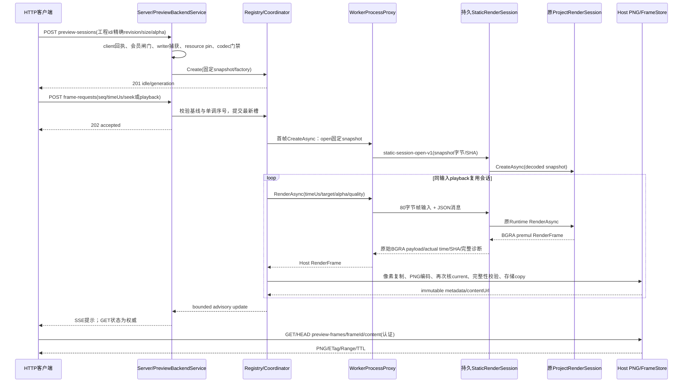

# Render 入口、跨进程帧输出与正式任务

调查基线：`refactor/individual-backend`，`feda45973ae33827da93eee2a2cfd834c105a5da`，产品`0.70.1`，2026-10-14；§1～8保留该次源码调查及行号归属，原调查没有运行构建、测试、性能、GUI或native进程。2026-10-15追加下方内部package Worker当前边界旁注，对应0.75.0内部诊断有限验收；当前HTTP以[统一API](backend-api.md)为准，后续实施与暂停边界以[实施记录](../archive/history/backend-extraction-progress.md)为准。

> **0.75.0 B3-G当前内部入口：** 显式[WorkerPackageRenderFrameSessionFactory](../../src/MakoKaraGenerator.Backend.Hosting/WorkerPackageRenderFrameSessionFactory.cs)经私有会话执行固定包Runtime，B3-G补齐source／image／material三类完整诊断及固定catalog身份恢复；Script／Source owner分离，PackageDiagnosticsVersion1显式协商，真实0.74旧能力不回退。各类256条／64KiB、合计512条／128KiB超限失败不截断；controller ArtifactHash只核格式与固定源关联，无Host独立重编译。Runtime Error禁像素、同Process／原pipe、static／package互斥与失控六组合实际组排水保持。本机Linux实际组隔离不是任意恶意脚本OS sandbox；统一1001与独立已发布Runtime22等计数见[实施§30](../archive/history/backend-extraction-progress.md#b3-package-diagnostics-0750)，历史B3-F971与部署20保[§29](../archive/history/backend-extraction-progress.md#b3-package-worker-isolation-0740)归属。Server HTTP仍双静态profile，完整B3／B4、预设／完整媒体字体闭包、作者Web及原暂停矩阵保持。

源码链接相对本目录，`Lx–Ly` 是该基线实际行号；链接进入文件，行号文本供本地定位。HTTP 当前合同以 [backend-api.md](backend-api.md) 为准；未来 API 草案不作为已实现能力。

整条链的导航见 [Render 总览](render-pipeline.md)；完整脚本装载／编译见 [脚本加载](render-script-loading.md)，`PrepareAsync` 与运行状态见 [Runtime 一帧求值](render-runtime-frame.md)，Skia 绘制和像素语义见 [Skia 输出](render-skia-output.md)。本篇解释这些共同能力如何被不同入口固定、调度和交付。

## 1. 三种输出入口共用代码，能力边界不同

当前独立 Server 的预览、正式验证和正式导出都进入原 `ProjectRenderSessionFactory`／`ProjectRenderSession`。但 Server 先用专用 `snapshot-v1` codec 限制来源，因此只开放静态歌词／场景及完整已接受分析数据两个 profile。原 Avalonia 正式预览、作者验证和直接导出能进入完整 Runtime 的效果包编译、帧准备、图片／视频背景等路线。使用相同 Runtime 不等于 HTTP 已开放全部输入。

| 入口 | 来源及执行位置 | 一帧输出交付 | 当前边界 |
| --- | --- | --- | --- |
| Server HTTP 预览 | 精确工程修订→固定快照→专用 codec→持久 Worker 中的 Runtime 会话 | Worker 裸 BGRA 像素→Host PNG→受认证 frame 内容 URL | 两个静态 profile；无效果包、固定预设、包材质、图片／视频背景 |
| Server HTTP 正式验证 | 精确工程修订→固定快照→独立任务 Worker→原 `RuntimeFrameValidator` | Worker 内逐帧检查，只向 Host 传进度与完整报告 | 两个静态 profile；普通／透明独立会话，指定帧计划 |
| Server HTTP 正式导出 | 精确工程修订→固定快照＋可选显式音频 grant→独立任务 Worker→原 `VideoExporter` | Worker 内连续帧→FFmpeg stdin→私有 candidate→Host 公开媒体／报告包 | 两个静态 profile；MP4 或透明 MOV；带音轨仍限定 PCM16 WAV |
| Avalonia 正式画布 | UI 当前不可变快照→每画布后台协调器→同进程完整 Runtime | `RenderFrame`→复制像素→UI `WriteableBitmap` | 可进入完整固定包／预设／分析／图片视频 Runtime；不是 Server Worker 隔离 |
| Avalonia 中性歌词预览 | `LyricsDocument`＋分支＋播放头→`LyricSampler`→Avalonia 文本绘制 | `DrawingContext` 文本 | 只读正文和时间，不显示工程样式、场景或脚本效果 |
| 同进程静态／设计试样 | `IRenderPipeline.Render`，没有 `SessionFactory` 时的画布分支 | `RenderFrame`→UI 位图 | 没有编译／`PrepareAsync`；不能把它当正式脚本预览 |

共同入口源码：[ProjectRenderSessionFactory](../../src/MakoKaraGenerator.Runtime.Hosting/ProjectRenderSessionFactory.cs) L19–32、[ProjectRenderSession](../../src/MakoKaraGenerator.Runtime.Hosting/ProjectRenderSession.cs) L13–28；实际 Server 组合：[Program](../../src/MakoKaraGenerator.Backend.Server/Program.cs) L55–86；实际 App 组合：[App.axaml.cs](../../samples/TechnicalSpike.App/App.axaml.cs) L36–76。

## 2. 固定快照与两个静态 profile

### 2.1 快照不读取编辑器状态

`ProjectSnapshot.FromProject` 把领域工程变成固定渲染来源，包含合成、歌词、展示树、样式、动画、背景、音频声明、分析、效果与固定预设。它不深拷贝不可变领域记录；编辑产生新对象，所以旧快照仍是旧输入。它同时投影预设效果并计算 `EffectInputsFingerprint`，而非让渲染临时查询个人库。[ProjectSnapshot](../../src/MakoKaraGenerator.Rendering.Abstractions/ProjectSnapshot.cs) L16–20、L96–117。

HTTP 捕获在 `ProjectSession.Writer` 唯一写者闸门内执行：核对 owner、关闭状态和精确 `ProjectRevision`，然后 `ProjectSnapshot.FromProject`。后续编辑不会让旧预览自动变成新修订；必须显式更新 input。[ProjectSession.CapturePreviewInputAsync](../../src/MakoKaraGenerator.Backend.Hosting/ProjectSession.Preview.cs) L12–26。

### 2.2 两个 profile 是互斥来源合同

| 来源字段／能力 | `static-lyrics-scene-v1` | `static-lyrics-scene-analysis-v1` | 原完整 Runtime |
| --- | --- | --- | --- |
| 合成、静态歌词／逐字时间／注音、展示树、基础样式和原进入动画 | 保留并领域验证 | 同左 | 保留并按完整路径渲染 |
| `AudioAnalysis` | 必须 `null` | 必须非空，完整保留 Available／Failed／NoStream | 可参与脚本分析查询与帧求值，能力由固定闭包决定 |
| Available 分析 | 不接受 | 完整 canonical 数据、所有 points、revision／contentHash；核 sourceHash 同 AudioMedia | 原完整分析源 |
| Failed／NoStream 分析 | 不接受 | 原 code／message 保留，不降为 `null` | 原状态可见 |
| `AudioPath`／`AudioMedia` | 声明性保留；media 不能脱离 path | 两者必须存在；Available 同源 | 仍是固定来源信息，脚本不直接读取路径 |
| 背景 | 仅 `BackgroundKind.Color`，Path／Media 必须空 | 同左 | `BackgroundFrameSourceResolver` 可装配图片／视频资源 |
| `Effects`、`PresetApplications`、`EffectInputsFingerprint` | 只允许空效果、空预设、空指纹及默认效果预算 | 同左 | 非空指纹触发固定包编译及 `PrepareAsync` |
| 样式中的包材质 | 明确拒绝 | 明确拒绝 | 由固定包与 Skia 材质资源处理 |
| 文件／可搬移字体资源能力 | 没有额外字体授权合同；Worker 使用其实际字体环境 | 同左 | 原宿主／字体环境及固定资源，仍不应推断跨平台相同 |

`StaticProjectSnapshotCodec.SelectProfile` 只按 `snapshot.AudioAnalysis is null` 自动选 profile，HTTP 没有让客户端任意指定 profile。`Encode`／`Decode` 保留 15 个 source 字段的对应位置；不支持的包／预设只有空标记，非空明确拒绝，不能删除字段再运行。[StaticProjectSnapshotCodec](../../src/MakoKaraGenerator.Backend.Rendering/StaticProjectSnapshotCodec.cs) L24–50、L60–96、L110–161、L184–210；分析状态编码：[SnapshotAudioAnalysisSourceCodec](../../src/MakoKaraGenerator.Backend.Rendering/SnapshotAudioAnalysisSourceCodec.cs) L9–66。

codec 总额为 4 MiB，源图值总数最多 200,000，JSON 深度最多 64；还要求专用版本、受支持 profile、当前 `EngineIdentity`、当前工程／歌词 schema、无重复字段及原 Open 领域验证。预览 IPC 的 open 再扣 24 字节头，所以净快照上限是 `4,194,280` 字节。正式验证和导出各自还扣任务封包开销，不能把 codec 总额直接作为它们最终净输入额。[StaticProjectSnapshotCodec](../../src/MakoKaraGenerator.Backend.Rendering/StaticProjectSnapshotCodec.cs) L34–40、L69–95、L139–157；[StaticRenderWorkerContract](../../src/MakoKaraGenerator.Backend.Contracts/StaticRenderWorkerContract.cs) L20–27。

### 2.3 声明路径与 IO grant 是不同对象

预览 `CaptureAsync` 首先为工程 `AudioAssetId` 获得 retention reference，然后包装工厂，使每个实际 Runtime 会话另外取得运行 reference。前者保住固定输入，后者直到实际会话排水才释放；更换 input 时两者不会被混为同一租约。codec 传递的 `AudioPath` 不授权 Worker 读取音频。[PreviewBackendService](../../src/MakoKaraGenerator.Backend.Server/PreviewBackendService.cs) L118–149、L209–242。

正式验证同样保留音频 resource reference，但没有向任务发放读取音频的 grant。纯视频导出不发音频 grant；带音轨导出在工程 writer 内取得授权资源 reference 与 read lease，核固定 identity、自包含 PCM16 WAV 结构及覆盖完整派生视频时长，才生成私有 `BackendExportAudioGrant(path,size,sha)`。该 grant 的访问路径可能不同于原快照声明路径，它不会反写源码声明或替代 source SHA。[ProjectSessionRegistry.Validation](../../src/MakoKaraGenerator.Backend.Hosting/ProjectSessionRegistry.Validation.cs) L56–79；[ProjectSessionRegistry.Export](../../src/MakoKaraGenerator.Backend.Hosting/ProjectSessionRegistry.Export.cs) L66–114。

新建／重开准备的 WAV／MP3／FLAC／AAC／MOV／Ogg 六家族能力属于另一条 Host native 准备链。它既不扩大此静态 profile，也不扩大带音轨 export 的 PCM16 WAV grant。原 Runtime 能消费分析数据，不意味着静态 HTTP 已允许音频驱动脚本视觉。[统一 API](backend-api.md) §9、§11、§12。

## 3. Server HTTP 预览：从请求到帧句柄



### 3.1 接收、捕获与请求函数

| 重要函数 | 输入→输出及行为 | 源码定位 |
| --- | --- | --- |
| `ConfigurePreviewEndpoints`／`RequestPreviewFrameAsync` | 建立 preview CRUD／frame request 路由。解析 JSON 并在接受前查 `RequestAborted`；202 只表示登记，不表示已产帧。接受后由 preview 生命周期拥有工作 | [ServerEndpoints.Preview](../../src/MakoKaraGenerator.Backend.Server/ServerEndpoints.Preview.cs) L7–47 |
| `PreviewBackendService.CreateAsync`／`UpdateAsync` | 共用 client 级回执，`purpose` 只接受 preview；核 size、旧 input 基线，捕获新固定来源。拒绝／异常归还未交出的 retention lease | [PreviewBackendService](../../src/MakoKaraGenerator.Backend.Server/PreviewBackendService.cs) L38–76 |
| `MutateAsync` | `_membership` 串行化服务成员变化，拒绝 stopping／过期或休眠 client；不在此闸门内执行整段逐帧渲染 | 同上 L105–115 |
| `CaptureAsync` | owner 工程／精确修订→snapshot＋ReferencedFactory；codec 预检查 profile／快照预算后移交资源 reference | 同上 L118–149 |
| `BackendPreviewSessionRegistry.Create` | 固定来源、目标和 alpha；创建一 preview entry／coordinator，激活 frame 与诊断 store。默认总会话 32、每 client 4 | [Registry](../../src/MakoKaraGenerator.Backend.Hosting/BackendPreviewSessionRegistry.cs) L22–28、L102–123 |
| `RequestFrame` | timeUs／requestSeq 用规范十进制字符串传输，转非负 long／正 long；序号必须大于已接受序号，time 不超过固定 composition 时长。playback 禁止回退；seek 原子换代次并 invalidate | 同上 L161–213 |
| `Update`／`Reset` | 明确新 snapshot／size／alpha，服务分配新 generation，撤销旧帧／诊断并取消旧会话；不靠修改播放头复活旧输入 | 同上 L133–158、L459–476 |

认证在全局路由中间件完成：loopback／Host／Origin allowlist、`X-Mako-Client-Id` 与 Bearer、可选当前 Host identity。frameId 和 content URL 本身不是访问凭证；没有认证的 `` 也不因此获得读取权。[ServerEndpoints](../../src/MakoKaraGenerator.Backend.Server/ServerEndpoints.cs) L14–58、L85–87。

### 3.2 执行、复用与丢旧帧

每个 `BackendPreviewCoordinator` 最多一执行中 work 和一最新 pending work。`Submit` 锁内只替换 pending，按输入变化取消 token；`RunAsync` 用 `Task.Run` 的单执行者依次释放旧会话、创建固定会话、渲染帧和复制像素。正常向前播放允许当前帧完成，然后直接跳到最新 pending 时刻；不会为所有播放头变化积累无限队列。[BackendPreviewCoordinator](../../src/MakoKaraGenerator.Backend.Hosting/BackendPreviewCoordinator.cs) L98–119、L146–238。

这里不是要求“只能发布最新 requestSeq”：向前播放允许旧但不倒退的在途帧先发布，以保持连续更新。三层再次检查构成边界：

1. coordinator `CanPublish` 核同 factory／snapshot 引用、generation、source revision、target、quality、alpha、layout／prepared input；实际帧时间不能大于当前最新播放头。
2. registry `Current` 核 entry 仍 live、当前 generation／source、snapshot 引用与已接受序号；PNG 编码在 registry 锁外进行，编码完必须再次检查 current、发布序号递增以及帧时间不倒退。
3. frame store 重新核已激活 owner／输入、固定 metadata／request、PNG 长度／SHA／结构、租约与预算，才复制存储。

源码：[Coordinator](../../src/MakoKaraGenerator.Backend.Hosting/BackendPreviewCoordinator.cs) L278–324；[Registry.Receive](../../src/MakoKaraGenerator.Backend.Hosting/BackendPreviewSessionRegistry.cs) L317–390、L451–457；[PreviewFrameHandleStore.Publish](../../src/MakoKaraGenerator.Backend.Hosting/PreviewFrameHandleStore.cs) L95–147。

HTTP generation 与 private Worker frame sequence 是两种序号。registry 的 requestSeq 来自客户端并在 preview 内递增；Worker factory 另以 `_sequence` 为每个 native session 分配单调序号。新 Worker session 有独立 GUID／source SHA，不能靠复用 HTTP requestSeq 混入旧 session。[WorkerRenderFrameSessionFactory](../../src/MakoKaraGenerator.Backend.Hosting/WorkerRenderFrameSessionFactory.cs) L57–94；[StaticRenderSession](../../src/MakoKaraGenerator.Backend.Worker/StaticRenderSession.cs) L117–128。

### 3.3 Worker IPC 与真实 Runtime

`WorkerRenderFrameSessionFactory.CreateAsync` 重新编码受限快照，创建一个 `WorkerProcessProxy`，发送 open 并返回持久 `Session`。第一次 frame 请求才需要该 open；后续相同输入 playback 不每帧重发整个工程。`Session.RenderAsync` 强制 request.Project 与固定 snapshot 同引用，拒绝 LayoutLineId／PreparedFrame；连接调用、request 与 closing tokens，用 semaphore 串行发帧，收到完整验证的结果才包装 `RenderFrame`。[WorkerRenderFrameSessionFactory](../../src/MakoKaraGenerator.Backend.Hosting/WorkerRenderFrameSessionFactory.cs) L25–107。

| private IPC 数据 | 固定内容／预算 | 位置 |
| --- | --- | --- |
| open | 24 字节前缀＋专用 snapshot UTF-8；session GUID、snapshot source SHA | [StaticRenderWorkerContract](../../src/MakoKaraGenerator.Backend.Contracts/StaticRenderWorkerContract.cs) L20–50 |
| frame request | 80 字节，含 session GUID、source SHA、width／height、timeUs、sequence、alpha、quality | 同上 L53–77 |
| close | 64 字节，session GUID／source SHA／新 sequence | 同上 L80–97 |
| frame result | 裸 BGRA8888 premul，stride=`width×4`，actual time、输入／输出 SHA、session／source／sequence、alpha／quality、完整诊断 | 同上 L113–131 |
| 消息封装 | `worker-1`，4 字节 little-endian 长度＋JSON；消息对象实际 `byte[] Payload` 经 `JsonSerializer.SerializeToUtf8Bytes` 成 base64；payload≤4 MiB、message≤8 MiB | [WorkerProtocol](../../src/MakoKaraGenerator.Backend.Contracts/WorkerProtocol.cs) L12–24、L31–54、L68–108、L169 |

private frame 几何理论上允许宽≤1920、高≤1080，但仍要求 `width×height×4≤4 MiB`，所以 1920×1080 并不能走预览 IPC。Server 实际再公布并使用 1280×720／4 MiB 裸像素上限；formal task 在 Worker 内消费帧，可到 1920×1080／8 MiB，不受这条逐帧 IPC 限制。[StaticRenderWorkerContract](../../src/MakoKaraGenerator.Backend.Contracts/StaticRenderWorkerContract.cs) L100–110；[Server.Program](../../src/MakoKaraGenerator.Backend.Server/Program.cs) L77–86；[BackendValidationOptions](../../src/MakoKaraGenerator.Backend.Hosting/BackendValidationOptions.cs) L10–16。

Worker `Program` 的 stdin 读取循环不被执行任务占住；可以收到 cancel／shutdown。每个进程最多保留两个 active 操作，容纳一个串行调用与刚发布回执的交接窗口；`StaticRenderSession._gate` 再串行 open／render／close。stdout 经 `outputGate` 串行写出。该设计不等于一进程并行渲染多帧。[Worker.Program](../../src/MakoKaraGenerator.Backend.Worker/Program.cs) L24–31、L34–123、L325–329。

`StaticRenderSession.ExecuteAsync` 解码 snapshot 并创建原 Runtime factory；codec 已禁止非空效果指纹，所以当前 static Worker 得到 `source=null` 的 `ProjectRenderSession`，走原 Skia 静态渲染而没有脚本 `PrepareAsync`。实际 `RenderFrame` 先检查 token、真实诊断、BGRA 格式，再 `PixelMemory.ToArray()` 交出独立 IPC payload。未协商的 image／material 诊断不静默丢弃，而是失败。[StaticRenderSession](../../src/MakoKaraGenerator.Backend.Worker/StaticRenderSession.cs) L20–79；[ProjectRenderSessionFactory](../../src/MakoKaraGenerator.Runtime.Hosting/ProjectRenderSessionFactory.cs) L24–32。

### 3.4 像素变为 PNG 与发布完整性

当前数据路径有清晰的所有权转换：

| 阶段 | 输出所有者及释放 |
| --- | --- |
| 原 Runtime `RenderFrame` | Worker 调用者 `using`；可能为池 buffer，不能把 view 留到 Dispose 后 |
| Worker `PixelMemory.ToArray()` | 独立 `byte[]`，被 IPC JSON／base64 消息消费；原 Runtime frame 可立即释放 |
| Host Worker factory `RenderFrame(result.Payload)` | Host coordinator `using`；工厂不转 alpha |
| `BackendPreviewFrame` | 构造时再 `PixelMemory.ToArray()`；事件订阅者只拥有中立独立像素，不拥有 Runtime／池 buffer |
| PNG encoder | 紧凑 premul BGRA→Marshal.Copy 到 `SKBitmap(Premul)`→Skia PNG Encode→独立 PNG `byte[]`；PNG 使用 straight alpha |
| frame store | 完整性／配额通过后在 store gate 内 `content.ToArray()`；不可变内容由 retention 与 active read leases 持有 |
| HTTP 响应 | 借用 store read lease 的只读 MemoryStream；响应结束 Dispose 租约，不消耗或修改 retained PNG |

源码：[RenderFrame](../../src/MakoKaraGenerator.Rendering.Abstractions/RenderFrame.cs) L17–19、L103–122、L214 起；[BackendPreviewFrame](../../src/MakoKaraGenerator.Backend.Hosting/BackendPreviewCoordinator.cs) L40–57；[PNG encoder](../../src/MakoKaraGenerator.Backend.Rendering.Skia/SkiaBackendPreviewPngEncoder.cs) L34–67；[Frame store](../../src/MakoKaraGenerator.Backend.Hosting/PreviewFrameHandleStore.cs) L142–147、L170–214、L235–249。

registry 在编码前检查实际尺寸、时间等于请求、premul BGRA 格式和精确裸字节数；真实 Error 诊断禁止成功。编码后创建随机 frameId／handleId、固定 metadata 与 PNG SHA。store 先做 `PreviewTransportValidation.ValidateFrame`，再 `PreviewFrameContract.Validate`：绑定 owner 输入／generation／source／requestSeq，尺寸／alpha／预算／MIME／TTL；核 PNG 内容实际长度、SHA、PNG chunk／CRC／IHDR 尺寸。PNG 容器校验本身没有完整解码像素，不能把它当像素正确性的测试。[Registry](../../src/MakoKaraGenerator.Backend.Hosting/BackendPreviewSessionRegistry.cs) L341–387；[PreviewTransportValidation](../../src/MakoKaraGenerator.Backend.Contracts/PreviewTransportValidation.cs) L18–59；[PreviewFrameContract](../../src/MakoKaraGenerator.Backend.Contracts/PreviewFrameContract.cs) L15–62。

Server 当前每 preview 保留最多 2 帧／8 MiB，默认 TTL 30 秒，可配置到 300 秒。新 generation／关闭立即撤销新读取；已取得 read lease 的响应可以读完，底层内容仍计实际保留字节直到最后读者归还。帧读取并发还单独受 store reader 数量／字节预算限制。跨 client 拒绝、到期拒绝、淘汰后找不到，是预期的租约边界。[Server.Program](../../src/MakoKaraGenerator.Backend.Server/Program.cs) L77–86；[PreviewFrameHandleStore](../../src/MakoKaraGenerator.Backend.Hosting/PreviewFrameHandleStore.cs) L33–43、L170–214、L235–249。

`ReadPreviewFrameAsync` 取得 read lease 后给出 `X-Mako-Preview-Expires-At`，共用不可变内容流函数设置 SHA ETag、Accept-Ranges、If-None-Match／304、单 Range／206、HEAD；实际流读写连接 HTTP `RequestAborted`。下载取消只释放此读取租约，不反向取消原预览会话。[ServerEndpoints.Streaming](../../src/MakoKaraGenerator.Backend.Server/ServerEndpoints.Streaming.cs) L63–117。

### 3.5 取消、失败和关闭

`Invalidate` 取消在途、清 pending／失败缓存，并要求同一 runner 释放会话；即使没有新 frame request，旧会话也会释放。输入相同的失败缓存可以复用，换输入清掉；旧 generation 的迟到帧／失败不能覆盖新状态。事件回调位于 coordinator 锁外，registry 再用容量 128／DropOldest 通知 channel，事件只是提示，GET 状态才是权威。[Coordinator](../../src/MakoKaraGenerator.Backend.Hosting/BackendPreviewCoordinator.cs) L124–142、L214–260、L278–290；[Registry](../../src/MakoKaraGenerator.Backend.Hosting/BackendPreviewSessionRegistry.cs) L74–96、L268–282。

preview open／render／close 默认各 20 秒 deadline，配置工厂上限一分钟。proxy `InvokeMessageAsync` 用 `_callGate` 串行请求和响应，`_writeGate` 串行命令／cancel，`_lifecycleGate` 保护进程创建／回收。取消先发送同 requestId 的 cancel，默认给两秒 grace；收不到匹配回执、部分写入、坏消息或 EOF 会废弃 private stream 并回收进程。停止不仅等待 leader，还排水已捕获 private group／tree 的后代及 stderr。[WorkerRenderFrameSessionFactory](../../src/MakoKaraGenerator.Backend.Hosting/WorkerRenderFrameSessionFactory.cs) L16–22；[WorkerProcessProxy](../../src/MakoKaraGenerator.Backend.Hosting/WorkerProcessProxy.cs) L101–155、L236–242、L280–337、L368–431。

proxy 层成功消费取消回执可保持协议流可用，但 preview `Session.RenderAsync` 对调用失败或取消会标记 `_failed` 并 Stop Worker，后续不得继续假装当前 session 健康；重建固定输入会话才可恢复。dispose 先 cancel closing token，等 render gate，再尝试 close 或直接 dispose proxy。[WorkerRenderFrameSessionFactory](../../src/MakoKaraGenerator.Backend.Hosting/WorkerRenderFrameSessionFactory.cs) L96–134。

`BeginClose` 先把 preview 改 closing、撤销 frame／diagnostic store，再 await coordinator dispose；最后归还固定 input reference、移除 entry，才释放 session 名额。客户端休眠 cleanup 关闭其 previews，工程可以保留；Server shutdown 停接收、排水已接受操作、释放 preview／project registry。[Registry](../../src/MakoKaraGenerator.Backend.Hosting/BackendPreviewSessionRegistry.cs) L284–315；[PreviewBackendService](../../src/MakoKaraGenerator.Backend.Server/PreviewBackendService.cs) L166–203；[Server.Program](../../src/MakoKaraGenerator.Backend.Server/Program.cs) L98–112。

实际 Runtime 失败诊断保 occurrence epoch／sequence、instance、artifact、stage、time、location、package identity；纯 transport 失败标 `OriginKind=transportFailure`，不伪造作者日志。preview 完整诊断超预算明确失败，不截断后声称完整。[Registry](../../src/MakoKaraGenerator.Backend.Hosting/BackendPreviewSessionRegistry.cs) L408–448；[StaticRenderWorkerContract](../../src/MakoKaraGenerator.Backend.Contracts/StaticRenderWorkerContract.cs) L166–208。

## 4. 正式验证：Worker 本地双输出帧循环

`StartValidationCoreAsync` 在 writer 内核精确来源／计划／profile，固定 snapshot source SHA，并预约共用调度器与音频 reference；接受后 job 后台执行。`RunValidationAsync` 等 permit，调用 executor；executor 新建专用 proxy／Worker，返回前实际 dispose 排水。Host 释放音频 reference 后编码完整报告，最后取消检查→唯一 job 进入不可取消 committing→发布报告 sidecar→登记终态。[ProjectSessionRegistry.Validation](../../src/MakoKaraGenerator.Backend.Hosting/ProjectSessionRegistry.Validation.cs) L49–92、L107–134；[WorkerBackendValidationExecutor](../../src/MakoKaraGenerator.Backend.Hosting/WorkerBackendValidationExecutor.cs) L28–58。

`StaticValidationTask.ExecuteAsync` 解码来源并复核 task／source／frames correlation，使用原 `RuntimeFrameValidator`，只在报告累积前增加宿主预算和进度适配。Worker 本地每帧不会经过 preview PNG encoder，也不会把每张图传回 Host。[StaticValidationTask](../../src/MakoKaraGenerator.Backend.Worker/StaticValidationTask.cs) L18–61、L76–90。

`RuntimeFrameValidator.ValidateAsync` 的具体语义：

1. 按 `{opaque,false}`、`{transparent,true}` 先后执行，每种输出创建独立 `IRenderFrameSession`，避免复用普通输出的脚本求值状态。
2. 指定 `framesPerOutput=N`，从 index=0 到 N−1。`timeUs=floor(index×1,000,000×denominator/numerator)`，是前缀帧计划，不是从时长重新计算整片帧数，也不是均匀散点采样。
3. 以 composition 原尺寸、`RenderQuality.Final` 渲染；每帧核尺寸、time 和有效像素内存，再读诊断。每帧用 `using` 释放。
4. `RuntimeDiagnosticCursor` 保留新的真实 occurrences；material／image-effect 诊断成为结构化 issues。遇 Error 提前返回失败，取消继续抛出。两输出全部完成才成功。
5. `ValidationSessionScope` 等资源释放；已有主要失败时，释放异常附在 primary Data，保留原失败／取消，而不是替代成 cleanup 错误。

源码：[RuntimeFrameValidator](../../src/MakoKaraGenerator.Runtime.Hosting/RuntimeFrameValidator.cs) L16–70、L72–112、L114–160。

当前 HTTP 最大每输出 600 帧、1920×1080／8 MiB 裸帧；末帧时刻须不大于显式正工程时长。默认整个任务 deadline 60 秒，超时编号 `WorkerTaskTimedOut` 是执行失败，显式用户取消才变 cancelled。进度由真实完成数、输出模式、整数时刻生成，Worker channel 容量 1／DropOldest 只合并提示，最终完整报告仍保留全部所要求的来源。[BackendValidationOptions](../../src/MakoKaraGenerator.Backend.Hosting/BackendValidationOptions.cs) L5–18；[WorkerValidationContract](../../src/MakoKaraGenerator.Backend.Contracts/WorkerValidationContract.cs) L56–68；[WorkerValidationProcessProxy](../../src/MakoKaraGenerator.Backend.Hosting/WorkerValidationProcessProxy.cs) L20–60；[StaticValidationTask](../../src/MakoKaraGenerator.Backend.Worker/StaticValidationTask.cs) L32–54。

## 5. 正式导出：连续帧、编码器队列与两层提交


### 5.1 计划、帧循环与编码

HTTP `StartExportCoreAsync` 沿原 Export 领域验证，固定精确 revision、profile、snapshot SHA，核格式／计划和音频 grant 后，预留磁盘与共用执行许可。当前边界：显式正时长≤10秒、fps≤60、总帧≤600、画布≤1920×1080、裸帧≤8 MiB；MP4 宽高偶数，透明 ProRes MOV 不因 MP4 的要求拒绝奇数。编码固定 Standard，渲染固定 Final。[ProjectSessionRegistry.Export](../../src/MakoKaraGenerator.Backend.Hosting/ProjectSessionRegistry.Export.cs) L57–114、L129–140；[BackendExportOptions](../../src/MakoKaraGenerator.Backend.Hosting/BackendExportOptions.cs) L5–15。

整片计划 `CompositionFramePlan.Create`：

```text
totalFrames = max(1, Round(outputDurationUs / 1,000,000 × fps, AwayFromZero))
frameTimeUs(index) = floor(index × 1,000,000 × denominator / numerator)
videoDurationUs = floor(totalFrames × 1,000,000 × denominator / numerator)
```

`videoDurationUs` 是量化后的帧计划时长，不必等于 composition nominal 时长。Host／Worker 核同一派生计划；formal validation 的 N 帧前缀与整片导出计划不能互换。[CompositionFramePlan](../../src/MakoKaraGenerator.Core/Time/CompositionFramePlan.cs) L9–28；[VideoExporter](../../src/MakoKaraGenerator.Export/VideoExporter.cs) L377–382。

`StaticExportTask` 解码专用 snapshot、复核 metadata profile、重组 project 并重新编码核同 source bytes；带音轨时明确读 grant 文件，核前后 SHA／大小、自包含 WAV 与实际 probe duration。用 StrictFactory／StrictProbe／StrictEncoder 包装原 `VideoExporter`，没有另写一套 Render 引擎。StrictFactory 核 Final、target／time／alpha、真实 Error、未协商诊断和报告预算；非允许错误包装 `RenderSessionFailureException`，阻止原普通单帧后端 fallback 被当静态任务成功作品。[StaticExportTask](../../src/MakoKaraGenerator.Backend.Worker/StaticExportTask.cs) L25–96、L186–193、L219–283。

`VideoExporter.ExportAsync` 校验→snapshot→probe→创建独立 render session／encoder→按 index 逐帧调用 `RenderAsync`→`WriteFrameAsync`→封装→产物报告核验→资源释放→最后取消检查→Publish。原直接 API 在无 effect fingerprint 时允许某些普通渲染异常用背景 fallback 并记 failedFrames；EffectFailure、PreparedFrame、SourceMaterial、RenderSession 失败明确中断，完整脚本工程也不能回退成无效果作品。Backend 的 StrictFactory／严格报告使其有限出口更窄。[VideoExporter](../../src/MakoKaraGenerator.Export/VideoExporter.cs) L68–125、L137–193、L248–287。

`FfmpegEncodingSession` 的 frame channel 容量 2、FullMode=Wait；渲染与编码可以重叠，队列满就反压，并非丢旧帧的预览策略。`WriteFrameAsync` 成功入队后 frame 所有权交编码器；取消／通道关闭或尺寸错会释放传入帧。消费者逐帧写 raw BGRA `pipe:0`：透明输出租 ArrayPool 临时 buffer，`AlphaFrameConverter.ToStraight` 后写；普通输出直接写 `PixelMemory`。每帧 finally Dispose；dispose 时取消编码 lifetime、等进程与管道、释放残留队列帧。[FfmpegMediaEncoder](../../src/MakoKaraGenerator.Export/FfmpegMediaEncoder.cs) L139–155、L203–235、L287–314、L334–387。

FFmpeg 实际参数选择 `libx264/yuv420p` MP4 或 `prores_ks/4444/yuva444p10le` MOV，输入固定帧率裸 BGRA。Backend 带音轨 grant 以 `-protocol_whitelist file,pipe -f wav` 授受限音频输入；透明 MOV 音轨 `pcm_s16le`，普通 WAV→AAC。原桌面音频路径与 Backend 受限 WAV 的 `-shortest` 策略不同，当前源码明确保留这一区别。[FfmpegCommandLine](../../src/MakoKaraGenerator.Export/FfmpegCommandLine.cs) L40–149。

### 5.2 私有 candidate 与公开包各有提交闸门

第一层是 Worker 内原 `VideoExporter` 事务：编码暂存文件完成、实际产物／报告核验、render／encoder 释放、最后取消检查之后才 Publish 到 `metadata.CandidatePath`。该 candidate 仍是 Host 私有目录，不能下载。Worker 之后进一步核媒体解码计数／format／实际时长等严格报告，传回 metadata／report，Host executor dispose proxy 并排水 native 子进程后才返回。[VideoExporter](../../src/MakoKaraGenerator.Export/VideoExporter.cs) L205–261；[StaticExportTask](../../src/MakoKaraGenerator.Backend.Worker/StaticExportTask.cs) L73–96；[WorkerBackendExportExecutor](../../src/MakoKaraGenerator.Backend.Hosting/WorkerBackendExportExecutor.cs) L71–110。

第二层是 Host 公开提交：`RunExportAsync` 等排水完成，释放音频 reference，核完整报告与计划，再 `BackendJobArtifactStore.PrepareAsync` 核 candidate 内容大小／SHA 并写报告。最后 job cancellation 检查→`EnterCommitting` 将 CanCancel=false→一次 `Directory.Move` 公开媒体／report 包→唯一账本终态。新 job 在公开提交之前取消仍可赢；不能把 Worker 私有 candidate 的完成当整个 HTTP export succeeded。[ProjectSessionRegistry.Export](../../src/MakoKaraGenerator.Backend.Hosting/ProjectSessionRegistry.Export.cs) L143–195；[BackendJobArtifactStore](../../src/MakoKaraGenerator.Backend.Hosting/BackendJobArtifactStore.cs) L66–105；[BackendJob](../../src/MakoKaraGenerator.Backend.Hosting/BackendJob.cs) L99–149。

有真实非空 Runtime diagnostic snapshot 的失败可发表独立 failure report；纯 transport failure 不创造日志／媒体／空报告。用户取消先赢公开闸门不发表失败报告，cleanup/report secondary failure 保 primary。读取公开结果继续核 owner、登记 source profile／计划／SHA；重启恢复只读旧已登记结果，不复活任务或授旧 live 编辑权限。[ProjectSessionRegistry.Export](../../src/MakoKaraGenerator.Backend.Hosting/ProjectSessionRegistry.Export.cs) L167–194；[统一 API](backend-api.md) §11。

整个 export task 默认 deadline 120 秒，超时 `WorkerExportTimedOut`；Linux-x64 有验证后的 private process group／subreaper 与 64 MiB 单文件 `RLIMIT_FSIZE` guard。它不是全目录、全磁盘或全内存硬限。Worker progress 映射 preparing-result／prepared，Host 直到公开 committing 前仍能取消。[Server.Program](../../src/MakoKaraGenerator.Backend.Server/Program.cs) L63–69；[WorkerExportProcessProxy](../../src/MakoKaraGenerator.Backend.Hosting/WorkerExportProcessProxy.cs) L8–17、L69–85；[WorkerProcessProxy](../../src/MakoKaraGenerator.Backend.Hosting/WorkerProcessProxy.cs) L95–147。

### 5.3 共用任务并发与 Worker 复用范围

验证／导出／分析共用一个 `BackendTaskScheduler`，没有第二份 job 状态或 ledger。默认总 running 2、每 client 1、每 project 1，queued 16／每 client 4；Reservation 在 lock 下分配，取消 queued 后释放预留，不启动 Worker；释放时跳过被 client 限制的队列项，允许其他 client 使用空位。每个 BackendJob 以 `Task.Run` 执行，close／shutdown 保留并等待 completion。[BackendTaskScheduler](../../src/MakoKaraGenerator.Backend.Hosting/BackendTaskScheduler.cs) L15–75；[BackendTaskSchedulingOptions](../../src/MakoKaraGenerator.Backend.Hosting/BackendTaskSchedulingOptions.cs) L3–4；[BackendJob](../../src/MakoKaraGenerator.Backend.Hosting/BackendJob.cs) L37–64。

preview 的会话限额与单执行者是另一种资源控制，不占正式任务 scheduler permit。因此“formal 同 client 一任务”不代表该 client 没有 preview Worker。预览复用其自身 Worker／Runtime；formal executor 每任务创建／dispose 一 proxy，双输出验证在同一任务 Worker 内先后建立两个 Runtime session；export 在独立任务 Worker 内使用自己的 Runtime／FFmpeg。不同 preview／job 不共享可变 `SkiaRenderPipeline` 或脚本状态。

## 6. 原 Avalonia 与直接 Runtime 入口

### 6.1 正式 Runtime 的分叉

`ProjectRenderSessionFactory.CreateAsync` 把创建工作放到 `Task.Run`：没有 effect fingerprint 时装配 Skia＋background resolver 的静态 session；非空时 `CompiledProjectEffects.CompileAsync` 固定编译包／验证器，装配 package image／graph／material／sprite resources 与 image budgets，再创建 evaluated frame source。成功 session 拥有这些 native objects／fixed images；失败创建清理全部已建立资源并保 primary。[ProjectRenderSessionFactory](../../src/MakoKaraGenerator.Runtime.Hosting/ProjectRenderSessionFactory.cs) L16–32、L33–95。

`ProjectRenderSession.RenderAsync` 另以 Task.Run 进入 `_gate`，核请求属于固定 snapshot；有 evaluated source 时先 `PrepareAsync(timeUs,OutputMode,target,token)`，再把准备帧和同一个 linked token 交 Skia Render。gate 同时排斥 render 与 dispose，避免多线程共同使用 session 里的 native／脚本资源；这只保证单会话串行，不代表全应用／全进程单线程。preview／IPC／Runtime 多层 gate分别保护自己的生命周期，一次请求穿过它们后仍只调用一次 Runtime 帧计算。`ReleaseAsync` 依次释放 source、renderer、resources、fixedImages、inputs、native exports、budget，并收集 cleanup failures。[ProjectRenderSession](../../src/MakoKaraGenerator.Runtime.Hosting/ProjectRenderSession.cs) L11–61。

### 6.2 正式画布不是 HTTP 预览协调器

主画布真实接 `App.PreviewSessions`，候选预设预览也捕获临时 projected snapshot 并接同一工厂；每次创建返回独立 session，工厂相同不表示共享 mutable renderer。App Exporter 使用另外 factory，ReplayReason.Export；preview 是 Initial。[MainWindow.axaml.cs](../../samples/TechnicalSpike.App/Views/MainWindow.axaml.cs) L174–181；[AppearanceWorkspaceView.Preview](../../samples/TechnicalSpike.App/Views/AppearanceWorkspaceView.Preview.cs) L35–52；[App.axaml.cs](../../samples/TechnicalSpike.App/App.axaml.cs) L48–76。

画布 `Render` 在 UI 上计算实际 `RenderScaling` 与 composition `FitWithin` 目标。当 `SessionFactory` 存在，提交后台 `PreviewFrameCoordinator`；已有 bitmap 可继续显示并标 preparing／failed，而不是用旧帧谎称新帧成功。后台 callback `Dispatcher.UIThread.Post` 后再次核 coordinator、snapshot／factory 引用、layout／quality／alpha、当前 time 和实际 target，才创建 BGRA premul `WriteableBitmap`、复制像素和 Dispose 旧 bitmap。[KaraokeCanvas](../../samples/TechnicalSpike.App/Controls/KaraokeCanvas.cs) L100–149；[KaraokeCanvas.Async](../../samples/TechnicalSpike.App/Controls/KaraokeCanvas.Async.cs) L33–79。

App `PreviewFrameCoordinator` 是独立实现，不使用 Backend coordinator，也不创建 Worker。它也有一执行者／最新槽，输入变化取消、固定工厂／snapshot 改变才重建 session；target／quality／alpha／layout 改变可继续同一 snapshot session，Runtime evaluated source 处理请求／重放语义。取消和错误缓存、诊断／编译失败投影在本实现里；UI 上又复核一次迟到结果。[PreviewFrameCoordinator](../../samples/TechnicalSpike.App/Rendering/PreviewFrameCoordinator.cs) L19–78、L80–143。

控件 detach／factory 改变清 coordinator 引用、撤旧 bitmap 并异步释放；`StopPreviewAsync` 是明确可 await 的排水出口。后者供关闭工程／候选预览等需要等待释放的工作流。[KaraokeCanvas.Async](../../samples/TechnicalSpike.App/Controls/KaraokeCanvas.Async.cs) L81–112。

### 6.3 中性与设计预览

歌词工作区切换 `NeutralLyricsPreview`，画面工作区显示正式 canvas。[MainWindow.Navigation](../../samples/TechnicalSpike.App/Views/MainWindow.Navigation.cs) L240–243。中性预览只 `LyricSampler.Sample`，FollowPrimary 临时投影真实主行时间，没有有效行显示 `···`；用 Avalonia `FormattedText` 绘制当前／已唱 token 色，不读取工程样式／scene／script。这是工作区职责，不是正式 Render 删除了这些能力。[NeutralLyricsPreview](../../samples/TechnicalSpike.App/Controls/NeutralLyricsPreview.cs) L11–14、L51–112。

没有 `SessionFactory` 的 `KaraokeCanvas` 才走同步 `pipeline.Render`→`CopyPixelsTo`→`WriteableBitmap` 路线，主要是静态／设计试样。`App.DesignRenderPipeline` 有独立容量 4 cache，普通 `App.RenderPipeline` 容量 12；正式 session 路线每 session 自有 renderer，不能仅凭 App 那个 cache 容量推断所有正式帧缓存行为。[KaraokeCanvas](../../samples/TechnicalSpike.App/Controls/KaraokeCanvas.cs) L123–139、L152–205；[App.axaml.cs](../../samples/TechnicalSpike.App/App.axaml.cs) L38–49。

作者“正式运行验证”是 `ScriptRuntimeValidator`→`ScriptSampleValidator`→同一个 `RuntimeFrameValidator`，先建立自有 media 与固定试样，各输出 360 帧共 720，然后先排水 session 再释放媒体；不对当前 editor 工程现场渲染来替代固定验证。[ScriptRuntimeValidator](../../samples/TechnicalSpike.App/Workspaces/ScriptRuntimeValidator.cs) L24–37；[ScriptSampleValidator](../../src/MakoKaraGenerator.Runtime.Hosting/Authoring/ScriptSampleValidator.cs) L7–27。

### 6.4 旧接缝与当前产品入口不能混淆

`RenderFrameV1SessionFactory` 是可包原 factory 的同进程预算／帧一致性适配器，默认 1920×1080／64 MiB；它并非当前 Server `WorkerRenderFrameSessionFactory` 组合。Worker 的旧 `render-frame-v1` kind 输入只有固定 40 字节几何／颜色／时间，Worker 自建空歌词背景工程、每次临时 Runtime session；旧 opaque `render` 更是回显 seam。它们不能证明 current HTTP 已加载实际歌词、包脚本或任意快照；当前实际工程 HTTP 使用 `static-session-*-v1`。[RenderFrameV1SessionFactory](../../src/MakoKaraGenerator.Backend.Hosting/RenderFrameV1SessionFactory.cs) L24、L65–98、L107–138；[Worker.Program](../../src/MakoKaraGenerator.Backend.Worker/Program.cs) L254–313；[RenderFrameV1WorkerContract](../../src/MakoKaraGenerator.Backend.Contracts/RenderFrameV1WorkerContract.cs) L19–39、L59–76。

## 7. 可见成本与代码卫生候选：只作静态调查

以下是真实代码结构导出的调查候选，尚无本轮 profile／复现，不能称为已测瓶颈、性能回归或根因。

| 候选 | 静态事实及影响范围 | 后续需要的证据 |
| --- | --- | --- |
| 每张 HTTP preview 的多次复制／base64／hash | Runtime→Worker `ToArray`、JSON/base64、Host `BackendPreviewFrame.ToArray`、PNG native copy／独立 encoded bytes、store copy；IPC 和 PNG 还各自做完整性 SHA。这些是进程／租约所有权边界，不能直接删除 | 分解 cold／warm render、IPC encode/decode、PNG encode、store／HTTP时间与分配；保持 byteexact／取消／租约边界 |
| PNG encoder 全局串行 | Server 单例 `SkiaBackendPreviewPngEncoder._gate`，各 preview coordinator 在锁外编码，但共享 native scratch gate | 多 previews 下 gate wait 与编码占比；未测前不称所有预览被渲染锁串行 |
| seek 触发新 Worker／Runtime 会话 | HTTP seek 换 generation→Invalidate 释放 session，下次 frame 重新 Create/open；正常 playback 可复用 | seek 频率、Worker启动/open时间与静态session状态隔离需求；不能拿正式export帧循环推断同样成本 |
| 嵌套 Task.Run／串行 gate | preview coordinator runner＋Runtime factory／每帧 `Task.Run`；多层 gate分别保护 preview、IPC、Runtime/native | 调度次数、上下文切换及各 gate wait；辨清安全保护后评估，不能猜它们是同一锁 |
| App／Backend 两套 preview coordinator | latest slot、cancel、失败缓存、stale result、dispose的规则分别实现，App还传完整编译／image／material诊断，Backend还管generation／transport | 对称契约清单与差异测试；不应机械统一而丢掉一侧产品语义 |
| 文档注释可能保留旧能力口径 | 例如 `WorkerRenderFrameSessionFactory` L10 remarks仍说分析拒绝，而实际 L30自动选择分析profile；App Exporter注释提UI线程旧pipeline，实际带session factory | 以后单独文档／注释修正；本轮以真实调用与codec为准，不改生产源 |

正式导出的 Worker 本地帧循环没有逐张 PNG 编码和 Host IPC；它的主要结构成本是 Runtime prepare／Skia、编码队列反压、FFmpeg与最终核验。两条链要分别测量。当前静态调查不能说明完整脚本效果相对成本，也不能推出 GPU 使用或某个可见卡顿的实测原因。

## 8. 可复查的测试与历史证据入口

这里只列已存在的测试合同／历史实施记录供后续复查；本轮没有执行它们，也没有重新核历史所有 artifact SHA。

| 合同问题 | 测试源码定位 |
| --- | --- |
| 一执行者／最新槽、generation／source取消、回调在锁外、失败缓存 | [BackendPreviewCoordinatorTests](../../tests/MakoKaraGenerator.Backend.Hosting.Tests/BackendPreviewCoordinatorTests.cs) L31、L60、L89、L113、L142 |
| playback、seek、update无新请求仍释放、编码锁外／迟到不发布、close排水／已有lease可读 | [BackendPreviewSessionRegistryTests](../../tests/MakoKaraGenerator.Backend.Hosting.Tests/BackendPreviewSessionRegistryTests.cs) L92、L119、L143、L168、L208、L311 |
| 元数据／hash／CRC／IHDR／租约／原始预算 | [PreviewFrameContractValidationTests](../../tests/MakoKaraGenerator.Backend.Hosting.Tests/PreviewFrameContractValidationTests.cs) L10、L22、L37、L54、L70、L81 |
| Worker真实连续帧及重新open同原Runtime像素比较 | [WorkerStaticSessionIntegrationTests](../../tests/MakoKaraGenerator.Runtime.Hosting.Tests/WorkerStaticSessionIntegrationTests.cs) L22、L63 |
| 双profile互斥、三状态、同源identity、canonical／总字节／值预算 | [AnalysisStaticProjectSnapshotCodecTests](../../tests/MakoKaraGenerator.Backend.Rendering.Tests/AnalysisStaticProjectSnapshotCodecTests.cs) L31、L63、L81、L93、L131、L142、L154 |
| 任务共用调度、取消／超时、完整报告、终态前排水 | [BackendValidationJobTests](../../tests/MakoKaraGenerator.Backend.Hosting.Tests/BackendValidationJobTests.cs) L12、L70、L85、L125；[BackendExportJobTests](../../tests/MakoKaraGenerator.Backend.Hosting.Tests/BackendExportJobTests.cs) L63、L143、L175 |
| 导出Worker leader先退出仍排水真实编码器 | [WorkerExportLifetimeTests](../../tests/MakoKaraGenerator.Backend.Hosting.Tests/WorkerExportLifetimeTests.cs) L15 |

历史实跑入口：[实施记录§18](../archive/history/backend-extraction-progress.md#b3-static-preview-0640)（静态实际工程 Worker／HTTP／PNG）、[§19](../archive/history/backend-extraction-progress.md#b4-static-validation-0650)（正式验证）、[§20](../archive/history/backend-extraction-progress.md#b4-static-export-0660)（正式导出）、[§23](../archive/history/backend-extraction-progress.md#b4-analysis-static-profile-0690)（新完整分析静态 profile）、[§24](../archive/history/backend-extraction-progress.md#b4-compressed-analysis-0700)（压缩分析兼容）、[§25](../archive/history/backend-extraction-progress.md#b4-self-contained-preparation-0701)（Host音频准备）。其原验证边界和版本分别保留，不能把历史计数并成本轮 Render 全量／性能／GUI／跨平台测量。
