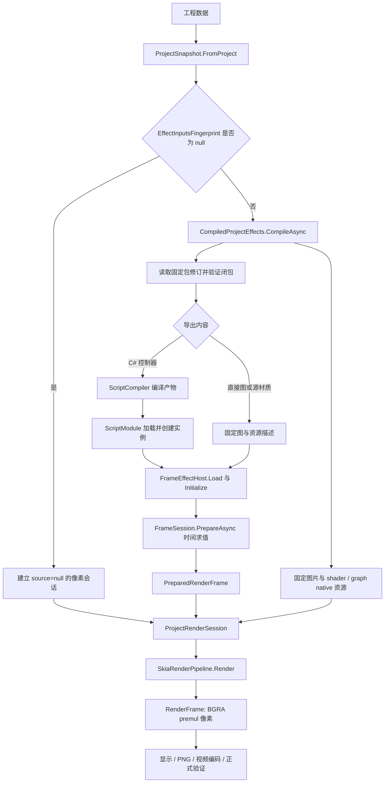
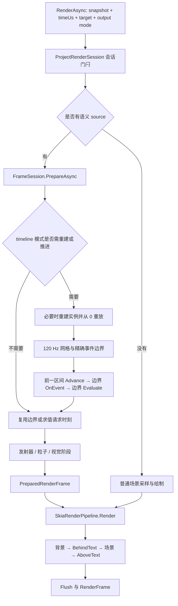
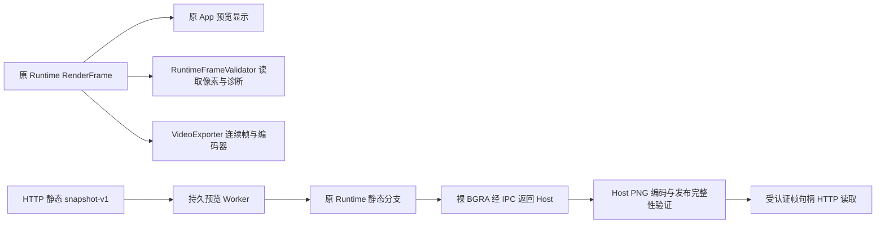

# Render 管线调查：从固定脚本到一帧画面

调查日期：2026-10-14。源码基线：`feda45973ae33827da93eee2a2cfd834c105a5da`，产品版本 `0.70.1`，分支 `refactor/individual-backend`。

本轮暂停功能开发，只读调查生产调用链、接口、现有测试和相关合同，新增调查文档。没有运行构建、测试、原生窗口、性能采样或渲染实验。下面的执行顺序来自源码；成本分析是待测量的结构判断。

> **2026-11-12 说明（产品 0.112.72）**：本文及四个详细章节是 0.70.1 时的只读调查记录，正文保持原样。此后的主要变化——
> SDK v2 纯求值、Vulkan 后端与桌面 GPU 共享纹理、图与材质的区域收紧——见
> [主计划](../../../docs/plans/script-sdk-v2-render-pipeline-plan.md)与[阶段二路线](../../../docs/plans/script-sdk-v2-phase-two-roadmap.md)。
> Skia 层在 0.112.69～0.112.72 做过一次结构整理，现状写在下面的 §0；§4 的函数表与 §7 的导航已按现状更正。

## 0. Skia 层的当前结构（2026-11-12，0.112.72）

`MakoKaraGenerator.Rendering.Skia` 里原来由 `SkiaRenderPipeline` 一个类兼任的职责，现在分成三层：

| 层 | 类型与文件 | 职责 |
|---|---|---|
| 几何 | `SkiaSceneGeometry`（`SkiaSceneGeometry*.cs`） | 整行整形、注音与文字标记布局、场景帧与逐行／逐元素测量、描边／阴影／辉光的外扩量。实现 `ILineGeometryProvider`，只持有排版引擎与布局缓存，不依赖渲染设备 |
| 对象计划 | `ObjectRenderPlan`（`SkiaRenderPipeline.ObjectPlan.cs`） | 图像效果场景里一个对象（一行或一个文字标记）本帧怎么画：部件清单、图的执行序列与目标框、工作框、下层来源、层组装方式。只含数据 |
| 绘制 | `SkiaRenderPipeline`（其余 `SkiaRenderPipeline*.cs`） | 背景、歌词直绘、叠加图元、图像效果场景的调度与执行、CPU 读回或 GPU 帧输出 |

**几何与绘制的关系。** 绘制管线持有一个几何实例，在同一份布局上绘制，并把 `ILineGeometryProvider` 的调用转交给它。
脚本宿主需要几何时由 `ProjectRenderSessionFactory` 给它单独的 `SkiaSceneGeometry`，不再为此另建绘制管线，一个会话只有一个绘制管线。
几何与绘制可能用到同一个排版引擎（native 字体对象不能跨线程），因此共用渲染设备的同步对象；布局缓存按「可跨引擎共享」与「属于某个引擎」分开存放。

**一帧怎么画。** `RenderToOutput` 依次画背景、文字下方的叠加图元、歌词、文字上方的叠加图元。准备帧里没有图、材质或组透明度时走直绘（`DrawLyrics`）；
有其中任何一种时走图像效果场景（`DrawImageEffectScene`）。

**图像效果场景。** 两个调度器只决定对象的先后、隔离与下层来源，每个对象都交给同一个入口 `DrawSceneObject`：

- 遗留调度（`DrawIsolatedScene`）：按绘制顺序逐个对象画到目标表面，组透明度用临时表面隔离；对象开始前对目标表面取一次快照作为下层。
- 前缀调度（`DrawGroupCompositionScene`）：帧里有组图，或有图／材质读取下层且其属主画了文字下方的图元时启用。对象不直接写目标表面，
  而是把闭合的层（前景与擦除量）导出给调度器，调度器维护「到目前为止的前景」前缀，下层按属主从前缀惰性解析。

`DrawSceneObject` 对没有图、材质且不在组合导出中的对象原样绘制；否则先建计划再执行：

1. `BuildObjectPlan` 分步建计划，每步只改计划：基本计划（身份、程序、图的执行序列，区域取程序框）→ 区域收紧（材质按对象实际区域、
   图按绑定目标的实际区域）→ 工作框定稿（辉光外扩、像素对齐）→ 部件清单（原样或材质）→ 判空（本帧必然没有像素的部件不捕获）→ 层组装方式。
   后三个优化各有一个内部开关，供回归对照时单独关闭。
2. `ExecuteObjectPlan` 只照计划执行：分配对象状态、按需取下层快照、逐部件捕获或执行材质、按序执行图、最后合成写回或导出闭合层。

对象只能读到自己工作框内的下层与输入。收紧后的工作框由图目标框加声明外扩、材质工作框得出；声明了下层、背景底色或背景媒体输入的
图与材质另并入声明的取样偏移（各节点 `maxSampleOffsetPx` 之和），使节点在偏移内读到的目标框外像素与整框时相同。只读对象自身输入
（目标颜色、各类覆盖）或包图片的不并入：对象自身的捕获在目标框外本就透明，包图片不按工作框裁剪。独立对象不超出收紧前的整框
（程序框加外扩），组合导出时还并入对象自身范围，且不超出调度器给定的框（0.112.73 起两条路径一致）。

## 1. 结论与阅读入口

工程已有不依赖 Avalonia 的正式渲染组合根：`ProjectRenderSessionFactory.CreateAsync(snapshot)` 建立会话，`IRenderFrameSession.RenderAsync(RenderRequest.At(snapshot, timeUs))` 请求某一时刻的画面。原 Runtime 可组合固定效果包、C# 控制器、原分析数据、材质、图片图和背景媒体；调用者仍须提供有效资源、字体和运行环境。

当前独立 Server 的两个静态 profile 只开放这套 Runtime 的一部分。HTTP 静态工程明确拒绝效果包、预设及图片／视频背景等输入，因此当前 HTTP 预览不会沿完整 C# 脚本加载链运行。完整 Runtime 能力与独立 HTTP 已开放能力须分别理解。

| 详细章节 | 回答的问题 |
|---|---|
| [脚本加载与会话准备](render-script-loading.md) | 包的固定修订如何找到源码、编译成程序集、加载为效果实例，以及参数和 native 资源如何绑定？ |
| [逐帧语义与时间推进](render-runtime-frame.md) | Initialize／事件／Advance／Evaluate 的顺序是什么？为什么请求一帧可能执行很多次 Evaluate？ |
| [Skia 绘制与像素输出](render-skia-output.md) | 几何、字形、注音、材质、图效果、背景和叠加图元如何变成最终像素？ |
| [预览、Worker、验证和导出入口](render-entrypoints.md) | 同一 Runtime 如何进入 Avalonia、独立 HTTP 预览、正式验证和视频导出？ |

## 2. 先区分三种产物

| 产物 | 含义 | 不包含什么 |
|---|---|---|
| `ProjectSnapshot` | 当前渲染会话的固定工程输入，包括歌词、场景、样式以及相关效果输入 | 不是一帧像素，也不等于任意资源读取授权 |
| `PreparedRenderFrame` | 某一时间和目标下完成语义求值的中立帧描述：几何、变换、样式、材质／图绑定、叠加图元与诊断 | 不持有最终 BGRA 画面；不能把它当成已经绘制的图片 |
| `RenderFrame` | 绘制完成的画面：尺寸、stride、时刻、像素格式、像素内存和诊断 | 不是 PNG 文件，也不是视频；调用者还要选择编码或显示出口 |

当前正式像素后端明确是 **Skia CPU 光栅**。它在托管字节缓冲区上创建 `SKSurface`，输出 `Bgra8888Premultiplied`。`Task.Run` 将工作调度到线程池，不会把一帧内部的步骤自动拆成多核并行，也不会把 CPU 光栅切换成 GPU 渲染。

## 3. 总体流程

这张图表示依赖关系。编译、native 资源准备和语义会话建立发生在 `CreateAsync` 阶段；后续 `RenderAsync` 使用已经固定的会话。C# 不是逐帧重新编译。直接图和源材质也不是必须先生成一个 C# 程序集才能参与渲染。

### 3.1 建立会话：固定输入与准备资源

`ProjectRenderSessionFactory.CreateCoreAsync` 先检查效果输入指纹。没有准备输入时直接创建普通 `SkiaRenderPipeline`；有准备输入时，先固定并编译工程引用的效果包，再准备 shader、图程序、图片表面、资源映射和表面预算，最后建立独立语义会话与最终像素渲染器。

准备链中有两个不同用途的 Skia 对象：一个为脚本提供排版与几何，另一个负责最终像素绘制。中立 prepared frame 不携带 native `ShapedLine`。最终渲染器可以复用 prepared 的场景几何，但仍有自己的字形布局缓存；两个对象的缓存不能当作同一份缓存。

### 3.2 请求一帧：固定时刻不等于一次脚本回调

主调用是 `source.PrepareAsync(timeUs, outputMode, target)`，当前没有一个名为 `PrepareFrameAsync` 的生产接口。正式工程组合根使用时间语义工厂：即使一个控制器只覆写 `Evaluate`，也不会自动改走纯帧模式。底层另有不执行时间推进的 `PureFrameSourceFactory`，它不是当前生产包按实例选择的分支。

时间语义会话按固定 120 Hz 网格和精确事件时间推进，输出视频帧率不会改变这个网格或真实事件边界；事件插入会进一步切分推进区间，实际步长并不恒定。首边界 0 处理事件与求值，不执行零长 `Advance`。第一次直接请求较晚时刻、时间回退或目标／输出模式变化，可能需要从固定输入重建并重放。边界求值、粒子出生几何查询和独立锚点查询都可能增加求值次数。因此，输出一张图片不表示只调用一次 `Evaluate`。

仅按网格作简化推导：新语义会话首次请求 1 秒，在没有额外事件、粒子或桥查询时，要执行 121 次 host `Evaluate`；首次请求 60 秒是 7,201 次。每次又会遍历 active 控制器。两种请求最终都只生成一张目标像素帧；这个计数是源码推导，不是耗时测量。当前 HTTP 无脚本静态分支不承担这段重放成本。

`FrameEffectHost.Evaluate` 先获得歌词／场景采样与基础几何，再为每个绑定实例构建 `FrameContext` 和 `FrameWriter`，顺序收集并组合效果输出。`FrameWriter` 是受能力与目标约束的输出描述器；脚本通过它提交样式、变换等内容，最终像素仍由渲染器绘制。

## 4. 重要函数速查

函数的具体参数、分支、调用顺序及当前行号在对应详细章节中展开。

| 函数 | 输入与产物 | 在流程中的作用 |
|---|---|---|
| `ProjectSnapshot.FromProject` | 工程 → 渲染快照 | 固定渲染输入，避免逐帧访问正在编辑的工作区 |
| `ProjectRenderSessionFactory.CreateAsync` | 固定快照 → `IRenderFrameSession` | 正式组合根，组织包编译、native 资源和会话所有权 |
| `CompiledProjectEffects.CompileAsync` | 快照与编译／资源验证依赖 → 固定包和效果描述 | 按固定包身份去重并解析实例绑定、参数、分析和源材质 |
| `ScriptCompiler.CompileAsync` | 源码与编译输入 → 程序集产物及诊断 | 编译 C# 控制器；缓存是否命中由实际输入身份决定 |
| `ScriptModule.CreateInstance<T>` | 编译产物与入口类型 → 控制器对象 | 将固定程序集入口实例化；可回收加载上下文不等于安全沙箱 |
| `FrameEffectHost.Load` | 固定实例／工程上下文 → 初始化后的控制器集合 | 建立实例并调用 `Initialize`，重放重建也会再经过这里 |
| `FrameSession.PrepareAsync` | 微秒时刻、输出模式、目标 → 中立 prepared frame | 管理重放、事件边界、状态推进与请求时刻求值 |
| `FrameEffectHost.Evaluate` | 时间、历史、几何与绑定 → 组合后的中立输出 | 调用控制器 `Evaluate`，收集并组合 `FrameWriter` 的输出 |
| `SkiaSceneGeometry.GetSceneFrame` | 快照与时间 → 场景采样及几何 | 将歌词、样式和场景层级转成脚本与绘制共同使用的几何（0.112.69 起；`SkiaRenderPipeline` 上的同名方法只是转交） |
| `SkiaRenderPipeline.Render`／`RenderGpu` | `RenderRequest` 及可选 prepared frame → `RenderFrame` 或 GPU 帧租约 | 组织背景、场景、图效果和叠加层；CPU 读回或输出共享 GPU 帧 |
| `SkiaRenderPipeline.BuildObjectPlan`／`ExecuteObjectPlan` | 对象及其图、材质绑定 → `ObjectRenderPlan` → 像素或闭合层 | 图像效果场景里单个对象先建计划再执行（0.112.70 起，见 §0） |
| `RenderFrame.Dispose` | 持有的帧 | 结束像素所有权；池化缓冲区归还后不能继续借用其内存 |

## 5. 像素出口与当前独立后端边界

HTTP 预览的 Worker 返回裸 BGRA，而不是在 Worker 内生成 PNG。Host 再编码 PNG并验证发布身份。正式验证和导出在自己的任务 Worker 内连续使用 Runtime，视频导出的每张像素帧不需要先经过这条 HTTP／PNG 返回链。

| 能力 | 原 Runtime／原 App 正式入口 | 当前独立 HTTP |
|---|---|---|
| 静态歌词、注音、场景、样式 | 有 | 有，固定静态 profile |
| 已接受分析进入静态快照 | 有 | 有，独立分析静态 profile；不等于已开放音频驱动脚本画面 |
| 固定包 C# 控制器、事件与状态推进 | 有相应正式调用链 | 当前静态 profile 明确拒绝 |
| 包材质、直接图、预设及完整图片／视频背景 | 原有相应渲染链，仍受各项资源与功能门禁 | 当前静态输入不开放这些完整能力 |
| 一帧 BGRA 输出 | `IRenderFrameSession` 的基础产物 | Worker／Host 内部产物，对外预览发布 PNG |
| 失控脚本的进程隔离与强制回收 | 原脚本加载／回调本身不能提供这种保证 | 当前静态 Worker 不承载完整包脚本，不可推导完整脚本已隔离 |

当前接口限制以[唯一后端 API](backend-api.md)为准；本报告不另定义一套接口，不改变 B3／B4 的完成状态。

## 6. 如何理解现有性能表现

以下来自源码结构，不是本轮的耗时测量：

1. **单会话串行。** `ProjectRenderSession` 和语义会话各自有门闩，单帧内部也按固定阶段顺序执行。脚本编译也有同进程静态门闩，Roslyn 明确使用 `concurrentBuild:false`。线程池调度不等于把这些步骤并行化。
2. **晚时刻首帧有重放成本。** 时间语义会话可能从 0 推进至请求时刻；中间边界会执行求值而不输出像素帧。该成本不能套用到当前无脚本的 HTTP 静态分支。
3. **会话准备与逐帧工作不同。** 包验证、编译、shader／图资源准备、首次 shaping 与字体加载应和后续热帧分别看待。DLL 缓存命中并不省掉全部包资源验证；门禁临时 native 验证与正式会话 native 准备还分别执行编译／解码。会话重建会影响这些工作能否复用。
4. **几何与绘制有独立缓存。** prepared frame 复用中立几何，并不共享两个 Skia 对象的 native 字形缓存；动态输入和查询还可能增加几何求值。
5. **像素绘制本身是 CPU 工作。** 大画布、字形描边／阴影、group 隔离、图效果及中间表面会增加 CPU 和内存访问成本。
6. **独立预览有额外包装成本。** 裸像素复制、IPC 封包与校验、Host PNG 编码、帧存储及 HTTP 读取属于 Runtime 像素生成之后的工作，导出出口则有另一套编码链。

因此，源码可以解释为何单次渲染不自然占满多核，以及“重建预览”和“画下一帧”可能拥有不同成本；尚不能据此给出每段耗时比例或断言某一个模块是卡顿的首要根因。详细章节另列待复现的缓存／一致性风险与可定位的成本点，本轮不修复它们。

## 7. 调查范围与代码导航

- 主组合根：[ProjectRenderSessionFactory](../../src/MakoKaraGenerator.Runtime.Hosting/ProjectRenderSessionFactory.cs)、[ProjectRenderSession](../../src/MakoKaraGenerator.Runtime.Hosting/ProjectRenderSession.cs)。
- 效果闭包：[CompiledProjectEffects](../../src/MakoKaraGenerator.Scripting/Compilation/CompiledProjectEffects.cs)。
- 状态与逐帧求值：[FrameSession](../../src/MakoKaraGenerator.Scripting/Execution/FrameSession.cs)、[FrameEffectHost](../../src/MakoKaraGenerator.Scripting/Execution/FrameEffectHost.cs)。
- 几何：[SkiaSceneGeometry](../../src/MakoKaraGenerator.Rendering.Skia/SkiaSceneGeometry.cs)。
- 绘制：[SkiaRenderPipeline](../../src/MakoKaraGenerator.Rendering.Skia/SkiaRenderPipeline.cs)；对象计划见
  [ObjectPlan](../../src/MakoKaraGenerator.Rendering.Skia/SkiaRenderPipeline.ObjectPlan.cs) 与
  [ObjectPlan.Execute](../../src/MakoKaraGenerator.Rendering.Skia/SkiaRenderPipeline.ObjectPlan.Execute.cs)。
- 当前独立预览入口：[WorkerRenderFrameSessionFactory](../../src/MakoKaraGenerator.Backend.Hosting/WorkerRenderFrameSessionFactory.cs)、[StaticRenderSession](../../src/MakoKaraGenerator.Backend.Worker/StaticRenderSession.cs)。

详细章节以同一源码基线逐项解释调用者、输入、输出、所有权和错误边界。旧实施记录和现有测试仅作为已有合同的查阅入口，不算本轮重新运行的验收证据。
