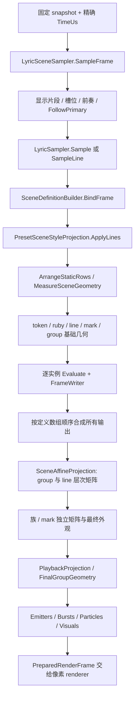

# Render 运行时：状态推进到准备帧

基线：`refactor/individual-backend`，`feda45973ae33827da93eee2a2cfd834c105a5da`，产品 0.70.1；调查日期 2026-10-14。本文来自生产源码及现有测试的静态阅读，本轮没有执行构建、测试、性能探针或原生窗口操作。本文覆盖原 Runtime 包脚本运行链，不表示 Backend HTTP 静态 profile 已开放同样的脚本能力。

本文的入口是已经创建好的 `ProjectRenderSession`。包读取、编译、资源固定与会话建立见 [脚本加载说明](render-script-loading.md)；准备帧之后的实际像素绘制见 [Skia 绘制说明](render-skia-output.md)。当前生产接口叫 `IEvaluatedFrameSource.PrepareAsync`；基线 `src/`、`tests/` 没有 `PrepareFrameAsync` 符号。

## 1. 核心结论与三个时间概念

一帧不是直接把当前时间传给脚本然后绘制。正常包脚本路径先把独立语义会话推进到请求时刻之前的最后边界，在边界派发真实事件、求文字输出和视觉状态；随后求请求时刻的只读外观，最后交给 Skia 创建像素。

| 概念 | 实际来源 | 用途与边界 |
| --- | --- | --- |
| 工程／歌曲时间 `TimeUs` | 调用者给出的非负整数微秒 | 歌词进度、显示装载、音频分析采样、目标外观都在这条时间轴上；没有由 UI 帧累加出的另一条歌曲时间。 |
| 语义模拟边界 | `floor(n × 1_000_000 / 120)` 与固定事件时间的并集 | 决定 `Advance`、`OnEvent`、边界发射器注册和 `AdvanceVisuals`；事件会把 120 Hz 网格间隔再切开，并不是每个步长恒为 8,333 微秒。 |
| 预览／导出的画面帧率 | 上层请求目标帧的调度 | 决定请求哪些 `TimeUs`；不会改变上述 120 Hz 网格，也不会把歌词起点取整到视频帧。 |

网格实现见 [TimelineFrameSourceFactory.cs，L23–36](../../src/MakoKaraGenerator.Scripting/Execution/TimelineFrameSourceFactory.cs#L23)。`SimulationStep` 严格表示 `[StartUs, EndUs)`；其输入与历史截至 `StartUs`，不包含终点事件，见 [StateContext.cs，L4–20、L48–52](../../src/MakoKaraGenerator.Scripting.Abstractions/StateContext.cs#L4)。

生产包效果 `CompiledProjectEffects.CreateFactory` 总是返回 `TimelineFrameSourceFactory`，见 [CompiledProjectEffects.cs，L121–126](../../src/MakoKaraGenerator.Scripting/Compilation/CompiledProjectEffects.cs#L121)。`PureFrameSourceFactory` 是另一个公开接缝：无语义时间线，不执行 `OnEvent`／`Advance`；加载时拒绝覆写这些状态入口或 `AdvanceVisuals` 的作者，访问 `frame.History` 或产出连续 emitter 也明确失败。不能把它当作有状态作者的快捷运行模式。

当前链没有按实例 `TimelineMode` 选择纯帧／时间线的分叉：`FrameEffectHost.Advance` 对 active 数组中的所有实例调用 `Advance`，纯作者或直接图通过 `EffectBase` 默认空实现体现“不改变共享状态”；Emitters 与 Visuals 则只调用真实覆写方法的实例。整个生产包 source 即使某个作者只覆写 Evaluate，仍属于语义会话。

## 2. 一次请求的真实顺序

```mermaid
sequenceDiagram
    participant C as 调用者
    participant R as ProjectRenderSession
    participant S as FrameSession
    participant H as FrameEffectHost
    participant G as 独立几何后端
    participant A as 作者实例数组
    participant K as 像素 SkiaRenderPipeline
    C->>R: RenderAsync(RenderRequest)
    R->>R: Task.Run / linked token / 串行 gate / snapshot 身份
    R->>S: PrepareAsync(TimeUs, mode, target)
    S->>S: 回退、输出改变或 poison 时 Reset
    opt 首次或 Reset 后
        S->>H: ProcessBoundaryAsync(0)
        H->>A: 同刻事件逐项 OnEvent
        H->>G: GetSceneFrame(snapshot, 0)
        H->>A: 各实例 Evaluate / FrameWriter
        H->>H: 合成并构造 PreparedRenderFrame
        H->>A: EvaluateEmitters
        H->>H: ResolveBursts / PrepareParticles
        H->>A: EvaluateVisuals
    end
    loop 下一网格或事件边界 <= 请求时间
        S->>H: AdvanceParticles(next, 旧history)
        H->>A: 出生时间可能额外 Evaluate
        S->>H: Advance([lastBoundary,next), 旧history)
        H->>A: 各实例 Advance
        S->>H: ProcessBoundaryAsync(next)
        H->>A: 同刻事件逐项 OnEvent
        H->>G: GetSceneFrame(snapshot, next)
        H->>A: 各实例 Evaluate / FrameWriter
        H->>H: 合成文字与最终几何
        H->>A: EvaluateEmitters
        H->>H: ResolveBursts
        H->>H: PrepareParticles
        H->>A: AdvanceVisuals(上一边界到当前边界)
        H->>A: EvaluateVisuals
    end
    alt 请求恰好等于最近缓存边界
        S-->>R: 返回该边界 PreparedRenderFrame
    else 请求是边界间任意时刻
        S->>H: Evaluate(request.TimeUs, 边界history)
        H->>G: 目标时刻基础采样与几何
        H->>A: 各实例 Evaluate
        H->>H: 粒子副本 Read
        H->>A: EvaluateVisuals(最终几何, 最近边界几何)
        S-->>R: 新 PreparedRenderFrame
    end
    R->>K: Render(request with PreparedFrame)
    K-->>C: RenderFrame 像素与诊断
```

首次边界 0 不调用零长 `Advance` 或 `AdvanceVisuals`。固定步进到边界 `b` 的顺序是：先提交前一区间的连续粒子，再 `Advance([a,b), history@a)`，再处理 `b` 的事件和文字输出。这样终点事件只影响从 `b` 开始的状态；粒子出生几何在主共享状态推进前求解。见 [FrameSession.cs，L34–43、L82–104](../../src/MakoKaraGenerator.Scripting/Execution/FrameSession.cs#L34)。

例如现有测试在元素事件 `1,001` 和 `10,000` 微秒之间，请求 `18,001` 微秒会走边界 `0 → 1,001 → 8,333 → 10,000 → 16,666`；推进区间是四个严格正长区间。最后另求 `18,001` 的外观，`FrameContext.TimeUs = 18,001`，`LastSimulationBoundaryUs = 16,666`；并未把状态推进到 18,001。见 [SemanticSessionTests.cs，L126–142](../../tests/MakoKaraGenerator.Scripting.Tests/SemanticSessionTests.cs#L126)。

由控制流可推导以下调用量性质；这是算法计数示例，没有做耗时或性能实测：

| 请求场景 | 文字 Evaluate 的性质 |
| --- | --- |
| 新语义会话首次直接请求 1 秒 | 即使没有任何非网格事件、粒子或桥，也会处理 0 到 1 秒的 121 个网格边界，每个边界一次 host Evaluate；1 秒本身是网格点，最后直接复用边界帧。 |
| 新会话首次直接请求 60 秒 | 相同简化条件下是 7,201 次 host Evaluate；没有自动快进／状态 checkpoint。 |
| 已完成前一请求，顺序请求下一视频帧 | 只补上两次请求之间尚未处理的网格／事件边界；目标不在边界时再求一次精确目标外观。24／30／60 fps 并不等于每帧只 Evaluate 一次。 |
| 后退 seek 后请求任意时刻 | 新建作者状态，从 0 到目标重新计算；不是从旧边界向后算差值。 |
| 存在真实事件、连续发射或桥接 | 非网格事件时间增加边界；每个出生时间可额外求文字；桥 cache 未命中还会创建独立 AnchorQuery 重放。与网格同刻的事件合用一个边界，但同刻 OnEvent 仍逐项派发。 |

每次 host Evaluate 又遍历全部 active 实例并求基础 scene；在上述简化条件下，N 个实例分别收到 121／7,201 次 Evaluate，而这次 `RenderAsync` 最后仍只创建一张目标像素帧。作者的基础 GeometryQueries 还可能增加测量次数，虽不增加 host Evaluate。实例数、包输出、几何测量和端点重放共同决定实际成本。无 source 的静态渲染入口不会进入这条 120 Hz 循环，不能用上述算法解释当前所有 HTTP 静态帧请求。

## 3. 重要函数表

表中的输出既包括返回值，也包括该函数真实更新的会话状态。源码链接的行号固定于上述基线。

| 生产函数／位置 | 输入 | 输出／状态 | 调用者与职责 |
| --- | --- | --- | --- |
| [ProjectRenderSession.RenderAsync，L13](../../src/MakoKaraGenerator.Runtime.Hosting/ProjectRenderSession.cs#L13) | `RenderRequest`、调用者取消 token | `ValueTask<RenderFrame>` | `IRenderFrameSession` 消费者；用 `Task.Run` 执行后续异步核心。 |
| [RenderCoreAsync，L15](../../src/MakoKaraGenerator.Runtime.Hosting/ProjectRenderSession.cs#L15) | 固定快照请求、两个取消 token | 像素 `RenderFrame` | `RenderAsync`；合并 token、占会话 gate、验证 snapshot 引用，先准备再绘制。 |
| [FrameSessionFactory.CreateAsync，L37](../../src/MakoKaraGenerator.Scripting/Execution/FrameSessionFactory.cs#L37) | snapshot、固定编译产物／指纹／音频／工厂 | 独立 `FrameSession`、host、geometry provider | 两种 source factory；投影目录、构建订阅、Load；失败释放已创建的 host／geometry。 |
| [FrameEffectHost.Load，L38](../../src/MakoKaraGenerator.Scripting/Execution/FrameEffectHost.cs#L38) | semantic 标志、固定定义数组、token | 新作者实例、独立随机服务、新诊断代次 | 建会话及 `Reset`；先 `Unload`，每实例验证输入与 required 音频，加载模块或直接图，调用 `Initialize`。 |
| [TimelineProjection.Create，L34](../../src/MakoKaraGenerator.Scripting/Projection/TimelineProjection.cs#L34) | snapshot、重放原因、固定分析 | 完整目录、排序事件表、光标后继表 | 建语义会话；从真实源时间与共享显示计划生成，不运行作者代码。 |
| [AddPerformance，L65](../../src/MakoKaraGenerator.Scripting/Projection/TimelineProjection.cs#L65) | 完整源目录 | Token／Line started、completed 事件 | `TimelineProjection.Create`；缺 token 时间不造 token 事件；有 timed token 的行演唱范围取这些 token 的最小起点／最大终点。 |
| [AddDisplay，L86](../../src/MakoKaraGenerator.Scripting/Projection/TimelineProjection.cs#L86) | 源、场景、显示计划 | 装载／可见／前奏事件 | `Create`；按候选边界前 1 微秒和该边界的共享采样差分生成，提前显示不等于起唱。 |
| [FrameSession.PrepareAsync，L19](../../src/MakoKaraGenerator.Scripting/Execution/FrameSession.cs#L19) | `timeUs`、mode、target、token | 准备帧；推进边界／event cursor／last request | `ProjectRenderSession` 等；串行推进、重放门禁、缓存边界或求任意时刻外观。 |
| [NextBoundaryAfter，L74](../../src/MakoKaraGenerator.Scripting/Execution/FrameSession.cs#L74) | 上一边界时间、next event cursor | 下一个网格／事件的较早值 | 准备循环与 emitter 桥接窗口；网格溢出不回绕。 |
| [ProcessBoundaryAsync，L82](../../src/MakoKaraGenerator.Scripting/Execution/FrameSession.cs#L82) | 边界、mode、target、token | 新 history、完整边界帧、last boundary | `PrepareAsync`；逐事件 Dispatch，再文字、发射器、burst、粒子、视觉推进与视觉求值。 |
| [Dispatch，L10](../../src/MakoKaraGenerator.Scripting/Execution/FrameEffectHost.Bursts.cs#L10) | 已排序单事件、含该事件的前缀 | 作者共享状态、pending burst intents | `ProcessBoundaryAsync`；按源订阅筛选实例 OnEvent，BurstWriter 限本阶段有效。 |
| [Advance，L104](../../src/MakoKaraGenerator.Scripting/Execution/FrameEffectHost.cs#L104) | `[start,end)`、起点 history | 各作者共享状态 | 准备循环；依实例数组次序调用，提供起点输入，不能写 FrameWriter。 |
| [Evaluate，L115](../../src/MakoKaraGenerator.Scripting/Execution/FrameEffectHost.cs#L115) | 精确时刻、mode、target、当前 history | 文字／层次／外观／材质／图绑定准备帧 | 边界、任意帧和出生几何；先统一基础几何，逐实例 FrameWriter，最后合成所有实例输出。 |
| [SkiaRenderPipeline.GetSceneFrame，L17](../../src/MakoKaraGenerator.Rendering.Skia/SkiaRenderPipeline.Geometry.cs#L17) | snapshot、时刻；可选编辑行 | 采样且测量过的 `SceneFrame` | host、基础查询与直接 Skia；采样→preset→静态排布→文本／token／mark／group 几何，未调用作者。 |
| [LyricSceneSampler.SampleFrame，L72](../../src/MakoKaraGenerator.Rendering.Abstractions/LyricSceneSampler.cs#L72) | snapshot、时刻 | 装载行、树绑定、前奏 `SceneFrame` | geometry、timeline display；纯时间重建全部分支显示。 |
| [LyricSampler.SampleLine，L142](../../src/MakoKaraGenerator.Rendering.Abstractions/LyricSampler.cs#L142) | 指定源行、时刻、行序号 | 行进度与逐元素 `LyricFrameSample` | 场景采样与 SDK 投影；元素只读自身区间，不由整行估算缺失元素进度。 |
| [FrameProjection.Tokens，L35](../../src/MakoKaraGenerator.Scripting/Projection/FrameProjection.cs#L35) | 当前可见装载 `SceneFrame` | 含 source／binding／occurrence／performance 的 FrameToken 数组 | `Evaluate` 与 final geometry 投影；再次用同一 LyricSampler 求源演唱输入。 |
| [FrameWriter.Complete／Invalidate，L105／118](../../src/MakoKaraGenerator.Scripting.Abstractions/FrameWriter.cs#L105) | 本实例合规写入 | 不可变 `FrameOutput`；writer 关闭 | host `Evaluate`；完成一次或 finally 失效，保存旧 writer 继续写报 InvalidOutputStage。 |
| [PreparedRenderFrame.CreateWithDiagnosticSnapshot，L64](../../src/MakoKaraGenerator.Rendering.Abstractions/PreparedRenderFrame.cs#L64) | snapshot／time／mode／target、scene、合成输出 | 已验证闭包、最终几何与 playback | `Evaluate`；成功帧拒绝 Error，验证目标／独立字簇／有限可逆矩阵／外观／材质。 |
| [SceneAffineProjection.Apply，L14](../../src/MakoKaraGenerator.Rendering.Abstractions/SceneAffineProjection.cs#L14) | 基础 scene、合成 line／group transforms | `HierarchyScene` | Prepared 构造与合成验证；沿真实运行父树组合一次，不重新调度或整形。 |
| [EvaluateEmittersAsync，L9](../../src/MakoKaraGenerator.Scripting/Execution/FrameEffectHost.Emitters.cs#L9) | 完成文字的 prepared、history、下一边界 | 连续 emitter 注册、桥端点缓存 | 边界处理；作者读取 FinalGeometry，输出 emitter 描述；纯帧模式非空输出拒绝。 |
| [ResolveBursts，L37](../../src/MakoKaraGenerator.Scripting/Execution/FrameEffectHost.Bursts.cs#L37) | 边界文字 prepared、pending intents | 该边界真实粒子出生 | 边界处理；事件意图到此才按最终文字几何解析锚点，要求实际装载与输出权限。 |
| [AdvanceParticles，L9](../../src/MakoKaraGenerator.Scripting/Execution/FrameEffectHost.Particles.cs#L9) | 下一边界、mode／target、旧 history | 连续模拟提交至下一边界 | 共享 `Advance` 之前；用 `BirthGeometry` 求出生锚点，固定出生记录和拖尾。 |
| [BirthGeometry，L15](../../src/MakoKaraGenerator.Scripting/Execution/FrameEffectHost.Particles.cs#L15) | 输出条件与 history | `(instance,time) → PlaybackFrame` | 粒子 Commit／Read；额外文字 Evaluate，不派发事件、不推进视觉、不登记 emitter；仅闭包内缓存最近出生时刻。 |
| [PrepareParticles，L46](../../src/MakoKaraGenerator.Scripting/Execution/FrameEffectHost.Emitters.cs#L46) | prepared、history、预算、token | 带粒子／dot／emission schedule 的新 prepared | 边界及任意时刻外观；在模拟副本 Read，不提交任意帧出生。 |
| [AdvanceVisuals，L9](../../src/MakoKaraGenerator.Scripting/Execution/FrameEffectHost.Visuals.cs#L9) | 前后 prepared／history、视觉区间 | 各作者视觉状态 | 新边界文字和粒子准备之后；读取前后 FinalGeometry／particles，不能回写共享或文字状态。 |
| [EvaluateVisuals，L24](../../src/MakoKaraGenerator.Scripting/Execution/FrameEffectHost.Visuals.cs#L24) | 目标文字 prepared、最近边界 prepared、history | 合成 overlay 的 prepared | 边界及任意时刻；限时 VisualWriter，校验资源／声明／唯一批次／全实例绘制预算。 |
| [FinalGeometryFor，L72](../../src/MakoKaraGenerator.Scripting/Execution/FrameEffectHost.Visuals.cs#L72) | 本实例、完整 prepared | 绑定内 FinalSceneGeometry | emitter／burst／visual；tokens／lines／marks／playback 按实际输出范围筛选，组几何提供共同只读上下文。 |
| [InvokeContext／BaseAt，L10／18](../../src/MakoKaraGenerator.Scripting/Execution/FrameEffectHost.Queries.cs#L10) | 当前阶段、任意查询时刻／源筛选 | 阶段内 GeometryQueries／基础几何 | Initialize／OnEvent／Advance／Evaluate；只查询共享布局，不执行作者、不推进历史，离开阶段失效。 |
| [SemanticAnchorQuery.PrepareEndpointAsync，L36](../../src/MakoKaraGenerator.Scripting/Execution/SemanticAnchorQuery.cs#L36) | 源光标身份、端点种类、输出条件 | 独立重放的 endpoint prepared | 桥接查询；每次新 session，前端点取 `EndUs−1`、后端点取 `StartUs`，不改主状态。 |
| [FrameSession.Reset，L106](../../src/MakoKaraGenerator.Scripting/Execution/FrameSession.cs#L106) | 重放原因、token | 清游标／历史／边界帧；重新 Load | 回退、输出改变、poison 恢复；重新实例化并 Initialize，从 0 重放。 |
| [Invoke，L18](../../src/MakoKaraGenerator.Scripting/Execution/FrameEffectHost.Diagnostics.cs#L18) | 实例、阶段、时刻、诊断 sink、回调 | 诊断或定位后的 EffectFailureException | 所有作者阶段；Error 即便作者捕获返回仍失败，取消保持取消类型，reporter finally 失效。 |
| [ProjectRenderSession.ReleaseAsync，L41](../../src/MakoKaraGenerator.Runtime.Hosting/ProjectRenderSession.cs#L41) | source、renderer、资源、图输入／native、预算 | 尽力释放所有对象；保留清理失败数组 | Dispose 与创建失败清理；单项异常不阻止其余所有者释放。 |

## 4. 时间线与历史：先知道源，再选择显示

`ContentProjection.Create` 保留所有分支、所有源行／token／ruby，`SceneProjection.Create` 保留完整显示结构；这两个目录不随当前可见行裁切。`TimelineProjection.Create` 一次生成三类时间线：源演唱、真实显示／前奏、语义光标转换，并附加已完成分析的真实 `AudioFeatureTick`。音频 tick 来自分析 hop，不是 120 Hz 模拟网格，也不是视频 fps。见 [TimelineProjection.cs，L39–50](../../src/MakoKaraGenerator.Scripting/Projection/TimelineProjection.cs#L39)。

源演唱与显示必须分开理解：

- `TokenStarted`／`Completed` 只由 token 自己的有效时间产生；缺时间 token 不获得从行时间推算的事件。
- 行存在 timed token 时，`LinePerformanceStarted`／`Completed` 的演唱区间取这些 token 的包围区间；否则用行自身时间。
- `BindingEntered`／`Left` 描述一次实际源行装载；`ElementVisible`／`Hidden` 描述实际节点可见身份。前奏或预备槽位可以提前装载，而源 token 尚未开始。
- `AddDisplay` 检查 `boundary−1` 与 `boundary` 的共享采样真实状态。事件来源不是“这个 UI 帧看到变化”，也不是脚本自己回传显示状态。

同刻事件排序固定为：结束／离场 → 进入／准备／音频 → 起唱 → 光标转换；同优先级继续按源分支、行、token 序号、EventId 排序。见 [TimelineEvent.cs，L92–116](../../src/MakoKaraGenerator.Scripting.Abstractions/TimelineEvent.cs#L92)。

`ProcessBoundaryAsync` 在每次 `OnEvent` 前先将该事件加入 `TimelineHistory`；回调可见这项及之前的事件，却看不到排序在后的同刻事件。边界全部派发后再建立完整该边界前缀。history 由一个经过验证的不可变事件表和可见数量共享，不每次复制整个历史；`Records` 只有真的读取时才物化可见数组。见 [FrameSession.cs，L85–92](../../src/MakoKaraGenerator.Scripting/Execution/FrameSession.cs#L85) 与 [TimelineHistory.cs，L48–92](../../src/MakoKaraGenerator.Scripting.Abstractions/TimelineHistory.cs#L48)。

源订阅只筛选 `OnEvent`，不筛掉完整工程 history；输出 `Binding` 则决定当前装载的写权限。扩大订阅可以让作者了解别处分支起唱，不能让 writer 改那处分支，也不能让 burst 或桥端点越过输出范围。

## 5. 采样、基础几何、最终几何的顺序

`FrameEffectHost.Evaluate` 最先调用独立几何 provider 的 `GetSceneFrame(snapshot,time)`。正常 provider 是另一实例 `SkiaRenderPipeline`，由 `FrameSessionFactory` 的 geometry factory 创建；它负责测量，最终像素 renderer 则由 `ProjectRenderSessionFactory` 另外创建。source 的 host 释放前者，外层 session 释放后者。

这些几何是 snapshot 逻辑画布上的值。host 收到 RenderTarget 并将它冻结进 Prepared，target 改变也触发重放；但当前 `FrameContext`、`VisualContext`、`EmissionFrameContext` 没有直接暴露 target 像素宽高，作者读到的 `Project.CanvasSize` 是逻辑画布尺寸。不要把 target 身份门禁理解成每阶段都给作者一个不同像素密度的布局。

正常基础几何链为：

`LyricSceneSampler` 按显示 program、clip、槽位序列、前奏计划决定实际装载。`FollowPrimary` 关联行的显示阶段及可选动画可以跟随主行，但调用 `SampleLine` 的是自身源行。没有从主行把 token 时间复制给翻译行。`LyricSampler` 的活动区间为 `[StartUs,EndUs)`，进度夹在 `[0,1]`；未定时元素保持 `Unavailable`，不会被解释成有确定依据的“还没唱”。见 [LyricSceneSampler.cs，L81–133](../../src/MakoKaraGenerator.Rendering.Abstractions/LyricSceneSampler.cs#L81) 和 [LyricSampler.cs，L240–269](../../src/MakoKaraGenerator.Rendering.Abstractions/LyricSampler.cs#L240)。

一个容易漏掉的区别是静态绘制策略：`CreateSample` 可将绘制进度清零，SDK `FrameProjection.Tokens` 却会对真实源行重新调用同一 `LyricSampler.SampleLine`，保留它的真实演唱时间与进度。这并非第二套时间算法，而是把视觉策略与源演唱输入分开。若 token 文本拼接不匹配行文本，SDK progress 为不可用；缺时间则为 Missing／null。见 [FrameProjection.cs，L44–56](../../src/MakoKaraGenerator.Scripting/Projection/FrameProjection.cs#L44) 与 [ContentProjection.cs，L36–45](../../src/MakoKaraGenerator.Scripting/Projection/ContentProjection.cs#L36)。

每个实例 `Evaluate` 都收到同一个基础 scene／静态 baseline 的绑定内视图，**不会收到前一个实例已经改过的几何或外观**。输出累积在 host 的字典中：局部矩阵按实例数组次序 `Compose`，StyleUpdate 按次序 `Then`，组透明度相乘，图效果保留实例归属。完成所有实例后，host 校验最终 alpha 与矩阵，构造 Prepared；某一实例不能通过读取“上一效果结果”建立隐式执行依赖。见 [FrameEffectHost.cs，L118–166、L167–235](../../src/MakoKaraGenerator.Scripting/Execution/FrameEffectHost.cs#L118)。

Prepared 的构造先建立 `HierarchyScene`，应用组与整行层次变换；再对 token family、ruby 和 mark 施加独立输出，产生 FinalGeometry、FinalLineGeometry、FinalMarkGeometry，随后建立 Playback 与最终 group ink。overlay／连续发射器／burst 锚点读取的是这些最终文字结果，不能反过来改变本帧文字布局。见 [PreparedRenderFrame.cs，L88–139](../../src/MakoKaraGenerator.Rendering.Abstractions/PreparedRenderFrame.cs#L88)。

基础 `GeometryQueries.GetBaseAt` 经 host 的 `BaseAt` 可以在 Initialize、OnEvent、Advance、Evaluate 阶段查询任意 timestamp 的共享基础布局，不执行脚本、不暴露尚未完成的最终光标、不让未来事件变成已发生历史。查询对象只活到本次阶段结束；FinalGeometry 通过 emission／visual 上下文提供，避免文字 Evaluate 自己递归求最终文字。见 [GeometryQueries.cs，L33–40](../../src/MakoKaraGenerator.Scripting.Abstractions/GeometryQueries.cs#L33)。

## 6. 粒子、视觉与独立端点查询

`OnEvent` 的 BurstWriter 写的是意图；事件时刻尚未完成所有作者的文字输出。`ResolveBursts` 延后到当前边界文字准备后解析真实锚点，按事件排序、实例数组顺序和 intent 顺序出生；源 token／line 对应当前实际 binding 的最终几何，缺装载或越权直接失败。

连续 emitter 在边界的 `EvaluateEmitters` 中登记，负责下一区间。`ContinuousParticleSimulation.Commit` 以精确 rate 配额算每个出生时间，按全实例出生时间顺序合并，检查实际同时存活峰值与出生记录／拖尾预算；粒子位置由出生位置、速度和加速度解析得到。见 [ContinuousParticleSimulation.cs，L22–118、L165–170](../../src/MakoKaraGenerator.Scripting/Particles/ContinuousParticleSimulation.cs#L22)。

任意帧的粒子 `Read` 在 emitter、quota、particle、trail 的副本上计算至 `timeUs+1`，只让目标时刻出生可见，不提交主模拟；暂停重绘和更密的输出 fps 因而不消费额外出生身份。`PrepareParticles` 附带的 EmissionSchedule 来自已提交区间；不能将其误读为任意分数时刻的持久出生账本。见 [ContinuousParticleSimulation.Read.cs，L8–18](../../src/MakoKaraGenerator.Scripting/Particles/ContinuousParticleSimulation.Read.cs#L8)。

出生锚点有额外 `Evaluate`：`BirthGeometry` 可能在网格之间求任意出生时刻的文字几何，使用尚未执行主 `Advance` 的当前实例状态与旧 history，且只创建临时诊断 buffer。此调用不执行事件、emitter、visual。因此 **Evaluate 次数不等于输出像素帧数**；它必须遵守纯求值合同。

`AdvanceVisuals` 在当前边界的文字和粒子确定之后推进前一区间视觉状态，提供前后 FinalGeometry、前后 history 与粒子。`EvaluateVisuals` 随后写临时 overlay；任意分数帧只运行 EvaluateVisuals，不推进视觉状态，其 BoundaryGeometry 仍是最近固定边界。

需要 Bridge 的 emitter 可能通过 `ResolveBridgesAsync` 查询前／后源光标端点。其缓存键包含源 cursor identity、端点类型、anchor mode、output mode 和 render target；无法取得真实端点则报告具名 Warning 并停该桥接路径。见 [FrameEffectHost.Bridges.cs，L16–51](../../src/MakoKaraGenerator.Scripting/Execution/FrameEffectHost.Bridges.cs#L16)。

缓存未命中时 `SemanticAnchorQuery` 每次建立独立 `ReplayReason.AnchorQuery` 会话，从固定相同输入重放 Initialize、OnEvent、Advance、Evaluate；前端点是结束前 1 微秒，后端点是起点。它跳过粒子、burst 消费、emitter 和视觉阶段，也不会给脚本开放递归完整帧接口；主会话的历史与共享状态不变。由此 Initialize 只可理解为**每个新实例一次**，不是每工程、每包或整个播放过程总共一次。

## 7. 独立 timestamp 与会话依赖

| 工作 | 可否仅凭固定输入与 timestamp 重建 | 会话复用的真实作用 |
| --- | --- | --- |
| LyricSampler、LyricSceneSampler、FrameProjection、基础测量 | 可以 | 不以先前帧决定歌词进度或实际装载；字体／布局服务可复用，但结果是时间查询。 |
| PureFrameSource 的外观 | 合规纯作者可以 | Initialize 固定输入后，每次直接 Evaluate；不能要求真实 history 或状态阶段。 |
| 语义作者共享状态 | 需重放 0 到目标的所有边界与事件 | 顺序请求复用已经完成的状态，省掉重复重放；不能只给最后 timestamp 就跳过历史。 |
| 粒子出生身份、quota、固定拖尾与视觉状态 | 需固定边界历史 | 主状态提交发生在边界；任意目标帧只从最近边界解析，不推进主状态。 |
| 最终桥端点 | 可以独立重放求得 | 每个端点新 AnchorQuery 会话；主 host 的 endpoint cache 避免相同条件反复重放。 |
| PreparedRenderFrame 像素绘制 | 已有正确 prepared 后可消费 | Prepared 冻结 snapshot／time／mode／target；绘制端不再反向调用作者。 |

SDK 声明 Evaluate／EvaluateEmitters／EvaluateVisuals 为纯求值，AdvanceVisuals 不得回写共享状态。但当前同一个 CLR 作者对象承载这些方法，host 并没有复制作者实例字段或强制阻止作者在 Evaluate 中写自己的字段。确定性依赖作者遵守合同；类型化 writer、上下文失效、绑定检查和固定随机服务提供输出边界，不能等同于对任意 .NET 代码的沙箱证明。见 [FrameContext.cs，L149–165](../../src/MakoKaraGenerator.Scripting.Abstractions/FrameContext.cs#L149)。

## 8. seek、取消、失败、释放与缓存

| 触发 | 当前行为 | 关键位置 |
| --- | --- | --- |
| 语义请求 `timeUs < _lastRequest` | Reset 为 Seek，清历史／游标／边界帧，Unload→新实例→Initialize，再从 0 重放 | [FrameSession.cs，L30–43、L106–112](../../src/MakoKaraGenerator.Scripting/Execution/FrameSession.cs#L30) |
| target 或 output mode 改变 | 在已有边界帧时 Reset 为 InputsChanged；语义共享／视觉状态随新实例重放 | 同上；实际 snapshot 变化须外层另建 session，不能塞进当前 session。 |
| 相同时间重复请求 | 若恰等于最近边界且 target／mode 一致，复用边界帧；否则重新求任意帧外观，不重新 Advance | [FrameSession.cs，L45–61](../../src/MakoKaraGenerator.Scripting/Execution/FrameSession.cs#L45) |
| source 处理中取消或失败 | `_poisoned=true`、清边界帧、尝试 Unload；本次原异常保留；下一次 Reset 后重建 | [FrameSession.cs，L63–69](../../src/MakoKaraGenerator.Scripting/Execution/FrameSession.cs#L63) |
| gate 等待时取消／开始前取消 | 未进入内部推进 catch，不修改已完成 source 状态 | `ProjectRenderSession` L14／19，`FrameSession` L24／27。 |
| source 成功之后像素 renderer 失败 | 外层释放 gate；不进入 source 的 poison catch，source 已完成的推进状态保留 | [ProjectRenderSession.cs，L24–28](../../src/MakoKaraGenerator.Runtime.Hosting/ProjectRenderSession.cs#L24) |
| 作者普通异常／作者 Error | 形成有 instance／runtime hash／package／stage／time／code 的 EffectFailureException；不退回无效果帧 | [FrameEffectHost.Diagnostics.cs，L7–45](../../src/MakoKaraGenerator.Scripting/Execution/FrameEffectHost.Diagnostics.cs#L7) |
| Dispose | 串行等待当前请求；所有者置 disposed 后尽力释放全部对象，重复 Dispose 安全 | [FrameSession.cs，L114–124](../../src/MakoKaraGenerator.Scripting/Execution/FrameSession.cs#L114)、[ProjectRenderSession.cs，L30–61](../../src/MakoKaraGenerator.Runtime.Hosting/ProjectRenderSession.cs#L30) |

自动回退检测相对的是最后**成功请求**，不是只对 `_lastBoundary` 比较；即使回退目标仍晚于当前 boundary，也触发重放。正常前跳则补齐中间边界，没有专门的“快进直接到终点”或持久状态 checkpoint。循环原因 Loop 是 factory 可显式传入的重放原因；该函数不会从 UI 操作猜出 Loop。

取消是当前进程中的协作式取消：host 在阶段和循环间检查 token，也把 token 交给作者。同步作者代码若长期不返回且忽略 token，`Task.Run` 本身不会强杀它；本文这条 Runtime 本地链不能据此声称有 Worker deadline 隔离。

`Unload` 清 pending bursts、连续粒子与桥端点缓存，取走整个 active 数组后逐个释放；某个 Dispose 失败仍会继续释放其余实例。host Dispose 继续释放 geometry provider，外层 ReleaseAsync 继续释放像素 renderer、resources、fixed images、graph inputs、native exports 和 budget。会话门闩保留供排队与重复释放安全退出。

本链的缓存分别是：

- `FrameSession._boundaryFrame` 仅保存最近完整边界，任意分数帧没有 Prepared 的多项缓存。
- timeline history 共享一个 validated table；每个前缀不是整表复制，旧 history／prepared 在后续推进和 Reset 后仍稳定。
- 边界诊断写入持久 host buffer；任意帧和出生几何使用快照派生的临时 buffer，所以分数帧诊断不会污染后续边界日志。Reset 新建诊断代次。
- `BirthGeometry` 的本次闭包只缓存最近一个出生时刻，避免同刻不同实例重复求全体文字输出；不是跨请求缓存。
- bridge endpoint cache 在同一 host 内复用，Unload 时清空。
- `CachedRenderPipeline` 是另一种可选像素缓存接缝；键还包含 Prepared 引用身份，命中前仍验证请求。这里 `ProjectRenderSession` 保存的是直接 `SkiaRenderPipeline`，未用该 wrapper，不能宣称此路径默认有八帧像素 LRU。见 [CachedRenderPipeline.cs，L67–112、L154–175](../../src/MakoKaraGenerator.Rendering.Abstractions/CachedRenderPipeline.cs#L67)。

Prepared 交付给 renderer 前的 `ValidateRequest` 要求 snapshot 引用、时间、target、mode 完全一致；已有启用效果而没有 Prepared 则报 MissingPreparedFrame，有源包材质缺固定资源也拒绝。它不允许拿旧 prepared 给新 snapshot 使用，也不允许在准备失败时绘制无效果原画。见 [PreparedRenderFrame.cs，L190–206](../../src/MakoKaraGenerator.Rendering.Abstractions/PreparedRenderFrame.cs#L190)。

## 9. 现有测试的语义证据与本次调查限制

以下是已阅读的测试断言，不是本轮重新运行的通过结果：

| 测试位置 | 明确覆盖的语义 |
| --- | --- |
| [SemanticSessionTests.cs，L108–142](../../tests/MakoKaraGenerator.Scripting.Tests/SemanticSessionTests.cs#L108) | 网格取整、Int64 极值、精确事件加入固定网格、分数帧不推进共享状态。 |
| [SemanticSessionTests.cs，L145–165](../../tests/MakoKaraGenerator.Scripting.Tests/SemanticSessionTests.cs#L145) | 从 0 回退重建、EventId 保持、独立 Export 会话、订阅只筛 OnEvent 而 history 仍完整。 |
| [SemanticSessionTests.cs，L169–242](../../tests/MakoKaraGenerator.Scripting.Tests/SemanticSessionTests.cs#L169) | Error 捕获后仍失败、取消类型、过期 reporter、取消后 Seek 重建、纯帧状态门禁、所有实例与几何释放。 |
| [HistoryPrefixSessionTests.cs，L61–90](../../tests/MakoKaraGenerator.Scripting.Tests/HistoryPrefixSessionTests.cs#L61) | 24／30／60 fps 的逐事件历史、透明／普通状态、mode 改变 InputsChanged、旧帧跨取消与重建稳定。 |
| [DiagnosticSnapshotSessionTests.cs，L74–132](../../tests/MakoKaraGenerator.Scripting.Tests/DiagnosticSnapshotSessionTests.cs#L74) | 七阶段完整发生日志、边界重用、分数帧新求值、分数诊断不入后续持久日志、Reset 新诊断代次。 |
| [SdkProjectionTests.cs，L30–86](../../tests/MakoKaraGenerator.Scripting.Tests/SdkProjectionTests.cs#L30) | 共享 LyricSampler 半开边界、失效映射不造进度、源身份与 binding 区别、静态绘制保留 SDK 源演唱时间。 |
| [TimelineProjectionTests.cs，L13–151](../../tests/MakoKaraGenerator.Scripting.Tests/TimelineProjectionTests.cs#L13) | 缺时间不造起唱、提前可见不是起唱、前奏遵循共享采样、重放原因不改身份、音频真实 hop。 |

本文未测量重放成本，也未据这些测试推导任意第三方作者都满足纯求值、长片性能或失控脚本隔离。源码已经能说明：远 timestamp／频繁回退／许多桥端点会产生中间文字求值与独立重放；具体负载与上限必须另做获授权的运行验证。
