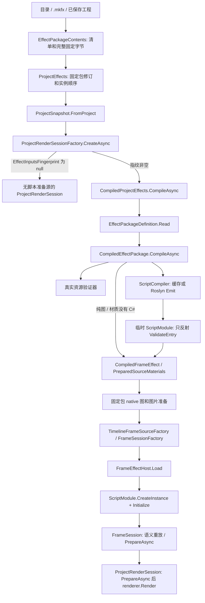

# Render 管线：效果包固定、脚本编译、加载与会话准备

本文以 `feda45973ae33827da93eee2a2cfd834c105a5da`（分支 `refactor/individual-backend`，产品版本 0.70.1）为只读调查基线，描述当前源码实际调用链。调查日期为 2026-10-14。本轮没有运行构建、测试、native、GUI 或性能检查；下文的测试是现有测试源码的证据索引，不代表本轮重新执行通过。

本文的终点是：固定工程快照已经得到独立的脚本实例、图像资源和 `IEvaluatedFrameSource`，随后 `ProjectRenderSession.RenderAsync` 可以先准备效果帧，再交给 Skia 绘制像素。时间事件、逐帧 writer 和最终 Skia 绘制的展开由架构目录中的相邻文档负责。

## 1. 真实主链与三种入口

桌面应用组合根在 [App.axaml.cs](../../samples/TechnicalSpike.App/App.axaml.cs) 创建预览和导出各自的 `ProjectRenderSessionFactory`，使用分发目录下的 `script-refs/net10.0`，并使用本机 `MakoKaraGenerator/script-artifacts-v2` 缓存。预览传入 `ReplayReason.Initial`，导出传入 `ReplayReason.Export`。本机缓存根为 `XDG_CACHE_HOME`，未设置时是用户目录下的 `.cache`。`PreviewSessions` 是长期工厂，不是共享的可变脚本会话；`CreateAsync` 每次创建独立会话。

三种入口必须区分：

| 入口 | 实际结果 | 是否构造作者实例 |
|---|---|---|
| 作者工作区 `EffectPackageCompiler.CompileAsync` | 验证固定候选包，返回编译/资源诊断报告 | 不构造，入口检查只反射 |
| 原 Runtime `ProjectRenderSessionFactory.CreateAsync` | 编译/加载固定工程输入，准备 native 与时间会话 | 控制器会构造并初始化 |
| 当前 Backend HTTP 静态 profile | 固定静态歌词/场景快照，经 Worker 使用 Runtime | 包、实例、包材质和固定预设在上游拒绝，不能据共享 Runtime 推定开放脚本 |

在 [ProjectRenderSessionFactory.cs](../../src/MakoKaraGenerator.Runtime.Hosting/ProjectRenderSessionFactory.cs) 第 27 行，无效果分支的精确条件是 `snapshot.EffectInputsFingerprint is null`。它并非只检查 `Effects.Instances`：该指纹还可来自源样式中的包材质以及固定预设投影。只有注册包、没有启用实例或实际材质引用的普通工程可以不进入脚本准备链。

## 2. 包在哪里读文件，在哪里停止读原目录

### 2.1 目录、分享包与工程持久化

[EffectPackageTransfer.cs](../../src/MakoKaraGenerator.Application/EffectPackageTransfer.cs) 的 `ReadDirectoryAsync` 委托 [EffectPackageStorage.cs](../../src/MakoKaraGenerator.Core/Persistence/EffectPackageStorage.cs) 读取完整目录；`.mkfx` 使用 `ReadArchiveAsync` 直接读取 ZIP 条目，不先解压、不从外部目录补缺文件。它们只传输固定内容，不自动编译或运行作者脚本。

目录读取逐项检查逻辑路径和链接，按文件数/字节预算登记后开流，依据读取前长度 `ReadExactlyAsync`，随后多读一个字节确认长度没有增长；短读或多读报 `PackageFileChanged`。这是一段固定读取代码，不应扩大成对所有同长并发写入的原子快照保证。后续仍用清单 SHA-256 验证实际捕获的文件字节。

[EffectPackageContents.Create](../../src/MakoKaraGenerator.Core/Effects/EffectPackageContents.cs) 第 65 行开始：

1. 要求包格式、SDK 与 shader profile 精确匹配宿主；当前 [ProjectEffectsJson.PackageProfile](../../src/MakoKaraGenerator.Core/Effects/ProjectEffectsJson.cs) 为 `2 / 1.0.0 / skia-raster-3.119.4-v1`。
2. 拒绝缺声明、额外文件、重复身份、路径大小写/文件目录前缀冲突以及错误文件摘要。
3. 在摘要验证前复制每个文件字节，防止调用者之后修改原数组。`csharp/shader/graph/shaderProgram` 必须是严格 UTF-8。
4. 对清单对象键排序形成规范 JSON；数组顺序保留。把规范清单、排序后的文件路径/长度/摘要写入带长度前缀的 hash 输入，形成 `sha256:<64位小写>` 包修订。

默认展开预算是全部 256 MiB、1024 文件、单文件 64 MiB，见 [EffectPackageContentBudget.cs](../../src/MakoKaraGenerator.Core/Effects/EffectPackageContentBudget.cs)。这是包字节预算，不等于整个进程峰值内存或运行耗时限额。

保存工程时 [ProjectStore.cs](../../src/MakoKaraGenerator.Core/Persistence/ProjectStore.cs) 第 80 行把完整包发布到 `effects/packages/<revision摘要>`；`project.json` 的 effects 部分保存包入口、实例、参数、顺序和预算，不保存 DLL、PDB 或脚本状态。`EffectPackageStorage.Publish` 写临时候选、逐文件刷盘、重新读回验证，再移动到内容地址；已有目录必须身份一致，不覆写。重开由 `LoadEffects`/`ProjectEffectsJson.Read` 按固定相对路径读包，并核验包的实际 ID/Revision。

因此，原包目录或 `.mkfx` 在导入后不再是渲染会话的源码来源。会话读取 `ProjectSnapshot.Effects` 中已经持有的不可变闭包；工程重开时才从工程自己的包目录重新固定字节。

### 2.2 源码草稿如何成为新修订

当前作者入口位于 [ScriptConfigurationSourceEditorViewModel.cs](../../samples/TechnicalSpike.App/ViewModels/ScriptConfigurationSourceEditorViewModel.cs)：

- `TryBuildPackage` 从旧固定包复制全部文件，严格编码当前 C# 文本，更新该文件的清单 SHA，再调用 `EffectPackageContents.Create`；草稿编译也先建立固定候选闭包。
- `SaveRevision` 调用工作区 `RegisterAuthorPackage`，由 [ScriptAuthorPackageStore.Publish](../../samples/TechnicalSpike.App/Workspaces/ScriptAuthorPackageStore.cs) 发布到配置库的内容地址包目录。保存源码只注册新包，不自动改变已有配置的包修订。
- [AdoptSourceRevision](../../samples/TechnicalSpike.App/ViewModels/ScriptConfigurationWorkspaceViewModel.Revisions.cs) 才显式采用同包的新修订；它重新校验原导出、参数、目标、读取范围、分支、种子和图元层兼容性。采用与编译、配置保存、正式运行结果各有自己的状态。
- 源码页的 `_compilations` 按完整包 `Revision` 缓存报告；文本改变会 `ResetCompilation` 并增加 `_sourceGeneration`，晚到的异步结果不能冒充当前草稿。该 UI 报告缓存与下面的 DLL 内容缓存是不同层。

这条当前源码入口不应与旧效果作者/测试辅助入口混为一个 ViewModel。运行阶段最终统一消费固定 `ProjectEffects` 和 `ProjectSnapshot`。

## 3. 四个身份分别防止什么漂移

| 身份 | 生成位置与覆盖范围 | 实际使用 |
|---|---|---|
| 包 `PackageId + Revision` | `EffectPackageContents.Create`；清单和全部资源内容 | 精确找包、工程持久化、资源归属、新旧源码修订 |
| 编译 `ArtifactHash` | `ScriptCompiler.Compile`；源码路径/正文、入口集合、选项、Roslyn 版本、参考集合 | DLL/PDB 内容地址缓存、控制器 RuntimeHash |
| `EffectInputsFingerprint` | `ProjectEffectInputs.Fingerprint`；投影后的 effects 编码、源材质、固定预设、音频源及已接受分析身份 | 创建语义会话与准备帧时核验输入闭包 |
| 快照实例引用 | `ProjectRenderSession.RenderCoreAsync` 的 `ReferenceEquals(request.Project, snapshot)` | 禁止用同会话给另一个快照引用渲染 |

[ProjectSnapshot.FromProject](../../src/MakoKaraGenerator.Rendering.Abstractions/ProjectSnapshot.cs) 第 96 行不是逐帧读取工作区：它固定 `PresetApplicationsProjection.Effects(project)`、预设、歌词/样式/场景与已接受分析，并生成效果输入指纹。[ProjectEffectInputs.cs](../../src/MakoKaraGenerator.Core/Effects/ProjectEffectInputs.cs) 的指纹不是完整工程所有字段的总 hash；最终像素会话还用快照引用守住整个渲染输入。

包里仅图片、README 或参数默认值改变，也会改变包 Revision；源码与入口集合没变时可以复用 ArtifactHash。实例参数覆盖、绑定、读取范围、种子或预算改变要重建输入会话，未必重编译 DLL。作者清单的 `version` 是展示版本，不能代替内容修订。

## 4. 从完整包语义到可执行描述

### 4.1 只编译被引用的包，引用到的包整体验证

[CompiledProjectEffects.CompileCoreAsync](../../src/MakoKaraGenerator.Scripting/Compilation/CompiledProjectEffects.cs) 第 53 行把以下引用合并，再按 `(PackageId, Revision)` 去重：启用的工程实例，以及 `SourceMaterialCatalog.Collect` 收集的源包材质。`ProjectEffects.GetPackage` 只按完整身份查找，缺失报 `EffectPackageReferenceMissing`，没有“最新修订”回退。

每个被引用包经过 [EffectPackageDefinition.Read](../../src/MakoKaraGenerator.Core/Effects/EffectPackageDefinition.Parser.cs) 完整解析参数、shader 声明、图计划和全部导出：检查导出身份、参数引用、六类绑定、输出目标与依赖、图/材质引用和回退合同。输出依赖做拓扑排序，缺依赖/环明确失败；语义可解析不表示运行时已经支持该计划。

`CompiledEffectPackage.CompileAsync` 验证整个被引用包的所有 shader、所有声明图片、全部图和全部材质回退；不是只验证被选择的控制器。需要资源验证器但没有提供时拒绝启用。当前 Runtime 工厂提供真实 Skia 验证器：

| 验证器 | 真实行为 | 验证完成后的资源 |
|---|---|---|
| [PackageImageValidator](../../src/MakoKaraGenerator.Rendering.Skia/PackageImageValidator.cs) | SKCodec 完整解码到 sRGB/BGRA/Premul 像素，并检查尺寸和字节限额 | 验证用 SKImage 立即释放 |
| [PackageShaderValidator](../../src/MakoKaraGenerator.Rendering.Skia/PackageShaderValidator.cs) | `CompiledPackageShaderPrograms.Compile` 实编译/反射全部固定程序 | 临时编译集合释放 |
| [PackageImageGraphValidator](../../src/MakoKaraGenerator.Rendering.Skia/PackageImageGraphValidator.cs) | 每个图经 `CompiledImageGraph.Compile` | 临时 graph 释放 |
| [PackageMaterialValidator](../../src/MakoKaraGenerator.Rendering.Skia/PackageMaterialValidator.cs) | 检查回退渐变的实际生产支持矩阵/float 范围 | 不建立长期 native 对象 |

这些是门禁用临时对象，正式会话稍后会重新建立需要长期持有的 native 图/图片。没有从此次门禁向作者暴露原生句柄。

### 4.2 控制器、直接图与源材质是不同分支

[CompiledEffectPackage.cs](../../src/MakoKaraGenerator.Scripting/Compilation/CompiledEffectPackage.cs) 第 69 行：有 controller 导出或 `role:csharp` 文件才调用 C# 编译器，`EffectPackageSources.Read` 仅取固定闭包中的 `role:csharp` 并保留包内诊断路径。纯图/材质包没有假 DLL，`ControllerArtifact` 为 null；直接访问 `Artifact` 会报 `PackageCSharpArtifactUnavailable`。

所有包成功后，实例按 `ProjectEffects.Instances` 的原数组顺序转成 `CompiledFrameEffect`。`CreateEffect` 仍是描述构建，不调用作者构造：

- controller 校验绑定在清单 `bindingKinds` 内；从 `Outputs` 映射粗粒度 writer 能力，保留完整包声明，后续 writer/宿主仍检查真实目标和输出合同。
- 不支持的 requirement、非空 `DependsOn`、尚未实施的旁路或 writer 组合在这里明确失败；`AudioFeatures` requirement 转成 `RequiresAudio`。
- graph 经 `DirectGraphEffectValidation.Validate`，返回 Artifact/EntryType 均 null 的描述。正式 host 直接构造内置 `DirectGraphEffect`，不会编译“空控制器”。
- source material 没有 `IKaraokeEffect`；`CompileCoreAsync` 校验引用和区域、限制 `ColorOnly` 与无跨输出要求，解析为 `PreparedSourceMaterials`，用于静态继承基线及后续图资源执行。

某个包源码失败时结果中保留真实编译诊断，资源目录置空；工程整体不构建部分成功效果描述。工厂抛 [ProjectEffectCompilationException](../../src/MakoKaraGenerator.Runtime.Hosting/ProjectEffectCompilationException.cs)，把源码位置附上包、修订以及引用该包的启用实例/导出身份。资源/清单异常则直接或带 source-material owner 传播，不会降级为旧 DLL。

## 5. 离线 Roslyn 编译和持久缓存

[ScriptCompiler.cs](../../src/MakoKaraGenerator.Scripting/Compilation/ScriptCompiler.cs) 有三个独立边界：

1. **构造时读参考集**：列出分发目录的全部 `*.dll`，按 ordinal 排序，要求至少存在 `System.Runtime.dll`，再追加宿主公共 SDK（`typeof(TokenId).Assembly.Location`）。读取字节、计算参考摘要，`MetadataReference.CreateFromImage` 固定这些字节。没有向开发机 SDK、网络或 NuGet 做运行时解析。
2. **请求时固定源码/入口**：拒绝空源码、绝对/反斜线/冒号/空段/点段路径和忽略大小写重复路径；源码 ordinal 排序，入口去重/排序。static `CompilationGate` 将同进程所有 `ScriptCompiler` 的 Emit 流程串行化，等待和后台 Task 都传取消令牌。包资源验证不由此 gate 串行化。
3. **编译或缓存读取**：计算完整指纹后，先检查 `<artifactRoot>/<fingerprint>`。目录存在就严格读缓存；不存在才解析语法树、生成 DLL/PDB。

编译指纹以带 32 位长度前缀的字节序列串联：固定 Options 字符串、Roslyn 程序集实际版本、参考 hash、`package-entries-v1`、入口数量/各入口、各源码路径/文本。Options 当前包含 `csharp14|net10.0|release|nullable|deterministic|portable-pdb|unsafe:false|concurrentBuild:false|serial-emit-v1|artifact-format2`。

实际 Roslyn 设置为 C#14、Release、nullable enabled、deterministic、`concurrentBuild:false`，发射 Portable PDB，程序集名是 `MakoKaraEffect_<fingerprint>`。没有启用 unsafe。分发参考包固定为 .NET 10.0.0，Roslyn 包固定 5.0.0，见 [Scripting.csproj](../../src/MakoKaraGenerator.Scripting/MakoKaraGenerator.Scripting.csproj) 与 [Directory.Packages.props](../../Directory.Packages.props)；指纹使用实际加载/读取的版本与字节，不只使用这两条声明。

编译结果收集全部 Warning/Error，保留包内路径与 1 起算行列。失败 DLL/PDB 均为空，不发布缓存；取消作为 `OperationCanceledException` 传播。编译器没有失败结果持久缓存，也没有长期作者对象缓存。

[ScriptArtifactStore.cs](../../src/MakoKaraGenerator.Scripting/Compilation/ScriptArtifactStore.cs) 缓存每个成功代次的 `effect.dll`、`effect.pdb`、`build.json`（格式 2，含产物 hash、DLL/PDB SHA 和警告）。发布先写 `.build-<guid>`，读回验证，再 `Directory.Move`；并发已有代次逐字节与诊断核验，临时目录最终清理。这里没有调用包持久化使用的 `Flush(flushToDisk:true)`，不能把两层写入耐久性混为一谈。

缓存 Load 拒绝错误格式、错误诊断、空 DLL/PDB、坏内容 SHA。`ScriptCompiler` 再核验其中 ArtifactHash 等于本次计算的 fingerprint。已有目录损坏就失败，既不覆写，也不以重新编译掩盖损坏；成功旧修订仍可供其自己的原始输入使用。缓存是可重建本机产物，不是工程的源事实。

## 6. 反射、装载、参数与 Initialize

### 6.1 入口验证和实际构造分离

成功编译后，`CompiledEffectPackage.CompileAsync` 用一个临时 [ScriptModule](../../src/MakoKaraGenerator.Scripting/Loading/ScriptModule.cs) 从 DLL/PDB 字节 `LoadFromStream`，逐个 `ValidateEntry<IKaraokeEffect>`。要求类型为公共可见、非抽象、非开放泛型 class，实现当前 SDK 接口且有公共无参构造。`ValidateEntry` 不调用 `Activator.CreateInstance`，不运行作者实例构造/Initialize/Dispose；临时 module 随 `using` 卸载。

正式 `FrameEffectHost.Load` 对每个 controller 描述重新创建独立 module，再 `CreateInstance<IKaraokeEffect>`。同包同 DLL 的多个实例共用不可变编译字节，当前实现仍每实例一个加载上下文和对象；不是每包一个共享作者状态。

`ScriptModule` 使用 `isCollectible:true` 的 `AssemblyLoadContext`，`Load` 对 SDK 返回默认上下文的宿主 SDK，避免接口类型身份不一致；其他依赖返回 null，交默认解析行为，没有自动查外部 NuGet/native 插件的包解析器。参考集只提供 BCL+SDK、ALC 可卸载以及 `unsafe:false` 都不能解释成不受信代码安全沙箱。原 Runtime 的作者回调在宿主进程内同步执行，取消依赖回调/宿主的协作检查；本文不声称可以强制中断任意死循环。

### 6.2 参数不是源码字符串替换

`EffectPackageDefinition.ResolveParameters(exportId, overrides)` 先取该导出声明参数的已验证默认值，再严格解析 JSON 覆盖。未知键、类型错、范围错、图片不属于包等都失败，没有字符串注入编译或静默类型转换。

`CompiledEffectPackage.ResolveParameters` 将 Core 九类值投影到 SDK `ParameterValues`：number、integer、boolean、enum、duration、text、color、curve、asset。asset 转成 `ResourceCatalog.GetImage(path)` 的 `ImageHandle`；它包含完整包修订身份，没有机器文件路径或 SKImage。其他图/材质句柄也按 `(PackageId, Revision, ExportId)` 归属。

[ParameterValues.cs](../../src/MakoKaraGenerator.Scripting.Abstractions/ParameterValues.cs) 的 `ValidateResources` 再核验 asset 归属，`GetNumber/GetDuration/...` 保持类型，不接受其他类型冒充。初始化和逐帧上下文使用同一份固定参数/资源目录。参数改动通常复用 DLL，但需新描述和会话。

### 6.3 时间会话创建时才调用 Initialize

`CompiledProjectEffects.CreateFactory` 把 Effects、固定指纹、音频投影、绘图/粒子预算及源材质交给 `TimelineFrameSourceFactory`。其内部 [FrameSessionFactory.CreateAsync](../../src/MakoKaraGenerator.Scripting/Execution/FrameSessionFactory.cs) 校验指纹/材质快照，构建 Timeline、Content/Scene、只读 `ProjectContext`，校验绑定，解析各实例的独立 source subscription，然后通过 geometry factory 创建独立几何 provider。

Runtime 工厂传 `static () => new SkiaRenderPipeline()` 作几何 provider，供脚本查询和场景准备；最后绘像素使用另一个 renderer。前者由 `FrameEffectHost.Dispose` 释放，后者由 `ProjectRenderSession` 释放。

`host.Load` 的顺序是卸载旧代次、重置诊断、校验 required audio/参数资源、创建 module/instance、记录 active、调用 Initialize。required audio 在构造前检查时刻 0 的固定分析可用性；[ProjectAudioProjection](../../src/MakoKaraGenerator.Scripting/Projection/ProjectAudioProjection.cs) 只转已接受分析，不读音频或现场生成特征。源码若未声明 required，作者自行收到真实 NoAudio/NotAnalyzed/AnalysisFailed 等状态。

Initialize 上下文包含只读 Project（完整 Content/Scene、画布、已确定时长、分析）、类型化 Parameters、逻辑 Resources、由 Seed+InstanceId 分流的 DeterministicRandom、诊断 reporter、基本 GeometryQueries 和取消令牌。Initialize 不提供写帧 writer。`InvokeContext`/`Invoke` 调用结束使 GeometryQueries/reporter 失效；Error 诊断或异常附上实例、RuntimeHash、阶段、时刻和包导出身份，取消直接传播。

Initialize 是“每个实例代次一次”，不是每工程永远一次。[FrameSession.Reset](../../src/MakoKaraGenerator.Scripting/Execution/FrameSession.cs) 在后退 seek、输出模式/target 变化或失败后的重试调用 `host.Load`，从固定编译字节重新装载并初始化，再重建历史；不重编译源码。[SemanticAnchorQuery](../../src/MakoKaraGenerator.Scripting/Execution/SemanticAnchorQuery.cs) 每次端点解析还会创建自己的 AnchorQuery 会话，也会初始化独立作者实例，不推进主会话状态。

纯帧接缝 `PureFrameSourceFactory` 同样用 FrameSessionFactory，但不提供语义时间线；若作者重写 OnEvent/Advance/AdvanceVisuals，Load 明确报 `TimelineSessionRequired`。工程生产工厂使用的是 Timeline 分支，不会默默跳过状态回调。

## 7. ProjectRenderSessionFactory 的 native 准备与释放

编译门禁成功后 [ProjectRenderSessionFactory.CreateCoreAsync](../../src/MakoKaraGenerator.Runtime.Hosting/ProjectRenderSessionFactory.cs) 第 32～88 行在创建时间源前准备正式资源：

1. 创建工程 `ImageSurfaceBudgetSession`。`GraphBudget.MaximumBytes` 来自持久 `SurfaceMemoryBytes`，其他图限额沿默认值；图元/粒子限额单独交给时间工厂。
2. 对每个引用包 `CompiledPackageGraphExports.Compile`：再检查 shader/材质，完整解码包图片，编译所有图，并长期持有本次会话的对象。
3. 检查跨包固定图片数量与总字节。对每张图片按真实原始像素尺寸建立 `GetImageInput` 借用 surface，以 `ImageHandle` 建精灵图片表。
4. 对 graph/material 导出创建 `SceneImageGraphProgram`/`SceneMaterialProgram`；从各图声明收集固定资源图片输入。这些程序借用本 native 集合，不独自拥有底层 graph/image。
5. 建 `SceneImageEffectResources`，`budget.HoldFixedImages(inputs)` 为固定图片持有预算，再创建前述语义源。
6. 创建最终 `SkiaRenderPipeline`，注入 BackgroundFrameSourceResolver、budget 和资源表，返回拥有全部对象的 ProjectRenderSession。

BackgroundFrameSourceResolver 接受注入的 `IVideoFrameProvider`，但这里没有对背景视频执行一次性全片解码。媒体背景的按帧解析在后续 renderer 中；包图片固定准备与背景图片/视频来源不能混为一类。

[ProjectRenderSession.cs](../../src/MakoKaraGenerator.Runtime.Hosting/ProjectRenderSession.cs) 串行 Render/Dispose：检查快照引用，调用 `source.PrepareAsync(timeUs, outputMode, target)`，再把 `PreparedFrame` 放进 RenderRequest 交给 renderer。这个逐帧出口不读包目录、不调用 ScriptCompiler、不创建下一版源码修订。

所有权与释放顺序：

| 对象 | 持有者/所有权 | 正常或失败释放 |
|---|---|---|
| DLL/PDB/Definition/ParameterValues | 不可变 managed 描述；缓存另有文件代次 | 失去引用后由 GC；不随 session 删除缓存 |
| 每个 ScriptModule + 作者实例 | `FrameEffectHost.ActiveEffect`；Module 登记 instance | `Unload` 先清宿主列表，再 Module.Dispose；直接图走 Instance.Dispose |
| 几何 provider | FrameEffectHost | Dispose 后释放 provider |
| 时间源 | ProjectRenderSession | ReleaseAsync 首先 DisposeAsync |
| 最终 renderer、SceneImageEffectResources | ProjectRenderSession | 时间源后依次释放 |
| fixedImages 预算持有、借用 inputs | ProjectRenderSession | 资源表后释放预算持有与全部借用 surface |
| native graph/image 集合、budget | ProjectRenderSession | inputs 后释放 native，再 budget |

`ScriptModule.Dispose` 会尝试全部作者 Dispose，清掉强引用，请求 context.Unload，再抛聚合释放错误；请求卸载不等于此刻 GC 已完成。`FrameEffectHost.Unload` 也尝试全部实例，再报告 `ScriptDisposeFailed`。

若初始化失败，FrameSessionFactory 释放 host/geometry；Runtime 工厂 catch 调用统一 ReleaseAsync 释放已获得的 native/inputs/budget。清理失败附在原始异常的 `RuntimeCleanupFailure` 并写 stderr，保留原始准备失败。正常 ReleaseAsync 尝试每一层，收集失败，最后重新抛第一个并附 `RuntimeCleanupFailures`。这说明代码有资源释放责任链，不表示任意作者持有外部静态引用或失控线程都必然回收。

## 8. WordEmphasis：从真实 manifest 到实际接口实例

使用仓库公开包 [WordEmphasis/manifest.json](../../samples/ScriptEffects/WordEmphasis/manifest.json) 与 [src/WordEmphasis.cs](../../samples/ScriptEffects/WordEmphasis/src/WordEmphasis.cs)。这是现存源码与现存测试追踪，不是本轮生成/运行的新样例。

| 阶段 | 此包实际值与调用 |
|---|---|
| 固定入口 | `packageId=makokara.word-emphasis`，作者 `version=1.0.1`；profile2/SDK1.0.0 |
| 文件闭包 | `src/WordEmphasis.cs` 为 csharp，清单 SHA 为 `5bfca397aad0567cd57c5d8f79f523a42705673d446109148da9158d4e3ca615`；README 是 asset 也参与包修订 |
| 导出语义 | `word-emphasis` controller，`entryType=WordEmphasis`；允许六类 binding；唯一 `scale` 输出是 `VisualTransform/tokenFamily`，无 requires/dependsOn |
| 参数 | `peakScale:number` 默认 1.25、范围 1～4；`returnUs:duration` 默认 120000、范围 0～2000000 微秒 |
| 固定读包 | 测试 `EmphasisPackage` 用正式 `EffectPackageStorage.ReadDirectoryAsync` 读取分发的 `effect-packages/WordEmphasis`；原目录全部字节进入闭包 |
| 工程引用 | `EmphasisInstance` 把该包实际 PackageId/Revision 与 export 写到稳定实例，种子 `0x1234abcd`，source subscription 为 project，输出 binding 使用 Project 默认值 |
| 编译 | 去重后的固定包经 Definition.Read；Sources.Read 只投影一份 C#；编译入口集合 `[WordEmphasis]`，缓存 miss 则 Emit，hit 则严格读 DLL/PDB |
| 入口验证 | `WordEmphasis : EffectBase` 是 public sealed class，有隐式公共无参构造，继承 IKaraokeEffect；临时 module 只 ValidateEntry |
| 运行描述 | `CreateEffect` 返回 Transform 能力、EntryType、Artifact、参数、完整包声明和资源目录；同包资源目录即使无图片也保留包 Revision 身份 |
| 运行对象 | host.Load 新建 ScriptModule → CreateInstance<IKaraokeEffect>("WordEmphasis") → Initialize；Initialize 读取两项参数保存到字段 |
| 一帧输出 | Evaluate 遍历 TokensInBinding，只接受真实 Token 进度与 time range；当前元素 `1+(peak-1)*EaseOut(progress)`，刚唱完在 returnUs 内线性回落；writer 写 `ScaleTokenFamily(token.WithRuby, factor, BaseAdvanceCenter)`，含注音族 |
| 输出到像素 | Host 合并这些变换产生 PreparedRenderFrame；Session 将其交给最终 Skia renderer。脚本没有返回 PNG，也没有自行加载字体、源码文件或音频 |

WordEmphasis 只重写 Initialize/Evaluate；EffectBase 其余状态/发射/视觉回调默认为空，Dispose 默认无作者资源。这里不能把“脚本只用两个回调”推广到 RepeatEmphasis、粒子或事件脚本。

现存 [CompiledEffectPackageTests](../../tests/MakoKaraGenerator.Scripting.Tests/CompiledEffectPackageTests.cs) 第 15 行直接检查这个公开包的入口、默认参数、种子、Transform 能力与 Artifact；覆盖值 1.8 保留同 Artifact，值 9 明确 `PackageParameterOutOfRange`。现存 [ProjectRenderSessionTests.Emphasis.cs](../../tests/MakoKaraGenerator.Spike.App.Tests/Rendering/ProjectRenderSessionTests.Emphasis.cs) 把 WordEmphasis/RepeatEmphasis 加入真实工程并调用正式工厂，涵盖独立预览/导出、重绘/后退重放。本文不填没有本轮实际编译的具体 ArtifactHash，也不把这些测试名当成本轮运行结果。

## 9. 重要函数：输入、输出、职责与调用者

表内行号是基线定位辅助，文件链接是相对仓库入口；源码编辑后行号可能移动。

| 函数（基线行） | 输入 → 输出 | 核心职责 / I/O | 真实调用者 |
|---|---|---|---|
| EffectPackageStorage.ReadDirectoryAsync（47） | 目录、profile、预算 → Contents | 完整文件读取、固定长度、拒链接；磁盘 I/O | Transfer、ProjectStore、源码候选库 |
| EffectPackageTransfer.ReadArchiveAsync（16） | .mkfx、profile → Contents | ZIP 展开预算/闭包，不写解压目录 | 导入/分享工作流 |
| EffectPackageContents.Create（65） | manifest+文件字节 → 固定包 | 严格合同/SHA/路径、复制内容、规范清单、Revision；无文件 I/O | 目录/ZIP读取、源码草稿 |
| EffectPackageStorage.Publish（9） | 目录+Contents → void | 临时写、刷盘、重读、内容地址发布 | ProjectStore、源码/配置库 |
| EffectPackageDefinition.Read（Parser 10） | Contents → Definition | 全部参数、shader、图、导出语义；无外部 I/O | 包编译、工程编译 |
| EffectPackageDefinition.ResolveParameters（154） | export+覆盖字节 → Core值表 | 默认值+严格参数覆盖 | CompiledEffectPackage |
| EffectPackageSources.Read（11） | Contents → ScriptSource[] | 仅 csharp 固定正文/包内路径 | CompiledEffectPackage |
| ScriptCompiler 构造（25） | 参考目录、缓存根 → compiler | 读全部参考 DLL+SDK、固定 reference hash | Runtime/作者工厂的 Lazy |
| ScriptCompiler.CompileAsync（52） | 固定源码+入口 → Result | 规范路径/去重排序、转串行异步编译 | CompiledEffectPackage |
| ScriptCompiler.CompileSerialAsync（68） | 已排序输入+token → Result | 同进程 static gate，后台 Compile | CompileAsync |
| ScriptCompiler.Compile（75） | 固定源码/入口 → DLL/PDB或诊断 | 指纹/缓存；Roslyn Parse+Emit | CompileSerialAsync |
| ScriptArtifactStore.Load（45） | 目录 → Result | 读 manifest/DLL/PDB，完整性验证 | compiler、Publish读回、测试 |
| ScriptArtifactStore.Publish（14） | root+成功Result → 目录 | staging读回/移动、不覆盖损坏代次 | ScriptCompiler |
| CompiledEffectPackage.CompileAsync（43） | Definition+真实验证器 → 编译包 | 全资源门禁、编译、入口反射 | 作者编译器、CompiledProjectEffects |
| CompiledEffectPackage.CreateEffect（90） | 导出/实例/绑定/种子/覆盖 → 描述 | 能力与限制门禁；不运行构造 | CompiledProjectEffects |
| CompiledEffectPackage.ResolveParameters（135） | 导出/覆盖 → SDK值 | 九类投影/资源归属 | CreateEffect、源材质解析 |
| ScriptModule 构造（16） | 固定PE/PDB → 可回收module | LoadFromStream；无源码读取 | 编译入口验证、host.Load |
| ScriptModule.ValidateEntry（50） | 完整类型名 → void | 反射实际接口/可见性/构造合同 | CompiledEffectPackage |
| ScriptModule.CreateInstance（41） | 类型名 → IKaraokeEffect | Activator构造、登记Dispose所有权 | FrameEffectHost.Load |
| ScriptModule.Dispose（62） | 当前代次 → void | 全实例Dispose、清引用、请求卸载 | 临时验证using、Host.Unload |
| ProjectSnapshot.FromProject（96） | Project → snapshot | 固定投影后的包/预设/歌词/分析 | 原预览/导出/正式验证入口 |
| CompiledProjectEffects.CompileCoreAsync（53） | source+材质引用 → compiled | 去重精确修订、全包成功、实例原顺序 | CompileAsync各重载 |
| CompiledProjectEffects.CreateFactory（121） | geometry factory+reason → Timeline工厂 | 固定分析/预算/源材质；无作者对象 | Runtime工厂/验证接缝 |
| ProjectRenderSessionFactory.CreateCoreAsync（24） | snapshot+token → Pixel Session | 包编译、正式native、budget、时间源装配 | CreateAsync的后台Task |
| CompiledPackageGraphExports.Compile（22） | Definition+budget → native集合 | 固定图编译/图片完整解码 | Runtime工厂 |
| FrameSessionFactory.CreateAsync（37） | snapshot → evaluated source | 投影/绑定/订阅、独立geometry、host.Load | Timeline/Pure工厂 |
| FrameEffectHost.Load（38） | semantic+token → void | 卸旧、输入门禁、构造、Initialize | FrameSessionFactory、Reset |
| FrameEffectHost.InvokeContext（Queries 10） | active、stage、action → void | 本阶段诊断/几何查询生命周期 | Initialize/状态回调 |
| FrameSession.Reset（106） | reason+token → void | 重建实例/历史，不重编译 | PrepareAsync |
| ProjectRenderSession.RenderCoreAsync（15） | request → RenderFrame | 同快照守卫、PrepareAsync→Render | RenderAsync |
| ProjectRenderSession.ReleaseAsync（41） | 所有owned资源 → void | 时间源→renderer→资源→借用输入→native→budget | Session.Dispose、工厂失败catch |

这些函数所在文件已在前文链接；逐帧 OnEvent/Advance/Evaluate 的具体合并算法不属于这个函数表的编译/准备职责范围。

## 10. 当前 HTTP profile 的明确边界

[BackendPreviewSessionRegistry.cs](../../src/MakoKaraGenerator.Backend.Hosting/BackendPreviewSessionRegistry.cs) 第 513 行拒绝非空效果指纹、包、实例、固定预设和源包材质。[StaticProjectSnapshotCodec.cs](../../src/MakoKaraGenerator.Backend.Rendering/StaticProjectSnapshotCodec.cs) 第 121～154 行再次拒绝 effects/preset/非默认效果预算、包材质、非纯色背景；编码与解码都守住专用合同。

当前 `static-lyrics-scene-v1` 与 `static-lyrics-scene-analysis-v1` 可以进入 Worker 的真实 Runtime 工厂，但合法输入的效果指纹为空，走前文无脚本准备源分支。新 analysis profile 完整保留已接受分析不等于允许脚本消费分析驱动画面。独立音频分析任务允许分析含 effects 的工程音频，也不表示其视觉渲染任务接受效果。

当前唯一 API [backend-api.md](backend-api.md) §9/§11/§12/§13 和 codec/registry 的实际拒绝应一起读。原 Runtime 的文字变换、粒子、直接图、材质包能力与当前 HTTP 有限静态出口属于不同可达输入范围；本调查没有恢复或实施后端开发。

## 11. 现有回归源码证据与本轮未验证事项

| 现有源码 | 它约束的具体行为 |
|---|---|
| [CompilerTests.cs](../../tests/MakoKaraGenerator.Scripting.Tests/CompilerTests.cs) | 新compiler读真实持久缓存并保留warning；损坏代次不覆写/掩盖；入口改变新hash；SDK类型共享和合作卸载；固定顺序一致；取消不转诊断 |
| [EffectPackageCompilationTests.cs](../../tests/MakoKaraGenerator.Scripting.Tests/EffectPackageCompilationTests.cs) | 移走原目录仍用分享闭包编译；图片变化不改源码hash；真实错误行列，无失败DLL |
| [CompiledEffectPackageTests.cs](../../tests/MakoKaraGenerator.Scripting.Tests/CompiledEffectPackageTests.cs) | 公开样例参数/入口/种子；反射不构造作者；全部入口合同；真实resource门禁；Revision与Artifact身份分离 |
| [ProjectRenderSessionTests.Emphasis.Revisions.cs](../../tests/MakoKaraGenerator.Spike.App.Tests/Rendering/ProjectRenderSessionTests.Emphasis.Revisions.cs) | 参数和单实例源码修订保存/重开/撤销重做、替换旧会话 |
| [ProjectRenderSessionTests.Emphasis.Replay.cs](../../tests/MakoKaraGenerator.Spike.App.Tests/Rendering/ProjectRenderSessionTests.Emphasis.Replay.cs) | 部分推进取消后重建、required/optional分析状态，以及真实重复计数 |
| [ProjectRenderSessionTests.Emphasis.Outputs.cs](../../tests/MakoKaraGenerator.Spike.App.Tests/Rendering/ProjectRenderSessionTests.Emphasis.Outputs.cs) | 模式/target切换与独立会话像素关系；关闭卸载 |
| [ProjectRenderSessionTests.R8Public.cs](../../tests/MakoKaraGenerator.Spike.App.Tests/Rendering/ProjectRenderSessionTests.R8Public.cs) | 资源包目录→分享→脱离源→重开→普通/透明生产会话 |

本轮结论来自调用点和实现逐段对应，而不是名称推断。仍未通过本轮运行确认的事项包括编译/加载耗时、实际缓存命中率、峰值内存、特定系统字体/平台可用性、GC卸载完成时间，以及任意失控作者代码的进程隔离。已有测试与历史验收的范围不能由本文扩成全量/性能/平台验收。

可确定的源码边界是：一次像素会话创建时固定包并完成编译/资源门禁；每个作者实例代次装载并初始化；每帧复用固定描述，按语义重放后输出准备帧；关闭或失败沿既定所有权释放。本轮只新增架构说明，没有改变这些行为。
