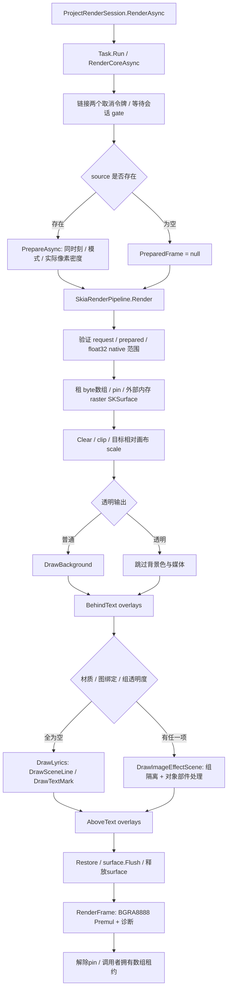
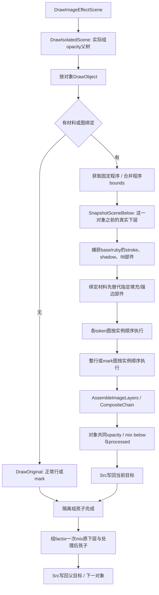

# Render 管线调查：Skia 绘制与一帧输出

本报告冻结于 `feda45973ae33827da93eee2a2cfd834c105a5da`（0.70.1，2026-10-14）。只读源码与已有测试；本轮没有构建、运行测试、启动原生窗口或做性能测量。下述行号均是该基线的实际源码行号。

范围从 `IRenderFrameSession.RenderAsync` 的准备帧消费边界开始，覆盖几何、固定字形、绘制、材质／图像效果和裸像素输出。包加载见[脚本加载调查](render-script-loading.md)，作者阶段见[逐帧执行调查](render-runtime-frame.md)；HTTP／正式导出的调度、传输和编码见[入口调查](render-entrypoints.md)。完整 Runtime 的能力不能直接推定为当前 Backend 静态 HTTP profile 的能力。

本文记录的是 2026-10-14 的 CPU 基线调查；当前显式 CPU／Vulkan 设备、共享 GPU surface 和 readback 见[Skia GPU 后端架构与验收边界](render-skia-gpu-backend.md)。

## 1. 一帧真正经过的入口

当前生产像素会话最终使用 `SkiaRenderPipeline`，源码直接标明 `BackendName => "Skia（CPU 光栅）"`（[主管线 L87](../../src/MakoKaraGenerator.Rendering.Skia/SkiaRenderPipeline.cs#L87)）。`Render` 本身是同步函数；异步、线程池安排和同一会话的串行门禁在 Runtime 外壳。

入口顺序来自 [ProjectRenderSession L13–28](../../src/MakoKaraGenerator.Runtime.Hosting/ProjectRenderSession.cs#L13) 和 [SkiaRenderPipeline.Render L90–184](../../src/MakoKaraGenerator.Rendering.Skia/SkiaRenderPipeline.cs#L90)。后端既不回调作者脚本，也不在绘制阶段重新执行作者求值。

| 重要函数（当前行号） | 输入 → 输出 | 职责与实际调用者 |
| --- | --- | --- |
| [`IRenderFrameSession.RenderAsync` L14](../../src/MakoKaraGenerator.Rendering.Abstractions/RenderFrameSession.cs#L14) | 固定 `RenderRequest`、token → 调用者拥有的 `RenderFrame` | 中立异步契约；预览、验证和导出消费 |
| [`ProjectRenderSession.RenderAsync` L13；`RenderCoreAsync` L15](../../src/MakoKaraGenerator.Runtime.Hosting/ProjectRenderSession.cs#L13) | request → frame | `Task.Run` 转后台，链接取消、gate串行、快照引用身份校验；调用 source 再调用 renderer |
| [`IEvaluatedFrameSource.PrepareAsync` L18](../../src/MakoKaraGenerator.Rendering.Abstractions/PreparedRenderFrame.cs#L18) | 时间、OutputMode、RenderTarget → PreparedRenderFrame | 作者／时间系统产生中立计划；像素后端只消费 |
| [`PreparedRenderFrame.ValidateRequest` L190](../../src/MakoKaraGenerator.Rendering.Abstractions/PreparedRenderFrame.cs#L190) | request → 通过或具名异常 | 校验快照引用、时间、密度、透明模式；启用效果却缺准备帧不能退回原画；主Render／捕获／缓存均调用 |
| [`ValidateNativePreparedFrame` L12](../../src/MakoKaraGenerator.Rendering.Skia/SkiaRenderPipeline.FamilyTransforms.cs#L12) | 中立prepared → 通过或异常 | 转float32前检查矩阵、逆矩阵、坐标、渐变及overlay；主Render和捕获入口调用 |
| [`SkiaRenderPipeline.Render` L90](../../src/MakoKaraGenerator.Rendering.Skia/SkiaRenderPipeline.cs#L90) | 固定request → raw frame | 组织实际绘制、pool数组、native surface和帧诊断；由Session或静态试样入口调用 |

## 2. 固定准备、惰性缓存与每帧工作

`ProjectRenderSessionFactory` 在 `EffectInputsFingerprint is null` 时建立 `source=null` 的普通管线（[L27–28](../../src/MakoKaraGenerator.Runtime.Hosting/ProjectRenderSessionFactory.cs#L27)）。否则固定包的 native 图、图片、材质程序和账本先建立，再建立求值会话及最终绘制器（同文件 L29–88）。这个指纹还覆盖源材质／预设投影，不能把它简化为“脚本实例数量”。

| 时机 | 实际工作 | 保留到何时 |
| --- | --- | --- |
| 像素会话创建 | 包声明／程序门禁，`CompiledPackageGraphExports.Compile`、完整图片解码、图／材质句柄映射 | Session释放固定native／图片／账本 |
| 几何会话创建 | `FrameSessionFactory` 用 `geometryFactory()` 建立独立几何provider | `FrameEffectHost.Dispose` 释放provider |
| 最终renderer创建 | 创建独立文字引擎／布局缓存、背景resolver；存在精灵图片时固定精灵宿主shader | renderer.Dispose |
| 首次碰到某文本／字体组合 | `GetLayout` 缓存未命中才Shape；字族／字号对象另在文字引擎缓存 | 当前Skia实例释放；布局缓存没有逐帧重建 |
| 首次解析某图片背景 | resolver创建来源，第一次 `GetFrame` 才Decode | 来源缓存关闭；失败结果也记住 |
| 每帧求值 | 时间推进、当前场景几何、变换／外观／可视输出／绑定，生成prepared | 单帧中立值；不存native字形对象 |
| 每帧绘制 | clear、实际目标scale、背景帧、overlay、文字或图链、诊断／surface释放 | 返回frame像素由调用者持有 |
| 第一次用组／对象隔离 | `_isolationResources.Value` 惰性创建固定宿主shader | renderer释放；不是每个对象重编译源码 |

两个 Skia 实例需要明确区分：`ProjectRenderSessionFactory` L86 为求值几何传入 `static () => new SkiaRenderPipeline()`，L88 又创建最终renderer。几何provider由 [FrameSessionFactory L50–58](../../src/MakoKaraGenerator.Scripting/Execution/FrameSessionFactory.cs#L50) 建立，由 [FrameEffectHost L252–256](../../src/MakoKaraGenerator.Scripting/Execution/FrameEffectHost.cs#L252) 拥有；最终renderer由Session拥有。

两个实例各自缓存 `ShapedLine`／字体，不共享native字体或文字blob。`PreparedRenderFrame` 携带中立矩阵、bounds、draw-unit身份和样式，不携带 `ShapedLine`。最终renderer首次遇到同一行，仍需建立自己的布局缓存。

有prepared时，`DrawLyrics` 直接取 `HierarchyScene`，不再 `GetSceneFrame` 做时间采样（[主管线 L288–295](../../src/MakoKaraGenerator.Rendering.Skia/SkiaRenderPipeline.cs#L288)）。但绘制和native验证仍访问 `GetLayout`、`MeasureRuby`。无prepared时，每次Render的普通歌词分支调用 `GetSceneFrame`；布局命中只省掉Shape，不代表整个SceneFrame被缓存。

## 3. 从当前歌词到实际世界几何

| 重要函数（当前行号） | 输入 → 输出 | 职责与调用关系 |
| --- | --- | --- |
| [`GetSceneFrame` L17](../../src/MakoKaraGenerator.Rendering.Skia/SkiaRenderPipeline.Geometry.cs#L17) | snapshot、time、可选编辑行 → SceneFrame | 采样→预设投影→静态行安排→场景测量→各级几何；求值provider和无prepared绘制调用 |
| [`ArrangeStaticRows` L8](../../src/MakoKaraGenerator.Rendering.Skia/SkiaRenderPipeline.SceneLayout.cs#L8) | 当前SceneLineSample数组、画布 → 已安排数组 | Static来源按Container分组，含装饰高度／6px间隔／safe area缩放；不写工程 |
| [`MeasureSceneGeometry` L66](../../src/MakoKaraGenerator.Rendering.Skia/SkiaRenderPipeline.SceneLayout.cs#L66) | 当前行、样式、composition → LineRenderGeometry或null | 基本文字+注音墨迹共同决定bounds，再调用BuildGeometry |
| [`LayoutOptionsFor` L90](../../src/MakoKaraGenerator.Rendering.Skia/SkiaRenderPipeline.Geometry.cs#L90) | LyricStyle → TextLayoutOptions | 字族、显式回退链、字号、字重、粗／斜体、字距；几何／绘制共用 |
| [`BuildGeometry` L98](../../src/MakoKaraGenerator.Rendering.Skia/SkiaRenderPipeline.Geometry.cs#L98) | shaped／groupink、父参考矩形、placement、local、入场 → 行几何 | 锚点→origin／baseline→最大宽度限制→local矩阵→父矩阵；返回世界矩阵和pivot |
| [`MeasureRuby` L13](../../src/MakoKaraGenerator.Rendering.Skia/SkiaRenderPipeline.Ruby.cs#L13) | 行、样式、base shaped → RubyLayout列表 | 根据BaseTokenId、相对字号、对齐、Gap定位；tokens拼不回正文时不猜映射 |
| [`GroupInk` L40](../../src/MakoKaraGenerator.Rendering.Skia/SkiaRenderPipeline.Ruby.cs#L40) | 基本文字墨迹、注音列表 → 合并墨迹 | 行摆放和缩放包含注音，而非仅基本字advance |
| [`MeasureFrameElements` L7](../../src/MakoKaraGenerator.Rendering.Skia/SkiaRenderPipeline.SceneFrame.cs#L7) | 已测量行 → 实际Elements与组参考几何 | 汇总运行父树、组可见性、基本字／ruby／mark world corners；先测TextMarks |
| [`MeasureTextMarks` L8](../../src/MakoKaraGenerator.Rendering.Skia/SkiaRenderPipeline.TextMarks.cs#L8) | frame／LeadIns → 固定标记文本与几何 | cue附着到当前目标行，节点参考矩形中心排版；Elapsed决定两态，保留实际Cue／Binding |
| [`MeasureTokenGeometries` L45](../../src/MakoKaraGenerator.Rendering.Skia/SkiaRenderPipeline.TokenGeometry.cs#L45) | 当前行shaped／source spans／ruby → TokenGeometrySample[] | GlyphPartitioner关联真实字簇；产出base／带ruby family／progresspath与独立能力 |
| [`MeasureLineGeometries` L23；`MeasureMarkGeometries` L11](../../src/MakoKaraGenerator.Rendering.Skia/SkiaRenderPipeline.TokenGeometry.cs#L11) | shaped、当前矩阵 → 中立几何数组 | 整行／mark的固定单元、advance／ink bounds与世界矩阵 |
| [`MeasureUnits` L95](../../src/MakoKaraGenerator.Rendering.Skia/SkiaRenderPipeline.TokenGeometry.cs#L95) | draw-unit索引、origin／baseline、world → GeometrySample | 合并真实glyph墨迹，生成稳定DrawUnitId；空单元不伪造文字框 |
| [`SceneAffineProjection.Apply` L14](../../src/MakoKaraGenerator.Rendering.Abstractions/SceneAffineProjection.cs#L14) | scene、line／group局部变换 → HierarchyScene | 在真实父树上继承delta，各乘一次；不重新采样／整形 |

普通源样式解析顺序是默认→可选预设→分支→行→元素（[LyricStyleResolver.Resolve L27–66](../../src/MakoKaraGenerator.Core/Projects/LyricStyleResolver.cs#L27)）。场景预设另先经 `PresetSceneStyleProjection` 落入当前frame；不能只读主绘制里的 `preset:null` 就判断预设不参与。

`BuildGeometry` 的父矩阵来自当前运行装载；prepared先组合组／整行仿射，之后独立元素族继续组合自己的local。实际绘制在 `DrawSceneLine` 先concat行世界矩阵，`DrawChangedFamilies`再concat族local，因此父变换不会给同一个glyph重复乘两次。

脚本 `StyleUpdate` 当前只改填充、描边、阴影和opacity，保持源typography（[StaticStyleProjection.ApplyCore L66–79](../../src/MakoKaraGenerator.Rendering.Abstractions/StaticStyleProjection.cs#L66)）。这条动态外观路线不做随帧字体／字号重排；source typography、注音相对字号和不同标记文本仍各有自己的布局key。

## 4. 整行整形、回退字体和固定字形

“整行布局一次”并不是只调用一次HarfBuzz：先按完整grapheme选择字体，相邻同字体文本合并为run，每个run分别 `SKShaper.Shape`；所有run再汇成整行稳定位置。

| 重要函数（当前行号） | 输入 → 输出 | 职责与实际调用者 |
| --- | --- | --- |
| [`GetLayout` L585](../../src/MakoKaraGenerator.Rendering.Skia/SkiaRenderPipeline.cs#L585) | text＋layout options → 缓存ShapedLine | 管线实例缓存；测量、验证、正文／注音／mark绘制都调用；命中不重新Shape |
| [`SkiaTextLayoutEngine.Shape` L83](../../src/MakoKaraGenerator.Rendering.Skia/SkiaTextLayoutEngine.cs#L83) | 字符串／选项 → ShapedLine | 验证typography→字体集合→runs→每run shaping→cluster映射→字距／墨迹合并 |
| [`GetOrAddFontSet` L306](../../src/MakoKaraGenerator.Rendering.Skia/SkiaTextLayoutEngine.cs#L306) | 族名、fallback链、size／weight／slant → FontSet | native Typeface／Font／Shaper缓存，Shape和DrawLine调用；字距不改变字体对象 |
| [`CreateUsableTypeface` L287；`HasFontData` L299](../../src/MakoKaraGenerator.Rendering.Skia/SkiaTextLayoutEngine.cs#L287) | 请求字族／style → 可读取Typeface | 依次请求族、系统默认族、Noto；OpenStream须有数据；全不可用明确报错 |
| [`FontSet.ResolveFontEntry` L538](../../src/MakoKaraGenerator.Rendering.Skia/SkiaTextLayoutEngine.cs#L538) | 一个完整文本元素 → FontEntry | 主字体→显式回退→已记结果→系统MatchCharacter；完整元素覆盖后才采用 |
| [`SkiaTypefaceCoverage.IsElementCoveredBy` L29](../../src/MakoKaraGenerator.Rendering.Skia/SkiaTypefaceCoverage.cs#L29) | Typeface、文本元素 → bool | 忽略默认可忽略码点，检查其余码点glyph；避免变体选择符导致错误回退 |
| [`BuildRuns` L400](../../src/MakoKaraGenerator.Rendering.Skia/SkiaTextLayoutEngine.cs#L400) | 整行、FontSet → FontRun列表 | grapheme保持完整，相邻同FontEntry合并；Shape调用 |
| [`BuildUtf8ToUtf16Map` L445；`AppendRunElements` L330](../../src/MakoKaraGenerator.Rendering.Skia/SkiaTextLayoutEngine.cs#L330) | HarfBuzz clusters／positions → 元素＋固定draw units | cluster按UTF-8偏移关联.NET UTF-16；保留glyph ID／位置／墨迹／缺字数 |
| [`GlyphPartitioner.Partition` L27](../../src/MakoKaraGenerator.Text/GlyphPartitioner.cs#L27) | 整行ShapedLine＋连续source spans → 每token单元与能力 | 重叠字簇关联；跨token合字可报告不可独立，不按UTF-16切开glyph |
| [`SkiaTextLayoutEngine.DrawLine` L185](../../src/MakoKaraGenerator.Rendering.Skia/SkiaTextLayoutEngine.cs#L185) | fixed shaped／选项／paint／可选unit索引 → canvas写入 | 找回真实字体，逐固定单元绘制；不调用子串shaping |
| [`DrawShapedText` L234](../../src/MakoKaraGenerator.Rendering.Skia/SkiaTextLayoutEngine.cs#L234) | 固定glyph ID／positions → positioned SKTextBlob写canvas | 每次绘制构造并释放blob；没有持久blob缓存；DrawLine调用 |

自动回退结果（包括miss）有1024元素／单元素64 UTF-16长度的缓存边界（SkiaTextLayoutEngine L482–485、L593–600）。FontSet／管线layout本身则按组合保留到Dispose；不要把“回退缓存有界”扩大成“所有文字缓存有界”。

未定时token不由后面已唱token推断高亮。`BuildSungRegions` 仅接受 `ProgressSource.FromToken`，正文拼接不一致时返回空路径；宽度从稳定 `ShapedLine.XAt`取得（[主管线 L550–575](../../src/MakoKaraGenerator.Rendering.Skia/SkiaRenderPipeline.cs#L550)）。

注音没有独立演唱时间：`DrawRuby` 用关联base token的Progress，在ruby自身宽度上裁切（[Ruby L50–74](../../src/MakoKaraGenerator.Rendering.Skia/SkiaRenderPipeline.Ruby.cs#L50)）。它不是按发音单位重新采样的第二时间轴。

## 5. 普通文字绘制与独立元素效果

| 重要函数（当前行号） | 输入 → 输出 | 实际职责／调用者 |
| --- | --- | --- |
| [`DrawLyrics` L288](../../src/MakoKaraGenerator.Rendering.Skia/SkiaRenderPipeline.cs#L288) | canvas、request、composition → 场景文字 | 获取HierarchyScene或现场测量；按DrawItems调用行／mark绘制 |
| [`DrawItems` L44](../../src/MakoKaraGenerator.Rendering.Skia/SkiaRenderPipeline.Capture.cs#L44) | 当前SceneFrame → 有序行／mark序列 | 先逐行，某branch最后一行后插该branch前奏mark；普通／图／capture共用 |
| [`DrawSceneLine` L298](../../src/MakoKaraGenerator.Rendering.Skia/SkiaRenderPipeline.cs#L298) | 行sample、prepared、可选CapturePaint → canvas写入 | 源样式／layout／ruby→入场alpha layer→行worldmatrix→两态绘制或变化族分支 |
| [`BuildSungRegions` L550](../../src/MakoKaraGenerator.Rendering.Skia/SkiaRenderPipeline.cs#L550) | token samples、shaped、clip → SKPath | 每个真实定时token贡献已唱矩形，不连续填满未定时空隙 |
| [`DrawChangedFamilies` L86](../../src/MakoKaraGenerator.Rendering.Skia/SkiaRenderPipeline.FamilyTransforms.cs#L86) | transforms／styles、partitions、ruby → canvas写入 | 排除移走glyph；剩余字走原两态；变化族只画自己的完整单元＋ruby |
| [`DrawTokenOverrides` L419](../../src/MakoKaraGenerator.Rendering.Skia/SkiaRenderPipeline.cs#L419) | 源token override、互补裁切／可选units → canvas写入 | 不可独立的历史源覆盖仍可矩形补绘；先排除与补绘共用含装饰边界 |
| [`DrawStyledLine` L10](../../src/MakoKaraGenerator.Rendering.Skia/SkiaRenderPipeline.TextPainting.cs#L10) | shaped、最终style、color／gradient、capture → paint passes | 实际外描边、字形内减除、填充及阴影；调用文字引擎DrawLine |
| [`CreateGradientShader` L628](../../src/MakoKaraGenerator.Rendering.Skia/SkiaRenderPipeline.cs#L628) | GradientSpec、行／画布坐标 → SKShader或null | 用Core规则采样65色点，再创建线性／径向shader；每次样式pass调用 |
| [`CreateTextShadow` L135](../../src/MakoKaraGenerator.Rendering.Skia/SkiaRenderPipeline.TextPainting.cs#L135) | ShadowSpec／style opacity → DropShadow／Only filter或null | capture shadow-only与普通fill+shadow分支明确区分 |
| [`DrawRuby` L50](../../src/MakoKaraGenerator.Rendering.Skia/SkiaRenderPipeline.Ruby.cs#L50) | ruby、base进度、最终style → canvas写入 | 各ruby稳定几何，未唱／已唱互补裁切，复用DrawStyledLine |
| [`DrawTextMark` L60](../../src/MakoKaraGenerator.Rendering.Skia/SkiaRenderPipeline.TextMarks.cs#L60) | 当前cue mark＋prepared → canvas写入 | elapsed两态，最终mark矩阵，共同opacity一次；普通／capture／图对象均调用 |

普通行按未唱区域／已唱区域各画最终样式；两区域通过同一 `SKPath` 的Difference／Intersect互补。token源override先在整行pass排除同一装饰框，再补画。独立族路线则按实际glyph单元排除，不是把移动后的字放在原字上重画。

外描边用两倍宽度的Stroke绘制再以 `DstOut` 减去字形内部（TextPainting L65–89）。填充透明并不会露出内半边描边。入场／mark共同透明度使用SaveLayer；材质／图捕获时可显式压制共同alpha，之后在对象合成统一应用。

Draft关闭抗锯齿（主管线 L347–348），不改变layout／world geometry。普通与透明请求使用同一几何，只改变背景与依赖背景的效果语义。

## 6. Vector、粒子、拖尾、Sprite的实际像素路径

这些输出在进入Skia前已是prepared的不可变 `OverlayBatches`；发射、事件回放、粒子生命周期由上游执行系统负责。Skia只按现有批次画图元，不做第二次物理模拟。

| 函数（当前行号） | 输入 → 输出 | 绘制职责／调用者 |
| --- | --- | --- |
| [`ValidateNativeOverlays` L8](../../src/MakoKaraGenerator.Rendering.Skia/SkiaRenderPipeline.Visuals.cs#L8) | 批次 → 通过或异常 | 图元坐标／大小／精灵native门禁，ValidateNativePreparedFrame调用 |
| [`DrawOverlays` L42](../../src/MakoKaraGenerator.Rendering.Skia/SkiaRenderPipeline.Visuals.cs#L42) | 指定Layer的batches → canvas写入 | 保留批次／item顺序；Dot画Circle，Segment画butt-cap Line，Trail／Sprite分派 |
| [`DrawTrail` L8](../../src/MakoKaraGenerator.Rendering.Skia/SkiaRenderPipeline.Trails.cs#L8) | 固定trail points → TriangleStrip网格 | 合并连续重复位置，求法线／宽度／逐点色；尖反转处分条，释放SKVertices |
| [`BorrowSpriteImages` L39](../../src/MakoKaraGenerator.Rendering.Skia/SkiaRenderPipeline.Sprites.cs#L39) | 本帧sprite batches → 图片账本借用租约 | 借用帧外固定图像；Render帧资源范围内释放租约 |
| [`DrawSprites` L54](../../src/MakoKaraGenerator.Rendering.Skia/SkiaRenderPipeline.Sprites.cs#L54) | source裁片、UnitToWorld、tint → canvas单位矩形 | 固定图片shader＋色矩阵，变换(0,0)-(1,1)；无帧内文件加载／图片副本 |
| [`SceneSpriteProgram.CreateShader` L13](../../src/MakoKaraGenerator.Rendering.Skia/Effects/SceneSpriteProgram.cs#L13) | SKImage、归一化source → SKShader | 半像素内缩clamp限制裁片采样；绑定已编译宿主program |
| [`SpriteOperation` L25](../../src/MakoKaraGenerator.Rendering.Skia/SkiaRenderPipeline.Sprites.cs#L25) | 操作、batch owner → 结果或归属失败 | 真实overlay owner补充Instance／Artifact／Package诊断，取消保持取消 |

`Render`先画BehindText，再完成全部scene文字／材质／图／组透明度，再画AboveText。overlay不被当作某一个文字组的内部子对象。BehindText会出现在随后真实下层快照里；当前代码明确拒绝某实例的图／材质采样自身拥有的BehindText输出。

## 7. 材质与图像效果：捕获、执行、合成的真实顺序

只要prepared的Materials、ImageEffects或GroupOpacities任一非空，主Render进入 `DrawImageEffectScene`。这条分支包含普通文字回落绘制，也负责检查每个绑定确实消费，不能静默丢弃不可见目标上的绑定。

色彩部件顺序固定为 `BaseStroke → BaseShadow → BaseFill → RubyStroke → RubyShadow → RubyFill`（[ImageScene L10–11](../../src/MakoKaraGenerator.Rendering.Skia/SkiaRenderPipeline.ImageScene.cs#L10)）。在同一个part内先剩余行内容，随后按源token顺序放独立token；mark没有ruby部件。

| 重要函数（当前行号） | 输入 → 输出 | 实际职责／调用关系 |
| --- | --- | --- |
| [`DrawImageEffectScene` L34](../../src/MakoKaraGenerator.Rendering.Skia/SkiaRenderPipeline.ImageScene.cs#L34) | main surface／prepared／共享账 → 诊断，main写入 | DrawIsolatedScene→DrawObject；核对所有材料／图binding被消费；主Render调用 |
| 同函数内部 `DrawObject` L57、`AddParts` L92 | 当前行或mark → 实际部件状态 | 真实下层→六类捕获／材料；token图先于行图； Changed=false时回DrawOriginal |
| [`DrawIsolatedScene` L19](../../src/MakoKaraGenerator.Rendering.Skia/SkiaRenderPipeline.GroupIsolation.cs#L19) | GroupOpacities／实际父树 → 组隔离绘制 | 只隔离有opacity输出的祖先；嵌套组递归；交错后代改变顺序会追加真实warning |
| 同文件 `DrawGroup` L68；[`RenderGroupChildren` L92](../../src/MakoKaraGenerator.Rendering.Skia/SkiaRenderPipeline.GroupIsolation.cs#L92) | below＋孩子动作 → 独立处理后surface | 当前使用全目标尺寸中间surface；即便factor=0仍执行孩子／错误门禁 |
| [`SnapshotSceneBelow` L9](../../src/MakoKaraGenerator.Rendering.Skia/SkiaRenderPipeline.ImageScene.Surfaces.cs#L9) | 当前main、bounds → 下层surface | main Snapshot后按显式bounds raster，包含之前已完成内容，排除尚未画对象 |
| [`CaptureColorPart` L16](../../src/MakoKaraGenerator.Rendering.Skia/SkiaRenderPipeline.ColorParts.cs#L16) | target、part、可选token排除／sung侧 → PartResult | 复用生产字形、最终变换和进度；共同opacity单独返回 |
| [`CaptureSceneTarget` L59](../../src/MakoKaraGenerator.Rendering.Skia/SkiaRenderPipeline.Capture.cs#L59) | 真实target／recipe／channel／bounds → surface | 实际装载选择；TargetColor或raw coverage；同DrawSceneLine／DrawTextMark复用 |
| [`CaptureSceneMaterialRegion` L11](../../src/MakoKaraGenerator.Rendering.Skia/SkiaRenderPipeline.MaterialCapture.cs#L11) | base/ruby fill或stroke、包fallback、sung侧 → raw region＋fallback color | 同一固定glyph／边缘生成两种输入；不带源填充／阴影／共同alpha |
| [`ExecuteObjectMaterial` L9](../../src/MakoKaraGenerator.Rendering.Skia/SkiaRenderPipeline.ImageScene.Materials.cs#L9) | material binding／fixed program／part → ImageGraphResult | 生成真实材质region与输入，设置uniforms，调用Package.ExecuteMaterial |
| [`ApplyImageObjectBinding` L9](../../src/MakoKaraGenerator.Rendering.Skia/SkiaRenderPipeline.ImageScene.Binding.cs#L9) | 图binding／当前部件／below → 更新对象Layers | TargetColor读取已经处理的部件；raw覆盖仍捕获glyph；执行Graph并保留history |
| [`AssembleImageLayers` L20](../../src/MakoKaraGenerator.Rendering.Skia/SkiaRenderPipeline.ImageScene.Surfaces.cs#L20) | ordered layers、可选below → 合并surface | 原始部件SrcOver；有history走CompositeChain；旧中间产物及时Dispose |
| [`ApplyImageObjectOpacity` L50](../../src/MakoKaraGenerator.Rendering.Skia/SkiaRenderPipeline.ImageScene.Surfaces.cs#L50) | processed、below、共同opacity → final surface | `mix(below, processed, opacity)`后Src写回，避免把下层或遮罩反复乘alpha |

生产factory目前给图／材质程序的bounds是整个画布（ProjectRenderSessionFactory L43、L64、L69），图最大外扩再计入对象bounds。这不是自动按字形墨迹缩小的包围框。

普通图透明背景依赖走声明的 `BypassInput` 并报告warning；材料的透明背景依赖则整张材料图跳过，改用包内fallback与raw区域。两者都先做输入／声明门禁，不能用透明模式掩盖无效资源。

## 8. 编译图如何变成像素

| 重要函数（当前行号） | 输入 → 输出 | 职责／调用关系 |
| --- | --- | --- |
| [`CompiledPackageGraphExports.Compile` L22](../../src/MakoKaraGenerator.Rendering.Skia/Effects/CompiledPackageGraphExports.cs#L22) | 固定包定义／预算 → native图与图片集合 | 全部图片／程序门禁；每个ImageGraph编译；Session创建时调用 |
| [`CompiledRuntimeShader.Compile` L38](../../src/MakoKaraGenerator.Rendering.Skia/Effects/CompiledRuntimeShader.cs#L38) | SkSL源码＋typed声明 → SKRuntimeEffect包装 | 只支持RasterProfile；真实native编译＋uniform／child反射校验 |
| [`CompiledRuntimeShader.CreateShader` L64](../../src/MakoKaraGenerator.Rendering.Skia/Effects/CompiledRuntimeShader.cs#L64) | 完整UniformValues＋typed children → 本帧SKShader | 不编译源码；名称／类型／数组长度／native范围精确匹配；返回shader需Dispose |
| [`CompiledImageGraph.Execute` L52](../../src/MakoKaraGenerator.Rendering.Skia/Effects/CompiledImageGraph.cs#L52) | context＋真实inputs＋共享账 → ImageGraphResult | lock串行；active依赖→Shapes／Uses／Preflight→拓扑节点→最终output／coverage |
| 同文件 `Shapes` L180、`Preflight` L199 | 节点／密度／参数 → 显式像素框、峰值估算 | 累计外扩／Blur至少3σ、最大维度／表面／字节门禁；包括输入和blur scratch |
| [`DrawNode` L9](../../src/MakoKaraGenerator.Rendering.Skia/Effects/CompiledImageGraph.Drawing.cs#L9) | 一个active node＋已有surface → 新surface | RuntimeShader／Mask／Transform／Blend／Blur各有真实Skia分支，非通用脚本执行 |
| 同文件 [`Raster` L57](../../src/MakoKaraGenerator.Rendering.Skia/Effects/CompiledImageGraph.Drawing.cs#L57) | 逻辑shape／密度／draw动作 → Own surface | Reserve→BGRA/Premul/sRGB raster SKSurface→透明clear→矩阵→draw→snapshot→验证颜色 |
| 同文件 [`InputShader` L100](../../src/MakoKaraGenerator.Rendering.Skia/Effects/CompiledImageGraph.Drawing.cs#L100) | typed surface／edge → SKShader | Color走ToShader；Coverage走ToRawShader，避免把raw覆盖当颜色转换；linear sampling |
| 同文件 [`ValidateColorPixels` L82](../../src/MakoKaraGenerator.Rendering.Skia/Effects/CompiledImageGraph.Drawing.cs#L82) | CPU像素 → 通过或异常 | 每像素RGB≤alpha门禁；不修正作者输出；颜色输入和输出均可触发 |
| [`ExecuteMaterial` L30](../../src/MakoKaraGenerator.Rendering.Skia/Effects/CompiledPackageGraphExports.Materials.cs#L30) | 材质句柄／实际region／fallback／typed输入 → result | 验证region声明／参数／uniforms；TargetColor强制包fallback；图执行后限制覆盖 |
| [`ApplyMaterialCoverage` L21](../../src/MakoKaraGenerator.Rendering.Skia/Effects/CompiledImageGraph.MaterialCoverage.cs#L21) | result、raw region、mode／opacity → 独立result | Unmasked颜色与erase各乘region一次；Masked验证在区域内后复制，不二次减淡边缘 |
| 同文件 [`ValidateInsideRegion` L89](../../src/MakoKaraGenerator.Rendering.Skia/Effects/CompiledImageGraph.MaterialCoverage.cs#L89) | 输出与raw区域 → 通过或错误 | 同密度像素网格，逐像素检查alpha；零区域不允许泄漏一个字节 |
| [`Composite` L110](../../src/MakoKaraGenerator.Rendering.Skia/Effects/CompiledImageGraph.cs#L110) | 一结果＋真实below＋opacity → surface | SrcOver，或result×opacity + below×(1−coverage×opacity)的替换合成 |
| [`CompositeChain` L10](../../src/MakoKaraGenerator.Rendering.Skia/Effects/CompiledImageGraph.CompositionChain.cs#L10) | 同目标有序history＋below → surface | 保留历史replacement coverage的max并集；最终颜色／erase一次合成 |

每个active node按 `Plan.Nodes` 顺序执行；最后一次使用后即Dispose不再需要的节点surface（CompiledImageGraph L87–103）。没有“所有节点并行计算”的代码。图结果留下output／coverage及借用输入账本租约，交给拥有它的对象state统一释放。

`ExecuteSceneImageEffect`／`CompositeSceneImageEffectChain` 是公开的单目标原语（[ImageEffects L45、L10](../../src/MakoKaraGenerator.Rendering.Skia/SkiaRenderPipeline.ImageEffects.cs#L45)）：返回离屏结果，不自动写主画布。当前主Render实际经过ImageScene内部协调器，不能把这些原语的调用图替代主Render调用图。

## 9. 当前拒绝边界与透明输出

| 情况 | 当前行为与源码 |
| --- | --- |
| 有效果指纹却无prepared，或prepared属于别的快照／时刻／target／mode | `MissingPreparedFrame`／`PreparedInputsMismatch`，PreparedRenderFrame L190–206 |
| 材料／图绑定缺真实native资源集合 | `MaterialResourcesRequired`／`ImageEffectResourcesRequired`，主Render L98–109 |
| 共享字簇要独立变换／捕获 | `UnsupportedGlyphPartition`；GlyphPartitioner、DrawChangedFamilies、SelectCaptureItems共同门禁 |
| Group图像效果 | `GroupImageEffectUnsupported`，ImageScene L37–39、L202–203；组opacity已支持不表示Group图已支持 |
| 非ColorOnly实际图映射 | `ImageEffectMappingPending`，ImageScene.Binding L12–13；Material也明确拒绝实际mapping |
| 后代跨对象捕获尚无处理后父组协调 | `ImageEffectDescendantCompositionPending`，ImageScene.Binding L33–34 |
| 图／材质读取自身BehindText粒子 | `ImageEffectOwnedBackdropPending`，Binding L48–49、Materials L41–42 |
| 后续图只选择已融合图片的一部分 | `ImageEffectPartialFusion`，Binding L67–68、L99–103 |
| optional input缺失且策略未定 | `GraphOptionalInputPolicyPending`，CompiledImageGraph L147–151；不伪造空图 |
| 透明输出 | clear透明、跳过真实背景；图依赖背景走声明旁路，材料走fallback并附诊断；独立装饰／overlay仍绘制 |

图层边界／维度／预乘颜色／uniforms失败不是“效果没画出来就算成功”。图／材质／精灵与组执行器为失败补充Instance／Artifact／Package／Stage归属；取消保持取消，无部分RenderFrame发布。capture原始TargetColor也不能绕过已经绑定的材料或组最终opacity（Capture L70–77）。

### 背景图片、视频和图的背景输入

| 重要函数（当前行号） | 输入 → 输出 | 实际职责／调用者 |
| --- | --- | --- |
| [`DrawBackground` L191；`ResolveBackgroundFrame` L213](../../src/MakoKaraGenerator.Rendering.Skia/SkiaRenderPipeline.cs#L191) | BackgroundSource／TimeUs → 借用SKBitmap或无图 | 普通Render先解析当前媒体帧，缺图只保留Clear底色；透明请求不调用 |
| [`DrawBackgroundFrame` L216](../../src/MakoKaraGenerator.Rendering.Skia/SkiaRenderPipeline.cs#L216) | 实际bitmap／fit／composition → canvas写入 | `BackgroundPlacement.Compute`计算源／目标rect，DrawBitmap共享当前画布scale |
| [`BackgroundFrameSourceResolver.Resolve` L22](../../src/MakoKaraGenerator.Rendering.Skia/BackgroundFrameSourceResolver.cs#L22) | 种类、canonical path、Hash／ByteLength、playback → 来源 | 按固定身份／播放策略缓存；IO在cache lock外，未发布candidate自己Dispose |
| [`ImageBackgroundFrameSource.GetFrame` L94](../../src/MakoKaraGenerator.Rendering.Skia/BackgroundFrameSources.cs#L94) | 任意时间 → 缓存bitmap或null | 第一次才SKBitmap.Decode；以后借同图；IO／权限失败记LoadError，不逐帧重试 |
| [`VideoBackgroundFrameSource.GetFrame` L217](../../src/MakoKaraGenerator.Rendering.Skia/BackgroundFrameSources.cs#L217) | 工程时间 → 复用SKBitmap | lock串行，Loop取模／FreezeLastFrame夹末微秒，TryGetFrame后逐行搬运BGRA |
| [`FfmpegVideoFrameProvider.Open` L69](../../src/MakoKaraGenerator.Media/FfmpegVideoFrameProvider.cs#L69) | 本机路径、token → IVideoFrameSource或null | 同步等待ffprobe元数据；建立带复用byte数组的source；来源缺失／IO失败只保底色 |
| [`FfmpegVideoFrameSource.GetFrameAsync` L40](../../src/MakoKaraGenerator.Media/FfmpegVideoFrameProvider.Source.cs#L40) | 源时间 → 借用VideoFrame | floor映射帧序号；同帧命中缓存，顺序读取rawvideo，逆跳／远跳重启；期限与取消管进程 |
| 同文件 [`RestartAsync` L101](../../src/MakoKaraGenerator.Media/FfmpegVideoFrameProvider.Source.cs#L101) | 目标帧号 → ffmpeg解码进程 | 首次取帧才启动；可用`-ss`定位，再输出`rawvideo bgra`到stdout，不编码PNG |
| [`CaptureSceneBackground` L11](../../src/MakoKaraGenerator.Rendering.Skia/SkiaRenderPipeline.SceneSurfaces.cs#L11) | BackgroundColor或Media／显式bounds → surface或null | 两种输入分别捕获，不混歌词／另一背景层；透明或缺媒体返回null |

视频帧来源的缓冲会在下一次取帧时覆盖；Skia适配先拷到自己复用的bitmap，再借给DrawBitmap。视频bitmap明确声明 `SKAlphaType.Unpremul`（BackgroundFrameSources L235–242），最终RenderFrame则是Premul；两端alpha语义不同，不可把原视频字节当最终预乘帧。

实际ffmpeg跳转判据为进程未启动、target低于_nextFrameIndex，或超过_nextFrameIndex+30（Source L57、Provider L36）。caller取消重抛，内部取帧超时／IO失败关闭进程并返回null＋LastError（Source L86–98）。这条路径没有本轮解码运行证据。

未注入IVideoFrameProvider的默认Skia实例对视频返回null（resolver L26）；完整Runtime的最终renderer注入provider，几何provider不需要它。当前HTTP静态profile对图片／视频资源有独立入口门禁，不能凭此绘制器支持视频就认为HTTP已开放视频。

## 10. 像素、图像与会话所有权

| 对象／函数（当前行号） | 所有者与有效期 | 释放行为 |
| --- | --- | --- |
| 主Render pool数组＋GCHandle（主管线 L119–182） | 绘制前管线拥有；成功后RenderFrame接管数组 | SKSurface在返回前释放，finally解除pin；绘制try失败归还ArrayPool |
| [`RenderFrame` 构造 L39](../../src/MakoKaraGenerator.Rendering.Abstractions/RenderFrame.cs#L39) | 调用者拥有，长度视图=`width×height×4`，Stride=`width×4` | 无Skia／Avalonia类型；Pixels／PixelMemory不复制也不转换alpha |
| 同文件 [`Dispose` L215](../../src/MakoKaraGenerator.Rendering.Abstractions/RenderFrame.cs#L215) | pool数组可重复利用前的唯一使用范围 | 清buffer引用；pooled时Return；再次读像素抛ObjectDisposedException；诊断仍可读取 |
| 同文件 [`CopyPixelsTo` L190](../../src/MakoKaraGenerator.Rendering.Abstractions/RenderFrame.cs#L190) | 借用frame，目标内存调用者拥有 | 按行Marshal.Copy，默认整帧；不转straight alpha |
| [`SkiaGraphSurface.Borrow` L17／`Own` L19](../../src/MakoKaraGenerator.Rendering.Skia/Effects/SkiaGraphSurface.cs#L17) | Borrow不拥有SKImage；Own拥有snapshot＋reservation | Dispose只销毁Own图像，并释放其预留 |
| 同文件 [`ImageGraphResult.Dispose` L58](../../src/MakoKaraGenerator.Rendering.Skia/Effects/SkiaGraphSurface.cs#L58) | graph返回给调用者 | 释放真正拥有的output／coverage；释放input reservations，不夺取借用输入 |
| [`ImageObjectState.Dispose` L31](../../src/MakoKaraGenerator.Rendering.Skia/SkiaRenderPipeline.ImageScene.cs#L31) | 当前DrawObject范围 | 逆序释放state.Own的捕获／图结果；final临时产物另用using |
| [`ImageSurfaceBudgetSession.BeginFrame` L59、`HoldFixedImages` L62](../../src/MakoKaraGenerator.Rendering.Skia/Effects/ImageSurfaceBudgetSession.cs#L59) | 固定会话持账，native image handle去重 | 帧关闭只禁新增申请；仍存活结果继续计账到自身释放 |
| [`SceneImageEffectResources.Dispose` L91](../../src/MakoKaraGenerator.Rendering.Skia/Effects/SceneImageEffectResources.cs#L91) | 借用固定程序／图片的句柄索引 | 只关闭资源访问，不销毁native图／图片；这些由Session后续释放 |
| [`SkiaRenderPipeline.Dispose` L246](../../src/MakoKaraGenerator.Rendering.Skia/SkiaRenderPipeline.cs#L246) | 当前pipeline实例 | 清layouts、隔离shader、sprite shader、自有budget、背景resolver、自有layoutengine |
| [`ProjectRenderSession.ReleaseAsync` L41](../../src/MakoKaraGenerator.Runtime.Hosting/ProjectRenderSession.cs#L41) | 完整会话固定资源 | 顺序source→renderer→resources→fixedImages→inputs→natives→budget；尽量全部释放并收集失败 |

`ImageSurfaceUsage`／`ImageGraphResult.PeakBytes` 是受管BGRA存储估算，不是完整native RSS或实测滤镜scratch（BudgetSession L5、GraphSurface L55）。主帧pool数组与native字体／textblob也不能简单算进这个中间表面账。

当前pipeline会Dispose传入的背景resolver（主管线 L257），factory为它创建独立resolver；构造注释L58的“调用者负责释放”不能覆盖实际代码。传入文字引擎和surface账则分别用owns标志决定是否释放。

### PNG适配器负责什么

[`SkiaBackendPreviewPngEncoder.Encode` L34](../../src/MakoKaraGenerator.Backend.Rendering.Skia/SkiaBackendPreviewPngEncoder.cs#L34) 接收已持有的BackendPreviewFrame，而不是调用Runtime。`EncodePixels` L43要求目标尺寸、紧凑stride、精确byte数、BGRA Premul与预算一致。

它在lock中分配SKBitmap、Marshal.Copy原像素、FromBitmap建立SKImage、Encode PNG、检查输出预算并返回独立 `byte[]`（L54–66）。temporary bitmap／image／data离开方法即Dispose；原像素数组保持原内容。PNG是输出编码，不是Skia绘制主frame的存储格式。

PNG的straight-alpha行为有已有测试明确断言（[PNG tests L14–35](../../tests/MakoKaraGenerator.Backend.Rendering.Skia.Tests/SkiaBackendPreviewPngEncoderTests.cs#L14)）；本轮仅阅读，没有重新执行。HTTP帧存储、SHA校验、租约与流式下载由Hosting负责；正式连续视频导出直接消费raw frame，不经过这个PNG适配器。

## 11. CPU、串行与取消的可证明范围

主surface使用 `SKSurface.Create(info, pinnedPointer, stride)`；图节点／capture／组隔离也使用仅 `SKImageInfo` 的raster创建形式。本调用链没有GRContext／GRDirectContext或GPU目标创建；SkSL／SKRuntimeEffect和SKVertices的存在不能据此称GPU渲染。

一个ProjectRenderSession通过SemaphoreSlim串行；文字引擎含native缓存，不跨并发帧共享。CompiledImageGraph.Execute／Composite与CompiledRuntimeShader.CreateShader各自lock。渲染列表／节点按循环顺序执行，`Task.Run`只安排整个会话工作到线程池。

这不排除Skia内部实现可能有自己的优化，也不证明多个独立会话的调度表现；本轮没有检测GPU设备、native内部线程或并行吞吐。API允许不同消费者持独立实例，不能把“独立实例”当作“帧内并行”。

取消检查位于会话gate、图元循环、图节点前后、像素扫描逐行、背景provider等边界。`DrawLine`／nativeshader编译／一次Skia draw不接受可中断token；只从静态代码可判断这是协作取消，不能保证正在执行的一次native操作立即停止。

## 12. 静态热点候选与调查边界

下表是源码工作量推断，不是实测瓶颈排序。记目标像素数为P，字形数为G，源token数为T，图节点为N，绑定数为B，trail点为K。

| 候选 | 来源／可能规模 | 能说与不能说 |
| --- | --- | --- |
| 第一次整形／字体匹配 | Shape＋BuildRuns／cluster排序；GetLayout miss；glyph／回退枚举 | 缓存miss会执行native shaping；没有本轮耗时／占比 |
| glyph绘制与重复pass | DrawShapedText每unit每pass建blob；fill／stroke／DstOut／shadow／两态／capture复用 | 与G及pass数量有关；native复杂度／实际字体成本未知 |
| token字簇分区 | GlyphPartitioner为每source span扫描DrawUnits，静态形式O(T×G) | 是候选；未测真实歌词尺寸或影响 |
| ruby与场景几何重算 | MeasureRuby每annotation查token／求前缀；SceneFrame每帧测量与父树查询 | 缓存Shape仍有托管集合工作；不能把几何视作免费或称主瓶颈 |
| 图节点和全框capture | 各node Raster／snapshot／颜色逐像素验证，约每输出O(P)；生产program bounds为画布 | 多绑定可放大表面和扫描数量；不同图／最大外扩决定实际P |
| 六类部件＋材料区域 | ColorPart捕获、空alpha扫描；材料raw+fallback两输入、Masked验证逐像素 | B与part／token目标增加调用；没有固定“每帧总共几张表面”的常数 |
| 组隔离 | 每有输出祖先建立全目标子表面、下层snapshot、最终mix | 嵌套组增加全帧存储／处理；factor=0不会省略孩子执行 |
| Sprite／trail | 每sprite shader＋filter，trail O(K)网格构造／复制 | 帧内固定图片借用不等于零绘制成本；未测大量粒子的成本 |
| 输出复制／PNG | raw frame紧凑4P字节；PNG adapter nativecopy＋encode＋ToArray | 是传输适配成本；正式Export没有逐帧PNG；压缩耗时依内容 |
| 长期文字缓存 | pipeline `_layouts`、engine `_fontSets`未见容量淘汰，Dispose才清 | 静态可见增长方向；未记录长期内存占用或泄漏 |

另外有一个可复查的一致性风险：管线 `LayoutKey`（主管线 L587–588、L717–718）含Text／主字体／字号／weight／bold／italic／spacing，却未含 `FallbackFamilyNames`；文字引擎 `FontKey`（SkiaTextLayoutEngine L311–313、L471）包含fallback链。同一pipeline内，若两份相同文本和其余typography只在显式fallback链上不同，可能复用先到的管线layout。这里是静态风险记录，未构造运行复现，不能标为本轮已证缺陷；未改生产代码。

| 已有测试源码入口 | 阅读得到的意图；不是本轮通过证据 |
| --- | --- |
| [ShapedDrawUnitTests L37](../../tests/MakoKaraGenerator.Rendering.Tests/ShapedDrawUnitTests.cs#L37) | 合字跨token不可独立，整族可绑定；固定unit不再次子串Shape |
| [TextFallbackCacheTests L54](../../tests/MakoKaraGenerator.Rendering.Tests/TextFallbackCacheTests.cs#L54) | 引擎font cache区分显式fallback；这不自动覆盖上一项pipeline key风险 |
| [SceneCaptureTests L37](../../tests/MakoKaraGenerator.Rendering.Tests/SceneCaptureTests.cs#L37) | capture与透明生产像素一致、真实最终变换、coverage不含外观alpha |
| [MaterialCoverageTests L27](../../tests/MakoKaraGenerator.Rendering.Tests/MaterialCoverageTests.cs#L27) | masked保抗锯齿边缘，越界失败；unmasked区域各乘一次 |
| [ImageGraphCompositionChainTests L84](../../tests/MakoKaraGenerator.Rendering.Tests/ImageGraphCompositionChainTests.cs#L84) | replacement历史覆盖取max，透明旁路保诊断和早期范围 |
| [MainCanvasGroupOpacityTests L11](../../tests/MakoKaraGenerator.Rendering.Tests/MainCanvasGroupOpacityTests.cs#L11) | 子图先完成再乘组factor，零alpha不隐藏非法图；nested below真实性 |
| [SkiaBackendPreviewPngEncoderTests L14](../../tests/MakoKaraGenerator.Backend.Rendering.Skia.Tests/SkiaBackendPreviewPngEncoderTests.cs#L14) | BGRA Premul到PNG straight-alpha、原数组保持、尺寸／字节预算门禁 |

本报告完成的是固定基线的调用与职责调查。字体可用性、复杂script的执行时间、全平台native行为、实际取消延迟、GPU能力和热点占比均没有本轮运行证据；也没有把源码测试意图记成新的验收结果。
