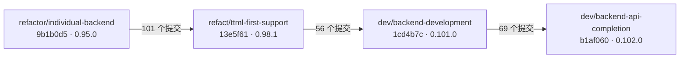

# 仓库分支与开发记录整理（2026-10-25）

> **2026-10-28后续集成：** 性能开发线 `dev/performance-optimization` 的 `77643f8` 已从 `1b2d375` 快进纳入 `main`，完整保留19个提交及原分支，产品0.107.0／合同1.39.0。两批优化、统一日志与原验收证据纳入主线；本次Git、合同和指纹复核见[main合入记录](backend-main-integration-20261028.md)。未删除其他分支或工作树，下方历史数量仍只代表原快照。

> **2026-10-27后续集成：** P3/P4/P5与两批GPU工作已从 `dev/gpu-render` 的 `9ab24b0` 快进纳入 `main`，完整保留95个提交。当前分支入口与新跑回归见[main合入记录](backend-main-integration-20261027.md)；本文件下方的分支数量、远程列表和“尚未合入”均为2026-10-25/P5时快照，不表示合入后的现状。

> **快照范围说明：** 本文记录 2026-10-25 将原开发线改名为 `main` 并清理分支时的结果，分支数量、远程列表、工作树及“当前”均指该次整理时刻。后续 P3/P4 在 `dev/backend-api-completion-p2` 开发并新增了任务分支；P5审查时该分支比 `main` 多42个提交，P3/P4/P5尚未合入 `main`。当时分支事实和 API 交接入口见 [P5收口审查](../research/backend-api-p5-closure-audit-20261025.md#2-分支与版本基线)，不要用下方“远程仅main／19分支”推定后续现状。本次P5不执行新的分支删除或集成。

## 整理时结果：main 为开发与默认入口

2026-10-25 按用户指示，已将本地及 GitHub 上的 `dev/backend-api-completion` **改名为 `main`**，并将 GitHub 默认分支设为 `main`。改名时两端 HEAD 均为 `c05fd4a5bda56900d09b418ef1eafbd85f93e897`，提交历史保持原样；后续文档记录提交继续进入 `main`。本地跟踪 `origin/main`，`origin/HEAD` 指向 `origin/main`。

本次“没有独立于当前 HEAD 的 Commit”按提交可达性判断：**`git rev-list --count main..<分支>` 必须为 0**。删除前重新核对本地/远程 SHA 和工作树绑定；远程删除附带预期 SHA 的 lease 并原子执行，本地用 `git branch -d`。

| 已删除分支（本地与远程） | 删除前 HEAD | `main..分支` 提交数 |
|---|---|---:|
| `dev/backend-development` | `1cd4b7cefca3ac1ca1530836e1a51a1b803628c2` | 0 |
| `refact/ttml-first-support` | `13e5f619d79f73595bf947b829932bb1887fe54f` | 0 |
| `refactor/individual-backend` | `9b1b0d5df99c8550f8d2e8da8dfa96cafafe66bd` | 0 |

原 `dev/backend-api-completion` 名称随改名移除；其全部提交由 `main` 继续引用。远程整理后仅有 **`main` 一个分支**。本地为 **19 个分支**：`main` 加 18 个任务分支。

18 个任务分支仍有独立提交 SHA，按本次条件全部保留。下表计数包含合并提交；它与后文旧快照中的 `git cherry` 补丁等价计数含义不同：

| 保留分支 | `main..分支` 提交数 |
|---|---:|
| `agent/api-completion-docs` | 1 |
| `agent/api-completion-probe` | 1 |
| `agent/final-contract-freeze` | 1 |
| `agent/font-wire-fix` | 1 |
| `agent/p1-background-fonts` | 12 |
| `agent/p1-docs-correction` | 1 |
| `agent/p1-edit-preview` | 3 |
| `agent/p1-empty-project` | 1 |
| `agent/p2-candidate-attachment` | 2 |
| `agent/p2-candidate-background` | 1 |
| `agent/p2-contract-final` | 1 |
| `agent/p2-export-media` | 23 |
| `agent/p2-runtime-input` | 5 |
| `agent/p2-runtime-validation` | 4 |
| `agent/runtime-preview-measurement` | 7 |
| `agent/runtime-validation-envelope` | 2 |
| `codex/basic-business-bugfix` | 1 |
| `work/p1-lyrics-import` | 2 |

其中 14 个分支的补丁已有等价集成提交，但原提交对象并未进入 `main` 的祖先链，因此本轮保留。18 个现存工作树、7 条失效工作树登记、两个本地标签及原有 6 个未跟踪探针文件也保持原样。本次只调整分支引用和文档入口，产品仍为 `0.102.0`、合同仍为 `1.36.0`。

## 整理前快照（基线 b1af060）

以下§1～§6保留改名前的审计快照；其中“当前”、分支名称、数量与默认分支均指当时状态。最新分支状态以上节为准。

核对目录：`/mnt/Data/Program/MakoKaraGenerator-Backend`。Git 快照基线为整理前的 `b1af060`；下列提交差、分支数量与工作树状态均对应此基线，本次文档提交不计入。远程信息经 `git fetch origin` 和 `git ls-remote --symref origin` 实际核对。

当前开发入口是 **`dev/backend-api-completion`，产品 `0.102.0`／合同 `1.36.0`**。P1/P2 当前计划代表后端范围已完成；下一阶段为 P3 完整模板与预设工坊、P4 作者与个人配置、P5 完整 API 交接。具体范围以[补齐计划](../plans/backend-api-completion-plan.md)、[实施§80](backend-extraction-progress.md#api-completion-01020)和[冻结合同](../../../web/api-contract.md)为准。

## 1. 远程分支与历史关系

远程 `origin` 为 `Zydr114/MakoKaraGenerator-Backend`。实际存在 **4 个远程分支**，本地都有同名分支且与远程完全一致；本地、远程均没有 `main`。

| 分支 | 核对时 HEAD | 最后提交日期（北京时间） | 产品／合同 | 相对 `b1af060` 少的提交 | 用途与现状 |
|---|---|---|---|---:|---|
| `dev/backend-api-completion` | `b1af060` | 2026-10-25 | 0.102.0／1.36.0 | 0 | 当前工作分支，P1/P2 统一输入、编辑候选与整曲导出代表验收已收口 |
| `dev/backend-development` | `1cd4b7c` | 2026-10-24 | 0.101.0／1.35.0 | 69 | 上一阶段集成基线，包含图片预览/验证/导出实现、架构审计和 API 补齐计划 |
| `refact/ttml-first-support` | `13e5f61` | 2026-10-20 | 0.98.1／1.30.1 | 125 | TTML/ruby、spacing、公共 package 预览与 validation 阶段历史基线；范围已超出分支名称 |
| `refactor/individual-backend` | `9b1b0d5` | 2026-10-18 | 0.95.0／1.25.0 | 226 | 独立后端拆分及基础业务阶段历史基线；仍是 GitHub 远程默认分支 |

四个分支满足祖先关系，后一个完整包含前一个的提交历史：



上述差值来自 `git rev-list --count <旧分支>..<新分支>`，并逐对通过 `git merge-base --is-ancestor`。它们是历史基线与当前分支的关系，不表示存在四套独立待合并的功能。

**默认入口落后于开发入口。** 直接进入 GitHub 首页或默认 clone 会落在 `refactor/individual-backend` 的 0.95.0。核对当前后端时应显式选择 `dev/backend-api-completion`。是否调整远程默认分支属于后续仓库管理决定。

仓库已设置 `fetch.prune=true`。本次 fetch 按既有配置移除了远程已不存在的本地跟踪引用，包括旧 `origin/main`、UI 分支和早期后端任务分支；这不表示本次删除了远程分支或源仓库历史。

## 2. 本地任务分支

本地共 **22 个分支**：上表 4 个长期/集成分支，加下表 18 个任务分支。18 个任务分支均未设置 upstream，远程没有同名分支。

任务提交大量通过 cherry-pick 进入集成分支，因此仅执行 `git branch --merged` 会漏掉已经吸收的工作。本表结合祖先关系和 `git cherry dev/backend-api-completion <任务分支>`：

- **等价补丁全部存在**：该任务分支所有分叉后的非合并提交，都能在当前分支找到相同 patch-id；共 14 个分支。这只能证明补丁吸收，不单独证明运行验收或后续改动保真。
- **存在补丁差异**：仍有 `git cherry` 标记为 `+` 的提交；共 4 个分支。对应功能已有集成提交，但整合修改、不同基础上下文及合并提交会影响比较，不能把 `+` 数量直接当成遗失功能数。

| 任务分支 | HEAD | 任务内容 | 相对当前基线的补丁核对 |
|---|---|---|---|
| `agent/p1-background-fonts` | `749be6c` | 背景编辑、字体 Worker/HTTP 与行为说明 | 存在 4 个非等价补丁，见下表 |
| `agent/p1-edit-preview` | `eb06e86` | 编辑候选、候选测量与原子应用 | 存在 1 个非等价补丁，见下表 |
| `agent/p1-empty-project` | `343b8d5` | 空工程/单素材创建 | 等价补丁全部存在 |
| `work/p1-lyrics-import` | `f34da65` | 歌词导入规划、六音轨家族分析 | 等价补丁全部存在 |
| `agent/p1-docs-correction` | `fdec054` | 恢复实施记录并修正合同边界 | 等价补丁全部存在 |
| `agent/p2-export-media` | `cdada2d` | 导出质量/资源策略、音轨、上传与统一 Runtime 导出 | 存在 16 个非等价补丁，另有 3 个合并提交 |
| `agent/p2-runtime-input` | `90df321` | 固定媒体、预设、包资源与字体输入 | 等价补丁全部存在 |
| `agent/p2-runtime-validation` | `c155624` | 正式 validation 消费统一 Runtime 与任务 SHA | 存在 1 个非等价补丁，见下表 |
| `agent/runtime-preview-measurement` | `06bcd21` | 统一输入的预览/测量及固定 snapshot 校验 | 等价补丁全部存在 |
| `agent/runtime-validation-envelope` | `78683ec` | validation 的 Host 信封门禁与编排 | 等价补丁全部存在 |
| `agent/p2-candidate-attachment` | `6d177e9` | 候选附着测量的媒体授权、部分 token 正文墨迹 | 等价补丁全部存在；没有绑定工作树 |
| `agent/p2-candidate-background` | `cabe953` | 候选背景命令复用与媒体历史修复 | 等价补丁全部存在 |
| `agent/font-wire-fix` | `60d8639` | Worker 字体成功响应信封修复 | 等价补丁全部存在 |
| `agent/p2-contract-final` | `a3d34a1` | 统一 Runtime 与高级模板合同审阅 | 等价补丁全部存在 |
| `agent/api-completion-probe` | `7ca8871` | HTTP 探针对工程状态与事件游标的正确比较 | 等价补丁全部存在 |
| `agent/api-completion-docs` | `d52ac1f` | P1/P2 最终代表验收与文档收口 | 等价补丁全部存在 |
| `agent/final-contract-freeze` | `7008537` | 最终 HTTP 证据与行为指纹更新 | 等价补丁全部存在 |
| `codex/basic-business-bugfix` | `9b714c7` | 0.94.1 透明导出合同及前奏错误反馈 | 等价补丁全部存在 |

存在补丁差异的分支保留以下追溯入口；本次没有对这些差异重新作逐行语义验收：

| 分支 | 非等价原提交 | 当前分支中的整合入口 |
|---|---|---|
| `agent/p1-background-fonts` | `89b0ce7`、`82fadec`、`c807aa0`、`749be6c` | 字体合同/预算 `667220b`，行为文档 `c37f412`，后续响应修复 `766d7f4` |
| `agent/p1-edit-preview` | `d611dcf` | 候选/原子应用 `41fa95e`，后续候选背景修复 `2f64c19` |
| `agent/p2-runtime-validation` | `3e4b8ce` | 统一验证输入 `6fb2f51`，后续 Host 编排 `57e5777` |
| `agent/p2-export-media` | `b37d495` 起的 16 个非等价补丁，含 `dac9f54`、`0aa1c13`、`7e7626a` | 质量 `798bb81`、策略 `38505bf`/`d6ab9da`、上传 `6d3dedd`、固定输入 `df8a6f9`、统一导出 `fa604df`、比例回归 `4f00599`；其余提交见当前分支日志 |

## 3. 工作树、暂存与标签

`git worktree list --porcelain` 登记 **25 个工作树**，其中 **18 个目录存在、7 个为可清理登记**。18 个现存目录由主工作树和 17 个任务工作树组成。

- 主工作树位于 `dev/backend-api-completion`；整理前没有已跟踪文件改动，只有 `tools/backend-project-image-export-probe/` 下 **6 个未跟踪文件**。它们属于旧图片导出独立探针；本次保留原字节，不加入整理提交，其 README 的验收描述不作为已通过证据。
- 其余 17 个现存任务工作树全部干净。多数位于仓库同级 `MakoKaraGenerator-Backend-*` 目录；旧 bugfix 位于 `artifacts/worktrees/basic-bugfix/`。
- `MakoKaraGenerator-Backend-p2-candidate-attachment` 目录实际绑定 **`agent/p2-candidate-background`**；同名旧任务分支 `agent/p2-candidate-attachment` 当前没有工作树。目录名不能代替分支核对。
- `git stash list` 为空。

7 条目录已不存在、Git 标记为 `prunable` 的登记如下；本次仅登记，未执行工作树清理：

```text
/tmp/makokara-measurement-baseline-c10eaad
/tmp/makokara-measurement-fix2
/tmp/mkg-contract-head
/tmp/mkg-g21
/tmp/mkg-image-oracle-d961895
/tmp/mkg-package-export-head-20261021
/tmp/mkg-validation-docs-final-e170926
```

| 标签 | 实际提交 | 本地／远程 | 意义 |
|---|---|---|---|
| `archive/backend-migration-20261017-8526b84` | `8526b84` | 两端均有 | 后端拆分前源代码归档；annotated tag 对象为 `7fe5a0b` |
| `v0.2.7` | `c7a43e2` | 仅本地 | 保留的旧桌面历史标签；tag 对象为 `cb91562`，不是当前后端发布版本 |

## 4. 开发历史主线

下表按阶段归纳已有记录。**验收结果沿用原批次归属，本次文档整理没有重跑产品或 HTTP 验收，也不累加不同目录的测试计数。**

| 日期 | 阶段／版本 | 主要成果与证据边界 | 开发记录入口 |
|---|---|---|---|
| 2026-10-15～2026-10-18 | Web 编辑基础，0.75.1～0.94.1 | headless 启动、精确修订读模型、正文/时间/来源/元素操作、波形、样式、模板、编排与测量逐步接通；G20～G24 原定义后端范围按当时判据关闭 | [实施§31～§57](backend-extraction-progress.md)、[G20～G24 计划](../plans/backend-g20-g24-completion-plan.md)、[0.94.1 补丁记录](../acceptance/backend-basic-business-bugfix-0941.md) |
| 2026-10-17 | 独立后端仓库拆分 | 以 `8526b84` 归档，`52bace2` 删除桌面 UI，`5bfb271` 清理 UI 依赖，`8ef13fb` 记录拆分边界；保留完整历史 | [仓库拆分记录](backend-repository-split.md) |
| 2026-10-18 | 基础业务，0.95.0／1.25.0 | 授权目录、LRC、音频历史、工程资源、完整模板传输、最终静态样式及 clip 扩缩/拆合；实现 `40ee152`、探针 `1ffd5f4`、归档 `9b1b0d5` | [基础业务计划](../plans/backend-basic-business-completion-plan.md)、[实施§58](backend-extraction-progress.md#basic-business-0950) |
| 2026-10-19 | TTML/ruby，0.96.0；spacing，0.97.0 | ruby 独立片段时间、TTML 项目/AMLL 往返与共享布局间距；时间轴与 spacing 是两个批次 | [时间轴计划](../plans/backend-ttml-ruby-timeline-plan.md)、[spacing 计划](../plans/backend-ruby-spacing-plan.md)、[实施§59～§61](backend-extraction-progress.md) |
| 2026-10-19～2026-10-20 | package 公共预览/validation，0.98.0～0.98.1／1.29.0～1.30.1 | 公共预览 final6 为 1513 请求／14090 断言；validation 成功多帧批次为 450／1533，warning/recovery 等各保留独立证据 | [公共预览计划](../plans/backend-public-package-preview-plan.md)、[validation 计划](../plans/backend-package-validation-plan.md)、[实施§62～§69](backend-extraction-progress.md) |
| 2026-10-21～2026-10-22 | package 资源与连续预览、无音轨导出，0.98.1／最高1.32.0 | 受控资源/租约、package 测量与作者有限接口接续；资源闭包/连续预览代表 HTTP 295／1863，无音轨导出 457／2575。原始资源读取、实际媒体消费与作者完整流程分别记账 | [资源与连续预览计划](../plans/backend-package-resource-closure-continuous-preview-plan.md)、[实施§70～§76](backend-extraction-progress.md) |
| 2026-10-23 | 已保存 Image 预览，0.99.0／1.33.0 | 发布 `d961895`；HTTP final6 为 1175／9760，40 组原 Runtime PNG/像素比较，105 个观察身份退出 | [图片预览计划](../plans/backend-project-image-preview-plan.md)、[实施§77](backend-extraction-progress.md#project-image-preview-0990) |
| 2026-10-24 | 已保存 Image 正式验证，0.100.0／1.34.0 | 发布 `7a03863`；HTTP final1 为 1412／10582，33 个观察身份退出；正式 validation 无 PNG | [图片验证计划](../plans/backend-project-image-validation-plan.md)、[实施§78](backend-extraction-progress.md#project-image-validation-01000) |
| 2026-10-24 | Image 导出登记、架构审计与 API 补齐计划，0.101.0／1.35.0 | 图片导出实现 `1276982`、合同 `688b0d4`；旧独立 HTTP 尚未验收。随后 `9b0872e` 架构审计、`1cd4b7c` 补齐计划形成新开发入口 | [图片导出计划](../plans/backend-project-image-export-plan.md)、[实施§79](backend-extraction-progress.md)、[架构审计](../research/backend-structure-audit-20261024.md) |
| 2026-10-24～2026-10-25 | P1/P2 统一 API，0.102.0／1.36.0 | 空创建/上传、导入规划、字体诊断、背景编辑、候选原子应用、统一 Runtime/包字体/高级 Line/Token 执行、代表整曲与取消；当前计划代表后端范围完成 | [补齐计划§8](../plans/backend-api-completion-plan.md#8-p1p2-实施记录)、[实施§80](backend-extraction-progress.md#api-completion-01020)、[统一 API§23](../../architecture/backend-api.md#unified-runtime-input-01020) |

旧 0.101 图片导出的独立验收状态保留于原记录；其代表工程导出已纳入 0.102 的统一 Runtime 流程，不应把旧“HTTP 待验收”解释为当前所有 Image 导出仍不可用，也不应反过来把新代表流程记成旧独立探针全矩阵通过。

## 5. 当前验收基线与后续开发

当前 0.102 批次的代码、合同、发布、探针和文档提交应分别识别：

| 角色 | 已记录基线 | 含义 |
|---|---|---|
| 生产修复 | `2f64c19` | 候选背景命令复用及媒体历史修复；该基线 solution 构建 0 警告/0 错误，相关回归 22/22 |
| 匹配发布 | `92c3e84` | `dist-92c3e84/deployment.json` 的源码；Release/linux-x64/self-contained、`sourceDirty=false`，1006 发布文件/885 生产输入 |
| 最终生成合同 | 合同提交 `eda4ee5`，source baseline `2f64c19` | 91 路径／101 方法／500 schemas／96 工程命令，2974 例（2248 反例）；最终文档行为指纹于 `b1af060` 刷新 |
| HTTP 探针 | `dfc5451` | 修正全 client 事件游标比较后执行 final3；不改变生产发布基线 |
| 最终记录 | `cdb6570`、`3a1142c`、`b1af060` | P1/P2 代表验收收口、表格状态与最终合同指纹对齐 |

现存本机证据入口为 `artifacts/api-completion-20261024/`，这些忽略目录不会随普通 Git clone 交付：

- `http-final3/summary.json`：passed，**320 请求／2215 断言**，13 个 job 终态为 12 成功/1 取消；180 秒、4320 帧带音轨成片及短透明/质量档位，视频+高级 Line+独立包字体的代表预览/测量/validation/短导出通过。
- `contract-http-final3.json`：307 个实际 JSON 响应、91 个成功请求的形状检查，覆盖 38 个操作，13 个非 JSON 跳过；此为留档检查，与 HTTP 业务运行分别计数。
- 原记录包含 Server exit0、64 个观察身份全部退出、remaining 为空及 781 文件凭证扫描；本次只核对入口与摘要，不重做媒体/像素/进程验收。
- `http-initial1/`、`http-final1/`、`http-final2/` 保留各自失败归属，不与 final3 合计。最终结论及完整限制见[实施§80](backend-extraction-progress.md#api-completion-01020)。

后续开发按当前[补齐计划](../plans/backend-api-completion-plan.md)推进：

| 阶段 | 待交付的用户流程 | 当前边界 |
|---|---|---|
| P3 | 完整高级模板定义读写、包检查、试样目标、clips/高级 node 分配、`.mktpl` 编辑分享往返 | 已有高级 Line/Token 运行能力不能代表定义编辑器接口完成 |
| P4 | 作者草稿列表/源码读取、参数配置、可取消编译、运行试样、个人配置库 | 当前有限作者操作不能代表完整作者闭环 |
| P5 | 全部目标 API 目录与冻结合同最终收口、完整交接 | 待 P3/P4 实施后完成 |

浏览器/用户、跨平台、任意输入组合、性能与完整产品分发继续独立登记。旧 B3/B4/B5/B6 文档保留历史，后续执行顺序以当前 P0～P5 计划为准。

## 6. 开发记录入口与维护方式

| 需要了解的内容 | 优先阅读 | 使用边界 |
|---|---|---|
| 当前分支/里程碑快照 | 本文 | 固定于 `b1af060`；后续新增提交需重新核对 |
| 当前目标、完成条件和阶段顺序 | [API 补齐计划](../plans/backend-api-completion-plan.md) | 区分已完成 P1/P2 与 P3/P4 提案 |
| 当前 API 和拟议变化 | [目标目录](../../backend-api-target-catalog.md)、[web 入口](../../../web/README.md)、[冻结合同](../../../web/api-contract.md) | 拟议 API 不计入已交付接口 |
| 实际 HTTP/Worker 行为 | [统一 API](../../architecture/backend-api.md)及源码 | 以当前实现和同提交合同为准 |
| 每批实现、验收、失败与证据 | [实施记录](backend-extraction-progress.md) | 最新读§80，早期条目保留各自范围 |
| 整体演进与裁决 | [roadmap](roadmap.md)顶部当前入口、[ADR](../decisions/decisions.md) | 长文中的旧“当前”表述须结合日期读取 |
| 架构与模块职责 | [2026-10-24 架构审计](../research/backend-structure-audit-20261024.md)、[架构图](../../backend-structure-20261024.mmd) | 结构审计不代替功能或产品验收 |
| 原桌面需求/设计与历史发布 | [development](development.md)、[CHANGELOG](../../../CHANGELOG.md)中的源桌面记录 | 保留作历史参考，桌面 Avalonia 已移出当前仓库 |

前次审计建议后续从开发线创建有限任务分支，按步骤提交并同步远程；集成后记录来源提交与必要修复。整理旧分支/工作树前，先复核未提交文件、patch-id 差异与归档需求。前次文档整理未执行远程默认分支调整、任务分支删除或 7 条失效工作树登记清理；后续实际分支整理结果见本文顶部。

本次整理只新增索引并修正 README/CHANGELOG 入口，没有改变产品能力、版本、冻结合同或既有验收状态。
