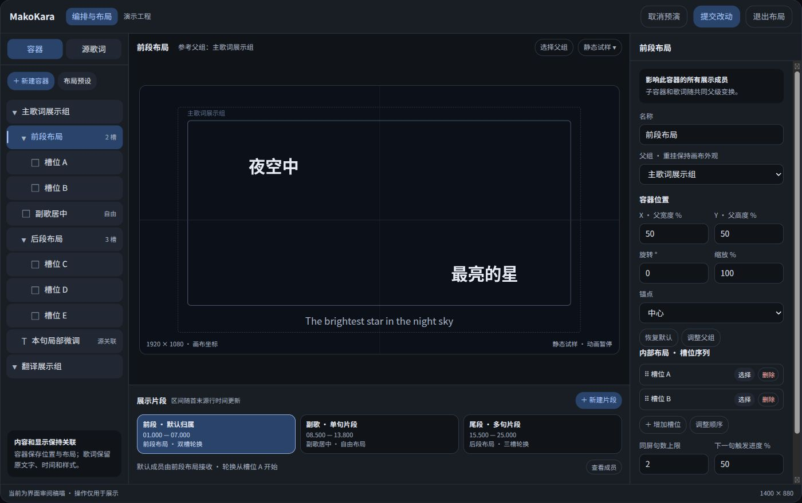
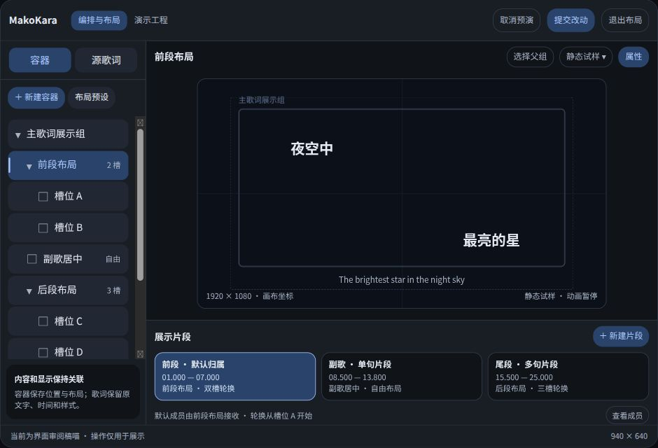

# 通用编排编辑器实施合同：数据结构与 UI

> 日期：2026-10-01；本合同交付基线 0.8.0，现行程序 0.8.1；工程／歌词／模板 schema：20／15／3。
> 状态：**G0 已批准，G1～G4 已实现并通过自动验证，0.8.0 基本编排流程已获人工确认**。原型与审阅过程见 §7，0.8.0 实施证据及验收路线保留在 §8；0.8.1 已按批准的[体验优化方案](scene-editor-ux-optimization-plan.md)实施并获用户“测试验收通过”，最新证据及记录见其 §13。0.7.1 注音修订的人工验收记录保持不变。
> 来源：[总体方案](scene-container-editor-plan.md)、ADR-0063～0065、当前代码及用户五项答复。

## 1. 已确认及拟交付范围

用户已确认：同一源分支可分段选择容器／布局；自动槽位中可微调单句；多句片段由首句行起点至末句行终点并随源时间更新；重挂父级保持画布位置、旋转和大小；槽位变化后整段按新顺序从第一个槽位重新分配。

本次交付 **0.8.0**，工程 schema **20**；歌词 **15**、样式模板 **3** 不变。无旧工程转换。交付覆盖节点树、任意槽位、源行归属、通用片段、局部微调、预演／撤销、保存重开及共享预览／导出。脚本仍保持原合同，待展示身份稳定后继续。

## 2. 静态数据合同

继续由工程的 `lyricPresentation` 保存 `nodes`、`programs`、`lineOverrides`。源歌词和样式模板保持原职责。

### 2.1 nodes：容器的唯一位置来源

| 字段 | 类型 | 语义 |
|---|---|---|
| id | string | 稳定身份；新建生成，改名、重排和换父级不改变 |
| name | string? | 用户名称；未命名时 UI 显示分支角色／默认布局／槽位序号，源文件不补写推测名称 |
| parentId | string? | 真实父节点；空值表示画布 |
| placement | ScenePlacement | 归一化位置、锚点、旋转、统一缩放 |
| referenceWidthRatio / referenceHeightRatio | double | 固定参考尺寸相对于父参考矩形的比例 |
| layout | LyricContainerLayout? | 空值为纯组；有值表示内部歌词布局 |

节点数组次序用于树的同级显示次序；`slotIds` 单独规定轮换次序。当前歌词绘制次序仍由源分支和活动采样解释，不借树重排隐式改变媒体图层。

内部布局保持 `Auto` 与 `SlotSequence` 两类。Auto 使用 `defaultPlacement`、安全区及最大宽度；SlotSequence 使用一个或多个真实直接子节点的有序 `slotIds` 与调度参数。槽位位置只在节点保存，调度对象不重复保存。

双槽、三槽为内置创建预设。预设创建后使用同一节点编辑、槽位增删与调度流程。名称中的“双行”退出通用模型和编辑目标；已有 `LinePlacement` 收口为 `ScenePlacement`，调度类型收口为 `SlotSequence`，不保留旧名称适配作为新编辑器数据来源。

### 2.2 programs：一个分支的默认归属和展示片段

| 字段 | 类型 | 语义 |
|---|---|---|
| id | string | 稳定程序身份 |
| branchId | string | 唯一源分支 |
| rootContainerId | string | 共同展示根，可继续嵌套在纯组中 |
| defaultContainerId | string | 未分配到显式片段的源行使用该容器 |
| animationPolicy | enum? | 为空时按源角色解释；保持 Karaoke／Static／FollowPrimary 口径 |
| clips | LyricDisplayClip[] | 同一分支的显式展示片段 |

`LyricDisplayClip` 保存 `id/name/containerId/lineIds`。`lineIds` 是源分支中连续、按源顺序排列的成员 ID；单句就是一个成员。它不保存重复的起止时间、独占布尔或专用“双行／居中”类型。目标容器的 Layout 决定排版；片段在该展示程序中独占活动范围。

一个源行最多属于该程序的一个显式片段；其他源行由默认容器接收。删除片段后，其成员回到默认容器，提交前列出新的分配与冲突。目标容器可被不同时间的多个片段复用；片段之间不得时间重叠。

常规与单句片段共用合同。现行 `RegularContainerId`／`ExclusiveClips` 退出 schema 20；首期每个源行只有一个活动显示实例。源分支是内容来源，容器树不储存歌词副本。

首期显式片段要求源分支为 Independent 且采用 Karaoke；关联翻译继续依据最终可见主行，在自己的默认容器排布。翻译的分段关联及同时多实例属于后续合同，不从本次主歌词答复推定。

### 2.3 lineOverrides：局部微调与本句进入动画

保留 `branchId/lineId/enterAnimation`，将原绝对 `placement` 替换为明确的 `localTransform`：

```text
LyricLocalTransform
  offsetXRatio = 0      // 相对于实际父容器／槽位的固定参考宽度
  offsetYRatio = 0      // 相对于实际父容器／槽位的固定参考高度
  rotationDegrees = 0 // 绕本句基础排版锚点
  scale = 1            // 围绕同一锚点
```

空值表示不微调。UI 可用像素或百分比显示偏移，转换由实际父参考尺寸决定。普通布局与槽位布局均使用同一微调层；旧绝对行位置不会在槽位模式隐式恢复。

基础排版锚点来自容器内部默认或槽位参考锚点。本句微调附加在基础排版之后，再叠加本句动画；注音继承完整文字矩阵。父组、槽位和微调共同参与预览、静态试样、命中和成片。

微调不携带字体、颜色或不透明度。样式继续走工程→分支→行→元素解析；进入动画保持行覆盖／工程默认规则。

### 2.4 编辑选择与运行身份

编辑选择用互斥的 `ContainerNode(NodeId)`、`SourceLine(BranchId, LineId)`、`DisplayClip(ProgramId, ClipId)` 表达。纯组和空槽位可独立选择；不再把选中源行作为容器编辑的前提。

持久化 NodeId／ProgramId／ClipId 与源 BranchId／LineId／TokenId 分别稳定。文本 ElementId 仍由源身份派生；一帧 ParentId 由当前装载决定。BindingId 由程序、片段或默认片段的首末源成员、目标容器／槽位与源行身份组成，不混入采样时间、显示名称和当前列表索引。源时间修改会重建会话与几何，但不单凭数值起止时间生成新的绑定身份；重新分配到另一槽位则改变该次装载身份。

`PresentationEditSession` 持有基准工程引用和不可变展示草稿。应用层沿用现有 ProjectHistory；App 只持有选择与预演状态，提交仍从 AdoptProject 入栈。矩阵逆解和树几何作为后端无关的纯规则收口在现有 Core 内，Rendering 消费同一结果；不新建项目或反向引用渲染层，不维护两套重挂计算。

### 2.5 示例（字段关系示意）

```json
{
  "nodes": [
    {"id":"show","name":"主歌词展示组","parentId":null,"placement":{"x":0.5,"y":0.5,"anchor":"Center","rotationDegrees":0,"scale":1},"referenceWidthRatio":1,"referenceHeightRatio":1},
    {"id":"dual","name":"前段布局","parentId":"show","layout":{"kind":"SlotSequence","slotIds":["slot-a","slot-b"],"slotAnimation":{"maxVisibleLines":2}}},
    {"id":"center","name":"副歌居中","parentId":"show","layout":{"kind":"Auto"}},
    {"id":"triple","name":"后段布局","parentId":"show","layout":{"kind":"SlotSequence","slotIds":["slot-c","slot-d","slot-e"],"slotAnimation":{"maxVisibleLines":3}}}
  ],
  "programs":[{"id":"main-show","branchId":"primary","rootContainerId":"show","defaultContainerId":"dual","clips":[
    {"id":"chorus","name":"副歌","containerId":"center","lineIds":["line-3"]},
    {"id":"ending","name":"尾段","containerId":"triple","lineIds":["line-4","line-5","line-6"]}
  ]}],
  "lineOverrides":[{"branchId":"primary","lineId":"line-5","localTransform":{"offsetXRatio":0.03,"offsetYRatio":-0.02,"rotationDegrees":0,"scale":1}}]
}
```

此示意省略槽位节点及完整默认参数，不能当成完整工程直接读入。实际 DTO 仍严格校验必需节点、引用和当前格式；具体 Placement 键沿用现行映射定义。

## 3. 时间与调度

1. 显式片段区间为首个成员行起点至最后成员行终点，采用整数微秒和半开区间。所有成员必须有有效行时间，按源顺序和时间递增，完整包含在该区间中；不猜测未定时成员。
2. 区间内只调度本片段成员。内部间隙按该容器的提前显示、保留及退出规则采样，演唱进度仍由各句／各元素源时间决定。
3. 片段边界直接切换；进入／退出不得穿越边界。显式片段、默认片段均从第一个槽位重建。单句自由布局继续保留本句进入动画。
4. 默认成员按显式片段边界分成相互隔离的常规区间；源行演唱时间跨入其他片段时报告冲突并拒绝，不截断源时间。
5. 槽位数量、次序及容量变化后预演整个相关片段的绑定及可见区间。用户提交时整个片段按新序列重新分配，播放位置不是调度输入。
6. 修改源时间后重新计算片段区间和校验；区间重叠、顺序反转和失效引用阻断修改及导出。渲染只读源，绝不修正它。
7. 直接跳转与连续播放得到相同源绑定、矩阵、逐字进度及像素。预览和导出共享同一解析器、采样器与几何入口。

## 4. 重挂、删除、复制与历史

- **重挂保持画布外观**：新局部矩阵 = 新父世界矩阵逆 × 旧节点世界矩阵。固定参考宽高保持原局部尺寸，换算相对于新父的比例，使子树的相对坐标和世界外观一起保持。现行统一缩放＋旋转可分解；非法尺寸、不可逆矩阵、父循环或显示根约束明确拒绝。
- **槽位换父**：作为“移入另一槽位容器”原子操作，同时更新两边 `slotIds`、父引用和位置；原容器至少保留一个有效槽位，否则阻断。预演两边重新分配。
- **删除节点**：先展示子树及引用。被默认容器、片段、展示根引用的节点及使布局失效的删除被阻断；用户先显式解除或改绑。未引用子树可以明确删除，源歌词保持独立。
- **删除片段**：成员回默认容器；先预演重新分配及冲突，一次提交，可完整撤销。默认容器保证首期源行始终有归属。
- **复制子树**：给节点及内部槽位引用生成新 ID；保留局部参数和名称副本，不复制源歌词、程序或片段绑定。
- **源删除**：只清理被明确删除源对象的关联；空片段移除，剩余成员重新校验。不得因源删后形成冲突而静默重新绑定其他行。
- 所有操作使用不可变草稿和统一校验；一次提交一步撤销，无变化返回原引用，取消和失效草稿不写历史。数值回车／失焦、拖动松手完成当前草稿操作；顶部「提交改动」才写入工程历史，一次提交一步撤销。

## 5. UI 合同

交互稿：[通用编排编辑器](../../design/scene-editor-preview.html)。这是界面审阅稿，按钮只演示交互，不写真实工程。

宽窗口与窄窗口的实际浏览器排版检查如下。它们是 HTML 文档原型截图，不能作为 Avalonia 成品的验收证据：





[窄窗口属性覆盖面板](../../design/scene-editor-compact-inspector.jpg)

### 5.1 主窗口布局模式

复用现有主画布。布局模式时左侧歌词列表切换为“容器／源歌词”两页签；容器树直接展示任意节点。中部顶部显示当前编辑目标、归属和静态／时间预演；底部集中展示紧凑片段条与成员摘要。右侧检查器成为所选对象属性，合成设置仍可从独立入口打开。

布局模式暂停真实播放，提供时间预演和静态试样切换。新容器、新片段、套用布局预设在一级入口；面板使用短分组与直接操作，避免新增整页长表单。

### 5.2 尺寸与响应式

| 窗口 | 容器树 | 画布 | 属性 |
|---|---|---|---|
| 1400×880 | 约 224 px，独立滚动 | 中间余量，16:9 适配 | 约 300 px，局部滚动 |
| 940×640 | 约 208 px，可收起 | 保留可见画布和底部 150 px 片段区 | 300 px 右侧覆盖面板，按钮显式展开／关闭 |

断点仍依据 WorkspaceGrid 实际宽度，延用 1100 逻辑像素。窄窗口覆盖面板的状态按原响应式合同保留；画布不被强制挤成窄条。创建、预演／取消／提交及属性入口必须在最小尺寸直接可见。

### 5.3 选择与作用范围

- 点击容器树或画布同步选择稳定 NodeId；纯组无须先选某句。
- “选择父组／进入子项”直接可见；重叠命中显示候选列表。
- 选槽位时显示影响该槽位的片段与装载歌词；选本句时显示只影响该句的局部微调。
- 数值栏标明坐标参考父组、单位、锚点及作用范围，行微调栏使用“偏移”而非“位置”。
- 槽位列表动态生成，提供新增、复制、删除和顺序调整；同屏上限、触发、保留、冲突策略放在同一布局组。
- 片段选择联动成员清单和对应容器，可跳到起点／中点／终点前。创建片段选择连续源行和目标容器，时间只读显示来源。
- 改动预演后顶部显示未提交标记与影响摘要；“提交改动／取消预演”固定可见，错误不被二级菜单隐藏。

## 6. 实施拆分及验证

| 批次 | 输出 | 关键验收 |
|---|---|---|
| G0 | 本数据合同、两尺寸 UI 稿及用户确认 | 所有剩余结构／时序／删除决策有记录 |
| G1 | 原生模型、schema 20、校验及通用片段调度 | 保存重开、严格格式拒绝、边界隔离、引用与冲突、无变化引用 |
| G2 | NodeId 几何／选择／共用位置、单句局部微调、重挂 | 任意节点及第三槽位可编辑；父组变换、逆矩阵、参考尺寸和实际像素 |
| G3 | 容器树、槽位编辑、片段成员及预演提交 UI | 宽／窄布局、创建／删除／复制、错误反馈、取消／撤销与过期草稿 |
| G4 | 用户完整制作双槽→居中→三槽案例、清理旧双行适配 | 新建工程制作成功、翻译／注音、随机跳转、MP4 抽帧与预览一致 |

每批保存可构建的 Git 进度；程序交付递增版本，相关文档同步。完成 G1～G4 后交付 0.8.0；中间如单独交付可用程序，另行按现行版本规则递增。性能基准和脚本 SDK 实现仍待本合同稳定后开展。

## 7. 审阅状态

G0 审阅时，程序为 0.7.1，G1～G4 尚未开工。用户答复确定时间区间、重挂保持世界外观及整段重新分配；具体模型和 UI 如本稿所列。以下保留审阅时的证据，当前实施状态见 §8。

2026-10-01 用户分别回复「按这份数据合同实施」「按这套 UI 实施」，明确批准默认容器兜底／删除片段回归、连续且有行时间的成员、复制子树不复制绑定，以及本稿具体数据格式和界面组织。AGENTS.md §8.3 所需的具体结构／删除决策已得到答复，进入 G1～G4。

G0 文档原型已检查 1400×880 与 940×640 排版、窄窗属性展开／关闭、整组数值移动、取消恢复、三槽切换、增加第四槽及重排。创建／成员／删除影响弹窗展示拟定流程，不执行真实项目命令。程序版本、schema 和 1434 项测试基线均未因此改变。


## 8. 0.8.0 实施结果与验收路线

### 8.1 已实现代码

| 批次 | 结果与入口 |
|---|---|
| G1 | `ScenePlacement`、`SlotSequenceAnimationProfile`、`LyricDisplayClip.LineIds` 和 `LyricLocalTransform`；工程 v20 的原生 DTO、严格键校验与通用片段解析；连续／定时成员、源时间顺序、重复绑定、时间冲突及删除清理均校验 |
| G2 | Core 的 `SceneTreeGeometry`／`SceneMatrix` 为渲染和重挂提供同一矩阵；`SceneTreeEditor` 按 NodeId 编辑、复制、删除、增删槽位、独立重排槽位及同级树顺序；画布读取共享世界几何，任意节点／第三槽位及本句局部偏移可编辑 |
| G3 | 主窗口「容器与布局编辑」进入真实三栏 `SceneEditorControl`；容器／源歌词页签、默认归属与紧凑片段列表、动态属性、创建／成员／重挂／删除反馈、覆盖面板和时间预演已接通真实项目命令 |
| G4 | 从仅含源歌词的新工程经编辑命令制作六句「双槽→居中→三槽」，保存重开、片段边界、三槽同时可见、源绑定、注音／翻译、局部微调及真实 MP4 抽帧对比通过 |

`PresentationEditSession` 持有基准引用与不可变草稿；取消不写盘／历史，提交一次入历史，过期草稿拒绝提交。源内容编辑如破坏已有片段连续性或时间合法性会拒绝并明确提示；删除明确源对象才清理其关联。未使用容器保留，复制子树不带源内容／片段绑定。

旧固定 `ScenePlacementTarget`、`GetPlacementGeometry`、双行专用配置表单和批量位置窗口已退出 App；模型和调度名称收口为 SlotSequence。`LyricBranchPresentation` 仅保留分支显示策略、默认投影与采样适配，通用编辑器直接编辑原生树。双槽／三槽只是创建预设；新增槽位通过同一动态列表和校验，不受前两个编辑目标限制。

### 8.2 验证证据与限制

全量构建 **0 警告、0 错误**；Application **66**、Core **824**、Export **35**、Media **69**、Rendering **227**、App **165**、Timeline **84**，共 **1470** 项自动测试通过。

- Core 覆盖当前格式往返、旧 `exclusiveClips`／`regularContainerId`／行 `placement` 拒绝、连续成员、时间跟随、冲突拒绝、引用删除、复制身份、独立树／槽位重排、六种锚点及跨旋转缩放父组重挂的子树世界几何。
- Application／App 覆盖无变化原引用、纯展示草稿范围、取消／一次提交／撤销重做／过期拒绝、完整新工程编排、第三槽位、空工程、局部微调、源插入破坏片段连续性时拒绝。
- Rendering 覆盖半开边界、三槽活动绑定、源时间改变后稳定 BindingId、重新排序后的新装载、空节点固定参考几何、文字与注音共用矩阵及翻译原位。
- Export 实际导出 MP4，抽取第 90／150／330 帧与相同时间共享预览比较，每帧像素符合率超过 90%；11 秒确认三句同时显示。压缩输出使用容差比较，不宣称编码后的逐像素相等。
- 真实 Avalonia 生命周期探针操作创建三槽、默认归属、连续片段、提交、撤销／重做和空工程；程序化点击实际按钮并选择实际对话框字段。使用真实宿主控件在 **1400×760／940×520 内容区**测量和渲染，两尺寸的提交、取消、新建容器／片段可见；窄区画布约 687×214，属性是 300 px 覆盖面板。niri 实际宿主窗口为 1008×1103.2，内容测量不是宣称窗口已人工调整为原型尺寸。

实际控件截图：[宽内容区](../../design/scene-editor-native-wide.png)、[窄内容区](../../design/scene-editor-native-compact.png)、[窄区属性面板](../../design/scene-editor-native-inspector.png)。临时探针及启动开关已移除，正式程序没有探针路径。**上述是 0.8.0 自动验证。** 2026-10-01 用户实际制作工程，确认“效果不错，基本按预期生效”“功能基本没问题”，记录为容器／片段／轮换基本流程人工确认；不扩大为下列所有边界均已人工通过。用户指出入口、角色和排版问题，随后批准[体验优化方案](scene-editor-ux-optimization-plan.md)；0.8.1 已实施该方案并获用户“测试验收通过”，最新证据及验收记录见其 §13，本节保留 0.8.0 历史。

### 8.3 用户验收路线

1. 在主窗口进入「容器与布局编辑」。选主歌词展示组，创建双槽／自由布局／三槽容器；新建容器应出现在树中并带未提交标记。
2. 设置默认归属为双槽；创建居中单句片段，再创建尾段连续多句片段指向三槽。起止来自源行，只读显示。开启「按时间预演」，拖动时间并用片段起点／中点／终点前查看边界。
3. 选第三槽位修改位置；新增、复制、删除未引用槽位并重排，检查整段从首槽重新分配。槽位数和正整数同屏上限独立，当前合同没有“同屏上限不得超过槽位数”的约束；删除最后一个有效槽位应拒绝，不静默截断或修改上限。
4. 在容器属性更改父组，检查画面位置／旋转／大小保持。直接拖动父组应带动全部子项；画布 Ctrl 点击或重叠目标可打开候选列表。
5. 切「源歌词」选择某句，修改局部偏移／旋转／缩放，检查其他句和槽位不变、注音跟随本句、关联翻译保持其容器位置。
6. 取消草稿应恢复工程画面；提交应一次入历史，可撤销／重做并保存重开。已被展示根、默认归属或片段引用的节点删除应报告引用并拒绝。
7. 缩窄工作区，检查画布／片段区和固定操作按钮；显式展开／关闭属性，切回宽区时状态按响应式合同保留。

本批未引入同一源行同时多实例显示、翻译分段编排、脚本执行或性能基准。用户随后指定[前奏调研](../plans/karaoke-lead-in-plan.md)，具体合同待批准；后续 SDK 固定前需纳入内容身份与准备显示语义，不改变本实施合同已完成的源时间、树和片段规则。
