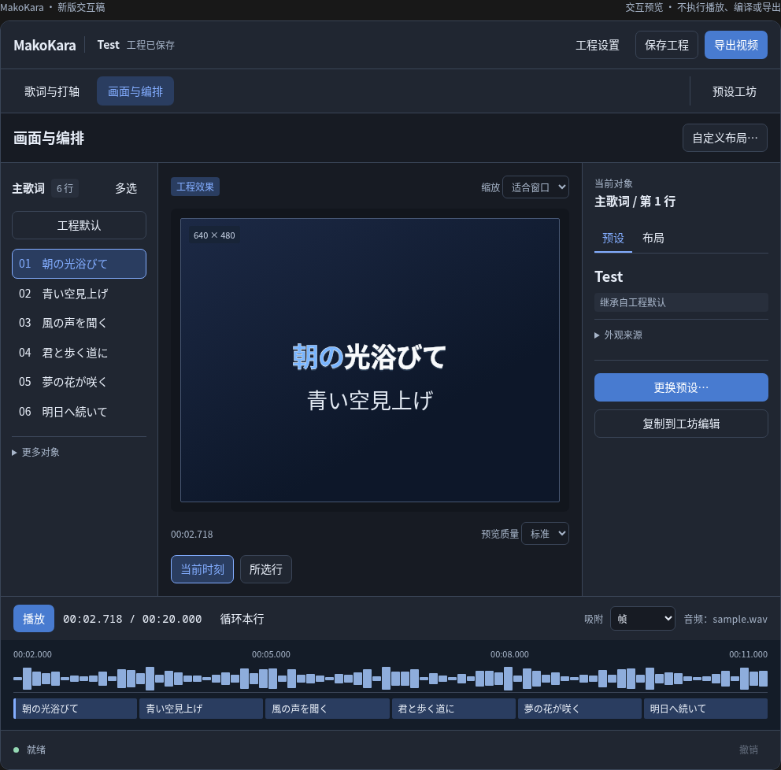
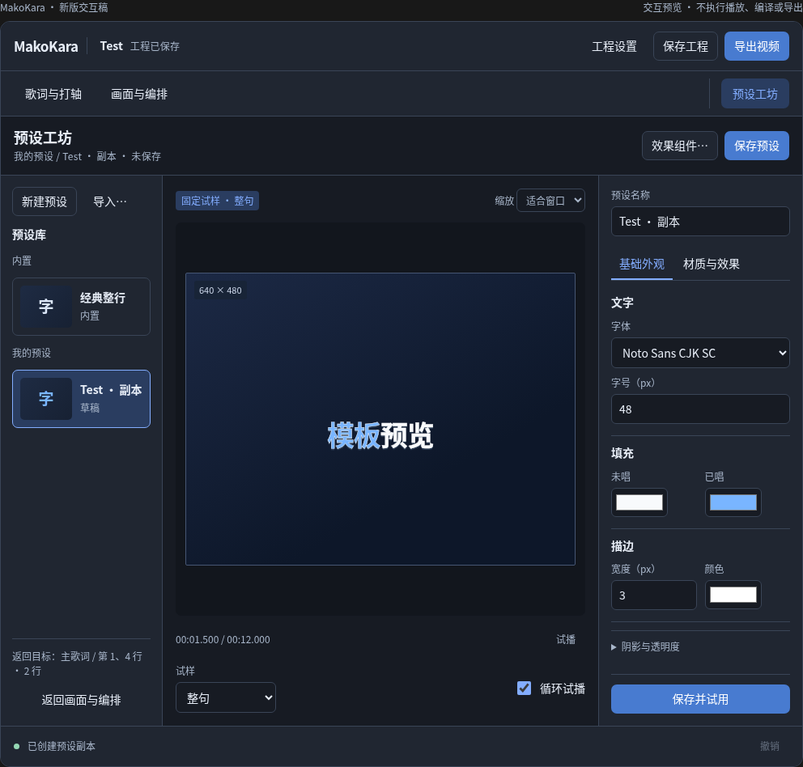

# UI 重构规划：以 0.49.6 自然引导设计为基线

日期：2026-10-10。状态：**用户已确认设计基线，已交付第 1 步共用基础（0.49.7）及第 2 步的外壳（0.49.8）、歌词编辑与时间组提交切片（0.49.9）、工程设置和统一添加歌词入口（0.49.10），以及第 3 步的对象选择、来源映射与候选预览切片（0.49.11）、复制当前应用到工坊/保存返回试看切片（0.49.12）、工坊基础外观首屏/资源库状态切片（0.49.13）和第 4 步效果组件配置/验证/源码工作流切片（0.49.14）；效果作者完整闭环、设置/导出往返及完整重构继续分批实施。**

实际入口、代码与验证进度见[功能迁移基线](ui-0496-feature-migration.md)及[实施记录](ui-0496-refactoring-progress.md)。

本规划以用户确认“这个版本无问题”的自然引导版为准：设计提交为 `01933a6`，产品功能基线为本次审查的 `0.49.6 / 78b7a55`。后续实施前须记录实际起点；若产品已有新增功能，应补入保留清单，不能为了匹配旧截图而删除。

目标是保留当前全部功能和原生 SukiUI 风格，重新组织入口、编辑上下文和反馈，让操作本身引导用户。允许调整功能所在位置、名称和展开方式；不把设计稿未画出的功能视为可删除范围，不将“少解释文字”理解为少功能或隐藏必要状态。

## 1. 依据、引用和优先关系

### 1.1 设计与规则依据

| 编号 | 引用 | 本规划如何使用 |
|---|---|---|
| D-01 | [自然引导修订](../../design/ui-0496-natural-guidance.md) | 本轮信息显露、文案删减和引导方式的直接依据，尤其是第 2–5 节 |
| D-02 | [完整设计规范](../../design/ui-0496-redesign-spec.md) | 工作区职责、九个视图、状态、响应式与验收任务的详细定义；与 D-01 配套阅读 |
| D-03 | [可交互设计稿源](../../design/ui-0496-prototype.html) | 已确认的导航、布局、主流程与状态演示；是 HTML 片段，不是桌面实现，也不是全部功能清单 |
| D-04 | [36 项截图与代码审查](../../design/ui-0496-interaction-review.md) | 每项重构要解决的问题及代码证据；A/P/L/B/W/C 问题编号用于追踪，不把历史说明式解法重新搬回界面 |
| D-05 | [设计稿浏览器检查记录](../../design/ui-0496-redesign-previews/prototype-checks.json) | 88 条原型检查的历史证据；仅证明原型导航/布局，不能代替重构后的原生验收 |
| C-01 | [UiControlMetrics.cs](../../../samples/TechnicalSpike.App/Theme/UiControlMetrics.cs) | 控件尺寸、字体、密度、面板和时间轴规格的代码来源 |
| C-02 | [EditorStyles.axaml](../../../samples/TechnicalSpike.App/Theme/EditorStyles.axaml) | 统一 Suki 动作层级、控件密度、工作区页签、弹层外壳修复 |
| C-03 | [App.axaml](../../../samples/TechnicalSpike.App/App.axaml)、[Colors.axaml](../../../samples/TechnicalSpike.App/Theme/Colors.axaml)、[UiSukiTheme.cs](../../../samples/TechnicalSpike.App/Theme/UiSukiTheme.cs) | Suki 主题装配、语义颜色、应用级强调色与主题状态 |
| C-04 | [Directory.Packages.props](../../../Directory.Packages.props) | 当前锁定 SukiUI 7.0.1、Avalonia 12.1.3；本轮不顺带升级 |
| C-05 | [AGENTS.md §3.3–3.4、§8.3、§9](../history/AGENTS-20261029-history.md) | 本地化、代码与主题约束、工作方式及验证/提交规则 |

**引用优先关系：** 本轮用户明确要求 → D-01 的自然引导方式与 D-03 已确认布局 → D-02 的完整交互规则。本文件将它们转成施工要求。当前代码决定“已有功能和数据语义是什么”，C-01～C-05 决定原生外观及工程约束。旧提案中与本轮冲突的工作区组织和常驻教学文案不再作为施工目标。

涉及数据格式、继承算法、脚本执行能力或正式渲染结果的变化不由界面原型自动授权；发现冲突时先记录实际差异，不能为方便实现而裁掉能力或偷偷改变语义。原型中的示例验证、波形、固定数据与按钮占位不能直接成为生产逻辑。

### 1.2 明确的页面与状态设计稿

| 页面编号 | 默认界面稿 | 关键状态稿 | 对应文字规则 |
|---|---|---|---|
| S1 歌词与打轴 | [lyrics.png](../../design/ui-0496-redesign-previews/lyrics.png) | [时间输入错误](../../design/ui-0496-redesign-previews/timing-error.png) | D-02 §3；D-01 §3 歌词行 |
| S2 画面与编排 | [appearance.png](../../design/ui-0496-redesign-previews/appearance.png) | 对象、来源、空选择与多选见 D-03 | D-02 §4；D-01 §3 画面行 |
| S3 预设选择与试看 | [choose.png](../../design/ui-0496-redesign-previews/choose.png) | [非连续多选试看](../../design/ui-0496-redesign-previews/multi-selection-preview.png)、[缺少来源](../../design/ui-0496-redesign-previews/input-mapping-required.png) | D-02 §4/S3；D-01 §4 第一条路径 |
| S4 基础布局 | [layout.png](../../design/ui-0496-redesign-previews/layout.png) | 范围与候选变化见 D-03 | D-02 §5；D-01 §3 布局行 |
| S5 自定义布局 | [scene.png](../../design/ui-0496-redesign-previews/scene.png) | [歌词分配](../../design/ui-0496-redesign-previews/lyric-assignment.png) | D-02 §6；D-01 §3 自定义布局行 |
| S6 预设工坊 | [workshop.png](../../design/ui-0496-redesign-previews/workshop.png) | [可编辑副本](../../design/ui-0496-redesign-previews/workshop-edit.png) | D-02 §7；D-01 §4 第二条路径 |
| S7 效果组件 | [effects.png](../../design/ui-0496-redesign-previews/effects.png) | [配置](../../design/ui-0496-redesign-previews/effect-configuration.png)、[验证](../../design/ui-0496-redesign-previews/effect-validation.png)、[源码](../../design/ui-0496-redesign-previews/effect-source.png) | D-02 §8；D-01 §4 第三条路径 |
| S8 工程设置 | [settings.png](../../design/ui-0496-redesign-previews/settings.png) | 背景移除、字段修改见 D-03 | D-02 §9；D-01 §3 设置行 |
| S9 导出 | [export.png](../../design/ui-0496-redesign-previews/export.png) | 实际运行、失败、取消状态沿用产品能力并按本文件补齐 | D-02 §9–10；本文件 §5.7 |

首页、新建/打开、分支管理、复杂渐变/材质、库管理、诊断详情等未完整出现在以上 17 张图中。它们按下面的功能保留表迁移，沿用同一套 Suki 组件与交互规则，不得直接删去或降为无功能占位。

以下两张是实施对照的主要界面，其他页面以表中对应图为准：

## 2. 功能完整性与范围

### 2.1 功能保留规则

- **F-01：能力不减少。** 菜单、快捷键、上下文菜单、对话框和动态控件都属于功能入口。入口合并时，相关命令、适用对象、可用条件、精度、撤销、错误恢复仍要完整可达。
- **F-02：简化的是默认呈现。** 低频能力可以进入“更多”、详情、折叠区或子工作页；入口名称和归属必须清楚，不能仅靠隐藏快捷键访问。
- **F-03：已有语义不回退。** 固定预设副本、一个对象一个组合预设、具名输入映射、实际继承来源、稳定 ID、现有精度、工程与作者独立历史、存储闭包和显式更新保持。
- **F-04：前端改变不等于后端重写。** 优先重用当前命令、用例与验证服务，只补 UI 所需状态和适配。没有必要的数据变化不修改 schema、格式兼容门禁、公开接口或运行内核。
- **F-05：未画出不等于取消。** 下表按能力组列举，不能替代逐项清点。每个切片必须登记“原入口/命令 → 新入口 → 原可用条件 → 对应验证”，有未映射项就不能删除旧入口。

### 2.2 必须保留的能力与新位置

| 能力组 | 新位置与保留内容 | 当前代码入口举例 |
|---|---|---|
| 工程生命周期 | 首页/文件菜单保留新建、打开、最近工程、保存、另存、返回首页、恢复、脏状态和关闭检查；新建必需内容与失败重试保持 | [StartPageView](../../../samples/TechnicalSpike.App/Views/StartPageView.axaml)、[NewProjectDialog](../../../samples/TechnicalSpike.App/Views/NewProjectDialog.axaml)、[MainWindow.Project](../../../samples/TechnicalSpike.App/Views/MainWindow.Project.cs)、[AutoSave](../../../samples/TechnicalSpike.App/Views/MainWindow.AutoSave.cs) |
| 来源与分支 | S1 来源管理保留主歌词、翻译分支、关联关系、增删/设置；新增与导入的目标分支明确 | [BranchSettingsWindow](../../../samples/TechnicalSpike.App/Views/BranchSettingsWindow.axaml)、[ImportLyricsDialog](../../../samples/TechnicalSpike.App/Views/ImportLyricsDialog.axaml) |
| 歌词导入/导出 | 文件菜单与“添加歌词”保留当前已支持的格式、粘贴追加、原有损失确认和错误；不能只保留原型中的六行示例 | [MainWindow.LyricsIO](../../../samples/TechnicalSpike.App/Views/MainWindow.LyricsIO.cs) |
| 文字与注音 | S1 保留行切换、编辑、注音、文本单元拆分/合并及原边界限制 | [LyricLineEditorWindow](../../../samples/TechnicalSpike.App/Views/LyricLineEditorWindow.axaml)、[Tokens](../../../samples/TechnicalSpike.App/Views/LyricLineEditorWindow.Tokens.cs)、[TokenSplitDialog](../../../samples/TechnicalSpike.App/Views/TokenSplitDialog.axaml) |
| 时间编辑 | S1 保留行/单元起止时间、清除时间、整体平移、时间轴拖动与键盘打轴；提交粒度、吸附、时间精度保持 | [Timing](../../../samples/TechnicalSpike.App/Views/LyricLineEditorWindow.Timing.cs)、[TimelineControl](../../../samples/TechnicalSpike.App/Controls/TimelineControl.cs)、[MainWindow.Keyboard](../../../samples/TechnicalSpike.App/Views/MainWindow.Keyboard.cs) |
| 播放与预览 | 共享播放条、试听、循环、定位、波形及当前已有播放控制保留；中性歌词/翻译预览与正式工程效果各自有身份 | [PlaybackBarView](../../../samples/TechnicalSpike.App/Views/PlaybackBarView.axaml)、[MainWindow.Playback](../../../samples/TechnicalSpike.App/Views/MainWindow.Playback.cs) |
| 所有预设应用目标 | S2 对象浏览器保留工程、来源、行、文本单元、片段、节点；高级目标进入“更多对象”而非删除 | [AppearanceWorkspaceView.Objects](../../../samples/TechnicalSpike.App/Views/AppearanceWorkspaceView.Objects.cs)、[AppearanceLyricsView](../../../samples/TechnicalSpike.App/Views/AppearanceLyricsView.axaml) |
| 预设应用与更新 | S2/S3 保留兼容性判断、多选、映射、影响预演、应用、停用/恢复、移除、库更新和实际来源；保留实例身份及种子 | [AppearanceWorkspaceView](../../../samples/TechnicalSpike.App/Views/AppearanceWorkspaceView.axaml.cs)、[Inputs](../../../samples/TechnicalSpike.App/Views/AppearanceWorkspaceView.Inputs.cs)、[Catalogue](../../../samples/TechnicalSpike.App/Views/AppearanceWorkspaceView.Catalogue.cs) |
| 基础布局 | S4 保留四种现有布局、当前来源全部行/精确连续段、未选对象的原行为和安全拆分限制 | [BasicLayoutUi](../../../samples/TechnicalSpike.App/Workspaces/BasicLayoutUi.cs)、[MainWindow.Composition](../../../samples/TechnicalSpike.App/Views/MainWindow.Composition.cs) |
| 高级编排 | S5 保留布局树、容器/显示位置、歌词片段绑定、前奏与准备提示、生成、变换、重挂与拖动等现有能力及草稿提交 | [SceneEditorControl](../../../samples/TechnicalSpike.App/Views/SceneEditorControl.cs)及其 Tree/Inspector/Generation/LeadIns/SlotDrag 分文件 |
| 静态外观与材质 | S6 保留字体、已唱/未唱、注音对应外观、渐变、描边、阴影、透明度、材质及原有全部受支持属性；不能缩减为原型中的颜色和描边两个控件 | [TemplateWorkshopWindow](../../../samples/TechnicalSpike.App/Views/TemplateWorkshopWindow.axaml)、[StyleGradientEditorView](../../../samples/TechnicalSpike.App/Views/StyleGradientEditorView.axaml)、[StrokeSpecEditorView](../../../samples/TechnicalSpike.App/Views/StrokeSpecEditorView.axaml)、[ShadowSpecEditorView](../../../samples/TechnicalSpike.App/Views/ShadowSpecEditorView.axaml) |
| 预设与组件资源库 | S6/S7 保留内置只读、个人库、新建、复制、刷新、导入/导出、删除及错误处理；无工程制作、固定试样及独立作者历史保持 | [TemplateWorkshopWindow.Transfer](../../../samples/TechnicalSpike.App/Views/TemplateWorkshopWindow.Transfer.cs)、[Preview](../../../samples/TechnicalSpike.App/Views/TemplateWorkshopWindow.Preview.cs)、[ScriptConfigurationWorkspaceWindow.Commands](../../../samples/TechnicalSpike.App/Views/ScriptConfigurationWorkspaceWindow.Commands.cs) |
| 效果配置 | S7 保留包/归档导入、包内效果与材质选择、参数重置、图形参数、精确值、曲线/图片/RGBA、JSON、目标、读取范围、具名输入、种子及叠加配置 | [ScriptConfigurationWorkspaceWindow](../../../samples/TechnicalSpike.App/Views/ScriptConfigurationWorkspaceWindow.axaml)、[ScriptParameterFieldView](../../../samples/TechnicalSpike.App/Views/ScriptParameterFieldView.axaml)、[ScriptParameterInputView](../../../samples/TechnicalSpike.App/Views/ScriptParameterInputView.axaml) |
| 源码与正式验证 | S7 保留文件选择、编辑、保存/放弃修订、编译/取消、采用、分享包、正式运行验证、取消、诊断与完整报告；不混淆编译通过和运行通过 | [ScriptConfigurationWorkspaceWindow](../../../samples/TechnicalSpike.App/Views/ScriptConfigurationWorkspaceWindow.axaml.cs)、[ScriptRuntimeValidationView](../../../samples/TechnicalSpike.App/Views/ScriptRuntimeValidationView.axaml) |
| 工程媒体与输出 | S8 保留音频替换、图片/视频背景、当前适配与播放策略、画布尺寸、帧率、结束时刻计算；S9 保留普通/透明输出、质量、路径、依赖探测、进度、取消、失败重试与旧输出保护 | [MainWindow.Composition](../../../samples/TechnicalSpike.App/Views/MainWindow.Composition.cs)、[ExportDialog](../../../samples/TechnicalSpike.App/Views/ExportDialog.axaml.cs) |
| 全局可用性 | 菜单/快捷键、撤销/重做、关闭处理、深色/浅色/跟随系统、强调色、帮助/关于均保留；弹层修复、中文输入和可访问性不得退化 | [MainWindow.axaml](../../../samples/TechnicalSpike.App/Views/MainWindow.axaml)、[TaskCommandContext](../../../samples/TechnicalSpike.App/Workspaces/TaskCommandContext.cs)、[MainWindow.Theme](../../../samples/TechnicalSpike.App/Views/MainWindow.Theme.cs) |

工程级副本、资源库对象、作者未保存草稿是不同对象。合并入口和重新命名不能把三者合并成一个自动保存/自动传播的状态。

## 3. UI 制作与交互原则

本节规则编号供各实施切片和验收记录直接引用；具体呈现依据 D-01 §2–5、D-02 §1/§10/§13。

| 规则 | 必须遵守的行为 | 禁止的做法 |
|---|---|---|
| I-01 任务与对象明确 | 常驻三个任务：歌词与打轴、画面与编排、预设工坊。当前对象的具体路径在检查器显示一次；高级工作归属清楚 | 多套相互不同步的选择；任务切换偷偷换行或目标 |
| I-02 自然引导 | 控件名称写出具体动作及必要范围，如“复制并编辑”“应用到 2 行”；显式多选入口展开复选框 | 默认显示操作教程、架构术语解释或完整使用步骤；仅用 Ctrl/⌘ 多选教学代替入口 |
| I-03 渐进呈现 | 日常保留对象/值/状态/动作；来源、版本和高级字段按需展开；空态保留一个起步动作 | 把删掉的长段落全部搬进悬浮提示；让关键能力只能靠悬停发现 |
| I-04 状态有唯一位置 | 工程未保存在工程身份处；作者未保存在作者处；试看在画布；错误在字段；反馈在当前任务 | 同一件事同时占标题、横幅、检查器和底栏；跨页遗留旧错误 |
| I-05 先预设后应用 | 外观字段只在工坊制作。工程对象通过应用/更换/停用/移除预设改变外观 | 给工程对象重新加直接颜色、字体或脚本参数编辑器 |
| I-06 预览身份可辨 | 分清工程当前时刻、所选行试看、工坊固定试样、布局预览；布局标“脚本关闭” | 用基础回退画面冒充完整脚本效果；把编辑选择等同播放头 |
| I-07 查看不提交 | 候选选择只试看，显式应用才进入工程历史；取消回原结果；无变化不新增历史 | 点击候选立刻写工程；用“预览”按钮偷偷保存 |
| I-08 保存目标明确 | 菜单、按钮、快捷键消费相同任务命令与输入提交逻辑；工程、预设、组件、源码保存分开 | 页面显示保存预设而 Ctrl+S 保存另一个目标；保存自动等同采用或验证 |
| I-09 输入与撤销可靠 | 保留非法输入，说明具体原因；同组校验；Enter/离开组提交、Esc 撤回；一次手势一次撤销 | 失焦和按钮重复提交；自动改正用户输入；精确整数/时长经浮点丢精度 |
| I-10 确认可判断 | 普通可撤销动作在有目标/差异的内联提交区完成；删除、覆盖、丢弃草稿按实际损失确认 | 每次应用再弹一遍范围；用通用“是否确定”隐藏真正后果 |
| I-11 异步结果属于原请求 | 工程、目标、候选修订和会话一致才展示/提交结果；取消与释放完成前禁止重入 | 迟到结果改到新对象；切页即丢弃错误或假装取消已完成 |
| I-12 反馈简洁且持续时间正确 | 成功反馈约 4.5 秒后收起；未保存、缺项、错误、正在取消等状态持续到解决；可撤销入口不随提示消失 | 给错误设置成功提示的超时；用绿色点代替必须读懂的状态 |
| I-13 选择与焦点稳定 | 使用稳定对象 ID；列表更新保留当前选择、草稿、焦点和滚动位置；切窗解除旧捕获 | 用列表索引作为对象身份；选择边框导致控件移位；刷新重建输入器造成丢字 |
| I-14 不隐藏后果 | 多选显示具体行及数量；实际替换、保留局部预设、继承变化和不安全拆分在提交前可判断 | 只写“2 行”而不说明哪两行；将不连续选区悄悄扩成连续段 |

**文案执行：** 标签使用简短中文名词，按钮使用动作词，错误使用“原因 + 可执行修复”。不在每一页解释后端类型、固定快照或保存架构。所有生产文案进入 `Resources/Strings.axaml`，格式化使用现有 `Loc.Format`；原型字面量不直接散落到 C#。仓库已有语气约定只在适合的短反馈中处理，不因此增加常驻说明长度。

## 4. SukiUI 外观与统一数值

### 4.1 Suki 是实际实现基础

- **V-01：保留原生 Suki。** 继续使用当前 `SukiTheme`、`SukiWindow`、原生控件模板、焦点/悬停/按下/禁用状态。D-03 的网页样式用于说明布局与信息层级，不能直接移植成一套自绘按钮或新的网页前端。
- **V-02：统一样式入口。** `EditorStyles.axaml` 负责编辑器共用样式，`Colors.axaml` 引用 Suki 语义色，`UiSukiTheme` 负责应用强调色；不引入 Semi/Material 模拟层或逐页配色。
- **V-03：强调度不改变尺寸。** 主/次/辅助动作沿用现有 `Flat / Outlined / Basic` 约定。同一操作组只突出当前关键动作，工作区选中状态不伪装成提交按钮。
- **V-04：主题属于应用。** 深浅/系统主题、强调色与界面字体不写入工程外观，不影响输出画面。画布中的作品色与界面语义色分别处理。
- **V-05：保留原生修复。** Flyout/下拉的实底、模板作用域、键盘选择、轻触关闭和位移收起等现有处理不能在换布局时丢失；自定义只扩展必要外壳，不重写整个控件生命周期。

### 4.2 数值只能有一份来源

下表是 C-01 的**现有代码值**，单位是 Avalonia 逻辑像素，不是截图物理像素。第一阶段复用这些规格；原型 CSS 中的近似尺寸及 D-02 的建议范围不构成第二套数值。

| 类型 | 唯一规格/成员 | 使用规则 |
|---|---|---|
| 标准按钮、输入与导航 | `StandardHeight = 36`；`StandardFontSize = 14`；`StandardPadding = (12,6)` | 同组标准文本控件共用，优先最小高度，长内容可合理增高 |
| 紧凑控件 | `CompactHeight = 32`；`CompactFontSize = 13`；`CompactPadding = (10,5)` | 用于明确紧凑区域；不能每个按钮自行选择密度 |
| 文字层级 | `TitleFontSize = 22`；`SectionFontSize = 16`；`SupportingFontSize = 12` | 标题/分区/辅助信息分别引用；不通过不断缩小文字解决溢出 |
| 其他现有标题 | `SubtitleFontSize = 20`；`PageTitleFontSize = 28`；`DisplayFontSize = 32` | 仅用于对应页面层级，普通表单不混用展示字号 |
| 图标与关闭 | `IconFontSize = 16`；`CloseButtonWidth = 32` | 图标有可访问名称；窗口系统按钮保持 Suki 规格 |
| 属性与资源面板 | `PropertyPanelWidth = 360`；`LibraryPanelWidth = 240`；`LyricsCompactListWidth = 180` | 作为原生起始规格；中央弹性，面板可收起/调整；不能为凑截图另写局部常量 |
| 宽窗阈值 | `WideWorkspaceBreakpoint = 1100` | 看工作区实际可用宽度；切换时保留对象、页签和输入 |
| 时间/短值输入 | `TimeInputWidth = 130`；`ShortInputWidth = 96`；`NumericInputMinWidth = 48` | 按字段语义选用；单位作为独立标签 |
| 多行与源码 | `MultilineInputHeight = 96`；`SourceEditorHeight = 180`；`ReportInputHeight = 210` | 最小可读区域，长内容在正文内滚动 |
| 时间轴 | `TimelineHeight = 152`；`CompactTimelineHeight = 120`；`AppearanceTimelineHeight = 96` | 保留拖动调整能力；不挤掉播放与时间字段 |
| 对话框与动作宽度 | `DialogMaxHeight = 640`；`ActionMinWidth = 96`；`LongActionMinWidth = 128` | 正文滚动，提交/取消固定可达；长翻译/名称按内容适配 |
| 焦点与色块 | `FocusBorderThickness = 2`；`SwatchContentSize = 24`；`SwatchPadding = 4` | 预留焦点空间；状态变化不重新排列其他控件 |

**V-06：AXAML 与 C# 动态控件共用数值。** AXAML 使用 `x:Static`/统一样式；动态按钮、参数编辑器、布局树和色块读取同一份 `UiControlMetrics`，不能各自写 `Height=35`、`FontSize=13.5` 等近似值。

**V-07：补齐间距规范，先集中后使用。** 当前类尚未完整覆盖页面间距。本轮拟集中增加 4/8/12/16/24 的间距梯度：图标内间距、同组控件间距、字段组间距、面板内边距、主要区块间距。新增名称与类型在基础切片统一确定，不能宣称这些成员已经存在；所有新页面共用。圆角与普通边框优先使用 Suki 现有主题资源；必要编辑器外壳值统一放共享样式，不逐页设置一套圆角。

**V-08：集中调整而非冻结错误结果。** 若现有面板数值在真实窗口中破坏已确认布局，应通过统一规格调整，并同时检查所有消费者和设计图。不得为了维护一个数值，让画布、输入或提交按钮被挤没；也不得以此为由重新设计已确认的工作区结构。

**V-09：响应式由可用空间决定。** 宽窗保留对象/画面/检查器关系；中窄窗按 D-02 §11 收起可切换侧栏，保留目标摘要与返回入口。最小原生验收目标 760×640，中窗 1100×760，宽窗 1440×900/1600×1000，并检查 1×/1.8×/2× 缩放。原型的 320/736 宽度用于对话预览重排，不等于承诺桌面支持手机布局。

**V-10：键盘、长内容与输入法属于布局验收。** 焦点可见，开关/选中/错误不只靠颜色；中文输入组合期间不提交；弹层关闭恢复焦点；长名称、长歌词、多行错误能阅读。列表和正文可滚动，当前任务主提交、取消、所选时间字段和播放控制不能被长表单推走。

## 5. 按页面实施的具体重构

### 5.1 外壳、导航与命令上下文

引用：D-02 §2、S2/S6；规则 I-01/I-04/I-08/I-13、V-01～V-06。

1. 三个任务入口统一为“歌词与打轴 / 画面与编排 / 预设工坊”，工坊在视觉上归为资源制作。菜单保留完整能力，移除的是重复入口，不是命令。
2. 工程身份、工程保存和导出属于全局区；作者身份与作者保存属于当前工作区。无工程时工坊仍能独立使用，不出现虚假的工程目标。
3. `TaskCommandContext` 继续作为按钮/菜单/快捷键的共同执行入口。根据活动上下文明确保存、撤销/重做及导出归属，输入准备和可用条件不得在多处实现。
4. 每个工作区分别持有选择、展开、滚动和编辑草稿。任务切换不销毁输入；离开含损失的草稿时走现有关闭检查。
5. 删除常驻职责介绍和跨页旧反馈，保留当前操作的短反馈。工程未保存、作者未保存、编排未应用不能共用一个模糊标记。

### 5.2 歌词与打轴

引用：S1、时间错误图；规则 I-02/I-06/I-09/I-13，功能 F-01/F-02。

- 左侧以来源与歌词行为主，多来源的管理入口紧邻来源；将音频替换从歌词来源职责移到工程设置，同时保留原文件菜单命令。
- 中央固定当前行文本、注音和文本单元选择。拆分/合并、前后行切换、粘贴追加、清除时间、整体平移等现有功能进入相应操作组/更多菜单，不能只做截图中的可见子集。
- 所选单元时间区靠近时间轴；行时间与单元时间明确分组。选择播放以外的行不会自动跳播放头，“定位到此行/试听此行”才执行相应动作。
- 取消“字段已经失焦提交，还要点击写入”的双重承诺。统一采用组提交，显式批量/平移动作用独立确认；非法草稿保留、阻止同目标后续提交，Esc 恢复组内草稿。
- 中性歌词与关联翻译预览保留，空档显示合理空态，不用基础预设试样冒充当前播放歌词。

### 5.3 画面对象、预设选择与试看

引用：S2/S3、多选/缺来源图；规则 I-01/I-05～I-07/I-11/I-14。

- 将现有歌词行目录与应用对象管理组织成统一浏览入口；右侧读取同一选择上下文。高级类型在“更多对象”可达，显示类型与路径。
- 提供可见的“多选”模式、复选框、全选/清空；保留原有快捷选择方式。关闭多选模式保留集合，选择数量和具体对象保持可见。
- 检查器展示当前预设、本地/继承/停用/混合状态和按需展开的实际来源；通过已有来源解析得到结果，不硬编码“工程→来源→行→字”的假树。
- 选择预设后，候选、兼容性、输入映射和目标属于一次临时会话。具名输入缺失时保留原工程画面，字段旁提示缺项；补齐后才呈现候选效果和可用提交。
- **新增的真实视觉试看**必须连接既有正式快照/预览通路，使用临时投影，不写工程、不污染历史。原型换字色不是实现方案。切候选/对象/工程时取消或丢弃迟到结果，释放临时资源。
- 应用按钮显示范围，普通多选一次应用、一次撤销；取消还原工程效果。更新、停用/恢复、移除仍保留其不同含义，更新前比较实际副本与映射。
- “复制到工坊编辑”携带来源、工程/目标稳定 ID 和返回位置。保存后先回原目标试看，目标失效则保留已保存预设并要求重新选择，不写回新对象。

### 5.4 基础布局与自定义布局

引用：S4/S5、歌词分配图；规则 I-06/I-07/I-10/I-14。

- S4 的范围独立于外观应用对象：明确来源、全部行或连续段。四种布局显示现状、候选与小图，未修改时不提供虚假可提交动作。
- 实际改变的片段/继承在提交前列差异；未变化的普通状态不常驻泛化警告。不连续选择不自动扩大，不安全拆分继续使用现有拒绝与恢复路径。
- S5 按“布局结构 / 歌词分配 / 时间检查”整理当前能力，树中的组、容器、显示位置用职责标签表达，保留高级属性、前奏、生成和拖动入口。
- 基础编排画布只标“布局预览 · 脚本关闭”；草稿在标题标“未应用”。应用后返回正式工程效果。关闭/切任务时处理未提交改动，不静默丢弃。

### 5.5 预设工坊

引用：S6、可编辑副本图；规则 I-03/I-05/I-08/I-09。

- 左资源库、中固定试样、右属性保持已确认布局。基础外观首屏可达；复杂渐变、描边、阴影、透明度及所有现有材质/效果能力在相关分组按需展开。
- 内置只读时给“复制并编辑”，不铺一段教学横幅。个人预设、复制草稿、已保存对象的名称与状态准确。
- 工坊保持独立试样、音频和作者撤销历史；工程当前播放位置不被试样播放覆盖。没有工程也能制作和保存。
- 从工程进入时提供“保存并试用”，回 S3；独立进入时是“保存预设”。保存资源与应用工程各自只执行一次。
- 资源库新建、复制、导入/导出、刷新、删除和版本信息完整保留；低频动作收纳到库菜单，不能把“简洁”实现成删除功能。

### 5.6 效果组件、源码与验证

引用：S7 的四张状态图；规则 I-02/I-03/I-08/I-09/I-11/I-12。

- 用“效果组件”表达脚本配置的制作产物；保留独立配置库和现有独立窗口能力。工坊下属工作页与“在独立窗口打开”应共享同一作者状态，不复制两份脏草稿。
- 空态只给“还没有效果包 / 导入效果包…”，导入入口仍允许当前支持的包来源与归档类型。导入后才展开该效果的参数、目标和来源配置。
- 图形参数复用现有字段模型，保留精确数值、重置、曲线、图片、RGBA 和 JSON；高级作用范围、种子等移入明确折叠组。
- 源码按当前状态突出“保存修订 → 编译 → 采用修订 → 验证此修订”，保留放弃、取消、包分享、文件选择与诊断。失败时突出修复/重试入口；不能只实现原型中的成功路径。
- 采用修订或参数变化后使旧验证结果失效，显示“需重新验证”；保存组件、编译成功、试样验证通过与工程整片验证分别记录，不互相代替。
- “保存并加入预设”复制到明确父预设草稿；父预设只读时提供“复制预设并加入”。父对象失效时保留组件，不自动加入别的预设。父预设保存后工程仍需明确应用。

### 5.7 工程设置、导出与未绘制界面

引用：S8/S9；规则 F-01～F-05、I-08/I-10/I-11。

- 工程设置按画布、背景、音频、输出范围分组；背景选择/替换/移除相邻，图片与视频只显示适用字段。保留媒体失败、重试及原媒体保护。
- 结束时刻按钮采用“按当前音频计算/按歌词末尾计算”，仍是一次取值，不偷偷改成持续绑定。已提交设置可撤销，返回不回滚已提交值。
- 导出与设置往返保留路径、格式、质量及校验状态；依赖探测、未准备、运行、取消中、失败、完成各有对应动作。允许进入负责探测的导出界面与允许开始编码是两个可用条件。
- 首页、新建、打开、最近工程、恢复和主题设置沿用现有功能及 Suki 风格，按 I-02～I-04 清理文案。为这些未完整绘制的页面补状态稿/原生截图，再按功能迁移表验收；不要扩大成新的视觉风格项目。

## 6. 代码组织与状态落地

**先重组 UI，复用领域逻辑。** 主入口集中在 `samples/TechnicalSpike.App/Views`。`MainWindow` 保留工程外壳、导航和命令路由；页面内部逐步抽取可复用 View/ViewModel，避免继续往一个窗口追加所有状态。具体类型名随代码评审确定，以下是职责而不是已经存在的类：

| UI 状态职责 | 必须持有的信息 | 复用边界 |
|---|---|---|
| 对象选择上下文 | 工程身份、来源、稳定对象 ID 集合、主选择对象 | 接现有对象管理/歌词选择，禁止用临时行号回写 |
| 预设试看会话 | 目标快照、候选固定修订、映射草稿、请求代次、预览/错误/取消状态 | 正式快照/预览服务与现有应用命令；不创建第二个工程历史 |
| 作者返回上下文 | 原工程/目标、来源预设、返回任务/页签、播放位置 | 独立作者会话；保存成功与返回应用分开 |
| 工作区呈现状态 | 开闭面板、宽窄模式、当前页签、滚动与焦点 | 现有导航/面板逻辑；跨页不泄漏反馈 |
| 效果作者状态 | 包修订、参数草稿、源码修订、编译/采用/验证状态 | 现有配置模型、参数字段与运行验证服务，不降低校验门禁 |

落实要求：

1. 继续使用编译绑定、明确 DataContext 和现有命令门禁；动态生成的参数/样式/场景控件同样执行统一规格和生命周期管理。
2. UI 读取已准备的目录/来源描述，复用当前缓存和异步发布路径，不在每次选择时同步重读完整库。
3. 事件订阅、拖动捕获、定时器、弹层、预览和后台任务在切工程/关闭时正确解绑与释放；旧目标不得收到新界面操作。
4. 新视图接入命令和验证后再删除旧入口；生产旧代码退出须有实际消费者清单，不删除仍支撑高级功能的共享组件。
5. 控件改名/拆分同步更新接线检查和对应测试；不通过排除新控件或关闭编译绑定来获得“通过”。

## 7. 验收与完成标准

### 7.1 每个切片的记录

每个切片在提交说明或验收文档中写清：对应 S 页面/状态图、D-04 问题编号、F/I/V 规则编号、旧功能到新入口映射、实际代码范围、验证方法与结果。尚未完成或未验证的状态单独列出，不用一张成功截图代替整条流程。

### 7.2 核心验收矩阵

| 验收点 | 必须得到的结果 |
|---|---|
| 功能迁移 | §2 的能力组及实际入口逐项有去向；菜单、快捷键、动态控件与高级入口没有遗漏；原型未展示的能力仍可操作 |
| 主线制作 | 新建/打开 → 导入或编辑 → 打轴 → 应用预设 → 布局 → 保存重开 → 普通/透明导出可以连续完成 |
| 非连续多选 | 第 1、4 行选择/试看/映射/应用目标一致，其他行保持；一次撤销恢复；键盘勾选后焦点不丢 |
| 预设制作闭环 | 复制当前预设 → 修改 → 保存并试用 → 回到原目标 → 应用/取消；保存期间换工程或删除目标不会误回写 |
| 继承与更新 | 本地、继承、停用、混合各状态准确；工程默认不覆盖本地应用；更新保持现有身份与映射规则 |
| 布局 | 全部/连续段范围明确；未选歌词保持；不安全拆分拒绝且不部分提交；草稿与正式效果区分清楚 |
| 歌词输入 | 注音/拆分/合并/时间清除/平移不丢；中文 IME、非法草稿、Esc、Enter、失焦、撤销/重做一致 |
| 效果作者 | 空库导入 → 参数 → 源码保存/编译/采用 → 验证 → 保存加入 → 工坊保存 → 工程应用完整；失败和取消可恢复 |
| 保存与资源 | 工程/预设/组件/源码各自保存；未保存离开检查；重新打开及工程闭包行为保持，不依赖作者机个人库的隐式引用 |
| 导出与恢复 | 缺少依赖时能进入探测；开始编码仍受门禁；设置往返不丢草稿；失败/取消保护旧输出并能重试 |
| 自然引导 | 默认页无教学横幅与重复状态；缺项/错误就地可修复；成功短反馈不会吞掉持续错误；关键入口无需悬停发现 |
| Suki 与统一规格 | AXAML/C# 动态控件一致；深/浅/系统主题、弹层实底、选中/焦点/禁用状态一致；没有散落的新尺寸或颜色 |
| 尺寸与长内容 | §4.2 的窗口与缩放组合；长中日英名称、200 行歌词、50 个预设、8 个输入映射、多条错误下目标与主操作可达 |

验证分层：UI 状态/命令定向测试 → Avalonia Headless 布局与接线 → 必要的隔离原生窗口交互/截图 → 用户连续制作验收。影响实际渲染、媒体或导出的切片再跑相应真实通路，不把浏览器原型的 88 条检查当作产品测试。

**范围约束：** 最初规划阶段只创建文档，不运行构建或产品测试；已授权实施的切片见实施记录。编码按仓库要求做到零警告构建与相关定向验证，保留当前对全量测试、性能优化/基准/采样的暂停要求，不自动恢复。原生验证使用专用窗口与隔离配置，不操作用户已有窗口。每个可验收切片独立提交并同步远程。

## 8. 简短实现顺序

1. **冻结功能映射与共用规范**：清点入口，建立 §2 的迁移表；统一 Suki 样式、尺寸、间距和反馈组件。
2. **改外壳与歌词任务**：接通任务/保存上下文，重组歌词编辑与时间区，保留导入、注音、打轴及快捷操作。
3. **打通画面预设闭环**：统一对象选择，完成多选、来源映射、真实试看、应用/撤销及复制到工坊后的返回路径。
4. **整理工坊与效果作者**：落实基础外观、完整资源库、组件参数、源码状态递进和正式验证，保留所有高级能力。
5. **整理布局、工程设置与导出**：完成范围/草稿表达、编排三页和设置往返；补齐未绘制界面的状态稿。
6. **收口与连续验收**：逐项核对功能无遗漏，检查统一数值、主题、窗口/缩放、键盘/IME及失败恢复，再删除已无消费者的旧入口。

各步以本文件 §7 的真实结果作为完成依据；用户确认设计基线不等于产品重构已实现或已验收。
