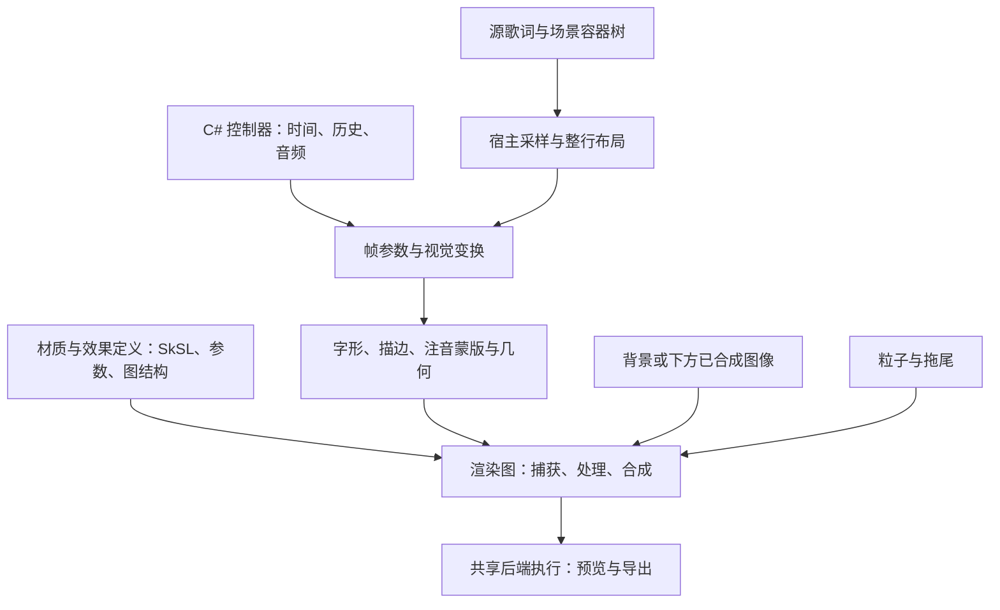

# 高阶自定义：材质、整行效果与渲染图设计评审

> 日期：2026-10-02；依据程序 **0.9.0**，工程／歌词／模板 schema **21／15／3**。
> 状态：**设计提案，未实施**。玻璃两种背景来源及透明输出“跳过依赖效果、提示、使用包内基础外观”已确认，见 ADR-0070／§11.2。着色器平台、SDK、数据结构、依赖拆分与 UI 仍待审阅；最新具体施工顺序见[脚本落地路线图](scripting-system-implementation-roadmap.md)。
> 本文接续 [脚本效果 SDK／打包方案](scripting-effects-sdk-package-plan.md)，保留 ADR-0068 已确认行为，修订其固定 writer 和单入口单阶段的扩展边界。关联 ADR-0069；实施状态见 roadmap §18.27。

优先阅读 **§1 结论、§4 三层结构、§5 样式与模板、§6 公开 API、§9 玻璃／glitch 推演、§13 实施顺序**。示例均为合同草案，不能直接用于当前程序。

## 1. 结论

**当前实现不能直接实现这些效果，上一版脚本提案也不足以完整表达它们。** C#＋Roslyn 的执行选择仍适用；主要缺口在渲染输出协议和样式模型的扩展点。

建议将“允许脚本修改若干样式字段”升级为：

- **材质**负责文字填充、描边等区域的像素生成，可使用自定义着色器。
- **效果栈／渲染图**负责捕获文字或容器的图像、处理多张输入、组织多遍处理与最终合成。
- **C# 控制器**读取演唱进度、历史、音频等，驱动材质参数、视觉变换和临时对象。

纯色、渐变和阴影继续提供易用编辑；高级效果复用同一材质／合成接口。新效果不必每次增加一个 `LyricStyleProperty` 枚举值和专用 writer，也不必向脚本公开可写工程或原生画布。

“高阶自定义”在本方案中指可编程的二维材质、空间图像处理、组合合成及时间驱动；不能据此承诺任意 GPU 计算、三维渲染、改变文字整形或无限资源使用。

## 2. 现状与上一版局限

### 2.1 当前代码事实

| 代码位置 | 已实现 | 缺口 |
|---|---|---|
| `Core/Projects/FillSpec.cs` | 纯色＋可选规范渐变 | 没有自定义材质或 shader 资源引用 |
| `Core/Projects/StrokeSpec.cs` | 外部描边宽度、连接、颜色；保留渐变描述 | 当前实际绘制使用纯色，没有独立描边材质 |
| `Rendering.Skia/SkiaRenderPipeline.cs` 的 `Render` | BGRA 预乘内存缓冲上的 `SKSurface.Create(info, pixels, stride)`；先背景、后歌词 | CPU raster 表面；没有 GPU 上下文或可公开引用的中间表面 |
| `DrawSceneLine` | 整行整形、逐字已唱区域、元素覆盖、注音及世界矩阵 | 直接绘入目标画布；没有可复用的行图像／通道输出 |
| `DrawStyledLine` | 内置渐变 shader、外部描边蒙版相减、阴影 filter | 没有 `SKRuntimeEffect` 调用、自定义 shader 编译、背景采样及通用多遍图 |
| `Rendering.Abstractions` | 快照、内容身份、共享采样和几何 | 没有材质资源、图节点、图像句柄、时序图像历史或脚本执行接口 |

已有 `SaveLayer` 用于入场 alpha 和外部描边，已有 `SKImageFilter` 用于阴影。这些是内部绘制手段，不能等同于已有通用效果图。当前透明输出明确跳过背景颜色／媒体。

### 2.2 上一版提案的四个限制

1. 只允许填充、描边、阴影、不透明度和元素等比缩放，难以表达整行撕裂、RGB 通道分离或组合滤镜。
2. 临时对象只有圆点／拖尾／精灵，且明确没有 shader 输出；无法在字形或描边内做自定义光照、纹理与折射。
3. 一个导出入口只能选择 Appearance 或 Visual，复合效果需拆成多个入口，状态和参数容易被人为分开。
4. “先文字、再粒子”的固定顺序能处理普通放大，却没有解释粒子在文字图像变形后该跟随哪个位置、背景什么时候截取及整组如何合成。

应保留阶段依赖，放宽**一个实例可声明多个有依赖的输出**；不把阶段约束换成任意代码插入绘制过程。

## 3. 技术路径与证据

建议首个材质后端采用 **SkSL＋Skia RuntimeEffect**，与已选择的 **C#＋Roslyn** 配合。SkSL 控制 Skia 的像素着色部分，可组合子 shader；C# 负责歌词语义、历史和参数，不承担逐像素循环。[Skia 官方说明](https://skia.org/docs/user/sksl/)

| 路径 | 本项目适配与代价 | 建议 |
|---|---|---|
| C# 控制＋SkSL／现有 Skia 后端 | 当前锁定库已有运行时 shader、color filter、blender 和图像输入接口；可复用整形及导出 | **推荐先验证**；不提前承诺 CPU 下复杂效果流畅 |
| C# 每像素运算 | 适合某些离线数据预计算；整帧高频处理需处理缓冲、矢量化和线程 | 不作为常规材质作者接口 |
| 独立 GLSL／WGSL 图形后端 | 适合更广泛 GPU 能力，但要新增设备、资源、文字接入和离屏导出路径 | 后续按能力需要评估，不在本轮默认替换 Skia |

本机 `SkiaSharp/3.119.4` 的 XML API 与该版本官方源码都存在 `SKRuntimeEffect.CreateShader`、`ToShader`、uniforms／children；`SKImage.ToRawShader` 可承接非颜色数据输入。现行 `SKSurface.Create` 重载调用 raster-direct 接口，不能因 UI 使用图形加速就声称视频效果也在 GPU 上执行。[版本源码：RuntimeEffect](https://github.com/mono/SkiaSharp/blob/v3.119.4/binding/SkiaSharp/SKRuntimeEffect.cs)、[Surface](https://github.com/mono/SkiaSharp/blob/v3.119.4/binding/SkiaSharp/SKSurface.cs)

SkSL 不是完整 GPU 程序入口。模糊、纹理读取、背景截取和多遍反馈需要宿主组织输入／表面；仅将源码赋给文字 `SKPaint.Shader` 不会自动获得背景图像或整行处理。[Skia Canvas 图层 API](https://api.skia.org/classSkCanvas.html)

本轮只核对 API 和绘制代码，**未执行新 shader、未证明玻璃效果的像素或性能**。H1 必须在锁定版本及 Linux native 库上验证；后端声明的语言能力以实际编译／绘制探针为准，不能照抄最新 Skia 网站的全部特性。依赖版本继续锁定，不顺手升级。

## 4. 三层结构及两个不同的“图”



- **场景容器树**回答“哪个对象属于谁、在哪里、何时装载”。继续使用 nodes／programs／clips，不把一个 blur pass 做成新的歌词槽位。
- **渲染图**回答“读哪些图像、经过什么处理、得到哪张图像、何时合成”。它由持久效果定义加本帧目标展开产生，运行时表面不进入容器树和撤销数据。

C# 的历史状态不由图节点持有；shader 的每次像素求值没有歌词 callback 副作用。共享父组／槽位的位置和分段轮换继续由场景系统负责，效果只作用于其本帧派生结果。

## 5. 样式模型与模板需要怎样扩展

### 5.1 把几何与区域材质分开

拟议职责如下，名称并非已批准的 JSON：

| 描述 | 职责 |
|---|---|
| `TypographySpec`／文字排版 | 字体家族、回退、字号、字重、字距；仍由宿主整形 |
| `FillMaterial` | 未唱／已唱文字区域使用的材质：内置纯色、内置渐变或包内自定义材质 |
| `StrokeGeometry` | 外部轮廓宽度、连接及位置；产生描边覆盖蒙版 |
| `StrokeMaterial` | 描边区域的颜色／纹理／着色器，与轮廓几何独立 |
| `ShadowSpec`／内置效果 | 保持常用编辑体验；转换为通用效果节点 |
| `MaterialInstance` | 指向固定包修订和导出材质，带类型化参数与明确输入来源 |
| `EffectStack` | 作用于元素族、整行、容器或组合的有序视觉／图像处理实例 |

本文把“字体着色器”理解为**字形区域的自定义材质**。真实替换字体或改变字形整形仍是 `TypographySpec` 的职责；shader 可以改变画面里的字形外观，不能据此篡改源文本或源时间。

新的材质选择应使用一个判别结构，不同时保存“旧 Color＋Gradient”和“新 Shader”两套竞争的最终填充。纯色／渐变只是内置材质种类；为当前类型编写内部转换适配不等于为旧工程增加兼容迁移。若落地替换格式，按新 schema 和版本门禁断代。

### 5.2 静态定义与动态控制

- 材质自身可独立使用：例如一个静态毛玻璃材质或按歌曲时间驱动的内置参数绑定，**无需额外写 C#**。
- C# 实例可给同一材质的参数赋值，例如起唱时提高折射强度、按低频改变模糊半径。
- 材质参数不是任意 JSON 或无类型字段袋；包声明名称、类型、颜色／数据用途、允许范围、输入和能力，宿主校验后生成编辑控件。
- 重建依据包括材质源码／图结构／参数模式和效果实例；调参不重新编译无关的 C# 或 SkSL。变更图结构或语言源码建立新代次。

模板工坊继续**制作行／元素模板**，歌词行编辑器继续**选择并应用**。模板可以保存材质及视觉效果配方和参数，不能包含选中行 ID、槽位 ID、播放历史状态或活粒子。

应用时复制配方与必要的包修订资源到工程，建立新的实例身份；之后编辑原模板不改已套用结果。容器／分支效果在展示编排选择并配置。C# 全工程 callback 实例不能因给每行套同一模板而意外变成多套共享计数；模板效果需明确支持的绑定范围，副本状态独立。

### 5.3 继承与效果顺序

普通样式仍按工程→分支→行→元素解析；某一级明确替换材质及参数，继承／关闭／启用三态保留。参数覆盖在类型相符的同一材质修订内合并，换材质不把旧 uniform 混进去。

效果栈是**有稳定实例 ID 的有序操作**，不能把它伪装成一个有任意深度的样式覆盖字典。建议先元素材质／局部变换，再行合成处理，再父容器由内到外处理，再场景最终合成。作用于父组的整体效果捕获整个选定子图；分支筛选绑定并不自动形成父子关系。跨对象的合成阶段和效果位置必须显式，不由词法 ID 或树拖动偷偷决定。

## 6. 暴露给脚本的 API：从固定字段到类型化能力

### 6.1 保留只读语义 SDK

沿用内容／场景／装载身份、实际起唱事件、进度、历史、音频、参数、种子和资源投影；继续禁止改源文字、时间、持久树和排版。普通 writer 保留作为简便入口，内部翻译到统一描述。

建议一个 `EffectDefinition` 声明它需要的能力和若干输出，而非只声明 `appearance` 或 `visual` 二选一：

```text
Outputs:
  StyleModulation      外观、uniform 驱动
  VisualTransform      排版后的元素族／行／组变换
  GeometryMapping      可验证的锚点映射（可选）
  Overlay              粒子、拖尾、临时绘制
  ImageGraph           行／组捕获、滤镜、合成（可选）
Requires:
  GlyphCoverage / StrokeCoverage / SungCoverage
  IsolatedTarget / BackgroundMedia / BackdropBelow
  RuntimeShader / DistanceField / HistorySurface（按效果声明）
```

同一实例可同时驱动多个输出，生命周期／历史只一份。各输出在宿主规定阶段执行，声明依赖不允许形成同帧反馈环；一个粒子实例不能读取最终画面后反过来改变该画面的文字几何。

多输出不等于每个阶段重复运行一次全部 callback／Advance。每个模拟边界的源事件和共享状态推进只一次；先纯求值文字／材质和可映射几何，再让视觉阶段读取最终锚点、维护临时对象。后阶段不能反向改变本边界已经求值的文字结果。阶段状态分区、延迟发射描述及自定义粒子推进的具体 API 须在 H0 固定；不能靠复制任意 C# 对象来假装已经冻结状态。重绘只读状态、纯求值参数和图计划。

### 6.2 图像输入与通道

| 拟议输入 | 内容及边界 |
|---|---|
| `GlyphCoverage` | 抗锯齿字形覆盖度；可以选基础字／关联注音／二者联合，不伪造文字 |
| `StrokeCoverage` | 外部描边蒙版，独立于填充 alpha；透明填充不露内轮廓 |
| `SungCoverage`／`TokenProgress` | 共享采样器的已唱区域／真实进度；没有时间保持未唱 |
| `TargetColor` | 指定阶段的孤立元素族、行或组图像；包括哪些装饰／子对象显式声明 |
| `BackgroundMedia` | 当前时刻已定位、裁切的背景媒体；无媒体时明确不可用，底色另有输入 |
| `BackdropBelow` | 目标合成之前，作用域外且位于其下方的已合成内容快照；不包含目标自身及后方尚未绘制内容 |
| `ResourceImage` | 包内图片、纹理、法线等；逻辑资源句柄，不给本地 native 指针 |
| `DistanceField`／`NormalField` | 从指定蒙版派生的数据；当前未实现，单位、精度及格式需 H1 验证 |
| `HistorySurface` | 按明确歌曲时间契约重建的先前输出；设计接缝，不能拿最近 UI 帧缓存充当历史 |

背景来源的两种选择已获用户确认。`BackgroundMedia` 不暗中混入歌词；`BackdropBelow` 可包含下层歌词和粒子，但必须由明确的合成位置决定。当前尚无通用图层编辑器，需在实施合同固定既有绘制顺序如何映射合成位置，不能宣称树上下拖动已经等于视频图层重排。

每张输入携带坐标空间、逻辑像素尺寸、到画布的矩阵、alpha／颜色或数据编码、采样／边缘规则和生命周期。表面句柄只在本图执行内使用；跨帧保存通过 History 接口，不在 C# 全局保存 `SKImage`。

### 6.3 输出与代码示意

```csharp
// 拟议 API，未实现；参数名须与包内材质定义一致。
public void Evaluate(FrameContext frame, FrameWriter output)
{
    foreach (var line in frame.Presentations.LinesInBinding)
    {
        output.Materials.SetUniform(line.FillMaterial, "distortion",
            parameters.Strength * frame.Audio.BassAt(frame.TimeUs));
        output.ImageEffects.Bind(line.WithRuby,
            resources.Graph("line-glitch"), parameters.Glitch);
    }
}
```

图结构可由包内声明或 C# 在定义／配置阶段用中立 builder 生成。帧求值只绑定目标、开关分支及填充类型化参数；首个合同不允许逐像素 callback 或每帧拼 shader 源码。需要动态遍数时用已声明的参数化子图与受校验上限，而非无边界创建表面。

```text
g.Capture(target.WithRuby, at: AfterMaterials) -> source
g.RuntimeShader("glitch", children: { source }, uniforms: { time, strength }) -> torn
g.Composite(torn, at: target.CompositePosition, replaceCapturedTarget: true)
```

这段描述替换目标原始绘制，避免原文字和故障文字重影；是否处理描边／阴影／注音由 capture 配方声明。脚本不使用 Avalonia／Skia 类型或直接控制输出编码器。

## 7. 渲染图必须规定的语义

### 7.1 图结构、执行与反馈

同帧图是有向无环图，节点输入输出带类型；可组合 Capture、Mask、RuntimeShader、Blur、Transform、Blend、Composite 等中立操作。共享输入／相同 blur 可复用；编译图确定生命期，后台统一租借表面并释放。新增后端能力通过版本化描述及明确“不支持”诊断扩展，不靠一组永远封闭的效果名称。

材质中的子 shader 组合和需要真正栅格中间图像的 pass 有区别。宿主可优化，但不能把需要多遍采样的滤镜误合并为同一个 per-pixel 函数。

**空间的毛玻璃 blur 不需要时间历史**。拖影、回声和反馈才需要 HistorySurface；其输入指向严格较早的模拟时间，不形成同帧回路。上一版建议 120 Hz 仍未锁定；增加图像历史后还需单独确定采样时基、更新／读取顺序、插值和中段重放规则，再开放给作者。该高级能力可晚于初批 shader／glitch，但 API 要预留明确的时序输入类别。

不能用“导出上一帧”当共同历史：24／30／60 fps 会得到不同状态；也不能让暂停多重绘几次使拖影变浓。状态 callback 和图像历史各有固定歌曲时间契约，独立于呈现帧数；同一时刻不能累计反馈多次。

### 7.2 颜色、蒙版与坐标

Skia shader 输出是预乘 alpha；颜色 uniform 和法线／距离等非颜色数据需明确区分，数据输入不能被颜色转换破坏。普通颜色用已声明的颜色空间，照明运算需要线性化；导出沿用现有预乘转直乘边界，避免再暗一次。[颜色及 alpha 规则](https://skia.org/docs/user/sksl/)

shader 坐标是指定局部空间，不是默认归一化 UV。包可要求元素、行、容器或画布坐标，宿主提供矩阵和逻辑分辨率。低质量预览只是采样密度变化，不能让一个“10 画布像素”的偏移变成 10 个缩略图像素。

每个 pass 声明输入采样范围／最大位移、输出边界及边缘规则。模糊核外扩、描边／阴影和 RGB 偏移必须计入；任意 shader 的边界不能可靠自动推导，作者提供合同或显式整画布输出。无声明、越预算或不支持格式应报告，不静默裁掉外沿。

### 7.3 组隔离与背景读取

整行 capture 可联合注音；组 capture 包含被选定的后代和指定粒子层，最终只合成一次；入场 alpha、样式 alpha 和组效果 alpha 各在所属阶段应用一次，不重复乘入捕获图及最终合成。**BackdropBelow 不能包含这个 capture 内正在处理的内容**，否则组里的文字会采样自身并形成环。组内部另有显式的局部合成顺序，需要读取兄弟下层时只能从已发布局部结果取输入。

遮罩玻璃替换背景局部区域时，图输出是完整处理后的预乘像素，按覆盖度替换该区域；不能先将背景压入效果结果，再当半透明普通文字覆盖同一背景，造成背景重复混合。玻璃 graph 和一般 source-over 材质分别声明合成操作。

## 8. 文字变形、播放头和粒子怎样共存

上一版的“最终几何”需要进一步区分：

1. **语义几何**：排版、元素进度及场景／局部变换后的真实文字锚点。
2. **可映射视觉几何**：可逆仿射或有显式正向映射的空间变形之后，锚点可继续跟随。
3. **图像外观**：RGB 分离、模糊、噪声、碎片复制等可能没有唯一的“字现在在哪里”。

不能从任意 shader 的像素反向采样函数自动推导出正确的播放头正向位置；RGB 三个副本也不存在唯一光标。建议效果声明 `ColorOnly`、`MappedWarp` 或 `ImageOnly`：

- ColorOnly：保持锚点，粒子照常跟随。
- MappedWarp：提供与 shader 相同参数的正向 AnchorMap；顺序应用所有映射，位移场／CPU 映射须用像素对照验证。
- ImageOnly：显式选择粒子与文字一起 capture／变形，或让粒子跟随语义播放头；若作者要求“精确跟随变形后光标”却没有映射，报告不支持，不伪造坐标。

同一 shader 出现“一对多”裂解时，未来可显式暴露多锚点；初批不自动猜主副本。容器布局编辑仍显示静态参考框；效果检查可以显示扩大的像素边界，两种边界不互相覆盖。

跨行桥接需要的下一句锚点，只计算可重建的语义／映射几何，不能递归求整幅画面、背景或粒子历史。入场、局部视觉变换和 AnchorMap 的求值接缝必须保持纯函数；原无空档直接换点及起唱计数语义保持。

## 9. 两类需求的完整推演

### 9.1 液态玻璃／毛玻璃字体或描边

```text
目标字形／外部描边蒙版 ──→ 可选距离／法线计算 ─────────┐
选择的背景输入 ──→ 模糊（毛玻璃）／偏移采样（折射） ──┼→ 色调／高光 → 蒙版合成
静态参数／歌曲时间／C# 驱动的 uniform ────────────────┘
```

毛玻璃可以从背景采样、blur、覆盖蒙版和色调开始；液态玻璃再加入法线／厚度近似、边缘高光和折射偏移。非物理的美术材质也可以直接使用包内法线贴图。不能把纯色加阴影叫作已经支持玻璃。

文字和描边可以使用不同材质；未唱／已唱可分别使用不同配方。高亮区域仍来自 LyricSampler，不由 shader 根据文字索引重算；关闭填充时描边蒙版仍有效。前奏文字标记也可复用材质身份，不要求它伪装为定时歌词。

“真实光学的三维玻璃”还涉及几何、光源、深度、厚度和多次传播；本方案承接二维屏幕空间玻璃，可用预计算数据增强，不承诺三维渲染器。

### 9.2 整行 glitch

```text
整行（基础字＋关联注音＋所选装饰）
  → 孤立彩色图像
  → 按歌曲时间／稳定种子生成分段位移
  → 通道偏移、扫描线、噪声等 shader／pass
  → 以扩展边界替换原行合成
```

对单字、整行、片段中各行或父容器组合使用同一个效果定义，目标不同而非额外发明“故障歌词”类型。按演唱开始或低频触发的 glitch 由 C# 控制；仅周期性空间 glitch 可由材质参数绑定控制。源文字、逐字时间及槽位轮换不被改变。

基本空间 glitch 无需 HistorySurface，先验证这一条；需要残影的版本再要求明确图像历史能力。若要让颗粒也碎裂，把相应粒子层纳入 group capture；若只扭曲文字，则按 §8 选择锚点策略。

## 10. 打包与本地持久化

扩展现有 `.mkfx` 源码资源包提案，让一个包可导出**材质、图配方、C# 控制器**，不强迫每个材质都带 C#：

```text
manifest.json        包／SDK／shader profile／能力要求／导出项
src/*.cs             可选控制器及共享算法
shaders/*.sksl       自定义材质／滤镜／混合源码
graphs/*.json        类型化渲染图配方（也可由定义 builder 生成）
assets/*             颜色纹理或注明数据编码的法线／噪声等
README.md
preview.png
```

清单声明 uniform 类型、默认值、输入槽、空间／颜色用途、输出范围和能力需求，C# 字段／SkSL uniforms／图端口之间编译检查。源码和图格式精确版本门禁；引入包修订时复制进工程，不依赖外部路径，保存／撤销沿用完整修订及原子包保存规则。

**DLL 只持久化 C# 编译结果。** SkSL 源码和图定义持久保存在工程／分享包，后端加载时编译并缓存；不能把某机器 GPU 二进制或 native 对象写进 DLL 当跨机器的唯一源数据。

区分指纹：

- 包修订：全部管理文件和清单；
- C# 产物：C# 源码、SDK、引用、编译／运行环境；不因无关图片或每次 uniform 值变化重编译；
- shader／图计划：相关源码、端口／参数模式、子图、能力 profile、Skia／native 版本；有设备二进制缓存时再包含设备／驱动信息；
- 帧／历史：源快照、展示、参数、种子、资源、背景时刻、音频、后端 profile 和模拟／图像历史合同。

包整体变更建立运行代次，但允许复用未变化的分项编译产物。热替换在帧／会话边界切换全部资源，预览旧代次须明示；当前启用新修订失败时阻止导出。shader 诊断应有文件、行列、材质／pass 和目标，图诊断给依赖链，不能统一显示成“C# 编译失败”。

## 11. 后端能力、透明导出与确定性

### 11.1 能力协商

SDK 定义逻辑图，不把 Skia 类型变成公共合同；SkSL 导出项明确要求对应语言 profile，**中立 SDK 不等于 shader 源码对所有后端通用**。未来 GLSL／WGSL 可作为另一个明确 profile 或包内变体，不能自动假定可翻译。

验证后的 RasterCompatible、GPURequired 等 profile 与图像格式／采样能力由后端报告。没有 GPU 不偷偷关闭 shader 或改成纯色；明确报错或由用户主动选择可用的效果变体。预览和本次导出固定同一语义 profile；跨 CPU／GPU 的像素差异要定义容差，不承诺不同驱动位级一致。

当前共享 CPU 路径可先作为正确性验证目标；如其成本无法满足实用预览，再向用户提出 GPU 设备层实施合同。真实 GPU 接入涉及离屏上下文、生命周期、线程、读回及导出，须另审阅；不在 UI 控件里新增一条独立 shader 绘制路径。

### 11.2 背景依赖与透明输出

常规 RGBA 透明歌词视频只携带像素，不能描述“以后放到任意背景上时再次折射／模糊”。背景依赖效果必须记录输入要求与来源；具体能力标记由实施合同固定，不能把“读取下层图像”自动等同于“必须有背景媒体”。

**2026-10-02 用户已决定（ADR-0070）**：透明模式造成背景缺失时，直接跳过背景依赖着色器效果，并提示用户。文字／描边材质使用**材质包提供的纯色／渐变基础外观**；整行／组图像效果使用处理前图像。不依赖背景的 shader 继续执行，跳过不改工程启用状态；导出前提示和完成报告记录目标／效果／原因及回退外观。

这取代本节原“建议阻止透明导出”的待选方向。当前启用源码的编译／运行错误、缺必需回退或其他资源等真实错误仍阻止导出，不以“忽略 shader”捕获所有失败。混合实例的独立输出、依赖子图 bypass 及透明缓存模式见[具体路线图 §3](scripting-system-implementation-roadmap.md#3-透明导出规则用户已确认adr-0070)，节点协议须在 R0 审阅后实施。

### 11.3 资源与时间

图像处理预算包括同时活动表面、分辨率、通道精度、采样范围、遍数、历史窗口与粒子；合同限值需在实施前确认。超限和不支持输入报告错误，不只在预览降低对象数量。GPU 绘制不取消“主进程会话串行”的脚本规则，图形设备线程／任务由宿主调度。

歌曲时间、种子及源事件保持确定；shader 随机值由传入稳定数据／可重复算法产生，不使用重绘次数、墙钟或设备熵。历史重放／中段导出／循环与暂停仍须一致。预览缩小只改变栅格密度；量纲和同一歌曲时间的效果参数保持。

## 12. 编辑界面与职责草案

- **模板工坊**：基础样式和高级材质／效果配方两种入口，共用实时预览。材质选择、参数、背景依赖与可用状态直接显示，不把 shader 编辑器塞进普通颜色控件。
- **效果／脚本工作区**：包内材质、图、控制器各有类型标记；源码诊断分开。图可先用命名 pass／输入列表编辑，节点连线编辑器以后按需求设计，不用复杂节点图取代常用样式表单。
- **歌词行／展示编排**：套用和配置实例，明确单字、整行、容器组合及作用阶段；顺序列表告诉用户为什么“先 glitch 后 blur”不同于相反次序。
- **效果检查**：查看输入蒙版、目标图像、背景来源、某个 pass 输出及锚点；调试工具不进入正常歌词套用流程。

这只是职责设计，非批准的 UI 稿。进入实现前制作宽／窄窗口可审阅界面，继续避免二级隐藏常用操作、重复入口和属性栏长页。

## 13. 调整后的实施顺序

本节 H0～H5 保留评审层次，最新按[具体路线图](scripting-system-implementation-roadmap.md) R0～R8 施工，包含代码接缝、任务对应、验收、版本和破坏性变更。

不要直接把上一版 E1～E5 按原固定接口实现后再推翻。

| 批次 | 工作与可验收结果 | 本轮状态 |
|---|---|---|
| H0 合同审阅 | 材质／图／多输出 SDK、背景和透明输出、绑定／模板依赖／删除、合成位置／锚点语义、版本及 UI | **设计中；待用户确认** |
| H1 技术验证 | 锁定 Skia 版本下：自定义文字和描边材质、图像子输入、行捕获／glitch、背景 blur／折射；输出实际离屏像素并比对 Alpha、矩阵和预览／导出 | 未实施；只验证能力与正确性，不提前进行性能基准项目 |
| H2 共用骨架 | 中立表面／蒙版与图计划、材质解析、生命周期、捕获替换及共享渲染；内置纯色／渐变／描边无行为退化 | 未实施；数据断代和项目拆分先批准 |
| H3 作者包与运行时 | C#＋Roslyn、SkSL 编译、包修订／缓存、会话历史、参数历史、错误门禁及材质无需 C# 的路径 | 未实施 |
| H4 效果闭环 | 原 E1／E3／E4 的逐字缩放、重复 callback、粒子／跨行；新增一个简单自定义材质与一个整行 glitch，验证组合／锚点 | 未实施；初批不用承诺复杂物理玻璃 |
| H5 工作区与交付 | 完整数据／UI、工程资源收拢、保存／重开／撤销／热替换、中段及透明输出门禁、原生像素与成片证据 | 未实施 |
| 后续扩展 | GPU 后端、图像反馈历史、高级 SDF／光照、更多图类型；按能力需求逐项确定 | 没有默认授权；性能基准在脚本系统完成后 |

H1 小型能力验证不等于完整性能基准；不能在本轮无实现授权时先安装依赖或创建生产模块。基础正确性验证通过后再确定后端支持范围，避免承诺所有 shader 都能在当前 CPU 路径实用运行。

## 14. 确认范围及设计交付

**已确认**：ADR-0068 的 C#／Roslyn 与效果行为继续有效；玻璃背景来源支持仅背景媒体／下层已合成内容二选一；透明模式跳过背景依赖效果并提示，材质使用包内纯色／渐变基础外观（ADR-0070）。

**待审阅**：SkSL 首后端、通用材质替换合同、图结构／端口／uniform、一个实例多阶段输出、组隔离／顺序、AnchorMap／ImageOnly、模板包依赖／复制删除、预算、新 UI 及透明 bypass 的具体节点协议。实际数据变化需按 AGENTS.md §8.3 获具体合同批准，再提升对应版本／schema；不兼容旧工程。

本轮只交付评审和设计，并同步入口／ADR／roadmap。程序仍 **0.9.0**，schema **21／15／3**；没有 shader、渲染图或脚本实现，也没有安装依赖。

设计交付验证：`dotnet build MakoKaraGenerator.slnx -m:1` **0 警告、0 错误**；`dotnet test MakoKaraGenerator.slnx --no-build -m:1` 七个项目 **1512 项通过，0 失败／跳过**。八份相关文档的本地链接／代码围栏、新增 ADR 唯一性和 `git diff --check` 通过，未改历史示意或现有 ADR 编号。此证据只验证文档一致性与现有程序基线，**不是自定义 shader、玻璃或 glitch 的像素／性能验收**。纯文档不升程序版本，也不重启验收窗口。
