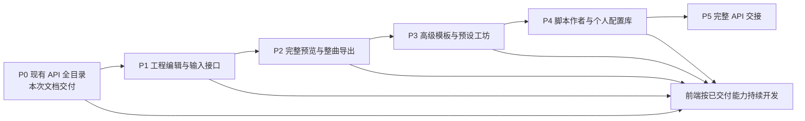

# 后端 API 功能补齐计划

> **2026-10-27当前状态：** P3/P4/P5及两批GPU工作已快进纳入 `main`，当前产品0.106.0／合同1.39.0／HTTP协议1；现行目录为102路径／113方法。合入与新跑定向回归见[main合入记录](../history/backend-main-integration-20261027.md)，下面2026-10-25的分支/产品/合同和阶段数值按当时快照保留。

历史快照日期：2026-10-25。P5审查与交接收口在 `dev/backend-api-completion-p2` 完成，产品0.104.1／合同1.38.1；`main` 是祖先基线与默认分支，P3/P4/P5尚未合入 `main`。实际冻结源码基线见manifest。P1/P2历史版本0.102.0／1.36.0、P3历史版本0.103.0／1.37.0、P4原合同1.38.0与各发布证据保留阶段归属。对照桌面基线：`8526b84` 的 `samples/TechnicalSpike.App`。

**本计划以“前端能通过完整、可执行的 API 复刻原桌面主要功能”为完成标准。** 后续按用户工作流收口，不再把每种媒体、每种任务各自拆成独立的长期迁移阶段。P1/P2 当前计划的代表后端范围已完成，匹配发布与 fresh HTTP 结果见§8；N01～N04、C01～C05及统一Runtime输入、六音轨家族、质量/资源策略已接入。P3 完整模板定义/包检查/试样选项/预设目标扩展已接入源码，并以匹配发布 fresh HTTP 174请求／1151断言通过；P3合同 freeze/validate 已由提交 `c4146d4` 完成；P4 N07～N14/E12～E15 已接入源码，合同1.38.0已冻结；P4源码、合同与有限HTTP验收均已通过，运行证据已登记。当前真实接口仍以 [冻结清单](../../../web/api-index.md)、[OpenAPI](../../../web/openapi.json) 和 [行为合同](../../architecture/backend-api.md) 为准。

配套交付：[完整目标 API 目录及变动日志](../../backend-api-target-catalog.md)，逐项导航 **当前102个路径／113个HTTP方法、96种工程命令及各阶段扩展**。完整方法表以同提交生成的 `web/api-index.md` 和 OpenAPI 为准；P4 N07～N14/E12～E15 已接入源码，P5合同勘误为1.38.1。结构与冗余分析沿用 [架构审计](../research/backend-structure-audit-20261024.md)，不重复开展一次架构重构。

## 1. 完成标准与实施原则

完成后，前端开发者仅依赖公开 API、DTO 和示例，即可完成以下工作：

1. 新建、打开、编辑、保存、另存、恢复工程；管理歌词、音频和背景资源。
2. 完成歌词正文、多来源、逐字时间、注音时间、波形和撤销重做。
3. 编辑样式、动画、场景、布局、片段、前奏提示与预设；草稿试看后一次应用。
4. 对含音频、图片/视频背景、字体、脚本/材质/预设的工程预览、测量、验证，并导出完整歌曲。
5. 制作和管理静态/高级模板，导入导出 `.mktpl`，管理预设应用。
6. 导入脚本包、读取/修改源码、编译、修改参数、运行试样、显式采用源码、保存个人配置并在模板/工程中使用。

“API 完整”要求每项都有**可读状态、可写操作、可见结果/错误、必要的任务进度或资源下载方式**；不能只给路由名称，也不能把内部 Core 方法或 Worker 能力算成已开放接口。目录中的必需项全部实现、冻结并走通代表流程后，才能宣布后端 API 补齐完成。

- **立即允许前端消费现有功能。** P0 是本次文档交付；不把 P1～P4 全部完成作为歌词、工程、波形、基础样式与场景页面开工的条件。
- **优先复用。** Core/Application 负责领域变化；原 Runtime/Skia/Media/Export 负责执行。Server 增加 DTO/路由，Hosting 负责授权、修订、准备与任务衔接，不再复制业务算法。
- **不另设门槛。** 不新增数值配额、短片限制、先验收再允许编辑的前置步骤。现有身份、资源所有权、修订冲突和取消语义继续使用；妨碍普通完整工程的临时上限在 P2 处理。
- **验证按实际修改选择。** 复用现有回归和探针；不要求每一格功能组合都新增测试、独立发布和一套 HTTP 证据工具。详见 §6。
- **交付单位是一个可用流程。** 提交可以按实现步骤拆分，但不以版本号、断言数量或内部 profile 数量表示完成进度。
- 本文调整后续实施顺序与验收口径；旧 B3/B4/B5/B6 文档保留历史，不继续作为逐切片加码的执行清单。

## 2. 当前能力与真实缺口

下表“已有”表示当前源码已提供公开入口或已接入实现，不意味着本次重新跑过全部 HTTP 验收。P1 的空创建、导入规划、字体目录/检查、背景读写、候选预览与原子应用已实现；P2 的共享媒体/包字体/预设执行、六音轨家族及导出质量/可空宿主策略已接入，真实Worker定向检查与最终代表HTTP分别登记于§8。

| 功能 | 当前可直接复用 | 需要补齐 | 阶段 |
|---|---|---|---|
| 工程生命周期 | 四种歌词/音频组合创建，含真实空工程；打开/恢复、保存/另存、关闭与历史 | 代表编辑/媒体保存重开已通过§8 HTTP | P1/P2 已实现 |
| 歌词导入 | 上传、`lyrics.importAsset`、格式/编码选项、导入报告、`POST /lyrics-import-plans` | 代表导入流程已通过；浏览器消费独立登记 | P1 已完成 |
| 正文/来源/时间/ruby | 96 种命令中的相应操作及精确修订读模型 | 沿用；时间轴批量元素修改已有 `lyrics.setTokenTimes` | 现有 |
| 音频/波形 | 替换/清除、首音轨准备、音频content与峰值窗口；准备/分析/导出六家族声明 | 浏览器播放与源格式兼容独立，不新增后端播放器 | P1/P2 已实现 |
| 工程背景 | 底色及四个媒体背景命令、settings/resources；Image/Video共享固定输入 | 代表HTTP已通过；保留各历史profile证据 | P1/P2 已实现 |
| 字体 | 真实Worker目录/检查；样式保存字体名；固定包内字体与回退经原Skia消费 | Worker环境诊断与包字体消费分别通过代表检查 | P1/P2 已实现 |
| 场景/样式编辑 | canonical 样式、来源、布局、动画、片段、提示、几何；`edit-previews` 与 `project.applyEdits` 已接入 | P2复杂输入代表流程已通过；P3完整模板定义与高级目标扩展已接入 | 候选预览、原子应用与P3 fresh HTTP已通过；合同freeze/validate已完成（`c4146d4`） |
| 场景测量 | time/layout，工程与编辑候选均可消费Image/Video、包字体、包与完整预设 | 同一固定snapshot核geometry/PNG；代表HTTP已通过 | P1/P2 已实现 |
| 连续预览 | 会话/换源/帧/generation/SSE/PNG与资源租约；共享固定Runtime输入 | 代表前进/seek回退及复杂输入HTTP已通过 | P2 已实现 |
| 视频导出 | 两格式、三质量；可空宿主策略；统一媒体/包字体/高级预设与六家族音轨 | 180秒整曲、运行中取消及代表复杂输入实际产物已通过 | P2 当前计划代表后端范围完成 |
| 模板库 | 静态及完整高级定义读写、完整高级 `.mktpl` 保真传输、复制/改名/删除 | 匹配发布、合同冻结与 fresh HTTP 已通过；作者配置库已在P4接入；运行证据独立登记 | P3 已接入 |
| 预设应用 | 原目标、clips、高级node、启停/更新/移除；完整合法模板可应用/候选/模板试样运行 | 匹配发布、合同冻结与 fresh HTTP 已通过 | P3 已接入 |
| 作者草稿 | 列表/详情、完整固定源码/配置、同步/异步编译、采用、删除、试样预览/验证与个人配置库 | 已接入源码与合同；实际运行证据见§10 | P4 |

以下结论直接来自当前代码，避免沿用旧文档的“尚未实现”：

- [PackagePresetProjectSnapshotCodec](../../../src/MakoKaraGenerator.Backend.Rendering/PackagePresetProjectSnapshotCodec.cs) 和 [SceneMeasurementWorker](../../../src/MakoKaraGenerator.Backend.Worker/SceneMeasurementWorker.cs) 已存在。P2 扩展其覆盖，不重写 package 测量。
- [作者合同](../../../src/MakoKaraGenerator.Backend.Contracts/BackendAuthorContracts.cs) 与 [Registry.Author](../../../src/MakoKaraGenerator.Backend.Hosting/ProjectSessionRegistry.Author.cs) 已存在。`adopt-source-revision` 是草稿中显式选择源码，不是入库发布，也没有“必须先编译成功”的现行条件。
- [工程资源读取](../../../src/MakoKaraGenerator.Backend.Hosting/ProjectSession.Resources.cs) 已提供音频及受控背景的 asset/content URL；[settings](../../../src/MakoKaraGenerator.Backend.Contracts/BackendProjectReadContracts.cs) 已增加完整 `background` 配置投影。资源读写接入不等于所有渲染任务已经消费该资源。
- 省略 `definitionFormat` 时模板详情保留旧摘要/静态wire；合法高级Line/Token/Composite返回 `advancedRuntimeAvailable` 与 `definition:null`。显式 `definitionFormat=full` 已提供完整样式、未选材质、配方顺序、参数精度和包引用读取/创建/替换；N05/N06与clips/高级Node扩展已接入源码，并已通过匹配发布 fresh HTTP。完整合同冻结仍单独登记。
- 导出资源限制已通过 `WorkerExportResourcePolicy` 接入宿主声明；默认 Server 未配置的导出策略字段为 `null`，不施加相应维度的部署限制；宿主可显式配置正值。因此原 10 秒、600 帧、64 MiB 产物和 16 MiB 音频等值不再是默认部署限制或产品固定硬门槛，但普通整曲仍须结合实际部署策略、流式处理、磁盘和取消语义完成真实 Worker/HTTP 验收。

## 3. 桌面功能覆盖矩阵

桌面证据列路径相对于归档的 `samples/TechnicalSpike.App/`；可用 `git show 8526b84:samples/TechnicalSpike.App/<路径>` 复查。这里只比较真实桌面入口及其业务调用，不要求把 Avalonia 控件或播放设备移入后端。

| 桌面功能/证据 | 前端使用的 API 或行为 | 缺口归属 |
|---|---|---|
| 首页新建/打开/恢复，`Views/StartPageView.axaml` | sessions、file-roots/entries、file-handles、open/recover-jobs | 已有 |
| 保存/另存/脏状态确认，`Views/MainWindow.Project.cs` | save-jobs 的 targetHandleId、GET session、close policy | 已有；P1/P2 媒体保真 |
| 最近工程 | 前端保存显示名及已授权 root/relativePath；重新打开时重新申请 handle | 前端状态；不保存访问凭证 |
| 格式/编码选择、再次导入，`EditorViewModel.LyricsImport.cs` | `POST /api/v1/lyrics-import-plans` + 现有 importAsset；返回检测候选、编码候选、来源分支、报告和预览 | 代表 HTTP 已通过，见§8 |
| LRC/TTML 导出，`EditorViewModel.LyricsIO.cs` | lyrics-export-plans、lyrics-exports、content；project/AMLL TTML 沿现有格式 | 已有 |
| 行/正文/切分/排序，`LineEditing`、`TokenSplit`、`LineWorkshop` | lyrics/window、setLineText、add/duplicate/removeLine、split/merge/reorder/resplit | 已有；P1 试看 |
| 多来源/主行关联，`EditorViewModel.Branches.cs` | branches、configure/add/removeBranch、linkPrimaryLine | 已有 |
| 打点/批量拖动/微调，`TimelineEditing`、`TimingActions` | setTimeRange、stamp/nudge/shift、setTokenTimes；手势末尾提交 | 已有 |
| 注音正文与片段时间，`EditorViewModel.Ruby.cs` | setRubyText、7 个 ruby 片段命令、歌词窗口 | 已有，后端已多于旧桌面 |
| 播放/循环/播放头，`Playback`、`Loop` | 音频 content、waveform；客户端时钟驱动现有 frame requests | 前端状态；P2 覆盖输入 |
| 音频导入/重试，`EditorViewModel.AudioLoading.cs` | assets、audio.replaceAsset/clear、resources | 已有；P1 消费说明 |
| 图片/视频导入/清除、适配、Loop/FreezeLastFrame，`EditorViewModel.Background.cs` | 底色及四个媒体背景命令、settings/background、resources；统一Runtime资源授权 | P1/P2 代表HTTP已通过 |
| 画布/fps/底色/时长，`EditorViewModel.Composition.cs` | 6 个 composition 命令、settings | 已有 |
| 字体选择，`Views/StylePropertyRowView.axaml.cs` | `GET /api/v1/fonts`、`POST /api/v1/fonts/inspect`；字体保存仍走 styles.patch | P1 已接入 |
| 样式多目标/继承/动画，`Animation`、`LineWorkshop`、外观工作区 | style、resolved-style、styles.patch/restore、现有动画命令 | 已有；草稿试看 P1 |
| 场景树/布局/拖拽/取消草稿，`SceneEditing`、`SceneLayout` | orchestration/geometry/measurements、现有结构命令、`edit-previews`、`project.applyEdits` | P1 候选预览/原子应用已接入；复杂输入继续验收 |
| clip/片段布局 | 现有 create/set/split/mergeClip、basicLayout | 已有 |
| 前奏/倒数/mark/生成/附着，`EditorViewModel.LeadIns.cs` | 现有 lead-in/mark 命令及测量 | 已有，复杂输入 P2 |
| 预设试看/应用/更新，`EditorViewModel.PresetApplications.cs` | preset-application-previews、presetApplications 四命令 | clips、高级node、完整定义与草稿来源已接入；匹配发布/fresh HTTP 已通过 |
| 模板新建/保存/复制/删除，`TemplateWorkshopViewModel.Persistence.cs` | template-libraries 的 detail/commands | 完整定义读写已接入；匹配发布/fresh HTTP 已通过 |
| 模板脚本/材质/配方顺序，`TemplateMaterialEditorViewModel`、`TemplateEffectRecipeEditorViewModel`、`TemplateWorkshopViewModel.Recipes.cs` | 完整 template definition 中 material、parameters、effectRecipes 有序集合、固定 package 引用 | 已接入；匹配发布/fresh HTTP 已通过 |
| 模板单/多行试样/目标选择，`TemplateWorkshopViewModel.Preview.cs` | `template-preview-options`；扩展 template-preview-sessions | 已接入；匹配发布/fresh HTTP 已通过 |
| 模板分享/导入，`TemplateWorkshopViewModel.Transfer.cs` | 现有 imports/preflight、imports、exports、archive | 已有；P3完整定义扩展后仍保真 |
| 脚本包/导出选择与参数控件，`ScriptConfigurationWorkspaceViewModel.cs`、`ScriptParameterPanelViewModel.cs` | effect-packages/inspect、draft configuration、参数 schema | P3包解析已接入；P4 N09 configuration 已接入 |
| 源码切换/编辑/保存/编译/诊断，`ScriptConfigurationSourceEditorViewModel*` | source-revision、sources、compilation 与异步取消扩展 | P4 N08/N10/E13 已接入；运行试样与个人配置库亦已接入 |
| 显式采用源码，`ScriptConfigurationWorkspaceViewModel.Revisions.cs` | 现有 adopt-source-revision | 已有；P4 连接配置保存 |
| 参数、目标、读取范围、种子/层，配置保存/另存/删除，`ScriptConfigurationWorkspaceViewModel.Persistence.cs` | draft configuration 和 script-configurations 库 | P4 N09/N12～N14 已接入 |
| 独立运行验证/取消/普通与透明结果，`ScriptConfigurationRuntimeViewModel.cs` | authorDraft 预览源、draft validation-jobs、既有 job/result/diagnostics/cancel | P4 N11/E14/E15 已接入 |
| 视频两种格式/三档质量/进度取消，`EditorViewModel.Export.cs` | export-jobs、capabilities、jobs、SSE、content；quality 三档与宿主资源策略已接入 | P2 代表整曲/取消HTTP已通过 |
| 撤销重做与 no-op | 现有 history.undo/redo；候选草稿只在最终确认时写一次历史 | 已有/P1 |
| 主题/语言/快捷键/选择/展开/缩放/停靠/输入框草稿 | 前端实现；格式化文案和 UI 状态不新增后端命令 | 前端职责 |

范围说明：`EditorViewModel.Commands.TryApplyProjectEffects` 在归档中可见，但本次搜索未找到 UI 调用点，不因此另造一套直接效果编辑器 API。现有 direct-package 工程继续可加载/运行/保真保存；主要制作路径通过完整模板与脚本配置实现。任意新轨道系统、云账户、在线素材市场、独立字体安装管理器不属于桌面主要功能对齐的前置项。

## 4. 分阶段实施

这是交付顺序，不要求一阶段结束前禁止准备下一阶段的数据定义。P2 应先处理整曲导出的临时限制与质量档位，再接齐媒体/高级输入；避免普通成片继续等待作者工作流。P3 可提前对齐 P4 共用的包和参数 DTO。

### P0：现有能力登记与前端入口——本次交付

- 输出本计划及目标目录，把当前接口与拟议接口明确区分。
- 已有歌词/工程/样式/场景接口直接供前端开发；不再补做一遍历史批次验收。
- P0为原计划文档交付；P1/P2历史批次为产品 `0.102.0`／合同 `1.36.0`；当前P3合同由提交 `c4146d4` 固定。

### P1：补齐工程编辑与输入接口

**用户结果：前端可以从空工程开始导入完整素材、配置背景、选择实际字体，在场景/样式草稿中试看并一次应用。** 视频等复杂输入的最终执行在 P2 完成，接口状态应如实显示当前可执行性。

1. 扩展 settings，返回背景 kind、fit、playback、资源身份；扩展 resources 给已保存/新导入的背景实际授权 asset/content。复用音频已有的授权、历史引用及保存加载流程，让撤销后资源仍然可用。
2. 新增 4 个背景命令：`composition.setBackgroundAsset`、`composition.clearBackground`、`composition.setBackgroundFit`、`composition.setBackgroundPlayback`。复用 `ProjectBackgroundEditor` 和媒体存储；不接受任意主机路径。设置图片不要求先存盘再重开。
3. 字体目录来自真实 Worker 渲染环境；诊断复用 `SkiaFontInspector`。字体选择仍走 `styles.patch`，不增加第二套样式模型。不要求用户把系统字体逐个上传。
4. `lyrics-import-plans` 返回检测格式、编码、歧义、来源分支、导入报告和预览信息。复用 `LyricsImportEditUseCase.Detect/Prepare`；现有 importAsset 可直接执行，不强制先调用规划接口。
5. 增加编辑候选预览：固定工程修订，在内存中应用相同的编辑准备逻辑，再交现有 PreviewSession；可替换候选并请求帧、测量。正式提交用 `project.applyEdits` 把同一组工程数据编辑原子提交一次历史。单操作仍可用原命令，无须新流程。
6. 解释音频获取方式：`resources → assets/{id}/content`，峰值走 waveform；播放头/循环/暂停由前端维护。若支持的源格式需要浏览器可播派生音频，复用受管媒体准备，将派生 asset 的 content URL 返回在资源读模型中，不创建后端播放器。
7. 创建请求的audioAssetId／lyricsAssetId各自可省略或null，从真实空领域工程开始；空白ID仍拒绝。仅歌词保原importer和未知媒体时长规则，仅音频保真实准备与空歌词。无音频不占用受管理音频准备名额。独立空创建实现已完成四组合、owner、收据重放、空输入及原Worker失败映射定向回归96/96，solution零警告／错误，合同反射与7个新增fixture通过；正式合同生成和真实HTTP闭环由最终集成统一登记。

复用点：[ProjectBackgroundEditor](../../../src/MakoKaraGenerator.Core/Projects/ProjectBackgroundEditor.cs)、[LyricsImportEditUseCase](../../../src/MakoKaraGenerator.Application/Editing/LyricsImportEditUseCase.cs)、[ProjectStyleEditUseCase](../../../src/MakoKaraGenerator.Application/Editing/ProjectStyleEditUseCase.cs)、`SceneTreeEditSession`、现有 Preview/ResourceStore/ProjectWorkspace。

API 变更：目标目录 N01～N04、C01～C05、E01～E04。阶段交付：新建工程 → 检测/导入歌词和音频 → 设置背景/字体 → 候选试看 → 一次应用 → undo/redo → 保存重开；执行类型采用对应Worker的实际能力，最终代表HTTP结果独立登记。

### P2：完整渲染输入与整曲输出

**用户结果：工程能够连续预览、测量、验证，并产出与桌面两种视频格式接近的完整成片。** 完成此阶段后，常规编辑器与成片流程不再依赖 P4。

1. `ExportJobRequest.quality` 已接入，接受 `draft`/`standard`/`high`，省略保持 `standard`；报告回显请求/实际质量。画布和 fps 仍来自工程，不随质量档位改变。
2. 导出执行已改为使用宿主声明的 `WorkerExportResourcePolicy`：帧数、时长、帧率、画布、裸帧、媒体、音频、压缩音频和操作时限可按部署配置；`null` 表示该维度不施加宿主限额，仍受流式处理、磁盘错误和取消控制。产品不再固定限制10秒/600帧；本轮180秒代表整曲已通过真实 Worker/HTTP 验收，见§8。未配置限额不等于无限资源保证，其他规模的性能结论需实际测量。
3. 完整输入共用一条“固定工程修订 + 固定资源引用 → 原 Runtime”准备路径。按原模型保留 Color/Image/Video、fit、Loop/FreezeLastFrame、字体和回退、direct package、静态及高级 preset、材质与已采用音频分析。已有 codec/会话可复用，不以为每个组合再起 profile 命名作为交付目标；必要的 Worker 协议演进一次集中处理。
4. 预览、同帧测量、正式验证和导出继续消费固定工程语义。package+静态 preset 测量与 package/预设音轨导出接缝已进入源码；本轮已统一接入Image/Video、包字体和高级Line/Token闭包，代表HTTP结果见§8。不得把视频首帧接缝当连续视频，也不得把字体固定测试文本整形当真实歌词字体支持。
5. 音频分析仍是音频任务，扩展到已支持准备的音轨家族；效果消费已采用的完整分析结果。不新增含义重复的“package 音频分析 API”。导出接齐 package/预设带音轨，保原首音轨与透明背景语义。
6. 复用连续 frame requests、换源 generation、SSE 和帧读取；普通 seek/循环无需重建整套工程。能力响应按任务公布实际支持的输入/组合与 quality，不要求前端理解 Worker 私有编码细节。

复用点：`ProjectRenderSessionFactory`、`ProjectSnapshotSourceProfile`、`PackagePresetProjectSnapshotCodec`、`BackgroundFrameSourceResolver`、`Media`、`VideoExporter`、已有 analysis/validation/export/measurement executor。字体由实际渲染解析器消费，包内资源不被丢弃；没有原模型依据时不引入新的工程字体管理模式。

API 变更：E05～E08；主要为现有端点的字段/可用输入扩展，**没有新 HTTP 路径**。交付一首代表歌曲的带音轨成片、普通/透明模式的代表输出，以及视频前进/回退、复杂预设与测量流程；复用旧样例，其余组合按修改选择回归。原0.101图片导出待验收范围已纳入本轮代表流程，不另建平行实现。

### P3：完整模板与预设工坊

**用户结果：前端能创建、修改、试看、保存、分享带脚本/材质的模板，并应用到原模型支持的目标。**

1. 扩展模板详情与 create/replace 的 definition：完整静态样式、选中属性、包材质、配方有序集合、包身份/闭包。已有 `advancedRuntimeAvailable` 仅表示闭包运行可用；本阶段补齐完整高级定义读取/编辑，保存时不丢未选字段。
2. 复用 `StyleTemplate.Create`、`TemplateEffectRecipe`、`StyleTemplateLibrary` 和当前 CAS 库服务。配方启停、参数、目标、读取范围、顺序和材质槽位作为完整定义更新，不为每个编辑控件建立一条路由。
3. 增加包检查接口，供模板/作者共享读取 manifest、exports、参数类型/默认值/范围/枚举/输入声明、资源文件身份；只解析，不因查看列表执行脚本。
4. 增加试样选项读取，复用 `TemplateSampleScene` 的单/多行、目标和材质槽位。既有 template-preview-sessions 支持完整草稿定义与固定库定义；试看不写个人库或当前歌曲。
5. 预设 target 补 clips，node 允许原模型合法高级模板；现有 apply/update/setEnabled/remove 继续使用。快照固定、显式更新、branchInputs 保持，不因模板库更新自动改变工程。目标可用性由原 binding 声明决定，不人为追加新的静态限定。
6. 原 `.mktpl` 传输保持完整包闭包，导入后高级模板可直接读取和修改；这次不另造分享格式。

API 变更：N05～N06、E09～E11。交付：导入或制作一个含材质/配方的模板 → 改参数/顺序 → 试样 → 保存/重读 → 工程目标试看/应用/更新 → 导出 `.mktpl` 再导入。

### P4：脚本作者与个人配置库闭环

**用户结果：前端无需读取服务器文件、解析私有存储或改工程 JSON，就能完成源码/参数制作及复用。**

1. 草稿列表与指定源码修订读取；GET draft 返回完整配置、可选目标/材质槽位、当前/已采用修订。前端刷新后可以恢复编辑，不必从本地缓存猜源码。
2. 配置写入完整覆盖 `ScriptConfiguration` 的 name/export/parameters/relativeTarget/readScope/branchInput/fixedSeed/overlayLayer，参数 schema 复用 P3 包检查。用原参数验证器，不在 HTTP 层另造业务范围。
3. 现有源码修订和编译路由保留。编译增加显式异步模式，接现有 jobs/SSE/cancel 和按 job 读取结果；省略异步选项继续返回现行同步 200，不能把旧调用偷偷改成 202。结果固定其 sourceRevision，旧编译完成不覆盖新草稿状态。
4. `preview-sessions` 增加 authorDraft 来源；增加 draft validation-jobs，复用 `ScriptSampleBuilder`/`ScriptSampleValidator`、现有预览帧与验证报告读取。目标/材质槽位来自原试样模型，普通/透明结果、取消和诊断对前端可读。
5. 原 adopt 保持“显式选择固定源码”的含义。保存失败/未编译源码修订仍可编辑；不新增“编译或运行验证成功后才能保存/采用”的条件。编译/运行状态供用户判断，保存规则沿原配置模型。
6. 用 `ScriptConfigurationRepository` 增加个人配置目录/详情和 create/replace/copy/rename/delete。库写入固定所选源码修订，不自动用最新草稿；支持保存、另存、删除、冲突后重读。
7. 配置进入模板时复用配置转配方/材质的现有逻辑。此处“发布”指保存到个人配置库并可被模板使用，不引入云市场、远程发布服务或额外分发协议。对外分享沿完整 `.mktpl`。

API 变更：P4 N07～N14、E12～E15 已接入源码。交付：检查包 → 草稿读写 → 编译/修错 → 参数试样 → 显式采用 → 保存个人配置 → 引用到模板 → 工程应用并渲染。

### P5：完整 API 交接收口（已完成）

1. 将目录中已交付项目回填实际合同版本、实现提交和调用示例；删除“待定”状态，不用下一份无限接续计划替代关闭。
2. 从真实路由/DTO 重新生成 `web/api-index.md`、OpenAPI、例子和 manifest；行为合同反映最终 API，清除当前说明中与新能力冲突的旧限制。历史证据放原记录中，不重复追加各入口的长篇计数。
3. 对照 §3 每个需后端支持的动作，验证都有相应读写/结果路径。剩余明确的前端工作不标成后端缺口；实际缺失接口也不能转交前端绕过。
4. 交付匹配 Server/Worker 的现有启动方式，以及精简的前端调用顺序。前端不必启动 Avalonia、不必直接访问库文件、不必实现模板解析/脚本编译/渲染规则。
5. API 交接完成与浏览器产品验收分别登记。后续浏览器交互、跨平台安装、性能矩阵、长时间压测不再阻塞本次接口交付；正常整曲成功属于 P2 必需功能，不能归入延期压测。

## 5. API 变动日志与兼容策略

详细字段、输入输出及全部方法见 [目标目录](../../backend-api-target-catalog.md)。本表同时登记源码接入状态与后续提案；合同生成物及后端验收按实际证据登记，未实施项不预占版本号。

| 阶段 | 新增 | 扩展现有 API | 完成后前端获得 |
|---|---|---|---|
| P0 / 已交付 | 文档同步 | 记录 P1/P2 实际能力与验收边界 | 当前源码含新增导入规划、字体、编辑候选路由及背景/批量编辑命令 |
| P1 / 当前计划代表后端范围完成 | 4 HTTP 操作；4 背景命令 + applyEdits | settings/resources、候选 preview 输入与测量接缝 | 可读取导入信息、实际字体环境、背景资源和固定编辑候选；代表后端 HTTP 已通过；浏览器验收独立 |
| P2 / 当前计划代表后端范围完成 | 无新路径 | 统一Runtime媒体/字体/包与预设、六音轨家族、两格式三质量及可空宿主策略 | 实际Worker能力决定部署可用性；整曲/取消与复杂输入代表证据见§8 |
| P3 / 源码、匹配发布与 fresh HTTP 已通过 | N05～N06两新HTTP操作 | E09完整定义读写；E10试样选项/完整草稿来源；E11 clips/高级Node目标扩展 | `3005d5c`；fresh HTTP `artifacts/p3-http-3005d5c-r1/` 通过174请求／1151断言；合同freeze/validate已完成（`c4146d4`） |
| P4 / 源码、合同与有限HTTP已通过 | N07～N14 | 草稿列表/源码与配置读取、异步编译结果 | 作者草稿、固定源码、同步/异步编译、试样验证和配置库闭环已具备；有限HTTP已通过，浏览器与平台验收独立 |
| P5 / 已完成 | 无计划新增 | 合同1.38.1勘误冻结、100路径／111方法／556 schemas／3156 examples（2374反例）、完整调用顺序与前端交接 | 前端可据同一提交的合同、行为源和交接速查复刻已公开的后端工作流 |

当前源码和合同为 **100 个路径 / 111 个显式 HTTP 方法、96 种工程命令**，另有原模板库 5 命令和配置库5命令。数值仅核对是否漏项，不是验收 KPI；实施时如果复用现有操作可以减少新增，应同步修改目录和本表，不为凑数量增加接口。

兼容规则：旧路径和请求默认行为保留；高级 definition、异步编译、候选源等用明确的可选字段或 union 分支选择；旧静态结构仍合法。现行严格 JSON converter/OpenAPI 必须同步调整，不能只增加 CLR 属性。工程 expectedRevision、库 CAS、draftRevision、previewGeneration 继续各自管理，不能混用。新业务错误复用原错误结构和领域原因，不为每阶段另起错误体系。

## 6. 最小充分验证与停止条件

本计划明确不延续“每个有限切片新建大型 probe、全矩阵验收、变异测试再加独立 evidence 项目”的默认流程。

| 变更 | 需要的检查 | 不自动要求 |
|---|---|---|
| 本次计划/目录 | 路径/命令与基线核对、文档链接、diff | build/test/publish/HTTP 重跑 |
| 新 DTO/路由、业务适配 | 正常构建；复用受影响模块回归；合同生成与校验；代表调用 | 全仓测试、为每字段另写测试、重复所有错误排列 |
| Worker/媒体/导出路径 | 匹配配置的 Server/Worker；受影响真实 Worker 回归；同一代表工程跑实际输出/取消 | 每种格式×背景×预设×任务的笛卡尔积、逐阶段新建探针框架 |
| 实际发现且旧回归捕获不到的 bug | 仅在必要时补能捕获该 bug 的定向回归 | 为实现细节或一行 DTO 写镜像测试 |

优先把阶段检查组织成 4 条可复用流程：①工程编辑/保存重开；②完整歌曲媒体/渲染/导出；③模板制作/应用/分享；④作者修改/验证/入库/使用。流程可随阶段增量运行，不在每次文档或合同提交时全部重跑。

HTTP 层必须实际能调用，Worker 必须确实处理输入，导出必须有真实媒体输出。保留这些基本事实即可；不设请求数、断言数或证据文件数指标。测试 Host/Worker 使用匹配 Debug 或 Release 构建，复用既有环境，避免配置不匹配导致大批假失败后再添加前置验收。

**每阶段停止条件：** 表列功能已可调用；读写和结果闭环；必需的针对性检查通过；目录/实际合同一致。达到后转下一阶段。未触碰的历史矩阵、桌面 UI 测试或新的性能研究不成为追加任务。

## 7. 实施边界与第一批工作

计划初次提交 `1cd4b7c` 只包含文档，实施授权及分支登记见 `aa8a93a`。后续 P1/P2 实施按用户授权在 `dev/backend-api-completion` 进行；不改原桌面/Web 仓库。已有未跟踪 `tools/backend-project-image-export-probe/` 保持原样。

P1 空创建/背景/资源/导入规划/字体/候选与P2统一Runtime、六音轨家族和整曲导出实现已进入该分支。已按§6完成匹配发布、代表HTTP与本阶段合同登记；P3源码、本地定向流程、匹配发布与 fresh HTTP 已进入该分支，P3合同freeze/validate已登记（`c4146d4`），P4 N07～N14/E12～E15已接入并冻结合同1.38.0，运行验收另行登记；P5已完成合同勘误、目录/行为核对和前端交接，审查报告见 [P5收口审查](../research/backend-api-p5-closure-audit-20261025.md)。浏览器验收独立，不作为 P1/P2/P3/P4 后端交付的前置条件。2026-10-25 按用户指示将该开发线改名为 `main` 并设为默认分支，该次改名保留历史归属；当前P3/P4/P5开发位于 `dev/backend-api-completion-p2`，每步在该分支聚焦提交并推送；不先做 Hosting 全面拆分、不先清理全仓测试、不重写 Core/Runtime。清理冗余仅在相关代码确实阻碍本阶段交付时顺手处理。

## 8. P1/P2 实施记录

2026-10-24 开始实施，2026-10-25 完成当前计划 P1/P2 代表后端范围。主要编码由 GPT 6.1 Sol 子代理在独立worktree完成，主代理审查、集成、运行代表流程并逐步推送。产品 **0.102.0／合同1.36.0**；匹配Server/Worker发布源码为 `92c3e84`，fresh HTTP `http-final3` 通过320请求／2215断言。源码、本地回归、合同形状和实际HTTP各自登记；P3源码、本地HTTP与匹配发布已登记于§9；P4 N07～N14/E12～E15现已接入并冻结合同1.38.0，独立记录见§10。

| 工作项 | 目标目录 | 实现状态 | 核验与证据边界 |
|---|---|---|---|
| 空工程及单来源创建 | 原create扩展 | 歌词/音频各自省略或null，四组合；无音频不占准备名额 | 真实空领域工程、owner/receipt/失败清理已接入；公开无资源创建通过HTTP，四组合另见本地定向回归 |
| 流式上传与背景历史资源 | C01～C04、E01 | raw/multipart流式暂存与完整SHA；单项/总字节默认null；底色+四媒体背景操作、settings/resources、撤销/重做与保存闭包 | 代表素材导入/保存重开已通过HTTP；nullable上传策略独立于各codec预算 |
| 歌词导入规划与Worker字体目录/诊断 | N01～N03 | 原Detect/Prepare及真实Skia字体环境；严格字段/完整报告 | 导入规划及实际Worker环境目录/检查已通过代表HTTP；浏览器/跨平台独立 |
| 候选试看、测量与一次应用 | N04、C05、E03/E04 | 固定候选revision/generation，顺序准备/整体拒绝/一次历史；共享Runtime输入与独立引用 | 候选不改正式历史；媒体候选附着沿原session持租约和二次Writer复核（实现 `adbe871`）；HTTP候选/测量/一次apply/undo/redo已通过 |
| 统一媒体/包/预设与字体消费 | E07、E03/E04 | Color/Image/Video、原fit/playback、完整包与预设、包字体/TTC与回退复用原Runtime/Skia；预览、测量、验证、导出共享固定资源 | 真实Worker定向检查及视频前进/seek回退、同帧测量、validation与短导出代表HTTP已通过，不外推全部组合 |
| 六音轨家族与已采用分析 | E02/E08 | PCM16 WAV、MP3 LayerIII、native FLAC、AAC ADTS、MOV/M4A、Ogg；实际codec/解码门禁；原分析apply/clear保留 | 分析仍有300秒/样本/结果预算；PCM16 WAV代表整曲流程通过HTTP；其余家族按定向检查登记，不承诺任意容器变体 |
| 两格式三质量与整曲输出 | E05/E06 | opaqueMp4/transparentProRes4444；draft/standard/high；原Exporter与可空宿主资源策略 | 完整180秒代表歌曲、运行中取消及短透明/质量产物已通过HTTP；配置null不等于无限资源保证 |
| 已有高级Line/Token完整闭包执行 | E07及已有模板入口 | .mktpl完整传输（归档/解压256MiB、单文件64MiB，与原包预算对齐，实现 `d0bc2fa`）后apply/update、候选及固定试样可运行；`advancedRuntimeAvailable` + `definition:null` | 公开导入/apply高级Line+包字体代表HTTP已通过；高级Token/update/试样另见定向检查；完整定义、高级Node与clips已在P3接入并通过 fresh HTTP；P4作者/配置库已接入，运行证据另行登记 |
| 合同与文档 | P0/P1/P2/P3 | P3新增N05/N06、E09～E11；P3当时源码93路径/103方法、96工程命令；详细现时行为见统一API§24 | P1/P2 freeze/validate与代表HTTP通过；P3匹配发布/fresh HTTP 174请求／1151断言通过；P3合同冻结已由主分支提交 `c4146d4` 登记 |

原实施入口提交保持追溯：背景 `285d1c6`/`f70aca4`、导入规划 `cd9bd71`、字体 `8caaab4`/`8bcb21a`、候选 `41fa95e`/`6bdad33`、质量与资源策略 `798bb81`/`38505bf`/`d6ab9da`/`7124943`、音轨分析 `b67e511`/`f865907`；后续统一Runtime及已有高级闭包在这些入口复用扩展，高级模板入口实现 `ab41907`，部分token文字ink覆盖修复 `086f103`。统一导出适配器 `035afcd`、测量消费者 `2b2a5e6`、正式验证纯Host门禁 `57e5777` 与候选背景修复 `2f64c19` 分别保留追溯。

定向证据位于 `artifacts/api-completion-20261024/tests/`，各套件独立登记且不求和：`runtime-preview-measurement-integrated` 49/49、`unified-runtime-export-hosting` 53/53、`unified-runtime-export-worker` 10/10、`package-font-validation-matched` 11/11、`package-font-measurement-worker` 10/10、`package-font-export-worker` 1/1、`candidate-media-attachment` 11/11、`partial-token-measurement` 4/4、`advanced-template-workflow` 7/7、`large-font-template-transfer` 1/1。真实19,484,784字节独立家族TTC的Color输入time/layout测量、固定snapshot不匹配在Worker启动前拒绝属于对应定向检查；正式validation没有PNG。候选背景失败后的修复 `2f64c19` 另以 `candidate-background-fixed.trx` 22/22登记；该基线正常solution Debug构建0警告/0错误。本地定向检查不替代本轮HTTP。

**匹配发布与实际HTTP：已通过。** `artifacts/api-completion-20261024/dist-92c3e84/` 为Release/linux-x64/self-contained、`sourceDirty=false`；`http-final3/` 为320请求／2215断言，包含180秒4320帧带音轨成片、运行中取消、短透明/三质量以及视频+高级Line模板+包字体的预览/测量/正式验证/短导出。13个job终态为12成功、1取消；Server exit0、64个观察身份（含27个Worker）全部退出，remaining为空，781个文件凭证扫描通过。完整发布指纹、媒体检查、原Runtime像素范围和旧失败见[实施§80](../history/backend-extraction-progress.md#api-completion-01020)。P1/P2历史合同1.36.0为91路径／101方法／500 schemas／96工程命令、2974例（2248反例），最终合同提交`eda4ee5`、source baseline为`2f64c19`；当前P3合同1.37.0为93 paths／103 methods／530 schemas／3042 examples（2294 negative examples），合同提交`c4146d4`，源码/发布基线`3005d5c`；final3实际JSON形状检查通过307个响应与91个成功请求，13个非JSON跳过、0未配对，覆盖38个操作。

已达到§4/§6的P1/P2后端停止条件；P3源码与匹配发布/fresh HTTP已在§9登记。P4作者草稿/配置/异步编译/试样/个人库已接入并冻结合同1.38.0；P5已完成最终全目录、生成物、行为说明和前端交接收口，合同勘误为1.38.1。浏览器、跨平台、任意输入组合及性能矩阵独立；历史B3/B4碎片不增加本阶段的新门槛。

## 9. P3实施记录

2026-10-25 完成 P3 E09～E11 与 N05～N06 集成。当前合同 freeze 提交为 `051f597`，最终 manifest/validate 修订为 `c4146d4`；匹配发布源码基线为 `3005d5c`，以主分支集成记录为准。

当前源码行为包括：

- E09：详情 `definitionFormat=full`；create/replace 的 `definitionFormat:"full"`；旧省略格式保持静态 wire。full 定义覆盖完整 canonical style（含未选字段和 package material `parametersJson`）、properties、按顺序的 effectRecipes、十进制字符串 `fixedSeed`、library/asset 包引用及只读 `packageClosureDetails`。完整命令在个人库 CAS 之前固定包闭包，避免重入模板 IO gate；Composite 与纯配方模板由原 `StyleTemplate.Create` 判定，不加人工 kind 限制。
- N05/N06：效果包 inspect 只读解析与精确 library reference；模板 preview options 返回双 workshop sample、稳定 target/binding 和三材质槽；完整草稿可进入同一模板运行链，不写库或工程。
- E10/E11：预览来源支持完整 draft/library definition；preset candidate 支持互斥完整 source；目标 union 支持 clips 和原模型兼容的高级 node，仍由 `PresetApplicationTargets.CanApply` 做领域判定。

定向验证：Hosting 模板相关回归 43/43、Server 模板/预览/预设相关回归 72/72（范围有重叠，不求和），Solution build 0 warning/0 error；闭环覆盖 `.mktpl` 导入→full detail typed readback→参数精度/未选材质/有序配方→replace/create→导出再导入。匹配 self-contained Server/Worker fresh HTTP 位于 `artifacts/p3-http-3005d5c-r1/`，通过174请求／1151断言；覆盖包检查、完整定义 create/get/replace、单/多行工坊预览、clips/node 候选与正式应用、显式 update、固定快照和 `.mktpl` 往返。P3合同 freeze/validate 已由主分支提交 `c4146d4` 完成；P4作者/配置库、浏览器、跨平台和性能矩阵独立。

P3 full 与现有 `.mktpl` 完整传输共用 `StyleTemplateLibrary`/`EffectPackageContents`，不引入第二种模板存储或要求客户端重复上传库内包。full GET 的 package refs 绑定 library/template/package 三层修订；库写入后继续编辑必须重新读取最新 full detail。P4 作者草稿/配置库、浏览器、跨平台和性能矩阵继续独立。

## 10. P4实施记录

2026-10-25，P4实现位于 `dev/backend-api-completion-p2`，产品0.104.0／原合同1.38.0。N07～N14、E12～E15已接入：草稿列表/完整固定源码与配置、同步200/显式异步202编译及live job结果、作者试样预览/正式验证、个人配置库五命令CAS及精确配置来源建草稿。P4合同为100路径／111方法／556 schemas／3156 examples（2374反例）；其后P5仅做兼容勘误与交接整理，合同升为1.38.1。freeze/drift/validate通过。合同HTTP回放覆盖163份JSON响应、42份成功请求，4份跳过、0份未配对。匹配发布源`aa663b4`，fresh HTTP `artifacts/p4-author-01040-r1/http-final1`通过167请求／1142断言，Server exit0、24 identities、remaining=[]，deployment manifest SHA `300027a4d8d8fa8a93e40efd72652f243c10d66f39e09d208a1e93ada071b4cf`，证据 manifest SHA `08eb76b4df84cf3b049e95f3ec802025a02ef1486e899d52bcddd59e2a56d1a7`。P5合同/文档审查不是新HTTP重跑；浏览器、平台及性能验收仍独立。

authorDraft预览固定 `source:{kind:"authorDraft",sourceId:"<draftId>",sourceRevision:"<draftRevision>",authorSourceRevision:"<sourceRevision>",templateSample:{sampleId,targetKey,materialSlot}}`；创建时 `previewKind:"authorDraft"`、`committable:false`。PUT input保持draft ID，允许更新草稿/源码修订与试样选择，使用expectedPreviewGeneration并推进generation。验证任务沿既有job/报告/诊断链固定640×360、30fps、12秒、每输出360帧。N10只读当前宿主live编译结果，持久sidecar不构成公开恢复路由。

P4匹配发布与fresh HTTP已通过上述有限作者工作流证据；P5以产品0.104.1匹配发布源码`f4d5e2a`重跑作者流程增量fresh HTTP，205请求／1368断言通过，证据见`artifacts/p5-final-01041/http-r1/`和P5审查报告§5.1。P5合同、目录、行为说明和前端交接已完成。浏览器、跨平台及性能范围继续独立。
