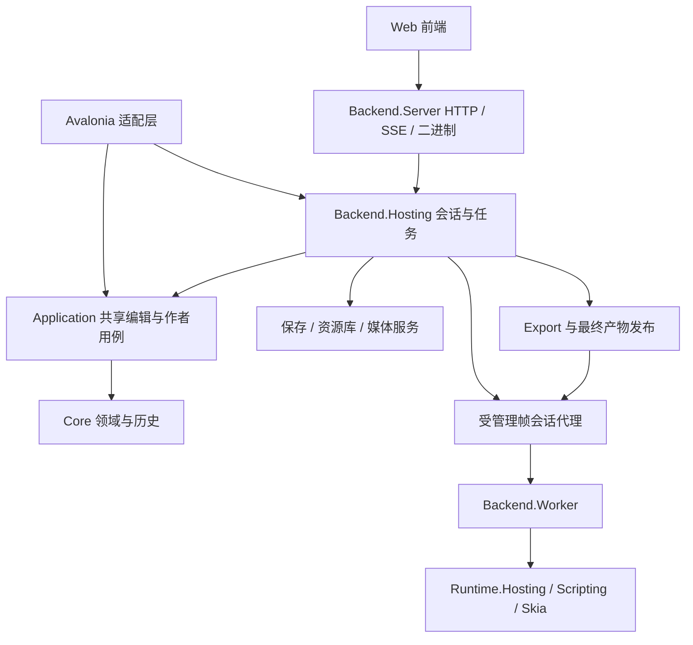

# 独立后端拆分方案：保留 Avalonia，逐批提取用例并修复问题

> **2026-10-15 接续顺序调整／功能开发暂停：** 用户要求先停止开发并建立 [Web 前后端交接入口](../../../web/README.md)。当前产品0.75.0／`696acea`，下文历史阶段与完成定义保留；恢复需等待用户指示。恢复后先补前端所需HTTP工程命令、完整读模型与波形，并联调现有静态异步帧的编辑后换输入／连续播放／seek闭环；公共package HTTP排在该首轮Web编辑闭环之后，随后继续完整资源、正式任务、B5与B6。现有静态预览接口已存在，完整工程实时体验未交付；B1共享用例完成不等于HTTP覆盖完成。Avalonia不作为headless启动或Web验收前置，现有客户端与领域／渲染语义继续保留。具体批次和出口见交接文档§4；本次只调整计划，不新增接口、版本或实现完成声明。

原方案日期：2026-10-11。原文档基线：`16b05ae`；产品源码与 `f7940d4 / 0.49.14` 相同；历史实施状态更新于2026-10-12。前置材料：[可行性调研](../research/backend-web-feasibility-report.md)。当前HTTP接口只维护于[统一API规范](../../architecture/backend-api.md)，[API v1草案](backend-api-v1-draft.md)保留未来目标。2026-10-13的0.65.0 [B4-A固定静态工程正式验证](backend-b4-plan.md)有限出口已完成，0.66 B4-B独立静态导出有限出口已完成，0.67 B4-C独立音频分析按[实施§21](../history/backend-extraction-progress.md#b4-audio-analysis-0670)完成有限出口；2026-10-14的0.68 B4-D显式采用／清除按[实施§22](../history/backend-extraction-progress.md#b4-analysis-apply-0680)完成有限出口，该批staticprofile不扩大；2026-10-14的0.69 B4-E完整分析静态profile已按[实施§23](../history/backend-extraction-progress.md#b4-analysis-static-profile-0690)完成有限出口，新profile不等于脚本音频驱动视觉；0.70固定MP3／FLAC独立分析及显式采用兼容见[实施§24](../history/backend-extraction-progress.md#b4-compressed-analysis-0700)有限出口，带音轨export仍PCM16 WAV，0.70.1 Backend自包含prepare卫生／未发布候选释放已按[实施§25](../history/backend-extraction-progress.md#b4-self-contained-preparation-0701)完成有限出口，App/defaultMedia保留，准备Worker/deadline隔离另批；完整B3剩余不作为整体前置，实际完成状态见[实施记录](../history/backend-extraction-progress.md)。

**历史0.63.0 B3-C有限出口：** 当时已接入真实Runtime.Hosting同进程render-frame-v1适配、受保护PNG帧句柄读取和诊断路由，见[实施记录§17](../history/backend-extraction-progress.md#b3-runtime-frame-0630)／ADR-0207；跨进程Worker真实渲染当时未完成，后续0.64静态工程Worker已按[实施§18](../history/backend-extraction-progress.md#b3-static-preview-0640)接通，0.65正式任务有限出口见[实施§19](../history/backend-extraction-progress.md#b4-static-validation-0650)，后续0.66独立静态导出有限出口见[实施§20](../history/backend-extraction-progress.md#b4-static-export-0660)。历史截点不替代当前状态。

**0.62.0 B3-B帧发布完整性合同已完成：** 在B3-A接缝上固定代次／来源／序号／PNG句柄租约／尺寸／大小／SHA-256验证，见[实施记录§16](../history/backend-extraction-progress.md#b3-frame-integrity-0620)／ADR-0206；Server预览路由和真实Worker渲染仍未完成。

**0.61.0 B3-A有限技术出口已完成：** 已新增中立预览协调器、预览帧／诊断DTO及有界Worker IPC生命周期，见[实施记录§15](../history/backend-extraction-progress.md#b3-preview-worker-0610)／ADR-0205；Worker尚未接入真实Runtime.Hosting渲染，B3完整出口仍未完成。

**0.60.0有限出口已验收：** 用户授权完成B2剩余范围，已完成本机生命周期与独立持久化闭环的有限链路，见[实施记录§14](../history/backend-extraction-progress.md#b2-lifecycle-persistence-0600)／ADR-0204／roadmap§18.182；本机启动见[Server说明](../../backend-server-runbook.md)。下段0.59.0为上一已验收基线，不能用它的计数代替本批出口。

**历史0.59施工状态：用户已授权逐批实施。** 0.50.0～0.56.0交付B1七个进程内共享编辑切片与B0必要有限基线；0.57.0交付B2无GUI新建候选；`a8c8a63 / 0.58.0` 已提交并推送B2-A Contracts／Server、固定上传与创建摘要种子。0.59.0 B2-B已完成具名时间／撤销／重做、单写者修订与一致查询的有限验收，最终证据见[实施记录§13](../history/backend-extraction-progress.md#b2-timing-http-0590)；0.58.0提交时HTTP因缺ASP.NET运行时未实跑，历史证据见[§12](../history/backend-extraction-progress.md#b2-transport-seed-0580)。长期Web、可选Tauri、保留Avalonia直接调用共享用例的决定保持。临时clientId标签不是凭证认证，完整本机握手／Host／Origin、SSE、资源与目录租约、独立保存重开、Worker及性能出口仍未交付。既有ADR数据语义继续有效。

## 1. 建议与完成定义

建议保留 C# 内核，新增一个本地 ASP.NET Core 服务，把 App 中的业务流程提取为共享用例；通过 HTTP 提供命令与查询，通过 SSE 提供事件，通过独立二进制响应传输预览和媒体。渲染、脚本运行放到受管理的工作进程。Avalonia 在过渡期直接调用同一批用例，Web 经服务入口调用。

“独立后端完成”至少意味着：

1. 不加载 Avalonia、不创建窗口、不依赖物理音频设备，即可完成新建／打开、歌词与时间编辑、场景与预设操作、保存／恢复、预览、验证和导出。
2. 工程、撤销、草稿、资源库、任务各有明确的状态所有者；进程内入口与 HTTP 入口执行相同规则。
3. 当前模板／效果作者能力有后端入口，包括非法草稿、固定源码修订、编译、采用及正式验证；不能只有渲染接口就宣称拆分完成。
4. 取消、断连、过期结果、脚本失控及退出可以收敛；保存和最终成片发布保留现有事务保证。
5. Avalonia 现有功能继续可用；迁出的流程在 App 中只剩适配，不能长期保留两份业务实现。

“第一条独立链路可用”是更小的中间出口：上传／授权工程资源 → 新建或打开 → 修改一行时间 → 撤销／重做 → 保存并重开。预览和作者流程分后续批次接入。完整 Web 界面、Tauri 打包、远程多人协作不在这次后端拆分范围内。

## 2. 代码复核得到的关键约束

下表补充前置报告，重点是哪些现有机制不能在网络化时丢掉。

| 当前代码与事实 | 对拆分的约束／同步修复 |
|---|---|
| [ProjectWorkspace](../../../src/MakoKaraGenerator.Application/ProjectWorkspace.cs) 已有工程、历史、保存身份；`Generation` 仅在换工程时递增 | 复用它，外围补每次成功编辑的单调修订；不能把 `Generation` 当编辑版本，也不能另建一套工程状态 |
| [ProjectHistory](../../../src/MakoKaraGenerator.Application/ProjectHistory.cs) 保存不可变前后状态，支持合并与分组 | 一次用户提交一次历史；无变化返回原引用；不能跨任意 HTTP 请求悬挂 `BeginGroup` |
| [保存协调器](../../../src/MakoKaraGenerator.Application/ProjectSaveCoordinator.cs) 捕获固定快照、串行写入、区分手动保存与自动备份 | 保存第 N 版期间可编辑到 N+1；只将真正落盘的快照标记为已保存，不能收到完成事件便清空当前 dirty |
| [PresentationEditSession](../../../src/MakoKaraGenerator.Application/PresentationEditSession.cs) 的提交要求当前工程仍为原 Source | 场景草稿有独立身份及基线；工程变化后拒绝旧草稿提交，不静默覆盖新编辑 |
| [NewProjectPreparation](../../../samples/TechnicalSpike.App/Workspaces/NewProjectPreparation.cs) 依赖 App 选项、VM 导入方法、本地化及 `IAudioPlayback.LoadAsync` | 拆成领域／媒体准备与桌面播放准备；后端建工程不访问声卡，Avalonia 切换前仍完成原播放准备并保留失败时旧工程 |
| [AudioSessionCoordinator](../../../src/MakoKaraGenerator.Media/AudioSessionCoordinator.cs) 管理播放与加载身份 | 桌面声卡会话留在适配层；服务器提供音频资源、分析和波形，浏览器自己播放 |
| [LibraryRepository](../../../src/MakoKaraGenerator.Application/LibraryRepository.cs) 已有索引修订、写入租约、冲突和发布顺序 | API 使用独立 libraryRevision 做比较并提交，复用现有仓储；不要以最后一次写入覆盖整个库 |
| [AuthorInputDraft](../../../samples/TechnicalSpike.App/Authoring/AuthorInputDraft.cs) 与[工坊历史](../../../samples/TechnicalSpike.App/ViewModels/TemplateWorkshopViewModel.History.cs) 保留非法原文、合法值及撤销 | 后端作者草稿必须保留这些语义，不能把保存失败解释成“丢弃输入并恢复上次值” |
| [源码流程](../../../samples/TechnicalSpike.App/ViewModels/ScriptConfigurationSourceEditorViewModel.Workflow.cs) 按固定修订缓存编译，并以 sourceGeneration 拒绝过期结果 | 保存源码、编译、采用、保存配置、正式验证分别建用例；编译成功不自动采用，也不等于验证通过 |
| [ScriptAuthorPackageStore](../../../samples/TechnicalSpike.App/Workspaces/ScriptAuthorPackageStore.cs) 候选读取含同步目录扫描及异步读取的同步等待 | 迁移时改成可取消的异步目录服务，保留闭包、哈希、链接与大小校验及过期回调门禁 |
| [预览协调器](../../../samples/TechnicalSpike.App/Rendering/PreviewFrameCoordinator.cs) 已有单执行者及最新请求槽，但使用引用身份、锁内通知 | 保留背压，改用显式代次和受跟踪生命周期；锁外通知；不能误改成播放时每次 seek 都取消当前帧 |
| [Runtime.Hosting](../../../src/MakoKaraGenerator.Runtime.Hosting/MakoKaraGenerator.Runtime.Hosting.csproj) 已独立；[Export](../../../src/MakoKaraGenerator.Export/MakoKaraGenerator.Export.csproj) 消费中立帧会话 | 复用既有工厂；新增进程代理实现同一帧会话抽象，不重写渲染与编码逻辑 |
| [ProjectStore](../../../src/MakoKaraGenerator.Core/Persistence/ProjectStore.cs) 仍要求精确产品版本一致 | HTTP 协议版本不能代替文件兼容规则；拆分期间保持旧规则，未来放宽须另行裁决 |

## 3. 目标依赖与工程布局

首批按实际使用增加三个项目，不为每个概念另建程序集：

| 目标项目／现有项目 | 职责与依赖 |
|---|---|
| **现有** Core、Application | Core 保留领域命令与文件语义；Application 增加 `Editing`、`Authoring` 等用例目录，仍只依赖 Core。媒体／存储能力用窄接口注入 |
| **新增** Backend.Contracts | 传输 DTO、错误码、命令类型和协议版本；只依赖 BCL／JSON 基础设施，不暴露 Core 对象、委托、Skia 或 Avalonia 类型 |
| **新增** Backend.Hosting | 会话所有权、用例协调、任务、预览、资源租约、DTO 映射；组合 Application、Media、Runtime.Hosting、Export 等现有库，不依赖 ASP.NET 或 App |
| **新增** Backend.Server | `net10.0` 可执行程序；ASP.NET Core 路由、鉴权、SSE、二进制响应及组合根，依赖 Hosting／Contracts |
| **后续新增** Backend.Worker | 运行脚本编译／正式渲染的受管理子进程；复用 Runtime.Hosting。与主服务使用私有、严格版本匹配的 IPC |
| **保留** TechnicalSpike.App | Avalonia 控件、绑定、输入法、弹窗、焦点、桌面音频、UI 调度及中立结果的显示；已迁出的功能调用共享用例 |

`Backend.Contracts`、`Backend.Hosting`、`Backend.Server` 已按最小实际边界新增；表中完整职责和 `Backend.Worker` 仍为目标。Application 的领域参数与结果不依赖传输 DTO，映射放 Hosting；不把 HTTP、作业队列或 Skia 塞进 Application。仅用有实际边界的接口，不先引入通用命令总线、微服务框架或重复仓储层。

这里的两条客户端路径不代表共同修改一个裸 `ProjectWorkspace`。每个会话只能有一个写入所有者。过渡期未迁出的工程仍由 App 所有者线程管理；共享用例先在这个线程执行，昂贵准备工作捕获不可变输入后转后台，结果带基线回交。迁移整个会话时再切到 Hosting 的串行队列，VM 从只读结果更新显示。禁止 UI 线程直接调用 `Workspace.Execute`，同时又让后端队列修改同一工作区。

Avalonia 与独立服务默认各自打开自己的会话。服务内同一规范化工程目录只允许一个写入会话；跨进程需增加工程写入租约及只读／冲突反馈，并在 B2 同时接入保留的 App 打开／保存路径。库现有租约继续复用。更旧的、不参与租约的执行体不具备互斥保证，不能声称自动防住所有外部写入；两端验收使用不同工程副本。

## 4. 状态与职责归属

| 状态 | 所有者 | 客户端责任 |
|---|---|---|
| 工程内容、历史、dirty、已保存快照 | Application 工作区，由 Hosting／过渡期 App 的单一调度器拥有 | 提交带预期修订的意图，接收变更摘要；不另建权威工程树 |
| 选择、滚动、焦点、输入法预编辑、面板展开 | 客户端 | 保留稳定 ID；工程变化后按返回结果纠正失效选择 |
| 时间／工程设置尚未提交的字段组 | 客户端输入草稿 | Enter／离开整组后提交；非法输入保持可见并阻止要求提交的操作 |
| 场景与作者正式草稿、非法作者原文、作者历史 | 共享草稿用例 | 展示原文／错误与最后合法预览；UI 输入法中间态仍在客户端 |
| 播放时钟与扬声器 | 当前客户端 | 微秒与浏览器秒的转换在边界完成；服务器不播放到本机扬声器 |
| 固定渲染输入、会话、帧和诊断 | Hosting／Worker | 请求目标时间和尺寸；拒绝过期帧，展示实际渲染时间与失败 |
| 文件／资源访问权限、临时文件、缓存 | Hosting | 上传字节或使用授予的句柄；不把浏览器本地路径当服务端路径 |
| 导出、分析、编译、验证任务 | Hosting | 通过 jobId 查询／取消；断开页面不等于取消任务 |
| 库索引及固定闭包 | 既有 Repository | 带 expectedLibraryRevision；冲突后重新读取，保留草稿 |

纯界面草稿不必全部搬到服务器。需要跨入口保持业务规则和撤销语义的作者草稿才由共享用例管理。用户进行工程保存时不会隐式发布个人库草稿，作者保存也不代替工程保存。

## 5. 执行与性能设计

### 5.1 先消除重复计算，再有条件并行

沿[调研中的实际调用链](../research/backend-web-feasibility-report.md)拆分以下层次：

1. 编辑用例返回 `ChangeSet`：稳定目标 ID、结构／时间／外观／资源等失效范围。普通歌词编辑更新受影响行，去掉 `UpdateProject` 中重复的场景刷新。
2. 快照构建移出 UI 同步路径，复用同一输入的效果投影和源材质清单；旧构建结果不得发布到新工程。未知依赖按全量失效处理。
3. 渲染会话缓存与时间无关的 SceneDefinition、父子／行／绑定索引。动态几何只能在证明依赖完整后缓存，不能把动态变换一并冻结。
4. 编译产物、不可变资源、时间线运行状态、像素帧分开管理。资源可复用不意味着旧脚本状态可继续使用。
5. 对独立工程、导出与预览、无依赖预计算进行有界并发；同一有状态时间线仍顺序推进。并发数量受 CPU 和内存预算约束，不默认“一帧一个 Task”。

任意脚本可读取歌词、场景和上下文。只要改变了其可观察输入，就必须使相关运行状态失效；不能凭“用户只改了文字颜色”判定脚本不受影响。新 `renderRevision` 首版宁可保守递增，以等价测试逐步缩小范围。

缓存键至少覆盖有效输入、固定包及资源内容、字体／引擎身份、输出模式和影响结果的尺寸；有界条目／字节数、明确原生资源释放及命中／失效计数。不可变项目子树可按身份做进程内缓存，但不能跨进程传裸对象身份。

**首期不承诺解决所有重建延迟。** 有状态脚本从 0 重放是现有合同；禁止跳过事件、降低 120 Hz 语义网格或随意并行帧。纯帧能力声明、检查点／恢复协议需要单独实验、金样对比和 SDK 决策，不作为拆分成立的前提，也不把它们藏进“整理代码”。

### 5.2 预览调度

每个预览上下文最多一个执行中请求和一个最新待处理请求。输入／尺寸／模式变化及显式 seek 使用新代次；正常向前播放只更新待处理时间，允许当前帧完成，避免持续取消导致饥饿。输出带实际时间、源修订和序号；客户端只显示当前代次中不倒退的帧，寻址／换工程后的旧代次一律拒绝。

控制与事件独立于像素传输。首个协议用 PNG 保证无损及透明度可核对，限制尺寸、帧数及保留字节；它是正确性基线，不承诺全高清高帧率。测量渲染、编码、传输、解码和显示各阶段后，再选择二进制 WebSocket、共享内存或视频流；普通浏览器协议仍需独立可用。

UI 位图复用属于 Avalonia 适配器修复；后台帧所有权、丢弃及释放属于共享预览服务。对异步任务逐个登记并等待释放，事件锁外发布；不继续复制 fire-and-forget 释放模式。

### 5.3 工作进程与任务

主服务管理工程、保存和最终发布；Worker 负责可能失控的脚本编译／运行与渲染。导出通过 `IRenderFrameSessionFactory` 的进程代理取帧，保留 Export 的帧顺序、容量为 2 的编码通道及事务提交。

Worker 输入是固定快照与闭包清单，含协议／引擎版本、资源哈希和输出合同；使用专用内部序列化，不把工程保存格式误当 IPC。首版可用有长度限制的管道消息加二进制帧块，先明确内存所有权与校验，再研究共享内存。不得以字符串拼接启动 shell。

每个 Worker 的活动会话有明确归属；不把不同用户意图的导出和交互预览塞进同一个无法单独终止的脚本实例。受全局配额限制排队；CPU 密集导出不能无限创建进程挤占交互。协作取消先通知并等待，超过策略期限再终止该 Worker 及归属子进程；失败仅影响其绑定任务，主服务和已保存工程继续可用。重启后使用新 Worker 代次，旧消息不得污染结果。

保存／最终重命名由主服务持有事务；`Committing` 阶段不接受取消，也不因客户端断开而杀死。保存协调器当前同步写入没有安全的中途取消协议，API 如实返回 `canCancel:false`，不能假装 token 可以回滚已发布文件。

子进程隔离用于故障恢复，不是任意恶意脚本沙箱；首期为用户本人使用的本地服务。远程运行不可信代码、强内存／CPU 限制及系统访问隔离另立范围。现有 `AssemblyLoadContext` 不提供安全隔离，见[微软说明](https://learn.microsoft.com/en-us/dotnet/api/system.runtime.loader.assemblyloadcontext?view=net-10.0)。

## 6. 分批施工顺序

每批可以拆成多个可回滚提交；每个提交将用例迁移、相关修复、回归和文档一起交付。新增公开 API 补 XML 说明，消除本切片的旧业务副本与过时注释，保持固定依赖；按仓库要求为缺陷回归做针对性变异核验并恢复源码。只在调用链所需范围内整理命名／文件，避免把全仓格式化混入拆分。用户已授权按本方案开始施工；下列阶段说明实施顺序，不是工期承诺或已完成 roadmap，逐批出口以实施记录为准。

| 批次 | 落点与交付 | 同步修复 | 阶段出口 |
|---|---|---|---|
| **B0：行为与依赖基线** | 逐项登记现有编辑／作者入口、稳定 ID、历史与文件合同；给拟迁用例建立窄接口和特征夹具 | 找出旧入口依赖和双写风险，不新增第二份状态 | 一个代表工程的既有保存、历史与渲染基准可重复；依赖检查能禁止新后端引用 App／Avalonia |
| **B1：共享编辑用例** | 从 `EditorViewModel.Commands/State/LyricsIO/TimelineEditing` 提取歌词、时间、导入和设置用例；App 直接复用 | 删除重复 SceneEditor 刷新；普通编辑按 ID 更新行；局部变化不再强制整份 `Reload` | App 同一用户动作只有一次领域提交；无变化零历史；时间组保留整数微秒，旧回调拒绝；HTTP 暂不作为验收前提 |
| **B2：首条独立链路** | 新增 Contracts／Hosting／Server；工程会话、资源入口、创建／打开、查询／命令、保存／恢复、基本事件与任务；共享媒体准备 | 去除新建对物理播放设备和 App 静态服务的依赖；加入单写者、目录租约、精确修订及资源生命周期 | 独立进程通过真实 HTTP 完成创建→编辑→撤销→保存→重开；无窗口／声卡环境可运行；保存并发编辑和断连结果正确 |
| **B3：预览与 Worker** | 提取中立预览协调器，增加 Worker 及会话代理、二进制帧、预览事件、诊断分页 | 快照重复投影、静态场景逐帧重建、锁内事件、不等待释放；每一项分别验证 | 普通／透明帧与旧正式宿主相等；持续播放不饥饿，寻址／换输入拒旧帧；故意失控脚本被终止后服务可继续工作 |
| **B4：导出／验证／分析任务** | 接入既有 Export、RuntimeFrameValidator、音频分析；任务配额、进度、取消、产物下载 | 将 VM 中任务状态机移至服务；统一归属、退出等待及完整诊断读取，避免每帧搬运全部日志 | 固定快照任务不受随后编辑影响；真实短片帧数／音轨／透明输出、失败与取消旧片保护、最终提交边界通过 |
| **B5：场景与作者闭环** | 提取场景草稿、模板／配置作者、源码修订、库发布、预设应用和映射；补齐 API | 作者 VM 分离解析／草稿历史／IO；候选目录取消同步等待；共享只读库目录；保留非法原文和过期结果 | 模板制作→库保存→应用；源码保存→编译→采用→保存配置→正式验证，两条全链均可无 GUI 执行，App 调同一用例 |
| **B6：收口与发布验证** | 删除已无调用的旧业务入口，生成 OpenAPI／客户端类型，补运行配置和独立发布入口 | 清理静态定位器与重复 DTO 映射，依赖与资源释放门禁常态化 | 本节与 §9 全部出口成立；最小浏览器协议客户端跑通，但不据此宣称完整 Web 产品已经完成 |

B1 的纯用例与 UI 增量刷新可分提交；B2 的新程序集也按真正需要时添加。B3 内先做会话代理和失控恢复，再接带脚本的公共预览入口；未隔离阶段仅限内部验证，不记健壮性完成。B5 可在 B2 之后提取纯草稿用例，但正式作者运行验证依赖 B3／B4。

### 首个最小切片及接续入口

“单行／元素时间组提交”已在 0.50.0 的首个切片完成：将校验、稳定 ID 定位、领域操作和时间 ChangeSet 从 VM 中提出，App 继续保持当前输入法／非法草稿和组提交交互。复用 `ProjectWorkspace` 执行一次命令，返回受影响 ID；去掉这条路径的整表重建与重复场景刷新。当前纯 Application 夹具与 Avalonia 接入均定向验证；独立 Hosting／HTTP 入口尚未实现。

0.51.0 接续完成现有元素拖动／行边沿、微调与选中元素清除的共享用例和实际控件接入，使用唯一拖动身份及稳定目标的微调身份，保持实时提交、原边界规则和保守增量。捕获丢失／拆除保留接受变化且完成一次；旧回调与历史恢复后复活门禁有定向和真实控件证据。打点流程、整体平移、拆分／合并等仍在App，未新增行／批量清除，详见[实施记录§5](../history/backend-extraction-progress.md#timing-actions-0510)／ADR-0195。

0.52.0接续完成现有正文、注音、新增行、复制行和删除行的五类共享用例。稳定原值、Workspace／Generation、全歌词ID分配、按目标合并与结果选择进入Application；App保留输入会话，正文／注音按摘要增量，结构和未知字段保守完整刷新。真实原VM缺陷与原同ID注音路线未复现分别记录；最终519项定向、Headless33／70／41／73及四项有效变异／40源码精确恢复见[实施记录§6](../history/backend-extraction-progress.md#lyrics-content-0520)／ADR-0196，不等于字形像素、原生输入或HTTP验收。

0.53.0完成固定字节Detect／Prepare、既有来源替换／文件新独立来源、粘贴追加／新翻译来源，以及画布、帧率、底色、时长四字段组和当前歌词末尾／已准备媒体时长标量。Application按完整原来源或歌词及字段组验证，GUI异步导入额外使用Project／Snapshot／Session保守门禁；新建仅透传固定候选并共享纯解析，原媒体／播放准备链保持App。所有文件入口统一拒绝空候选；Core模型继续允许表达非法数据，用户设置用例拒绝非正输入并保留奇数尺寸。328项有限定向、Headless51／73／33及四项成功编译后变异／31源码恢复见[实施记录§7](../history/backend-extraction-progress.md#lyrics-import-settings-0530)／ADR-0197。

0.54.0完成来源新增／删除／受控配置／主行关联。新增验证完整歌词，删除与配置验证完整来源，稳定关联只验证原PrimaryLineId并保留当前其余行字段；可选展示按原投影验证，显式非法元数据／展示在no-op前拒绝，合法相同投影不补默认存储。GUI窗口额外使用Session／Project／Snapshot，拒绝编辑Undo后的旧modal，失败保留输入与窗口。旧UpdateBranch只保留配置／单行关联／可选展示兼容，删除保留容器／效果／预设与既有悬空诊断；FollowPrimary草稿按稳定行权限拒绝，显式Core时间能力保持。190项有限定向、Headless34／70／33、四项有效变异及16源码精确恢复见[实施记录§8](../history/backend-extraction-progress.md#lyrics-branches-0540)／ADR-0198。

0.55.0接续完成稳定元素起点／终点的播放打点共享用例。Application按Workspace／Generation、来源／行／元素稳定ID和原时间验证；起点在无终点时按工程帧率补一帧并标记Estimated，终点确认即标记Edited，单次`token.stamp`历史，未知媒体时长只施加非负下界。App仅适配播放头、选择、消息和终点后的下一个元素。定向测试、变异拒绝与源码恢复见[实施记录§9](../history/backend-extraction-progress.md#timing-stamps-0550)／ADR-0199；整行平移、拆分／合并、规则重切与行内重排仍在App。

以上 0.50.0～0.55.0 为各切片交付时的历史状态，未迁入口由 0.56.0 接续：整行平移、行内元素重排的预览／提交进入 `LyricContentEditUseCase`，拆分／合并、固定行重切及明确来源全行重切进入 `LyricTokenEditUseCase`；App 只适配选择、草稿、确认与结果。最终验收范围和计数见[实施记录§10](../history/backend-extraction-progress.md#b1-closure-0560)，不提前把施工代码记成阶段完成。时间／正文／注音仍按稳定 ID 增量更新；拆合、重切、来源或行结构及不能证明的变化允许保守 `Reload`，正式快照仍完整建立。这一边界不能被扩写成所有局部变化都已消除完整重建或性能已改善。

背景／音频读取、媒体准备与持久化、背景播放／适配参数、播放器与轮询、新建整体准备仍留在 App；它们按 B2 共享媒体／生命周期、B4 分析任务及后续场景设置接续，不在 B1 共享编辑收口内。模板应用／继承恢复、动画、场景与作者业务属于 B5。`ProjectHistory.BeginGroup` 的满容量旧缺陷仍存在，0.56.0 删除已无消费者的 App 分组适配，新 B1 路径不调用它；这只移除当前路径依赖，不能记成底层修复。完整 B0 的代表工程保存／渲染基准继续未完成，不恢复原暂停范围。

**B2首切片0.57.0（已交付）：** 新增 `Backend.Hosting` 组合Application／Core／Media，提取 `NewProjectPreparationService` 的固定歌词候选、无GUI音频解码／时长／波形和领域工程组装；返回托管候选及结构化报告／错误，不给纯托管对象添加无资源职责的Dispose。App捕获输入后调用同一服务，另做播放设备准备与字体Shape前置门禁；按Workspace／Session／Generation／Project／Snapshot拒绝旧结果。仅歌词字节固定，音频探测、解码、播放仍可能多次读本机路径，不承诺媒体不可变快照或授权资产。窄验收包括无窗口／声卡真实短音频准备、空歌词／无音频流拒绝、取消／失败、候选播放释放与旧结果拒绝；当前状态与最终证据见[实施记录§11](../history/backend-extraction-progress.md#b2-new-project-0570)。该切片不是B2完成；Contracts／Server、资源授权、会话串行写入与单调修订、目录租约及真实HTTP创建→时间编辑→撤销／重做→保存→重开继续作为阶段出口。

**B2-A 0.58.0与B2-B 0.59.0接续：** B2-A已提交固定上传（SHA／MIME／大小／配额／标签归属）、同步创建与零修订摘要。B2-B增加稳定歌词目标的时间命令、撤销／重做、单一Writer闸门、单调projectRevision、一致歌词／历史／摘要查询与有界命令回执；最终solution零警告／错误、Hosting61项、独立真实HTTP688断言／110请求通过，见[实施记录§13](../history/backend-extraction-progress.md#b2-timing-http-0590)。本批纠正B2-A误用已保存基线的新建状态，改为isDirty:true／hasPath:false，与Avalonia一致；仍无磁盘保存或savedRevision。临时clientId不等于本机token认证；eventCursor未开放，HTTP省略该字段。第一条完整独立链路仍要求正式握手、安全资源生命周期、目录租约、真实HTTP保存并重开，不能由已有命令替代该出口。

## 7. API 与前端的基本交互

下述为整体设计约定，未来字段与错误见[API草案](backend-api-v1-draft.md)；当前已实现路由／DTO／错误以[统一规范](../../architecture/backend-api.md)为准，不由本节推定交付。核心约定如下：

- 工程内容只由后端修改。前端提交具名命令及 `expectedRevision`，后端原子提交并返回 `ChangeSet`；不开放任意 JSON Patch／反射字段写入。
- 工程修订、草稿修订、库修订、预览代次及事件序号分开；`isDirty` 继续源自实际已保存内容身份，不能用两个计数器不相等推断。
- 时间、64 位 seed／计数器使用十进制字符串；资源 ID 与稳定对象 ID 不依赖列表下标。
- 长任务返回 `202 + jobId`，通过事件与查询获取进度和终态；诊断分页读取，帧通过独立二进制地址获取。
- 浏览器上传资源或使用已授权根内的句柄。Tauri 只承担文件选择、启动／关闭后端等桌面适配，不能成为工程编辑或渲染的唯一入口。

选择 HTTP＋SSE 是本方案的工程建议：当前需要的控制请求是离散命令，连续信息主要由服务推送；不必先维护第二套 WebSocket 命令协议。ASP.NET Core 10 已提供 SSE 结果 API，见[官方文档](https://learn.microsoft.com/en-us/aspnet/core/fundamentals/minimal-apis/responses?view=aspnetcore-10.0)。后续若帧传输确需 WebSocket，只替换数据通道。

Tauri 能打包外部二进制并按平台启动 sidecar，因此 C# 服务不必改写成 Rust。各平台仍要发布匹配的 .NET／原生依赖与可执行体，不能把支持 sidecar 当作已经完成跨平台验收。见[Tauri 2 官方说明](https://v2.tauri.app/develop/sidecar/)。

## 8. CLI 取舍

**首期不另做完整 CLI。** `Backend.Server` 本身就是独立可执行程序，需要监听地址、profile、允许根目录、日志和 Worker 路径等启动参数；健康与能力可由 API 查询。无 GUI 测试可直接调用用例或启动真实服务，不依赖再维护一套命令行 UI。

若批处理、CI 成片验收或问题复现确有需要，再增加薄 CLI 的 `inspect`／`validate`／`export`。它调用同一用例或连接已有服务，输出结构化诊断和可靠退出码；不得另建项目加载、导出、路径、取消与错误规则。一次性验证工具仍放测试／工具目录，不冒充长期公共接口。

## 9. 验证、度量与完成门禁

### 9.1 优先复用的回归入口

| 范围 | 现有入口及需补充的行为 |
|---|---|
| 工程／历史／保存 | [ProjectWorkspaceTests](../../../tests/MakoKaraGenerator.Application.Tests/ProjectWorkspaceTests.cs)、[ProjectHistoryTests](../../../tests/MakoKaraGenerator.Application.Tests/ProjectHistoryTests.cs)、[ProjectSaveCoordinatorTests](../../../tests/MakoKaraGenerator.Application.Tests/ProjectSaveCoordinatorTests.cs)：补修订冲突、重试不重复历史、保存中编辑与撤销回保存态 |
| 场景／库 | [PresentationEditSessionTests](../../../tests/MakoKaraGenerator.Application.Tests/PresentationEditSessionTests.cs)、[LibraryRepositoryTests](../../../tests/MakoKaraGenerator.Application.Tests/LibraryRepositoryTests.cs)：草稿过期、跨进程租约、外部修改冲突与完整闭包 |
| 时间／音频 | [LyricsTimeDraftTests](../../../tests/MakoKaraGenerator.Spike.App.Tests/LyricsTimeDraftTests.cs)、[AudioProjectHistoryTests](../../../tests/MakoKaraGenerator.Spike.App.Tests/ViewModels/AudioProjectHistoryTests.cs)：非法输入、一次组提交、换工程拒旧回调、无声卡准备 |
| 后端依赖／帧 | [BackendDependencyTests](../../../tests/MakoKaraGenerator.Runtime.Hosting.Tests/BackendDependencyTests.cs)、[PreviewFrameCoordinatorTests](../../../tests/MakoKaraGenerator.Spike.App.Tests/Rendering/PreviewFrameCoordinatorTests.cs)：扩到所有新后端项目，迁移中立测试，新增进程终止与旧代次帧拒绝 |
| 导出 | [VideoExporterTests](../../../tests/MakoKaraGenerator.Export.Tests/VideoExporterTests.cs)：通过 Worker 代理实际编码与解码，失败／取消／提交后断连不损坏原片 |

新增协议集成验证必须走真实 HTTP／SSE 和真实独立进程，覆盖超过 JS 安全整数范围的 seed、revision、事件缺口重同步、重试、乱序、二进制生命周期与路径越界。渲染等价检查固定字体、资源、种子和实际帧时间；透明像素按现有预乘／直乘合同核对，不能只比“有图”。

Avalonia 定向回归继续验证现有输入、草稿、焦点和保存归属。只将无 GUI 业务测试迁到后端，不删除仍必要的 UI 测试；不能为了绕开失败而改变原断言语义。

### 9.2 度量方式

建立单独的受控基准，不用产品日常日志计时替代：同一机器／字体／工程、Release、冷／热分开，记录中位数和 P95，保存样本、构建 SHA、进程与资源峰值。

| 场景 | 必须拆开的指标 | 初步判据 |
|---|---|---|
| 大歌词工程编辑一个时间组 | 命令排队、用例执行、ChangeSet 应用、快照构建 | 无整表重建／重复场景刷新；工作量随影响范围变化 |
| 静态与正式效果预览 | 编译、投影、重放步数、布局、绘制、IPC、PNG、客户端显示 | 静态定义同一有效输入只构建一次；正常播放无取消饥饿；内存与队列有上限 |
| 0／30／180 秒处编辑及回退 | 冷建与复用分别采样，记录 120 Hz 推进与事件边界 | 不隐瞒从 0 重放的残余成本；等价输出成立后再比较耗时 |
| 预览同时导出 | 响应排队、每类 Worker 使用、峰值内存、导出帧速 | 控制接口能响应／取消，任务资源受限，不因吞吐优化破坏帧顺序 |

接口命令可先以“代表夹具服务端 P95 ≤50 ms，不含媒体／渲染长任务”作为**候选目标**；预览目标需 B0 新基准后按静态／有状态场景定值。候选目标不是已测结果或当前承诺。0.50.0 首个时间组切片只完成必要的有限基线与定向验证，没有恢复暂停的全量或性能执行；完整性能／平台验收另记证据。

## 10. 成本与主要风险

单人熟悉仓库、保持现有高级能力并补真实验收的粗粒度估计：B0～B2 约 3～5 人周；B3～B4 约 3～6 人周；B5～B6 约 4～7 人周。整体约 **10～18 人周**，属于规划区间，不是按行数计算的排期；不含完整 Web 界面、Tauri 分发、远程部署、脚本检查点或跨平台矩阵。可在 B2 交付后重新估算剩余范围。

最大的成本不是增加 HTTP 路由，而是把 App 隐含的业务状态、历史、资源与异步所有权变成可测试的用例，并保持作者全功能。最大的性能不确定项仍是任意脚本的长时间重放；最大的可靠性风险是工作进程终止与保存／发布生命周期混在一起。

可控原则是：一个业务切片只有一份实现；一步一个聚焦提交；有失败复现再修复；每批说明保留的能力、当前证据及剩余边界。移动目录、减少文件行数、增加接口数量都不是完成标准。

## 11. 决策状态与本轮交付边界

已由用户确定：保留可用 Avalonia，逐步共享用例而非首期强制 HTTP；长期 Web；Tauri 可选；拆分伴随相关卫生修复。

用户已授权按本方案逐批实施；本地 .NET 服务与Contracts／Hosting／Server最小边界已进入B2-A／B2-B；SSE、完整会话生命周期与受管理Worker仍为后续技术方案，首期不单独做业务CLI。实施时遇到以下变化须单独决策：放宽工程版本兼容、修改文件 schema／作者 SDK、增加脚本检查点／降低确定性、改为远程多人服务，或删除现有高级能力。它们都不是本方案的默认授权。

原设计轮次仅新增方案与 API 草案。2026-10-11 的 0.50.0 实施批次完成 B0 必要有限基线和 B1 首个时间组切片，新增共享 Application 用例、Avalonia 直接接入与增量刷新；solution 零警告／错误，205 项定向 xUnit 与 70 项 Headless 断言通过，详见[实施记录](../history/backend-extraction-progress.md)与 roadmap §18.172。

0.51.0 接续时间动作切片：原有限基线268项，最终solution零警告／错误、335项定向xUnit和Headless动作41／草稿70通过，四项成功编译后变异均被实际回归拒绝，源码精确恢复，见[实施记录§5](../history/backend-extraction-progress.md#timing-actions-0510)与roadmap §18.173。其余B1用例与完整B0未完成；HTTP／SSE、服务、Worker、协议、完整性能／平台验收尚未实施，不将局部用例交付记为整体拆分完成。

0.52.0正文／行操作及0.53.0固定字节导入／标量设置的实际有限证据分别见实施记录§6／§7与roadmap§18.174／§18.175。0.53.0最终solution零警告／错误，328项有限测试和Headless51／73／33通过，普通隔离包已启动供手测；不扩展前批全量、原生、性能或协议验收。

0.54.0来源管理实际有限出口见实施记录§8与roadmap§18.176；0.55.0打点实际有限出口见实施记录§9与roadmap§18.177。完整B0／B1继续部分，下一批仍从未迁业务建立必要基线，不直接跳到HTTP。

0.56.0 接续 B1 共享编辑收口，语义、调用入口与最终证据集中到[实施记录§10](../history/backend-extraction-progress.md#b1-closure-0560)／ADR-0200／roadmap§18.178。前述“整体 B1 仍部分”和未迁入口均是各版本当时状态，不能代替该节的当前范围裁决。完整 B0、独立新建／媒体、HTTP／SSE、服务／Worker、完整性能／平台出口与原暂停范围不随 B1 编辑收口自动完成。

0.57.0已完成B2无GUI新建候选首切片有限验收。仅歌词输入固定，音频仍为受信本机路径；Hosting组合媒体与领域准备，App保留声卡／字体／发布。最终证据见[实施记录§11](../history/backend-extraction-progress.md#b2-new-project-0570)；不能把此切片写成独立HTTP API、资源授权或B2完成。

0.58.0 B2-A与0.59.0 B2-B的实际范围以[实施记录§12／§13](../history/backend-extraction-progress.md#b2-transport-seed-0580)、ADR-0202／0203和roadmap§18.180／181为准。前述历史版本的“未实现”边界不代替当前裁决；0.59.0仅完成上述有限切片，不宣称完整B2或整体后端拆分完成。
