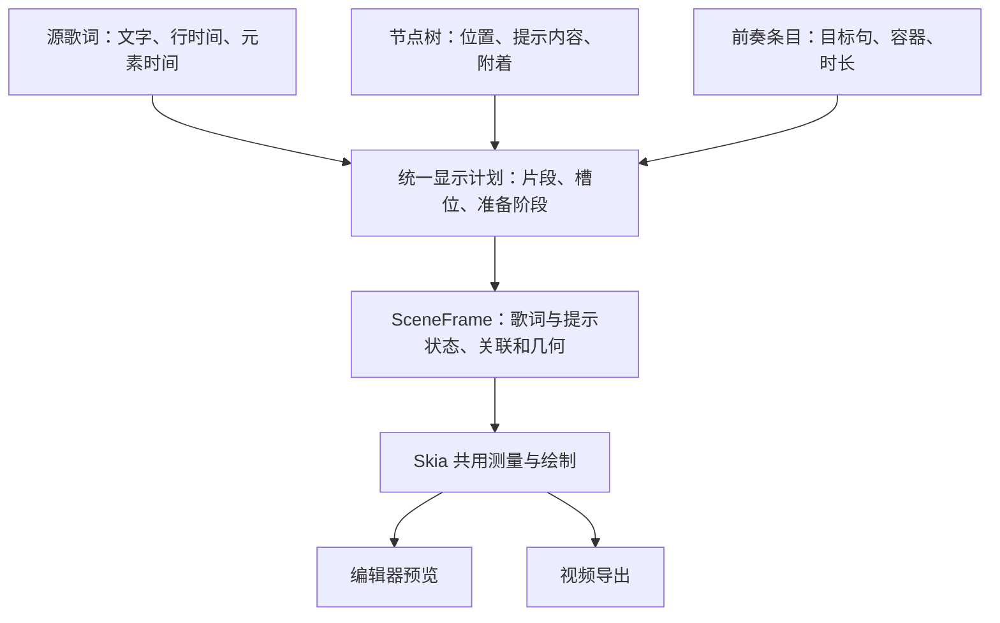

# 卡拉 OK 前奏提示：场景容器、准备显示与自动生成方案

> 日期：2026-10-01；调研基线：程序 **0.8.1**，工程／歌词／模板 schema **20／15／3**。
> 状态：**0.9.0 已完成 L1～L4，实现、自动验证及用户人工验收通过**（2026-10-02）。§4 数据合同、§9 UI 已随按文档实施的授权确认；实施证据、人工反馈及使用路线见 §13～14。
> 0.8.1 展示编排体验优化已获用户“测试验收通过”。当前程序 0.9.0，工程／歌词／模板 schema 21／15／3；不迁移旧工程。
> 关联：ADR-0050、0061、0065～0067；[当前架构](../history/current-architecture.md)、[编排实施合同](../legacy-ui/scene-editor-implementation-contract.md)。完成度以 roadmap §18.24 为准。

## 1. 推荐设计与用户认知

**先制作前奏提示容器，再把一次前奏提示绑定到某句歌词。** 容器决定提示长什么样、放在哪；绑定决定何时出现、为哪句倒计时。自动生成只帮助创建这些绑定。

例如：创建一个“三点提示”容器，设置三个点的颜色和位置；给“请照亮我前行”添加 3 秒前奏。该句首个定时元素在 12 秒开始，则 9 秒显示目标句和三个点，随后依次改变点的外观；12 秒提示消失，文字直接进入原有逐字演唱。

```text
共同父组
├─ 歌词容器（自由布局或任意槽位轮换）
│  └─ 实际装载的目标句 → 注音
└─ 前奏提示容器（固定在父组内，或运行时附着目标句）
   ├─ 标记 1：●
   ├─ 标记 2：●
   └─ 标记 3：●

前奏条目：目标句 ID ＋ 提示容器 ID ＋ 提示时长
```

三点是一个创建预设。点数、文字、局部位置、样式和顺序都可编辑；两个点、四个点、星号或「3／2／1」可以使用同一结构。首期采用文字字形作为标记，形状和图片内容另行扩展。

三点预设按实际父组参考尺寸创建紧凑固定框和三个等距标记（初始每个标记参考框 40×40 px），每个标记的位置都实际写入其 Placement；之后手工改动不会被自动排布覆盖。增加标记或改顺序只执行明确的节点操作，等距重排作为用户主动选择的快速布置。

源歌词继续只表示实际歌词和演唱时间。提示标记作为真实场景节点参与位置编辑、测量、命中和共享渲染；前奏条目作为展示程序的一部分引入“准备显示”阶段。

## 2. 已获用户确认的行为

| 问题 | 用户确认 |
|---|---|
| 自动生成范围 | 歌曲开头，以及长间奏后的再入唱；长间奏阈值可配置 |
| 倒计时归零 | 目标句首个有有效时间的歌词元素起点；没有逐字时间时使用行起点 |
| 提前显示 | 前奏期间提前显示目标句；前奏本身也是场景中的容器元素 |
| 入场动画 | 目标句在前奏开始时播放自身入场动画一次，起唱时连续衔接 |
| 原有保留歌词 | 前奏开始切换到目标句，只显示目标句及提示 |
| 开头时间不足 | 跳过并列出原因，由用户决定是否手工添加；不平移音频或歌词 |
| 提示定位 | 同时支持跟随目标句、固定在父组内 |
| 目标句原本更早揭示 | 有前奏的目标句等到倒计时开始再显示，并在那时入场 |

“只显示目标句”按**当前显示程序**实施；关联注音随目标句，FollowPrimary 翻译继续按已有关联和自身位置显示。其他独立分支仍由自己的显示程序控制。本方案不引入跨分支全局互斥控制。

上述显示行为先行确认；用户随后明确授权“按照本文开始逐步实施”，批准下面的内容、绑定、删除、生成保护和 UI 合同。授权过程保留在 ADR-0067；新增合同之外的决策仍须询问。

## 3. 调研结论与现有代码接缝

### 3.1 外部实现可借鉴什么

| 一手资料 | 实际做法 | 对本项目的启发 |
|---|---|---|
| [PowerKaraoke 官方事件文档](https://docs.powerkaraoke.com/books/ai-karaoke-video-creator-user-manual/page/using-events) | Countdown 是独立事件，在下一个词高亮前提示，可设置时长、标记数量和字符／文本 | 归零对齐实际起唱；点数和文字是配置，而非固定三个 |
| [MyKaraoke Video 官方高级编辑器说明](https://help.mykaraoke.video/en/articles/19-master-the-advanced-editor) | Countdown 是有时间位置和持续长度的可选元素，具有外形、字体、颜色和位置属性 | 提示拥有可选择、可编辑的场景身份，与容器编辑器统一 |
| [Aegisub 官方仓库的自动 lead-in 脚本](https://github.com/TypesettingTools/Aegisub/blob/master/automation/autoload/karaoke-auto-leadin.lua) | 按相邻字幕时间空档延长后一条的起点，并插入空白卡拉 OK 时长 | 可参考空档检测，但其修改源字幕的手段不适用于本项目的独立行时间与展示合同 |

**本方案的判断**：独立提示元素和目标起唱锚点有实际产品依据；用准备阶段连接本项目的容器、片段和槽位是本仓库的设计推导。这些资料不证明“三点必然对应三拍”或“默认必须倒计时三秒”。

### 3.2 调研基线 0.8.1 的基础与缺口

| 当前入口 | 已有能力 | 本批需要补齐 |
|---|---|---|
| `Core/Projects/SceneContainerDefinition.cs` | 节点 ID、父组、位置、固定参考尺寸、自由／槽位布局 | 当前节点没有独立文字内容和倒计时序列内容 |
| `Core/Projects/LyricDisplaySegment.cs` | clips 区间由首末源行解析；显式／默认片段隔离 | 时间尚未进入片段时不能通过当前 resolver 提前装载它的目标句 |
| `Core/Projects/SlotSequenceAnimationProfile.cs` | 任意槽位轮换、揭示、保留、容量、冲突 | Progress 等揭示规则可能在长间奏之前就显示后句，需要接受前奏的显示约束 |
| `Rendering.Abstractions/SceneDefinition.cs`、`LyricSceneSampler.cs` | 稳定定义／装载身份、真实槽位绑定、绝对时间采样、动画和关联翻译 | 增加准备阶段、提示内容采样及其源关联；起唱前后保持装载身份 |
| `Rendering.Skia/SkiaRenderPipeline.cs`、`.SceneFrame.cs` | 文本整形、注音测量、父子世界矩阵、最终几何 | 当前 DrawLyrics 遍历 Lines；新增节点定义本身不会使提示被画出，必须贯通共享内容绘制和几何 |
| `Application/PresentationEditSession.cs`、`Core/Validation/PresentationValidator.cs` | 不可变展示草稿、校验、一次应用／撤销 | 新字段的相等性、引用校验、自动生成差异和历史纳入同一草稿范围 |
| App 的 `SceneEditorControl` 及相关 partial | 树、画布、片段、动态属性、宽窄布局 | 使用已验收的入口与操作归属添加提示编辑 |

这里的路径均相对于 `src/MakoKaraGenerator.*`；App 位于 `samples/TechnicalSpike.App`。以上缺口描述调研时的 0.8.1；0.9.0 实施结果见 §13。音频节拍分析器仍未实现。

## 4. 数据设计：保留原生树，增加内容和前奏绑定

### 4.1 各对象负责什么

| 对象／拟新增字段 | 保存内容 | 不保存的派生结果 |
|---|---|---|
| `nodes[].content` | 可选内容；首期支持 CountdownSequence 与 TextMark | 不复制源歌词，不保存每帧状态 |
| 倒计时组的 CountdownSequence | 有序 `markNodeIds`、等时步进模式 | 点数从序列长度得出，不再保存第二份数量 |
| 子节点的 TextMark | 字符串及标记样式 | 不带 LyricToken 时间、TimingStatus 或逐字切分 |
| 倒计时组的 `attachment` | FixedParent 或 CueTargetText 定位模式 | 不另存第二份 X／Y；继续使用节点 Placement |
| `programs[].leadIns` | 稳定 ID、启用状态、目标 LineId、提示容器 ID、持续微秒、Manual／Generated 来源 | 起点、归零点、当前步骤和实际槽位均从源及配置解析 |
| `programs[].leadInGeneration` | 当前程序的范围、空档阈值、时长、所选提示容器和明确排除的 LineIds | 不在打开工程时执行生成，也不保存音频分析的猜测 |

普通节点仍只有 ParentId／Placement／ReferenceRect／可选 Layout。增加内容的节点与普通容器共用基础数据及矩阵。CountdownSequence 节点可以持有子标记，不能同时声明歌词 Layout；TextMark 是叶节点。首期附着模式只用于倒计时组，绑定只面向 Independent＋Karaoke 显示程序。

内部标记是节点，`markNodeIds` 是步骤顺序的唯一真值。树中显示同样顺序，拖动标记直接改变倒计时顺序，延续 ADR-0066 的明确交互。删除步骤至少保留一个；首期列表不混入未参与序列的 TextMark。

### 4.2 样式复用

标记样式复用现有 `TypographySpec`、`FillSpec`、`StrokeSpec`、`ShadowSpec` 和不透明度。序列的“待倒计时／已经过”两态使用同一排版，只切换填充或不透明度，避免每走一步字宽就变化。

拟用 `SceneTextAppearance` 组合这些已有值对象，提示组保存默认外观，TextMark 保存可选局部覆盖；字段只包括 Typography、PendingFill、ElapsedFill、Stroke、Shadow、Opacity。未写字段继承；Stroke／Shadow 使用“显式 null 关闭／对象启用”，字体和填充须保持有效。不复制 LyricStyle 中的歌词布局字段。整组与子标记使用同一外观编辑组件和校验；组默认外观是叶节点的解析基线，其 Opacity 不再次作为父级渲染透明度相乘。

标记样式保存在提示内容内，具有自己的默认值及显式覆盖；不通过目标句的样式继承链动态取值。可以从既有行模板**按值读取适用的外观属性**，并明确列出写入范围；位置、VerticalCenterRatio、整行对齐、基础缩放和入场动画不作为标记外观读入，位置与缩放由节点管理。这不改变 templates.json 的行／元素模板合同，也不另建一套颜色、描边和字体格式。

可以在工坊设计共用外观，在展示编排内为整个提示设置外观、对子标记单独覆盖。序列数量和轮换时间属于提示内容，继续在编排内编辑。

### 4.3 前奏条目与容器复用

一个提示容器可以被同一显示程序的多个前奏条目复用，每次以各自目标句和时间求值；同一时刻只允许一次活动装载。同一个跟随容器首期不跨不同程序共用，避免两个独立分支同时调用时产生父矩阵歧义；需要相同外观时可复制容器。

条目的 Enabled 为 false 时保留配置和关联，不参与前奏约束，目标句恢复普通显示；禁用和重新启用均进入展示草稿。禁用项在再次生成时仍视为已有配置，不被自动重新启用或另建同句条目。

每个程序中同一句最多一个启用前奏。前奏不改变该句的 clip 归属；实际歌词容器和槽位沿用其原有编排。自动生成身份由 ProgramId＋TargetLineId 定位，改名或修改时间不会制造重复条目。前奏 ID 与标记 NodeId 不含时间和列表索引。

复制提示子树生成新节点 ID，并重映射 `markNodeIds`，不复制前奏绑定或歌词。删除被条目引用的提示容器拒绝并列出引用；用户先删除或改绑对应条目。删除一条前奏不删除共用容器。明确删除源行时清理它的前奏和排除项，保留提示容器；撤销恢复完整关联。以上删除语义已随按方案实施的授权确认。

新增校验至少覆盖：目标行属于本程序且行时间有效；提示容器属于该程序展示根子树；每个步骤引用存在、唯一、是本提示组的直接 TextMark 子节点；提示组首期只持有这些标记叶节点。内容节点不能被当作歌词目标容器或轮换槽位；运行附着不得形成依赖环。启用条目的准备区间不得彼此重叠，也不得遮挡同程序其他句的演唱占用；禁用条目仍须通过结构、正时长和引用校验。无法求逆的位置基底、未知内容类型和非法数值只报错，不修正。

### 4.4 结构示意

以下仅显示**拟新增部分**，是评审草图，不能作为当前可加载 JSON，也未确定 DTO 枚举的最终拼写：

```json
{
  "nodes": [
    {
      "id": "cue-dots",
      "parentId": "main-display",
      "content": {
        "kind": "countdownSequence",
        "markNodeIds": ["dot-1", "dot-2", "dot-3"],
        "stepMode": "equalDuration"
      },
      "attachment": { "mode": "cueTargetText" }
    },
    { "id": "dot-1", "parentId": "cue-dots", "content": { "kind": "textMark", "text": "●" } },
    { "id": "dot-2", "parentId": "cue-dots", "content": { "kind": "textMark", "text": "●" } },
    { "id": "dot-3", "parentId": "cue-dots", "content": { "kind": "textMark", "text": "●" } }
  ],
  "programs": [
    {
      "id": "main-program",
      "leadIns": [
        {
          "id": "lead-in-1",
          "enabled": true,
          "targetLineId": "line-1",
          "indicatorContainerId": "cue-dots",
          "durationUs": 3000000,
          "origin": "manual"
        }
      ]
    }
  ]
}
```

真实工程还包括现有必填数据、各节点 Placement／ReferenceRect、内容样式及生成设置。归零锚点首期固定为 §2 已确认规则，UI 显示计算结果，不给用户一个含义不同的“结束时间”副本。

格式获批准并实施后，预计交付 **0.9.0／工程 v21**；歌词／模板保持 **v15／v3**。按现行政策拒绝旧版本工程，不增加迁移。本轮仍是 0.8.1／v20。

## 5. 时间、显示与动画合同

### 5.1 三个不同的时间概念

设目标起唱点为 `A`，提示时长为 `D`，则 `S = A - D`。

| 概念 | 真值 | 含义 |
|---|---|---|
| 行时间 | 现有 LyricLine.Time | 原有正常可见区间及片段范围的源依据 |
| 演唱时间 | 现有 LyricToken.Time；没有逐字时间则用行起点作提示锚点 | 逐字进度仍由 LyricSampler 解释；没有时间的字仍保持未唱 |
| 前奏准备时间 | 派生 `[S, A)` | 一个显式的展示扩展，让目标句提前出现；不写回源行时间 |

归零点选源顺序中的首个有效定时元素起点。目标句若有未定时前缀，提示对齐第一个**已知**起唱点，并显示时间依据警告；无法把它称作已确认的真实首字。元素全部缺时采用已确认的行起点规则，不制造逐字时间。

```text
例：行时间 [11.5, 18.0)，首个定时元素从 12.0 开始，D = 3 秒

时间       9.0           10.0          11.0          12.0              18.0
提示       ● ● ●    →    · ● ●    →    · · ●    →    消失
目标句     从 9 秒入场，逐字进度为 0                 沿原时间演唱       原规则退出
源行时间                                         11.5 ├───────────────┤
```

示例中的明暗和 3 秒只是建议的三点预设。首期按等时步进，不承诺音频拍点检测；可设置时长来匹配人工已知的节奏。
图中「·」只是暗态示意，实际仍绘制同一个标记字形。

### 5.2 同一显示计划协调前奏、片段和槽位

需要在 Core／共享采样层形成一个纯函数的**显示计划**：先解析源成员及实际容器／槽位，再合并前奏约束，最后对绝对时间求帧。名称可采用 `LyricDisplayScheduleBuilder`，它复用现有片段和槽位规则，不另起一套只给 UI 用的播放计时器。

1. 没有前奏的程序保留现有输出。
2. 有前奏的目标句禁止在 `S` 前由槽位规则揭示，`S` 成为本次装载的显示与进入动画起点。
3. `[S,A)` 只装载本程序的目标句及提示；此前保留句的显示在 `S` 终止，后续句最早在 `A` 揭示。起唱后旧保留句不能重新出现。
4. 目标句提前使用其**原片段中已经确定的槽位**，不消耗额外轮换序号，也不因前奏自行重置为首槽。跨 clip 边界仍按 ADR-0065 建立片段自身的首槽序列。
5. 前奏目标本次装载获得明确的展示优先权；准备期腾出对应槽位，目标句从准备到起唱保持连续。后续句从 `A` 起继续受正常容量和冲突规则约束，不用每帧临时修改配置。
6. 现有 `clips` 的源区间保持。准备阶段可以先装载目标句的未来片段，甚至跨过上一片段的**纯显示保留时间**；如果会隐藏同程序仍在演唱的其他句，拒绝并报告冲突。
7. 目标句行起点可能处于准备区间内；到达该点时不再次切容器、不重播动画。到 `A` 时只移除提示并切换 DisplayPhase，继续逐字采样。

规则 3～6 是具体调度实现建议，需随 §4 合同审阅；尤其不能以当前帧“过滤掉几句”的方式伪装已经完成了完整调度。完整计划须确定目标槽位、被终止的装载、后续揭示和容量，再供预览与导出共用。

### 5.3 边界和状态重建

- `t < S`：目标句遵守前奏限制，不提前显示；其他句正常采样。
- `S ≤ t < A`：目标句准备显示、逐字进度为零，提示按步骤求值。
- `t = A`：提示全部消失，源进度仍严格按半开时间解释；没有多留一帧。
- `t > A`：该句延续本次装载和进入动画时钟，退出仍用原有合同。

进入动画继续采用该句有效的现有动画覆盖，只把本次 RevealTime 设为 `S`；持续时间超过 `D` 时自然延续到演唱阶段。跟随模式下提示继承目标最终矩阵与不透明度；固定模式下提示使用自身父组矩阵，目标动画照常播放。

N 个标记的边界为 `bᵢ = S + floor(i × D / N)`，`i=0…N`。首期使用“完整字形按步骤改变外观”，保持整形和布局稳定。通过商余数分解计算整数微秒边界，避免乘法溢出；边界必须严格递增，时长过短明确报错。

所有状态从不可变快照、绝对时间和显示计划重建；随机跳转、从中间开始播放、循环、倒退和视频导出不依赖已经发生过的 UI callback。

BindingId 不加入 Preparation／Performance 或当前时间；前奏条目的 CueId 作为额外运行关联。目标在 `S`、源行起点和 `A` 前后保持同一装载身份，方便后续脚本区分“显示了”与“开始演唱了”。

## 6. 两种定位：同一位置编辑，明确参考对象

### 6.1 固定在父组内

使用现有 ParentId、ScenePlacement 和 ReferenceRect。提示与歌词容器同属共同父组，整组移动、旋转、缩放时一起变化；提示不因目标句换槽而跳转。

### 6.2 跟随目标句

树内结构父组继续表示所有权；本次运行装载显式附着于目标文本节点。定位参考使用**目标句在变换前的文字／注音联合边界**，节点 Placement 表示相对于该参考锚点的偏移，ReferenceRect 仍采用固定参考尺寸，不随着歌词长短偷偷改变偏移和缩放单位。

```text
提示世界矩阵
  = 目标文本最终世界矩阵
    × 目标文字局部参考锚点平移
    × 提示自身局部变换
```

目标最终矩阵已包含共同父组、实际槽位、本句局部微调和动画，外层变换只计算一次。不能把旋转后的世界包围盒当局部锚点，也不能再乘一次根组矩阵。

测量顺序为：目标文字与注音 → 附着提示 → 子标记 → 更新共同祖先联合边界。附着参考只包含目标文字／注音，不包含提示自身，避免测量循环。画布绘制、提示选择、拖动命中和导出使用相同的最终 SceneFrame。

属性中直接显示“定位：跟随目标句／固定父组”“参考：目标歌词／父组”。跟随布局参考须选择一个实际前奏条目作为上下文，明确当前参考哪句；容器有多个引用时可切换参考条目。时间预览可以跟随当前活动条目，但拖动编辑切到稳定布局参考，不把动画瞬间坐标写回 Placement。

切换定位模式时，建议在当前布局参考下保持画布外观，通过新参考基底逆矩阵换算；无参考条目或基底不可逆时拒绝并提示。现有静态 `TryReparent` 不能直接处理运行附着，需要使用解析后的参考基底扩展纯换算。共享容器的修改影响所有引用，属性显示引用数量。

## 7. 自动生成：从歌词时间得到可审阅候选

### 7.1 输入与演唱空档

用户打开“自动生成前奏…”，明确选择歌词来源、提示容器、提示时长和长间奏阈值。可分析当前程序或选择的多个 Independent＋Karaoke 程序；翻译／静态／关联分支不重复生成，列出不支持原因。

计算使用源时间，不用音量判定间奏：伴奏可能很响，歌曲开头也可能是弱声演唱。首期不依赖脚本系统或音频特征管线。

为每句构造保守的演唱占用区间：

- 全部元素具有有效时间：首元素起点至末元素终点，内部空隙仍按本句占用处理，避免给同一句中间的停顿生成前奏。
- 部分元素未定时，或全部无逐字时间：使用完整行区间判断空档，并附时间依据提示。起唱锚点仍严格按 §2 规则。
- 有效行时间缺失、源时间无效或存在未知时间的中间歌词：候选标为“无法可靠判断”，跳过而不跨过去猜一段长间奏。

扫描同程序所有前序占用区间的并集，使用最晚实际占用终点判断空档，不能只减去列表上紧邻上一行的终点。候选必须是一次新句起唱；新片段边界本身不构成再入唱证据。

### 7.2 候选与校验流程

1. 首个可可靠定位的起唱点得到歌曲开头候选；其前面有未定时歌词时不能称为首唱，列出原因。
2. 后续新句在演唱空档达到设定阈值时形成候选。
3. 计算 `A` 与 `S`，检查 `S ≥ 0`、`D > 0`、步骤边界、目标绑定、同程序演唱占用和其他前奏区间。
4. 时间不足、配置冲突、已有条目、明确排除等分别列出状态；用户可跳到 `S`、各步骤和 `A` 预览。
5. 勾选候选并确认差异后加入展示草稿；顶部“应用改动”一次提交入工程历史。

演唱空档等于阈值时计入候选；任何占用与 `[S,A)` 相交都拒绝。歌头不足完整时长时不自动缩短，用户可以通过手工条目明确选择更短时长。导入或估计时间的依据显示在候选中，不把 Imported／Estimated 自动升级成 Confirmed。

**已批准的初始创建参数**：三点、3 秒、长空档阈值 8 秒。它们是可修改的预设，生成对话框直接显示参数。

### 7.3 再次生成和人工调整

- 按 ProgramId＋TargetLineId 匹配，重复执行相同分析不会再创建一条。
- 手工前奏保留；自动条目第一次手工修改时明确转为 Manual，后续生成不覆盖它。
- 未人工调整的 Generated 条目可提出更新／移除建议，每一项显示前后差异，由用户确认；候选消失不立即删除旧条目。
- 生成器不重建或覆盖已经编辑的提示容器内容；共享外观的编辑是容器编辑，手工／自动来源描述的是前奏绑定条目。
- “删除此条”只删除条目；另提供明确的“删除并在自动生成时跳过这句”，在确认后写排除项。两种删除结果不混用。
- 自动检测和画布预览不写工程；批量增改删先验证整体结果，失败保持原引用，无变化不进入历史。
- 修改源时间后，条目的区间随源重新解析；如果既有配置变成负起点、重叠或引用失效，明确报告并按现行规则拒绝破坏合同的编辑／阻止导出。修复、删除或重新生成由用户决定，不在保存或打开时静默调整。

## 8. 共享采样、渲染与后续脚本



`SceneElementKind` 已有 Group／Text。提示组映射为 Group，标记映射为 Text；内容载荷明确区分源歌词与节点文字。SceneFrame 增加步骤状态、CueId、DisplayPhase 及最终样式和几何，避免 TextMark 假装具有 LineId／TokenId。

Skia 增加共享场景内容绘制入口；歌词仍整行整形，标记也走已有 DrawShapedText／字体回退／规范样式。字体缺失、阴影、描边和透明度的表现继承引擎规则。提示参与联合边界和命中；固定提示只受父组透明度影响，跟随提示还继承目标动画透明度，节点自身透明度在最终链上只乘一次。

首期沿用既有歌词绘制顺序，提示在其所属程序歌词之后绘制；标记按显式序列绘制，不把树排序扩张为通用媒体图层系统。所有渲染读取不可变快照；UI 不绘制一个仅预览可见的三点覆盖层。

脚本仍按 ADR-0061 只调制填充、渐变、描边、阴影、不透明度。前奏由主机调度，后续只读 SDK 应识别“准备可见”“起唱”“当前步骤”和真实装载身份，不能允许脚本借提示对象修改时间、布局或生成节点。本方案补齐内容与准备阶段合同后再冻结 SDK；不在本批实现 Roslyn、音频分析或扩展脚本权限。

## 9. UI：沿用已验收的展示编排工作区

### 9.1 创建与复用

树上“新建容器”对话框增加“前奏提示”用途，默认提供三点预设，可命名；完成后树显示“前奏提示／3 个标记”，展开后各标记可选。树右键／“⋯”处理复制、删除、新增标记和重排，属性页继续只负责所选对象参数。

画布下方既有编排区域分为 **“展示片段／前奏提示”** 两个页签；来源与默认容器设置保持在既有层级。前奏页签标题行只有“添加前奏”“自动生成…”两个入口，不再在树旁或属性底部重复常驻创建按钮。

```text
容器树                  共享画布                         所选对象属性
  主歌词展示组             目标句＋提示                     前奏提示容器
  ├─ 三槽布局                                             定位：跟随目标句
  └─ 三点提示                                             位置／引用详情
     ├─ 标记 1
     ├─ 标记 2
     └─ 标记 3

下方： [展示片段] [前奏提示]               添加前奏   自动生成…
       00:09.000 → 00:12.000 ·「请照亮我前行」· 三点提示 · 手工
```

这是一份 UI 结构稿，不是 Avalonia 实现截图。窄区继续使用显式属性覆盖面板；两页签共享下方空间，来源、主要按钮和当前草稿状态固定可见，列表内部滚动。

### 9.2 所选对象属性

| 选择对象 | 一级可见属性 |
|---|---|
| 提示容器 | 名称、定位模式、参考目标、共用位置字段、标记顺序／增删入口、适用外观、引用数 |
| 标记节点 | 字符串、局部位置、字体／待计时和已经过填充／描边／阴影／不透明度 |
| 前奏条目 | 目标句、提示容器、时长、派生准备区间、起唱依据、来源与错误信息 |

选条目同时高亮目标句及提示容器；“布局参考”提供稳定可编辑样本，“时间预览”检查倒计时和起唱衔接。源歌词编辑器仅显示已关联前奏的摘要和“在展示编排中编辑”，不提供第二套倒计时设置。

### 9.3 自动生成对话框

上方直接显示范围、提示时长、空档阈值和提示容器；下方列出“新增／建议更新／已保留／跳过及原因”，可预览具体句及时间。没有提示容器时可在对话框中明确创建三点容器，确认生成时一起进入同一展示草稿；取消不留下半成品。

“加入草稿”只生成当前勾选结果；顶部应用沿用 0.8.1 的一次提交和撤销。生成后反馈具体数量及跳过原因，明确结果尚未应用或已经应用。

## 10. 必须先验证的完整案例

| 案例 | 验收结果 |
|---|---|
| 歌头首字 12 秒、3 秒提示 | 9 秒才出现目标句和三点，12 秒提示消失，逐字进度仍来自源 |
| 长间奏后同片段继续三槽 | 上句保留在前奏开始时结束；目标使用原轮换槽位，后句准备期不抢先出现 |
| 前奏指向新自由布局片段 | 提前装载未来容器；源行起点和起唱点不重复入场，容器边界及源时间不被改写 |
| 跟随模式＋单句微调＋父组旋转缩放 | 提示准确跟随，定位编辑和渲染没有重复变换，注音保持原关联 |
| 固定父组模式 | 换槽不移动提示，整组变换影响提示，目标入场动画仍正常 |
| 元素时间晚于行起点／未定时前缀／全缺时 | 锚点依据准确显示，未定时字不误唱，全缺时归零用行起点 |
| 开头仅 1 秒且请求 3 秒 | 自动生成跳过并解释，不改歌词／音频；用户可以手工指定更短时长 |
| 部分未知时间、重叠、不同程序 | 不猜间奏，不隐藏本程序正在演唱的其他句，其他程序按自身规则采样 |
| 同配置重复生成、手工调整、明确排除 | 不重复、不覆盖手工结果、不静默删除；确认后一次提交，撤销恢复 |
| 中途跳转、倒退、循环与不同帧率导出 | 同一绝对时间得到相同提示步骤、目标绑定、动画与像素 |
| 复制／删源／删除引用容器／切定位模式 | ID 和引用准确换算／恢复，非法配置可读，失败不改变草稿 |
| 关闭前奏或没有任何前奏 | 原 0.8.1 歌词、槽位、片段、注音／翻译及 MP4 基线保持 |

边界覆盖 `S-1μs`、`S`、步骤前后、源行起点、`A-1μs`、`A`。测试分 Core 纯计划与校验、当前 DTO 往返、Application 草稿／历史、Skia 实际像素与 MP4 抽帧、App 控件和人工验收。不能用模型／VM 全绿代替提示确实画出、起唱衔接和命中正确。

## 11. 实施次序和审阅门槛

| 批次 | 工作 | 出口 |
|---|---|---|
| L0 设计审阅 | 确认 nodes.content／attachment、leadIns、生成保护／删除语义和 §9 UI；明确初始参数 | 用户已授权“按照本文开始逐步实施” |
| L1 模型与分析 | 不可变内容／条目、当前 DTO、相等性、校验、起唱锚点、保守空档候选 | 当前格式往返、无变化原引用、错误原因和分析候选测试通过 |
| L2 共用显示计划 | 准备阶段、未来片段装载、原槽位身份、一次入场、保留终止和正常衔接 | 自由布局和任意槽位完整绝对时间案例通过 |
| L3 渲染与几何 | 内容绘制、两种定位、字体／样式、最终联合边界与命中 | 原生 Skia 像素、变换与 MP4／预览对比通过 |
| L4 编辑与生成 | 既有树／属性／页签、候选差异、草稿一次应用撤销、版本／文档同步 | 全量构建测试、实窗宽窄检查、启动供人工验收 |

优先完成**一套歌头→长间奏→跨片段再入唱的完整离屏案例**再铺 UI，延续此前容器重构的验证顺序。先期不增加新项目或新的架构层，Core 负责模型与纯规则，Application 负责编辑事务，Abstractions／Skia 负责共享帧与绘制，App 负责交互。

本批数据与 UI 合同已随按文档实施的授权确认；后续若必须扩展时间语义、跨程序共用、撤销范围或删除数据，继续按 AGENTS.md §8.3 询问。不得因方案形成就提前宣告前奏已实现。

## 12. 设计交付历史（2026-10-01）

- 核对 0.8.1 原生节点、片段、槽位调度、SceneFrame、共享绘制和展示草稿接缝。
- 调研三份一手资料，并把外部做法与本项目的设计推导分别记录。
- 八项显示行为已有用户答复；具体结构、生成保护、UI 和建议参数待审阅。
- 同步 AGENTS.md、roadmap、当前架构、ADR、脚本计划及 0.8.1 体验方案；0.8.1 记录为人工验收通过，前奏记录为未实施方案。
- 本轮只变更文档，程序版本／schema 仍为 0.8.1／20／15／3；不将本方案或 Mermaid 示意当作运行证据。
- 按 AGENTS.md §9 完成存档前全量构建与测试：0 警告、0 错误，现行 **1480** 项全部通过；Markdown 本地链接及 diff 空白检查通过。没有新增应用测试，也未启动另一个验收窗口。

## 13. 0.9.0 实施与验证（2026-10-02）

| 批次 | 已实现内容 | 证据 |
|---|---|---|
| L1 | CountdownSequence／TextMark 内容、附着、leadIns／leadInGeneration、严格 DTO、引用／时间校验、保守空档候选与明确应用 | 16 项 Core 前奏测试：当前格式往返、源歌词不变、相等性、边界、保护、删除、复制及失败原引用 |
| L2 | LyricDisplayScheduleBuilder 重建准备和演唱计划；目标原片段／槽位及 BindingId 连续；S 起一次入场，A 恢复源逐字进度 | 5 项采样测试：自由／三槽、跨未来片段、归零／行起点、翻译关联、随机跳转和禁用恢复 |
| L3 | 真实文字节点、共用字体／渐变／描边／阴影、静态参考、两种定位及最终联合几何 | 5 项 Skia 像素／矩阵测试；2 项 24／30 fps MP4 抽帧对比，包含歌头、长间奏和跨片段衔接 |
| L4 | 前奏页签、树标记菜单／拖动、容器与条目属性、按值读取适用模板属性、候选分析／预览／取消／加入草稿及行编辑器导航 | 4 项 App 回归覆盖生成隔离、手工编辑、附着换算、保存重开、一次提交／撤销重做和过期拒绝；真实 Avalonia 控件验证见下 |

全量 `dotnet build MakoKaraGenerator.slnx -m:1` 为 **0 警告、0 错误**；`dotnet test MakoKaraGenerator.slnx --no-build -m:1` 共 **1512 项通过**。新增 32 项覆盖本合同，原槽位、片段、样式、注音和导出回归继续通过。程序版本统一为 **0.9.0**；工程／歌词／模板 schema **21／15／3**，精确版本门禁保持，不追加旧格式迁移。

完整案例在 `tests/Shared/LeadInFixture.cs`：六句、三槽、关联翻译及注音、歌头 9～12 秒提示、长间奏后 37～40 秒提示、可选独立居中片段、后段恢复轮换。成片测试按比例缩短案例和画布以控制成本，抽取真实 MP4 帧与相同帧时间的共用管线比较，逐个检查歌词及提示区域。

仓库外的原生 Avalonia 探针通过：添加／生成入口唯一；前奏选择切页签；14 个适用外观直接显示；标记文字控件回车提交；候选分析和真实画布预览不写草稿；取消不留下临时节点。检查 **1400×760／940×520 内容区**及 **820×620 生成窗口**，宽区三栏、窄区显式属性覆盖均可用。截图是运行中的 Avalonia 控件，非 HTML 原型：

- [宽区](../../design/karaoke-lead-in-native-wide.png)
- [窄区](../../design/karaoke-lead-in-native-compact.png)
- [窄区属性](../../design/karaoke-lead-in-native-inspector.png)
- [候选与预览](../../design/karaoke-lead-in-native-generation.png)

**2026-10-02 用户人工验收通过**：“测试完成，功能全部正常，前奏验证可用，且前奏确实也属于特殊容器，绑定在目标句上，符合预期。”这是本批的总体功能及结构反馈；自动证据保留，不把反馈改写成每项边界均被逐项人工检查。脚本、音频分析、节拍自动对齐、图形／图片标记及性能基准未进入本批；下一步方向见[脚本方案 §15](scripting-system-architecture-plan.md#15-090-验收后的下一步方向2026-10-02)。

本机交付历史：代码存档 `ea2e18f`，交付时启动构建 **PID 52456**。日志 `/tmp/makokara.log` 正确显示 `MakoKaraGenerator 0.9.0`，无异常；niri 确认主窗口和“发现未保存的现场”恢复对话框可见。该启动检查本身不计作人工验收；随后用户反馈见上文，PID 不作为当前仍在运行的保证。

## 14. 使用与人工验收路线

1. 在“展示编排”的“新建容器”选择 **前奏提示**，命名并选择标记数量；提示组和每个文字标记出现在容器树。
2. 在画布下方 **前奏提示** 页签“添加前奏”，选择目标句、提示容器和完整时长；区间从该句首个定时元素／行起点派生。需要先有实际绑定，才能以真实目标作为跟随位置编辑参考。
3. 或使用 **自动生成…**，明确范围、容器、时长及长空档阈值，分析后查看新增／更新／移除建议／保留／跳过。移除建议不会默认勾选；预览 S、各步骤和 A，确认后“加入草稿”。创建的新容器也只在这一步加入；取消不留节点。
4. 选提示组设置跟随／固定定位；切换使用所选实际目标的稳定布局参考并换算局部位置，保持画布位置和大小。选标记改文字、位置和外观；树菜单负责增删／复制／排序，等距布置须主动选择。
5. **时间预览**检查倒计时、起唱和长间奏；**布局参考**用于调整位置，忽略当前动画。顶部“应用改动”一次提交，撤销恢复整个草稿；放弃不改工程。
6. 重点验收 9 秒前目标不出现、9 秒一次入场、三点等时变化、12 秒连续起唱；37 秒结束原保留句、目标使用原槽位或居中片段、40 秒起唱，后段轮换保持。检查父组旋转缩放、单句微调、注音／翻译、固定位置、禁用恢复及保存重开。

本机准备了 `/tmp/makokara-lead-in-acceptance.mkgproj` 六句验收工程目录，包含两次提示和跨片段居中；通过“文件→打开工程”选择此目录即可。没有音频资源，时间预览可检查画面；若需要声音或带音轨导出，可导入自己的音频。临时工程不是发布示例或永久资源。
