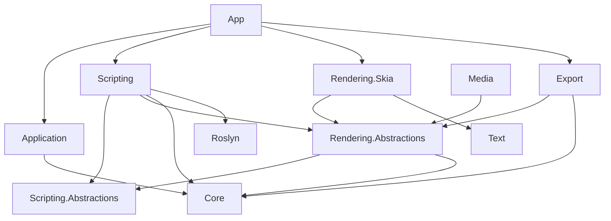

# 脚本系统实施合同（R0 审阅稿）

> 2026-10-02；依据 [施工路线](scripting-system-implementation-roadmap.md)、ADR-0068～0070。
> **用户已接受 A 架构／数据、B 时间／预算及 UI，明确继续 R1**（ADR-0071）。R0 审阅完成，R1 技术验证已完成，R2 源／场景投影、固定几何、纯帧准备／生产族变换、固定帧服务及事件／订阅／历史协议及元素基线／生产 Style writer 已实施；程序 0.11.1／schema 21／15／3，生产持久格式未改。参数／资源／随机／音频查询的具体实现见 [固定帧服务合同](../../scripting-r2-frame-services-contract.md)，事件精确边界与源订阅见 [事件协议](../../scripting-r2-timeline-protocol.md)；元素样式的具体边界见 [样式帧合同](../../scripting-r2-style-frame-contract.md)；共享语义阶段／作者诊断、最终播放头／几何查询、场景目标读取及标记／整行仿射生产输出已实施，最新证据见 [R2 记录](../research/scripting-r2-sdk-geometry-progress.md)；六阶段和实际圆点已接通，阶段／最终几何／预算及验证见 [视觉阶段合同](../../scripting-r2-visual-stages-contract.md)；0.9.12 已实现 [基础音频分析与初始化 required 门禁](../../scripting-audio-analysis-contract.md)；音轨外 required 策略待答。0.9.19 已实现包内容闭包、目录／ZIP 传输与固定源码投影，见 [内容合同](../../scripting-package-content-contract.md)；0.9.20 已接入九类包参数、控制器语义／依赖校验、清单到生产帧及真实图片门禁，见 [包语义合同](../../scripting-package-semantics-contract.md)；材质／图包语义、工程持久闭包及其余 writer／发射／粒子／工作区仍待后续批次。
> 已确认的 C#、视觉效果和透明回退行为不再裁决。按 R1～R8 实施；技术验证发现不支持时，回到讨论，不能悄悄缩减完整交付范围。

相关产物：[SDK 参考](../../scripting-sdk-contract.md)、[交互稿](../../design/scripting-workspace-preview.html)、[包清单示例](../../design/scripting-contract/manifest.json)、[图示例](../../design/scripting-contract/glass.graph.json)。示例属于已接受合同，但不是当前可导入的文件。

## 1. 接受范围与保留边界

本合同建议一起接受：两个新程序集、SDK 及图协议、包和三条持久格式、绑定／顺序／删除／模板复制、固定模拟时基与资源上限、初始效果参数，以及宽窄工作区。不迁移旧工程，保留旧文件。

仍按先前决定：主进程内每会话串行；编译和脚本不在 UI 线程；状态按歌曲时间重建；注音跟随基础字视觉变换；重复按起唱计数；粒子桥接／换点可选且无空档直接换点；只提供低频和基本节奏。脚本不改源歌词、时间、排版、节点树或调度。暂不开放图像历史、GPU compute、第三方引用包及 DLL-only 导入。

## 2. 模块与发布依赖

新增 **MakoKaraGenerator.Scripting.Abstractions**（公开 SDK）和 **MakoKaraGenerator.Scripting**（编译、加载、源／场景投影、串行会话、重放与粒子运行时）；增加同名测试项目。不另建私有脚本语言或粒子后端。



- SDK 只依赖 .NET 系统程序集；自身只读值／逻辑句柄，不公开 Core、Skia 或 Avalonia 类型。
- Core 持有可保存的材质／包／实例／参数／图定义与唯一领域校验。SDK 输出是帧描述；宿主适配成领域定义／中立图计划，不再维护另一套参数清单。
- Application 沿用 Core 依赖，负责不可变资源集合、接受修订、保存和历史；不加载脚本。Scripting 不反向引用 Application、Skia、Export 或 App。
- Rendering.Abstractions 定义布局和帧提供协议；Skia 实现几何／图执行；Export 注入帧源工厂。Roslyn 不进入渲染后端或 Export 的依赖。
- Media 实现中立的音频分析接口。App 是组合根，向会话工厂注入分析／几何／资源服务。

### 2.1 固定工具链提议

| 项目 | 首版值／规则 |
|---|---|
| Roslyn | Microsoft.CodeAnalysis.CSharp **5.0.0**，普通 CSharpCompilation＋Emit；不用 CSharp.Scripting 自动解析外部引用 |
| C# 合同 | C# 14，net10.0，nullable、确定性编译、Release、portable PDB；普通类入口、公共无参构造，实施 SDK 接口 |
| 编译引用 | 随应用分发 Microsoft.NETCore.App.Ref **10.0.0** 的参考 DLL 和宿主 SDK；记录完整文件指纹，不扫描开发机 SDK 或任意 TPA 作为包的隐式引用 |
| SDK／包／图／模拟 | 各自首版 **1.0.0／1／1／1**，精确匹配，不由应用版本代替 |
| shader profile | **skia-raster-3.119.4-v1**；SkSL，通过锁定 native 的 R1 实测收口支持矩阵 |
| 已有组件 | Avalonia／Skia／HarfBuzz 等保持仓库锁定版本 |

Roslyn 5.0.0 提供 net8.0／net9.0 资产，包为 MIT；这里选择固定版本匹配 C# 14 验证，不声称它是最新版本。[官方包](https://www.nuget.org/packages/Microsoft.CodeAnalysis.CSharp/5.0.0)。参考包属于 Microsoft 的 .NET targeting pack，随应用发布引用文件和许可说明，不随用户包携带 native 库。[官方参考包](https://www.nuget.org/packages/Microsoft.NETCore.App.Ref/10.0.0)。R1 核对实际 nupkg 的许可证、传递依赖、Linux 运行和 Windows 可用性；Windows 真机证据仍属于后续发布门禁。

ALC 只加载受管效果 DLL；SDK／BCL 由默认上下文共用。停止会话后释放实例、委托和所有宿主资源，再请求可回收 ALC 卸载；卸载是合作式，不能强制终止任意脚本循环。[官方卸载说明](https://learn.microsoft.com/en-us/dotnet/standard/assembly/unloadability)。取消在编译、重放边界和宿主 API 中检查；用户脚本可以读取 CancellationToken，运行期间不得阻塞 UI。

## 3. 身份、绑定和源订阅

### 3.1 身份

| ID | 真值及持续范围 |
|---|---|
| BranchId／LineId／TokenId／RubyId／NodeId／ClipId／CueId | 现有源／展示数据 ID，不创建“像歌词”的假 ID |
| BindingId | 共享场景计划的一次装载，前奏→起唱保持原值；不由脚本重新编号 |
| OccurrenceId | `(BranchId, LineId, TokenId, StartUs, EndUs)` 的稳定编码；一次源区间，所有装载共用。时间改动建立新执行修订 |
| EventId | `(事件类型, TimeUs, OccurrenceId或BindingId或CueId, 子序号)`；不使用运行中随机 GUID |
| EffectInstanceId | 创建／复制时生成持久身份；撤销恢复原身份，两个实例各有自己的状态 |
| CursorTrackId | 分支＋共享场景的连续演唱通道；合法并发返回集合，不猜唯一播放头 |
| ParticleId | `(EffectInstanceId, EmitterId, BirthIndex)`；同一执行修订、时间和种子下稳定 |

未定时元素没有 OccurrenceId／TokenStarted。TokenCompleted 的事件位于 EndUs，但该时刻元素已不再 Current。无逐字时间可以提供行范围的光标依据，明确 `ProgressSource.Line`，不伪造 TokenStarted；重复计数只处理有效源元素。

### 3.2 输出绑定

实例绑定为以下判别对象之一，所有字段显式，不保存当前 UI 选择：

| kind | 必需字段 | 含义 |
|---|---|---|
| project | 无 | 全工程合法源／展示目标 |
| branch | branchId | 该分支全部源行；跨片段／槽位仍为同一实例 |
| lines | lineIds（非空去重） | 指定源行的本帧所有装载及关联注音；不自动扩展到翻译 |
| tokens | tokenIds（非空去重） | 指定基础元素＋其注音；不自动加入其他字 |
| clips | clipIds（非空去重） | 片段成员，源时间／成员修改后重新解析；不改变片段调度 |
| node | nodeId、includeDescendants | 场景节点及选择的后代／当前装载；纯组无假 LineId |

每个导出效果声明允许的绑定种类和输出目标（tokenFamily／line／group／textMark）。不支持的绑定拒绝，不能后台转写父行。选分支是**筛选**，不自动产生捕获组；组图像效果须绑定真实节点，或逐行绑定其捕获图。

源事件订阅独立于输出绑定，实例保存 `subscription.kind: boundSources|branch|project`（branch 带 branchId）。全工程重复计数可订阅 project，但只能写自己的绑定。粒子只查绑定内光标后继，不暗中跳去另一分支。纯提示节点有装载／前奏事件，无起唱事件。

### 3.3 失效与结构编辑

- 普通源／节点删除沿用既有确认，摘要追加关联效果。删除导致绑定无目标时，实例保留为“目标缺失”，启用实例阻止导出；用户显式改绑／禁用／删除，不能自动迁移到默认容器。
- 删除片段导致成员回默认容器的现行语义保持；绑定该 ClipId 的效果仍缺目标，不偷改为分支绑定。
- 拆分／合并沿用源 ID 合同，新增目标不自动纳入精确 tokens／lines 列表；动态 branch／project 筛选则自然包含新增源。
- 修改普通布局、时间或源文字使执行修订失效并重放；不要求用户重新编译无变化源码。

## 4. 同一实例的阶段与确定性合同

一个入口对象声明多种输出：StyleModulation、VisualTransform、GeometryMapping、ImageGraph、Overlay。每会话创建一次，Initialize／事件／共享状态推进不为每个输出复制。具体接口见 [SDK 参考 §2](../../scripting-sdk-contract.md#2-生命周期)。

### 4.1 时间和次序

建议模拟固定 **120 Hz**。第 n 个网格点为 `floor(n × 1_000_000 / 120)`，检查乘法溢出；精确源事件／装载／前奏边界加入同一排序集合。**不会为了渲染 t 而额外 Advance 到 t**，否则 24／30／60 fps 会得到不同积分轨迹。

每个固定边界 b 的处理：

1. 将共享状态从上一个边界推进至 b；SimulationStep 为 `[a,b)`，只读输入明确以 a 为取样点。初始 0 先 Initialize，无负时间推进。
2. 按 `结束／离场 → 装载／前奏开始或步变化 → 源起唱 → 光标转换` 派发 b 的事件。每组按分支源顺序、行序、元素序和稳定 ID 排序。事件不按 UI 帧差分生成。
3. 所有实例纯求值外观／材质参数／视觉变换；按效果数组顺序合并。构造最终字形／注音／光标几何和映射。
4. 0.10.0 按用户确认新增独立纯 EvaluateEmitters（ADR-0088）：共享推进之前已以左端状态解析前一区间真实出生；文字求值后登记 b 的描述并解析完整当前粒子，再 AdvanceVisuals／EvaluateVisuals。作者可只读 Particles／上一完整 EmissionSchedule，视觉状态不得回写共享或文字。0.11.0 已接通真实事件 Burst，边界出生、四类来源和统一预算见[事件 Burst 合同](../../scripting-event-burst-contract.md)。
5. 任意帧 t 读取最后一个 `b≤t` 的共享状态，使用 `t` 的真实进度纯求值；不得触发事件、累加次数或创建持久粒子。

事件 b 恰为起唱时先起唱 callback，后输出该字新颜色；半开区间结束先完成旧字，再处理新字。图像求值不再重复一次 OnEvent／Advance。所有当前启用实例按持久数组顺序串行；顺序变动建立新会话。

### 4.2 状态分区与分数帧

- 控制器可持有共享计数／记录与独立视觉模拟对象，但 `AdvanceVisuals` 不得更改 `Evaluate` 会读取的共享状态；writer 按阶段校验。受信 C# 可违反纯函数约定，宿主不宣称能自动检查全部任意字段。
- Evaluate／EvaluateEmitters／EvaluateVisuals 是只读求值，输入参数与资源句柄固定；不能用调用次数、系统钟、Random.Shared 或对象遍历的不稳定顺序驱动画面。SDK Random 用固定算法／分流键；算法和测试向量属于模拟合同。
- 自管模拟读取前一／当前固定状态，通过显式插值输出帧；不在 t 上再推进积分器。首版 SDK 提供时间／曲线和解析运动辅助，不假装复制任意 C# 对象。
- 0.9.23 连续发射已接通，用户确认每条合法播放头独立 rate。具体身份／出生纯几何预查询、拖尾、预算及限制见 [连续粒子合同](../../scripting-continuous-particles-contract.md)。0.10.0 已补独立发射和作者查询；0.11.0 已补事件 Burst；桥接／sprite／带状拖尾继续后续实施。
- 宿主管理发射采用每个模拟区间的左端描述：rate 在区间内保持，累计配额保留小数，按精确整数微秒出生时刻编号。Burst 位于事件时刻，EventId 去重。出生锚点按该时刻的纯文字几何解析。
- 尚未到下个边界的帧可读本区间截至 t 的临时出生／解析位置；这些结果不推进共享状态。边界提交时相同 ParticleId 被接纳一次。区间末端出生属于下一半开区间；暂停重绘不增量。
- 粒子位置和拖尾样本依据歌曲时间；拖尾固定在上述边界及出生／死亡点，呈现时可插值，不取最近 N 张 UI 帧。

### 4.3 重放与未来锚点

跳转、循环、参数／源码／时间／目标／顺序变化或撤销建立新独立会话，从 0 重放至 t；允许合并取消旧请求，旧结果不得覆盖新预览。首版不做任意脚本对象检查点。中段导出从 0 重放历史，不从导出起点重新计数。

跨行桥接终点若依赖未来 callback／缩放，宿主新建**只推进语义和文字输出**的独立查询会话，到下一起唱取得端点；不执行粒子或图像、不读取主会话未来状态、不共享用户可写对象。只读基本布局查询可直接取采样器／布局缓存。不能递归请求整幅未来渲染。

## 5. 文字、几何和效果叠加

静态顺序保持：工程 → 分支 → 行 → 元素覆盖。随后按 `effects.instances` 数组顺序应用每个实例在本帧匹配的输出；同属性 Set 后项覆盖，opacity／视觉比例／仿射按顺序组合。脚本默认读同一静态基线，不把前一个控制器的可写状态暴露给后项；Visual 阶段统一读最终几何。

- 元素族变换含基础字及其注音；默认 pivot 为基础字 Advance 矩形中心（不是含注音后的框中心）。局部变换在基础入场／单句／槽位／父组矩阵内组合；不能再乘一次组变换。
- 整行和组变换在所属坐标空间组合，不让子项重排。Style alpha、既有入场 alpha、效果 alpha 各只乘一次。
- 字形必须整行整形，再通过字簇映射形成绘制单元。一个不可拆合字跨两个独立变化的 Token 时报告 `UnsupportedGlyphPartition`，不按 UTF-16 剪断或重新逐字整形。静态原画仍可绘制；请求该变化的启用效果阻止导出，用户可调整源切分或禁用。
- 光标由真实进度＋整形 Advance＋最终矩阵产生；未定时字无光标；空档提供 transition 数据，不猜正在唱的字。

### 5.1 变形与锚点

| 图／效果声明 | 规则 |
|---|---|
| ColorOnly | 不改几何；粒子使用现有最终光标 |
| MappedWarp | 提供中立仿射／曲线位移映射；宿主按顺序合成并校验；粒子可选择 mapped 光标 |
| ImageOnly | RGB 拆分、切条、复制等无唯一位置。粒子参数必须显式选 `semanticCursor` 或 `includeInTargetCapture` |

自定义图若声明 MappedWarp，其映射与 shader 的对应性由包作者负责；宿主能验证有限性、定义域／边界，不能证明任意 shader 和函数等价。SDK 首版提供有界的仿射及横／纵波形映射，不开放任意回调读取 native 像素。

## 6. 材质和渲染图

### 6.1 材质唯一真值

以 `MaterialSpec` 判别结构替换 FillSpec 的 `color＋gradient` 双值。未唱／已唱仍是两个独立材质；描边改为 `geometry＋material`。阴影保持原静态结构，可由效果调制，首版不再为阴影新设独立 shader 区域。

```json
{
  "unsungFill": { "kind": "solid", "color": "#4A5060FF" },
  "sungFill": {
    "kind": "packageMaterial", "packageId": "demo.advanced",
    "revision": "sha256:<完整资源修订>", "exportId": "glass-ink",
    "parameters": { "backgroundSource": "media", "blurPx": 8.0 }
  },
  "stroke": {
    "geometry": { "widthPx": 2.0, "join": "round", "position": "outside" },
    "material": { "kind": "solid", "color": "#FFFFFFFF" }
  }
}
```

solid 只存 color；gradient 只存已有完整 GradientSpec（规范 stop、坐标空间、RGB／HSV等），关闭渐变改为明确 solid，不留另一颜色真值。packageMaterial 存固定包修订／导出项和参数。包内 fallback 是**输出模式替代外观**，不是与正常 shader 竞争的基础材质。

覆盖中属性缺失=继承；填充不可 null，禁用用透明 solid；stroke:null 关闭。支持描边 geometry 的逐属性覆盖和 material 整体覆盖；材质参数通过显式编辑器合并并产生新的完整参数对象，不引入无法验证的任意 JSON patch。旧色彩按钮对 solid／gradient 正常可用，遇到 packageMaterial 显示材质参数或明确“替换为纯色”，不偷偷抹掉 shader。

### 6.2 图格式和端口

图定义保存 `graphVersion、id、inputs、parameters、nodes、output、anchorMode、bounds、composite`，见[图例](../../design/scripting-contract/glass.graph.json)。节点 IDs 非空唯一；边引用前后皆可，由拓扑排序执行；同帧环、悬空端口、类型不符拒绝。

| 操作 | 输入 → 输出与限制 |
|---|---|
| Input | 已声明的 GlyphCoverage／StrokeCoverage／SungCoverage／TargetColor／BackgroundMedia／BackdropBelow／ResourceImage |
| RuntimeShader | profile、文件、typed uniforms、typed child inputs → ColorSurface／CoverageSurface；不得每帧替换源码 |
| Blur | ColorSurface、sigmaPx → 同空间 ColorSurface；高斯外扩为 `ceil(3σ)` |
| Mask | ColorSurface＋CoverageSurface → 预乘 ColorSurface |
| Transform | 有限可逆仿射＋输入，显式输出框和边缘规则 → 同类型 surface |
| Blend | foreground／background，sourceOver／plus／multiply → ColorSurface |

capture 是图输入的配置，不允许图自由捕获本图 Composite 后的自身；Composite 是一次 output 配置，不是能在同一图里任意回读的节点。新的版本化 operation 可以扩展集合，首版不靠 effect 名字白名单限定 shader 算法。DistanceField／NormalField／HistorySurface 预留能力名，但 v1 请求它们报告不支持。

uniform 类型为 float、float2/3/4、int、color、matrix3x3；参数 boolean 映射为 uniform int 的 0／1，不承诺 native bool uniform。定长数组须声明长度并计预算。用户 color 为 sRGB 直乘浮点值，SkSL color 声明负责颜色转换；图输出预乘 sRGB RGBA8888。数据蒙版使用 raw coverage，不做颜色空间转换。v1 不承诺 HDR／float 目标；不支持的 shader 声明必须诊断。

0.9.13 已落实本段的固定 ShaderProgramDefinition、公开 UniformValue／UniformValues 和正式后端严格编译／CPU 创建原语；具体 color 为 RGBA float4／half4 的 layout(color)，SDK 矩阵按行输入、后端按列打包，数组和 128 标量按真实类型验证。该批未新增 JSON 或图执行，也未关闭 R3 资源释放出口；细节与原生限制见 [shader 原语合同](../../scripting-shader-program-contract.md)。

0.9.14 已实施中立不可变图及正式 CPU RuntimeShader／Blur／Mask／Transform／Blend、替换合成、透明显式旁路及真实编码同帧。输入必须由调用者提供 Canvas 图像；生产 capture／目标绑定、全局资源账本／实例失败门禁仍未接通，optional 缺失策略已询问且未默认选择。具体适配、像素预乘校验和完整 R3 剩余见 [图合同](../../scripting-image-graph-contract.md)／ADR-0078。

0.9.15 已实现生产固定字形／注音／前奏／组捕获、ImageEffects 中立绑定及真实实例图执行适配，详见 [生产捕获合同](../../scripting-production-capture-contract.md)／ADR-0079；全场景隔离调度、背景／下层生产与全局账本继续。用户已确认同实例同目标只保留最后一次绑定；多个实例按工程顺序串接，每次绑定的图及参数整体替换，不合并遗留字段。组写权限已确认仅工程／显式节点，不从只读目录扩权。0.11.1 已接通组仿射；组图 writer 与隔离合成后续接入，见[组仿射合同](../../scripting-group-affine-contract.md)。

图中值绑定只允许 JSON 字面量、`parameter:<id>`、`host:timeSeconds|canvasSize`；边只允许 `input:<id>`／`node:<id>`。bounds.expandPx 可为非负数或 `ceil(k * parameter:<numberId>)`（k 为非负有限常量），不用任意表达式解释器。条件输入 choices 由已声明 enum 选择。参数最大值代入后检查外扩／内存；运行时再检查实际值，禁止未声明字符串表达式。

每 surface 携带 logicalBounds、space（token/line/node/canvas）、localToCanvas、像素密度、编码；所有距离使用合成画布逻辑像素，不随预览缩图比例改变。每节点声明 sampler edge: transparent／clamp／repeat、最大偏移和外扩；缺声明拒绝，不用当前管线 DecorationExtent 的 64 px 截断冒充高阶边界。

### 6.3 捕获、层级与合成

建议无效果时保持现有 `SceneFrame.Lines` 顺序和每分支前奏标记的位置。新增显示后端以**根分支源顺序**展开；同一分支内，真实父组隔离其后代，子组按各自第一个后代的原绘制序号排序。若组后代与外部绘制交错，启用整组 capture 会将后代合成成连续单位，这项差异必须在绑定摘要写明；树槽位排序不成为媒体图层排序。

顺序为背景底色／媒体 → 每分支 BehindText overlay → 分支内歌词与提示的容器捕获 → 每分支 AboveText overlay；工程级 overlay 在全部分支之前／之后。绑定行的存活粒子离场后继续归入对应分支 overlay，不随旧 Binding 的消失被抹掉。

组内先完成各子行材质／图，再捕获给父图；每对象多张图按实例数组順序串接，每张 TargetColor 都是上一张处理后的目标。子项只画入父 capture，父输出只合成一次。capture 配方显式指定 ruby、stroke、shadow、descendant groups、owned overlay；只允许纳入同目标所属 overlay，禁止捕获另一个后方尚未合成的目标。

2026-10-03 用户确认：未纳入的注音／描边／阴影照常绘制，不受该效果处理；多个图各自的合成规则生效，后续 SourceOver 保留此前替换下层的范围。具体合成公式和分区义务见 [场景合成合同](../../scripting-scene-composition-contract.md)／ADR-0081。0.9.17 实施链原语与真实媒体／底色输入；0.9.18 已实现六类真实彩色部件、共同 alpha 分离及显式顺序重组，见 [部件合同](../../scripting-color-parts-contract.md)／ADR-0082。效果与保留部件的叠放顺序已询问，答复前不默认决定；正式自动重组及父子 Render 调度仍待接入。

`BackdropBelow` 是该合成位置之前的只读下层快照，排除整个目标 capture 的所有后代／自有粒子。BackgroundMedia 只含定位后的媒体（不含底色或其他歌词）；另有 BackgroundColor 可声明。不透明模式没有媒体但请求必需 media 是缺输入错误，不伪造空纹理。

普通图 `composite: sourceOver`；玻璃 `replaceCoveredBackdrop` 声明独立覆盖蒙版。图产物已经由 Mask 乘覆盖度，合成为 `maskedResult + below × (1-coverage)`，覆盖度只乘一次；若有材质 opacity，蒙版和替换范围一起计入它。不能将背景采样像素再做一次普通文字 source-over，或在 Composite 对已 masked 的结果再乘蒙版。R1 以半透明边缘像素证明无覆盖度平方／重复背景。

### 6.4 背景依赖与透明绕过

输入字段 `availability: required|optional`、`backgroundRequirement: none|media|opaqueCanvas`。读取 BackdropBelow 且 requirement:none 可在透明模式处理下层透明歌词；读取 media 或要求 opaqueCanvas 才因透明模式绕过。反射验证 shader children 名称／类型，清单是依赖来源，不能靠文件名猜。

每个独立输出声明 bypass：

- 包材质背景缺失 → 包导出项 mandatory fallback（solid／gradient，完整可校验，不含第二次包引用）。
- 图像处理背景缺失 → `bypassInput: target`，返回原 TargetColor；其下游节点收到同类型原图，再正常执行不依赖背景的节点。
- 被绕过子图不得产生 uniform／几何映射副作用。跨输出关联通过命名 OutputId 和依赖表；需要某映射的 overlay 如未提供 bypass 映射则拒绝包，不能留下假光标。ColorOnly／恒等映射可显式作为该子图回退。
- 同实例独立缩放／计数／粒子保留；共享 OnEvent／Advance 照常，求值到被禁用 writer 输出由已编译输出计划过滤，不将整实例禁用。
- 启用资源在透明模式也检查源码、版本和结构；只有因模式缺背景的已批准路径可绕过。编译或图非法仍失败。

导出前和透明预览显示去重清单（实例／目标／输出／原因／替代外观），导出报告保留；无需逐项再许可。缓存键包括输出模式、背景可用性和 bypass 计划。

## 7. 包、工程、歌词和模板的存储

### 7.1 包与内容修订

`.mkfx` 为 ZIP，可编辑目录同一内容；清单示例见 manifest.json。顶层 `packageVersion、packageId、name、version、sdkVersion、shaderProfile、files、parameters、exports`；不允许未知字段或缺字段静默猜测。C# 导出包括 entryType；材质包括 graph／fallback；图导出包括 graph；参数声明是完整唯一元数据。

files 显式列出相对路径、用途及 SHA-256；源码 UTF-8，路径分隔符 `/`，区分大小写但拒绝跨平台大小写冲突、绝对／越界路径、链接和重复条目。限制的是受管内容一致性，不是恶意脚本沙箱。包间引用首版不开放，依赖都在本包；预览图／README 也进入资源修订。

`RevisionHash` 为规范化清单（排除自引用 hash）＋按 ordinal 路径排列的全部文件长度／内容 SHA-256。`ArtifactHash` 只包括 C# 文件、入口／SDK、参考程序集、Roslyn、编译选项／TFM；改图片或调参不重编译 C#。shader cache 键单独含 SkSL、图 profile／uniform ABI、native 后端。缓存缺失可离线重建，参数变化重建会话而非编译。

### 7.2 工程增量合同

现有 nodes／clips／leadIns／源时间字段不改。工程新聚合如下（其余原字段照现有 DTO）：

```json
{
  "effects": {
    "contractVersion": 1,
    "simulation": { "version": 1, "stepHz": 120, "random": "pcg32-v1" },
    "budgets": { "surfaceMemoryBytes": 536870912, "liveParticles": 20000, "trailSamples": 200000 },
    "packages": [{ "packageId": "demo.advanced", "revision": "sha256:<hash>", "path": "effects/packages/<hash>" }],
    "instances": [{
      "id": "fx:<stable-id>", "name": "主歌词重复强调", "enabled": true,
      "packageId": "demo.advanced", "revision": "sha256:<hash>", "exportId": "repeat",
      "binding": { "kind": "branch", "branchId": "main" },
      "subscription": { "kind": "project" },
      "seed": "0000000000000001",
      "parameters": { "countScope": "project", "scaleStep": 0.08, "maxScale": 1.8 }
    }]
  }
}
```

数组是实例顺序唯一真值；不保存另一个 Order。seed 为 16 位十六进制 UInt64 字符串，避免 JSON 数字跨语言精度丢失。packageId＋revision 二者一起引用，允许同时保留同包的两个修订。导出冻结所有引用修订和 Artifact 代次，编辑不影响正在编码的作品。

Project 中持有不可变文件集合的逻辑修订，Application 接受源码时建立完整新集合，不把运行缓存或绝对外部路径塞进数据。历史引用旧集合；只读 byte 内容不可向调用方暴露可写数组。

lyrics.json 不另设全工程脚本表：只因行／元素／分支覆盖中的 MaterialSpec 改结构而升 schema。所有直接实例在 project.effects，明确源绑定。模板保存配方，应用复制实例到项目表，避免实例和歌词内同时有两份真值。

### 7.3 多文件保存事务

工程仍以根 project.json 为唯一入口；它保存 `lyricsFile` 指向不可变歌词修订 `data/lyrics/<hash>.json`。初次新格式生成该文件；根 lyrics.json 不再作为第二份可读真值。**这是本合同增加的工程存储断代**，直接查看歌词使用指定文件，文档／导入／备份／测试一并更新。

1. 将缺失的包、媒体受管资源和歌词修订写入临时文件，校验 hash，再原子发布到内容地址路径；已有修订不覆写。
2. 新 project.json 引用本次完整闭包；它最后通过同目录临时文件原子替换，成功后再记 saved reference。
3. 失败留下的未引用对象不影响上一个有效工程，报告错误；不把部分完成标为保存成功。
4. 自动备份以独立备份 manifest 引用／复制同一完整闭包；另存为／复制工程真正带走全部引用内容，不依赖原工程目录。
5. 首版无自动磁盘 GC。旧工程、历史、正在导出的修订和旧库不删除；显式清理若以后开放，另行审阅。

这样避免现有 ProjectStore 顺序替换 project／lyrics 时可能留下不同批数据；不能用“每个文件原子”声称完整工程原子。

### 7.4 模板库与复用

新应用级目录 **templates-v4/**：index.json（schema4 模板与包引用）、packages/<hash>/ 和依赖资源。旧 templates.json 留在原位置不读／不覆盖。不存在新库时以当前内置模板＋空个人库开始，界面一次说明旧库保留和新格式不转换。

模板增加 `effectRecipes`（recipeId、export/ref、参数、输出层次和顺序）；没有目标 ID、InstanceId、会话状态或粒子。行模板可应用 line／tokenFamily 配方，元素模板仅 tokenFamily；组 capture 不进入行／元素模板，仍在展示编排配置。

套用模板时复制闭包并创建独立实例。已有该模板套用槽位的配方，以 `(目标ID, templateId, recipeId)` 更新对应已应用实例、保留身份；再次应用不重复叠加。来自其他模板或用户直接创建的实例不删除。恢复模板效果继承／移除该模板配方是明确操作，不能与静态样式恢复继承混写。删除个人模板不改变已经应用的工程。

### 7.5 复制、更新与删除

| 动作 | 明确规则 |
|---|---|
| 复制实例 | 新 InstanceId／seed，复制参数／绑定和包引用；用户可将 seed 显式设成相同以复现；不复制运行状态 |
| 复制源码包 | 新 packageId／revision，可编辑副本，不联动原工程实例 |
| 接受源码修订 | 展示受影响实例／材质／模板；本工程同包旧修订引用可勾选升级，一次命令；未选者保留旧修订 |
| 删除实例 | 删除此实例／配方应用记录，一步撤销；停止预览的新会话临时对象，不影响固定导出 |
| 删除包修订 | 有当前工程／模板引用时拒绝，列出定位；先显式解绑／替换再删。仅删登记引用，不抹掉历史需要的磁盘对象 |
| 删除材质／图导出项 | 接受修订前列出断开的引用；可保留旧修订，不能随机替换为默认样式 |
| 删除源／节点／片段 | 按 §3.3 保留失效实例与诊断；与源操作在同一工程历史动作内 |

源码草稿不进工程历史；“保存并编译”先接受不可变修订及选定升级（一步历史），再异步编译。失败源码仍可保存／备份，上一成功预览可留在画面，但必须标明“预览旧版／当前导出不可用”。不能把编译失败误当保存失败，不能自动恢复旧源码以让导出通过。

### 7.6 版本批次

R1 技术探针若进入仓库可交付程序，建议 0.9.1（schema 不改；精确 app 门禁仍拒绝 0.9.0 工程）；R2／R3 每个实际程序交付再提升 PATCH。R4 新持久格式一次并入 **下一不兼容 MINOR／22／16／4**。之后不兼容合同升 MINOR；SDK、包、图、模拟 profile 独立版本。技术临时产物不自动占正式版本，具体提交记录实际交付，不预先修改 Directory.Build.props。

## 8. 预算、参数和音频

以下建议值用于防止宿主无限分配，**需本合同接受后实施**；不是性能承诺，不静默削减预览粒子／图遍数。预算数据可在工程“效果运行设置”中显式修改，修改纳入历史／导出固定；超过宿主绝对可寻址／图格式限制拒绝。

| 预算 | 建议首版初始值 |
|---|---:|
| 单包展开内容／文件数／单文件 | 256 MiB／1024／64 MiB |
| 图 pass／同时活动表面 | 每目标每图 32／每帧总计 64 |
| 中间表面内存 | 每会话 512 MiB，以实际输出密度和格式预估 |
| 单张表面 | 每边 8192 px；越限报告，不缩尺寸 |
| 图输入外扩／blur sigma | 256 逻辑 px／64 逻辑 px；实际组合外扩仍计入边界和总内存 |
| 活粒子／固定拖尾采样 | 每会话 20,000／总计 200,000 |
| 每边界批量绘制项／uniform 数量 | 100,000／每 shader 128 个标量槽 |

过预算诊断列出声明／当前值／限制，用户显式改值或效果配方后再执行。取消不依赖超时强杀脚本；可能长期重放时显示进度并保持 UI 可操作。

### 8.1 六个随应用源码样例的初始参数

| 样例 | 建议参数（均在一级参数页可见） |
|---|---|
| 逐字强调 | peakScale=1.25；curve=easeOut；endMode=return；returnUs=120000；pivot=baseAdvanceCenter |
| 重复 callback | countScope=branch；match=ordinalExact；scaleStep=0.08；maxScale=1.8；darkenStep=0.06；minBrightness=0.35；首唱作为第1次，增量从第2次算 |
| 光标拖尾 | rate=60/s；lifeUs=600000；sizePx=4；spreadPx=8；trailUs=250000；transition=jump；bridgeUs=180000；bridgeGapLimitUs=2000000；imageOnlyPolicy=semanticCursor |
| 自定义填充／描边 | 波纹频率=2/s；幅度=0.15；明确纯色／渐变调色，不改字形 |
| 整行 glitch | strengthPx=6；sliceHeightPx=12；frequencyHz=8；anchorMode=ImageOnly；captureRuby=true |
| 二维玻璃 | source=media（可选 backdrop）；blurPx=8；refractionPx=4；highlight=0.2；opacity=0.75；包内 fallback 为蓝色纯色或规范渐变 |

强调的回落只在元素起唱后到该句离场前可见，不延长源展示。桥接时长为 min(bridgeUs, 实际空档)，超过 gapLimit 不桥接；没有空档直接换点。内置粒子采样 PCG32 分流键的确切字节编码及测试向量随 SDK 参考实现固定，不使用 .NET Random 的跨版本隐式算法。

### 8.2 音频 v1

离线分析复用音频 PCM 解码；基础单声道重采样输入、固定分析时间，提供 `bassLevel、pulse、beatPhase、beatConfidence` 与 availability，绝不伪造已识别节拍。拟使用 48 kHz、20 ms 分析 hop、20～200 Hz 低频能量、标准化包络和峰检测；算法版本／音频 hash／时间映射进入分析修订。无音频、解码失败／未完成分别标状态；声明 audio required 的启用效果不可导出，optional 的效果自行按不可用分支求值。

完整 FFT、多频带、自动高潮判定后置。算法是可复建的可视化近似，不把 confidence 低的节奏称为精准拍点；R5 记录静音／脉冲／低频／不同采样率证据。

## 9. 帧接口、缓存和错误

```text
IEvaluatedFrameSourceFactory.CreateAsync(fixedInputs, cancellation)
  → 独立 IEvaluatedFrameSource（IAsyncDisposable）
  → PrepareAsync(timeUs, outputMode, targetDensity, cancellation)
  → PreparedRenderFrame（快照指纹、时刻、几何、外观、图、overlay、bypass、诊断）
  → IRenderPipeline.Render(RenderRequest { PreparedFrame = ... })
```

几何接口与 Skia 绘制使用同一整行布局，准备流程不重复猜字体。RenderRequest 无效果可走现有只读路径；含启用效果却缺 PreparedFrame、时刻／snapshot／mode 不一致时拒绝，不能无声忽略效果。缓存位于事件推进之后；命中像素不跳过会话。RenderQuality 只改变采样成本／密度，不再隐式跳过脚本效果；透明计划是唯一已批准的背景绕过。

EffectFailureException 携带中立诊断（stage、package/revision/export/instance、source path／line／column、target／time、code／message）；VideoExporter 在通用占位 catch 之前识别并向上抛出，初始化失败不开编码器，途中失败停止编码并删除本次临时产物、保留原目标文件。OperationCanceledException 仍为取消，不改成错误。

2026-10-03 用户已确认并按 ADR-0072 固化：作者 Diagnostics.Report(Error, ...) 使阶段失败并阻止导出，Info／Warning 仅记录。0.9.7 Reporter 阶段失效、Error 即使被捕获也失败、实例／阶段／时刻／源码位置，以及真实中途编码临时发布验证见 [语义会话合同](../../scripting-r2-semantic-session-contract.md)。

普通非效果渲染异常原占位策略保留；intentional bypass 是警告／成功信息，报告不增加 FailedFrames。当前导出报表追加结构化 skippedEffects，不每帧重复刷告警。禁用实例可保留错误源码，但被正常材质／其他启用输出直接引用的包仍必须可编译／解析。

## 10. UI 合同与走查

交互稿有**宽窗口／窄窗口、效果参数／包源码／诊断、正常／编译失败、透明输出**切换。只演示交互，不是实际 shader 画面，文案和颜色实现时仍进入现有资源。UI 最终在 1600×1000 与 940×640 真实 Avalonia 生命周期验证。

- 主窗口工具栏独立“脚本效果…”入口；打开为主工作区工具，不塞到歌词属性底部。保留实际工程画布和底部时间导航。
- 左栏两个对象页：**工程效果**（实例）／**源码包**（固定资源及导出项）。实例页上方“添加效果”，明确选择导出项和绑定，初建禁用，完成目标／参数后用户启用。包页“新建／导入／分享”，不会因选包就自动应用歌词。
- 右栏常用参数直接可见，绑定摘要、启用开关和顺序也在一级；复制／删除在实例列表右键／明显次要行，删除用警告色。拖动顺序显示多输出阶段不随视觉拖动反转依赖。
- 源码页取代中间画布编辑空间，文件树／文本编辑；画布可显式切回“工程预览”，不在窄窗口保留两个挤小画布。底部固定“保存并编译／放弃草稿”，选定受影响引用再接受。
- 编译失败固定可见“源码已保存 · 编译失败 · 画面为上一成功版 · 当前不能导出”；诊断点击打开文件行列／目标，不把旧预览冒充成功。
- 窄窗口收为单列，左对象列表显式按钮开覆盖面板，参数显式按钮开右覆盖面板；属性面板只保留一个关闭入口。提交按钮右对齐或占满可用宽度，不能再孤立居中。
- 模板工坊的填充／描边新增材质选择和“效果配方”组；无大代码框。行编辑器样式页继续应用模板，不扩建预览画布；独立“本行效果”快捷入口跳至工作区并预选绑定。
- 展示编排所选组／节点有“对象效果…”入口，组捕获／粒子绑定详情可定位节点；不把容器当脚本包。

走查：新建／导入包 → 检查导出项 → 编辑源码、保存并编译 → 添加独立实例并选分支 → 调参／启用、实时预览 → 复制与排序、一步撤销 → 保存、退出、搬动工程、重开 → 导出 MP4 → 切透明模式查看跳过清单和替代外观 → 导出 Alpha。失败／取消／草稿离开都必须可读；源码草稿没有保存时离开给保存／放弃／取消，接受修订和工程保存是不同状态。

## 11. R1 验证清单与停止条件

批准 R0 后第一批实现可重复的技术探针，不接用户工程格式：

1. 按这里的 SDK 最小接口编译 DLL／PDB，实例调用及默认 SDK 类型共用；新进程离线复用 Artifact；WeakReference 证明正常实例释放后 ALC 可回收；故意语法错误诊断带行列。
2. 锁定 Skia CPU 下绘制 shader、颜色／child 图像、字体覆盖、外部描边蒙版、整行 RGB 位移；复用真实整形验证，不能用矩形染色证明字体 shader。
3. 图输出背景 blur／折射近似、旋转父组、透明包内基础外观／原图 bypass、预乘边缘；离屏 PNG 和像素断言＋短片同帧。
4. 形成支持矩阵及包／SDK 示例编译证据。未支持能力列出原因；需要 GPU 或任何能力缩减时询问用户，不升级依赖或换窄目标。

R2～R8 的原始完整交付和验收矩阵不缩减。本合同审核后补 ADR 接受状态；R0 文档完成不代表 SPIKE-07 或 SCRIPT-01～09 完成。

## 12. 接受记录与实施边界

| 项 | 本稿给出的具体提议 | 接受前允许的工作 |
|---|---|---|
| A 架构与数据 | §2 两项目／依赖；§3 绑定；§6 材质／图／透明协议；§7 包、歌词内容地址、模板目录、拒绝引用删除、版本 | 文档／样例／UI 原型／当前基线验证 |
| B 时间与限值 | §4 120Hz／事件／状态分区；§8 预算、六样例参数及基础音频算法 | 校对合同，不默默将建议值写成生产默认 |
| C UI | §10 入口、实例／包分离、宽窄覆盖面板、源码／编译／导出状态 | 交互稿，真实 App 改动等接受后实施 |

2026-10-02 用户分别回复“接受合同 A，按此实施”“接受合同 B，按此实施”“接受 UI，继续 R1”。上表三项已接受，ADR-0071 固化；程序未因文档批准就修改格式。本文覆盖旧 SDK／高阶提案中的冲突建议。后续超出此合同的重大结构／语义变更仍询问用户。

### 12.1 R0 验证证据

当前基线全量 build 为 0 警告／0 错误；七个测试项目 1512 项通过。交互稿以真实 Chromium 检查 1600×1000／940×760：参数反馈、源码草稿、模拟编译失败、诊断定位、导出阻断提示、透明绕过说明、窄窗覆盖面板和关闭通过，无浏览器异常／横向溢出；宽窄截图仅为方案验证，不是实际 shader 或 Avalonia 功能证据。SDK 作者代码仍须 R1～R6 真实编译运行。

### 已实施中间表面账本（0.9.16）

§8 初始 64／512 MiB 已进入 ImageSurfaceBudgetSession／Frame，单图限制继续独立保留；当前捕获、图节点／合成、真实绑定执行适配及 Blur／显式捕获层共同计费。正式主画布协调器后续须传同一帧账；分开调用的自动帧账不冒充整个场景已统一。借用／产物生命周期、预检、诊断及真实中途编码失败证据见 [资源合同](../../scripting-surface-budget-contract.md)／ADR-0080。工程运行设置持久化仍按 R4；完整 native scratch、上游终结器及主画布出口未关闭。

### R4 独立内容闭包接续（0.9.19）

§7.1 的文件集合、严格顶层及 files、规范清单、实际哈希／固定字节、路径／链接／大小写冲突和 RevisionHash 已实现；Application 可在目录／.mkfx 间传输同一闭包，分享失败及实际写入取消保留原目标。固定 C# 文件可在离开原目录后通过已分发引用离线编译并调用 SDK。此集合只验证内容，不宣称 parameters／exports、图／材质和输出依赖已通过语义校验；不能直接启用。§7.2～7.4 的工程聚合、歌词内容地址、多文件事务和模板依赖未改，生产 schema 21／15／3 保持；详见 [内容合同](../../scripting-package-content-contract.md)／ADR-0083／roadmap §18.48。

### R4 参数和控制器接续（0.9.20）

用户本轮确认 color 的 RGBA 对象、三类封闭曲线判别对象及 asset 的本包 role:image 路径编码。九类默认值／覆盖共用完整类型／区间校验，唯一约束沿用 EffectParameterConstraint；控制器导出、允许绑定和输出依赖生成固定元数据。实际图片解码、全部 DLL 入口反射与包到生产帧／像素已验证，反射不调用作者构造；实际输出不能超出清单的目标类别和 Overlay OutputId。§8 包展开预算在读取分配前实施。材质／图包、输出 requires／旁路执行及工程／模板持久事务仍未实施；完整 R4 和 R2～R8 保持未完成。详见 [包语义合同](../../scripting-package-semantics-contract.md)／ADR-0084／roadmap §18.49。

### R4 独立 shader 程序接续（0.9.21）

用户确认 [图语义补充合同 §2 A](../../scripting-package-graph-semantics-contract.md#2-已确认-a独立-shader-程序文件)：独立 role:shaderProgram 文件保存版本、固定源码引用、profile、七类 typed 声明及 child。完整资源修订包含程序文件，C# Artifact 仍不受非 C# 内容变化影响。全部程序由正式后端实际编译／反射，未引用错误项也不能部分启用控制器包；固定编译集合逐帧只换值，native 生命周期保持原合同。B 随后获确认并在 0.9.22 接续；C 导出／fallback 编码仍待答，不能把示意图当可运行完整包。实际代码／验证见补充合同 §6／ADR-0085／roadmap §18.50；生产持久格式及完整 R2～R8 尚未完成。

### R4 包图与逐输入捕获接续（0.9.22）

补充合同 B 已确认并实施。全部图文件进入唯一 Core 计划，使用同一参数约束／固定程序 ABI；完整配方按输入保存，不默认省略的 include 字段。正式 CPU 门禁和图片完整解码接通，真实生产注音差分与显式图片 Transform／透明原输入／短片验证通过。owned overlay／materialRegion、跨图部件重组、非 Canvas 执行未接入时明确失败；不以整体产物替代不同捕获配方。C 的混合导出／材质回退、工程保存及正式主画布仍未完成，见 [补充合同 §8](../../scripting-package-graph-semantics-contract.md#8-b-的实际实施路径0922)／ADR-0086／roadmap §18.51。

### R4 入口与歌词内容地址接续（0.14.0）

§7.3的歌词内容地址／根入口最后发布已实施：工程schema22新增必填lyricsFile，歌词15及模板3不改；实际UTF-8字节hash、已有修订不覆写、唯一暂存／刷盘／校验、入口最后发布和失败saved reference保持。加载从同一根字节读取版本／schema／引用，歌词一次读取供hash与JSON共用；坏结构拒绝加载而不是空工程。自动备份及另存为独立歌词闭包；历史／未引用修订和旧根文件不删除，不新增迁移。完整包／媒体／分析资源事务、工程效果聚合及模板依赖仍按R4～R7接续。设计／证据见[存储合同](../../scripting-project-revision-storage-contract.md)／ADR-0100／roadmap §18.66。

### 7.6 0.15.0工程闭包接续状态

§7.2工程schema23已保存effects、全部包修订、顺序实例、六种绑定／三种订阅、完整种子和规范参数，初始120Hz／pcg32-v1严格固定。§7.3已实施包→歌词→入口发布，另存为／备份独立字节闭包；完整媒体／分析事务和模板目录尚未接通。§7.5源实例历史、复制新身份／种子、显式选择升级和被引用包拒绝注销已实施，原字节无GC。宿主控制器投影已接入实际编译／帧及成片；直接图／材质实例和跨输出计划继续后续。无新的作者SDK方法，见[工程效果合同](../../scripting-project-effects-contract.md)／ADR-0101／roadmap §18.67。
