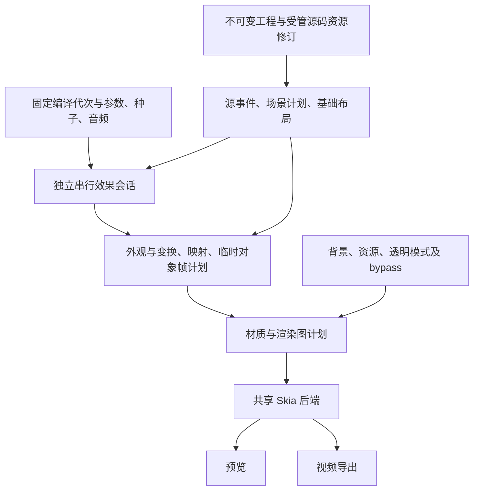

# 脚本系统具体落地路线图

> 日期：2026-10-02；2026-10-04 更新；当前程序 **0.25.0**，工程／歌词／模板 schema **26／16／5**。
> 状态：**R0／R1 已完成，R2 基础、生产样式／变换、固定服务、事件协议及七阶段／圆点已实施，R4 包闭包／控制器／图语义与 R7 工作区基础已接通；0.25.0 已增加组图目标与 C/E 父合成宿主原语但尚未接入正式主画布；完整出口未达成，R3～R8 仍有高级组合与映射、完整作者工作区、粒子桥接、模板整合与成片验收缺口**。本路线最初只交付文档，后续开工授权及具体数据／SDK／预算／UI 见[实施合同](scripting-system-implementation-contract.md)／ADR-0071。
> 依据：ADR-0060／0061／0068／0069／0070；[运行基线](scripting-system-architecture-plan.md)、[三个效果／打包初稿](scripting-effects-sdk-package-plan.md)、[高阶材质／渲染图评审](advanced-material-render-graph-plan.md)。任务完成度仍只由 [roadmap §18](../history/roadmap.md#18-完成度盘点)维护。

**读法**：§2～3 是能力和透明输出边界；§4 是架构；§5～7 是分批施工与验收；§8 是破坏性变更；§9～10 是作者包和工作区；§11 是开工前必须定稿的清单。上一轮 E／H 编号的对应关系见 §6，本轮不会把旧编号当作已经完成。

用户已确认包图补充合同 C 及效果融合图片置于所处理部件最高层；C 的统一语义／目录和真实包执行接缝已在0.12.0实施，0.12.1 已接通元素／整行／标记的主画布最高层协调器；组隔离和区域材质仍待完成，见[补充合同 §9](../../scripting-package-graph-semantics-contract.md#9-c-的接续确认2026-10-03)、[叠放合同](../../scripting-retained-parts-stacking-proposal.md)／ADR-0091／roadmap §18.56。

0.12.2 已实施真实组 alpha writer／包能力、准备输出与嵌套主画布隔离，孩子实际图先完成、父子 alpha 各一次，顺序诊断经缓存与导出保留。组图 writer、部件化父捕获／owned overlay、区域材质和完整 R2～R8 继续；验证与边界见[组隔离合同](../../scripting-group-opacity-isolation-contract.md)／roadmap §18.60／ADR-0094。

0.12.3 已实施可传递颜色／实际擦除CPU产物；真实组图／父捕获三项边界已询问待答，未采用默认行为，实施边界见[父捕获合同](../../scripting-parent-composition-contract.md)／ADR-0095／roadmap §18.61。

0.13.3 已按用户三项答复接通材质逐帧 uniform：显式部位／节点／名字、有序 Set 清除、真实写入者、七类／数组、主画布与透明协议门禁。程序性接口见[uniform合同](../../scripting-material-uniform-writer-proposal.md)及公开SDK；仍不关闭完整R2～R8，下一步补工程持久事务及剩余 writer／组图／映射／粒子和工作区。组图三项与原四项待答保留。

0.14.0开始接续R4入口和不可变歌词修订，实施与验证见[存储合同](../../scripting-project-revision-storage-contract.md)／roadmap §18.66。0.15.0接续工程包闭包／实例、历史及真实控制器投影（§18.67）；完整媒体／分析事务、模板依赖与工作区未交付。用户2026-10-04更新目标，授权新的决策依据已有文档按最优理解实施并记录ADR；既有明确选择不改变，旧七项记录不再作为必须等答的阻塞，也不视为已实现。

## 1. 基线、目标与交付范围

### 1.1 当前已经有什么

0.12.0 已实施三类统一导出、完整回退／旁路校验、纯资源包和真实材质／图目录，实际控制器图绑定接通生产准备帧及显式 CPU／编码验证；公共宿主类改名为 EffectPackageDefinition／CompiledEffectPackage。0.12.1 主 Render 已完成当前三个字形目标的自动部件重组；区域材质、跨输出计划和完整组协调仍未完成，见[包合同 §10](../../scripting-package-graph-semantics-contract.md#10-c-实际实施接缝0120)／roadmap §18.58／ADR-0092。

0.11.2 已补通真实控制器包的组仿射创建门禁，包参数／权限／生产像素及真实 MP4／Alpha 路径通过，全量2286项；见[组仿射合同 §5](../../scripting-group-affine-contract.md#5-真实包创建接缝修复0112)／roadmap §18.57。

0.11.1 已接通 R2 真实组仿射：仅工程／显式节点可写，实际父树传播到槽位／行／注音／前奏，最终播放头、捕获和粒子出生共用几何。组透明度隔离合成及完整 R2～R8 未完成，见[组仿射合同](../../scripting-group-affine-contract.md)／ADR-0090／roadmap §18.55。

0.9.23 已接通 R6 连续发射／解析运动／固定拖尾基础，每条合法头独立 rate，暂停／不同帧率及出生几何共用固定会话。仅 Jump／SemanticCursor；0.10.0 已补独立发射阶段、作者粒子／完整区间出生记录及 CursorTrail 包；0.11.0 已补事件 Burst、四类真实来源及统一出生身份／预算；桥接、sprite／独立拖尾 API 与正式捕获仍未完成。具体见 [连续合同](../../scripting-continuous-particles-contract.md)与[发射阶段合同](../../scripting-emission-stage-proposal.md)和[事件 Burst 合同](../../scripting-event-burst-contract.md)／roadmap §18.54，不能据此关闭完整 R6。

通用容器树、任意槽位、分段展示、单句局部变换、关联注音／翻译、前奏准备阶段、规范样式、模板与行编辑器、预览／导出共享采样已经实现。稳定的源 ID、节点 ID、片段 ID 和 BindingId 可用于 SDK 投影。

R1／R2 已有中立 SDK 子集、Roslyn 编译／可回收加载、固定源／场景和字形几何、纯帧准备及生产元素族缩放；九类参数、固定资源／随机和音频输入已接通，封闭事件／源订阅／只读历史及共享显示边界已实施；元素静态基线与 Style writer 已接上生产填充／纯色描边／阴影／透明度。共享 120 Hz／精确事件会话、诊断及真实 RepeatEmphasis 已接通；行／组／标记基线、真实帧对象／几何和生产标记 Style／仿射已接通，整行仿射／运行父树传播及最终目标几何和播放头按 ADR-0074 已接通；组级规则按 ADR-0073；同实例六阶段、最终几何视觉上下文及实际圆点按 ADR-0075 已接通；R5 独立音频分支已完成真实基础分析与初始化 required 门禁，见 [音频合同](../../scripting-audio-analysis-contract.md)／ADR-0076，音轨外 required 策略待答。0.9.13 已将固定 shader 声明、SDK uniform 帧值和严格编译／原生反射／CPU 创建原语移入正式程序集，见 [shader 合同](../../scripting-shader-program-contract.md)／ADR-0077。0.9.14 中立图定义、拓扑／端口／参数与外扩校验、正式 CPU 五类操作、替换合成／透明旁路及真实编码同帧已实施，见 [图合同](../../scripting-image-graph-contract.md)／ADR-0078；0.9.15 已补生产捕获／目标绑定与真实实例图执行适配（[合同](../../scripting-production-capture-contract.md)／ADR-0079），0.9.16 已接通共享会话／帧中间表面账（[合同](../../scripting-surface-budget-contract.md)／ADR-0080），0.9.17 已接通保留历史替换范围的合成链和工程媒体／底色输入（[合同](../../scripting-scene-composition-contract.md)／ADR-0081）；0.9.18 已实现六类彩色部件、共同 alpha 分离和显式顺序重组（[合同](../../scripting-color-parts-contract.md)／ADR-0082）；0.9.19 已实现 R4 独立包内容闭包、目录／ZIP 传输和固定源码离线编译（[合同](../../scripting-package-content-contract.md)／ADR-0083）；主画布协调器、效果与保留部件自动重组、真实下层和完整 native 资源出口仍待接通。**尚未实现**：完整 SDK 其余 writer、桥接、分析持久闭包、脚本参数／资源持久化、生产歌词自定义 shader 的完整主画布集成、材质包和生产通用渲染图。现行 Skia 管线向 CPU raster 缓冲绘制；不能以 UI 加速代替实际效果后端验证。

两个必须改造的现有接缝：

- `IRenderPipeline.Render` 仍为同步像素入口；0.9.3 已加入 PreparedRenderFrame 和工厂接缝，完整事件／模拟会话不能偷偷塞进 Skia 管线。
- `VideoExporter` 将普通非取消渲染异常计为失败帧、用占位帧继续；0.9.3 已建立效果／准备协议异常的独立传播通道，真实编码中止／清理及保留原输出通过。完整持久效果的导出会话仍在 R4～R5 注入。

路线制定时的 1512 项基线不构成脚本证据；0.9.1 的 1537 项及真正编译／shader／成片证据见 [R1 报告](../research/scripting-r1-capability-report.md)；0.9.19 曾有2033项（roadmap §18.48）；0.12.1曾为2354项（roadmap §18.59）；0.12.2曾为2386项（roadmap §18.60）；0.13.1曾为2460项（roadmap §18.63）；当前0.13.3为2527项（roadmap §18.65）；源／场景投影、固定几何／准备帧、生产族变换、固定帧服务、事件协议、生产样式帧、共享语义会话／诊断及最终播放头／几何查询及场景目标读取／标记生产及整行层次仿射、视觉阶段／圆点及其编码失败证据见 [R2 记录](../research/scripting-r2-sdk-geometry-progress.md)。

### 1.2 首个完整交付必须包含什么

1. 用户可导入／制作可编辑源码资源包，编译、绑定、调参、撤销并保存工程。
2. 三个原始效果闭环：逐字强调、重复文本 callback、播放头粒子及拖尾／跨行。
3. 至少一个自定义文字／描边材质、一个整行 glitch、一个二维背景采样玻璃演示，证明接口具备扩展点。
4. 同时刻连续播放、跳转、循环、中段导出得到同一时间线状态；预览和成片使用同一求值和图执行路径。
5. 透明输出按用户确认的跳过／基础外观规则生成，明确说明它与包含背景的画面有何差异。

玻璃演示验证背景读取、模糊／折射近似和蒙版合成，不以复杂三维光学为首期承诺。性能基准继续在脚本系统完成后；功能阶段仍检查可取消、释放和资源有界。

## 2. 能力边界

### 2.1 沿用的已确认规则

| 项目 | 边界 |
|---|---|
| 执行平台 | C#＋Roslyn；受信主进程内，每会话串行，不在 UI 线程编译或执行脚本 |
| 会话上下文 | 可以持有跨行状态，读完整源目录与歌曲时间线历史；预览／导出各有独立实例 |
| 时间 | 整数微秒、半开区间；进度来自 LyricSampler，显示及前奏来自共享场景计划 |
| 视觉放大 | 排版后放大，不改源字号或让邻字重新排布；注音随基础字一起放大／移动 |
| 重复效果 | 按源元素文本，在实际 TokenStarted 时计数；范围可选分支／全工程，提前显示不计数 |
| 粒子 | 从真实播放头几何发射；跨行可桥接或换点，无空档直接换点；旧拖尾按寿命消散 |
| 音频 | 暂时只提供离线、可重建的基础节奏／低频特征；没有输入时明确标为不可用 |
| 编辑／导出 | 参数和已接受源码修订进入历史；当前启用源码失败阻止导出；产物在本机持久保存 |
| 兼容 | 不迁移旧工程／旧模板／旧脚本合同；版本不符提示并拒绝，不改写旧文件 |

### 2.2 本轮路线中拟落地的扩展

| 能力 | 初批边界 | 需要定稿的合同 |
|---|---|---|
| 自定义材质 | 填充和外部描边区域的 shader；未唱／已唱可分别配置 | 建议 SkSL 首后端、uniform／输入类型、坐标／颜色规则、基础回退外观 |
| 整行／组图像处理 | 捕获、蒙版、blur、shader、变换、混合、替换合成；支持整行 glitch | 图端口／操作集合、组隔离、合成位置、外扩边界及采样规则 |
| 多输出效果 | 一个 C# 实例驱动材质、视觉变换、映射和临时对象；生命周期／共享历史一份 | 阶段依赖、共享／视觉状态分区及延迟发射接口 |
| 作用对象 | 元素族、源行、片段筛选、分支筛选、场景节点／组 | 筛选范围与合成组的区别、源订阅和输出绑定、复制／解绑语义 |
| 几何与粒子联动 | 仿射变换及显式 AnchorMap；纯图像裂解不假设唯一播放头 | ColorOnly／MappedWarp／ImageOnly、无映射时的粒子策略 |
| 模板复用 | 模板保存材质／效果配方与必要包修订，应用时建立独立实例 | 资源闭包、继承顺序、身份生成及模板库结构 |

上述是拟落地范围，不表示本轮已批准每个类型／字段；R0 固定具体合同。

### 2.3 首期不开放的能力

下列是宿主 SDK 的支持范围，不是对受信 C# 建立技术沙箱。确定性效果需遵守宿主时间、种子和受管输入合同；不能将普通 C# 的进程能力误写成 SDK 提供的成片接口。

- 改源文字、歌词／元素时间、持久节点树、片段调度或字体整形；“字体 shader”指字形区域材质。
- 任意 Avalonia／SkiaCanvas／native 句柄或编码器调用；不直接写底层 framebuffer。
- 自动三维几何、任意 GPU compute、完整视频／音频多轨或图层编辑器。
- 把用户播放／暂停／拖动操作录制为成片视觉历史。
- 完整 FFT、多频段／高潮推断、在线数据或设备随机源驱动画面。
- 首版即支持图像反馈历史、任意 C# 对象检查点序列化、第三方 NuGet／native 包、只有 DLL 的外部包或多语言运行时。

图像历史和 GPU 是明确扩展点，不能用上一呈现帧缓存、偷偷换后端或静默降低粒子数临时凑出来。受信运行不新增恶意脚本沙箱项目。

## 3. 透明导出规则（用户已确认，ADR-0070）

### 3.1 正常行为

透明输出仍移除工程底色／背景媒体。**因为这个输出模式缺少背景而无法工作的着色器效果，跳过并提示；不将这类缺输入本身当导出失败。**

| 被跳过的类型 | 输出结果 |
|---|---|
| 背景依赖文字／描边材质 | 使用**材质包提供的纯色／渐变基础外观**；基础外观需可随包携带和在导入时校验 |
| 作用于整行／组的背景依赖图像效果 | 返回该效果处理前的目标图像；不把原文字和效果结果都画一遍 |
| 不依赖背景的 shader／glitch | 仍正常执行，不按“自定义 shader”标签一刀切禁用 |
| 同实例的独立缩放、计数、粒子输出 | 保留独立输出；有依赖的子图按明确 bypass 规则传播，不能留下悬空输入 |

前两项回退行为和提示是用户确认；子图切分、能力标记、同实例输出之间的具体绕过协议由 R0 固定，不将其视为已批准全部 API。

使用 `BackdropBelow` 不一定等于依赖背景媒体：目标下方可能只有透明歌词／粒子。清单须区分“读取下层图像”和“必须包含背景成分”；判断依据是声明和本次可用输入，不能只搜索 shader 名字或文件后缀。

### 3.2 提示和错误必须分开

导出前列出被跳过的效果／材质、目标、原因及基础外观，导出完成报告保留同一清单；长片不逐帧刷同一提醒。提示是信息确认，不再额外添加每次导出的权限批准步骤。透明预览可查看同一降级结果。

跳过不修改工程的启用状态、原材质或包文件，不进入工程撤销。用户下次导出带背景视频时恢复原效果。导出计划／缓存指纹包含输出模式与实际 bypass 清单，避免透明结果污染不透明预览。

**本规则仅处理透明模式造成的背景输入缺失。** 启用源码的编译／加载／回调／求值错误、非法输出、缺失必需的基础外观或其他资源、图循环、不支持的后端和超预算仍是错误。不能通过 catch 所有异常并“忽略 shader”将损坏工程导出成成功作品。

## 4. 最终架构接缝



### 4.1 会话与绘制分离

会话负责历史／模拟，不放入源 Project、公共静态字典或当前 `SkiaRenderPipeline` 的隐式“当前帧”。宿主协调器先异步重放／求值，再把不可变的已求值计划交给绘制。预览 UI 只显示完成帧和状态；导出固定快照、资源、编译代次及会话。

拟新增中立帧提供／会话工厂接口，`RenderRequest` 接收已准备的计划或通过明确适配调用；具体签名在 R0 固定。Export 只依赖中立协议，不反向引用 Application，也不在逐帧循环里直接启动 Roslyn。

同一模拟边界的源事件和共享状态推进一次；文字／映射先求值，视觉阶段读取最终锚点后推进临时对象。渲染重绘不再次计数／发射。后阶段不能改变本边界已决定的文字状态；需在 API 中表达分区和依赖，不能只依赖两个 writer 名字。

### 4.2 拟议模块责任

| 模块 | 负责 | 不负责 |
|---|---|---|
| Core | 材质／效果／参数／绑定／包修订模型、校验、DTO 与纯编辑 | Roslyn、native 绘制、执行用户代码 |
| Application | 工程包和不可变资源修订、源码接受、保存／备份／历史、会话请求 | UI 和像素后端 |
| Scripting.Abstractions（拟新增） | 版本化只读投影、生命周期、参数／输出／诊断合同 | Core 可写类型、Avalonia、Skia、编译器 |
| Scripting（拟新增） | Roslyn／引用集、DLL 库、加载代次、会话及重放适配 | 直接绘制到 App 画布 |
| Text／Rendering.Abstractions | 绘制单元、几何／光标、图像／材质计划和中立帧接口 | 加载 C# 编译器或维护工程历史 |
| Rendering.Skia | 蒙版、材质、图执行、表面生命周期、同一像素输出 | 修改工程或替用户选择布局 |
| Media | 离线基础节奏／低频时间序列 | 脚本侧访问播放器或猜逐字进度 |
| Export | 固定输入、独立会话、错误／跳过分类、编码与报告 | 反向引用 Application／App |
| App | 工作区、参数控件、诊断、预览请求和组合根 | 在 UI 线程执行 C# 或新增第二套视频 shader 路径 |

具体新增程序集、图描述与 SDK 的适配关系、粒子模块位置和 Roslyn 分发引用集必须先画出依赖图并获确认。不得让 renderer 依赖编译器，或为相同能力维护无校验的多份清单。

## 5. 施工路线总览

R 编号是本路线的施工批次，不替代原 `SCRIPT-xx` 任务号，也不表示提前完成阶段 6。

| 批次 | 可审阅／验收产物 | 主要依赖 | 变更风险 |
|---|---|---|---|
| **R0 合同定稿** | SDK／事件／阶段、材质／图、包／工程格式、版本／预算、删除语义和宽窄 UI 稿 | 本文和用户审阅 | 文档；无程序／数据变更 |
| **R1 技术验证** | C# 编译加载卸载＋锁定 Skia 下材质、描边、行捕获、背景和 Alpha 证明 | R0 的验证范围授权 | 技术验证，不改用户数据 |
| **R2 中立 SDK 与帧接缝** | 源／装载身份、进度、绘制单元、元素族变换、光标、输出图值协议 | R1 能力报告 | 公共内部 API／预览调用路径 |
| **R3 材质与共享渲染图** | 内置适配、自定义材质、glitch／玻璃、透明 bypass、表面释放 | R2 图与几何合同 | 实际像素和合成规则 |
| **R4 作者包与数据断代** | `.mkfx`、源码修订、完整保存／备份、材质／绑定模型、持久 DLL／shader 代次 | R2／R3；R0 数据批准 | **工程／歌词／模板及资源包格式断代** |
| **R5 有状态执行闭环** | 共享状态／事件／重放、逐字强调、重复 callback、基础音频输入、错误传播 | R4 固定包；R2／R3 执行计划 | 模拟／事件与导出失败规则 |
| **R6 粒子与跨行联动** | 固定时基发射／拖尾、两种跨行、显式锚点映射、组合实例 | R5；R2 最终几何 | 状态／资源和视觉顺序 |
| **R7 用户工作区与模板整合** | 制作／分享／绑定／调参、实时预览、诊断及宽窄交互 | R4～R6 | 入口、模板和实例历史 |
| **R8 成片和收尾验收** | 保存重开、组合工程、MP4／Alpha 对照、退出释放、作者文档／示例 | R7 | 交付门禁，不再改基础语义 |

每批保持可构建、可测试；R2／R3 的受控测试接缝不冒充公开脚本工作区。完整用户闭环在 R5～R8 交付，不把测试里的私有脚本入口写成 SDK 已完成。

## 6. 每批具体工作与停止条件

### R0：合同和 UI 定稿

形成独立实施合同／SDK 参考与参数／包示例，补齐 source／occurrence／binding 身份、事件排序、同实例多输出、固定模拟时基、输出类型、图／材质输入、继承／合成顺序和删除规则。给出宽／窄窗口稿及“制作包→绑定→调参→保存／重开→两种导出”的交互走查。

**出口**：用户接受具体格式、拆项目、绑定／删除／模板依赖、透明 bypass 和 UI；已确认 C# 平台及产品行为不重问。120 Hz 仅为前轮建议，不能未经确认成为数据默认值。没有合同接受就不改生产格式。

### R1：双链技术验证

- Roslyn：最小公开 SDK 类编译成 DLL／PDB，调用、释放、卸载；验证宿主 SDK 类型共用及退出重开产物复用所需引用。
- Skia：在 **3.119.4** 与本机 Linux native 库上实际编译／画出 shader；证明文字／外部描边材质、子图像输入、整行捕获和 RGB 位移。
- 背景／Alpha：背景 blur／折射近似、父组变换、预乘边缘和外扩；透明模式使用明确基础外观／原图回退。
- 使用可重复的离屏样本、像素断言和短片／同帧对比记录能力，验证样本不进入用户工程。

**出口**：能力支持／不支持矩阵、失败诊断和证据。若当前 CPU 路径无法承接所选能力，停止扩大实现，向用户提交缩小能力或 GPU 设备层方案；不升级锁定库或仅宣称“接口存在”。此处不是完整性能基准。

### R2：中立 SDK 与宿主几何

复用 LyricSampler／LyricSceneSampler／SceneFrame，公开只读目录、进度、准备阶段及真实绑定。把整行整形后的绘制单元和 Token／Ruby 映射接入元素族视觉变换，输出真实墨迹、Advance、世界矩阵及光标轨道。

建立帧／会话接缝、类型化输出和能力校验。对不能独立变换的合字／字簇明确报告，不按 UTF-16 裁开。纯图像效果与 AnchorMap 分开；未来目标查询不推进主会话、求整幅背景或再次生成粒子。

**出口**：受控逐字放大不让邻字让位、注音跟随、描边与双色区域无重影；父组／槽位／单句局部变换与前奏的几何一致。公共 API 有 XML 注释及可运行的最小作者示例。

### R3：共享材质与渲染图

先将当前纯色、规范渐变、外部描边、阴影和 alpha 转为中立材质／图输入适配，建立 Coverage／TargetColor／资源／背景输入、孤立 capture、图依赖和表面释放。然后接入自定义 shader、可组合空间滤镜及替换合成。

蒙版和 shader 分开，不以填充透明度决定描边区域。图声明坐标／采样范围／外扩／颜色或数据编码；同帧环拒绝，历史图像接口尚不开放。透明计划按 §3 绕过背景依赖输出，保留独立效果，不能先把背景混入材质再重复合成。

**出口**：现有样式无行为退化；同一逻辑尺寸在不同预览分辨率下参数量纲一致；行 glitch 和二维玻璃有实际像素及同帧导出证据；透明 bypass 无背景泄漏、无文字消失或原图重影。生产数据仍沿用适配层直至 R4，测试能力不自动写回源数据。

### R4：作者包、编译产物与持久格式

**当前独立基础**：0.9.19 已实现文件闭包／原子分享；0.9.20 已补齐九类参数、控制器语义／输出依赖校验、真实图片解码门禁及清单到生产帧／像素消费。材质／图解析、跨输出执行／旁路、工程聚合及完整保存事务仍未完成，不能据此关闭本节出口。0.9.21 已按确认 A 增加独立 shader 程序／七类 ABI 和全部资源真实原生门禁、固定逐帧 CPU 集合；0.9.22 已接续确认 B，读取全部包图／逐输入配方、ABI 帧值和显式边界，接通真实 CPU／图片及透明原输入；导出／回退 C 待答。规则见 [包语义合同](../../scripting-package-semantics-contract.md)及[图语义补充合同](../../scripting-package-graph-semantics-contract.md)／ADR-0084～0086，实际验证见 roadmap §18.51。

按批准格式接入材质／图／控制器导出、参数声明、来源／能力、SDK／shader profile 和必要基础外观。源码复制到工程受管包，固定内容修订；Roslyn、SDK 和参考程序集由应用分发，运行不依赖用户安装开发 SDK 或联网下载。

引入材质判别结构及效果／包绑定，更新 Core、DTO、当前格式校验、模板、源覆盖、内置预设和快照。源码草稿、接受修订及成功运行代次分开；接受修订、参数／绑定／顺序通过同一命令历史。持久 DLL／PDB／build manifest 和 shader 缓存分项指纹，原子发布代次。

**出口**：新建／保存／另存为／自动备份／恢复包含完整源码及资源；搬走原包目录仍可重开；源码修改／参数／绑定撤销可还原；编译失败保留可编辑源码并准确提示；版本拒绝不破坏旧文件。实际程序／schema 在本批交付记录中更新，不能先只更新文档数字。

### R5：串行会话、重放与两个文字效果

实现初始化、源事件、共享状态／视觉状态推进、纯帧求值及释放，固定步与精确事件边界协同。按 OccurrenceId 去重并保留每次出现自己的颜色／比例；前奏、保留槽位、暂停重绘和几何查询不增次数。

跳转、循环、参数／源码撤销、热替换建立新会话并重放，独立导出包含此前历史。接入同时间轴的基础节奏／低频及明确缺输入状态；此能力不成为三个示例无音频时的隐藏前提。

建立可识别的效果失败通道，在编码前预检查；编码途中错误中止并清理临时输出。`VideoExporter` 不将这类失败替换成占位帧。普通非效果渲染异常的既有策略另行保留／明确，不顺手扩大改变范围。

**出口**：逐字强调和重复 callback 使用公开 SDK，在连续／跳转／中段导出和前奏上状态一致；启用当前源码错误无法输出“成功”作品；热替换／释放无旧实例引用残留。受信串行不保证中断恶意死循环，首期不声称可强制终止任意 C#。

### R6：粒子、拖尾与变形联动

发射描述与每次绘制分开，出生 ID／寿命／随机／轨迹依据固定歌曲时间。提供圆点／精灵／带状拖尾和批量描述，预算与层级从同一合同派生。作用域跨槽位、居中、三槽及片段；多条合法光标返回集合，不猜唯一后继。

有空档可以桥接；没有空档直接换点，旧尾迹留原处消散。仿射／MappedWarp 计算锚点，ImageOnly 按明确策略把粒子纳入 capture 或跟随语义光标；缺映射却请求精确跟随时报告不支持。

**出口**：24／30／60 fps 同时刻出生身份／运动一致，暂停不增加对象；缩放＋callback＋粒子＋glitch 组合无重复状态推进，未来目标查询不污染主会话；删除／热替换释放全部临时对象。

### R7：可用的编辑工作区

实现包／导出项与绑定实例分开、明确的保存并编译／当前代次状态、类型化参数／顺序／绑定、诊断定位、源码草稿离开处理和宽窄窗口切换。常用项直接可见，不把代码编辑器堆到歌词属性页底部。

模板工坊制作行／元素配方，行编辑器套用；组效果在展示编排配置。应用模板复制所需包修订并生成独立实例，不保存目标 ID、会话历史或活粒子。先实现可解释的 pass／输入列表；完整节点连线编辑器不计为首期必交。

**出口**：用户通过界面制作、分享、导入、绑定和调参；指定宽窄操作、源码／参数撤销及两种导出提示获得人工反馈。不会因编辑原模板／外部包而改变已定稿工程。

### R8：组合成片与交付收尾

使用现行完整编排案例加入三个脚本及材质／glitch／玻璃，跑 §7 的矩阵。交付源码示例、SDK／包作者文档、诊断路线和真实窗口／短片；记录自动证据与人工反馈，不能把构造成功等同于用户验收。

**出口**：全部能力范围有实际闭环；旧流程退役无死入口，当前格式往返、热替换和资源清理验证完成。满足对应判据后在 roadmap 将 SPIKE／SCRIPT 任务标为完成；性能基准另开后续工作，不以本次功能正确性测试充数。

### 与旧计划／任务号的对应

| 本路线 | 原计划与任务 |
|---|---|
| R0 | H0／E0；只冻结合同，不完成 SCRIPT |
| R1 | H1、SPIKE-07；支持报告不等于整个运行时完成 |
| R2 | H2／E1 的几何与协议；SCRIPT-01／03 |
| R3 | H2 的图执行与高阶材质；新增渲染验收范围 |
| R4 | H3／E2 的包和产物；SCRIPT-04／05，SCRIPT-06 的参数模式 |
| R5 | E1／E3、生命周期／历史／音频；SCRIPT-02／08／09，复用 SCRIPT-07 随机合同 |
| R6 | E4；SCRIPT-03／07 的粒子与锚点完整验证 |
| R7 | H5／E5；SCRIPT-06 的实际界面与工程编辑 |
| R8 | H4～H5 的完整组合验收；按实际 DoD 关闭各任务 |

多个批次共同覆盖一个任务，不能按“已经写了某个接口”提前宣告其验收完成。

## 7. 最终验收矩阵

| 场景 | 必须证明 |
|---|---|
| 未定时字／行内空档／极短元素 | 不猜进度或起唱事件；空档维持原可见规则 |
| 前奏和多槽提前可见 | 入场一次；计数以起唱为准；准备阶段和 BindingId 保持 |
| 中文／日文／Latin／组合音标／Emoji | 整行整形、字簇、注音及回退；不支持单元明确诊断 |
| 双槽→居中→三槽、父组变换／单句微调 | 采样、蒙版、材质坐标、光标和粒子共用真实矩阵 |
| 重复文本／不同计数范围／两个实例 | 去重、旧句保留本次结果、实例状态独立 |
| 同时刻不同 FPS／暂停／循环／跳转／中段导出 | 状态、ID、轨迹一致；跨后端像素只按已声明容差 |
| 自定义材质＋glitch＋粒子 | 清晰的图／输出依赖，无重影／反馈环／假最终锚点 |
| 透明预览／Alpha 成片 | 背景不泄漏；仅背景依赖输出回退，基础外观／原图和提示一致；不依赖背景的效果保留 |
| 缺源码／资源／回退／profile 不符／非法输出 | 分类诊断；跳过背景不掩盖真实错误 |
| 保存／另存为／备份／撤销／重开／移动工程 | 包修订完整，离开原外部路径和本地 DLL 缓存仍可恢复 |
| 热替换／关闭／取消／过期请求 | 固定导出代次不受编辑影响；旧上下文／资源释放，不显示过期预览 |

每批全量 build 0 警告＋全量测试通过；修改像素须增加对应原生像素／成片证据，修复回归需证明测试能复现。程序交付后按 AGENTS.md 启动当前构建，报告 PID／异常以供验收；纯文档不启动。

## 8. 破坏性变更和数据保护

### 8.1 对实际现有数据／代码的影响

| 变更 | 触及范围 | 破坏性与处理 |
|---|---|---|
| 填充／描边材质判别结构 | LyricStyle／覆盖、project.json、lyrics.json、templates.json、DTO／编辑／预设／渲染 | **替换当前样式存储合同**；三条 schema 线分别提升，旧库／工程拒绝，不增加旧键转换 |
| 包修订、材质／图／控制器实例与参数／绑定 | 工程聚合、工程包目录、快照与资源收拢 | **新增工程格式及保存原子性要求**；只带 project／lyrics 两个文件不再足以恢复脚本工程 |
| 模板可携带包资源依赖 | 应用模板库／分享／套用 | **模板从单文件值扩展为定义＋资源集合**；必须保存依赖闭包，原库留存，不被空新库覆盖 |
| 已求值帧／会话工厂、材质／图输出 | IRenderPipeline／RenderRequest 附近、预览、Export 构造和内部调用 | **公共内部 API 变化**；全量更新调用、适配与测试，源树／时间规则保持 |
| 效果错误不再被占位帧吞掉 | VideoExporter／报告／UI 状态 | **导出行为变化**；只对明确的效果失败中止，透明主动 bypass 是可提示的成功 |
| SDK／包／profile／模拟精确版本 | 作者包、引用／缓存、示例 | **新外部合同**；首次发布前冻结，后续破坏变更需版本提升及重新审阅／编译 |

原草稿的 `scriptEffects`、`phase: appearance/visual` 和示例 SDK 尚未进入程序；修改它们属于**提案替换**，不等于正在迁移现有工程中的这些字段。新统一包登记结构的名称／位置在 R0 确定，不同时创建一套材质包库和一套互不关联的脚本包库。

本轮不重新设计 nodes／clips／leadIns 或源时间模型。运行时粒子／pass／表面不保存成歌词槽位；普通静态样式仍可独立使用，基础字与注音保持整形及关联规则。

### 8.2 版本与交付建议

当前程序及生产格式为 **0.12.3／21／15／3**。0.10.0 用于不兼容 SDK 阶段替换，0.11.0 用于不兼容粒子来源更改，生产 JSON 仍未改；首个包含新材质、包和绑定持久数据的正式批次应使用下一不兼容 MINOR；如果 R4 合并所有持久结构，可建议 schema **22／16／4**。这些是 R0 审阅用的版本预算，**不是本轮实际版本，也不预先锁定每批数字**。

若多批先后改变格式，各次分别提升对应 schema 和程序 MINOR；不改持久格式的普通修复递增 PATCH。根 `VersionPrefix` 仍是单一来源，每次完成程序修改并交付都给出实际版本及完整格式矩阵。

**即使某批只提升 PATCH、schema 未变化，精确 applicationVersion 门禁仍会拒绝旧程序写出的工程。** 不能向用户声称“schema 没变所以旧工程可用”；继续按用户要求只考虑新版本，不偷偷改版本号绕过校验。

SDK API、包格式、shader profile、模拟合同和编译指纹是不同版本线。程序版本门禁不能替代这些检查，也不把本地机器路径或 GPU 二进制当跨机器兼容依据。测试使用当前 schema 常量，不硬编码版本替换字符串。

### 8.3 数据保护和退回方式

- 开始持久格式批次前建立代码存档与可检查的新／旧样例；原用户工程、个人模板和资源保留，不被试验写入覆盖。
- 旧工程拒绝时提供明确文件／版本提示，不删除或转换；新示例从新版本新建。备份恢复同样遵守版本门禁。
- 旧个人模板库不自动覆盖为空库；新库创建／保存目的地和保留原库的具体交互在 R0 定稿，不因“无兼容”推导出删除授权。
- 包、图、材质或绑定目标删除先展示依赖影响。未引用的包可显式删除；有引用时按已批准的拒绝／解除规则处理，不随机替换材质或目标。当前运行／导出／历史引用的资源修订不得清理。
- 回退代码使用阶段提交及旧程序打开原旧样例；不会承诺旧程序能读取已经保存的新格式。失败保存不得破坏上一个完整工程集合，源码和大资源也要参与原子保存设计。

## 9. 包和持久化的最低交付合同

```text
EffectPack.mkfx / 可编辑目录
  manifest.json       包、导出材质／图／控制器、参数、能力、版本
  src/*.cs            可选 C# 控制器
  shaders/*.sksl      材质／图像处理源码
  graphs/*.json       图配方或受管定义
  assets/*            颜色纹理／明确编码的数据纹理
  README.md
  preview.png

工程 scripts/<受管包ID>/       固定源码资源修订；具体子目录在 R0 定稿
本地 scripts/<artifactHash>/  DLL、PDB、build.json；退出后保留
本地 shader 缓存              可重建后端产物；源码和图不依赖它生存
```

源码资源是可编辑真值，DLL 和 shader native 产物可重建。导入复制完整依赖；修改外部原包不改变工程。C#／shader 编译键与参数值、资源／执行修订分开；只调参不重新编译所有代码。

背景依赖文字／描边材质必须声明可用的纯色／渐变基础外观；图像效果提供明确处理前输入的 bypass。没有完整替代路径时包校验报告，不能等编码到一半再让歌词消失。固定清单、资源和基础外观字段须在 R0 给出完整示例再实施。

## 10. 用户可见交付

**脚本效果工作区**负责包、源码、编译及实例；**模板工坊**负责样式／材质配方；**行编辑器／展示编排**负责应用和目标。包中“材质／图／C# 控制器”类型可见，避免用户把源码定义和当前绑定实例混为一谈。

核心操作：导入／新建包 → 保存并编译 → 创建实例／选择目标 → 参数与顺序 → 工程预览 → 保存／分享 → 导出。明确显示“草稿未保存、已接受源码、编译结果、当前预览代次、导出可用状态”。

透明输出的跳过清单和基础外观在导出前／透明预览可见，报告保留；无须用户逐一手工禁用材质。不透明工程预览仍显示原材质，不把透明导出的临时计划写回工程。

## 11. 开工前检查与待裁决项

**已裁决不重问**：C#＋Roslyn、受信串行、历史状态、参数撤销、持久 DLL、失败阻止导出、三个效果行为、玻璃两种背景来源，以及本轮透明模式跳过／提示和包内基础外观。

**R0 必须交付并接受**：

1. 精确 SDK 类型／事件顺序、多输出与状态分区、固定模拟时基、可取消接口和可运行作者样例。
2. 材质／图／uniform／坐标／颜色合同、SkSL profile、背景依赖标记、bypass 传播与锚点策略。
3. 完整包／工程／歌词／模板当前格式、模板资源闭包、不可变源码修订、复制／删除／旧库保留及保存原子性。
4. 依赖图、SDK／Roslyn 分发引用和 native 约束；具体依赖版本不以文档网站最新值代替。
5. 参数初始值、图／粒子预算、作者编辑与绑定／诊断宽窄 UI 稿。

遇到 R1 的后端能力不足、必须引入 GPU、需要扩展源／时间写权或不同删除／版本语义时，回到用户讨论，不按推荐值默默实施。

> 0.30.0 当前接续以[后续工作计划](scripting-system-next-work-plan.md)为准：本计划 R3 Core／持久闭包／R5 自动出口已完成，R6 已接通向量、精灵、真实后继／独立端点与 Bridge 发射，目标内捕获、剩余跨输出组合和完整 R6 继续。ADR-0125～0126 取代历史重叠后继待答并确定逐边飞行配额；以下旧下一步段落保留当时记录，不作为当前完成状态。

**当前下一步**：R0／R1 已完成，R2 基础／会话／几何和 R3 shader／图／捕获／绑定／账本／合成／背景／彩色部件已有，R4 已实现独立内容闭包及真实目录／ZIP／离线源码消费、九类参数／控制器语义及独立包 shader 程序真实 ABI 门禁及 0.9.22 包图／逐输入捕获／图片执行验证。0.12.1 已接通元素→整行／标记图、混合配方、真实下层、最高层融合和透明旁路提示；0.12.2 已补组alpha隔离，接续组图／跨行父子捕获、自身粒子排除与包材质；包方面0.12.0已将三类导出语义接到真实固定目录／控制器图绑定，接续完成区域材质、跨输出执行计划、工程持久事务和 UI，再补其余 writer、光标转换／映射、粒子及六包成片。效果与保留部件最高层叠放、包编码 C 及组写权已确认；重叠光标接续、行／元素同属性顺序、音轨外 required 和 optional 输入缺失仍待答，不默认选择。[R2 记录](../research/scripting-r2-sdk-geometry-progress.md)和 roadmap §18.59 记录最新证据；整个 R2～R8 和完整 SCRIPT 功能仍未完成。

## 12. 路线初次文档交付验证（历史）

`dotnet build MakoKaraGenerator.slnx -m:1` **0 警告、0 错误**；`dotnet test MakoKaraGenerator.slnx --no-build -m:1` 七个项目 **1512 项通过，0 失败／跳过**。九份相关文档的本地路径、代码围栏、修改的 JSON 示意、新引用标题与 ADR-0070 编号库存检查通过；`git diff --check` 通过，历史 ADR 编号保留。

纯文档不改程序版本、schema、依赖或启动新的验收窗口；这些基线验证不代表脚本、shader 或透明 bypass 已实现。原用户图片和个人配置未修改或纳入提交。

0.12.1 的主画布实施边界和已确认两项融合规则见[合同](../../scripting-main-canvas-composition-contract.md)／ADR-0093；完整 R3 出口仍未达成，缓存构建授权沿用，无依赖升级或新的在线审查证据。


0.12.3 接续：独立前景／实际擦除产物、同目标历史提取、独立孩子顺序合成及真实下层应用已接到现有CPU后端，验证使用现行图链和逐孩子合成作参照。尚未接入组图writer和真实父配方捕获；部分孩子alpha、空组执行及父图继承擦除三项已询问待答。不得将这批基础接口记作完整R3出口，见[合同](../../scripting-parent-composition-contract.md)／ADR-0095／roadmap §18.61。


### 0.13.0 R3 区域材质接缝进展

已按用户答复实现显式覆盖编码及真实区域／包基础外观捕获、固定包材质执行、透明基础外观旁路、严格覆盖验证与共享预算。当前源码包profile2，不转换旧材质清单。准备帧／主Render自动调用和材质成片出口仍待接通；R3及R2～R8保持未完成。实际边界见[区域材质合同](../../scripting-region-material-contract.md)／roadmap §18.62／ADR-0096。

### 0.13.1 R3 区域材质生产接续

0.13.1 已接通元素族／真实前奏标记的 PackageExport 准备帧和正式主 Render。未唱／已唱／描边逐属性保留最后写入者，真实 StyleView 保留包句柄／参数，LyricStyle 只作明确几何绘制种子；没有归属或固定资源拒绝。已唱／未唱互补裁切，基础字及注音使用实际材质，后续整行图读取已处理彩色部件；元素局部 alpha、标记／行共同 alpha、组 alpha 各一次。透明背景依赖使用自身包基础外观并保留真实 MaterialHandle 提示，缓存和导出按实例去重。原始 TargetColor／彩色部件捕获遇到未重组材质报告 MaterialProcessedCaptureRequired，不返回白色种子。

真实C#控制器到准备帧、正式Render、MP4／Alpha同帧及失败门禁已经贯通。本批不新增工程字段、包编码、程序集或依赖；程序升 PATCH 0.13.1，schema21／15／3与package profile2保持。Materials.SetUniform、组图／父配方、映射、跨输出执行计划、工程／模板／分析事务和工作区仍待实施；原七项待答不使用默认值。完整 R2～R8／R3 出口保持未完成。 下一步继续完整R3的组／父捕获和其余SDK能力，随后完成R4持久事务及R7工作区；依据roadmap §18.63／[区域材质合同](../../scripting-region-material-contract.md)，不将本批当作整个脚本系统完成。


### 0.13.2 R2／R3 直接渐变描边接续

已接通现有Style.SetStroke的直接GradientMaterial到元素族／标记准备帧及主Render，支持渐变类型和空间沿现有后端，不重排或改源数据。普通渐变填充／描边的色标alpha与样式alpha各一次，去掉历史纯色字段和画笔二次相乘。静态半透明渐变像素按R0约定修正，纯色与包材质路径保持。schema21／15／3与包profile2不变，无新增程序集或依赖。

本批验证与破坏性范围见roadmap §18.64／[样式帧合同 §5](../../scripting-r2-style-frame-contract.md)。程序PATCH0.13.2，完整SDK未冻结；整行Style、组图／父捕获、实际映射、跨输出、工程／模板／分析持久事务和工作区仍继续；七项待答不使用默认值。

## 本轮接续：0.15.0工程效果源闭包

按合同A接入project.effects；工程schema23、歌词15／模板3／包profile2保持，严格版本门禁。先发布不可变完整包目录与歌词，最后发布根入口；源参数／绑定／订阅／UInt64 seed和执行顺序随工程保存，另存为及备份各自独立，失败保留旧入口。实例编辑共用历史，启用实例进入快照指纹与真实编译投影，编译失败阻止会话和导出。具体接口、格式与验证见[工程效果合同](../../scripting-project-effects-contract.md)／ADR-0101／roadmap §18.67。

R4仅完成包／歌词／实例入口接缝，完整媒体／分析事务和模板资源继续；R2／R3其余writer／组图／映射、跨输出计划、R6桥接与绘制、R7工作区及R8综合出口仍未关闭。

## 本轮接续：0.16.0媒体与音频分析修订

按合同A§7.3补齐工程媒体与分析闭包：mandatory media／audioAnalysis、流式内容地址、完整真实hop修订、独立备份／另存为、资源先发布入口最后替换。程序0.16.0／工程schema24，歌词15／模板3／包profile2保持；坏资源拒绝打开，不迁移旧工程。宿主CompileAsync(Project,...)把已接受分析传回既有SDK与真实事件／历史，全部特征内容进入会话指纹。requires:AudioFeatures要求初始化修订完成；音轨外返回OutsideRange，作者Error继续阻止导出。

新细节按当前脚本目标授权依据既有合同决策，记录ADR-0102；保留所有明确效果行为。具体格式、IO限额与证据见[媒体与分析存储合同](../../scripting-media-analysis-storage-contract.md)／roadmap §18.68。R4模板资源、直接图／材质实例与跨输出计划、R2／R3其余能力、R6桥接／绘制、R7工作区和R8整体出口继续，不能把这批存储接缝当作完整脚本交付。


### R4 模板闭包及幂等套用接续（0.17.0）

已按合同A§7.4接入templates-v4/schema4、完整包目录及.mktpl分享、相对效果配方和工程templateOrigin／overlayLayer（schema25）。重套用保留ID／seed／enabled并替换本次来源块，其他模板／直接实例保护；静态与效果一步历史，相同不新增。工坊静态编辑／复制保存已有资源和配方，持续标注预览范围。层覆盖进入圆点、连续与Burst真实输出，粒子本帧实际Layer可读。证据见[模板合同](../../scripting-template-recipes-contract.md)／ADR-0103／roadmap§18.69。

这批完成模板资源与配方存储接缝；MaterialSpec持久源字段、直接图实例、跨输出执行计划、整体保存事务与异步UI、配方编辑／分享按钮及实时脚本预览仍继续。R2～R8总出口保持未完成，性能基准后置。


### R4 源材质模型与闭包接续（0.18.0，M1）

已依据合同A§6.1／§7将Core及当前JSON改为唯一MaterialSpec：solid／gradient／packageMaterial；填充整体继承，描边几何独立，旧静态访问不保存隐藏颜色。基线、分支／行／元素及真实前奏标记与effects.packages共用资源，模板的存储材质＋配方共同决定完整闭包、分享与套用。工程／歌词／模板26／16／5、templates-v5，旧版不迁移或覆写。源引用也阻止注销；缺失闭包拒绝，非法参数草稿有真实诊断。

M1仅完成源存储与编辑保护：正式CompileAsync(Project)／基线／Render／捕获明确SourceMaterialPreparationPending，旧颜色控件只读，未就绪预览留空；既有帧脚本材质和uniform继续。下一步M2是源归属＋固定纯材质资源＋真实准备帧／成片，M3是R7材质选择与参数；直接图、跨输出计划、组／父配方、映射、完整会话、桥接和持久工作区继续原路线。具体合同及证据见[源材质合同](../../scripting-source-material-contract.md)／ADR-0104／roadmap§18.70，不能将此切片标作R3／R4或完整脚本交付。性能基准后置。

### R2／R3 源材质实际运行接续（0.19.0，M2）

完整Project编译已固定全部源包／参数和真实继承来源；纯资源包不需要C#或假实例。源StyleView保留包句柄，元素族／注音／描边／前奏进入正式准备帧和既有区域材质Render。脚本Set／uniform按显式部位和调用顺序接管来源；alpha不抢归属。Source／Script是宿主公开来源协议，源失败、预算及透明回退提示保留真实存储路径与修订。纯帧、时间线和独立端点共享固定源投影，帧内不解析包或编译shader；实际MP4／Alpha与预览同帧及中途错误保护纳入出口。

本批不改变schema26／16／5、包profile2或依赖；因公开宿主来源协议不兼容升MINOR0.19.0。缺少准备帧／native资源明确失败，跨输出、owned overlay、映射和共享字簇门禁保持。M3／R7负责自动组合根、材质选择／参数及模板实时预览，当前GUI仍持续提示未接入；完整R2～R8未交付，性能基准后置。证据见[源材质合同](../../scripting-source-material-contract.md)§8／ADR-0105／roadmap§18.71。

## 本轮接续：0.20.0～0.24.0运行装配与工作区

0.20.0 已把 `IRenderFrameSessionFactory`／`IRenderFrameSession` 接入预览和导出；0.21.0 已接通模板工坊三材质槽位、九类参数、目录／`.mkfx`导入和正式异步试样。0.22.0 U2 基础已接通工程效果实例的草稿编辑、顺序、绑定／订阅／seed／参数校验、保存前工程校验与正式会话验证，并以一个撤销命令发布。

0.23.0中间构建已接通工作区目录／`.mkfx`包闭包导入与原子分享：导入复用既有完整路径／哈希／profile／预算门禁，只登记草稿；分享读取固定内容闭包，不保存外部路径。0.24.0补齐作者源码操作：跨包／文件草稿、多文件新修订、独立完整包编译和诊断行列定位、单实例显式升级保参数、失败源码保存与撤销；新建实例禁用，保存和正式工程验证分开。工程／歌词／模板 schema 26／16／5、包 profile2 保持。U0运行组合根已完成；余下是直接图／跨输出执行计划、组／父捕获、真实映射、Bridge／sprite／拖尾、模板与编排入口、完整宽窄作者工作区及六示例成片。本接续不能宣称完整脚本系统完成。证据见 roadmap §18.72～§18.76、[源码编辑合同](../legacy-ui/scripting-workspace-source-editing-contract.md)、运行装配合同 §3～4、ADR-0106～0110。


## 12. 0.25.0 组图与父级合成接续

本批新增 `ImageEffectTarget.Group`、真实组写权与准备帧校验，并在 Skia 宿主提供独立颜色／擦除 `ImageCompositionPayload`。共同透明度按有序后缀擦除分解，父级继承孩子擦除并取逐像素最大值；所有产物共用表面预算、取消和释放。

这只是 R3 的宿主接缝：正式 `DrawImageEffectScene` 仍未收集真实后代部件、执行父图配方或输出预览／MP4／Alpha 同帧证据。下一批继续父组主画布协调、保留部件叠放与透明旁路；owned overlay、自身粒子排除、Mappings、Bridge／sprite／带状拖尾和完整 R7／R8 不因本批提前关闭。
