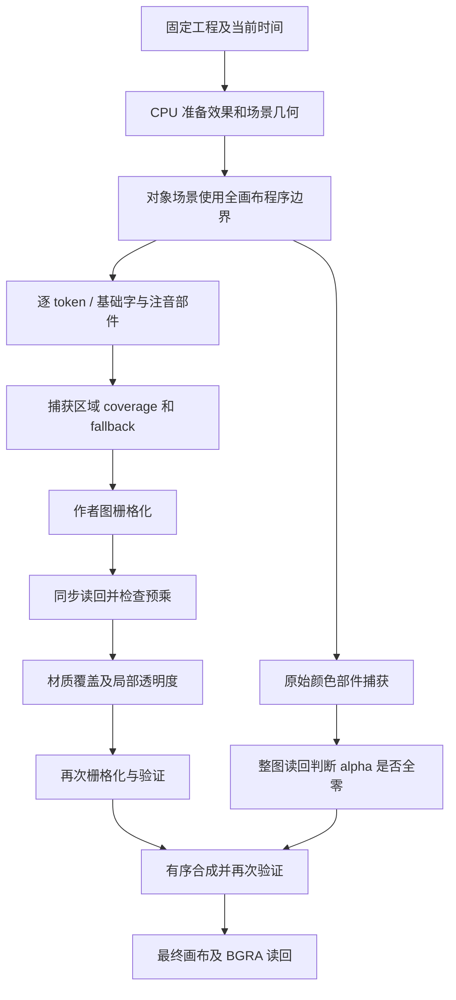

# GPU 渲染性能优化调研（2026-10-27）

> **状态：调研完成，尚未实施优化。** 基于已完成的本机 CPU/Vulkan 短批次基线、当前生产调用链及 SkiaSharp 3.119.4 官方源码。没有新增渲染、构建或功能测试。本轮仅记录分析和建议，500 ms/帧是用户提出的期望，尚不是已验收能力或任意输入保证。

## 1. 结论与目标口径

当前最值得优化的是材质管线中反复执行的全画布工作：每个部件生成中间图像，GPU 同步提交后再整图读回，CPU 检查像素；后续覆盖和合成又重复读取同一图像。应先减少重复工作，再将必须执行的像素检查留在 GPU，并减少不必要的同步。现有数据不足以判断 Radeon 880M 的纯 shader 运算上限，也没有证据表明更换渲染后端或 GPU 是当前必要条件。

**500 ms/帧可作为当前固定 1080p 样本的阶段目标，不能承诺通过一个局部修改达到。** 材质和组合场景的短窗口最大值分别需要下降 75.96% 和 81.40%。普通歌词、轻量 C#、图和粒子的预热后计量帧已经低于 500 ms；首帧、创建以及跳转到较晚时间必须另列。

建议后续先以“相同机器、相同工程样本、相同时间戳和质量、GPU 未插桩五轮短批次，所有计量帧 ≤500 ms”评估这个目标，同时报告中位数、P95、最大值和五轮分布。它只是有限样本目标；每次渲染继续少于 100 帧，不据此声称长片或任意工程的最坏延迟上限。

研究工作区起点为 `main` 的 `cb2ad2c`；生产源码仍是基线的 `8681bc09d59fc72c11d62810940324a6a44eefd2`，工具为 `3d87528`，产品 0.106.0／合同 1.39.0。数据来自[基线报告](backend-render-performance-baseline-20261027.md)、[baseline.json](../../performance/20261027/baseline.json)、[frames.csv](../../performance/20261027/frames.csv)及[stages.csv](../../performance/20261027/stages.csv)，未重新采样。三个 GPT 6.1 Terra xhigh 子代理分别复核设备同步、材质流程和目标可行性。

## 2. 与 500 ms 的实际距离

以下是未插桩 Vulkan 的预热后短窗口，单位 ms；材质和组合各 40 个计量帧，其余各 120 帧，均分布在五个独立进程。相关帧的 P95 和最大值是本轮描述统计，不能推导长期最坏值。

| 场景 | 中位数 | P95 | 最大值 | 当前判断 |
| --- | ---: | ---: | ---: | --- |
| 普通歌词 | 3.437 | 4.322 | 6.229 | 本窗口已经低于目标 |
| C# 效果 | 6.440 | 11.329 | 24.273 | 本窗口已经低于目标 |
| 图效果 | 176.428 | 227.412 | 295.272 | 本窗口已经低于目标，仍有公共路径可优化 |
| 材质 | 2038.934 | 2065.962 | 2080.070 | 最大值需下降 75.96% |
| 粒子 | 9.979 | 13.887 | 30.270 | 本窗口已经低于目标 |
| 组合 | 2551.087 | 2625.710 | 2687.878 | 最大值需下降 81.40% |

材质和组合的中位数分别需要约 4.08 倍和 5.10 倍加速。首帧另有明显成本：图／材质／组合的首帧中位数为 500.133／2371.113／3040.093 ms，首帧最大值为 805.245／2416.187／3078.756 ms。它们的会话创建中位数另为 397.786／237.234／1159.122 ms；不能将两个中位数之和当成实际某次请求。创建使用独立空脚本编译缓存，但未清理系统和驱动缓存；固定工程构造、HTTP、Worker 通信、PNG 和编码也不在帧计时内。

同一基线下 CPU 的材质／组合中位数为 4713.954／5069.729 ms。GPU 已经改善重负载，但当前实现仍有大量宿主参与。轻负载 CPU 更快的结果不支持静默切换后端；公开 `cpu|gpu` 选择及 GPU 失败不回落语义应保留。

## 3. 已定位的工作量

### 3.1 阶段证据

下表来自独立插桩执行体的计量帧均值，单位 ms；不是上一节中位数的分解。

| Vulkan 场景 | 根区间 | 内部 imageReadback | 读回次数/帧 | 预乘扫描 | 扫描次数/帧 | graph Raster 次数/帧 |
| --- | ---: | ---: | ---: | ---: | ---: | ---: |
| graph | 178.821 | 150.954 | 12 | 8.459 | 6 | 2 |
| material | 2018.880 | 1733.411 | 166 | 134.857 | 112 | 48 |
| combined | 2539.209 | 2200.421 | 188 | 165.041 | 134 | 50 |

材质和组合约 85.86%／86.66% 的根区间落在内部图像读回路径。该路径包含提交、等待前序 GPU 工作、转为 raster、像素读取和临时对象释放，**不等于纯拷贝时间，也不等于全部可消除时间**。`graph.sceneReadback` 是包含 `device.imageReadback` 的上层区间，不可再次相加。最终整帧读回均值只有材质 1.586 ms、组合 2.183 ms，单独优化最终读回不能弥补秒级差距。

未插桩材质／组合每帧托管分配中位数约 1317.040／1535.825 MiB。单张 1920×1080 BGRA 图像约 7.91 MiB，材质的 166 个全尺寸读回数组合计约 1313.09 MiB，和分配规模一致。这是分配流量，不是保留堆、显存占用或实际总线传输字节；不能据它推导硬件带宽瓶颈。

### 3.2 为什么一个简单材质需要这么多次处理

从[工厂](../../../src/MakoKaraGenerator.Runtime.Hosting/ProjectRenderSessionFactory.cs)到[对象场景](../../../src/MakoKaraGenerator.Rendering.Skia/SkiaRenderPipeline.ImageScene.cs)及[材质入口](../../../src/MakoKaraGenerator.Rendering.Skia/SkiaRenderPipeline.ImageScene.Materials.cs)的链路如下：

工厂给图和材质的 `Bounds` 都是完整画布，对象再联合这些边界。因此基线中的单个字、空注音和空描边也会产生全尺寸部件处理。材质样本这一窗口内有 8 个目标 token，未唱填充同时进入 `BaseFill` 和 `RubyFill`，共 16 次材质调用；没有 ruby 也会进入材质路径。

每次材质有作者图、unmasked 覆盖、下层合成三次颜色 `Raster`，即 **16×3=48**。这三次各在产出时验证一次，覆盖前、组合链及组合输入还重复验证，共 **16×7=112** 次预乘读回。另外行余量和 8 个 token 共 9 组，每组六类原始部件，产生 **9×6=54** 次捕获读回判空；最终是 **112+54=166** 次内部图像读回。这里的 Raster 计数是图执行器的次数，不包含所有场景捕获 surface。

对应源码为 [Raster 与像素验证](../../../src/MakoKaraGenerator.Rendering.Skia/Effects/CompiledImageGraph.Drawing.cs)、[ValidateSurface／Composite](../../../src/MakoKaraGenerator.Rendering.Skia/Effects/CompiledImageGraph.cs)、[组合链](../../../src/MakoKaraGenerator.Rendering.Skia/Effects/CompiledImageGraph.CompositionChain.cs)、[材质覆盖](../../../src/MakoKaraGenerator.Rendering.Skia/Effects/CompiledImageGraph.MaterialCoverage.cs)。当前合法性检查明确拒绝 `RGB > alpha`；masked 还检查实际像素是否超出绑定区域。它们是现有错误行为，不能直接关掉。

### 3.3 设备同步的实际含义

[设备实现](../../../src/MakoKaraGenerator.Rendering.Skia/SkiaRenderBackend.cs)在中间 surface 绘制后调用 `surface.Flush()`、`_context.Flush()`、`_context.Submit(true)`；图像读回又调用 context flush、同步 submit、`image.ToRasterImage(true)`，随后复制到托管目标。

核对锁定的 SkiaSharp 3.119.4 官方绑定 [S1–S3]：无参数 `GRContext.Flush()` 实际是 `Flush(submit: true)`，默认包含非同步 flush-and-submit；GPU surface 的无参数 `Flush()` 也委托到 context 的这一调用，因此当前路径含相邻的两次 flush-and-submit 调用。之后的 `Submit(true)` 要求 CPU 同步等待；重复调用不等于两次完整重绘，也不能按调用数推算成本。`SKImage.ToRasterImage(true)` 的布尔参数是 `ensurePixelData`，不是异步开关。该版本 `SKImage.ReadPixels` 托管重载没有显式 `GRContext` 参数，不能把原生 Skia 新文档的接口直接套用到本项目。

历史提交 `be2fe30623d1cfe362c6287274f2ffff7677b58d` 将直接 image.ReadPixels 改成现有 raster 读回路径。因此“删掉 ToRasterImage”需要专门验证，不能视为无风险的重复复制删除。当前同设备图像传递已经保留 GPU 纹理；跨设备才 raster 化。主要问题是验证和捕获的主动读回，不是所有中间输入都自动跨设备。

## 4. 建议的实施顺序

以下均是候选优化，尚无实测收益。优先级依据工作量、实施范围和保持现有行为的难度；每项独立提交和复测后再决定下一项。

| 顺序 | 建议 | 主要减少的工作 | 预计改动范围／风险 |
| --- | --- | --- | --- |
| 1 | 同一不可变图像的成功像素验证去重 | 重复读回、CPU 扫描和数组分配 | 图 surface 生命周期与验证入口；相对集中 |
| 2 | 原始部件的可证明空路径、必要读回的有界缓冲复用 | 空捕获、整图判空和 GC 压力 | 场景捕获与读回；须保留结构和错误检查 |
| 3 | 同帧共享相同、无输入作者图的产物 | 重复全画布 shader、验证及图像分配 | 材质执行与结果所有权；需设计缓存及预算 |
| 4 | GPU 全域像素检查与小结果读回，配套收紧同步边界 | 必须保留的整图下载和 CPU 扫描 | 设备与图执行器；先做等价性技术验证 |
| 5 | 受限 ROI、惰性捕获及图融合 | 全画布像素量与中间表面 | 图计划／采样／色彩及错误语义；范围较大 |

### 4.1 成功验证去重：首个实施切片

为内部拥有且内容不可变的 `SKImage` 保存“实际像素已通过预乘检查”的成功事实，并让别名共享它。[SkiaGraphSurface](../../../src/MakoKaraGenerator.Rendering.Skia/Effects/SkiaGraphSurface.cs)的 `Own`、`BorrowAs` 和设备租约是主要入口。首次验证仍完整执行；之后 `ValidateSurface` 继续检查句柄、类型、几何、密度、sRGB、预算和取消，只复用已成功完成的像素判定。

凭据不能只以可复用的 native handle、帧号或图计划为键。外部借用、未知可变内存、跨设备转换和新内容默认重新验证；取消和失败不产生成功凭据。缓存有效期必须随真实图像及设备生命周期结束，不能延长设备生存期或绕过释放。

同时可在一次 masked 材质操作内复用必要的像素读回：预乘验证与区域检查读取同一颜色，两个区域检查共享 region。当前基线是 unmasked，因此 masked 的收益须另测。缓冲池应有明确有效长度和上限、在 `finally` 归还；它降低分配，不自动消除同步，也不能变成无界的全帧像素缓存。

第一步验收重点是同图多别名、不同图复用句柄、外部输入改变、取消后重试和创建者先释放。先确认实际读回次数与字节量下降，再看未插桩总耗时，不能按“去掉多少个调用”线性推算收益。

### 4.2 空部件与捕获

当前 `AddOriginal` 总是先捕获，再整图读取 alpha 判断空，最后才复用空图。可先从能由实际绘制路径证明为空的原始部件做快路，例如确实没有 ruby 的 ruby 部件，以及最终有效样式确定不绘制的描边／阴影。仍保留目标、变换、共同透明度、部件顺序、选择来源和原有验证；还须保留原捕获的逻辑表面预算准入及限额失败顺序，不能因少分配一个空表面就让原本超限的请求静默成功。无法证明时回原路径。

**空 coverage 不允许直接跳过作者材质。** 作者图可能在区域外输出非法颜色，当前会先失败再应用区域；跳过会改变诊断。可先共享已验证的作者输出，再研究空覆盖后的宿主处理。

[材质捕获](../../../src/MakoKaraGenerator.Rendering.Skia/SkiaRenderPipeline.MaterialCapture.cs)总是同时生成 region 和 fallback。CustomInk 没有输入，也不触发背景依赖的透明 fallback，可研究按真实活动输入惰性生成 fallback。必须保留原来就会执行的 fallback 定义、目标与几何检查，以及预算准入；“未使用”不能自动视为“无需验证”。此项先于一般 ROI，但应作为独立小切片，不与图计划改造混做。

### 4.3 同帧作者图复用

[CustomInk 图](../../../samples/ScriptEffects/CustomInk/graphs/wave.graph.json)没有任何图像输入，只有时间和参数；[shader](../../../samples/ScriptEffects/CustomInk/shaders/wave.sksl)依赖画布坐标。当前基线 16 次作者图调用的程序、时间、参数和完整画布边界相同，因此具备研究同帧共享的条件。

共享的是**完整且已验证的作者图原始输出**；每个 token／ruby 的 coverage、透明度、owner、诊断映射和后续有序合成仍独立。仅在依赖完全匹配时命中：固定图修订、设备、时间、所有参数与 uniform、画布及目标边界、密度、输出模式、色彩格式和资源身份。先限定真正无输入且纯图操作的路径，有动态输入或不能证明身份时不复用。

该样本最多可把重复的 16 次作者图栅格化合并为 1 次，即少 15 次作者图执行；48 次总图栅格化中的覆盖和合成不会因此全部消失。这只是满足条件后的结构推算，不是已实现调用数或耗时预测。保留图输出的 BGRA 量化边界，避免直接跨节点融合改变像素。

结果共享会改变持有时间、资源去重和峰值。应单独保存原逻辑执行的准入与峰值语义，并限制物理缓存；缓存空间不足时回退无缓存执行，不能让新增缓存使原本成功的工程超预算，也不能跳过原本应失败的逻辑预算检查。现有 `ImageSurfaceBudgetSession` 不是全部托管/native/GPU 内存核算器，不能假设它自动覆盖新缓存。

### 4.4 GPU 上检查像素，再读取小结果

相比先缩小作者输出范围，优先研究在 **原完整检查域** 上执行 GPU 判定：预乘是否合法、alpha 是否全零，以及 masked 输出是否越界；逐级归约成少量标记后再读回。这里的“归约”是把每个像素的布尔结果逐级合并，最终 CPU 只取少量结果，而不是整张 BGRA 图。

这是技术验证方向，现有项目没有这项能力。当前 RuntimeEffect 与 raw image shader 可作为原型入口 [S4]，但不等于已有通用 compute 或可直接调用的异步 readback。先评估 Skia 内多次小渲染归约；若绑定不能精确保留判定或收益不足，再决定是否值得维护 native 扩展。

必须针对**现有读回转换后的 BGRA8 字节语义**证明等价，不能直接对浮点 shader 值检查后就宣布一致。禁止色彩管理、过滤采样、预乘修正或精度变化隐藏非法值；保持 sRGB、像素坐标、区域错位和边界语义。masked 的现有规则是 alpha 不能超过“区域为零时为 0，否则区域 alpha+1”，不能改成一般非零 mask。先保留逐节点检查及首个失败归属，原型失败或未覆盖的格式采用原验证路径。

在必须的 CPU 可见结果之前，研究减少中间 `Submit(true)`。同一 context 的依赖可以由 Skia 管理，但快照、主 surface 后续写入、预算租约和资源释放需逐路径审查；先改变内部单一路径，不统一删除全部同步。小结果读回仍可能等待 GPU 完成，减少传输量不等于完全隐藏延迟。

### 4.5 ROI 与融合的边界

局部 backing store 应与逻辑图域分开，不能直接把 `TargetBounds` 改成字形框。至少要保留全局 shader 坐标、像素对齐、变换、抗锯齿、描边／阴影、采样邻域、blur/transform、clamp/repeat、背景和 backdrop 输入，以及完整原验证域。

CustomInk 当前虽无输入和外扩，仍在整画布验证作者输出；裁掉不可见区域会隐藏该区域的非法颜色。任意 SKSL 声明的 `maxSampleOffsetPx` 也不能单独证明实际采样受限。未来只在能证明等价的子集启用 ROI，其余保持完整路径。若要改变验证域或预算合同，应另行设计和登记行为变更。

Skia 支持将 child shader 合成一个执行程序 [S4]，但本项目现有节点之间有 BGRA8 中间量化、像素检查及错误顺序；直接融合可能改变舍入、滤波和非法中间值的可见性。先做不跨这些语义边界的复用和惰性工作，再评估有限融合。

## 5. 达到 500 ms 需要多大变化

只用同一插桩构建的均值做敏感性分析：设根区间为 T，内部读回路径为 R；假设其余时间不变、该路径减少比例为 s，则算术上 `T' = T - s × R`。

| 假设内部读回路径减少 | material 估算 ms | combined 估算 ms |
| --- | ---: | ---: |
| 50% | 1152.17 | 1439.00 |
| 75% | 718.82 | 888.89 |
| 90% | 458.81 | 558.83 |

该理想模型分别需要减少读回路径 87.62%／92.67% 才到 500 ms。**这些数值不是性能预测或理论下限**：R 包含必须执行的 GPU 工作，改变同步可能只把耗时移到其他区间；减少捕获、图执行和验证又会同时影响多个阶段。它说明仅池化数组、优化最终读回或去掉几个等待调用，很难独自完成目标；应把重复图像工作和全量验证读回作为整体问题处理。

## 6. 次要方向与 RenderAt(t)

普通歌词、当前 C# 和粒子样本的稳态成本已经很低，暂不优先做微小字典／对象优化、并发提交、改 Vulkan API 版本或更换 Skia 后端。GPU 视频编码改善的是另一段导出链路，本次 Runtime 基线不包含编码，不能用编码收益解释这里的单帧改善。

会话复用和按固定源码缓存编译对首帧体验可能有用，但需要保持包、资源、权限和实例状态隔离。[ProjectRenderSession](../../../src/MakoKaraGenerator.Runtime.Hosting/ProjectRenderSession.cs)目前串行保护准备、绘制及读回；多个 graph 的各自锁不能证明共享设备可并行使用。异步队列或多帧流水线主要是另一个吞吐问题，也会增加在途内存，不能据此保证单帧延迟。

[FrameSession](../../../src/MakoKaraGenerator.Scripting/Execution/FrameSession.cs)仍沿时间网格和事件边界推进，回退或输出改变会重建。GPU 图像优化不会将它变成统一无状态、恒定成本的 `RenderAt(t)`。后续若要降低首次晚时刻和回退 seek 成本，应单独研究可验证的状态检查点或明确声明的纯求值模式，保存脚本、随机数、事件、粒子和资源状态；不能因效果只重写 Evaluate 就跳过时间推进。

## 7. 后续实施与验证建议

建议首批仅实施成功验证去重、必要读回缓冲复用和可证明空的原始部件，分别提交，使用当前基线工具复测。完成后根据剩余读回次数、全画布 Raster 和 GPU/CPU 等待分布决定同帧共享及 GPU 归约的先后；不在没有数据时承诺前三项即可达到目标。

后续验证按以下边界开展，本轮没有执行：

1. **正确性：** 同设备旧／新执行体的完整有效 BGRA、规范化诊断与错误归属；继续检查无 ruby／有 ruby、描边／阴影、变换及半像素边界、普通／透明、masked／unmasked、跨设备输入、seek 和取消。CPU 与 GPU 分别对各自原版，不要求 CPU/GPU 位级相同。
2. **负例：** 单像素非法预乘、区域外非法颜色、masked 越界及边界容差、外部可变借用、别名与句柄复用、sRGB／密度不符、失败后重试、设备与创建者先释放、预算恰好及超限。优化不得用空覆盖、缓存或 ROI 掩盖原错误。
3. **性能：** 原六类 fixture、原分辨率和时间序列保持；普通 8+24、重负载 4+8，各五轮，串行运行并交替安排旧／新版本，单进程项目帧加 probe 仍少于 100。正式总耗时用未插桩执行体，阶段观察单独运行，不混入一个统计量。首次晚时刻只做少量输出帧，另报历史重放成本。
4. **资源与归因：** 记录实际读回字节、像素扫描／Raster 次数、缓存命中及保持量、托管分配和 GC、可获得的 native/GPU 内存与进程排水。若同步改动让耗时移动到别处，不能据某个 span 下降认定提速；需要进一步定位时，再增加有限 GPU 时间查询或驱动分析，先验证当前绑定支持情况。

本次交付为调研文档与入口链接。生产源码、版本、合同和基线数据保持原归属；没有新的性能验收、发布或 HTTP 结果。

## 8. 官方资料与版本边界

查阅日期为 2026-10-27。绑定行为以项目锁定的 `v3.119.4` 为准；Skia 的概念说明只用于提出候选，不当作本项目已暴露 API 的证明。

- **S1 — SkiaSharp 3.119.4 GRContext：** `https://raw.githubusercontent.com/mono/SkiaSharp/v3.119.4/binding/SkiaSharp/GRContext.cs`。核对无参数 `Flush()`、`Flush(bool submit, bool synchronous = false)` 和 `Submit(bool synchronous = false)` 的实际绑定。
- **S2 — SkiaSharp 3.119.4 SKImage：** `https://raw.githubusercontent.com/mono/SkiaSharp/v3.119.4/binding/SkiaSharp/SKImage.cs`。核对 `ReadPixels`、`ToRasterImage(bool ensurePixelData)` 与 raw shader 入口。
- **S3 — SkiaSharp 3.119.4 SKSurface：** `https://raw.githubusercontent.com/mono/SkiaSharp/v3.119.4/binding/SkiaSharp/SKSurface.cs`。核对 GPU surface 的 flush、snapshot 和同步像素读回绑定。
- **S4 — Skia Runtime Effects 官方说明：** `https://skia.org/docs/user/sksl/`。child shader、坐标、色彩管理及 raw image shader 的语义；GPU 归约、有限融合是否等价仍需本项目验证。
