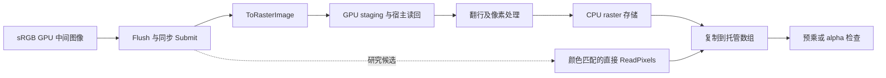

# GPU 渲染结构与读回路径二次调研（2026-10-28）

> 调研基线为 `dev/performance-optimization` 的 `61ee27ef069c1d7126e68a3bfe0e6c6d8391d3bd`，生产输入与第一批 `feb7f23` 一致。产品 **0.106.1**／合同 **1.39.0** 保持。本轮完成源码复核、既有 trace 重分析及用户同意的隔离诊断；候选修改仅存在于忽略目录的独立副本，未修改生产实现。它不是第二批优化交付或正式性能验收。

## 1. 结论与优先级变化

**有明确的继续优化空间，而且已经找到比上一轮建议更小、更有实测依据的入口：中间图像读回的颜色编码匹配。** 现有 Vulkan 图像路径先 `ToRasterImage(true)`，再复制到目标数组；锁定版本的 native 实现会在 raster 化时使用无颜色空间标记的读回目标。它与默认 BottomLeft 表面、sRGB 中间图像组合，进入较重的宿主像素处理路径。

隔离副本只将这一入口改为保留图像颜色空间的直接 `SKImage.ReadPixels`，保持表面原点、显式 flush／同步 submit、完整像素检查与其余生产逻辑。三轮配对、每轮 4 个预热阶段帧（含首帧）＋8 个计量帧的结果如下；每格共 24 个计量帧，单位 ms：

| Vulkan 场景 | 当前实现 median / P95 / max | 匹配颜色直接读回 median / P95 / max | median 降幅 |
| --- | ---: | ---: | ---: |
| graph | 99.758 / 113.539 / 121.988 | 33.115 / 37.744 / 41.724 | 66.80% |
| material | 1044.482 / 1063.517 / 1069.643 | 305.832 / 347.885 / 361.676 | 70.72% |
| combined | 1203.041 / 1305.755 / 1321.898 | 385.889 / 495.685 / 506.331 | 67.92% |

这是同一研究批次、同一后端的未插桩 Runtime 对照，**不是拿新微探针与旧正式验收直接比较**。包括探索、配对、透明和 seek 在内，直接读回候选的 **161 对完整有效 BGRA 哈希及完整规范化诊断一致**。尚未验证非法像素、masked 边界、外借图像等全部负例，所以不能直接作为生产补丁发布。组合场景计量帧最大值仍为 **506.331 ms**，没有达到 500 ms；也未运行原五轮完整矩阵。

用户对结构问题的怀疑在重负载上得到支持，但需要区分两类情况：

- **图／材质：** 存在反复同步读回、native 中转及 CPU 像素检查，并有逐 token／部件执行全画布材质图的放大。第一批后材质和组合 GPU 已约为 CPU 的四倍速度，但远未释放 GPU 的潜力。
- **纯歌词：** 该 fixture 没有中间图像读回，也没有脚本实例。GPU 较慢主要与最终 CPU 可见整帧输出、同步成本有关，不能归因于同样的 91 次中间读回。

建议下一批首先处理 **颜色匹配的直接图像读回**，随后做同帧作者图共享和可证明无用的捕获；GPU 小结果验证及同步收敛仍值得研究，一般 ROI／节点融合暂放后面。

## 2. 源码和证据边界

- 第一批正式结果仍以[原验收报告](../acceptance/backend-gpu-performance-optimization-acceptance-20261027.md)为准；本轮没有重写其耗时或结论。
- 新原始证据位于 `artifacts/gpu-structural-research-20261028/`；可迁移的精简归档、统计、指纹和说明见[证据目录](../../performance/20261028-structural-research/README.md)。原第一批的 12 份 trace 单独复制为历史重分析输入，不计为本轮新渲染。
- 当前工作树与基线的 **952 个选定源码／样本／工具输入**逐项 SHA-256 相同；两个候选副本也逐项复核，分别只在 `SkiaRenderBackend.cs` 有预期修改。此计数不是全仓库文件数。
- SkiaSharp 锁定 **3.119.4**。已核对该 tag 的 `externals/skia` 指向 `mono/skia` **`7dbfc07dd33181f84e0958afb7ee805c6c769f0b`**，不是用当前 upstream 主分支猜测本机行为。官方绑定、native 源码、许可证和逐文件 SHA 进入归档；版本关系与来源地址在 `upstream/manifest.json`、`upstream/submodule-verification.json`。
- 本机设备证据为 AMD Radeon 880M Graphics（RADV STRIX1），驱动原始位 `0x06802005`，Vulkan API `1.4.354`。Runtime 进程内 maps／DRM 描述符与帧后独立 4×2 probe 分列，不把 probe 当作逐个 GPU 命令的归属证明。

## 3. 中间图像为什么比最终主帧读回贵

### 3.1 两条入口不相同

[最终画布](../../../src/MakoKaraGenerator.Rendering.Skia/SkiaRenderPipeline.cs)创建 `SKImageInfo` 后，把同一个 info 交给 surface 读回；存在材质、图效果等时，两边都带 sRGB。它直接填充最终托管帧缓冲。

[内部验证](../../../src/MakoKaraGenerator.Rendering.Skia/Effects/CompiledImageGraph.Drawing.cs)和[部件判空](../../../src/MakoKaraGenerator.Rendering.Skia/SkiaRenderPipeline.ImageScene.cs)则传入不带颜色空间的 BGRA8888／Premul info。[Vulkan 设备](../../../src/MakoKaraGenerator.Rendering.Skia/SkiaRenderBackend.cs)先同步，再把 image 转成 raster，最后由 raster 复制到调用方缓冲。

示意图表示逻辑数据路径，不是测得的 GPU command 数。候选仍可能经过驱动 staging、宿主翻行和复制，**不是零拷贝**；也没有取消 CPU 完整检查。

### 3.2 锁定 native 源码揭示的组合问题

按归档中的官方源码逐层核对：

1. `SKSurface.Create(context, true, info)` 的省略原点重载默认 **BottomLeft**。
2. `SkImage::makeRasterImage` 为下载创建 CPU 存储，读回时临时将目标颜色空间设为 null，返回 raster 时又保留原图的颜色信息。
3. Ganesh `SurfaceContext::readPixels` 对 BottomLeft 需要翻行，因而分配临时像素并进入 `GrConvertPixels`。
4. `GrConvertPixels` 在源 sRGB、目标 null 时不能采用“颜色信息相同”的行 memcpy 快路，而进入 raster pipeline；翻行情况下该 pipeline 按行运行。
5. `SkColorSpaceXformSteps` 随后把 null 目标解释为源颜色空间。因此这里不应描述成“必须进行 sRGB 到另一色域的转换”；即使实际颜色转换是恒等，路径选择仍可能更重。
6. Vulkan `GrVkGpu::onReadPixels` 自身还包含 image-to-buffer、提交／等待、映射及宿主拷贝。直接读取不会消除这些底层步骤。

颜色匹配的直接读回同时绕开 `makeRasterImage` 的 null 目标，以及显式 raster 中转和后续复制。微探针分别控制颜色信息与表面原点，支持这条解释；本轮未采 native CPU 调用栈或硬件 GPU 时间戳，不能把全部差值精确分摊给某一 native 函数，更不能将这些时间当成物理总线带宽。

### 3.3 无显式 context 参数不等于不能直接读 GPU image

上一轮只查到托管 `SKImage.ReadPixels` 没有显式 context 参数，并提醒不能直接套用新版原生 API。本轮向下核对发现：锁定 native 的该重载会从 image 取所属 `directContext()`，然后调用带 context 的实现。

本机探针在**新快照尚未 raster 化、创建它的 surface 已释放、设备仍存活**时直接读回成功。历史 `be2fe306` 引入 raster 路径这一事实仍保留，但该历史改动不能证明当前同设备 Ganesh 图像必须经过它。外部 texture、跨设备、不同颜色或 alpha 类型、context 已失效等情况没有被此次成功自动覆盖。

## 4. 隔离实验的具体证据

### 4.1 小型读回探针

三组共 15 个串行进程：基础方法 CPU/Vulkan 各三轮、颜色控制 CPU/Vulkan 各三轮、TopLeft 控制仅 Vulkan 三轮。每个进程分别创建带／不带 sRGB 的 1920×1080 表面，画固定的半透明渐变和叠加矩形；每方法两次预热、六次计量，轮换方法顺序。每个进程最多 80 个合成表面，不是 80 个项目帧。

同一个颜色批次、默认 BottomLeft 的 Vulkan **read 阶段中位数**如下，每格 18 个计量样本：

| 源图像 | 读取方式 | read 中位数 ms |
| --- | --- | ---: |
| 无颜色空间 | image 直接读、目标 null | 2.001 |
| 无颜色空间 | image 直接读、目标匹配 | 1.875 |
| sRGB | image 直接读、目标 null | 12.839 |
| sRGB | image 直接读、目标 sRGB | 1.972 |
| sRGB | surface 直接读、目标 null | 13.036 |
| sRGB | surface 直接读、目标 sRGB | 1.847 |

更早的基础方法批次中，sRGB 的 `ToRasterImage` 阶段中位数为 9.201 ms、随后 rasterCopy 为 0.377 ms；无颜色空间相应为 1.613／0.280 ms。它们属于另一组采样，不与上表相减来计算单项收益。只省略外层同步或改用 scratch surface，并没有消除 sRGB／null 的慢路径。

全部 **960 条读回记录**在各自同后端、同原点、同图案的四方法间哈希一致。该集合不证明所有 BGRA 字节组合和错误输入都一致。探针源码归档为最终综合版，三个历史探针构建没有分别保存探针本体二进制；结果记录了被调用生产 Rendering 程序集 SHA。

### 4.2 TopLeft 是被否决的直接替换方案

TopLeft 下，sRGB／null 的读回也降至约 1.4 ms，符合避开翻行处理的方向。但它不是无损改动：

- 合成探针对照原 BottomLeft，**192 条记录全部哈希不同**；在各自原点内四种读取方法仍一致。
- 真实 Runtime 的 lyrics／graph／material／combined 各五帧探索中，TopLeft 有 **5/20 对 BGRA 不同**，其中 material 首帧一对、combined 前四帧四对；20 对诊断相同。

本轮未定位差异到具体像素或断言为垂直颠倒；原点变化也可能影响 shader／光栅舍入。**不建议把全局 TopLeft 切换纳入下一批无像素变化优化。** 此反例说明，不能只看速度或最终一张 PNG 就认可候选。

### 4.3 直接读回候选的 Runtime 配对

独立副本的修改只有图像 `ReadPixels` 方法：保留原来的 `_context.Flush()` 和 `_context.Submit(true)`，读取 `image.ColorSpace` 构造匹配 info，直接填充原目标缓冲。未修改 `RasterizeImage` 的跨设备路径、CPU 实现、表面原点、图计划或验证扫描。

共运行 42 个 Vulkan Runtime 进程、**342 个项目帧＋42 个 4×2 probe**；每个进程最多 12 个项目帧。所有进程正常 exit0，已观察 PID 在收口时退出；没有运行 Worker／HTTP 后代控制矩阵。42 份输出都有 RADV 库及 DRM 描述符证据，所有项目帧 `hasError=false`。

| 批次 | 进程／项目帧 | 直接读回候选的逐帧对照 |
| --- | ---: | ---: |
| 四场景探索，基线／TopLeft／直接读回 | 12／60 | 20 对一致；另列 TopLeft 20 对及失败 |
| graph／material／combined，三轮配对 4＋8 | 18／216 | 108 对一致 |
| 三场景透明，各 1＋2 | 6／18 | 9 对一致 |
| 三场景 seek，各 8 帧 | 6／48 | 24 对一致 |
| 合计 | 42／342 | **161 对一致**，不含 TopLeft 对照 |

逐帧检查的是有效 BGRA 全长度哈希、完整诊断对象和规范化诊断哈希，不要求 CPU 与 Vulkan 相互位级一致。三个场景的三轮中位数（当前→候选，ms）：

| 场景 | 第一轮 | 第二轮 | 第三轮 |
| --- | ---: | ---: | ---: |
| graph | 94.532 → 31.838 | 103.729 → 34.289 | 99.011 → 32.170 |
| material | 1045.673 → 293.832 | 1041.585 → 344.932 | 1045.125 → 303.614 |
| combined | 1191.133 → 381.216 | 1213.749 → 434.576 | 1211.258 → 372.568 |

创建与首次请求另外记录，三个进程的中位数如下；首次请求位于 1 秒，可能含时间轴重放，不能等同纯绘制：

| 场景 | 创建 当前→候选 ms | 首次请求 当前→候选 ms |
| --- | ---: | ---: |
| graph | 254.849 → 383.059 | 338.002 → 274.055 |
| material | 230.141 → 265.599 | 1326.362 → 565.419 |
| combined | 1196.569 → 1129.275 | 1656.751 → 791.989 |

创建并没有一致改善。本轮由用户确认无游戏／重负载后采样，构建与渲染串行；未保存逐轮系统负载快照、锁频或清除系统／驱动缓存，仍是日常桌面环境中的探索实验。配对按轮交替候选顺序；帧间有关联，不把 24 帧当成 24 个独立实验。哈希、诊断整理、PNG 和 probe 在 wall 外，结果不是连续导出吞吐量。

## 5. 重复读回与脚本挂载的结构审查

### 5.1 重复读回确实存在，但不是每层都先下载再上传

[SkiaGraphSurface.ImageForDevice](../../../src/MakoKaraGenerator.Rendering.Skia/Effects/SkiaGraphSurface.cs)在同设备下直接返回原图；只有跨设备或没有可靠设备归属时才考虑 raster 化。[会话工厂](../../../src/MakoKaraGenerator.Runtime.Hosting/ProjectRenderSessionFactory.cs)把同一设备交给 renderer、包图和捕获路径。因此，当前证据支持“验证／判空主动多次下载”，不支持“同设备所有效果输入都必然 CPU 往返”。

第一批后的历史 trace 重分析如下。时间是每帧阶段中位数，区间有嵌套，不能相加，也不能当作上面新 wall 表的精确分解：

| Vulkan 场景 | 内部读回次数／请求字节 | 图 Raster 次数 | 内部读回 ms | CPU 预乘扫描 ms | Runtime 准备 ms |
| --- | ---: | ---: | ---: | ---: | ---: |
| graph | 7／59,947,200 | 2 | 70.801 | 4.742 | 1.427 |
| material | 91／754,790,400 | 48 | 850.042 | 72.193 | 1.070 |
| combined | 95／810,756,288 | 50 | 934.011 | 79.462 | 3.203 |

字节是应用请求长度，不是物理总线流量。当前机器为集成 GPU，不能由这些字节推出 PCIe 瓶颈。候选仍执行相同的读回及扫描调用；它减少每次调用的多余中转和处理。第一批有界数组池主要解决托管分配，本轮定位的 native 中转不会被该池自动消除。

### 5.2 编译／加载没有放到每帧，但材质执行粒度过细

[CompiledProjectEffects](../../../src/MakoKaraGenerator.Scripting/Compilation/CompiledProjectEffects.cs)按包身份／修订去重编译，native 图在创建会话时固定；[FrameSessionFactory](../../../src/MakoKaraGenerator.Scripting/Execution/FrameSessionFactory.cs)创建 host 并 Load／Initialize。正常单调帧请求不重新编译、加载整个包。回退、输出变化或失败后的重置会重载执行状态，这是现有状态重放语义。

固定 material fixture 直接把 CustomInk 挂在默认未唱填充，**没有 C# 控制器实例**，源码见 [Fixtures](../../../tools/backend-render-performance/Runner/Fixtures.cs)。历史 trace 中的 `script.evaluate` 是 host 准备入口计数，不能解释成“每次都运行作者 C#”。材质准备约 1 ms、图像处理约秒级，表明当前主瓶颈不在脚本编译或 CLR 调用本身。

真正的放大位于[对象场景](../../../src/MakoKaraGenerator.Rendering.Skia/SkiaRenderPipeline.ImageScene.cs)、[材质执行入口](../../../src/MakoKaraGenerator.Rendering.Skia/SkiaRenderPipeline.ImageScene.Materials.cs)和[覆盖处理](../../../src/MakoKaraGenerator.Rendering.Skia/Effects/CompiledPackageGraphExports.Materials.cs)：

- 工厂给材质完整画布 bounds。当前窗口有 8 个 token，每个进入基础字和注音填充，即 16 次材质执行；无 ruby 仍执行作者图。
- 每次包含作者图、coverage 后颜色以及后续组合，形成共 48 次图 Raster。第一批去重验证后仍有 64 次预乘检查和 27 次原始部件 alpha 判空，即 91 次内部读回。
- [CustomInk 图](../../../samples/ScriptEffects/CustomInk/graphs/wave.graph.json)没有图像输入；shader 仅依赖时间、参数与画布坐标。同帧相同完整 bounds 的作者输出具备共享条件，coverage、透明度、顺序和 owner 仍须各自处理。
- [CaptureSceneMaterialRegion](../../../src/MakoKaraGenerator.Rendering.Skia/SkiaRenderPipeline.MaterialCapture.cs)总是生成 region 和 fallback 颜色；对没有 TargetColor／背景依赖的图，fallback 可能没有消费方，仍有惰性生成空间。

因此，下一阶段应共享可证明相同的作者图，保留材质的逐目标绑定语义；直接把逐字绑定改成整行绘制会改变遮挡、演唱裁切和错误归属。

### 5.3 时间轴重复求值是另一个问题

[FrameSession](../../../src/MakoKaraGenerator.Scripting/Execution/FrameSession.cs)沿 120 Hz 网格和精确事件边界推进。30 fps 输出的历史 trace 在普通场景中每帧有 4 次 host Evaluate；粒子还可能为出生时刻补算。它不是简单的重复挂载，更不能因最终只要一个时间点就省掉前面的状态演进。

纯源材质的准备可以另做更窄的计划复用研究；有状态脚本若要改为纯求值或状态检查点，则必须保持事件、随机数、粒子、diagnostics、取消后恢复和 seek 重放。它们对本次秒级重负载不是第一优先项。

## 6. 为什么 Lyrics 的 Vulkan 仍慢于 CPU

第一批五轮正式未插桩中位数为 CPU **0.904 ms**、Vulkan **2.757 ms**。同批独立 trace 显示：

| 纯歌词阶段 | CPU 中位数 ms | Vulkan 中位数 ms |
| --- | ---: | ---: |
| lyrics 绘制宿主区间 | 0.773 | 0.987 |
| 最终 submit | 0.001 | 0.421 |
| 最终 surface 读回 | 0.431 | 2.280 |
| 内部 image 读回 | 0 次 | 0 次 |

trace 有插桩开销，不能拿表中区间与未插桩总中位数做加减。GPU 绘制宿主区间也不是 GPU 执行时间；后续读回会等待尚未完成的工作。证据更支持“轻量绘制被最终输出和同步固定成本盖过”，没有发现纯歌词反复通过材质捕获下载的路径。

当前 `RenderFrame` 合同返回 CPU 可见 BGRA，因而保留最终读回是现有出口的实际要求，但不是 GPU 渲染永远无法加速的理论限制。可单独研究主 surface／输出缓冲复用，以及把必要等待集中到最终读取。若未来需要 GPU 常驻预览或编码，须设计新的资源所有权／消费者出口；仅改编码器不会加速当前测量。异步读回和多帧流水线主要影响吞吐，不自动降低单帧延迟，也不应静默把用户选择的 GPU 换成 CPU。

## 7. 可实施的后续切片

| 顺序 | 建议切片 | 本轮依据 | 实施前必须补齐 |
| --- | --- | --- | --- |
| A | 同设备 BGRA8／Premul 图像的颜色匹配直接读回 | 161 对帧一致、三轮约 67%～71% 中位降幅 | 全部像素／错误边界和设备生命周期回归，原五轮 A/B |
| B | 同帧相同无输入作者图共享 | 当前 16 次相同作者图、48 次总 Raster | 完整依赖键、逐目标错误归属、预算和缓存生命周期 |
| C | 可证明空的原始部件、未使用 fallback 惰性生成 | 27 次原始判空读回、固定的 region＋fallback 捕获 | 无／有 ruby、描边阴影、透明 fallback、原预算准入和错误顺序 |
| D | 完整检查域的 GPU 小结果验证，随后收敛同步边界 | 候选后仍有完整下载及 CPU 扫描 | BGRA8 字节级判定、非法预乘、masked 容差、取消与首错一致 |
| E | 受限 ROI／图融合、GPU 常驻出口 | 仍有全画布工作，轻载受最终读回限制 | 分开设计像素坐标／量化／采样域与输出资源合同 |

**A 不是直接把研究补丁复制进生产。** 研究补丁无条件使用图像颜色空间；正式实现应明确它服务于哪些调用者、输入格式与已验证的 sRGB 语义，不能覆盖调用者本来要求的不同颜色转换。当前两个内部 image 调用者均请求 BGRA8888／Premul／null，但内部设备接口还应有明确约束。

A 至少需要核对：alpha 为 0／1／254／255、RGB 恰好等于或大于 alpha、区域外非法单像素、masked 区域零值和 alpha+1 容差、raw coverage、null／sRGB 与被拒绝色彩格式、行跨度和尺寸、snapshot 创建者先释放、外部 Borrow／跨设备、设备释放、读回失败、取消后重试。仍然完整检查所有像素，不能因新的快路掩盖本来非法的值；也不能将读回失败改成静默 CPU 后端回落。

B 的共享只覆盖完整已验证作者结果，不能共享每个 token 的最终材质颜色。候选依赖至少包含固定包／图修订、device、time、参数和 uniform、bounds／density、输出／透明模式、色彩和资源身份。当前样本若所有条件成立，作者 Raster 可由 16 降到 1，48 次总 Raster 理论上降至 33；这是结构推算，**尚未实现或计时**。必须保持逻辑预算拒绝和首错顺序，同时限制新增缓存的物理保留量，不能让缓存把原本成功的请求变成超限。

C 不允许因空 coverage 直接跳过作者图：作者可能在不可见域输出非法颜色；可先共享全域验证结果，再省去确定无用的宿主工作。D 必须按当前 BGRA8 读回语义验证，不能以浮点近似检查替代。E 不能直接把逻辑 TargetBounds 改为字形框，也不能跨过中间量化和非法输出检查边界融合。

## 8. 本轮交付与未完成范围

本轮仅提交调研、可复核证据和入口索引。隔离探针三次构建、两个 Runtime 副本构建均零警告／零错误；这些不是生产 solution 回归。57 个诊断／Runtime 进程全部 exit0，源输入核对、统计重算、归档哈希和文档链接检查另见证据目录。

没有修改生产代码、版本、合同或第一批验收数据；没有新 self-contained 发布、HTTP、浏览器、完整正确性矩阵或跨驱动测试。TopLeft 的像素失败作为反例保留。**可以继续优化的判断已有实测支持；500 ms 目标与可上线补丁仍未验收完成。**
