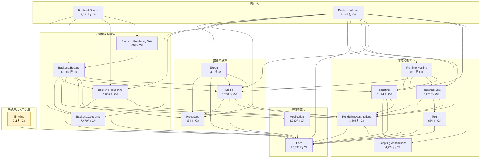
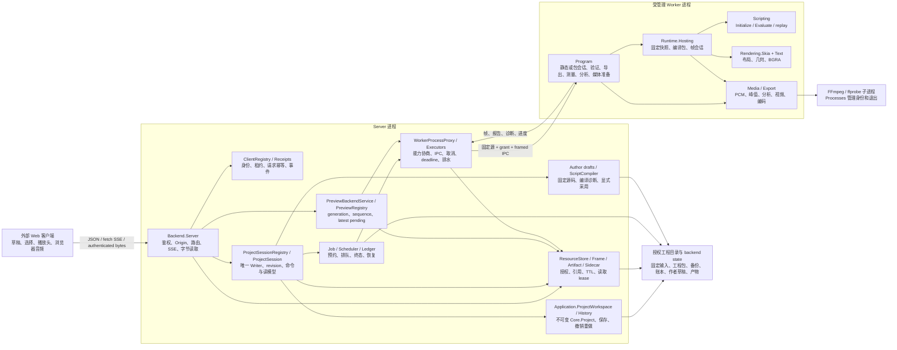
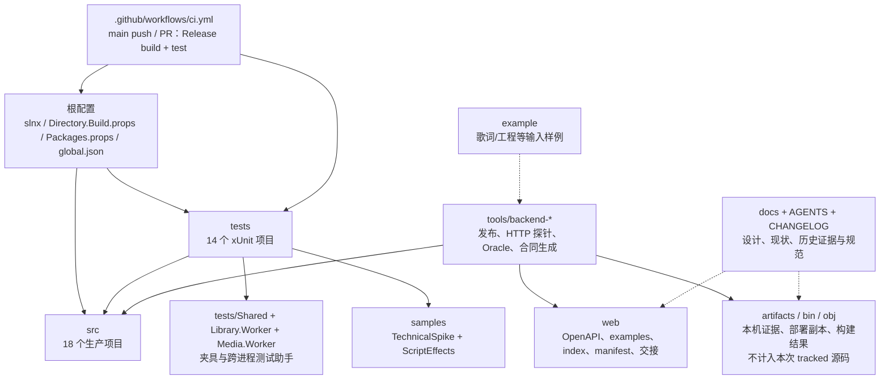

# 当前分支仓库架构、冗余代码与测试有效性审计

日期：2026-10-24。分支：`dev/backend-development`。源码基线：`688b0d4d4193c7f534ab8681ef0810b056c87d2d`；产品 `0.101.0`，HTTP 合同 `1.35.0`，生产合同基线 `1276982`。

## 1. 结论和审计边界

**桌面 UI 拆除、独立 Server/Worker 进程和领域复用已经存在；当前主要工作已转为把原引擎的完整输入与用户流程接到公共后端。继续把全部后续能力称为“迁移”，会让阶段没有明确终点。**

本次发现少量明确的桌面遗留代码，以及更显著的编排集中、能力组合不一致、测试环境误配和状态文档陈旧问题。删除遗留代码有价值，但不能解决整曲导出、完整媒体输入和前端闭环缺口。建议先定义可交付的用户流程和剩余阻塞项，再做局部清理；不把全仓重构设为前端开工的新前置。

本报告做了全部 18 个生产项目的引用盘点，并沿 HTTP、命令、快照、Worker、Runtime、媒体、持久化与测试启动链抽查实现。**这不是逐方法死代码证明，也不是完整业务/HTTP/浏览器验收。** 结论分为“当前产品入口未调用”“可合并的重复机制”“过时/条件失效的测试”“应保留的有效验证”。

审计开始时有未跟踪的 `tools/backend-project-image-export-probe/`。它是进行中的图片导出工具，不纳入已提交源码统计、不删除、不代记为验收完成。本次仅交付审计文档、Mermaid 原文件与统计快照，没有改产品、合同或测试行为。

## 2. 重新核对代码行数

### 2.1 同口径结果

使用 Git 提交树中的 `.cs` 文件，以 `splitlines()` 统计物理行；包含注释和空行。只统计各列指定目录，不计 `bin/obj/artifacts`、未跟踪文件和生成的 OpenAPI JSON。**这些数值不是 cloc 的去注释代码行数，不能直接和未知口径的“16 万 / 14 万”比较。**

桌面仓库当前 HEAD 也核对为迁移归档 `8526b84`。注意：这份归档已经包含 20,017 行 `Backend.*` 代码，并非尚未启动后端工作的原始桌面版本。

| C# 范围 | 归档 `8526b84` 文件 / 行 | 当前 `688b0d4` 文件 / 行 | 行数变化 |
|---|---:|---:|---:|
| `src/` 生产库与执行入口 | 736 / 77,959 | 839 / **91,415** | +13,456 |
| `tests/`，包含共享夹具和辅助 Worker | 568 / 87,350 | 525 / **81,847** | -5,503 |
| `samples/` | 193 / 25,995 | 11 / 848 | -25,147 |
| `tools/` 中的 C# | 56 / 9,271 | 11 / 1,170 | -8,101 |
| 合计 | 1,553 / **200,575** | 1,386 / **175,280** | **-25,295（12.6%）** |

`src` 当前去空行后为 83,857 行，`tests` 为 75,325 行，仍包含注释。UI 的 `samples/TechnicalSpike.App` 删除了 25,147 行 C#；现有 `Backend.*` 从 20,017 增长到 30,915 行，其余 `src` 从 57,942 增长到 60,500 行。由此可见：**UI 删除的同时，又增加了传输、进程隔离、生命周期和新的编辑能力；这不是只给原引擎套一层薄 HTTP。**

其他需要单列的规模：

| 范围 | 当前规模 | 如何解释 |
|---|---:|---|
| `tools/**/*.py` | 70 文件 / 20,253 行 | 合同生成、HTTP 探针、发布和证据工具；不进入产品运行时 |
| `web/examples.json` | 112,578 行 | 生成的正反例数据，不能当生产逻辑或真实 HTTP 用例数 |
| `web/openapi.json` | 29,034 行 | 生成的网络合同 |
| `docs/**/*.md` | 175 文件 / 35,056 行 | 包含大量历史计划和验收记录 |
| `AGENTS.md` | 1,023 行 | 仍夹杂已删除桌面 UI 的历史指令 |

可复核统计在 [metrics.json](../../backend-structure-20261024.metrics.json)。附录提供同口径复算命令。

## 3. 完整生产项目依赖图

以下覆盖全部 18 个生产项目和 **50 条直接 `ProjectReference`**，直接从该提交的 `.csproj` 提取。实线仅表示编译期项目依赖，不表示进程调用、数据流或“所有代码都被使用”。公共前缀 `MakoKaraGenerator.` 省略。图中没有环；Server/Worker 的联合传递依赖覆盖 17 个项目，唯独 Timeline 不在产品入口依赖闭包中。

可复制的独立 Mermaid 文件：[backend-structure-20261024.mmd](../../backend-structure-20261024.mmd)。



### 3.1 各模块说明

| 项目（省略公共前缀） | C# 文件 | 物理行 | 当前职责 |
|---|---:|---:|---|
| [`Core`](../../../src/MakoKaraGenerator.Core) | 241 | 26,836 | 歌词/时间、工程和场景模型、效果包、校验、序列化；无产品项目依赖 |
| [`Backend.Hosting`](../../../src/MakoKaraGenerator.Backend.Hosting) | 115 | 17,207 | Client/Session/Job、读写编排、资源与报告租约、恢复、作者和 Worker 代理 |
| [`Backend.Contracts`](../../../src/MakoKaraGenerator.Backend.Contracts) | 72 | 7,470 | 公共 HTTP DTO、严格命令 JSON、Worker IPC/能力/预算；无产品项目依赖 |
| [`Application`](../../../src/MakoKaraGenerator.Application) | 71 | 6,980 | ProjectWorkspace/History、纯编辑用例、模板库、保存和工程包协调 |
| [`Rendering.Skia`](../../../src/MakoKaraGenerator.Rendering.Skia) | 62 | 6,671 | 实际文字整形布局、场景几何、图/材质/粒子合成、BGRA 输出 |
| [`Scripting.Abstractions`](../../../src/MakoKaraGenerator.Scripting.Abstractions) | 69 | 4,724 | 作者 SDK、效果/事件/图/材质/粒子接口与输出合同 |
| [`Media`](../../../src/MakoKaraGenerator.Media) | 26 | 3,720 | FFmpeg probe/PCM/video、音频分析/峰值；还混有桌面 SoundFlow 播放链 |
| [`Rendering.Abstractions`](../../../src/MakoKaraGenerator.Rendering.Abstractions) | 48 | 3,695 | ProjectSnapshot、帧/几何/背景源/渲染会话接口与准备数据 |
| [`Scripting`](../../../src/MakoKaraGenerator.Scripting) | 42 | 3,144 | Roslyn 编译、固定包、时间线投影、语义回放与效果运行 |
| [`Backend.Server`](../../../src/MakoKaraGenerator.Backend.Server) | 30 | 2,391 | ASP.NET 启动、loopback/Origin/鉴权、路由、SSE、资源下载和退出 |
| [`Backend.Worker`](../../../src/MakoKaraGenerator.Backend.Worker) | 9 | 2,145 | IPC 分发；静态/包/图片会话、验证/导出、音频准备/分析、测量、资源验证 |
| [`Export`](../../../src/MakoKaraGenerator.Export) | 14 | 2,040 | VideoExporter、编码器、帧/音频流、alpha 转换与成片核验 |
| [`Backend.Rendering`](../../../src/MakoKaraGenerator.Backend.Rendering) | 12 | 1,633 | 固定 snapshot 源 codec、static/package/preset/image 选择和诊断映射 |
| [`Timeline`](../../../src/MakoKaraGenerator.Timeline) | 4 | 911 | 视口时间轴、轨道矩形、交互命中、loop region；当前产品入口不引用 |
| [`Runtime.Hosting`](../../../src/MakoKaraGenerator.Runtime.Hosting) | 14 | 811 | ProjectRenderSessionFactory、包/图/材质组装、帧会话、验证与作者试样 |
| [`Text`](../../../src/MakoKaraGenerator.Text) | 5 | 634 | 文字布局结果和接口；本项目不引用 Skia/HarfBuzz，具体整形在 Rendering.Skia |
| [`Processes`](../../../src/MakoKaraGenerator.Processes) | 4 | 334 | 进程身份、私有进程组、受管外部进程和退出回收 |
| [`Backend.Rendering.Skia`](../../../src/MakoKaraGenerator.Backend.Rendering.Skia) | 1 | 69 | Host 的 BGRA → PNG 适配；不是第二套完整渲染器 |

三个容易混淆的名称需要明确：

- `Backend.Hosting` 是服务会话、任务、授权资源与 Worker 编排；`Runtime.Hosting` 是原渲染引擎的组装和生命周期。两者不是重复实现。
- `Backend.Rendering` 是跨进程固定源的 codec；`Rendering.Skia` 真正排版和绘制；仅 69 行的 `Backend.Rendering.Skia` 把后端 BGRA 帧编码成 PNG。这一小程序集维持 Hosting 不直接引用 Skia 的边界，有明确用途。
- `Timeline` 是视口坐标、轨道布局、鼠标命中与循环区间辅助库；它不同于 `Scripting/Projection/TimelineProjection` 的效果语义时间线。前者可迁出，后者仍在实际渲染链上。

### 3.2 运行时与数据所有权



读图时注意：音频准备/分析直接走 Media，不必经过渲染；预览使用帧会话，不等同于持久 job；作者源码编译目前在 Host 的作者服务中，不能把它画成全部在 Worker 执行。Server/Worker 是独立进程边界，但不是任意恶意脚本的 OS 安全沙箱。

实际入口与关键链：

| 用户动作 | 当前调用链及重要约束 |
|---|---|
| 编辑 | [ServerEndpoints](../../../src/MakoKaraGenerator.Backend.Server/ServerEndpoints.cs) → `ProjectSessionRegistry` → `ProjectSession` → `Application.Editing` → `Core`；精确 revision、Writer、完整读投影/回执预算、一次历史提交 |
| 保存/重开 | [Registry.Persistence](../../../src/MakoKaraGenerator.Backend.Hosting/ProjectSessionRegistry.Persistence.cs) → `ProjectWorkspace/ProjectPackage/ProjectSaveCoordinator` → Core persistence；文件授权、固定输入和音频准备单独管理 |
| 预览 | [PreviewBackendService](../../../src/MakoKaraGenerator.Backend.Server/PreviewBackendService.cs) → 固定 snapshot / lease → `BackendPreviewSessionRegistry` → Worker session factory → Worker → Runtime；generation/sequence 防迟到帧 |
| 包执行 | [ProjectRenderSessionFactory](../../../src/MakoKaraGenerator.Runtime.Hosting/ProjectRenderSessionFactory.cs) → `CompiledProjectEffects` → `ScriptCompiler`、资源/图/材质准备 → frame source → Skia；失败先释放未移交资源 |
| 图片验证/导出 | [Registry.Validation](../../../src/MakoKaraGenerator.Backend.Hosting/ProjectSessionRegistry.Validation.cs)、[Registry.Export](../../../src/MakoKaraGenerator.Backend.Hosting/ProjectSessionRegistry.Export.cs) → 独立图片 capability/envelope → `StaticValidationTask/StaticExportTask` → 同一 Runtime；Writer 外 IO 后要重新核会话/修订/关闭状态 |
| 测量 | [ProjectSession.SceneMeasurements](../../../src/MakoKaraGenerator.Backend.Hosting/ProjectSession.SceneMeasurements.cs) → `ProjectSnapshotSourceProfile` → `WorkerProcessProxy.SceneMeasurements` → `SceneMeasurementWorker` → Runtime 同帧 geometry + PNG |
| 音频分析 | [Registry.Analysis](../../../src/MakoKaraGenerator.Backend.Hosting/ProjectSessionRegistry.Analysis.cs) → 当前授权音频 grant → Worker analysis → `AudioFeatureAnalyzer` → 独立结果；apply/clear 是另一次显式命令 |
| 作者草稿 | [ServerEndpoints.Author](../../../src/MakoKaraGenerator.Backend.Server/ServerEndpoints.Author.cs) → `Registry.Author` → 固定包/完整 C# 源集合/编译/采用；adopt 不要求编译成功，也不发布到个人库 |

### 3.3 仓库其余部分和测试结构



14 个 xUnit 项目为 Application、Backend.Hosting、Backend.Rendering、Backend.Rendering.Skia、Backend.Server、Backend.Worker、Core、Export、Media、Processes、Rendering、Runtime.Hosting、Scripting、Timeline。Text 的行为随文字布局/Rendering 测试覆盖，没有独立 Text.Tests。

`Library.Worker` 和 `Media.Worker` 虽不单列在 solution 中，但分别被 Application.Tests 和 Media.Tests 用 `ReferenceOutputAssembly=false` 构建并复制；它们验证文件竞争和媒体子进程，不是孤立的第二套产品 Worker。`tests/Shared/*.cs` 被多个测试项目链接编译，物理行数只统计一份。

## 4. 为什么代码很多，仍不能作为完整后端使用

### 4.1 最大集中点在 Hosting，不在 Server 路由

`Backend.Hosting` 17,207 行，占生产 C# 18.8%。其中 `ProjectSession` 35 个 partial 文件合计 5,376 行；`ProjectSessionRegistry` 25 个 partial 文件合计 4,608 行，两者合计 **9,984 行**。前者是工程写入/读模型聚合，后者同时管理 session、job、恢复、作者、模板、分析和媒体。拆成多个文件没有改变共享状态、锁顺序和租约移交的耦合。

Core 的 26,836 行中，Lyrics 9,152、Projects 7,193、Persistence 5,158、Effects 2,875。它们承载原业务语义，不能为缩行而重写。Server 的路由 partial 合计 1,339 行，反而不是主要膨胀来源。

### 4.2 能力沿“任务 × 输入类型”逐格扩展

当前已有 8 个 snapshot/profile 常量；图片预览、验证、导出分别新增能力协议和控制链。每一格都需要输入预算、源身份、Worker 协商、资源固定、回执、失败释放和验收。原 Runtime 可渲染某类输入，不自动意味着公共 Server 已能安全构造同一输入。

| 能力 | `688b0d4` 的代码事实 | 证据/剩余边界 |
|---|---|---|
| 歌词、时间、ruby、样式、场景编辑与模板库 | 路由、命令、读模型和历史已存在 | 可以围绕这些明确合同开展前端；本次未运行浏览器 |
| static/static-analysis/static-presets 预览 | Worker 静态会话、Runtime、PNG 链存在 | 原有限证据保留；不承诺持续 30/60 fps |
| direct package 预览、validation、无音轨 export | 相应能力、报告与任务链存在 | 历史 fresh HTTP 分别见实施 §62、§65–69、§76；完整组合独立 |
| 已保存 Image 背景 | 预览、验证及最新导出代码均存在 | 预览 §77、验证 §78 已记录 fresh HTTP；**0.101 图片导出仅代码/合同，fresh HTTP 未完成** |
| package + preset 的场景测量 | **已接通代码**：通用 source selector、Host/Worker 五 profile allowlist、Runtime measure | 不能沿用“完全没有实现”的旧结论；本次没有验证该组合的 fresh HTTP 完整矩阵 |
| package-aware 音频分析 | 当前 analysis job 主要读取授权音频；`SourceProfile` 是音频来源合同 | 与保存/采用完整分析、脚本消费分析、混合场景测量分别判断，不能合并记完成 |
| 视频/字体 | `PackageResourceTask` 已有受控视频首帧与字体固定文本整形接缝 | 见实施 §75；不等于连续视频背景/可搬移字体接入全部预览、验证和导出 |
| B5 作者工作流 | **不是零实现**：草稿、源码修订、编译、诊断、采用、删除共 7 个 HTTP 操作 | adopt 仅绑定草稿来源；不等于完整参数制作、运行验证、入库、发布/分发闭环 |
| 整曲视频导出 | 公共 Worker 导出仍有 **10 秒、600 帧、64 MiB** 上限 | 即使短片测试全部通过，也不能交付常规整曲制作；上限不是前端可绕过的参数 |

源码依据：[profiles](../../../src/MakoKaraGenerator.Backend.Contracts/BackendSnapshotProfiles.cs)、[混合 codec](../../../src/MakoKaraGenerator.Backend.Rendering/PackagePresetProjectSnapshotCodec.cs)、[测量能力门禁](../../../src/MakoKaraGenerator.Backend.Hosting/WorkerProcessProxy.SceneMeasurements.cs)、[导出上限](../../../src/MakoKaraGenerator.Backend.Contracts/WorkerExportContract.cs)、[实际导出计划检查](../../../src/MakoKaraGenerator.Backend.Worker/StaticExportTask.cs)。历史验收只引用仓库记录，未在本次重新跑 fresh HTTP。

**实际阻塞是完整用户流程的输入/输出覆盖不闭合。** 如果用户打开的是含预设、包、图片、视频和音频的工程，单项功能存在也不能确保该组合可预览、可测量、可导出。仅继续增加版本号与有限切片，不会自动关闭这个矩阵。

### 4.3 状态文档和构建入口增加了额外成本

- [current-architecture.md](../history/current-architecture.md) 仍以“当前 UI 责任与编辑会话”、MainWindow、EditorViewModel 描述架构；AGENTS 仍有启动已删除桌面项目的命令和旧版本约束。历史可保留，但不能继续作为当前后端默认入口。
- `AGENTS.md`、roadmap（3,115 行）、decisions（5,188 行）、实施记录（2,393 行）不断重复状态摘要。代码已存在的作者/测量接缝与旧“未实现”文字混在一起，容易触发重复开发或重复验收。
- `.github/workflows/ci.yml` 当前仅 main push/PR，执行 Release solution build/test；没有当前 dev 分支 push 专属门禁，也没有合同检查/fresh HTTP 步骤。不能把本地详细验收记录理解为 CI 每次自动复验。
- 测试默认启动 Debug Worker，与 Release 测试命令不匹配，已在本轮实际复现。构建/部署身份检查有价值，但测试入口没有自动准备匹配依赖，把正确性成本转嫁给人工操作。

这些是从代码结构与本轮运行作出的原因分析；本次没有时间日志/性能剖析，不能给出各项耗时占比。

## 5. 冗余与重构候选：逐项裁决

| 项目 | 证据与范围 | 裁决和建议 |
|---|---|---|
| `Timeline` | 4 个 C# 文件 911 行；唯一直接使用项目是 Timeline.Tests（938 行），不在 Server/Worker 依赖闭包中 | **当前后端产品冗余，高置信度**。归属桌面/独立共享库；确认没有仓库外消费者后可从后端迁出。不可误删脚本时间线 |
| SoundFlow 播放链 | `IAudioPlayback`、工厂、SoundFlow/Silent 播放器、AudioSessionCoordinator 三 partial，共 7 文件 1,211 行；src 内调用限于这组自身 | **当前后端入口未调用，高置信度候选**。四组相关测试 569 行；Media 仍引 SoundFlow，Worker 输出可见 SoundFlow.dll。迁出可减少依赖，不是删除 FFmpeg/PCM/峰值/视频准备 |
| `PresentationEditSession` / `TemplateLibraryCatalogue` | 前者 49 行、后者与 monitor 218 行；当前生产符号搜索主要为定义/自身，测试仍使用 | **二次调用审计候选**。需核库消费者和未来作者流程，不计入已确认可删量 |
| `TechnicalSpike` | 4 个 C# 文件 577 行；Rendering.Tests 的 `RuntimeShaderCapabilityTests`、Export.Tests 的 `RuntimeShaderExportTests` 明确调用 | **不是死代码**。保留底层 shader/成片探针，或把被用夹具移入 tests 后去掉样例执行入口依赖；不能直接删除 |
| 三套 Rendering/两个 Hosting | 项目图与实际运行链表明职责和进程边界不同 | **不是冗余**。优先改导航和说明，不因命名相似合并 |
| static/package Worker 会话 | open/render/close、序号、Dispose 和结果校验有类似代码；package 额外有编译/图/材质诊断和图片 resolver | **重复机制候选**。抽小的生命周期 helper，保留 profile/诊断专有策略；避免一个万能会话替代所有边界 |
| 字节预算 stream / JSON duplicate 校验 | 后端目录中可见 10 个 Stream 子类；StyleIntentCountingStream、TemplateIntentStream、ReadModelCountingStream 等形似 | **可局部合并**。仅合并同样的计数/限长机制，保留各操作预算、错误码、计数与存储流差异；不能直接认为 10 个都等价 |
| author/validation/export/analysis 的 admission 与回收 | Registry partial 重复资源固定、调度预约、失败释放、结果保存 | **最高维护收益的重构区**。从固定输入 lease/admission 小对象开始，逐条替换；保留 Writer 二次身份核验、原子提交和进程排水 |
| 多套 HTTP probe / Oracle | 工具规模大，但已有继承：ImagePreviewProbe 基于 PackagePreviewProbe，ImageValidationProbe 基于 PackageValidationProbe | **不能按目录数判废**。抽统一启动/身份/HTTP/扫描/证据设施，保留任务断言；历史证据路径留作历史，不全部常规重跑 |
| `web` 大 JSON 与历史 artifacts | 是合同数据及验收产物；artifacts 内可能含旧仓库/旧 UI/旧发布 | **不是运行代码冗余**。统计时排除；历史证据按归属存档，不因旧文件出现就称当前依赖仍含 UI |

桌面遗留两大组最多涉及 **2,122 行生产 C#（当前 2.3%）+ 1,507 行相关测试**，还需核仓库外消费者。即使全部迁出，也只减少几千行，无法靠删除把完整后端能力“做出来”。本次未进行全仓符号可达性或反射/动态加载证明，不能把文本搜索无引用直接提升为绝对死代码。

生产/测试/工具的已提交 `.cs/.py` 文件中，按 Git blob 比较、长度超过 15 行的**整文件完全相同副本未发现**。这不排除代码块重复；本报告的重复机制结论来自上述具体实现对照，不提供未经工具测量的“重复率”。

## 6. 无效测试、条件性假绿与必须保留的测试

### 6.1 已经失去原测试目标的两条 UI 测试

[UserInterfacePurityTests.cs](../../../tests/MakoKaraGenerator.Export.Tests/UserInterfacePurityTests.cs) 第 41、84 行的两个 Fact，名义上检查 UI 不含编码器参数、ViewModel 不引用具体后端类。UI 目录缺失时，两者都转入第 132 行 `AssertBackendRepositoryBoundary`，只检查 solution 不含 UI 路径以及 AGENTS.md 的两段指定文案。

**原 UI 规则已不被测试；两条测试在当前仓库重复检查同一个弱边界。** 本轮实跑仍是 2 passed / 0 skipped。它们不是毫无断言，而是名称、计数和实际保护目标不一致，且修改说明文字也会使其失败。

处理：删除过时源码扫描部分，把必要的“生产项目不得引 GUI”断言并入现有 [Runtime.Hosting.Tests/BackendDependencyTests](../../../tests/MakoKaraGenerator.Runtime.Hosting.Tests/BackendDependencyTests.cs) 或 Hosting 的架构守卫。无需为此再建一个新的测试程序集。

### 6.2 条件不满足时被记为通过

- [AudioPlaybackFactoryTests.cs](../../../tests/MakoKaraGenerator.Media.Tests/AudioPlaybackFactoryTests.cs)：第 47 行 probe 无结果直接 return；第 59 行无设备时只验证 fallback reason；第 107 行无设备直接 return。它们没有完成标题所承诺的真实播放/音量行为，却会作为通过记账。设备缺失不是播放能力验收。
- 全部 tracked 测试中检索到 **47 处** `if (!OperatingSystem.IsLinux()) return;`，分布在 **13 个文件**；另有 **6 处** `if (!LinuxProcessGuards.IsSupported) return;`。这是静态匹配位置数，不是去重运行用例数，Theory 可能展开多例。
- 另有 Windows 跳过权限/符号链接测试和 CodePages 缺失的提前返回；不能只按 `return` 全文搜索自动删除，因为夹具、回调、递归去重和已断言错误分支也会合理返回。

这些测试在 Linux 前提满足时仍有价值。建议将平台/FFmpeg/设备需求集中到测试入口和分类：前提应满足的 CI job 明确失败；不适用的平台显式 skipped；纯逻辑测试用 fake。**Trait 只能分类/筛选，单独添加 Trait 不会把 return 自动变成 skipped。** 保留 Linux 实际私有进程组和 native 取消测试，不能替换成全 fake 后宣称同等保障。

### 6.3 实际复现的测试环境缺陷：Release 测试启动 Debug Worker

[WorkerStaticSessionIntegrationTests](../../../tests/MakoKaraGenerator.Runtime.Hosting.Tests/WorkerStaticSessionIntegrationTests.cs) 第 153 行、WorkerValidation/Export 的 helper 和 [PackageWorkerRuntimeFixture](../../../tests/MakoKaraGenerator.Runtime.Hosting.Tests/PackageWorkerRuntimeFixture.cs) 第 89 行默认使用 `bin/Debug/net10.0`。测试项目没有构建匹配 Backend.Worker 的显式依赖。package helper 支持 `MAKO_B3F_TEST_WORKER_PATH`，但其他 helper 并不统一。

本轮三次运行分开记账：

| 组合 | 结果 | 解释 |
|---|---|---|
| 当前 Release 测试 + 工作区原有 Debug Worker | 110 中 25 通过 / 85 失败 | 引擎/能力身份不匹配等，不能解释为 85 个产品缺陷 |
| 重建当前 Debug Worker + Release 测试 | 110 中 56 通过 / 54 失败 | package/图片等仍在脚本参考身份门禁失败 |
| 当前 Debug Worker + 当前 Debug 测试 | **110/110 通过，0 skipped** | 匹配构建组合恢复；是本地 Runtime/Worker 集成，非 fresh HTTP |

原因不止“DLL 文件存在”：`WorkerProcessProxy.TryComputeScriptReferenceIdentity` 将 Host 已加载的 `Scripting.Abstractions` 程序集也纳入参考集 hash。Debug/Release 二进制不同；本轮匹配 Debug 的 Worker/test SDK DLL SHA 相同，混用 Release 测试与 Debug Worker 不同。这是构建前置和测试入口缺陷，当前产品的 fail-closed 身份门禁反而按设计工作。

建议统一 Worker fixture，自动准备**同源码、同 Configuration、同 SDK refs** 的 Worker 并记录身份，提供一个命令运行。CI 的 Release build/test 应对应 Release Worker；不要把“先手工构建 Debug”永久作为 Release 测试说明。

### 6.4 不能归为无效的验证

| 测试层 | 实际保护对象 | 应保留的代表 |
|---|---|---|
| Core/Application | 不可变编辑、no-op、历史、保存、歌词/时间/样式语义 | 编辑用例、持久化往返、ruby、场景成员 |
| Contracts/codec | strict union、完整源、预算、重复字段、来源身份 | snapshot codec、图片任务 header、诊断 union |
| Hosting 使用 fake Worker | 准入、revision、lease 转移、并发和失败回收 | 图片导出/验证二次 Writer、资源 quota、job 状态 |
| 实际 Worker + Runtime | IPC 是否改变输入、像素/诊断等价、失控作者退出 | Runtime.Hosting.Tests 的真实进程、PNG/BGRA 比较、runaway 六组合 |
| HTTP transport / fresh HTTP | 鉴权、路由、状态码、JSON/SSE、下载及恢复 | Server tests 和匹配发布上的代表场景 |
| 底层 native probe | shader/编码器本身是否符合预期 | TechnicalSpike 被调用的真实像素和透明成片测试 |

使用同一个 Runtime 作为 Host/Worker 对照 Oracle，只能证明传输/执行一致性；要证明 Runtime 本身正确还需领域期望、golden 或反事实像素断言。但它不是无效测试。Mock 同样可以有效验证 Host 状态机，只是不替代实际进程/图像验收。

当前没有全仓覆盖率、逐测试耗时、测试变异结果或“删掉该测例后缺陷仍可检出”的完整报告。因此本次不声称发现了多少百分比无效测试，也不建议凭测试数/行数批量删除。合成 JSON 正反例、轮询请求和普通/透明帧数不能相加当作不同用户流程完成数。

## 7. 面向尽快可用的统筹建议

### 7.1 先收口交付定义，不先大改架构

建议把下一阶段的完成条件写成**一个真实代表工程的完整流程**：创建/打开 → 编辑歌词与时间/样式 → 保存并重开 → 预览和 seek → 按预期时长导出 → 下载 → 取消/关闭后回到可用状态。明确代表工程的图片/视频/字体/包/预设组合和音频要求；整曲用户流程不能用 10 秒测试替代。

这是本次审计提出的优先级调整建议，不代表已经重排或实施原 B3/B4/B5/B6 计划。业务范围决定是否包含 B5 作者流程及哪些媒体；不能把“所有平台、所有性能、所有作者能力”都无条件变成歌词编辑前端的开工条件。

### 7.2 前端可以围绕稳定的子集并行推进

目前的客户端登记、工程读写、歌词/时间/ruby、静态样式、波形、静态 PNG 预览已有可消费合同。前端可以接通这些明确范围，同时在入口显示 capability 不可用原因。完整工程预览和整曲导出则需要后端补齐，不能由前端无声降级掩盖。

本次不代表已验收当前 Web 仓库；只指出“后端尚不完整”不等于“所有前端都必须继续等待”。优先用一条真实浏览器流程暴露剩余阻塞，减少继续围绕人工假设扩展 profile。

### 7.3 建议的独立变更顺序

| 优先级 | 有限动作 | 验收和停止条件 |
|---|---|---|
| P0 | 固定代表工程和能力矩阵，明确整曲导出/媒体组合的实际阻塞 | 一张当前实现/HTTP/浏览器状态表；每项能关联用户操作，不再用总测试数判完成 |
| P0 | 统一匹配 Worker 的测试启动；整理当前文档入口 | 干净构建的一条命令可复现相关测试，旧 Debug/Release 混用有明确诊断 |
| P1 | Timeline、播放链与过时 UI 测试分别做小提交 | 核消费者后迁出；产品引用/发布依赖变化和对应回归通过，不趁机重写媒体层 |
| P1 | 修正在不适用平台/设备上静默 return 的报告方式 | 报告能区分通过、跳过、环境失败；Linux 关键验证仍实际执行 |
| P1 | 按代表工程补公共输入和输出缺口，优先真正阻塞用户流程的组合 | 同一源码发布上的端到端流程通过，不以另一个有限短片替代整曲 |
| P2 | 随功能改动提取 Host 的输入 lease、admission、报告存储等小组件 | 外部 route/wire 不变；关键 revision/close/取消回收回归保持 |
| P2 | 统一 probe 基础设施，历史证据归档 | 通用 harness + 场景参数；保留独立预期和来源，不把当前实现当自己的唯一 Oracle |

**不建议**为了减少项目数先合并 Core/Contracts/Hosting/Rendering，也不建议把 17k 行 Hosting 一次改成一批新项目。先迁出确定的遗留内容和修复测试入口，再沿交付主线局部整理，更符合尽快得到可用后端的目标。

## 8. 本次验证与复现

- 全部 18 个 src `.csproj`、50 条直接引用已解析；原文件、图和指标相互核对。Git blob 统计不受本机 artifacts 中旧源码副本干扰。
- 三幅 Mermaid 图均经 Mermaid 11.12.0 语法解析通过，文档相对链接和独立 `.mmd` 与内嵌图一致性检查通过；本次未做图片导出的视觉验收。解析工具仅安装在 `/tmp`，未改仓库依赖。
- Debug Worker 构建通过，0 warnings / 0 errors。
- `Runtime.Hosting.Tests` 匹配 Debug 组合 110/110；UI purity 定向测试 2/2。这些是两套不同检查，不据此计算产品完成比例。
- 两次配置误配失败单列于 §6.3，不覆盖为“本轮全绿”。匹配运行日志和 TRX 在本机 `/tmp/makokara-structure-audit-20261024/`，不是长期发布证据；本报告已保存计数和原因。
- 本次未运行全 solution tests、fresh HTTP、浏览器、长片、跨平台和性能矩阵；没有删除产品代码或回写旧验收记录。

匹配 Worker 的本次实际命令：

```bash
dotnet build src/MakoKaraGenerator.Backend.Worker/MakoKaraGenerator.Backend.Worker.csproj \
  -c Debug -m:1 /p:UseSharedCompilation=false --no-restore
dotnet test tests/MakoKaraGenerator.Runtime.Hosting.Tests/MakoKaraGenerator.Runtime.Hosting.Tests.csproj \
  -c Debug -m:1 --no-restore
```

新 checkout 应先 restore；这仍是临时遵循现有 fixture 的复现方式，统一启动入口的建议见 §6.3。

物理 C# 行数复算（只读 Git blobs）：

```python
import subprocess
for ref in ("8526b84", "688b0d4"):
    paths = subprocess.check_output(["git", "ls-tree", "-r", "--name-only", ref], text=True).splitlines()
    for prefix in ("src/", "tests/", "samples/", "tools/"):
        selected = [p for p in paths if p.startswith(prefix) and p.endswith(".cs")]
        texts = [subprocess.check_output(["git", "show", f"{ref}:{p}"]).decode("utf-8-sig") for p in selected]
        print(ref, prefix, len(selected), sum(len(t.splitlines()) for t in texts))
```
