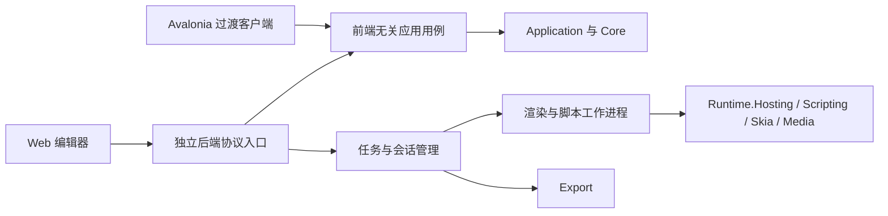

# 独立后端与 Web 前端可行性调研

日期：2026-10-11。源码基线：`f7940d4956a71bc989c0ca60ccff70eecdcb8efe`，产品版本 `0.49.14`，分支 `codex/ui-interaction-redesign-0496`。

本文归档本轮源码调研，并补充用户随后提出的方向评估：暂时保留 Avalonia 前端代码，先拆独立后端；未来前端完全使用 Web 技术，跨平台桌面客户端按需采用 Tauri。本文是调研与建议，不是已经实施的重构或完整施工计划。源码与行为事实以所列基线为准，后续变化须重新核对。

后续已整理[独立后端拆分方案](../plans/backend-extraction-plan.md)与[前后端 API v1 草案](../plans/backend-api-v1-draft.md)。用户明确采用“Avalonia 继续可用，逐步改用共享后端用例；首期不要求全部走 HTTP”的过渡方式；这两份文档仍是设计提案，不表示后端拆分已经实施。

## 1. 结论与证据边界

**独立后端可行性高，Web 前端可行；替换 Avalonia 不会自动消除当前性能问题。** 当前主要风险横跨 UI 更新、快照投影、场景计算和脚本状态重放，应把后端执行模型改造与客户端替换分别验收。

建议保留 C# 领域、媒体、渲染、脚本和导出实现，先建立可独立启动的本地后端。Avalonia 作为过渡期客户端和行为对照继续保留；Web 前端消费与 GUI 框架无关的协议；Tauri 将来作为薄桌面外壳启动同一个后端。远程多用户部署不是完成上述目标的前提。

本轮证据分为三类：

- **当前源码证据**：追踪工程编辑、快照生成、预览调度、效果重放、场景几何、像素传递及导出调用链，检查项目依赖。
- **当前有限执行证据**：Application、Runtime.Hosting、Export 的独立构建通过；重新构建后的 Runtime.Hosting 测试 16 项通过。
- **历史性能证据**：引用 0.49.3／0.49.4 的既有采样和排队延迟记录。本轮未重新进行完整性能基准或线程采样，不能把历史数据当作 0.49.14 的新测量。

源码足以证明重复工作、串行执行和全量刷新确实存在，不能据此直接给出各项占用百分比或承诺优化倍数。此次调研及文档归档未修改产品代码、版本、格式或依赖，未操作用户已有窗口，未恢复既有暂停的全量和性能任务。

## 2. 当前组件与复用边界

| 组件 | 当前职责 | 独立后端中的去向 |
|---|---|---|
| Core | 工程、歌词、样式、场景、命令、校验、持久化 | 保留领域与现有文件语义 |
| Application | 工程会话、历史、保存协调、资源库、部分布局用例 | 保留并补足编辑与作者用例接口 |
| Timeline、Text | 时间轴计算、文字布局契约 | 保留；浏览器交互适配另行设计 |
| Media | 探测、分析、解码、波形、桌面音频播放 | 保留媒体处理；Web 播放接浏览器适配 |
| Rendering.Abstractions | 不可变快照、帧请求、裸像素、几何与会话接口 | 作为内核边界保留，不直接当网络 DTO |
| Rendering.Skia | 文字整形和 CPU 绘制 | 作为权威渲染后端保留 |
| Scripting | 编译、加载、效果执行、时间线重放 | 保留实现，增加独立工作进程边界 |
| Runtime.Hosting | 正式会话资源装配、验证和作者试样服务 | 作为无 GUI 的运行入口保留 |
| Export | 顺序渲染、编码、最终产物提交 | 接入后端任务管理 |
| TechnicalSpike.App | Avalonia 控件、视图模型、交互、组合根 | 暂时保留；分离其中真实业务流程，随后由 Web 替代 |

后端不引用 Avalonia，并已有完整项目图和编译后程序集依赖测试。[正式运行宿主合同](../../runtime-hosting-contract.md)、[后端依赖测试](../../../tests/MakoKaraGenerator.Runtime.Hosting.Tests/BackendDependencyTests.cs)、[App 项目引用](../../../samples/TechnicalSpike.App/MakoKaraGenerator.Spike.App.csproj)。

排除 `bin/obj`，按 `.cs`／`.axaml` 物理行统计，包含注释：

| 范围 | 规模 |
|---|---:|
| `src` 后端 C# | 52,340 行 |
| `samples/TechnicalSpike.App` C#＋AXAML | 28,929 行 |
| 其中 App C# | 24,634 行 |
| AXAML 文件 | 34 个 |
| `EditorViewModel*.cs` | 28 个文件，4,759 行 |
| `MainWindow*.cs` | 18 个文件，2,655 行 |

这些数字用于说明迁移规模，不代表复杂度排名或需要重写的代码量。大部分后端可以继续编译复用；AXAML 和控件交互需要重新实现。partial 文件分拆改善了导航，但没有把一个对象的职责拆成独立用例。

**现状是“渲染内核已独立，完整编辑器后端尚未成为独立服务”。** `ProjectWorkspace`、`IRenderFrameSessionFactory`、`RuntimeFrameValidator`、`VideoExporter` 是可用起点；网络命令、编辑修订、任务生命周期和前端无关的完整作者流程仍需补齐。

## 3. 预览重建慢的主要结构原因

### 3.1 新快照导致会话重建，正式效果从 0 重放

当前调用链：

```text
修改工程数据
  → EditorViewModel.UpdateProject
  → ProjectSnapshot.FromProject 生成新快照
  → PreviewFrameCoordinator 按快照引用判定输入变化
  → 释放旧渲染会话，创建新会话
  → FrameSession 从 0 推进到播放头
  → 求值、几何、粒子及视觉阶段
  → 绘制目标帧
```

证据：[工程更新](../../../samples/TechnicalSpike.App/ViewModels/EditorViewModel.State.cs)、[预览协调器](../../../samples/TechnicalSpike.App/Rendering/PreviewFrameCoordinator.cs)、[正式会话工厂](../../../src/MakoKaraGenerator.Runtime.Hosting/ProjectRenderSessionFactory.cs)、[FrameSession](../../../src/MakoKaraGenerator.Scripting/Execution/FrameSession.cs)。

正式效果使用固定 120 Hz 语义网格，并插入精确事件边界。新会话从 0 定位到 180 秒，需要经过约 21,600 个网格区间，另有事件边界成本。这是推进和求值数量的理论量级，不是输出位图数量，也不是实测耗时。[网格定义](../../../src/MakoKaraGenerator.Scripting/Execution/TimelineFrameSourceFactory.cs)。

时间回退、输出目标／模式变化和被取消后不再可信的状态也会触发重建。正式 `CompiledProjectEffects.CreateFactory` 返回 `TimelineFrameSourceFactory`，没有自动依据“效果实际无状态”切换纯帧路径；无启用效果／源材质的静态路径不承担这一重放链。[正式效果工厂](../../../src/MakoKaraGenerator.Scripting/Compilation/CompiledProjectEffects.cs)。

这是“越靠后修改或回退，等待可能越长”的直接结构解释，换 Web 不会消除它。它同时是既有取舍：[脚本实施合同 §4.3](../plans/scripting-system-implementation-contract.md)明确从 0 重放，首版不做任意脚本对象检查点。

建议分别研究无状态效果直接求值、静态投影缓存、资源与运行状态身份分离、受约束的可恢复状态。任意 C# 对象不能可靠地自动复制；检查点可能需要 SDK 合同变化。不能通过跳过历史、删除锁或降低语义网格来假装完成等价优化。

### 3.2 歌词引用变化触发整份行模型重建

`AdoptProject` 发现 `Lyrics` 引用变化后调用 `Reload`。`Reload` 重建时间轴块，清空 `Lines`，重新创建当前分支全部 `LyricRowViewModel`，恢复选择并更新校验。修改内容或时间也会产生新歌词引用，判断没有区分局部字段变化与结构变化。

证据：[AdoptProject](../../../samples/TechnicalSpike.App/ViewModels/EditorViewModel.Commands.cs)、[Reload](../../../samples/TechnicalSpike.App/ViewModels/EditorViewModel.State.cs)。

不可变模型本身值得保留。问题是将引用变化转成全量视图失效。应按稳定 ID 更新行，并分别处理内容、时间、结构、样式变化；Web 实现同样需要这种粒度和列表虚拟化。

### 3.3 静态场景定义与几何工作位于逐帧路径

`LyricSceneSampler.SampleFrame` 每次调用 `SceneDefinitionBuilder.Build`。后者遍历节点、全部分支、歌词行和注音建立与时间无关的定义。`GetSceneFrame` 随后安排布局、测量几何、元素与组墨迹。`MeasureFrameElements` 在遍历定义时反复筛选行和标记、遍历父链，成本随场景规模增长。

证据：[场景采样](../../../src/MakoKaraGenerator.Rendering.Abstractions/LyricSceneSampler.cs)、[场景定义](../../../src/MakoKaraGenerator.Rendering.Abstractions/SceneDefinition.cs)、[几何构建](../../../src/MakoKaraGenerator.Rendering.Skia/SkiaRenderPipeline.Geometry.cs)、[元素测量](../../../src/MakoKaraGenerator.Rendering.Skia/SkiaRenderPipeline.SceneFrame.cs)。

已有文字整形缓存，但不等于完整场景定义和派生几何已缓存。`FrameEffectHost.Evaluate` 会请求场景几何，这项成本还进入 120 Hz 重放。[效果求值](../../../src/MakoKaraGenerator.Scripting/Execution/FrameEffectHost.cs)。

应按有效渲染修订建立静态定义、父子／行／绑定索引，分开静态布局与动态变换，并建立完整失效规则。几何查询也要消费这些结果，避免检查器查询再走整份场景计算。

### 3.4 快照生成不再只是几个引用赋值

`ProjectSnapshot.FromProject` 投影效果并计算指纹；指纹生成再次投影效果，收集完整源材质目录，特定条件下编码预设应用 JSON。源材质扫描遍历分支、行、元素和节点，即使最终没有包材质也需要完成遍历。

证据：[ProjectSnapshot](../../../src/MakoKaraGenerator.Rendering.Abstractions/ProjectSnapshot.cs)、[指纹](../../../src/MakoKaraGenerator.Core/Effects/ProjectEffectInputs.cs)、[源材质目录](../../../src/MakoKaraGenerator.Core/Projects/SourceMaterialCatalog.cs)、[效果投影](../../../src/MakoKaraGenerator.Core/Projects/PresetApplicationsProjection.cs)。

这些工作位于编辑更新链上；快照注释中“几个引用”的成本假设已经过时。应复用不变子树的投影／指纹，明确哪些输入使渲染修订改变，避免重复全量投影。

### 3.5 组合根中的帧缓存未覆盖主异步预览

App 配置了 `CachedRenderPipeline`，主画布同时配置 `SessionFactory`。`KaraokeCanvas.Render` 优先进入异步会话分支；会话内部创建的 Skia 管线未经过这个外部缓存。

证据：[App 组合根](../../../samples/TechnicalSpike.App/App.axaml.cs)、[主窗口装配](../../../samples/TechnicalSpike.App/Views/MainWindow.axaml.cs)、[画布分支](../../../samples/TechnicalSpike.App/Controls/KaraokeCanvas.cs)、[帧缓存](../../../src/MakoKaraGenerator.Rendering.Abstractions/CachedRenderPipeline.cs)。

因此不能凭缓存类存在就认定正式预览已有缓存收益。连续播放也不一定命中相同帧；简单接入 LRU 无法解决重放和几何成本，且必须保留准备帧、诊断和修订语义。

### 3.6 帧传递有完整复制和 UI 位图分配

后台执行 `frame.PixelMemory.ToArray()`；UI 线程为每个接受的像素结果创建新 `WriteableBitmap`，复制像素并释放旧位图。

证据：[后台帧复制](../../../samples/TechnicalSpike.App/Rendering/PreviewFrameCoordinator.cs)、[UI 位图更新](../../../samples/TechnicalSpike.App/Controls/KaraokeCanvas.Async.cs)。

完整 1920×1080 BGRA 一帧约 8.29 MB；若每秒接受 60 帧，两次复制的数据量接近 1 GB/s，尚不包括绘制和显示上传。实际画布会缩小目标尺寸，这只是量级示例。可评估复用位图、有界缓冲和明确所有权，再研究更直接的纹理呈现。

## 4. 单核表现与并行边界

`ProjectRenderSession` 以 `SemaphoreSlim(1,1)` 保护一次准备与绘制；`Task.Run` 只是将整个工作移到线程池，没有分解一帧内部的任务。Skia 后端明确为 CPU 光栅。单会话在昂贵阶段主要占用一个核心与这条结构一致，具体 CPU 分布仍需新采样定量确认。

证据：[会话串行门禁](../../../src/MakoKaraGenerator.Runtime.Hosting/ProjectRenderSession.cs)、[Skia 管线](../../../src/MakoKaraGenerator.Rendering.Skia/SkiaRenderPipeline.cs)。

两项限定很重要：

- **正常播放时间变化不会每 16 ms 取消当前帧。** `SameInput` 不包含时间；时间变化覆盖待处理请求，快照／尺寸等输入变化才取消。协调器已有最新请求槽，不是无限积压渲染请求。
- **整个程序不是完全没有并行。** 导出按顺序等待每帧渲染，但编码器有容量为 2 的有界队列，允许渲染和编码重叠。[导出循环](../../../src/MakoKaraGenerator.Export/VideoExporter.cs)、[编码队列](../../../src/MakoKaraGenerator.Export/FfmpegMediaEncoder.cs)。

另外，`ScriptCompiler` 使用进程级静态编译门禁，Roslyn `concurrentBuild` 为 false。这是并发编译的吞吐限制，不等于每次预览都重新编译；当前有内容地址产物缓存。[编译器](../../../src/MakoKaraGenerator.Scripting/Compilation/ScriptCompiler.cs)。

多核应优先用于独立任务、无顺序依赖的预计算和可安全并行的无状态部分。任意并行时间线帧会破坏状态、事件和粒子语义。减少重复工作量应先于单纯提高 CPU 占用率。

历史性能记录显示，0.49.3／0.49.4 的带窗口 Headless 输入任务排队 P99 仍约 1.3 秒，局部 `RebuildTokens` 改进未形成稳定整体改善。记录中的模板、Reload 和字体布局采样是整条序列累计墙钟采样，不能相加为 CPU 成本，也不是物理输入或当前版本帧率。[既有修复验收 §F6d／F6e](../acceptance/code-review-remediation-acceptance.md)。

## 5. 架构与代码卫生问题

| 问题 | 影响与建议 | 证据 |
|---|---|---|
| 编辑与作者用例散布在巨大 ViewModel／窗口对象 | partial 分拆没有消除共享可变状态和职责耦合；迁出真实用例，保留 UI 输入状态 | [EditorViewModel](../../../samples/TechnicalSpike.App/ViewModels/EditorViewModel.cs)、[MainWindow](../../../samples/TechnicalSpike.App/Views/MainWindow.axaml.cs) |
| App 静态服务与路径根 | 隐含进程生命周期，不利于会话配额、重启及隔离测试；组合根应创建显式依赖和服务作用域 | [App](../../../samples/TechnicalSpike.App/App.axaml.cs) |
| 命令接受进程内委托 | `Func<Project, Project>` 不能直接成为网络协议；传输显式命令 DTO，服务内部复用现有命令 | [ProjectCommand](../../../src/MakoKaraGenerator.Core/Commands/ProjectCommand.cs) |
| 快照与会话使用引用身份 | 进程内合理，跨进程需工程修订、渲染修订、请求序号和幂等规则 | [ProjectWorkspace](../../../src/MakoKaraGenerator.Application/ProjectWorkspace.cs)、[ProjectRenderSession](../../../src/MakoKaraGenerator.Runtime.Hosting/ProjectRenderSession.cs) |
| 刷新职责重复 | `UpdateProject → RefreshPlacementState → RefreshSceneEditor` 后又直接刷新 SceneEditor；后者可重建草稿快照并发通知 | [State](../../../samples/TechnicalSpike.App/ViewModels/EditorViewModel.State.cs)、[Placement](../../../samples/TechnicalSpike.App/ViewModels/EditorViewModel.Placement.cs)、[SceneEditing](../../../samples/TechnicalSpike.App/ViewModels/EditorViewModel.SceneEditing.cs) |
| 异步生命周期分散 | 部分非事件式 `async void`、不等待的释放任务难以统一追踪；不把合法事件处理器一概判为错误 | [设置预览](../../../samples/TechnicalSpike.App/Views/ProjectSettingsView.Preview.cs)、[画布释放](../../../samples/TechnicalSpike.App/Controls/KaraokeCanvas.Async.cs) |
| 锁内调用外部事件 | `Publish` 在锁内触发 `Updated`，增加外部订阅者阻塞和重入耦合；宜锁内捕获、锁外通知并保持代次检查 | [PreviewFrameCoordinator](../../../samples/TechnicalSpike.App/Rendering/PreviewFrameCoordinator.cs) |
| 产品版本与工程兼容性严格绑定 | 保存版本不等于当前版本即拒绝加载；独立前后端升级需要重新评估兼容政策 | [ProjectStore.CheckApplicationVersion](../../../src/MakoKaraGenerator.Core/Persistence/ProjectStore.cs) |

版本打开政策是已批准的产品语义，不属于可擅自修复的 bug。未来要区分协议版本、文件 schema、渲染／脚本合同与产品版本，再决定兼容范围。

### 脚本进程隔离是健壮性边界

当前脚本通过可回收 `AssemblyLoadContext` 在宿主内加载。它有加载／卸载边界，没有强制终止不配合脚本的能力；无限循环、异常原生行为或进程级故障可能拖垮宿主。SDK 写入预算也不是任意 C# 计算时间的硬限制。[ScriptModule](../../../src/MakoKaraGenerator.Scripting/Loading/ScriptModule.cs)。

微软明确说明 `AssemblyLoadContext` 不提供安全隔离，代码具有进程权限。[官方说明](https://learn.microsoft.com/en-us/dotnet/api/system.runtime.loader.assemblyloadcontext?view=net-10.0)。

本地后端建议将脚本／渲染工作置于可终止、可重启的子进程；若接收远程用户上传的脚本，还需要操作系统层面的资源与访问限制。不能把加载上下文、Tauri API 权限或一个取消令牌当成脚本沙箱。

仓库已有不可变模型、事务保存、固定资源闭包、取消门禁、后端依赖测试和独立宿主。这些应保留。主要问题集中在失效粒度、执行成本和生命周期边界，没有依据推倒整个后端重写。

## 6. 独立后端的目标边界

建议先建立单个本地服务，按需要管理渲染／脚本工作进程，避免第一阶段引入多套微服务。



上图中的 Avalonia 过渡适配既可先调用进程内用例，也可随后接同一协议。保留现有前端不要求第一阶段就把所有控件改成远程调用；但独立后端必须能够不启动 App 完成真实工作。

需补齐：

1. **工程会话服务**：串行执行一个工程的编辑命令，复用历史、事务保存和恢复。`ProjectWorkspace.Generation` 只在换工程等动作时增长，不能直接充当每次编辑修订。
2. **命令／查询 DTO**：携带预期修订、目标稳定 ID、输入和请求 ID；定义迟到、重复、冲突、取消及重试结果。不能把整个领域对象图和任意本机路径无约束暴露出去。
3. **运行任务管理**：管理会话数量、内存预算、优先级、取消、缓存、诊断和关闭；预览、验证、导出分别持有运行资源。
4. **脚本工作进程**：明确启动、健康状态、超时终止、失败恢复和子进程回收，保留旧导出产物保护语义。
5. **媒体与库服务**：先复用本地目录、固定资源和事务存储；浏览器消费资源 ID，远程存储以后另做适配。
6. **观测**：分别记录快照投影、建会话、重放步数、几何、绘制、帧传输、UI 呈现、取消等待和缓存命中。

Web 前端拥有选择、焦点、输入法预编辑、未提交文本和拖动反馈；后端拥有已提交工程、领域校验和持久历史。作者非法草稿和撤销的具体归属应形成用例合同，不能在迁移时丢失。每次鼠标移动和按键都同步等待后端会降低响应性。

## 7. Web 迁移路线与成本

| 路线 | 可行性与额外工作 | 判断 |
|---|---|---|
| 本地 .NET 后端＋浏览器／WebView | 协议、进程管理、前端重写、预览传输 | 当前首选 |
| 远程后端＋浏览器 | 再增加上传、租户隔离、存储、配额、部署和网络延迟 | 有明确远程需求后推进 |
| 所有内核在浏览器执行 | 原生媒体、字体、Skia、脚本加载与状态模型均需重新验证或替换 | 不作为首阶段目标 |

Web 技术可减少 Avalonia 模板、绑定和平台控件的维护，但会增加协议、类型同步、打包与通信工作。收益依赖于业务用例真正脱离 UI，而不是将当前刷新逻辑翻译成 DOM 全量重建。

| 功能 | 迁移难度 |
|---|---|
| 首页、设置、资源列表、普通表单 | 较低 |
| 歌词、时间组提交、非法草稿、撤销 | 中等 |
| 波形、时间轴、拖动、快捷键、音画同步 | 中高 |
| 场景选择、变换、命中测试、预设应用 | 高 |
| 工坊、动态参数、源码和正式验证闭环 | 高 |
| 高帧率预览及与导出的语义一致性 | 高 |

时间轴与歌词列表需要虚拟化，波形和大量图形宜有专门绘制层。C# 时间／种子等精确整数跨 JSON 时需明确编码，特别是 UInt64 不能无条件转换为 JavaScript Number。

### 预览和文件能力

1080p BGRA 在 30 fps 下裸数据约 249 MB/s，接近 2 Gbit/s；不能把裸帧网络传输当作默认方案。本地通信也有复制成本。初期可保留后端权威渲染，以受控分辨率、压缩帧和有界队列传输，附修订与时间戳；预览丢旧帧，导出保留全部帧。音频播放和编辑反馈不应逐帧等待远程往返。

标准 WebSocket 不自动提供背压，因此仍需应用层限流、合并和旧帧丢弃。[MDN WebSocket](https://developer.mozilla.org/en-US/docs/Web/API/WebSockets_API)。

浏览器目录访问存在兼容性和用户许可边界，不能直接照搬桌面绝对路径模型。本地后端可以代管项目目录，普通浏览器使用明确的文件选择／导入导出流程。[MDN 目录选择](https://developer.mozilla.org/en-US/docs/Web/API/Window/showDirectoryPicker)。

### 工作量量级

以下是调研估计，不是承诺；单位为有效人周，累计口径。假设熟悉本仓库、保留当前高级功能、不同时更换渲染引擎。重点不确定性为作者交互、跨平台验证和状态恢复。

| 交付目标 | 累计估计 |
|---|---:|
| 无 GUI 的加载、渲染、导出验证入口 | 1–2 人周 |
| 可维护的本地后端：命令、会话、任务、基本进程隔离与观测 | 6–10 人周 |
| Web MVP：工程、歌词、打轴、音频、预览、导出 | 12–20 人周 |
| 覆盖画面编排、工坊、脚本作者流程的完整替换 | 24–44 人周 |

完整状态检查点／重放优化可能另需 4–10 人周或更多；远程多用户及 Tauri 的完整分平台发布也需单独细化。单人完整替换大致是半年到一年量级，第一轮可运行切片后必须重估，不能按 AXAML 文件数直接推导排期。

## 8. 用户提出的两条需求评估（2026-10-11）

### 8.1 暂时保留 Avalonia，先拆独立后端：合理，建议采用

用户表达的是开发方向，本轮授权为报告归档与合理性评估，并未开始实施拆分。

保留当前代码能继续使用既有功能、验证文件与渲染行为，并让后端逐步迁出 App 中的用例。建议保留一套共享内核和业务真值，避免复制出一个随后独立演化的“Web 专用后端”。前端修复与新后端适配按实际需要进行，不以永久双前端维护作为目标。

“独立”的验收应包含：

- 后端单独启动、停止与发布，不引用 Avalonia、App 或 Tauri。
- 命令行或协议客户端能完成打开／编辑／撤销／保存，以及真实预览／验证／导出。
- 所有运行目录、媒体依赖和脚本参考集由后端组合根显式配置，不读取 App 静态状态。
- 取消、失败、关闭和重新打开可验证；不只证明某个 DLL 能单独编译。
- 现有文件语义、固定资源、历史和正式像素规则持续复用。

先把“功能可脱离 UI 运行”做成可测试边界，再改性能模型，可以缩小故障定位范围。两者可按小切片交替推进，不必等完整 Web 界面出现才验证后端。

### 8.2 前端完全使用 Web，桌面按需使用 Tauri：合理，须保持外壳可替换

这里将“完全 Web”理解为编辑界面采用 HTML／CSS／JavaScript 等 Web 技术，能在普通浏览器中连接独立后端运行；并不意味着将 C# 渲染、媒体和脚本内核迁入浏览器。

Tauri 支持打包和启动其他语言实现的外部程序（sidecar），因此能够承载现有 .NET 后端的发布产物，无需为了外壳重写为 Rust；每个 OS／CPU 目标仍需准备匹配的二进制。[Tauri 外部程序文档](https://v2.tauri.app/develop/sidecar/)。

建议职责：

| 部分 | 拥有的职责 |
|---|---|
| Web 编辑器 | 全部编辑界面、交互草稿、时间轴、播放与后端客户端 |
| .NET 后端 | 工程、作者用例、领域历史、资源、正式渲染、脚本、导出 |
| Tauri／少量 Rust 适配 | 窗口、后端启动与回收、文件对话框、系统集成、安装和更新 |

Tauri 的 Core 进程与本项目 Core 程序集不是同一层。不要把领域状态同时维护在 Rust 和 .NET 中，也不要让通用 Web 组件直接散落调用 Tauri 专用 API。文件选择、系统菜单等能力集中到适配接口，普通浏览器和 Tauri 各有实现；编辑命令继续走同一后端合同。

独立后端初期可评估 HTTP＋WebSocket／SSE；是否由 Tauri 转发部分控制调用是后续实现选择。原始高频像素不应无条件经过多层 JSON／Base64 桥接，需单独测量数据通路。

Tauri 使用平台 WebView：Windows 的 WebView2、macOS 的 WKWebView、Linux 的 WebKitGTK，不能用单一 Chromium 验证推定全部平台相同。[Tauri 进程模型](https://v2.tauri.app/concept/process-model/)。本项目尤其需要验证中文 IME、键盘、拖放、音频、Canvas、HiDPI 和 Linux 图形环境。

仍需计入桌面交付的工作有：.NET 运行时的分发方式、Skia／HarfBuzz、FFmpeg、字体、脚本参考程序集、安装资源路径、签名和更新。sidecar 的存在不保证这些资源自动齐全，也不保证应用整体安装包很小。动态编译／加载和 native 依赖需验证后再决定裁剪、单文件或其他发布优化。

本地服务应有明确的实例发现、协议握手、访问令牌、来源校验和退出回收；仅绑定 loopback 不能替代完整的访问控制。Tauri 的 capabilities 用来约束暴露给 WebView 的原生能力，不会自动限制 .NET 工作进程中的任意脚本。[Tauri capabilities](https://v2.tauri.app/security/capabilities/)。

建议将跨平台客户端的首期范围理解为 Windows／Linux／macOS 桌面；移动端若以后需要，须另行评估本地 .NET、媒体和脚本运行能力，不由桌面 sidecar 方案自动推定可用。

**因此，两条需求兼容且顺序合理：独立后端先行，Web 是唯一长期界面实现，Tauri 是可选桌面宿主。** 首期不必同时承担云服务、完整 Tauri 打包、前端重写和脚本 SDK 重设计。

## 9. 建议的下一阶段与出口

这些是后续计划的建议输入，不是本轮已实施内容：

1. **后端垂直切片**：一个固定工程，通过无 GUI 入口完成加载、编辑、撤销、保存、同帧渲染和短片导出。
2. **明确身份与任务协议**：工程／渲染修订、稳定目标、请求序号、取消、重试和诊断；不泄漏 GUI 对象或进程内引用身份。
3. **性能归因**：对无效果、无状态与有状态效果，分别测量 10／60／180 秒冷定位、顺序播放和回退；测量局部编辑后的快照投影、重放和 UI 更新。
4. **低风险优化**：按稳定 ID 更新行；缓存静态场景与索引；减少重复快照投影；保留现有正式语义。
5. **状态恢复设计**：基于实测决定纯帧分流和检查点是否需要 SDK 调整，不能让预览与导出走不同语义。
6. **最小 Web 客户端**：一行编辑、试听、真实预览和导出，验证协议与帧传输成本；之后迁移歌词／打轴，再迁移画面和作者流程。
7. **按需增加 Tauri**：复用同一 Web 构建产物与后端协议，以桌面生命周期、打包和分平台验证为独立出口。

后端独立的证明应来自真实进程和无 GUI 消费者；性能改善应来自同工程、同执行环境下的分阶段测量；完整 Web 替换应来自功能保留和连续制作路线验收。三者不能互相代替。

## 10. 本轮执行记录与复查入口

源码调研阶段执行并通过：

```bash
dotnet build src/MakoKaraGenerator.Application/MakoKaraGenerator.Application.csproj --no-restore -m:1
dotnet build src/MakoKaraGenerator.Runtime.Hosting/MakoKaraGenerator.Runtime.Hosting.csproj --no-restore -m:1
dotnet build src/MakoKaraGenerator.Export/MakoKaraGenerator.Export.csproj --no-restore -m:1
dotnet test tests/MakoKaraGenerator.Runtime.Hosting.Tests/MakoKaraGenerator.Runtime.Hosting.Tests.csproj --no-restore -m:1 --verbosity minimal
```

最终三个独立构建均零警告、零错误；宿主测试 16 通过、0 失败、0 跳过，已等待进程退出。初次并行构建共享依赖时出现 PDB 文件争用和临时复制警告，随后串行复核通过；初次争用不作为产品编译失败或性能证据。

这些检查支持后端依赖边界和有限运行能力，不等于全量、完整导出性能、Web／Tauri 或跨平台验收。文档归档阶段仅检查链接、事实一致性和差异，不重复运行产品测试。产品保持 0.49.14，工作区原有 `screenshots/` 未纳入本次改动。
