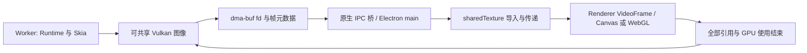

# Electron 连续预览与低拷贝调研计划

日期：2026-10-29。状态：**源码调研及候选计划，尚未实施或运行验收**。

用户确认目标：**Linux 优先，后续 Windows；先稳定 1280×720 / 30fps**。本次只新增计划文档和目录入口，不修改程序、版本、合同或前端，不构建、不启动应用、不做性能测试。两名调查子代理分别只读核对前后端，主代理复核关键路径及官方资料。

## 1. 结论与调研基线

成片预览首先受到前端主动限速：每 500ms 最多请求一帧，理论上限约 2fps。即使传输与渲染耗时归零，这条路径仍达不到连续播放。后端还存在 GPU 最终读回、Worker JSON/Base64、整帧复制、PNG 编码与浏览器图片消费链路，确有降低开销的空间；本次没有测出各部分的实际占比。

不能只将 500ms 改为 33ms：逐帧请求占用同客户端的幂等回执，默认 60 秒有效期和 1024 项上限，在持续 30 次/秒下约 34 秒就可能达到配额。需要把持续播放从逐帧可靠修改请求中分离。

推荐路线：先建立当前版本端到端基线，改造持续播放调度与控制协议，再以 Linux 原生共享纹理试验决定桌面传输方案。优先追求**最终画面不经过 CPU 读回及 PNG 编解码**，不提前承诺 GPU 内部绝无复制、所有效果无读回或任意工程均能 30fps。

| 项目 | 本次读取状态 |
|---|---|
| 后端 | `chore/repository-hygiene-20261029`，源码 `ab582b27aefa724481d6cc93eb060dd8aede19fe` |
| 产品与合同 | `Directory.Build.props` 为 0.107.4，HTTP 合同 1.39.0 |
| 前端 | `/mnt/Data/Program/MakoKaraGenerator-Web`，`main`，`d99c517db84b734444afc9f9a3e9ef2e3bb47978`，调研开始时干净 |
| 前端交接记录 | 配套后端记录为 0.107.0 / `4e70334`，合同 1.39.0；不能据此推定用户正在运行的 Server/Worker |
| 原有未跟踪内容 | 后端 `tools/backend-project-image-export-probe/`，保留未触碰 |
| Electron | 前端 `package.json` 尚无 Electron 依赖，桌面桥接仍需新增 |

下文源码行号对应上述基线；后续实施必须重新核对部署 SHA、发布产物、GPU 驱动、显示环境和 Electron 固定版本。

## 2. 已确认的前端限制

前端文件相对于 `/mnt/Data/Program/MakoKaraGenerator-Web`。

| 事实 | 源码位置 | 对计划的影响 |
|---|---|---|
| 成片播放请求间隔 500ms；播放头/修订检查间隔 250ms | `src/editor/preview/PreviewPanel.tsx:19,71` | 播放最多约 2fps；暂停与定位也可能多等一个检查周期 |
| 每帧依次请求、等状态、取 PNG、发布 Blob URL；只留一个最新待处理目标 | `src/editor/preview/preview-controller.ts:75,98,193` | 当前端到端流程串行；需要有界流水线，不能堆积无限帧 |
| 即使等待中已有新目标，旧目标帧也先显示，再处理最新目标 | `src/editor/preview/preview-controller.ts:210` | 换修订/seek 时需更强的当前身份门禁；顺播不能简单丢弃所有非最新请求结果而导致饥饿 |
| SSE 到达后仍 GET 权威状态，另每 500ms 兜底轮询；查询中触发被忽略 | `src/client/mako-client.ts:1458` | 存在额外往返及事件/查询竞态的等待窗口；不能把 500ms 轮询误认为每帧必然等待 500ms |
| 成片按画布比例固定缩至最多 1280×720，未按面板大小选择 | `src/editor/preview/preview-controller.ts:38` | 后续可结合实际显示尺寸、runtime limits、DPR 与稳定档位选择输出 |
| 当前成片通过 `` 消费 PNG | `src/editor/preview/PreviewPanel.tsx:125` | 源码不能确定浏览器实际解码/合成耗时或内部复制次数 |
| 成片直接 `fetchBinary`，没有调用额外算 SHA 的 `fetchFrame` | `src/editor/preview/preview-controller.ts:210`；`src/client/mako-client.ts:1523` | 不能将模板工坊的客户端哈希成本错误归入成片路径 |
| 工坊是另一条 640×360、最小间隔 40ms 的串行预览路径 | `src/editor/library/template-workshop.ts:32,291` | 不把成片 2fps 结论推广到全部预览；未来共享调度基础设施，分别验收 |
| 音频是成片时钟；无音频时预览时刻固定为 0 | `src/editor/preview/PreviewPanel.tsx:12`；`src/editor/audio/audio-controller.ts:131` | 无音频连续播放需有独立单调时钟；有音频时保持音频主时钟 |

前端已有 generation/sourceRevision/requestSeq 门禁、换输入、设备切换、关闭及 Blob URL 回收。新方案复用这些语义；音频继续播放时，新预览调度不应等待后端完成每一帧才推进播放头。

## 3. 后端当前数据路径与配额


以上是实际逻辑边界，不是测量出的时间占比，也不表示每个箭头都恰好发生一次内存复制。

| 路径 | 源码证据 |
|---|---|
| 最终输出租用 CPU buffer，绘制完后读回，即使选择 Vulkan 也返回预乘 BGRA | `src/MakoKaraGenerator.Rendering.Skia/SkiaRenderPipeline.cs:140,187` |
| Vulkan flush 后 `Submit(true)`；当前创建普通 Skia surface，没有外部可共享内存分配流程 | `src/MakoKaraGenerator.Rendering.Skia/SkiaRenderBackend.cs:161,292,299` |
| Worker 复用 Runtime session；每帧 `PixelMemory.ToArray()`，校验诊断、计算像素 SHA | `src/MakoKaraGenerator.Backend.Worker/PackageRenderSession.cs:71` |
| `byte[]` payload 经 JSON 序列化为 Base64，外层长度前缀并分配完整正文 | `src/MakoKaraGenerator.Backend.Contracts/WorkerProtocol.cs:97` |
| 协调器再次复制整帧并释放原帧 | `src/MakoKaraGenerator.Backend.Hosting/BackendPreviewCoordinator.cs:40` |
| 编码器实例锁、`Marshal.Copy`、PNG 编码与数组输出 | `src/MakoKaraGenerator.Backend.Rendering.Skia/SkiaBackendPreviewPngEncoder.cs:43` |
| 编码与发布在协调器更新回调中；该预览等待回调完成后处理下一帧 | `src/MakoKaraGenerator.Backend.Hosting/BackendPreviewCoordinator.cs:242`；`BackendPreviewSessionRegistry.cs:459`（同目录） |
| PNG 存储核结构、大小、SHA，复制并持有租约 | `src/MakoKaraGenerator.Backend.Hosting/PreviewFrameHandleStore.cs:104` |

720p BGRA 每帧为 `1280 × 720 × 4 = 3,686,400` 字节，约 3.52MiB；30fps 单份裸像素流为 110.6MB/s，Base64 部分约 147.5MB/s，未计 JSON、额外复制和 PNG。这是字节量计算，不是实测带宽或 PCIe 流量。

当前默认输出上限为 1280×720 / 裸帧 4MiB，同会话一个在途帧加一个最新 pending，保留帧和租约有界。顺播不会每次取消在途工作；seek 换代并取消/排水。部署未指定渲染后端时默认 CPU，GPU 明确指 Vulkan；选了 GPU 不得因新传输失败偷偷回落 CPU。配置入口为 `src/MakoKaraGenerator.Backend.Server/Program.cs:103` 与 `src/MakoKaraGenerator.Backend.Hosting/BackendRenderBackendConfiguration.cs:17`。

### 3.1 30fps 的请求回执问题

- 前端 `src/client/mako-client.ts:1390` 每帧生成新回执；`src/client/clock.ts:57` 默认有效窗口 60 秒。
- `src/MakoKaraGenerator.Backend.Server/PreviewBackendService.cs:271` 将帧请求送入客户端共享回执表。
- `src/MakoKaraGenerator.Backend.Hosting/ClientRequestReceiptStore.cs:73` 只清理已完成且到期的回执；`202` 或帧完成不提前释放有效回执。
- `src/MakoKaraGenerator.Backend.Hosting/ProjectCommandRetentionOptions.cs:4` 默认 1024 项，其他修改操作也共用客户端配额。

空表、无其他操作、稳定 30 次/秒时，首次到期前需要约 1800 项；第 1025 次请求约在 34.1 秒遇到 `requestQuotaExceeded` / 429。实际时刻取决于 deadline、速率与已有占用。合并 pending 不能消除已经接受的 HTTP 回执。

短期可单独评估更短帧回执窗口，但不能提前驱逐有效回执、修改重试载荷或依靠无限增大容量实现连续播放。新流式路径应另有有界去重与重同步语义。

### 3.2 即使传输免费，重效果也可能不实时

`src/MakoKaraGenerator.Scripting/Execution/FrameSession.cs:19` 保持时间线历史，按语义网格与事件推进；后退、输出变化或失败会重置。它不是任意 `RenderAt(t)` 都恒定成本的无状态函数。目标输出尺寸的频繁变化也可能触发回放，因此自适应分辨率需要迟滞、冷却和明确代次切换。

内部图像图与材质仍有读回、预乘校验、alpha 扫描及同步：见 `src/MakoKaraGenerator.Rendering.Skia/Effects/CompiledImageGraph.Drawing.cs:92`、`SkiaRenderPipeline.ImageScene.cs:220`、`SkiaRenderBackend.cs:340`（后两项同渲染项目目录）。共享最终纹理不能自动移除这些成本，更不能直接取消会影响错误/诊断语义的检查。

已归档的 **2026-10-28、1920×1080、源码 `5802ac1`、固定 Linux/Vulkan 短批次**中，新实现 frame wall 中位值为 lyrics 2.605ms、graph 34.892ms、material 285.524ms、combined 338.909ms，见 [原始比较](performance/20261028-structural-optimization/compact-performance-comparison.json)和[范围说明](performance/20261028-structural-optimization/README.md)。这些是历史 Runtime 证据，**不是当前 0.107.4 的 720p、HTTP、Electron 或用户工程性能**。它们只支持将重效果优化列为独立工作，不能用面积比例推算 720p 已达标。

## 4. Electron 低拷贝方向及官方证据

本次直接读取 Electron 官方 API 文档及其指向的 `v45.1.0` tag 源码，见 §8。该版本是本次外部研究依据，尚未成为项目依赖；实施前选定并锁定受支持版本及 Chromium 版本。

官方 `sharedTexture.importSharedTexture` 可导入平台原生共享图像，`sendSharedTexture` 可交给 renderer，`getVideoFrame()` 生成使用该共享图像的 `VideoFrame`。这些 API 标记为 experimental。Linux 描述含 `nativePixmap`、planes 的 fd/stride/offset/size 与 modifier；Windows 为进程本地 NT HANDLE。资源必须保留至全部引用释放及 GPU 使用完成，不能在发送完成时立即覆盖。

特别区分：`offscreen.useSharedTexture` 是将 **Electron 页面输出给外部程序**；此项目主要需要反方向，即把 **后端帧导入 Electron**。开启 offscreen 不是解决现有链路的开关。

### 4.1 Linux 首选候选



设计要点：

1. 需要新增导出型图像分配、格式/modifier 能力协商及 Skia 包装。现有普通 `SKSurface` 的内部 `VkImage` 不能视为天然可导出的 dma-buf。若直接绘入共享图像不成立，可先验证一次 GPU 到 GPU 拷贝到导出图像，仍避免最终 CPU 往返，但明确不是“零次 GPU 拷贝”。
2. 使用原生本地 IPC 将真实 fd 传入 Electron main，例如 Unix domain socket 的 `SCM_RIGHTS`；不能把另一个进程中的 fd 数字当作有效句柄通过普通 JSON/HTTP 传递。桥可由 .NET/native helper 与 Node native addon 组成，最终位置由 P2 试验决定。
3. 校验同一 GPU、像素格式、stride、modifier、色彩空间、预乘 alpha、上下方向，以及 producer 写完成与 consumer 读完成。首轮允许保留 producer 完成等待以证明正确性，再评估 fence/semaphore 异步同步；不先删除 `Submit(true)`。
4. 采用有界纹理池，初始建议最多三槽：可写、待显示、显示中；具体状态需要原子所有权。只有释放完成的槽才能覆写；满时合并待渲染目标或丢弃未展示旧帧，不能覆写 consumer 正在读取的纹理。
5. 不能由 JS 布尔值宣称硬件支持零拷贝。所查源码虽接收 `supportsZeroCopyWebGpuImport`，但 Linux `CreateSharedImage` usage 未包含 WebGPU 位；该版本相关 spec 仅启用于 macOS ARM64。Linux 首轮验证 `VideoFrame` 的 Canvas/WebGL 消费，WebGPU 单列后续能力试验。
6. Canvas/WebGL 消费也可能产生 GPU 内部拷贝或格式转换。验收应分别记录“无最终 CPU readback”“无 PNG 编解码”“跨进程无整帧 CPU 复制”和“GPU 内部复制情况”，不将显示成功等同于全链零拷贝。

Linux 先在用户目标 GPU/驱动和当前 Wayland 或 X11 环境验证，再扩到另一显示环境。Linux dma-buf 导入存在不等于 AMD、Intel、NVIDIA、混合显卡都已兼容。

### 4.2 方案取舍

| 候选 | 预期移除的开销 | 仍需承担/验证 | 建议 |
|---|---|---|---|
| 现有 PNG + 调度改进 | 2fps 主动限制与部分等待 | 逐帧回执、PNG、CPU 往返 | 保留静帧/浏览器兼容；高频前先解决配额 |
| 二进制 IPC + 原始 BGRA | Base64 与部分分配，按路径可去 PNG | CPU readback、浏览器上传和潜在 JS 拷贝 | 共享纹理受阻时的务实中间方案 |
| 共享 CPU 内存环形缓冲 | Worker/Host 间多次复制及 Base64 | 映射生命周期、Chromium 导入/上传；SharedArrayBuffer 不等同于原生 mmap | 有条件备用，明确称低拷贝 |
| Linux dma-buf + Electron sharedTexture | 最终 CPU readback、PNG、跨进程整帧 CPU 数据传输 | 原生桥、图像分配、同步、驱动和实验 API | 桌面首选研究方向，先做可否通过的试验 |
| 硬件视频编码 + 浏览器视频解码 | 裸帧网络流量 | 编解码延迟、色度/文字边缘、alpha、seek | 远程浏览器扩展候选，本机第一阶段不优先 |

仅改 WebSocket、ArrayBuffer、SharedArrayBuffer，或把网页装进 Electron，不会自动消除 GPU→CPU→GPU。

Windows 后续复用控制/帧描述合同，另验 NT HANDLE 传递与 Vulkan/D3D 共享资源兼容，不能直接复用 Linux fd 实现。当前 Vulkan 初始化还硬编码加载 `libvulkan.so.1`（`SkiaRenderBackend.cs:193`），因此 Windows 前置工作不仅是改传输。平台失败允许明确切回 CPU 帧传输/PNG，但保持用户所选渲染设备；切换 GPU→CPU 必须沿现有显式设备选择语义。

## 5. 持续播放候选合同

本节是待实现设计，不新增或宣称已有任何公共 API；路由和 wire schema 在实施批次冻结。

**控制与帧交付分离。** 工程修改、固定输入、设备选择和生命周期继续使用可靠 HTTP 合同。新增会话级持续播放操作，例如 start/pause/seek/setClockAnchor/stop；低频可靠操作沿请求回执，频繁时钟更新使用单调控制序号和 latest 状态。不要每个目标显示帧都创建通用命令回执，也不把每帧通知塞入用于工程/任务恢复的全局 SSE 重放队列。

| 合同面 | 候选要求 |
|---|---|
| 场景 | 音频主时钟的成片播放、暂停静帧、拖动定位；无音频使用本地单调时钟 |
| 固定身份 | hostInstanceId、client owner、previewId、sourceRevision、generation、streamId/epoch；输入、设备、尺寸变化显式换代 |
| 播放控制 | anchorTimeUs、速率、目标 fps、controlSeq、可见/暂停状态；建立前端/Host 单调时钟映射，不能直接比较不同进程的时间原点 |
| 帧描述 | frameSeq、实际 timeUs、generation/revision、renderBackend、transport、size/stride/format、colorSpace/alpha/origin、slot/lease、诊断关联；Int64 保持既有 wire 精度规则 |
| 所有权 | Server 授权固定会话，Worker 只生产自身租约，Electron broker 只接收该会话；renderer 不获得任意路径或任意进程句柄权限 |
| 发布门禁 | 完整诊断和错误检查先于像素/句柄发布；失败不发布新画面。晚到旧 revision/generation 一律丢弃并归还 |
| 顺播 | 一个渲染者推进原语义时间线；至多一个待渲染最新目标，有界已完成帧；允许显示同代较早完成的帧以防饥饿，同时统计 frame age |
| 寻址与编辑 | 用户 seek 无论向前/向后均是显式意图；取消旧代并排水。新修订切换保持精确 CAS，不自动追随可变工程 |
| 去重与恢复 | 控制序号限定窗口、重复/乱序有明确结果；断连读权威状态重新开流，过期 stream 拒绝重放；不改变既有 HTTP 回执合同 |
| 预算 | 会话、纹理/CPU槽、bytes、FD、待处理通知、诊断和期限均有上限，consumer 暂停不无限积累 |
| 资源释放 | 正常 close、取消、更新、renderer/Worker/GPU 崩溃、导入失败均可排水；不能以超时为理由覆写仍被 GPU 读取的槽 |
| 历史/no-op | 预览控制不写工程历史或修订；保持现有同设备切换 no-op 与 PUT input 换代语义。新流控制的重复设置另行定义，不改变旧接口合同 |

传输能力与渲染后端分开协商，例如候选 `png-http`、`bgra-local`、`gpu-shared-linux`；这些名字只是设计标签。协商失败明确展示传输原因，保持当前 CPU/GPU 固定选择，不静默改变渲染语义。

前端建立共同的时钟/调度与帧展示接口，使成片、工坊可复用，但仍独立管理各自会话。帧像素显示不要求每帧走 React 组件状态；React 保留控件与低频状态。Electron bootstrap 可接已有 `src/client/bootstrap.ts:3` 的 provider 接缝；桌面 main/preload 管理凭证与本地桥，页面继续经过 client 层。首轮可通过受控 loopback origin 加载现有前端，避免把 `file://` 或放宽 Origin 校验当作既定条件。

## 6. 实施顺序与退出条件

后续实施时每个独立步骤一个中文 `type(scope): 摘要` 提交，并推送各自当前工作分支。跨仓库分工保持：后端实现合同与生产者，前端实现时钟、消费者和浏览器/Electron 验收。下表不构成本次编码授权。

| 阶段 | 工作内容 | 可审查交付与进入下一阶段的条件 |
|---|---|---|
| P0：当前版本基线 | 固定源码/匹配 Server+Worker/前端版本，确认实际 CPU/GPU、720p目标；分段记录请求→准备/渲染→读回→IPC→编码→读取→消费→显示可观测点 | 轻歌词、图片/视频背景、粒子、图、重材质、混合效果及用户卡顿工程的 P50/P95/P99、frame age、帧间隔、分配/GC、CPU/GPU；明确图片 load 或 rAF 不是物理屏幕显示时间 |
| P1：持续播放与前端调度 | 新增有界播放控制和帧交付协议；音频/单调时钟；立即响应 pause/seek/修订；移除 500/250ms 固定调度；解决 SSE 等待竞态及旧代显示 | 用可控生产者先证明30fps调度、无饥饿/积压、超过60秒仍不触发回执配额；现有 PNG 静帧和命令回执兼容 |
| P2：Linux 共享图像可行性 | 独立最小 Electron+原生桥，用可控色块/透明/方向/运动图案，随后接一条实际 Skia 帧；探测导出格式、dma-buf、导入显示、同步、释放 | 原生句柄能在目标环境可靠导入，画面一致，槽/FD/显存有界；先证正确，再测成本。失败记录具体驱动/格式/API障碍，决定使用低拷贝 CPU 备用路径，不无限投入 Electron fork |
| P3：接入生产 Runtime | 为渲染输出增加 GPU 帧租约接缝，复用 Runtime 与绘制/诊断逻辑；共享图像池；保持原 CPU `RenderFrame` 与导出路径；按P0证据决定是否同时改二进制Worker IPC | 轻量真实工程通过720p30；像素/诊断/随机状态/回放保持；取消、预算、Error和资源寿命负例通过 |
| P4：重效果预算 | 若实际场景渲染本身超过33.3ms，单独审计内部材质读回、图重复工作、同步与回放；分辨率档位有冷却，缓存绑定完整固定输入 | 分场景说明30fps是否成立；若需降低质量或预渲染缓存，明示预览档位，不能冒充同质量实时或改变导出结果 |
| P5：Linux完整验收与Windows后续 | 完整编辑器、音画同步、长时播放、交互/崩溃恢复；补X11/Wayland及驱动矩阵；Windows再做加载器与NT HANDLE互操作 | 按§7提供部署、性能与平台证据；只声明真正通过的矩阵 |

P2 可在 P1 合同明确后独立开展。若低拷贝 CPU 路径已满足720p30，可先交付它，再决定共享纹理投入；不把“零拷贝”当作必须先完成才能改善体验的前置。

## 7. 建议验收标准与证据边界

以下是下一轮建议门槛，除 Linux 优先和720p30外，具体阈值尚未由用户逐项确认。

- **吞吐/流畅度**：固定720p、真实有变化的代表工程，预热后连续10分钟；平均显示新帧≥29fps，迟到/丢帧合计≤1%，显示帧间隔P95≤40ms、P99≤66.7ms，无持续积压。统计实际消费帧与时间戳，不能统计请求数、重复显示或空画布充数。
- **延迟/音画同步**：轻量基准工程的可观测 frame age P95≤100ms；暂停/seek后正确新代帧P95≤150ms作为初始目标。重脚本回放、首次编译和冷启动单列，不能删掉失败样本后宣称普遍达标。
- **持续性**：至少越过60秒回执窗口，完整10分钟仍无因帧率导致的429；回执、队列、CPU/GPU内存、FD和纹理槽不随帧数线性增长；隐藏/恢复、暂停/恢复资源有界。
- **正确性**：同输入、同时间、同后端比较原CPU帧输出与共享纹理诊断读回，覆盖文字/ruby、背景、图/材质、粒子、透明、色彩空间、alpha和上下方向；额外读回仅用于正确性验收，不混入性能主样本。CPU/GPU跨后端不默认要求逐字节一致。
- **时序**：快速来回seek、边播放边编辑、换设备/尺寸/输入、连续播放丢帧仍保持120Hz语义网格和事件/随机状态；丢的是显示帧，不是必须执行的状态推进。
- **失败与生命周期**：错误诊断禁止新帧；旧代/错误owner/越界描述拒绝；断连、consumer冻结、Worker退出、GPU设备丢失、导入超时、取消和关闭无悬空引用/覆盖在用槽，重复回收安全。
- **运行合同**：新增HTTP行为时实现/定向回归/行为源/生成合同同步，matched Server+Worker发布后给fresh HTTP证据；Worker私有协议变更需能力/version协商。按语义增加程序版本，重要决定实施时登记ADR，不用本候选文档冒充已实现API。
- **性能方法**：无监控主样本与有界分段观测分开；既有telemetry并非零开销。用各进程单调耗时及关联身份，跨进程时钟须校准；显示提交、浏览器合成与物理扫描呈现是不同证据。固定机器/驱动/电源状态与干扰条件，每轮有明确时长和终止上限。

工程构建零警告、定向回归、合同生成、fresh HTTP、Electron UI、GPU复制分析与跨平台兼容分别报告。新增缺陷回归先证明旧实现或对应变异失败。运行进程只按本轮PID/startTicks收尾。未达到目标的重效果应给出实测能力与后续项，不能用简单歌词通过代替“完整工程稳定30fps”。

## 8. 外部一手资料及本次文档核验

访问日期：2026-10-29。使用官方文档和官方仓库，未使用第三方博客推断可用性。浮动文档核对后继续查看其指向的固定tag源码；摘录仅为接口名，其他内容均为本计划概述。

| 资料 | 直接核对的内容 |
|---|---|
| Electron `sharedTexture` API | import/send/receiver、experimental、全部引用释放回调 |
| Electron `SharedTextureHandle` / `SharedTextureImportTextureInfo` / `SharedTextureImported` | Linux planes/modifier、Windows NT HANDLE、颜色/尺寸/timestamp、VideoFrame/release |
| Electron offscreen rendering | 页面输出方向、共享GPU纹理与CPU bitmap区别 |
| `v45.1.0/shell/common/api/shared_texture/README.md` | 导入架构、进程本地句柄、SharedImage、GPU完成与引用释放 |
| `v45.1.0/shell/common/api/electron_api_shared_texture.cc:763` | Linux NativePixmap导入、fd duplication |
| 同文件 `:803` | Linux usage不含WebGPU位；不能仅凭结构中的支持标志判定WebGPU零拷贝 |
| `v45.1.0/spec/api-shared-texture.spec.ts:13` | 该spec只在macOS ARM64运行，不构成Linux验证 |

原始来源地址（固定tag优先用于复核）：

```text
https://www.electronjs.org/docs/latest/api/shared-texture
https://www.electronjs.org/docs/latest/api/structures/shared-texture-handle
https://www.electronjs.org/docs/latest/api/structures/shared-texture-import-texture-info
https://www.electronjs.org/docs/latest/api/structures/shared-texture-imported
https://www.electronjs.org/docs/latest/tutorial/offscreen-rendering
https://raw.githubusercontent.com/electron/electron/v45.1.0/shell/common/api/shared_texture/README.md
https://raw.githubusercontent.com/electron/electron/v45.1.0/shell/common/api/electron_api_shared_texture.cc
https://raw.githubusercontent.com/electron/electron/v45.1.0/spec/api-shared-texture.spec.ts
```

本次核验限于源码/官方资料/历史证据阅读、计划内部一致性与文档diff检查。没有执行构建、测试、HTTP、浏览器、Electron或性能验收；历史测量保持原提交归属。完成计划不表示已确定Linux端零拷贝可交付，也不表示720p30已达标。
