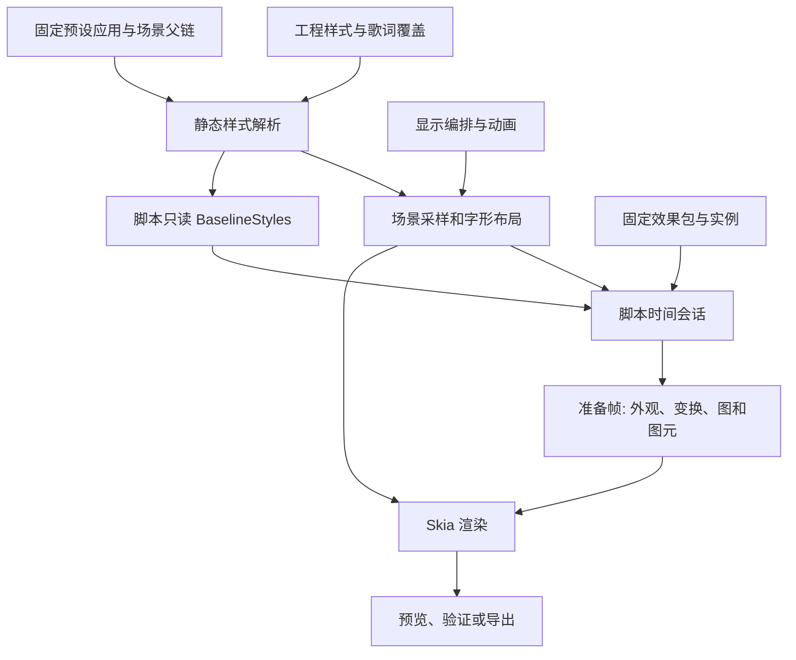

# 后端样式系统与脚本 SDK 总览

调查日期：2026-11-01。原始源码基线：App 提交 `f3fdfdf210c69dcf1af15537e855d5559ec9ce09`；辉光内容按后续工作树源码补充，该提交不包含辉光。
本组文档来自当前 `backend/` 的模型、校验、编辑命令、SDK 与实际渲染消费代码；
描述后端能力，不表示 App 前端已经为每项能力提供界面。

## 1. 阅读入口与范围

| 要解决的问题 | 文档 | 内容 |
|---|---|---|
| 用户能调哪些文字外观，默认值和范围是什么？ | [静态样式选项](static-options.md) | 字体、排版、未唱/已唱填充、渐变、包材质、描边、阴影、透明度、缩放、注音、逐字支持与继承 |
| 辉光如何继承、编辑和绘制？ | [静态辉光](glow.md) | 字段、覆盖、HTTP 和渲染语义 |
| 显示、运动、场景和可复用预设能调什么？ | [动画、场景与预设](animation-scene-presets.md) | 行与槽位动画、前奏提示、容器与场景变换、展示编排、模板、预设应用和效果实例配置 |
| C# 脚本可以读取什么、写入什么？ | [脚本 SDK](script-sdk.md) | 生命周期、上下文、查询、事件、音频、几何、全部输出 writer、材质、图、粒子、资源和限制 |
| SDK v2 当前开发接口和 M07 限制是什么？ | [SDK v2 开发参考](../../../docs/style-reference/script-sdk-v2.md) | Declare／Evaluate、能力与目标、四类源索引、退场与同源重入、作者显式采用；M07 尚待统一验收 |
| 查找某个 SDK 类型的字段、构造器或枚举值 | [SDK 类型与成员索引](script-sdk-types.md) | 上下文和数据类型完整索引、作者值与宿主接缝的区别、逐文件源码入口 |
| 客户端通过哪些请求编辑、查询或制作效果？ | [HTTP 编辑与作者入口](http-authoring.md) | 样式命令、读取解析结果、场景与预设操作、包/源码/草稿/实例工作流及修订语义 |

“全部选项”的边界是后端样式及其相邻视觉系统：包含改变文字外观、位置、显示时序、
动画、前奏提示、场景合成和脚本输出的持久字段及公开入口；不把编码器、文件管理、
播放器按钮和旧 Avalonia 编辑器界面当作样式选项。HTTP 的完整通用格式仍以
[执行合同](../../web/api-contract.md)和 [OpenAPI](../../web/openapi.json)为准。

各篇区分三种事实：

- **数据可表达**：Core 或 SDK 类型能构造/持久化该值。
- **入口可编辑**：当前 HTTP 命令或作者 writer 接受该值与目标。
- **渲染可执行**：正式会话和 Skia 消费者已经实现；仍须满足资源、绑定和预算门禁。

例如，Core 能保存包材质，但普通 `styles.patch` 不接受包材质；SDK 有组图绑定重载，
正式渲染仍拒绝组图。单看类型定义或旧文档都会把可用范围写大。
具体条件分别见[静态材质](static-options.md)和 [SDK 能力限制](script-sdk.md)。

## 2. 当前版本身份

| 身份 | 本次读取的值 | 单一来源 |
|---|---|---|
| 后端产品/程序集版本 | `0.110.0` | [Directory.Build.props](../../Directory.Build.props) |
| HTTP 合同/协议 | `1.42.0` / `1` | [contract-manifest.json](../../web/contract-manifest.json) |
| 工程 schema | `29` | [Project.cs](../../src/MakoKaraGenerator.Core/Projects/Project.cs) |
| 歌词 schema | `18` | [LyricsDocument.cs](../../src/MakoKaraGenerator.Core/Lyrics/LyricsDocument.cs) |
| 模板库 schema | `7` | [StyleTemplateLibrary.cs](../../src/MakoKaraGenerator.Core/Persistence/StyleTemplateLibrary.cs) |
| 脚本配置库 schema | `1` | [ScriptConfigurationLibrary.cs](../../src/MakoKaraGenerator.Core/Persistence/ScriptConfigurationLibrary.cs) |
| 包格式/SDK 声明 | `packageVersion: 2` / `sdkVersion: "1.0.0"` | [ProjectEffectsJson.cs](../../src/MakoKaraGenerator.Core/Effects/ProjectEffectsJson.cs) |
| Shader profile | `skia-raster-3.119.4-v1` | [ShaderProgramDefinition.cs](../../src/MakoKaraGenerator.Core/Effects/ShaderProgramDefinition.cs) |

包里的 `sdkVersion` 是严格匹配的协议声明，不是当前程序集版本，也不意味着旧 SDK
文档列举的所有目标能力均已完成。HTTP manifest 的 `sourceBaselineCommit` 是合同冻结
来源，和本次调查的 App 提交各自保留身份。

## 3. 系统结构

| 层 | 负责什么 | 主要源码 |
|---|---|---|
| Core | 不可变样式、规范材质、覆盖、预设、展示树、动画、效果包源数据及校验 | [Projects](../../src/MakoKaraGenerator.Core/Projects)、[Effects](../../src/MakoKaraGenerator.Core/Effects) |
| Application | 按目标/成员执行编辑，处理继承恢复、值校验和不可变结果 | [ProjectStyleEditUseCase.cs](../../src/MakoKaraGenerator.Application/Editing/ProjectStyleEditUseCase.cs) |
| Contracts/Hosting/Server | JSON 字段、严格命令、稳定 ID、revision、历史、作者草稿和 HTTP 返回 | [BackendStyleContracts.cs](../../src/MakoKaraGenerator.Backend.Contracts/BackendStyleContracts.cs)、[ProjectSession.StyleCommands.cs](../../src/MakoKaraGenerator.Backend.Hosting/ProjectSession.StyleCommands.cs) |
| Rendering.Abstractions | 固定快照、实际场景预设投影、SDK 静态基线及准备帧 | [ProjectSnapshot.cs](../../src/MakoKaraGenerator.Rendering.Abstractions/ProjectSnapshot.cs)、[PresetSceneStyleProjection.cs](../../src/MakoKaraGenerator.Rendering.Abstractions/PresetSceneStyleProjection.cs)、[StaticStyleProjection.cs](../../src/MakoKaraGenerator.Rendering.Abstractions/StaticStyleProjection.cs) |
| Scripting.Abstractions | 作者可用的中立 C# 类型、只读上下文和受限 writer | [SDK 源码目录](../../src/MakoKaraGenerator.Scripting.Abstractions) |
| Scripting | 固定包编译、实例加载、绑定权限、时间推进、输出组合、粒子模拟和诊断 | [FrameEffectHost.cs](../../src/MakoKaraGenerator.Scripting/Execution/FrameEffectHost.cs)、[FrameSession.cs](../../src/MakoKaraGenerator.Scripting/Execution/FrameSession.cs) |
| Runtime.Hosting/Rendering.Skia | 组装正式会话，准备 shader/图片资源，排版、材质与图执行、合成和像素输出 | [ProjectRenderSessionFactory.cs](../../src/MakoKaraGenerator.Runtime.Hosting/ProjectRenderSessionFactory.cs)、[SkiaRenderPipeline.cs](../../src/MakoKaraGenerator.Rendering.Skia/SkiaRenderPipeline.cs) |

样式编辑修改工程源数据，脚本 writer 只描述当前帧输出。预览与导出从固定快照建立
会话，不把当前脚本结果反写成用户样式。

## 4. 样式到底从哪里来

### 4.1 没有固定预设应用时

生产静态样式使用工程 `lyricStyle`，依次叠加分支、行和元素的 `StyleOverride`。
`LyricStyleResolver` 另有可选 `LyricStylePreset` 参数：传入时先用整份预设替换默认基线，
再叠加覆盖。这是 Core 解析能力，不能据此认为渲染时会去个人库动态查找某个名字。
参见 [LyricStyleResolver.cs](../../src/MakoKaraGenerator.Core/Projects/LyricStyleResolver.cs)。

### 4.2 存在固定预设应用时

`PresetStyleResolver.ResolveLyrics` 的真实顺序为：

1. 工程 `lyricStyle`。
2. 工程目标的已启用预设应用。
3. 分支样式覆盖，随后是分支预设应用。
4. 实际场景节点链，由根到直属父节点；祖先应用必须允许 `includeDescendants`。
5. 当前实际展示片段的预设应用。
6. 行覆盖，随后是行预设应用。
7. 元素覆盖，随后是元素预设应用。

每份应用只覆盖其固定快照 `properties` 选中的属性。源文字在不同槽位/容器装载时，
场景层可能不同；不能仅按 `lineId` 写死一个永远相同的最终来源。前奏文字标记从提示组
外观和自身覆盖起步，再应用工程、分支与实际节点链，详情见
[PresetStyleResolver.cs](../../src/MakoKaraGenerator.Core/Projects/PresetStyleResolver.cs)和
[PresetSceneStyleProjection.cs](../../src/MakoKaraGenerator.Rendering.Abstractions/PresetSceneStyleProjection.cs)。

### 4.3 脚本帧输出

所有实例读取的是当前静态基线，不会把前一个实例的结果当成自己的 `Baseline`。
宿主按实例顺序合成输出；样式替换遵守调用顺序，透明度乘数累乘，最终结果再验证。
变换、材质 uniform 和图链各有自己的合成规则，不能用统一的“后者完全覆盖前者”概括。
实现见 [FrameEffectHost.cs](../../src/MakoKaraGenerator.Scripting/Execution/FrameEffectHost.cs)和
[StyleUpdate.cs](../../src/MakoKaraGenerator.Scripting.Abstractions/StyleUpdate.cs)。

`resolved-style` 返回静态预设层级与逐属性来源，响应明确带
`resolution: "staticPresetHierarchy"`、`finalPixelAppearance: false`。
它不执行脚本、动画或像素采样，不能代表当前时刻的最终画面。查询实现见
[ProjectSession.ResolvedStyle.cs](../../src/MakoKaraGenerator.Backend.Hosting/ProjectSession.ResolvedStyle.cs)。

## 5. 选择正确的扩展入口

| 需求 | 应使用的能力 |
|---|---|
| 改字体、字号、颜色、描边或阴影 | 静态样式和作用域覆盖；逐字目标受支持属性集合限制 |
| 保存一套可反复套用的视觉设计 | 模板库、固定预设应用；带效果时保存其配方与固定包闭包 |
| 控制提前显示、淡入淡出、滚动、行间距、槽位位置 | 展示程序、行/槽位动画和场景编排 |
| 演唱时按进度改变元素颜色、透明度、缩放 | C# `Evaluate` 中使用样式/变换 writer |
| 按事件产生持续状态或粒子 | `OnEvent`、固定步进 `Advance`、发射器及视觉阶段 |
| 使用程序化填充或描边 | 包材质、显式材质槽位、参数和逐节点 uniform |
| 对渲染出的文字颜色图做后处理 | 当前支持的 `ColorOnly` 图和真实目标绑定；遵守透明输出约定 |
| 从界面解释“为什么这项样式生效” | 读取规范源数据及 `resolved-style`，展示来源路径 |

脚本时间以整数微秒和半开区间 `[startUs, endUs)` 表达。正式时间会话使用 120 Hz
语义网格与精确事件边界，输出视频帧率并不改变脚本状态推进规则。重绘不会被当作
新的共享状态步进；seek、失败恢复或输出条件改变可能重建和重放。
参见 [TimelineFrameSourceFactory.cs](../../src/MakoKaraGenerator.Scripting/Execution/TimelineFrameSourceFactory.cs)
和 [FrameSession.cs](../../src/MakoKaraGenerator.Scripting/Execution/FrameSession.cs)。

## 6. 调查验证与后续维护

本次只修改文档，核对了生产声明、校验器、编辑入口、输出消费链和相关现有测试源码，
并检查新增文档的本地链接及 Git 差异格式；没有运行构建、单元测试、HTTP 服务、
渲染或性能探针。文中的“实现/支持”表示源码路径已接通，不代表本次完成实测验收。

辉光补充后的清单覆盖：26 个 `LyricStyleProperty`、29 个 HTTP 样式编辑成员、
42 个 `orchestration.*` 命令以及 27 个作者 writer 写入方法重载。
SDK 附录覆盖抽象层全部 69 个 C# 源码文件，同时区分作者入口和宿主辅助类型。

本组文档取代旧 SDK 文档开头的版本/能力概览作为本次源码盘点入口；历史合同、ADR
与验收记录保留原版本归属。以后新增字段或 SDK 成员时，应同时更新对应表格并检查：
数据是否合法、编辑入口是否开放、目标权限是否允许、消费者是否执行。

若实际运行能力随 Worker 或输入 profile 改变，客户端应读取该服务公布的能力，不能
把 Core/SDK 支持自动推广到每一种预览或导出入口。各入口的区别见
[HTTP 编辑与作者入口](http-authoring.md)及
[BackendSnapshotProfiles.cs](../../src/MakoKaraGenerator.Backend.Contracts/BackendSnapshotProfiles.cs)。
