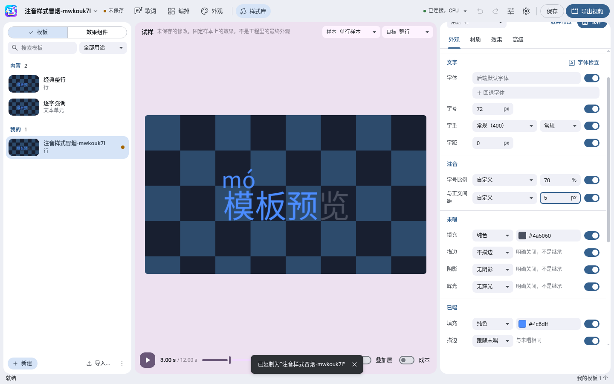
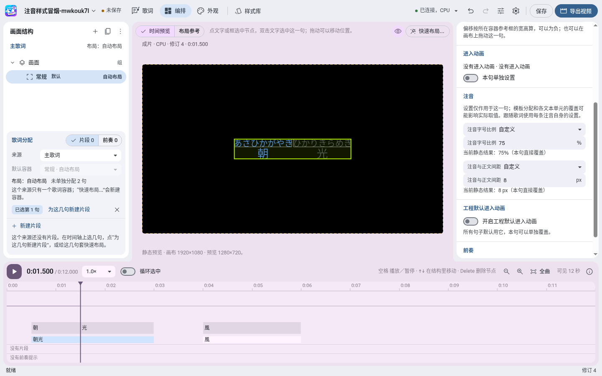

# Ruby 大小、正文距离与连续字距验收

2026-11-17，按用户选择的方案 2 实施：Ruby 继续继承所属文字的外观，增加字号比例与正文距离。
产品为 **0.115.0**，HTTP 合同为 **1.56.0**，开发分支 `fix/ruby-layout-settings` 已快进合入 `main`。
范围决定见 [实施计划](../plans/ruby-layout-settings-plan.md)，数据决策见
[ADR-0263](../../backend/docs/archive/decisions/decisions.md#adr-0263)。

## 使用与排版行为

- 样式库：复制或编辑个人模板，在“外观 → 注音”中分别启用“字号比例”和“与正文间距”。
  比例按正文字号的百分比输入，距离使用画布像素；可选择自定义或跟随歌词中的注音设置。
- 编排：选择单句，在右侧“注音”中调整两项。可以继承上级、明确跟随歌词原值或自定义；
  面板同时显示后端解析的静态结果与来源。容器和片段继续使用已有模板分配。
- 注音不增加独立填充、描边、字体等外观。源 `RubyAnnotation` 的文本、身份、时间、比例和距离保持；
  样式覆盖只影响实际布局和绘制。未设置的覆盖继续继承，显式 null 回到歌词原值，restore 删除本层覆盖。

相邻长注音仍由共享整行排版推动正文扩距。两段注音的墨迹接缝下限改为
`max(1, 前段 trailing bearing + 前段附加字距 + 后段 leading bearing)`，单位是缩放前布局像素。
不能直接以 `LetterSpacingPx` 代替自然距离，否则附加字距为零时仍会拥挤。已有空间足够时保持原位置；
字号不同时按各段实际整形结果测量。共享不可拆字簇、非单调视觉顺序、不精确映射和非法坐标仍走已有保护边界。

预览、测量、几何、变形与导出使用相同有效比例和距离。固定字体样例“代償”对应的
“だいしょ”“うはら”在正文字号 96 px、注音原比例 50%、附加字距 3 px 时，HTTP 测得两段墨迹间隔为 **19 px**。
该数字属于此样例，其他字体和字号按实际整形结果计算。

## 数据格式与合同

工程／歌词／模板 schema 分别为 **32／20／10**；个人模板保存于 `templates-v10`。
依照现有严格加载约定，旧格式不会自动迁移，旧工程与旧个人模板目录保留原位，内置模板独立可用。
原有注音数据结构不变。样式新增 `ruby.relativeScale` 与 `ruby.gapPx`，规范样式必返两项可空数值；
样式属性共 45 项，元素可用 35 项，前奏文字标记仍为 34 项且不接受 Ruby 属性。

合同生产基线为 `13ef1ae57f5659da46888fd7dd57a9f7623a5bef`。
从新构建的 Release CLR metadata 生成后，freeze 写入、默认漂移检查和 validate 均通过：
115 路径、128 方法、679 schemas、4016 个合成例，其中 2886 个反例。历史语料可逆还原门禁保留。
前端完整合同副本与后端逐字节一致；静态校验报告见 [contract-validation.json](evidence/ruby-layout-20261117/contract-validation.json)。

## 验证结果

完整 `dotnet build MakoKaraGenerator.slnx -m:1` 通过，零警告、零错误。
前端生产构建（TypeScript 检查与 Vite）通过，保留已有的资源块大小提示。
以下定向测试全部通过；部分过滤器有交集，不汇总成一个总数：

| 范围 | 通过数量 | 主要证据 |
| --- | ---: | --- |
| Core 注音样式、元素支持、持久化与模板 | 42 | 数值／null／继承／恢复、当前格式往返 |
| Application 样式编辑 | 29 | 逐属性写入、no-op 与非法值 |
| Core 模板隔离及相关闭包 | 52 | 旧 v9 原位保留、v10 写入、模板与包保护 |
| Rendering 注音及预设 | 104 | 连续整形 oracle、段边界、有效大小／距离、行／元素／节点模板 |
| Worker Snapshot | 268 | 新样式字段及显式 null 快照往返 |
| Hosting 样式与标记 | 43 | 注音读写、标记拒绝 Ruby 属性 |
| Server 模板和注音 HTTP transport | 55 | 严格必填字段、数值／null／restore |
| 前端全部 unit | 4587 | 冻结合同、模板属性分组、句子命令及既有用例 |
| 前端既有辉光 HTTP integration | 9 | 真实新版本读写、保存与严格版本保护 |

渲染回归使用完整连续整形“だいしょうはら”与分段整形作独立接缝对照，附加字距分别为 0 和 3 px；
另有手算数值 oracle 覆盖负 bearing。临时恢复旧固定 1 像素规则时新增间距测试按预期失败，恢复实现后通过。
上述定向后端测试在实施期间运行，输出保存在会话工具结果中，没有伪造单独日志文件。

## 匹配部署与实际工作流

发布源码为 `be790139d31cb22df709f566765c11223d30714a`，`sourceDirty=false`，
RID `linux-x64`，self-contained Server／Worker 同次发布。
部署 manifest SHA-256 为 `0232ef19b98c9761c6fb5c5e38e55ca0e7d0757e4e40cb07d0df430c73175c1d`。
后续提交补充验收脚本与记录，运行源码保持此发布输入。

独立 HTTP probe 在新的临时 profile 中完成 **53 次请求**，包括：

- 标准 TTML 相邻日文 Ruby 导入；工程与元素的比例和距离实际改变测量 PNG。
- 行显式 null 恢复到歌词数值的精确 PNG；restore 恢复工程继承。
- 撤销／重做精确恢复 PNG，no-op 保留 redo；零比例、负距离和布局字号溢出均拒绝。
- 原始注音数据保持，个人模板定义往返，保存、关闭、重开后保持精确 PNG。
- CPU 和 GPU 返回相同 Ruby 几何；未要求两种后端抗锯齿后的 PNG 字节一致。
- CPU 导出 48 帧 H.264，严格报告、下载大小与哈希、独立 ffprobe 计数和完整 FFmpeg 解码通过。

HTTP 会话正常退出，观察到的 5 个所属进程全部排水，bootstrap 已移除；
部署及证据共 1032 个文件完成本次凭证扫描。详细结果见 [http.json](evidence/ruby-layout-20261117/http.json)。

浏览器在另一个隔离 profile 上使用实际生产 Web：复制内置模板，保存并重选后确认 70%／5 px；
编排选句后定位至 1.5 秒，设置 75%／8 px 并等待对应修订的真实 PNG。修改后 PNG 哈希变化，
恢复两项继承后回到初始哈希。模板试样和成片均等待加载完成再截图，无未处理页面异常。
临时模板与工程已关闭，浏览器及所属宿主正常停止，4 个观察身份全部退出。
结果见 [browser.json](evidence/ruby-layout-20261117/browser.json) 和
[browser-session.json](evidence/ruby-layout-20261117/browser-session.json)。






## 用户手测、主分支与 AppImage

2026-11-17，从 `8bf45d00d2564a73bcd30626ee81bb216165b17f` 的干净源码重新构建桌面配套产物，
在隔离的桌面会话中交用户手测。用户反馈“手测完成，无问题”，并授权提交到远程 `main`、
生成 AppImage 和替换本机安装。该反馈属于本次 Ruby 改动的人工验收。

重新获取远程后，`main`／`origin/main` 的 `14a72ee2fbf32090160afa239cc682e41c7d5db8` 是开发分支祖先，
独立提交数为 0／9，`git merge-tree --write-tree` 无冲突。使用 `git merge --ff-only` 将 `main`
快进到 `8bf45d0`，保留开发分支及其原有提交；本次收尾仅追加文档和发布记录。

使用 `node scripts/package-appimage.mjs --keep-appdir` 打包 Linux x64 的 **0.115.0 AppImage**。
打包前桌面构建新鲜度、Server／Worker 和 GPU 原生库部署校验通过。包内发布来源为上述 `8bf45d0`，
`sourceDirty=false`；独立解包后的 **1134 个文件**与 AppDir 逐文件哈希及可执行标志一致。
文件大小为 **183351800 字节（174.9 MiB）**，SHA-256 为：

```text
e902c49c5c228d46907fc606886c8091ca1cf74249329a1dfd50391bc53d2ba3
```

直接运行生成的 AppImage，使用独立 `XDG_DATA_HOME`、配置和缓存目录进行启动冒烟。
实际窗口可见、编辑器加载完成、连接包内后端成功，桌面预览桥存在；SIGTERM 正常退出码为 0，
观察到的 10 个所属进程全部退出。本次未重新运行前文的单元、HTTP、渲染、导出或持续 GPU 性能验收。

已安装到 `~/Applications/MakoKaraGenerator-0.115.0-x86_64.AppImage`，权限为 0755，
安装文件哈希与生成包一致。应用菜单 `~/.local/share/applications/makokara-generator.desktop`
的 Exec／TryExec 已更新，桌面项校验和菜单数据库刷新通过。
原 0.114.1 AppImage 及旧桌面项保留在
`~/Applications/.backups/makokara-generator-20261117-130548/`，旧包哈希复核一致；
现有用户工程和配置未由本次打包、启动冒烟或替换操作改写。
发布证据见 [appimage.json](evidence/ruby-layout-20261117/appimage.json)。

## 复验入口与边界

```bash
node scripts/app.mjs build
python3 scripts/ruby-layout-http.py --dist <本次匹配发布目录> --output <全新证据目录>
node frontend/scripts/ruby-style-smoke.mjs --url <隔离宿主页面> --screenshot <证据前缀.png>
```

本轮证明本机 Linux 的上述固定流程。Windows、macOS、任意字体／复杂脚本、性能和长时运行未验收；
未重做 Electron 原生共享纹理协议的验收。原 [checks.json](evidence/ruby-layout-20261117/checks.json)
保留首次 HTTP／浏览器验收的范围，随后 AppImage 生成、启动和本机替换的证据单独记录。
证据索引及文件指纹见 [checks.json](evidence/ruby-layout-20261117/checks.json) 和
[sha256.json](evidence/ruby-layout-20261117/sha256.json)。
