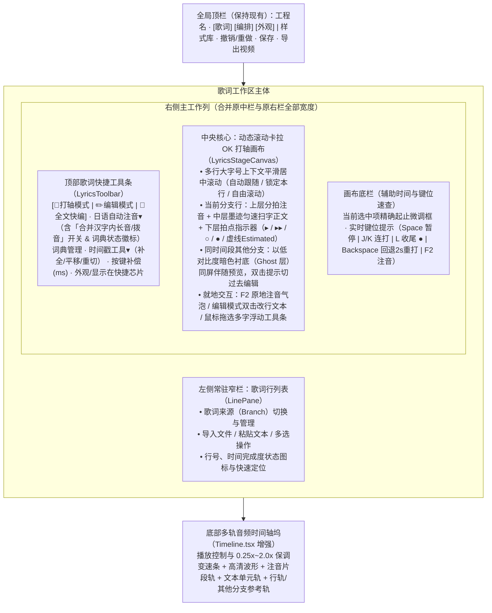

# 歌词编辑与注音打轴页面重构计划（技术细化定稿）

> 状态：**技术细化与改动面已对齐定稿（Ready for Implementation）**  
> 目标仓库与分支：`MakoKaraGenerator-App` · `dev/lyrics-page-refactor`（基于 `main` `00f7c97`）  
> 核心参考：`StrangeUtaGame`（动态滚动打轴画布、字下节奏点、语境化空格与拍数规则）、`MakoLrcStudio`（罗马音预览转换、离线日语分词自动注音）

---

## 零、已锁定关键技术决策与合规基线

在进入编码前，以下 5 项架构与合规边界已与项目负责人对齐并锁定：

| 决策项 | 已锁定方案 | 核心理由与影响说明 |
| :--- | :--- | :--- |
| **1. 日语自动注音引擎与词典** | **`@patdx/kuromoji`（Apache-2.0）+ 自编裁剪版 `NAIST-jdic 0.6.3b`（纯 BSD-3-Clause）** | 100% 兼容 **AGPL v3**，彻底避开默认 IPADIC 中 ICOT 条款的“遵守法规”附加限制争议；打包阶段显式剔除 `@patdx/kuromoji/dict`（IPADIC）。裁剪注音无关列后词典资产约 **14~16 MB**。 |
| **2. 日语词典分发与缓存方式** | **按需下载并在界面明确提醒**（首次使用时确认下载，本地持久缓存） | 基础安装包 **0 体积增重**；下载前界面提示体积与开源许可，支持进度展示、取消、重试与离线手动导入词典包。 |
| **3. 中文自动注音范围** | **本期不做中文词典自动注音，不引入任何中文词典依赖** | 避免引入未审计版权/许可的中文词库，聚焦日语与多语种手动注音；`F2` 原地注音浮窗通过 `Shift+Enter` 支持手动输入拼音/拉丁文本。 |
| **4. 渲染契约 A（扫字与 `.mkfx` 播放头）** | **方案 A1**：视觉扫字、羽化、高亮峰与 `.mkfx` `TokenGeometrySample.ProgressPath` 统一使用 **安全钳位后的非空白墨迹区间 `[inkLeft, inkRight]`** | 零破坏现有 SDK v2 脚本编译/API/运行时兼容性，守住“播放头横坐标 == 逐字换色像素边界”最高视觉不变量（避免 `LetterSpacingPx > 0` 时扫字星/粒子脱节）；钳位至 `[advLeft, advRight]` 防止斜体墨迹越界。 |
| **5. 渲染契约 B（多拍注音字分段同步权重）** | **方案 B1**：在 `LyricSampler` 中按各注音分段的**字素（Grapheme）数权重**计算基础字分段进度 | 保持 `Rendering.Abstractions` 与文本排版层零耦合，且 `.mkfx` 脚本与渲染画面进度 100% 一致；同步重构 `SungPosition` 及 SDK v2 粒子播放头，确保羽化、高亮峰与粒子轨迹不退化。 |

### 新引入依赖开源许可证清单（AGPL v3 兼容性审计）

| 依赖 / 资产 | 用途 | 许可证（含传递依赖） | 随安装包体积增量 | AGPL v3 兼容性 |
| :--- | :--- | :--- | :--- | :--- |
| `wanakana`（`^5.3.1`） | 罗马音实时预览转假名 | **MIT**（0 运行时依赖） | ~0.12 MB | ✅ 完全兼容 |
| `@patdx/kuromoji`（`^1.0.4`，仅引擎） | 前端日语形态素分词引擎（剔除自带 IPADIC `dict/`） | 主体 **Apache-2.0**；内嵌 `src/vendor/doublearray` 上游 **MIT**；0 外部运行依赖 | < 0.1 MB（剔除 `dict/` 后） | ✅ 完全兼容（FSF 确认 Apache-2.0 与 GPLv3/AGPLv3 单向兼容） |
| `NAIST-jdic 0.6.3b`（自编裁剪 `.dat.gz`） | 日语注音离线词典资产 | **纯 BSD-3-Clause**（无 ICOT 条款） | **0 MB**（按需下载 ~14~16 MB，缓存至本地） | ✅ 完全兼容 |
| 现有 `AudioController` | `0.25x ~ 2.0x` 无变调变速 | 浏览器原生 `HTMLAudioElement.preservesPitch` | 0 MB（无新增依赖） | ✅ 无新增风险 |

---

## 一、重构目标与总体架构定调

### 1.1 解决的核心痛点
1. **消除“静态表单感”与四重文本割裂**：移除原先单行堆叠表单（`LineDetail`）与右侧重复的只读预览栏（`WordPreview`），升级为**所见即所打的动态滚动卡拉 OK 画布**。
2. **打通后端无行时间直打闭环**：解除 `LyricTimingEditor` 强制要求预先存在 `line.Time` 的死锁，实现右手多键连续盲打时自动初始化与外扩行时间包络。
3. **根治空格与扫字/注音几何缺陷**：在重构页面前（Phase 0），先解决空白/标点粘连导致的注音居中右偏、扫字空扫空白，以及简单无时间空格导致的描边/外辉光裁剪竖缝问题，并区分英/日空格的「切分 vs 停顿」双语义。
4. **补齐高效注音与改词工具链**：引入 `F2` 原地注音浮窗（罗马音实时预览回车转假名、`Shift+Enter` 保留原文/拼音）、按需下载的离线日语自动注音（默认按标准日语拍 Mora 自动多拍切分 + 本地用户词典覆盖）、行内就地改词断行与「全文快编」Diff 保留时间轴。

### 1.2 底层数据结构边界（已锁定）
- **保持 `LyricsDocument` 强类型不可变领域模型 + `.mkgproj` 内容寻址 SHA-256 JSON 持久化**：100% 兼容现有稳定对象 ID、外观模板分配（`PresetApplications`）、编排片段（`Clip`）、撤销栈结构共享及 60fps Skia/Vulkan 渲染。
- **严格保持 TTML2 / AMLL 语义同构与双向无损往返**：行对应 `<p>`、实义词元对应 `<span>`、注音及多拍片段对应 `<span tts:ruby="container">` / `<span tts:ruby="text" begin end>`，补齐句中停顿提示覆写标记（`PhraseEndHint`）并在 `ttml.project` 与 `ttml.amll` 间实现无损映射。
- **暂不引入独立演唱者（`Singer`）体系**：多声部/翻译继续由 `LyricBranch`（歌词来源）承载；画布支持以**暗色低对比度背景层**同屏预览同一时间段的其他分支，但**一切编辑操作严格限定于当前激活分支**（编辑其他分支须显式切换）。

---

## 二、【Phase 0 前置攻坚】空格双语义、标点切分与扫字/注音几何底座

> **实施铁律**：本阶段在修改任何前端页面之前先行落地，并通过后端几何、像素渲染、SDK v2 播放头与 TTML 往返测试完整锁定。

### 2.1 领域模型、Schema 迁移与分词规则（P-B 前字收尾空隙法）

1. **领域模型扩展（`LyricToken`）**：
   - 在 `LyricToken`（`backend/src/MakoKaraGenerator.Core/Lyrics/LyricToken.cs`）新增可选字段：
     ```csharp
     /// <summary>句中收尾提示覆写：null=按邻接语境自动推导；true=强制显示收尾提示○；false=强制抑制收尾提示。</summary>
     public bool? PhraseEndHint { get; init; }
     ```
   - 持久化与 Schema 升级：
     - `PersistenceDtos.cs`（`LyricTokenDto`）与 `ProjectDtoMapper.cs` 同步读写 `phraseEndHint`（`null` 时省略写出以保持 JSON 精简）；
     - 按项目既有规范递增 `LyricsDocument.CurrentSchemaVersion`（`20 → 21`）与 `Project.CurrentSchemaVersion`（`32 → 33`），并在 `ProjectSchemaMigrator` 注册无损前向迁移（旧版缺省为 `null`）。
2. **空白与标点全部独立为无时间 Token**：
   - 改造 `LyricTokenSplitter`（`backend/src/MakoKaraGenerator.Core/Lyrics/LyricTokenSplitter.cs`）的 `Mixed` 等默认规则：
     - 连续空白（半角 `U+0020`、全角 `U+3000` 等）切分为独立空白 Token；
     - 标点符号（如 `、` `。` `！` `？` `「` `」` `（` `）` `,` `.` `!` `?` 等）各自切分为独立标点 Token，不再附着于实义字词末尾；
     - `LyricLineTokenSplitter` / 导入规范化阶段确保空白与标点 Token 初始均为无时间状态（`Time = null, TimingStatus = TimingStatus.Missing`）；
     - 严格保持 `TokensMatchLineText == true` 不变式（全行 `Tokens[i].Text` 依次拼接严格等于 `line.Text`）。
3. **英/日空格的邻接语境智能分流（新增共享纯规则 `LyricTokenSemantics`）**：
   - 将 Token 分类为 `Content`（实义可打轴）、`Whitespace`（纯空白）、`Punctuation`（纯标点）。
   - 对任一 `Content` Token，计算其有效 `HasPhraseEndHint`：
     - 若 `token.PhraseEndHint is { } explicitValue`，直接采用用户手动覆写值；
     - 否则向后扫描至下一个 `Content` Token 之间的无时间间隔：
       - **切分型空格（Separator）**：夹在拉丁字母/数字词之间的**单个半角空格 `U+0020`**，以及行首/行尾空白 → `false`（打轴游标自动跳过，连打时 `prev.endUs == next.startUs`）；
       - **停顿型空格（Pause / Breath）**：与中日韩字符（汉字、平/片假名、谚文）相邻的空格、**全角空格 `U+3000`** 或**连续多个空格** → `true`（画布为前驱实义词元挂载空心 `○` 提醒按 `L` 收尾，显式收尾后点亮实心 `●`，停顿表达为 `prev.endUs < next.startUs`）。
4. **TTML 导入/导出规范化**：
   - `TtmlExporter`（`Amll` Profile）：无时间的纯空白 `LyricToken` 直接写出为 `<span>` 之间的裸文本节点（`writer.WriteString(token.Text)`），不再包装空时间 `<span>`，并在 `Plan()` 中将其排除出 `consumerUntimedTokens`（消除 `AMLL消费端无时间普通元素` 误报告警）；
   - `TtmlExporter`（`Project` Profile）：在 `<span mkg:phrase-end="true|false">` 中精确写出非空 `PhraseEndHint` 覆写值；
   - `TtmlImporter`：导入词间裸空白文本节点为独立无时间空白 Token；`ttml.project` 精确恢复 `mkg:phrase-end` 属性，`ttml.amll` 缺省留 `null` 由语境规则自动推导。

### 2.2 底层渲染管线与 SDK v2 几何规范（已锁定 A1 + B1）

> **渲染管线改动边界说明**：Vulkan/CPU 渲染设备、GPU 预览流（DMA-BUF/SHM）、帧缓存与池、HarfBuzz 整形引擎（`SkiaTextLayoutEngine` 已产出 `ShapedGlyph.InkBounds`）、ImageScene 多图合成、GroupComposition、Warp 网格、Shader/RuntimeEffect 与 Glow/Shadow/Multi-Stroke 绘制器**均无需改动**；所有渲染改动严格收敛于扫字进度采样、裁剪分区计算、高亮峰位置、Token/Ruby 几何测量与 SDK v2 播放头投影。

1. **实义字词：安全钳位墨迹区间匀速扫字 + 轴承瞬时闭合（契约 A1）**：
   - 在 `MakoKaraGenerator.Rendering.Skia` 抽出统一纯几何计算辅助函数 `ResolveTokenWipeSpan(ShapedLine shaped, int utf16Start, int utf16End)`：
     - 原始 Advance 区间：`advLeft = shaped.XAt(utf16Start)`，`advRight = shaped.XAt(utf16End)`；
     - 汇总覆盖 `[utf16Start, utf16End)` 的 `ShapedDrawUnit` 中全部非空 `ShapedGlyph.InkBounds`，得到 `[rawInkLeft, rawInkRight]`；
     - 若存在有效墨迹且 `rawInkRight > rawInkLeft`，对其执行安全钳位：
       `inkLeft = Math.Clamp(rawInkLeft, advLeft, advRight)`，`inkRight = Math.Clamp(rawInkRight, advLeft, advRight)`（若钳位后宽度 `<= 0` 则回退至 `[advLeft, advRight]`）；无墨迹字符（空格、控制符等）直接回退至 `[advLeft, advRight]`。
   - **四处统一使用同一 `[inkLeft, inkRight]` 区间**：
     - `SkiaRenderPipeline.BuildSungRegions`（`progress ∈ (0, 1)` 在 `[inkLeft, inkRight]` 插值；`progress >= 1`（`IsSung`）时扩展闭合至完整 Advance `[advLeft, advRight]`，确保字侧轴承内的描边、投影与外辉光完整呈现）；
     - `SkiaRenderPipeline.BuildWipe`（羽化过渡带演唱位置按 `[inkLeft, inkRight]` 计算，唱完后过渡带滑出至 `advRight` 闭合）；
     - `SkiaRenderPipeline.BuildHighlights`（扫字线高亮峰中心严格对齐 `[inkLeft, inkRight]`）；
     - `SkiaSceneGeometry.TokenGeometry.ProgressPath`（`TokenGeometrySample.ProgressPath` 改为 `[inkLeft, inkRight]`；由于已钳位至 `[advLeft, advRight]`，100% 兼容 `TokenGeometrySample.GeometryAt(point)` 局部字簇匹配及 `V2CursorCuts` 二分断点，所有现有 `.mkfx` 脚本零修改即可运行且扫字星/粒子拖尾严格踩在变色笔画线上）。
2. **多拍注音字：上下分段同步扫字与羽化/高亮/粒子联动（契约 B1）**：
   - **纯采样层实现（`LyricSampler.cs`）**：
     - 当基础字绑定了包含 `>= 2` 个有效计时 `RubyTextSegment` 的注音时，基础字不再按外层 `Token.Time` 单段均速，而是按各已计时注音分段的**字素（Grapheme）数**计算归一化权重区间 $[w_k^{\text{start}}, w_k^{\text{end}}] \subseteq [0, 1]$（由 `GraphemeSplitter.Enumerate(segment.Text)` 计数，保证不依赖字体排版引擎）；
     - 任意时刻 $t$：
       - 若 $t$ 落入第 $k$ 拍 $[s_k, e_k)$，则基础字进度 $p(t) = w_k^{\text{start}} + (w_k^{\text{end}} - w_k^{\text{start}}) \cdot \frac{t - s_k}{e_k - s_k}$；
       - 若 $t$ 落于第 $k$ 拍与第 $k+1$ 拍之间的微小空隙，则 $p(t) = w_k^{\text{end}}$（保持原位等待下一拍）；
     - 在 `TokenSample` 上新增只读可选元数据 `TokenPiecewiseProgress? ActiveSegment`（记录用于羽化/高亮外推的当前活跃拍或最近边界拍的 `(TimeRange SegmentTime, double WeightStart, double WeightEnd)`）。
   - **重构 `SkiaRenderPipeline.Wipe.cs` 的 `SungPosition`（关键避坑）**：
     - 原实现中 `if (Math.Clamp(ratio, 0d, 1d) != progress) return null;` 强假设单段线性，会导致多拍字羽化与高亮峰失效退化。
     - 改造后：若 `TokenSample.ActiveSegment` 存在，则在分段子几何区间 `[segLeft, segRight]`（其中 `segLeft = lerp(inkLeft, inkRight, WeightStart)`，`segRight = lerp(inkLeft, inkRight, WeightEnd)`）上使用 `SegmentTime` 计算不夹值演唱位置 `position`，从而使羽化过渡带与扫字高亮峰在多拍汉字上全程平滑生效（拍间空隙时过渡带自然收束或静止等待下一拍）。
   - **SDK v2 粒子与基础播放头同步**：
     - 同步更新 `PureSourceIndexes.CursorsAt`（`backend/src/MakoKaraGenerator.Scripting/Projection/PureSourceIndexes.cs`）与 `FrameEffectHost.V2Anchors.V2CursorCuts`（`backend/src/MakoKaraGenerator.Scripting/Execution/FrameEffectHost.V2Anchors.cs`），使粒子发射器与基础播放头统一复用 `LyricSampler` 的分段进度计算函数，避免多拍汉字上文字按拍扫、粒子匀速跑的割裂。
3. **无时间空白与标点的裁剪自动跟亮桥接（覆盖全绘制路径）**：
   - **严格作用域**：仅对 `LyricTokenSemantics` 判定为无时间 `Whitespace` / `Punctuation` 的 Token 生效；**绝不作用于未定时的实义字**（守住“夹在两已定时实义字之间的未定时实义字保持未唱像素”红线）。
   - **桥接触发规则**：
     - **行首前导无时间空白/标点**（如 `「パネェっす」` 的 `「`）：绑定到后方首个已定时实义 Token，当 `t >= firstTimed.StartUs`（或处于其羽化进入带内）时，将其 Advance 区间并入已唱裁剪区（羽化模式取其起点的常数遮罩 `Mask(firstLeft)`）；
     - **句中与行尾无时间空白/标点**（如英文词间空格、`」`、`、`、`！`）：绑定到紧邻前驱已定时实义 Token，当 `t >= prevTimed.EndUs`（或处于其羽化退出带内）时，将其 Advance 区间并入已唱裁剪区（羽化模式取其终点的常数遮罩 `Mask(prevRight)`），彻底消除描边/外辉光在空格/标点处的未唱竖缝。
   - **全路径上下文打通（解决单元素 `tokenSample` 断链）**：
     - 在整行级采样/准备阶段一次性计算每个无时间空白/标点 Token 的桥接状态（`UntimedBridgeState`：已跟亮或携带绑定定时源的端点掩码）；
     - `DrawChangedFamilies`、`DrawTextPartitions`、`DrawWarpedPartitions` 调用 `BuildWipe` 时，携带该整行级桥接状态，确保带元素样式覆写、脚本变形或 Warp 的无时间标点/空格在独立绘制路径下同样无缝跟亮。
4. **Ruby 注音非空白墨迹居中加固**：
   - 修改 `SkiaSceneGeometry.Ruby.cs`（`MeasureRuby`）：将锚定基准从 `shaped.XAt(offset)` / `shaped.XAt(offset + len)` 改为 `ResolveTokenWipeSpan` 算出的基础字非空白墨迹区间 `[inkLeft, inkRight]`（同时自动剔除旧工程遗留含尾随空白 Token 的尾部空白宽度）；
   - `RubySpacingSolver` 保持不变，继续对已锚定的注音组执行刚性碰撞避让平移。

---

## 三、【Phase 1】右手多键开合盲打体系与后端原子命令

### 3.1 默认键位分区（模式 M1，支持设置内自定义重绑）

| 分区 | 默认按键 | 打轴模式行为 | 编辑模式行为 |
| :--- | --- | --- | --- |
| **全局启停（拇指）** | `Space` | **播放 / 暂停音频**（全工作区统一肌肉记忆） | **播放 / 暂停音频** |
| **连打主战区（右手食/中指）** | `J` / `K`（双键同效） | **开唱下一拍**：将上一未收尾拍的 `endUs` 闭合至当前时刻 $t$，同时将当前待打拍（单拍词元或当前注音分段）的 `startUs` 设为 $t$，游标推进至下一待打拍（支持高速 16 分音符双指交替轮指） | `J`：选中字微调菜单 |
| **闭口收尾键（右手无名指）** | `L` | **显式收尾 `●`**：将当前正在演唱拍的 `endUs` 定格为 $t$（并同步更新行尾 `line.EndUs`），**不开启下一拍 `startUs`**；用于行末、停顿空格前（`○` → `●`）及任意换气处 | 切换当前字的停顿收尾提示 `○` |
| **悔棋重打（左手/小指）** | `Backspace` 或 `G` | **撤回上一拍并回跳复听**：清除刚打的一拍、游标退回上一拍，音频自动回退 `2000ms`（可配）继续播放，免暂停无缝重打 | `Delete`/`Backspace`：清除所选单元时间 |
| **变速与寻轨（左手）** | `Q` / `W` · `Z` / `X` | `Q`/`W` 无变调减速/加速（`0.25x ~ 2.0x`，步进 `±10%` 或 `±5%`）；`Z`/`X` 快退 `2s` / 快进 `3s` | 同左 |
| **导航与拍点精修** | 方向键 · `Alt+←/→` · `[` / `]` | `↑/↓` 换行、`←/→` 换字、`Alt+←/→` 字内多拍切换、`[` / `]` 增减/合并当前字注音拍点 | 同左（`Alt+↑/↓` 按帧微调时间；`Enter` 断行、`Shift+Enter` 合行） |
| **快捷注音** | `F2` | 在当前字上方弹出原地注音浮窗（自动暂停或保持播放可配） | 在当前字上方弹出原地注音浮窗 |

### 3.2 连打状态机、防跨间奏截断与后端命令契约

1. **解除 `LyricTimingEditor` 行时间死锁与自动包络**：
   - 对无 `line.Time` 的未打轴行，首次执行连打命令自动初始化合法 `line.Time`（起点为 $t$，初始占位时长为 1 帧或按后续击键外扩）；
   - 后续敲击 `J`/`K`/`L` 若早于 `line.StartUs` 或晚于 `line.EndUs`，后端原子化自动外扩 `line.Time`；若操作目标为多拍注音中的 `RubyTextSegment`，同步自动重算父级基础 `Token.Time` 包络 `[min(seg.StartUs), max(seg.EndUs)]`；
   - 一次按键对应一条干净、独立可撤销的 `ProjectHistory` 提交记录。
2. **忘按 `L` 的智能阈值截断保护**：
   - 当正在演唱的上一拍位于**行末**或所属词元有效 `HasPhraseEndHint == true`（带 `○`）时，若用户忘记按 `L`，隔了一段间奏后直接按 `J`/`K` 打下一句/下一分句首字：
     - 若时间间隔 $\Delta t = t - \text{prev.startUs} \le 1.5\text{s}$（紧凑抢拍连唱）：正常无缝闭合 `prev.endUs = t`；
     - 若 $\Delta t > 1.5\text{s}$（明显间奏/长换气）：自动将上一未收尾拍按 `min(prev.startUs + 600ms, t)` 截断收尾，并将状态标为 `TimingStatus.Estimated`（画布以虚线圆点提示用户该尾音为自动兜底，可随时拖波形微调）。
3. **新增后端原子命令清单（贯穿 `Core` → `Application` → `Backend.Contracts` → `Backend.Hosting` → `frontend/src/protocol`）**：
   - `lyrics.strikeBeat`：原子连打命令（参数：`branchId`、上一待闭合拍定位 `closeTarget?`、当前待开唱拍定位 `openTarget`（Token 或 RubySegment）、`playheadUs`、`closeGuardGapUs`（默认 `1_500_000`）、`fallbackDurationUs`（默认 `600_000`））。
   - `lyrics.closeBeat`：原子显式收尾命令（闭合 `target`（Token 或 RubySegment）的 `endUs = playheadUs`，同步外扩父级 Token 与行尾包络）。
   - `lyrics.togglePhraseEndHint`：翻转指定 Token 的 `PhraseEndHint` 覆写值（`null/auto → !auto` 或循环切换）。
   - `lyrics.splitLine`：在指定 `tokenIndex` 之前将一行拆分为两行（自动分割两侧 `Tokens`、`RubyAnnotations`、以及基于两侧有效子项重算的行时间包络，保持未拆分侧 ID 稳定）。
   - `lyrics.mergeLines`：将当前行与上一行合并为一行（依次拼接文本、Token、Ruby 与外扩行时间包络）。
   - `lyrics.setRubySegments`（非破坏性多拍注音提交）：按新提交的注音分段文本列表更新某字的 `RubyAnnotation`，**按段序号尽量继承已有 `RubyTextSegment.Time` 与 `TimingStatus`**，避免修改注音文本时锁死或清空已打轴时间。
   - `lyrics.applyTextDiff`（服务「全文快编」）：接收当前分支的新文本行序列及前端/后端 LCS 对齐映射，在单条撤销记录内无损保留所有未改动字符的时间戳、注音分段与样式覆写，仅对变更片段按语境规则重新切分。

---

## 四、【Phase 2】前端日语注音引擎、按需词典下载与保调变速

### 4.1 宏观能力范围与第三方合规边界
- **本期仅实现离线日语自动注音**，**不实现中文词典自动注音，不引入中文词典依赖**。
- **零 IPADIC 污染保障**：
  - 安装 `wanakana`（MIT）与 `@patdx/kuromoji`（引擎 Apache-2.0，0 外部依赖）；
  - Vite 构建配置与桌面端打包脚本显式排除 `node_modules/@patdx/kuromoji/dict/**`，确保最终发布的 Web 产物与桌面安装包**绝不含任何 IPADIC 文件**。

### 4.2 自编裁剪版 `NAIST-jdic 0.6.3b` 离线构建与按需下载体系
1. **词典资产构建工具链（开发/发布期脚本，不打入客户端）**：
   - 新增 `scripts/build-naist-jdic.mjs`：
     - 输入：官方 `mecab-naist-jdic-0.6.3b`（纯 BSD-3-Clause）源 CSV；
     - **列裁剪优化**：保留表层、左右连接 ID、代价、品词大类、基本形与读音（`reading`），剔除歌词注音无需使用的 5~6 个冗余细分类/活用/发声列；
     - 输出：调用 kuromoji `DictionaryBuilder` 生成 `dict/*.dat.gz`（总计约 **14~16 MB**），连同 `LICENSE.naist-jdic.txt`（BSD-3-Clause 原文）与 `manifest.json`（版本号、文件清单、单文件与总包 SHA-256 哈希、字节大小）打成可托管的静态词典包（如 GitHub Releases / 静态镜像）。
2. **前端按需下载、校验与离线持久化（`frontend/src/editor/phonetics/dict-store.ts`）**：
   - **存储后端**：优先写入 **OPFS（Origin Private File System）**（浏览器与 Electron 均原生支持大文件零内存驻留存储，回退方案为 IndexedDB），按 `manifest.json` 版本号与 SHA-256 校验完整性；通过后永久离线可用。
   - **界面提醒与用户确认流**：
     - 首次点击「自动注音（日语）」或打开「词典管理」且本地无缓存时，弹出明确告知对话框：
       - 说明需下载的日语词典名称（`NAIST-jdic 0.6.3b`）、许可证（`BSD-3-Clause`）、预估体积（约 `14~16 MB`）以及“下载后永久本地离线缓存、可随时在设置中清除”；
       - 提供**「开始下载」**、**「从本地导入词典包（.zip / 目录）」**（照顾离线内网环境）与**「暂不下载」**三个入口；
     - 下载过程展示实时百分比、已下载/总大小、可随时中断取消，以及网络失败时的镜像地址配置/重试提示；
     - 词典管理弹窗支持查看缓存版本、占用空间及一键清理缓存。
   - **Web Worker 异步分词**：词典就绪后在专用 Worker（`japanese-furigana.worker.ts`）中懒加载 `@patdx/kuromoji` 并通过自定义 `LoaderConfig` 从 OPFS 读取 `ArrayBuffer` 初始化，主线程 60fps 零卡顿。

### 4.3 罗马音预览、标准 Mora 分拍与用户读音词典
1. **罗马音实时预览引擎（`romaji-preview.ts`）**：
   - 基于 `wanakana`：当输入含拉丁字母时保留原输入并在旁侧生成实时预览（小写转平假名、大写转片假名）；
   - 按 `Enter` 采纳假名并按当前 Mora 规则分拍；按 `Shift+Enter` 跳过假名转换、原样提交拉丁字母（兼顾英文音标与手动中文拼音注音）。
2. **日语自动注音与默认标准 Mora 分拍（`mora-splitter.ts` + `japanese-furigana.ts`）**：
   - **本地用户读音词典最高优先级覆盖**：支持在本地维护自定义词条（`surface → rubySegments`，保存于本地存储，支持导入/导出 `StrangeUtaGame` / `RL` 格式外部用户词典文件）；
   - **送假名剥离与熟字训识别**：例如 `見よう` → `見[み]` + `よう`，`二人` → 复合词元 `二人[ふ・た・り]`；
   - **默认标准日语拍（Mora）多拍切分**：
     - 拗音合并为 1 拍（`きゃ`/`きゅ`/`きょ`/`しゃ`/`ちゅ`/`ふぁ`/`てぃ` 等 = 1 拍）；
     - 其余独立假名、拨音 `ん`、促音 `っ`、长音 `う`/`い`/`ー` **默认各拆为独立 1 拍 `RubyTextSegment`**（例如 `同`=`お・な` 2 拍，`郷`=`きょ・う` 2 拍，`感`=`か・ん` 2 拍）；
     - **工具栏快捷开关「合并汉字内长音/拨音」**：开启后将汉字读音内部的尾随长音/拨音并入前一拍（如 `郷`=`きょう` 1 拍、`感`=`かん` 1 拍）。

### 4.4 保调变速、按键延迟补偿与悔棋回跳
- 复用现有 `AudioController`（`frontend/src/editor/audio/audio-controller.ts` 已开启 `this.audio.preservesPitch = true`）：
  - 扩展 `Transport.tsx` 及 `AudioController` 的调速能力覆盖 **`0.25x ~ 2.0x`**（新增 `stepRate(delta)` 支持 `Q`/`W` 按 `±10%` 或 `±5%` 连续步进，并保留常用预设项）；
  - 新增本地持久化打轴偏好：按键延迟补偿 `tagOffsetMs`（落点时刻自动减去补偿微秒数，默认 `0ms` 可调）、悔棋回退时长 `rewindMs`（默认 `2000ms` 可配）、`F2` 弹窗时是否自动暂停。

---

## 五、【Phase 3】宏观布局、动态打轴画布与正文编辑重构

### 5.1 三区宏观布局（保留左栏常驻 + 全宽滚动大画布 + 底部多轨时间轴）



- **外观与编排跳转零丢失**：原 `LineDetail` 底部的「外观（样式分配）」与「显示在（编排容器）」浓缩为顶部工具栏右侧的两个轻量状态芯片（及行右键菜单项），点击同样一键跳往外观页/编排页对应目标。

### 5.2 核心交互组件规格
1. **动态滚动卡拉 OK 打轴画布（`LyricsStageCanvas.tsx`）**：
   - 60fps 独立 `requestAnimationFrame` 扫字进度推进（直接读写播放头微秒并按 B1/A1 同构规则更新 CSS 变量/绘制层，避免每帧触发全量 React 重渲染）；
   - 三层字块渲染：上层分拍注音、中层正文、下层状态节奏点（待打 `▸` / 多拍待打 `▸▸` / 停顿提示 `○` / 已显式收尾 `●` / 自动截断兜底虚线点）；
   - 其他分支同时间段暗色伴随层（Ghost 层），严格只读，双击弹出切换分支确认；
   - 编辑模式下支持鼠标框选多字弹出浮动工具条（合并 Token、重切、清除时间、批量删注音、切换停顿标记）。
2. **`F2` / 双击字块 —— 原地悬浮注音框（`RubyInlinePopover.tsx`）**：
   - 紧贴目标字块正上方弹出，多拍注音以 `・` 或 `,` 分隔展示（如 `お,な`），提交调用 `lyrics.setRubySegments` 保留已有拍时间；
   - 拉丁字母实时预览徽标 `→ きょ・う`（`Enter` 转假名提交，`Shift+Enter` 原样提交拉丁字母/拼音）；
   - 连续键盘流：光标位于行首按 `←`、位于行尾按 `→`、或按 `Tab` / `Shift+Tab`，自动保存并跳至相邻实义字继续注音。
3. **行内就地改词与「全文快编」（`FullTextQuickEdit.tsx`）**：
   - 编辑模式双击某行（或 `Ctrl+Enter`）进入行内正文输入框；选中字块按 `Enter` 调用 `lyrics.splitLine` 断行，`Shift+Enter` 调用 `lyrics.mergeLines` 合行；
   - 切换 `📝 全文快编` 进入带行号多行纯文本/内联注音编辑器；点击「应用返回打轴」时，运行行级 + 字级 LCS Diff 预览变更并一次性提交，无损保留未改动字符的时间轴、注音分段与样式覆写。

---

## 六、各阶段改动面全景评估与文件级清单

### 6.1 改动面总览矩阵

| 阶段 | 改动面评级 | 主要涉及层级 | 核心基础设施影响 | 关键风险与回归重点 |
| :--- | :--- | :--- | :--- | :--- |
| **Phase 0**<br>*(空格/标点与扫字几何底座)* | **中偏小（局部集中，契约敏感）** | `Core.Lyrics`、`Core.Persistence`、`Rendering.Abstractions`、`Rendering.Skia`、`Scripting` | **底盘不动**（Vulkan/GPU流/HarfBuzz/ImageScene/Warp/Shader >90% 渲染代码零改动）；仅改扫字/几何/采样层约 10~14 个文件 | 1. 多拍字羽化与高亮峰需重构 `SungPosition`；<br>2. 独立绘制路径需传递整行桥接状态；<br>3. Schema（`20→21` / `32→33`）、`contract-manifest.json` 与像素基线测试需同步更新 |
| **Phase 1**<br>*(后端连打与结构编辑命令)* | **中等（纯增量扩展，低侵入）** | `Core.Lyrics`、`Application.Editing`、`Backend.Contracts`、`Backend.Hosting`、`frontend/src/protocol` | **零影响渲染与持久化底盘**；严格沿用现有命令管道与撤销栈模式 | 需确保连打外扩 `line.Time` / `Token.Time` 与 `TryAcceptDisplay`（编排时间槽）校验自洽，防止合法连打被旧校验误拒 |
| **Phase 2**<br>*(前端日语注音引擎、按需词典与变速)* | **中小（前端隔离模块 + 离线脚本）** | `scripts/`、`frontend/src/editor/phonetics/`、`frontend/src/editor/audio/`、`frontend/vite.config.ts` | **零影响后端**；打包配置剔除 IPADIC，基础包增量 < 0.3 MB | 1. 需验证 Electron 与浏览器环境下 OPFS / IndexedDB 持久化及代理/离线导入体验；<br>2. 送假名剥离与 Mora 边界单测全覆盖 |
| **Phase 3**<br>*(动态画布与工作区重组)* | **较大（前端歌词页主体重写）** | `frontend/src/editor/lyrics/`、`frontend/src/editor/workspace/`、`frontend/src/editor/timeline/` | **仅限歌词工作区 UI**；保留 `LinePane`、`Timeline` 骨架，不影响编排页/外观页/导出页 | 1. 60fps 滚动/扫字不可触发高频 React 重渲染；<br>2. 快捷键状态机须与输入框/弹窗焦点严格隔离 |
| **Phase 4**<br>*(全链路回归与旧组件清理)* | **小（清理与验证）** | 前后端测试套件、桌面冒烟脚本、删除冗余旧表单组件 | 无新增架构面 | 清理 `LineDetail` / `WordPreview` 冗余代码，确认 CI、契约校验与桌面真实渲染全绿 |

### 6.2 各阶段详细文件清单

#### Phase 0 改动面清单
- **修改 — 核心领域、分词与 TTML（`MakoKaraGenerator.Core`）**：
  - `Lyrics/LyricToken.cs`（新增 `bool? PhraseEndHint`）
  - `Lyrics/LyricsDocument.cs`、`Projects/Project.cs`（递增 `CurrentSchemaVersion`）
  - `Lyrics/LyricTokenSplitter.cs`、`Lyrics/LyricLineTokenSplitter.cs`（独立空白与标点 Token）
  - `Lyrics/Export/TtmlExporter.cs`、`Lyrics/Import/TtmlImporter.cs`（AMLL 词间裸空格零告警 + `mkg:phrase-end` 精确往返）
  - `Persistence/PersistenceDtos.cs`、`Persistence/ProjectDtoMapper.cs`、`Persistence/ProjectSchemaMigrator.cs`（新增 `PhraseEndHint` 序列化与迁移）
- **新增 — 核心语义纯规则（`MakoKaraGenerator.Core`）**：
  - `Lyrics/LyricTokenSemantics.cs`（`Content`/`Whitespace`/`Punctuation` 分类与英/日邻接停顿推导）
  - `Persistence/LyricsV20ToV21Migration.cs`（及工程 `V32ToV33` 迁移注册）
- **修改 — 底层渲染管线与 SDK v2 播放头（局部集中，不碰 GPU/Shader/ImageScene）**：
  - `Rendering.Abstractions/LyricSampler.cs`（B1 多拍字素权重分段进度 + `ActiveSegment` 元数据 + 行级无时间桥接计算）
  - `Rendering.Skia/SkiaRenderPipeline.cs`（`BuildSungRegions`：A1 钳位墨迹区间 + 无时间桥接）
  - `Rendering.Skia/SkiaRenderPipeline.Wipe.cs`（`BuildWipe` + 重构 `SungPosition` 兼容 B1 多拍分段与桥接掩码）
  - `Rendering.Skia/SkiaRenderPipeline.WipeHighlight.cs`（`BuildHighlights` 对齐 A1 墨迹与 B1 多拍活跃段）
  - `Rendering.Skia/SkiaRenderPipeline.FamilyTransforms.cs`、`SkiaRenderPipeline.TextPartitions.cs`、`SkiaRenderPipeline.WarpPartitions.cs`（向单字独立绘制路径传递整行桥接上下文）
  - `Rendering.Skia/SkiaSceneGeometry.TokenGeometry.cs`（A1 `ProgressPath` 使用安全钳位 `[inkLeft, inkRight]`）
  - `Rendering.Skia/SkiaSceneGeometry.Ruby.cs`（`MeasureRuby` 锚定基础字非空白墨迹区间）
  - `Scripting/Projection/PureSourceIndexes.cs`、`Scripting/Execution/FrameEffectHost.V2Anchors.cs`（B1 粒子播放头与基础播放头同步复用 `LyricSampler` 分段进度）
- **更新 — 契约清单与测试基线**：
  - `backend/web/contract-manifest.json`（及 `backend/tools/backend-api-contract/` 契约校验同步）
  - 需同步调整断言的既有测试：`PlaybackGeometryTests.cs`（第 57~59 行相邻 `EndX == StartX` 断言）、`RubySpacingRenderingTests.cs`（第 204~208 行 Advance 锚点断言）、`WipeFeatherRenderingTests.cs`（Advance 坐标基准）
  - 新增测试：英/日混排分词与语境停顿单测、外辉光无空格/标点竖缝像素测试、多拍汉字分段同步（含羽化/高亮/粒子播放头）测试、`ttml.project` & `ttml.amll` 往返测试。

#### Phase 1 改动面清单
- **修改 — 领域编辑与用例层**：
  - `Core/Lyrics/LyricTimingEditor.cs`（新增连打/显式收尾/自动包络与 `1.5s` 截断规则）
  - `Core/Lyrics/RubySegmentEditor.cs`（新增非破坏性按序号保留时间的注音段更新）
  - `Application/Editing/LyricTimingEditUseCase.Stamps.cs`（接入 `StrikeBeat` / `CloseBeat` / `TogglePhraseEndHint`）
  - `Application/Editing/LyricContentEditUseCase.LineTransforms.cs`（接入 `SplitLine` / `MergeLines` / `ApplyTextDiff`）
  - `Application/Editing/RubySegmentEditUseCase.cs`（接入 `SetRubySegments`）
- **修改 — 后端协议与宿主分发**：
  - `Backend.Contracts/BackendProjectCommandContracts.cs`、`BackendProjectContentCommandContracts.cs`、`BackendRubySegmentContracts.cs`、`ProjectCommandJsonConverter.cs`、`RubySegmentCommandJson.cs`
  - `Backend.Hosting/ProjectSession.EditingCommands.cs`、`ProjectSession.ContentCommands.cs`、`ProjectSession.RubySegments.cs`
  - `frontend/src/protocol/editing.ts`、`frontend/src/protocol/lyrics-structure.ts`、`frontend/src/editor/session/editor-session.ts`

#### Phase 2 改动面清单
- **新增 — 词典构建脚本与前端注音子系统**：
  - `scripts/build-naist-jdic.mjs`（构建期脚本：裁剪并编译 `NAIST-jdic 0.6.3b` 为 `dict/*.dat.gz` + `manifest.json` + `LICENSE.naist-jdic.txt`）
  - `frontend/src/editor/phonetics/dict-store.ts`（OPFS/IndexedDB 缓存、按需下载、SHA-256 校验、本地导入与清理）
  - `frontend/src/editor/phonetics/japanese-furigana.worker.ts`（Web Worker 封装 `@patdx/kuromoji` + 自定义 OPFS Loader）
  - `frontend/src/editor/phonetics/japanese-furigana.ts`（送假名剥离、熟字训识别、用户词典优先覆盖）
  - `frontend/src/editor/phonetics/user-dictionary.ts`（本地用户读音词典增删改及 `StrangeUtaGame` / `RL` 词典导入解析）
  - `frontend/src/editor/phonetics/mora-splitter.ts`（标准日语拍 Mora 分拍器 +「合并汉字内长音/拨音」开关）
  - `frontend/src/editor/phonetics/romaji-preview.ts`（基于 `wanakana` 的罗马音实时预览与转换）
- **修改 — 前端依赖、打包与音频控制**：
  - `frontend/package.json`（新增 `wanakana`、`@patdx/kuromoji`）
  - `frontend/vite.config.ts` 及桌面打包脚本（显式排除 `@patdx/kuromoji/dict/**`，确保零 IPADIC 进入构建产物）
  - `frontend/src/editor/audio/audio-controller.ts`、`frontend/src/editor/audio/Transport.tsx`（扩展 `0.25x ~ 2.0x` 无变调变速、步进调速、悔棋回跳辅助方法）

#### Phase 3 改动面清单
- **新增 — 歌词画布与快捷交互组件（`frontend/src/editor/lyrics/`）**：
  - `LyricsToolbar.tsx`（模式切换、日语自动注音菜单、合并长音/拨音开关、词典状态徽标、按键延迟补偿、外观/编排跳转芯片）
  - `LyricsStageCanvas.tsx` & `lyrics-stage.css`（动态居中滚动卡拉 OK 画布、三层字块、Ghost 伴随分支层、框选浮动菜单）
  - `RubyInlinePopover.tsx`（`F2`/双击原地注音浮窗、罗马音预览徽标、连续键盘跳字）
  - `FullTextQuickEdit.tsx` & `full-text-diff.ts`（行级+字级 LCS Diff 对齐与无损应用）
  - `DictionaryManagerDialog.tsx`（按需下载提示与进度确认弹窗、本地词典导入/清理、用户读音词典编辑）
  - `timing-keymap.ts`（模式 M1 右手 `J/K/L` + `Space` + `Backspace/G` + `Q/W/Z/X` + `F2` 状态机与自定义键位持久化）
- **修改 — 工作区重组与时间轴增强**：
  - `frontend/src/editor/workspace/Workspace.tsx`、`WorkLayout.tsx`、`layout.css`（合并中右栏给 `LyricsStageCanvas`，保留左栏 `LinePane` 与底部 `Timeline`）
  - `frontend/src/editor/lyrics/LinePane.tsx`、`LineList.tsx`（补充时间完成度状态图标与行右键外观/编排入口）
  - `frontend/src/editor/timeline/Timeline.tsx`（适配 `0.25x ~ 2.0x` 变速条与连打即时高亮联动）

#### Phase 4 改动面清单
- **清理冗余旧组件**：评估移除不再使用的 `frontend/src/editor/lyrics/LineDetail.tsx`、`TokenSection.tsx`、`RubySection.tsx`、`TimeBar.tsx`、`frontend/src/editor/preview/WordPreview.tsx` 及对应样式与无引用测试；
- **全链路回归验证**：运行后端全量 xUnit、契约校验脚本、前端 Vitest 单元/集成测试、`smoke:lyrics` / `smoke:glow` / `smoke:desktop` 桌面渲染冒烟检查，并补充第三方声明文档（登记 `wanakana` MIT、`@patdx/kuromoji` Apache-2.0、`NAIST-jdic 0.6.3b` BSD-3-Clause）。

---

## 七、分阶段研发与验收路线图

| 阶段 | 核心交付内容 | 改动面 | 关键验收指标 |
| :--- | :--- | :--- | :--- |
| **Phase 0：空格、标点与扫字/注音几何底座** | 1. `LyricToken.PhraseEndHint` + Schema 迁移 + `LyricTokenSplitter` 独立空白/标点与语境停顿规则；<br>2. **A1** 钳位墨迹 `[inkLeft, inkRight]` 统一扫字与 `.mkfx` `ProgressPath`；<br>3. **B1** 多拍注音字字素权重分段同步（含 `SungPosition` 重构与 SDK v2 粒子播放头联动）；<br>4. 全绘制路径无时间空白/标点跟亮桥接；<br>5. `SkiaSceneGeometry.Ruby` 非空白墨迹居中；<br>6. `TtmlExporter` / `TtmlImporter` 零告警无损往返。 | **中偏小**<br>*(集中 10~14 个后端文件；GPU/Shader/ImageScene 零改动)* | 后端 xUnit 新增并通过：英/日混排分词与语境停顿测试、带空格/标点外辉光无竖缝像素测试、多拍汉字分段同步（含羽化/高亮/粒子播放头）测试、`ttml.project` & `ttml.amll` 往返测试；契约校验全绿。 |
| **Phase 1：后端连打原子命令与非破坏性编辑** | 1. 新增 `lyrics.strikeBeat` / `lyrics.closeBeat` / `lyrics.togglePhraseEndHint`（自动初始化/外扩 `line.Time` 与多拍父级 `Token.Time`，含 `1.5s` 忘按 `L` 截断 `Estimated` 保护）；<br>2. 新增 `lyrics.splitLine` / `lyrics.mergeLines` / `lyrics.setRubySegments` / `lyrics.applyTextDiff`。 | **中等**<br>*(增量命令管道扩展，零侵入底层渲染)* | 未打轴纯文本行可直接连打不报 `422`；单次按键产生单条可独立撤销历史；断行/合行/改注音均不破坏已有时间戳；契约校验全绿。 |
| **Phase 2：前端日语注音引擎、按需词典与保调变速** | 1. `scripts/build-naist-jdic.mjs` 产出裁剪版 `NAIST-jdic 0.6.3b`（BSD-3-Clause，~14~16 MB）及构建期剔除 IPADIC；<br>2. OPFS 按需下载/校验/离线导入 + 首次使用界面明确提醒；<br>3. `wanakana` 罗马音预览 + Web Worker `@patdx/kuromoji` + Mora 分拍器（含「合并汉字内长音/拨音」）+ 用户词典；<br>4. `AudioController` `0.25x ~ 2.0x` 无变调变速、按键延迟补偿与悔棋回跳。 | **中小**<br>*(隔离前端模块 + 离线脚本，零后端改动)* | 产物审计确认零 IPADIC 残留；首次点击自动注音正常弹出体积/许可提示并支持取消与本地导入；前端单测覆盖全部拗音/促音/拨音/长音分拍边界、送假名剥离与用户词典优先覆盖；变速不变调回放平滑。 |
| **Phase 3：动态滚动打轴画布与多键交互重构** | 1. 实现 `LyricsStageCanvas`（三层字块、`▸/○/●`/虚线指示器、Ghost 分支伴随层、框选浮动菜单）；<br>2. 实现 `RubyInlinePopover`（罗马音预览回车转假名、`Shift+Enter` 保留拉丁/拼音、`Tab`/方向键连续跳字）与 `DictionaryManagerDialog`；<br>3. 实现右手 `J/K` + `L` + `Space` + `Backspace` 状态机、行内改词断行与「全文快编」LCS Diff 视图，重组 `Workspace.tsx`。 | **较大**<br>*(歌词页前端主体重写，保留左栏与时间轴)* | 完整打通“导入纯文本 → 按需下载日语词典并一键多拍注音 → `F2` 罗马音/拼音补注 → 慢放右手 `J/K/L` 盲打 → 波形微调 → 预览导出”端到端闭环。 |
| **Phase 4：全链路回归、清理与许可声明** | 运行后端全量测试、前端组件/集成测试及桌面端真实渲染冒烟检查，清理冗余旧表单组件并补齐第三方开源许可声明。 | **小**<br>*(清理与验证)* | CI 全绿，无回归故障，60fps 滚动与扫字无掉帧；第三方许可证声明覆盖全部新引入依赖与按需下载词典。 |
