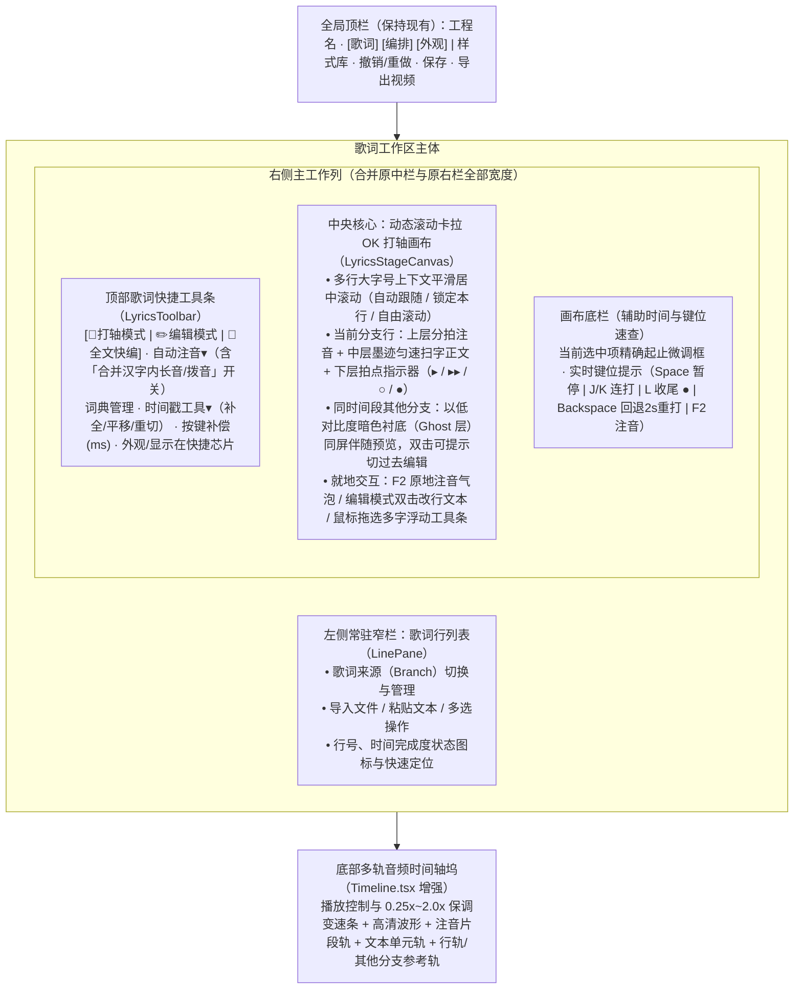

# 歌词编辑与注音打轴页面重构计划（已对齐定稿）

> 状态：**设计已对齐定稿（Ready for Implementation）**  
> 目标仓库与分支：`MakoKaraGenerator-App` · `dev/lyrics-page-refactor`（基于 `main` `00f7c97`）  
> 核心参考：`StrangeUtaGame`（动态滚动打轴画布、字下节奏点、语境化空格与拍数规则）、`MakoLrcStudio`（罗马音预览转换、离线日语分词自动注音）

---

## 一、重构目标与总体架构定调

### 1.1 解决的核心痛点
1. **消除“静态表单感”与四重文本割裂**：移除原先单行堆叠表单（`LineDetail`）与右侧重复的只读预览栏（`WordPreview`），升级为**所见即所打的动态滚动卡拉 OK 画布**。
2. **打通后端无行时间直打闭环**：解除 `LyricTimingEditor` 强制要求预先存在 `line.Time` 的死锁，实现右手多键连续盲打时自动初始化与外扩行时间包络。
3. **根治空格与扫字/注音几何缺陷**：在重构页面前（Phase 0），先解决空白/标点粘连导致的注音居中右偏、扫字空扫空白，以及简单无时间空格导致的描边/外辉光裁剪竖缝问题，并区分英/日空格的「切分 vs 停顿」双语义。
4. **补齐高效注音与改词工具链**：引入 `F2` 原地注音浮窗（罗马音实时预览回车转假名）、离线日语/中文自动注音（默认按标准日语拍 Mora 自动多拍切分 + 用户词典覆盖）、行内就地改词断行与「全文快编」Diff 保留时间轴。

### 1.2 底层数据结构边界（已锁定）
- **保持 `LyricsDocument` 强类型不可变领域模型 + `.mkgproj` 内容寻址 SHA-256 JSON 持久化**：100% 兼容现有稳定对象 ID、外观模板分配（`PresetApplications`）、编排片段（`Clip`）、撤销栈结构共享及 60fps Skia/Vulkan 渲染。
- **严格保持 TTML2 / AMLL 语义同构与双向无损往返**：行对应 `
`、实义词元对应 ``、注音及多拍片段对应 `` / ``，补齐句中停顿提示标记（`PhraseEndHint`）并在 `ttml.project` 与 `ttml.amll` 间实现无损映射。
- **暂不引入独立演唱者（`Singer`）体系**：多声部/翻译继续由 `LyricBranch`（歌词来源）承载；画布支持以**暗色低对比度背景层**同屏预览同一时间段的其他分支，但**一切编辑操作严格限定于当前激活分支**（编辑其他分支须显式切换）。

---

## 二、【Phase 0 前置攻坚】空格双语义、标点切分与扫字/注音几何规范

> **实施铁律**：本阶段在修改任何前端页面之前先行落地，并通过后端几何、像素渲染与 TTML 往返测试完整锁定。

### 2.1 空格与标点的切分及「前字收尾空隙法（P-B）」

1. **空白与标点全部独立为无时间 Token**：
   - 在 `LyricTokenSplitter` 默认规则（及重切/导入规范化）中，连续空白（半角 `U+0020`、全角 `U+3000`）与标点符号（如 `、` `。` `！` `？` `「` `」` `（` `）` 等）均切分为**独立的无时间 `LyricToken`（`Time = null, TimingStatus = Missing`）**，不再附着在实义字词末尾。
   - 全行所有 `Tokens[i].Text` 依次拼接依然严格等于权威原文 `line.Text`（`TokensMatchLineText == true` 不变式保持成立）。
2. **英/日空格的邻接语境智能分流（支持单点手动反转）**：
   - **切分型空格（Separator）**：夹在拉丁字母/数字词之间的**单个半角空格 `U+0020`**，以及行首/行尾空白。不产生停顿提示，打轴游标自动跳过，连打时前词终点直连后词起点（`prev.endUs == next.startUs`）。
   - **停顿型空格（Pause / Breath）**：中日韩字符（汉字、平/片假名、谚文）相邻的空格、**全角空格 `U+3000`** 或**连续多个空格**。空格本身仍不存时间，但自动为**前一个可打轴实义词元**挂载句中收尾提示（`PhraseEnd` 标记：未收尾时画布显示空心 `○` 提醒按收尾键 `L`，显式打下收尾后点亮实心 `●`），停顿区间自然表达为 `prev.endUs < next.startUs`。编辑模式下支持右键或快捷键随时反转单处的停顿提示标记。
3. **TTML 导入/导出规范化**：
   - `TtmlExporter`（`Amll` Profile）：无时间的纯空白 `LyricToken` 直接写出为 `` 之间的裸文本节点（`writer.WriteString(token.Text)`），不再包装空时间 ``，也不再误报 `AMLL消费端无时间普通元素` 损失告警；
   - `TtmlImporter`：导入词间裸空白文本为独立无时间空白 Token，并按同一语境规则恢复停顿提示（`ttml.project` 显式读写该标记以保证 100% 精确往返）。

### 2.2 墨迹匀速扫字、多拍分段同步与无时间邻接裁剪桥接

1. **实义字词：墨迹核心匀速推进 + 轴承瞬时闭合**：
   - 单个实义 Token 在 `progress ∈ (0, 1)` 演唱推进期间，`BuildSungRegions`、`BuildWipe`、`WipeHighlight` 与 `.mkfx` `TokenGeometrySample.ProgressPath` 统一在**非空白字形墨迹区间 `[inkLeft, inkRight]`** 上插值（无墨迹特殊字符回退至 `Advance`）；
   - 当 `progress >= 1`（`IsSung`）时，已唱裁剪区扩展至该 Token 的完整 `Advance` 边界 `[XAt(start), XAt(end)]`，确保字侧轴承内的多层描边、投影与外辉光完整呈现。
2. **多拍注音字：上下分段同步扫字（SUG 同款联动）**：
   - 当基础字绑定了含多个已计时 `RubyTextSegment` 的注音（如 `同` 绑定 `お` `[0.00s, 0.15s]` + `な` `[0.15s, 1.00s]`）时：
     - 基础字 `Token.Time` 自动包络首末拍区间 `[first.StartUs, last.EndUs]`；
     - 在 `LyricSampler` / 扫字映射中，基础字的总体扫字进度不再按 `[0.00s, 1.00s]` 盲目均速，而是**按上方各注音拍的时间进度与宽度权重分段同步推进**（第 $k$ 拍唱完时，基础字同步推进到对应比例；拍间若有微小空隙则保持原位等待下一拍），使短促首拍+长拖腔时汉字与假名的扫字速度严丝合缝。
3. **无时间空白与标点的裁剪自动跟亮桥接（消除辉光/描边竖缝）**：
   - **行首无时间前导符号/空白**（如 `「パネェっす」` 的 `「`）：在后方第一个已定时实义单元开唱时（`t >= firstTimed.StartUs`），立即将其 `Advance` 区间并入已唱裁剪区；
   - **句中无时间切分空格与尾随标点**（如英文词间空格、`」`、`、`、`！`）：在紧邻的前驱已定时实义单元唱完时（`t >= prevTimed.EndUs`），立即将其 `Advance` 区间并入已唱裁剪区（开启扫字羽化时过渡带平滑穿过该无时间区间），彻底杜绝两侧外辉光与厚描边在空格/标点处被切出未唱竖缝。
4. **Ruby 注音居中加固**：
   - `SkiaSceneGeometry.Ruby` 计算水平对齐（`Start` / `Center` / `End`）时，严格锚定基础字的非空白墨迹边界（同时对旧工程可能遗留的含尾随空白 Token 自动剔除尾部空白宽度）。

---

## 三、右手多键开合盲打体系（模式 M1）

### 3.1 默认键位分区（支持设置内自定义重绑）

| 分区 | 默认按键 | 打轴模式行为 | 编辑模式行为 |
| --- | --- | --- | --- |
| **全局启停（拇指）** | `Space` | **播放 / 暂停音频**（全工作区统一肌肉记忆） | **播放 / 暂停音频** |
| **连打主战区（右手食/中指）** | `J` / `K`（双键同效） | **开唱下一拍**：将上一未收尾拍的 `endUs` 闭合至当前时刻 $t$，同时将当前待打拍（单拍词元或当前注音分段）的 `startUs` 设为 $t$，游标推进至下一待打拍（支持高速 16 分音符双指交替轮指） | `J`：选中字微调菜单 |
| **闭口收尾键（右手无名指）** | `L` | **显式收尾 `●`**：将当前正在演唱拍的 `endUs` 定格为 $t$（并同步更新行尾 `line.EndUs`），**不开启下一拍 `startUs`**；用于行末、停顿空格前（`○` → `●`）及任意换气处 | 切换当前字的停顿收尾提示 `○` |
| **悔棋重打（左手/小指）** | `Backspace` 或 `G` | **撤回上一拍并回跳复听**：清除刚打的一拍、游标退回上一拍，音频自动回退 `2000ms`（可配）继续播放，免暂停无缝重打 | `Delete`/`Backspace`：清除所选单元时间 |
| **变速与寻轨（左手）** | `Q` / `W` · `Z` / `X` | `Q`/`W` 无变调减速/加速（`0.25x ~ 2.0x`，步进 `±10%` 或 `±5%`）；`Z`/`X` 快退 `2s` / 快进 `3s` | 同左 |
| **导航与拍点精修** | 方向键 · `Alt+←/→` · `[` / `]` | `↑/↓` 换行、`←/→` 换字、`Alt+←/→` 字内多拍切换、`[` / `]` 增减/合并当前字注音拍点 | 同左（`Alt+↑/↓` 按帧微调时间；`Enter` 断行、`Shift+Enter` 合行） |
| **快捷注音** | `F2` | 在当前字上方弹出原地注音浮窗（自动暂停或保持播放可配） | 在当前字上方弹出原地注音浮窗 |

### 3.2 连打状态机与防跨间奏拉长保护
1. **自动行时间包络**：对无 `line.Time` 的未打轴行，首次敲击 `J`/`K` 自动创建合法 `line.Time`；后续敲击 `J`/`K`/`L` 若早于 `line.StartUs` 或晚于 `line.EndUs`，后端原子化自动外扩 `line.Time`（连同父级基础 Token 时间包络一并同步），一次按键对应一条干净的撤销历史。
2. **忘按 `L` 的智能阈值截断保护**：
   - 当正在演唱的拍点位于**行末**或带有**停顿提示 `○`** 时，若用户忘记按 `L`，隔了一段间奏后直接按 `J`/`K` 打下一句/下一分句首字：
     - 若时间间隔 $\le 1.5\text{s}$（紧凑抢拍连唱）：正常无缝闭合 `prev.endUs = t`；
     - 若时间间隔 $> 1.5\text{s}$（明显间奏/长换气）：自动将上一未收尾拍按 `min(prev.startUs + 600ms, t)` 截断收尾，并将状态标为 `Estimated`（画布以虚线圆点提示用户该尾音为自动兜底，可随时拖波形微调），绝不把尾字错误拉长横跨整个间奏！

---

## 四、宏观布局、快捷注音与正文编辑详细设计

### 4.1 三区宏观布局（保留左栏常驻 + 全宽滚动大画布 + 底部多轨时间轴）

- **外观与编排跳转保留**：原 `LineDetail` 底部的「外观（样式分配）」与「显示在（编排容器）」浓缩为顶部工具栏右侧的两个轻量状态芯片（及行右键菜单项），点击同样一键跳往外观页/编排页对应目标，功能零丢失且不占画布纵向高度。

### 4.2 快捷注音与标准日语拍（Mora）切分体系

1. **`F2` / 双击字块 —— 原地悬浮注音框（`RubyInlinePopover`，预览后回车转换）**：
   - 紧贴目标字块正上方弹出紧凑浮窗，自动选中当前注音（多拍注音以 `・` 或 `,` 分隔展示，如 `お,な`；直接编辑不会锁死已有拍的时间，保存时按段序号继承原时间）。
   - **罗马音实时预览 → 回车转假名**：
     - 当输入内容含拉丁字母时，输入框保持用户敲入的原始罗马音（如 `kyou`），浮窗旁侧实时渲染转换预览徽标 `→ きょ・う`（大写字母预览片假名）；
     - 按 **`Enter`**：自动采纳假名转换结果并按当前分拍规则拆分为 `RubyTextSegment[]` 提交；
     - 按 **`Shift+Enter`**：不转假名，原样将拉丁字母作为注音提交（方便英文读音或拼音场景）；
     - 若用户直接用系统输入法输入纯假名/汉字/拼音（不含待转罗马音），按 `Enter` 直接提交。
   - **连续键盘流**：输入框光标位于行首按 `←`、位于行尾按 `→`、或按 `Tab` / `Shift+Tab`，自动保存当前注音并平滑跳至相邻实义字继续注音。
2. **日语自动注音与默认分拍粒度（Mora 级 + 可配开关）**：
   - 前端按需懒加载 `@patdx/kuromoji`（配合送假名剥离算法与熟字训识别，如 `見よう` → `見[み]` + `よう`，`二人` → 复合词元 `二人[ふ・た・り]`）。
   - **本地用户读音词典最高优先级覆盖**：支持增删特殊读音词条及导入 `StrangeUtaGame` / RL 词典。
   - **默认标准日语拍（Mora）自动多拍切分**：
     - 拗音合并为 1 拍（`きゃ`/`きゅ`/`きょ`/`しゃ`/`ちゅ`/`ふぁ`/`てぃ` 等 = 1 拍）；
     - 其余独立假名、拨音 `ん`、促音 `っ`、长音 `う`/`い`/`ー` **默认各拆为独立 1 拍 `RubyTextSegment`**（例如 `同`=`お・な` 2 拍，`郷`=`きょ・う` 2 拍，`感`=`か・ん` 2 拍），连打时 `J`/`K` 逐拍推进；
     - **工具栏快捷开关「合并汉字内长音/拨音」**：开启后可将汉字读音内部的尾随长音/拨音并入前一拍（如 `郷`=`きょう` 1 拍、`感`=`かん` 1 拍），满足超快歌简化打拍需求。

### 4.3 行内就地改词与「全文快编」双工作流
1. **编辑模式行内操作**：
   - 双击某行（或选中行按 `Ctrl+Enter`）进入行内正文输入框；
   - 选中字块按 `Enter` 在当前字前**断为两行**（自动拆分归属两侧的 Token、注音与时间区间），按 `Shift+Enter` **与上一行合并**。
2. **「全文快编（Full-Text Quick Edit）」视图**：
   - 顶栏切换到 `📝 全文快编` 时，画布切换为带行号的多行纯文本/内联注音编辑器（可一次粘贴修改整段歌词、批量增删空行或修正错别字）；
   - 点击「应用返回打轴」时，通过行级与字级序列 Diff（LCS 对齐）**无损保留所有未改动字符的已有时间戳、注音分段与样式覆写**，仅对新增/变更文本按语境分词规则生成新单元。

---

## 五、分阶段研发与验收路线图

| 阶段 | 核心交付内容 | 关键验收指标 |
| --- | --- | --- |
| **Phase 0：空格、标点与扫字/注音几何底座** | 1. `LyricTokenSplitter` 独立无时间空白与标点 + 英/日邻接停顿提示 `PhraseEnd` 规则； 2. `SkiaRenderPipeline` 墨迹 `[inkLeft, inkRight]` 匀速扫字、多拍注音字上下分段同步扫字、前导/尾随无时间空白标点裁剪自动跟亮桥接； 3. `SkiaSceneGeometry.Ruby` 非空白墨迹居中； 4. `TtmlExporter` / `TtmlImporter` 词间裸空格零告警无损往返。 | 后端 xUnit 新增并通过：英/日混排分词测试、带空格/标点外辉光无竖缝像素测试、多拍汉字上下同步进度测试、`ttml.project` & `ttml.amll` 往返测试。 |
| **Phase 1：后端连打原子命令与非破坏性编辑** | 1. 新增连打与显式收尾后端命令（自动初始化/外扩 `line.Time` 与多拍父级 `Token.Time`，含跨长间奏忘按 `L` 的阈值截断 `Estimated` 保护）； 2. 新增行断行（Split Line）、合行（Merge Line）及保留已有段时间的注音更新命令。 | 未打轴纯文本行可直接连打不报 `422`；单次按键产生单条可合并/可独立回退的撤销记录；契约校验全绿。 |
| **Phase 2：前端注音/罗马音引擎与保调变速** | 1. `wanakana` 罗马音预览转假名 + Mora 分拍器（含「合并汉字内长音/拨音」开关）； 2. 懒加载 `@patdx/kuromoji` 日语自动注音、中文拼音注音与本地用户词典； 3. `AudioController` `0.25x ~ 2.0x` 无变调变速、按键延迟补偿 `tagOffsetMs` 与悔棋回跳。 | 前端单测覆盖全部拗音/促音/拨音/长音分拍边界、送假名剥离与词典优先覆盖；变速不变调回放平滑。 |
| **Phase 3：动态滚动打轴画布与多键交互重构** | 1. 实现 `LyricsStageCanvas`（三层字块、`▸/○/●` 指示器、同时间段多分支暗色伴随层、框选浮动菜单）； 2. 实现 `RubyInlinePopover`（罗马音预览回车转假名、`Tab`/方向键连续跳字）； 3. 实现右手 `J/K` + `L` + `Space` + `Backspace` 状态机、行内改词断行与「全文快编」视图，重组 `Workspace.tsx`（保留左栏 `LinePane` + 底部 `Timeline`）。 | 完整打通“导入纯文本 → 一键自动多拍注音 → `F2` 罗马音补注 → 慢放右手 `J/K/L` 盲打 → 波形微调 → 预览导出”端到端闭环。 |
| **Phase 4：全链路回归与打磨** | 运行后端全量测试、前端组件/集成测试及桌面端真实渲染冒烟检查，清理冗余旧表单组件代码。 | CI 全绿，无回归故障，60fps 滚动与扫字无掉帧。 |
