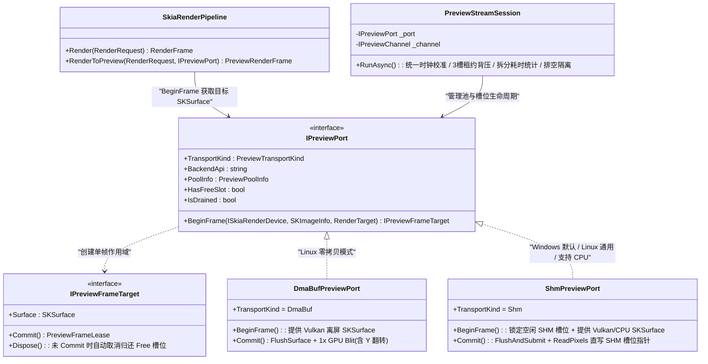
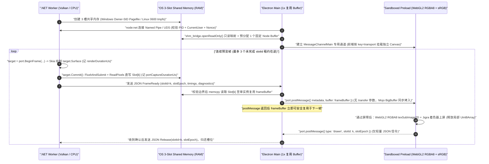
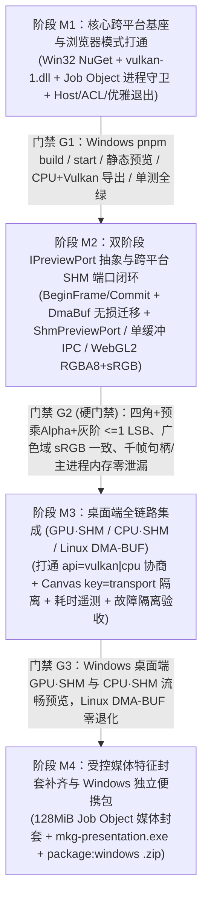

# 跨平台（Windows 优先）技术适配与 `IPreviewPort` 实施计划

状态：**设计已审阅定稿（v3），待按 M1 → M4 分阶段实施**。日期：2026-11-16。  
关联文档：[GPU 预览流 v1 合同](../architecture/gpu-preview-stream-v1.md)、[GPU 共享纹理预览实施计划](./gpu-shared-texture-preview-plan.md)、[GPU 预览生产验收记录](../performance/gpu-preview-production-2026-11-01.md)。

---

## 1. 架构决策定稿与核心取舍

### 1.1 已拍板的核心架构策略

1. **引入统一预览端口抽象（`IPreviewPort`），采用 `SHM` + `DMA-BUF` 双模路线**：
   - **默认传输策略**：**Windows 默认使用 `shm`（共享内存模式），Linux 默认保留 `dma-buf`（零拷贝模式）**；支持通过环境变量 `MAKO_PREVIEW_TRANSPORT=shm|dma-buf` 显式覆盖（Linux 下亦可切换至 `shm` 进行双平台同构验证）。
   - **严守显式语义（零静默降级）**：显式指定的渲染设备或传输模式在初始化失败时必须明确报错，绝不静默降级或伪造状态指标。
   - **不引入 Windows 定制 `libSkiaSharp` 编译与 D3D11↔Vulkan 跨 API 互操作**：`SHM` 模式直接使用官方 NuGet `SkiaSharp.NativeAssets.Win32` 标准接口完成像素回读，彻底规避 Windows 源码级 Skia 编译维护负担、跨图形 API 无锁同步隐患以及笔记本双显卡（核显+独显）跨卡导入失败难题。
2. **允许 `CpuSkiaRenderDevice` 接入 `ShmPreviewPort`**：
   - 解除前端 [render-device.ts](../../frontend/src/editor/model/render-device.ts)（`usesGpuStream`）与后端 [PreviewBackendService.GpuStream.cs](../../backend/src/MakoKaraGenerator.Backend.Server/PreviewBackendService.GpuStream.cs) 对 `cpu` 设备的连续流拦截。
   - 当桌面端显式切换为 CPU 光栅设备时，同样通过 `ShmPreviewPort` 提供连续预览流，前端标题与诊断状态如实标示 **`CPU · SHM`**（与 `GPU · SHM`、`GPU · DMA-BUF` 明确区分）；纯浏览器环境维持既有 HTTP 静态 PNG 预览与 500ms 控制节奏不变。
3. **分阶段推进顺序与 M4 边界（`M1 → M2 → M3 → M4`）**：
   - **M1～M3** 保持非 Linux 平台 `MakoMediaEnvelopeEnabled=false`（`BackendMediaFeatureService.TryCreate` 安全返回 `null`），优先完成核心跨平台基座、浏览器模式与桌面端 `SHM`/`DMA-BUF` 连续预览全链路验收。
   - **M4** 再实施 Windows `128 MiB` Job Object 媒体特征分析封套、`mkg-presentation.exe` 以及 `pnpm package:windows`（优先交付免安装 Portable `.zip` 便携包）。

### 1.2 各预览传输路径量化对比与真实开销边界

结合 [PreviewPanel.tsx](../../frontend/src/editor/preview/PreviewPanel.tsx) 的两档预览规格（`1280×720 @ 24fps`、`2560×1440 @ 30fps`）：

| 评估维度 | Windows 跨 API 零拷贝（暂不采用，留作未来插件） | **`SHM` 共享内存模式（Windows 默认 / Linux 通用 / 支持 CPU）** | Linux `DMA-BUF` 模式（保留现状） |
| :--- | :--- | :--- | :--- |
| **单帧体积 / 持续带宽** | `0 B` CPU 带宽 | 720p24：`3.68 MB`（`88.5 MB/s`） 1440p30：`14.75 MB`（`442.4 MB/s`） | `0 B` CPU 带宽 |
| **三槽共享池内存预算** | `<= 42.2 MiB` VRAM | **`10.5 MiB`（720p）/ `42.2 MiB`（1440p）RAM**（满足 `<= 64 MiB` 硬预算） | `<= 42.2 MiB` VRAM |
| **捕获与传输物理过程** | 同卡 D3D11 纹理导入 Vulkan + GPU Blit + 跨 API 同步 | **`FlushAndSubmit`（同步等待 GPU 绘制完成）+ PCIe 读回 Skia 缓冲 + CPU 拷入 SHM + Mojo `BigBuffer` 跨进程传输 + WebGL2 上传** | 定制 Skia 导出 `VkImage` + GPU Blit（含 Y 翻转）+ `vkQueueWaitIdle` + `SCM_RIGHTS` |
| **单帧捕获+上屏耗时** | `~0.4 ms`（不含队列等待） | 720p：`~1.2–1.8 ms`（占 `41.7ms` 预算 ~4%） 1440p：`~3.8–5.0 ms`（占 `33.3ms` 预算 ~14%，**会拍平 CPU/GPU 异步流水线，需独立监控**） | `~0.4 ms`（不含队列等待） |
| **定制 `libSkiaSharp` 依赖** | 必须维护 Windows Skia 源码补丁编译 | **零依赖**（直接使用官方 NuGet `SkiaSharp.NativeAssets.Win32`） | 维持现有 Linux 补丁产物 |
| **双显卡（核显+独显）兼容** | 跨卡直接失败，需强制同卡绑定 | **天然解耦**（独显全速跑 Vulkan 复杂渲染 + 核显合成窗口） | 强制同卡 DRM Render Node |
| **支持渲染设备 (`api`)** | 仅 `"vulkan"` | **`"vulkan"` 与 `"cpu"`**（未来 macOS 自动兼容 `"metal"`） | 仅 `"vulkan"` |

---

## 2. 全仓平台相关耦合点全景清单（实施索引）

除连续预览外，以下非图形耦合项同样是 Windows 运行的必要条件，实施时需逐项核销：

| 模块分类 | 涉及源码路径 | 现状 Linux 耦合点 | 目标跨平台改造动作 |
| :--- | :--- | :--- | :--- |
| **1. 渲染与预览端口接缝** | [GpuRenderFrame.cs](../../backend/src/MakoKaraGenerator.Rendering.Abstractions/GpuRenderFrame.cs) [SkiaRenderPipeline.cs](../../backend/src/MakoKaraGenerator.Rendering.Skia/SkiaRenderPipeline.cs) [VulkanGpuFramePool.cs](../../backend/src/MakoKaraGenerator.Rendering.Skia/VulkanGpuFramePool.cs) [ProjectRenderSession.cs](../../backend/src/MakoKaraGenerator.Runtime.Hosting/ProjectRenderSession.cs) | 连续预览强绑定 `VulkanSkiaRenderDevice`、DMA-BUF FD 与定制 `SkiaGpuBridge` 导出符号 | 提炼双阶段 `IPreviewPort`（`BeginFrame` + `Commit`）；既有逻辑封装为 `DmaBufPreviewPort`；新增跨平台 `ShmPreviewPort`（支持 Vulkan 与 CPU） |
| **2. Worker 预览流与通道** | [GpuStreamSession.cs](../../backend/src/MakoKaraGenerator.Backend.Worker/GpuStreamSession.cs) [GpuNativeChannel.cs](../../backend/src/MakoKaraGenerator.Backend.Worker/GpuNativeChannel.cs) [GpuStreamProtocol.cs](../../backend/src/MakoKaraGenerator.Backend.Worker/GpuStreamProtocol.cs) [GpuStreamWorkerSession.cs](../../backend/src/MakoKaraGenerator.Backend.Hosting/GpuStreamWorkerSession.cs) [PreviewBackendService.GpuStream.cs](../../backend/src/MakoKaraGenerator.Backend.Server/PreviewBackendService.GpuStream.cs) | 硬编码 `OperatingSystem.IsLinux()`、`api == "vulkan"`、`/tmp/mkg-gpu-.../broker.sock`、`AF_UNIX SOCK_SEQPACKET + SCM_RIGHTS` | 抽象 `IPreviewChannel`：`dma-buf` 维持原生通道，`shm` 使用纯 .NET `LocalStreamPreviewChannel`（Windows `CurrentUserOnly` Named Pipe / Linux UDS）；放开 `api: "vulkan" \| "cpu"` 并预留 `preferredGpuDevice` |
| **3. Electron 宿主与前端画布** | [desktop/main.cjs](../../desktop/main.cjs) [desktop/gpu-preview/preload.cjs](../../desktop/gpu-preview/preload.cjs) [desktop/gpu-preview/import-consumer.cjs](../../desktop/gpu-preview/import-consumer.cjs) [PreviewPanel.tsx](../../frontend/src/editor/preview/PreviewPanel.tsx) [render-device.ts](../../frontend/src/editor/model/render-device.ts) | 仅支持 `sharedTexture`（`nativePixmap`）与 `/proc/<gpuPid>/fd` DRM 节点校验；`usesGpuStream` 排除 `cpu` | 新增极简 `shm_bridge.node`（只读映射）+ 主进程单复用 `Buffer` + `MessagePortMain` + Preload WebGL2（`RGBA8` + `sRGB`）；前端 `<canvas key={transport}>` 节点隔离并支持 `CPU · SHM` |
| **4. .NET 原生资产与 Vulkan 加载** | [Directory.Packages.props](../../backend/Directory.Packages.props) [MakoKaraGenerator.Rendering.Skia.csproj](../../backend/src/MakoKaraGenerator.Rendering.Skia/MakoKaraGenerator.Rendering.Skia.csproj) [SkiaRenderBackend.cs](../../backend/src/MakoKaraGenerator.Rendering.Skia/SkiaRenderBackend.cs) | 仅引用 `.NativeAssets.Linux`；硬编码 `NativeLibrary.Load("libvulkan.so.1")` 与 `libdl.so.2` | 增加 `SkiaSharp.NativeAssets.Win32` 与 `HarfBuzzSharp.NativeAssets.Win32`；按平台加载 `"vulkan-1.dll"` / `"libvulkan.so.1"` / `"libvulkan.1.dylib"`；`Shm` 模式免除 Linux DRM 扩展要求 |
| **5. Worker 进程树与导出守卫** | [LinuxProcessGuards.cs](../../backend/src/MakoKaraGenerator.Processes/LinuxProcessGuards.cs) [OwnedProcessGroup.cs](../../backend/src/MakoKaraGenerator.Processes/OwnedProcessGroup.cs) [OwnedProcessTree.cs](../../backend/src/MakoKaraGenerator.Processes/OwnedProcessTree.cs) [WorkerProcessProxy.cs](../../backend/src/MakoKaraGenerator.Backend.Hosting/WorkerProcessProxy.cs) | 依赖 `prctl(PR_SET_CHILD_SUBREAPER)`、`setpgid`、`/proc/<pid>/stat`、`RLIMIT_FSIZE`；非 Linux 下直接拒绝音频预处理、SDK v2 包与视频导出 | 抽象 `IWorkerProcessGuard` / `IOwnedProcessGroup`，实现 `WindowsJobObjectGuard`（`JOB_OBJECT_LIMIT_KILL_ON_JOB_CLOSE` + `GetProcessTimes` `CreationTime` 身份校验 + FFmpeg `-fs` 及输出流字节上限监控） |
| **6. 构建、宿主、ACL 权限与退出** | [host.py](../../backend/tools/backend-web-host/host.py) [backend-host.cjs](../../desktop/runtime/backend-host.cjs) [launch-contract.cjs](../../desktop/gpu-preview/launch-contract.cjs) [standalone-paths.cjs](../../desktop/runtime/standalone-paths.cjs) [backend-launcher.mjs](../../frontend/scripts/backend-launcher.mjs) [scripts/app.mjs](../../scripts/app.mjs) [scripts/desktop-build.mjs](../../scripts/desktop-build.mjs) [package.json](../../package.json) | 锁死 `linux-x64`；调用 `process.getuid()` 与 `0o600` 校验（Windows 必崩）；读 `/proc` 清理残留；`flock` / `nm -D`；`startsWith(root + '/')`；`SIGTERM` 在 Windows 退化为 `TerminateProcess` 强杀 | 统一映射 `win-x64`/`linux-x64`；`msvcrt.locking` 替代 `flock`；`private-fs.cjs` 实现 Windows 当前用户 SID NTFS DACL；`path.relative` 边界检查；记录 `(pid, creationTicks)` 清理陈旧文件；受控优雅退出通道；Windows 数据目录落 `%LOCALAPPDATA%`；兼容 Node `>=24` 与 `corepack pnpm` |
| **7. 受控媒体特征封套（M4）** | [MakoKaraGenerator.Backend.Server.csproj](../../backend/src/MakoKaraGenerator.Backend.Server/MakoKaraGenerator.Backend.Server.csproj) [BackendMediaFeatureService.cs](../../backend/src/MakoKaraGenerator.Backend.Hosting/BackendMediaFeatureService.cs) [backend/native/media-envelope/](../../backend/native/media-envelope/README.md) [backend/native/media-presentation/](../../backend/native/media-presentation/CMakeLists.txt) | `sd-bus` systemd 临时单元 `MemoryMax=128M` + `mkg-presentation`（`ldd` + `dl_iterate_phdr`） | M1～M3 保持 `MakoMediaEnvelopeEnabled=false` 安全返回 `null`；M4 实现 Job Object `JOB_OBJECT_LIMIT_PROCESS_MEMORY = 128 MiB` 封套与 Windows `mkg-presentation.exe` |
| **8. 桌面分发打包（M4）** | [scripts/package-appimage.mjs](../../scripts/package-appimage.mjs) | 仅支持 Linux AppImage | M4 新增 `scripts/package-windows.mjs`（`pnpm package:windows`），组装自包含 `win-x64` 后端、前端、Electron `45.2.1` 与 `shm_bridge.node` 为免安装 Portable `.zip` |

---

## 3. 关键技术细节核证与硬性实现规范

### 3.1 Electron 主进程到沙箱 Preload 的单缓冲 IPC 规范（修正 `MessagePortMain` 契约）

> [!CAUTION]
> **红线约束**：Electron 主进程的 `MessagePortMain.postMessage(message, [transfer])` 第二个参数**仅接受 `MessagePortMain[]` 端口数组，不支持 Web 标准的 Transferable `ArrayBuffer`**——传入 `[buffer]` 会在运行时直接抛出类型异常崩溃；同时主进程与开启 `sandbox: true` 的渲染进程处于各自独立的 V8 Memory Cage 内，无法跨进程直接映射外部裸指针或零分配过户 `ArrayBuffer`。

1. **主进程侧（单固定复用 `Buffer`）**：
   - 每个预览流在 `attach` 时仅预分配 **1 个固定复用的 `Buffer.allocUnsafe(maxSlotBytes)`**。
   - 收到 Worker 的 `FrameReady(slotId)` 后，由极简 C 插件 `shm_bridge.node`（仅依赖系统 `<windows.h>` `OpenFileMappingW`/`MapViewOfFile` 或 POSIX `open`/`mmap`，零图形库依赖）严格校验 `(slotId, offset, byteLength <= shmTotalBytes)` 并 `memcpy` 至该复用缓冲切片 `frameView`，随后调用 **`port.postMessage({ metadata, buffer: frameView })`（严禁传第二个 `transfer` 参数）**。
   - **同步复用依据**：`MessagePortMain.postMessage` 内部在主线程同步执行 `v8::ValueSerializer::WriteValue`，在调用返回前已将字节完整拷入 Chromium `CloneableMessage`（`> 64 KB` 自动走 `mojo_base::BigBuffer` 共享内存段），因此返回后主进程该 `Buffer` 立即可安全用于下一帧。
2. **渲染进程侧（轻量回执与 3 槽租约背压）**：
   - `preload.cjs` 在 `port.onmessage` 中接收反序列化生成的局部 `Uint8Array`（位于渲染进程 V8 新生代堆，完成 `gl.texSubImage2D` 后立即释放引用交由 V8 Scavenger 回收），**严禁把像素缓冲发回主进程**，仅回传 `< 300 B` 的轻量信令 `{ type: 'drawn', ...lease }`（或丢弃时的 `{ type: 'released', ...lease }`）。
   - 主进程仅在收到对应租约回执后才向 Worker 发送 `release(slotId, slotEpoch)`；端到端严格由「最多 3 个未完成 `slotId` 租约」维持背压。

### 3.2 前端 `<canvas>` 上下文隔离与 WebGL2 sRGB / 预乘精确契约

1. **DOM `<canvas>` 按 `transport` 隔离**：
   - 同一 `<canvas>` 一旦调用 `getContext('2d')`（`dma-buf`）或 `getContext('webgl2')`（`shm`），其上下文模式即终身锁定，混用返回 `null`。
   - [PreviewPanel.tsx](../../frontend/src/editor/preview/PreviewPanel.tsx) 必须为预览 `<canvas>` 绑定 **`key={transport}`**（按 `"dma-buf"` 与 `"shm"` 隔离 DOM 节点，而同一 `transport` 下的换源/改尺寸复用该节点，防止频繁新建触发 Chromium 单页 16 个活动 WebGL 上下文硬上限）；`preload.cjs` 按当前 DOM `canvas` 引用绑定 WebGL2 状态并监听 `webglcontextlost` 执行受控流隔离。
2. **WebGL2 零色差渲染配置**：
   - 获取上下文：`canvas.getContext('webgl2', { alpha: true, premultipliedAlpha: true, antialias: false, depth: false, stencil: false, preserveDrawingBuffer: config.mode === 'correctness' })`。
   - 色彩空间锁定：显式设置 `gl.drawingBufferColorSpace = 'srgb'`，防止在广色域（Display P3 / HDR）显示器上出现与 `dma-buf` `VideoFrame` 不一致的色彩拉伸。
   - 解包参数：`gl.pixelStorei(gl.UNPACK_PREMULTIPLY_ALPHA_WEBGL, false)`（源像素已是 Skia 预乘 Alpha，禁止二次预乘）、`gl.pixelStorei(gl.UNPACK_FLIP_Y_WEBGL, false)`、`gl.pixelStorei(gl.UNPACK_COLORSPACE_CONVERSION_WEBGL, gl.NONE)`。
   - **纹理内部格式必须使用 `gl.RGBA8`（严禁使用 `gl.SRGB8_ALPHA8`）**：WebGL2 默认画布帧缓冲（`null`）不支持 `GL_FRAMEBUFFER_SRGB` 硬件重编码；若误用 `SRGB8_ALPHA8`，采样器会将 sRGB 字节解码为线性值后原样写入默认缓冲，导致中间灰阶严重压暗。使用 `gl.texStorage2D(gl.TEXTURE_2D, 1, gl.RGBA8, width, height)` 搭配 `gl.NEAREST`（或 `texelFetch` 整数坐标读取）+ 片元着色器 `.bgra` 通道重排，可达到 `0 LSB` 无损直通（`correctness` 模式用 `gl.readPixels` 取样时按 `height - 1 - py` 翻转纵坐标对齐左上原点）。

### 3.3 Worker 渲染与端口捕获耗时拆分（保持 `diagnostics` 契约纯净）

- 现有协议中 `FrameReady.diagnostics`（见 [GpuStreamDiagnostics.cs](../../backend/src/MakoKaraGenerator.Backend.Worker/GpuStreamDiagnostics.cs) 与 [desktop/main.cjs](../../desktop/main.cjs)）专用于承载作者脚本/材质警告与错误摘要（`GpuStreamDiagnosticSummary`，无告警时为 `null`），不得混入常规性能计时字段。
- 在 `FrameReady` 的 `timings` / `counters` 同级遥测字段及 `main.cjs` 采样记录中，拆分为：
  - `renderDurationUs`：`PrepareAsync` + `SkiaRenderPipeline` 在目标 `SKSurface` 上的纯业务绘制耗时（微秒）；
  - `portCaptureDurationUs`：`IPreviewFrameTarget.Commit()` 执行 `FlushAndSubmit + ReadPixels`（`SHM`）或 `FlushSurface + Blit + QueueWaitIdle`（`DMA-BUF`）的耗时（微秒）；
  - `counters.cpuPixelReadbacks`：`DMA-BUF` 报 `0`，`SHM` 如实报 `1`。

---

## 4. `IPreviewPort` 双阶段架构设计与系统交互图

### 4.1 双阶段帧租约（`BeginFrame` + `Commit`）与扩展预留

1. **双阶段接口语义**：
   - 渲染管道在完成 `PrepareAsync` 并确定本帧 `SKImageInfo`（含动态 `SKColorSpace`）后，调用 `using IPreviewFrameTarget frameTarget = previewPort.BeginFrame(device, surfaceInfo, renderTarget)` 锁定空闲槽位并取得绘制目标 `frameTarget.Surface`。
   - 全部业务绘制完成后调用 `frameTarget.Commit()` 产出 `PreviewFrameLease`：
     - `ShmPreviewPort` 在 `Commit()` 中执行 `device.FlushAndSubmit(surface)` + `device.ReadPixels(surface, surfaceInfo, slotPtr, stride)`（原样透传 `surfaceInfo` 以避免触发多余色彩空间转换缓冲）+ 跨进程内存屏障。
     - `DmaBufPreviewPort` 在 `Commit()` 中执行定制 Skia `FlushSurface` + `vkCmdBlitImage`（含 Y 翻转）+ `vkQueueWaitIdle`。
     - **未来直渲零拷贝演进**：未来若接入 macOS Metal `IOSurface` 或 Windows 同卡直渲纹理，`BeginFrame` 可直接返回包装在槽位共享纹理上的 `SKSurface`（注：因 [SkiaRenderPipeline.cs](../../backend/src/MakoKaraGenerator.Rendering.Skia/SkiaRenderPipeline.cs) 的 `CaptureSceneBackdrop` 会对目标表面调用 `surface.Snapshot()`，直渲端口须通过带采样标志的 `GRBackendTexture` 而非纯 `GRBackendRenderTarget` 包装 `SKSurface`），无需离屏拷贝。
   - **异常安全取消**：若 `Commit()` 前抛出任何异常（如 `ImageSurfaceBudgetException` 或作者 `EffectFailureException`），`frameTarget.Dispose()` 自动将槽位从 `Writing` 退回 `Free`，保持既有 `drained: true` 排空语义。
2. **协议预留与去 Vulkan 硬编码**：
   - 建流与 Worker 启动参数保留可空的 `PreferredGpuDevice`（承载 `VendorId`、`DeviceId`、Linux `DrmRenderMajor/Minor`、Windows 8 字节 `DeviceLuid`、macOS `MetalRegistryId`）。`SHM` 模式下传 `null`，充分发挥独显全速渲染 + 核显显示合成优势；同卡零拷贝模式下启用精确选卡。
   - 内部接口与帧类型统一去 Vulkan 硬编码（`IPreviewRenderSession`、`PreviewRenderFrame`、`PreviewStreamSession`），协议 `api` 字段支持 `"vulkan" | "cpu"`（枚举层预留 `"metal"`），HTTP 路由保留 `/api/v1/gpu-preview-streams` 兼容既有客户端。

### 4.2 `SHM` 模式完整运行序列图

---

## 5. 分阶段实施路线图与硬门禁（M1 → M4）

实施须遵守仓库 [AGENTS.md](../../AGENTS.md) 约定：每步一个中文 `type(scope): 摘要` 提交，按所属路径暂存并保留并行改动；严禁按进程名批量杀进程（必须按自有 PID + `CreationTime`/`StartTicks` 身份停止）。

| 阶段 | 核心工作清单 | 门禁验收标准 |
| :--- | :--- | :--- |
| **M1：基础跨平台与浏览器模式** | 1. 引入 `SkiaSharp`/`HarfBuzzSharp` Win32 NuGet 包，适配 `vulkan-1.dll` 加载器与 DirectWrite TTC 字体单测； 2. 实现 `WindowsJobObjectGuard`（`KILL_ON_JOB_CLOSE` + `CreationTime` 身份校验 + FFmpeg `-fs` / 输出字节监控）解除音频、SDK v2 包与导出守卫阻断； 3. 完成 `host.py`、`backend-host.cjs`、`private-fs.cjs`（Windows 当前用户 SID DACL）、`app.mjs` 路径与受控优雅退出改造。 | **门禁 G1**：Windows 本机 `dotnet test`、`pnpm test:unit`、`pnpm build`、`pnpm start` 通过；浏览器端静态 PNG 预览、音频波形预处理、SDK v2 脚本包及 CPU/Vulkan 视频导出实测通过。 |
| **M2：`IPreviewPort` 抽象与 `SHM` 硬门禁** | 1. 落地双阶段 `IPreviewPort`（`BeginFrame` + `Commit`）、`PreferredGpuDevice` 预留字段及 `api: "vulkan" \| "cpu"` 模型，将既有 Linux 逻辑无损迁入 `DmaBufPreviewPort`； 2. 实现 `ShmPreviewPort`（Windows Pagefile Section / Linux tmpfs）与纯 .NET `LocalStreamPreviewChannel`（`CurrentUserOnly` Named Pipe / UDS）； 3. 实现 `shm_bridge.node`（VS `cl.exe` / Linux `clang++` 编译）、主进程单复用 `Buffer` + `MessagePortMain.postMessage`（无 `transfer` 参数）及 `preload.cjs` WebGL2（`RGBA8` + `drawingBufferColorSpace='srgb'` + `UNPACK_PREMULTIPLY_ALPHA_WEBGL=false`）； 4. 独立拆分上报 `renderDurationUs` 与 `portCaptureDurationUs`。 | **门禁 G2（硬门禁）**： 1. **像素与色彩精度**：四角纯色、预乘半透明 `[255,0,255,128]`、全透明 `[0,0,0,0]`、8 级灰阶（验证无 `SRGB8_ALPHA8` 伽马压暗）与 16 位帧序号全部误差 `<= 1 LSB`； 2. **内存与句柄稳定性**：`MessagePortMain` 零异常，连续 1000 帧压力运行下 OS 句柄数零增长、主进程内存平稳、慢消费者 3 槽租约背压严格限制在途帧 `<= 3`； 3. **遥测完整性**：每帧准确产出拆分的 `renderDurationUs` 与 `portCaptureDurationUs`。 |
| **M3：桌面端完整集成与多模验收** | 1. 打通 `PreviewBackendService` 与前端 `PreviewPanel`（`<canvas key={transport}>` 节点隔离，放开 `usesGpuStream` 支持 `GPU · SHM`、`CPU · SHM` 与 Linux `GPU · DMA-BUF`）； 2. 改造 `scripts/desktop-build.mjs`（Windows 免定制 Skia 编译，直接调用 VS BuildTools `cl.exe` 构建 `shm_bridge.node`）； 3. 跑通暂停/定位/换源/改尺寸/作者错误在途排空与渲染/Worker 强杀故障隔离测试。 | **门禁 G3**：Windows 下 `pnpm build:desktop` 与 `pnpm desktop` 成功运行 Electron `45.2.1`，`GPU · SHM` 与切换至 `CPU · SHM` 均流畅播放且无 Canvas 上下文锁定冲突；`1440p30` 下可清晰观测渲染与回读拆分耗时；Linux `DMA-BUF` 与 `SHM` 回归全绿。 |
| **M4：媒体封套与便携包交付** | 1. 实现 Windows `128 MiB` Job Object 媒体特征封套与 `mkg-presentation.exe`，启用 Windows 端 `MakoMediaEnvelopeEnabled`； 2. 实现 `scripts/package-windows.mjs`（`pnpm package:windows`）生成免安装 Portable `.zip` 便携包。 | **门禁 G4**：超限畸形媒体触发 128 MiB OOM 受控拦截测试通过；Portable `.zip` 解压至干净隔离目录后启动、预览、导出、优雅退出清理全链路通过。 |
