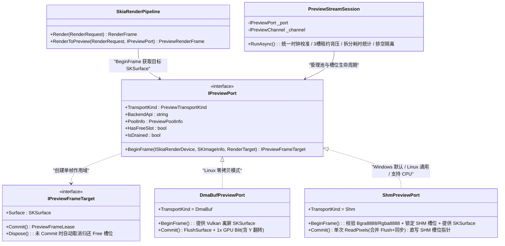
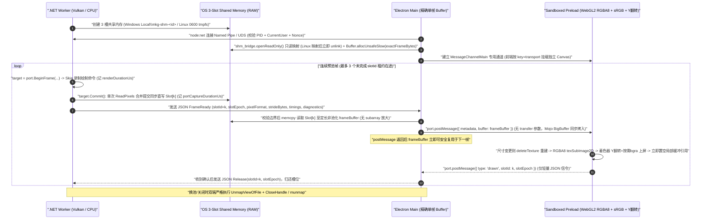
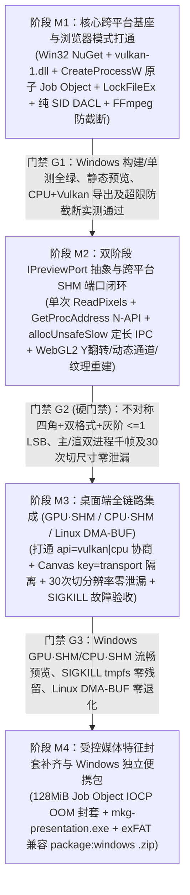

# 跨平台（Windows 优先）技术适配与 `IPreviewPort` 实施计划

状态：**设计已交叉核证定稿（v3.1）；M1 已完成（Windows G1 于 2026-11-16 通过，Linux M1 修复于 2026-11-17 复验通过）；M2 平台无关公共层与 Linux 全链路已按方式 B 合并主线（Linux G2 于 2026-11-18 通过）；M3 阶段 Linux 侧全链路集成与门禁验收于 2026-11-19 通过（产品 `0.116.0`、合同 `1.57.0`）；Windows 侧 M2 OS 叶子实现、Windows M3 实机 G3 与 M4 媒体封套/便携包统一延后至 M4 在 Windows 环境下实施与验收**。

验收依据：[M1 修复与 G1 实测记录](../integration/2026-11-16-cross-platform-m1.md)（`1bb1bef84d309aaadc6c1d35bd54a9fefb9e4ba5`，`win-x64`）、[Linux M1 修复与复验](../integration/2026-11-17-linux-m1-fixes.md)、[M2 方式 B 与 Linux G2 实测记录](../integration/2026-11-18-cross-platform-m2-linux-g2.md)、[M3 Linux 侧全链路实施与门禁验收记录](../integration/2026-11-19-cross-platform-m3-linux.md)。

关联文档：[GPU 预览流 v1 合同](../architecture/gpu-preview-stream-v1.md)、[GPU 共享纹理预览实施计划](./gpu-shared-texture-preview-plan.md)、[GPU 预览生产验收记录](../performance/gpu-preview-production-2026-11-01.md)。

---

## 1. 架构决策定稿与核心取舍

### 1.1 已拍板的核心架构策略

1. **引入统一预览端口抽象（`IPreviewPort`），采用 `SHM` + `DMA-BUF` 双模路线**：
   - **默认传输策略**：**Windows 默认使用 `shm`（共享内存模式），Linux 默认保留 `dma-buf`（零拷贝模式）**；支持通过环境变量 `MAKO_PREVIEW_TRANSPORT=shm|dma-buf` 显式覆盖（Linux 下亦可切换至 `shm` 进行双平台同构验证）。
   - **严守显式语义（零静默降级）**：显式指定的渲染设备或传输模式在初始化失败时必须明确报错，绝不静默降级或伪造状态指标。
   - **不引入 Windows 定制 `libSkiaSharp` 编译与 D3D11↔Vulkan 跨 API 互操作**：`SHM` 模式直接使用官方 NuGet `SkiaSharp.NativeAssets.Win32` 标准接口完成像素回读，彻底规避 Windows 源码级 Skia 编译维护负担、跨图形 API 无锁同步隐患以及笔记本双显卡（核显+独显）跨卡导入失败难题。
2. **允许 `CpuSkiaRenderDevice` 接入 `ShmPreviewPort`**：
   - 解除前端 [render-device.ts](../../frontend/src/editor/model/render-device.ts)（`usesGpuStream`）与后端 [PreviewBackendService.GpuStream.cs](../../backend/src/MakoKaraGenerator.Backend.Server/PreviewBackendService.GpuStream.cs) 对 `cpu` 设备的连续流拦截。
   - 当桌面端显式切换为 CPU 光栅设备时，同样通过 `ShmPreviewPort` 提供连续预览流，前端标题与诊断状态如实标示 **`CPU · SHM`**（与 `GPU · SHM`、`GPU · DMA-BUF` 明确区分）；纯浏览器环境维持既有 HTTP 静态 PNG 预览与 500ms 控制节奏不变。
3. **分阶段推进顺序与 M4 边界（`M1 → M2 → M3 → M4`）**：
   - **M1～M3** 保持非 Linux 平台 `MakoMediaEnvelopeEnabled=false`（`BackendMediaFeatureService.TryCreate` 安全返回 `null`），优先完成核心跨平台基座、浏览器模式与桌面端 `SHM`/`DMA-BUF` 连续预览全链路验收。
   - **M4** 再实施 Windows `128 MiB` Job Object 媒体特征分析封套（IOCP 内存超限事件判据）、原生媒体探针 `mkg-presentation.exe` 以及 `pnpm package:windows`（优先交付免安装 Portable `.zip` 便携包）。

### 1.2 各预览传输路径量化对比与真实开销边界

结合 [PreviewPanel.tsx](../../frontend/src/editor/preview/PreviewPanel.tsx) 的两档预览规格（`1280×720 @ 24fps`、`2560×1440 @ 30fps`）：

| 评估维度 | Windows 跨 API 零拷贝（暂不采用，留作未来插件） | **`SHM` 共享内存模式（Windows 默认 / Linux 通用 / 支持 CPU）** | Linux `DMA-BUF` 模式（保留现状） |
| :--- | :--- | :--- | :--- |
| **单帧体积 / 持续带宽** | `0 B` CPU 带宽 | 720p24：`3.68 MB`（`88.5 MB/s`） 1440p30：`14.75 MB`（`442.4 MB/s`） | `0 B` CPU 带宽 |
| **三槽共享池内存预算** | `<= 42.2 MiB` VRAM | **`10.5 MiB`（720p）/ `42.2 MiB`（1440p）RAM**（满足 `<= 64 MiB` 硬预算） | `<= 42.2 MiB` VRAM |
| **捕获与传输物理过程** | 同卡 D3D11 纹理导入 Vulkan + GPU Blit + 跨 API 同步 | **单次 `ReadPixels`（Ganesh 自动合并 Flush + Staging 拷贝 + 单次 Fence 同步直写 SHM 槽位）+ 主进程精确单帧 `Buffer` 拷入 + Mojo `BigBuffer` 跨进程传输 + WebGL2 上传（含着色器零开销 Y 翻转）** | 定制 Skia 导出 `VkImage` + GPU Blit（含 Y 翻转）+ `vkQueueWaitIdle` + `SCM_RIGHTS` |
| **单帧捕获+上屏耗时** | `~0.4 ms`（不含队列等待） | 720p：`~1.0–1.6 ms`（占 `41.7ms` 预算 ~4%） 1440p：`~3.2–4.5 ms`（占 `33.3ms` 预算 ~13%，**会拍平 CPU/GPU 异步流水线，需独立监控**） | `~0.4 ms`（不含队列等待） |
| **定制 `libSkiaSharp` 依赖** | 必须维护 Windows Skia 源码补丁编译 | **零依赖**（直接使用官方 NuGet `SkiaSharp.NativeAssets.Win32`） | 维持现有 Linux 补丁产物 |
| **双显卡（核显+独显）兼容** | 跨卡直接失败，需强制同卡绑定 | **天然解耦**（独显全速跑 Vulkan 复杂渲染 + 核显合成窗口） | 强制同卡 DRM Render Node |
| **支持渲染设备 (`api`)** | 仅 `"vulkan"` | **`"vulkan"` 与 `"cpu"`**（未来 macOS 自动兼容 `"metal"`） | 仅 `"vulkan"` |

---

## 2. 全仓平台相关耦合点全景清单（实施索引）

除连续预览外，以下非图形耦合项同样是 Windows 运行的必要条件，实施时需逐项核销：

| 模块分类 | 涉及源码路径 | 现状 Linux 耦合点 | 目标跨平台改造动作 |
| :--- | :--- | :--- | :--- |
| **1. 渲染与预览端口接缝** | [GpuRenderFrame.cs](../../backend/src/MakoKaraGenerator.Rendering.Abstractions/GpuRenderFrame.cs) [SkiaRenderPipeline.cs](../../backend/src/MakoKaraGenerator.Rendering.Skia/SkiaRenderPipeline.cs) [VulkanGpuFramePool.cs](../../backend/src/MakoKaraGenerator.Rendering.Skia/VulkanGpuFramePool.cs) [ProjectRenderSession.cs](../../backend/src/MakoKaraGenerator.Runtime.Hosting/ProjectRenderSession.cs) | 连续预览强绑定 `VulkanSkiaRenderDevice`、DMA-BUF FD 与定制 `SkiaGpuBridge` 导出符号 | 提炼双阶段 `IPreviewPort`（`BeginFrame` + `Commit`）；既有逻辑封装为 `DmaBufPreviewPort`；新增跨平台 `ShmPreviewPort`（支持 Vulkan 与 CPU，单次 `ReadPixels` 合并同步，显式暴露 `pixelFormat` 与 `strideBytes`） |
| **2. Worker 预览流与通道** | [GpuStreamSession.cs](../../backend/src/MakoKaraGenerator.Backend.Worker/GpuStreamSession.cs) [GpuNativeChannel.cs](../../backend/src/MakoKaraGenerator.Backend.Worker/GpuNativeChannel.cs) [GpuStreamProtocol.cs](../../backend/src/MakoKaraGenerator.Backend.Worker/GpuStreamProtocol.cs) [GpuStreamWorkerSession.cs](../../backend/src/MakoKaraGenerator.Backend.Hosting/GpuStreamWorkerSession.cs) [PreviewBackendService.GpuStream.cs](../../backend/src/MakoKaraGenerator.Backend.Server/PreviewBackendService.GpuStream.cs) | 硬编码 `OperatingSystem.IsLinux()`、`api == "vulkan"`、`/tmp/mkg-gpu-.../broker.sock`、`AF_UNIX SOCK_SEQPACKET + SCM_RIGHTS` | 抽象 `IPreviewChannel`：`dma-buf` 维持原生通道，`shm` 使用纯 .NET `LocalStreamPreviewChannel`（Windows `CurrentUserOnly` Named Pipe / Linux UDS）；共享内存固定 `Local\mkg-shm-<id>`（Windows）或打开即 `unlink` 的 `0600 tmpfs`（Linux）；放开 `api: "vulkan" \| "cpu"` 并预留 `preferredGpuDevice` |
| **3. Electron 宿主与前端画布** | [desktop/main.cjs](../../desktop/main.cjs) [desktop/gpu-preview/preload.cjs](../../desktop/gpu-preview/preload.cjs) [desktop/gpu-preview/import-consumer.cjs](../../desktop/gpu-preview/import-consumer.cjs) [PreviewPanel.tsx](../../frontend/src/editor/preview/PreviewPanel.tsx) [render-device.ts](../../frontend/src/editor/model/render-device.ts) | 仅支持 `sharedTexture`（`nativePixmap`）与 `/proc/<gpuPid>/fd` DRM 节点校验；`usesGpuStream` 排除 `cpu` | 新增极简 `shm_bridge.node`（Windows 采用 `GetProcAddress(GetModuleHandleW(nullptr), ...)` 动态解析 N-API 符号，配对 `UnmapViewOfFile`）+ 主进程按流精确分配 `Buffer.allocUnsafeSlow(exactFrameBytes)` + `MessagePortMain` + Preload WebGL2（`WeakMap` 状态缓存、尺寸变更 `deleteTexture` 重建、`RGBA8` + `sRGB` + 着色器纵轴翻转与动态 `bgra`/`rgba` 重排）；前端 `<canvas key={transport}>` 节点隔离并支持 `CPU · SHM` |
| **4. .NET 原生资产与 Vulkan 加载** | [Directory.Packages.props](../../backend/Directory.Packages.props) [MakoKaraGenerator.Rendering.Skia.csproj](../../backend/src/MakoKaraGenerator.Rendering.Skia/MakoKaraGenerator.Rendering.Skia.csproj) [SkiaRenderBackend.cs](../../backend/src/MakoKaraGenerator.Rendering.Skia/SkiaRenderBackend.cs) | 仅引用 `.NativeAssets.Linux`；硬编码 `NativeLibrary.Load("libvulkan.so.1")` 与 `libdl.so.2` | 增加 `SkiaSharp.NativeAssets.Win32` 与 `HarfBuzzSharp.NativeAssets.Win32`；按平台加载 `"vulkan-1.dll"` / `"libvulkan.so.1"` / `"libvulkan.1.dylib"`；`Shm` 模式免除 Linux DRM 扩展要求 |
| **5. Worker 进程树与导出守卫** | [LinuxProcessGuards.cs](../../backend/src/MakoKaraGenerator.Processes/LinuxProcessGuards.cs) [OwnedProcessGroup.cs](../../backend/src/MakoKaraGenerator.Processes/OwnedProcessGroup.cs) [OwnedProcessTree.cs](../../backend/src/MakoKaraGenerator.Processes/OwnedProcessTree.cs) [WorkerProcessProxy.cs](../../backend/src/MakoKaraGenerator.Backend.Hosting/WorkerProcessProxy.cs) [FfmpegCommandLine.cs](../../backend/src/MakoKaraGenerator.Export/FfmpegCommandLine.cs) [FfmpegMediaEncoder.cs](../../backend/src/MakoKaraGenerator.Export/FfmpegMediaEncoder.cs) | 依赖 `prctl(PR_SET_CHILD_SUBREAPER)`、`setpgid`、`/proc/<pid>/stat`、`RLIMIT_FSIZE`；非 Linux 下直接拒绝音频预处理、SDK v2 包与视频导出；`-fs maxBytes` 在无 `RLIMIT_FSIZE` 时会以退出码 `0` 静默截断 | 抽象 `IWorkerProcessGuard` / `IOwnedProcessGroup`，实现 `WindowsJobObjectGuard`（`CreateProcessW` + `PROC_THREAD_ATTRIBUTE_JOB_LIST` 启动前原子入组 + `JOB_OBJECT_LIMIT_KILL_ON_JOB_CLOSE` + `CreationTime` 身份校验）；FFmpeg `-fs` 设为 `maxBytes + 64 KiB` 兜底，配合共享句柄 `FileStream.Length`（`GetFileSizeEx`）监控与收尾校验真实字节数，超限立即杀进程删残片报错 |
| **6. 构建、宿主、ACL 权限与退出** | [host.py](../../backend/tools/backend-web-host/host.py) [backend-host.cjs](../../desktop/runtime/backend-host.cjs) [launch-contract.cjs](../../desktop/gpu-preview/launch-contract.cjs) [standalone-paths.cjs](../../desktop/runtime/standalone-paths.cjs) [backend-launcher.mjs](../../frontend/scripts/backend-launcher.mjs) [scripts/app.mjs](../../scripts/app.mjs) [scripts/desktop-build.mjs](../../scripts/desktop-build.mjs) [package.json](../../package.json) | 锁死 `linux-x64`；调用 `process.getuid()` 与 `0o600` 校验（Windows 必崩）；读 `/proc` 清理残留；`flock` / `nm -D`；`startsWith(root + '/')`；`SIGTERM` 在 Windows 退化为 `TerminateProcess` 强杀 | 统一映射 `win-x64`/`linux-x64`；`host.py` 锁独立旁路 `.lock` 空文件并用 `ctypes.windll.kernel32.LockFileEx` 替代 `flock`（严禁 `msvcrt.locking`）；`private-fs.cjs` 仅在父级运行时目录一次性设置纯当前用户 SID 受保护继承 NTFS DACL；运行时敏感/锁/状态目录默认落 `%LOCALAPPDATA%\makokara-generator`（兼容 exFAT 便携解压）；`path.relative` 边界检查；记录 `(pid, creationTicks)` 清理陈旧文件；受控优雅退出通道；兼容 Node `>=24` 与 `corepack pnpm` |
| **7. 受控媒体特征封套（M4）** | [MakoKaraGenerator.Backend.Server.csproj](../../backend/src/MakoKaraGenerator.Backend.Server/MakoKaraGenerator.Backend.Server.csproj) [BackendMediaFeatureService.cs](../../backend/src/MakoKaraGenerator.Backend.Hosting/BackendMediaFeatureService.cs) [LinuxSystemdEnvelopeBackend.cs](../../backend/src/MakoKaraGenerator.Processes/MediaEnvelope/LinuxSystemdEnvelopeBackend.cs) [backend/native/media-presentation/](../../backend/native/media-presentation/CMakeLists.txt) | `sd-bus` systemd 临时单元 `MemoryMax=128M` + `Result == "oom-kill"` + 原生探针 `mkg-presentation`（`ldd` + `dl_iterate_phdr`） | M1～M3 保持 `MakoMediaEnvelopeEnabled=false` 安全返回 `null`；M4 实现 `CreateProcessW` + `PROC_THREAD_ATTRIBUTE_JOB_LIST` 原子入组 + `JOB_OBJECT_LIMIT_PROCESS_MEMORY \| JOB_OBJECT_LIMIT_JOB_MEMORY = 128 MiB` + 关联 IOCP 监听 `JOB_OBJECT_MSG_*_MEMORY_LIMIT` 确定性 OOM 判据 + Windows `mkg-presentation.exe` |
| **8. 桌面分发打包（M4）** | [scripts/package-appimage.mjs](../../scripts/package-appimage.mjs) | 仅支持 Linux AppImage | M4 新增 `scripts/package-windows.mjs`（`pnpm package:windows`），组装自包含 `win-x64` 后端、前端、Electron `45.2.1`（可定制主程序名 `MakoKaraGenerator.exe`）与 `shm_bridge.node` 为免安装 Portable `.zip`，运行时状态落 `%LOCALAPPDATA%` 确保解压在 exFAT 分区亦可正常启动 |

---

## 3. 关键技术细节核证与硬性实现规范（v3.1 核证定稿）

### 3.1 Electron 主进程到沙箱 Preload 的定长单缓冲 IPC 与外部内存回收规范

> [!CAUTION]
> **双重红线约束**：
> 1. Electron 主进程的 `MessagePortMain.postMessage(message, [transfer])` 第二个参数**仅接受 `MessagePortMain[]` 端口数组，不支持 Web 标准的 Transferable `ArrayBuffer`**——传入 `[buffer]` 会在运行时直接抛出类型异常崩溃；同时主进程与开启 `sandbox: true` 的渲染进程处于各自独立的 V8 Memory Cage 内，无法跨进程直接映射裸指针或零分配过户 `ArrayBuffer`。
> 2. V8 的 `ValueSerializer::WriteJSArrayBufferView`（`src/objects/value-serializer.cc`）在序列化任何 `TypedArray` / `Buffer` 切片视图时，**会先调用 `WriteJSArrayBuffer(view->buffer())` 将底层整块 `JSArrayBuffer` 全量序列化写入 `CloneableMessage` / `mojo_base::BigBuffer`**，随后才记录 `(byteOffset, byteLength)`。若按最大规格（`14.75 MB`）预分配再在 `720p` 下传 `subarray(0, 3686400)`，每帧仍会跨进程拷贝整块 `14.75 MB`（带宽放大 4 倍）；若误落入 Node 共享 slab 池还会连带序列化无关内存。

1. **主进程侧（按流/按池精确分配独立定长 `Buffer`）**：
   - 在预览流 `attach` 或 `poolGeneration` 换池时，按当前共享池的精确单帧字节数 `exactFrameBytes = strideBytes * height` 调用 **`Buffer.allocUnsafeSlow(exactFrameBytes)`** 分配非池化独立定长缓冲，并强制断言 `frameBuffer.byteOffset === 0 && frameBuffer.buffer.byteLength === exactFrameBytes`，**严禁从更大的 `maxSlotBytes` 缓冲切 `subarray`**。
   - 收到 Worker 的 `FrameReady(slotId)` 后，由 `shm_bridge.node` 严格校验 `(slotId, offset, exactFrameBytes <= shmTotalBytes)` 并 `memcpy` 至 `frameBuffer`，随后调用 **`port.postMessage({ metadata, buffer: frameBuffer })`（严禁传第二个 `transfer` 参数）**。
   - **同步复用依据**：`MessagePortMain.postMessage` 在主线程同步完成 `v8::ValueSerializer::WriteValue`，调用返回前字节已完整拷入 Chromium `CloneableMessage`（`> 64 KB` 自动走 `mojo_base::BigBuffer` 共享内存段），返回后 `frameBuffer` 立即可安全复用于下一帧。
2. **渲染进程侧（PartitionAlloc 外部内存即时解绑与 3 槽租约背压）**：
   - **真实内存分布**：`preload.cjs` 在 `port.onmessage` 中收到的反序列化 `Uint8Array`，仅几十字节的包装头位于 V8 新生代，数 MB 像素载荷位于 V8 Sandbox 内的 **PartitionAlloc `ArrayBuffer` 外部后备存储区（Backing Store）**（受 `AdjustAmountOfExternalAllocatedMemory` 与 GC 协同回收）；`1440p30` 下真正承受 `442.4 MB/s` 分配与回收压力的是**渲染进程**。
   - **即时断引用红线**：`preload.cjs` 在接收消息时须立即解构出纯标量 `metadata` 与局部 `let pixelBuffer = event.data.buffer`，完成 `gl.texSubImage2D` 后在 `finally` 块立即执行 `pixelBuffer = null` 断开引用（**严禁将 `event.data` 或含 `buffer` 的对象驻留到状态树、等待队列或 `diagnosticEvents` 数组中**），并仅向主进程回传 `< 300 B` 的轻量信令 `{ type: 'drawn', ...lease }`（或丢弃时的 `{ type: 'released', ...lease }`）。
   - 主进程仅在收到对应租约回执后才向 Worker 发送 `release(slotId, slotEpoch)`；端到端严格由「最多 3 个未完成 `slotId` 租约」维持背压。

### 3.2 前端 `<canvas>` 上下文隔离、WebGL2 纵轴翻转、动态通道重排与不可变纹理缩放契约

1. **DOM `<canvas>` 按 `transport` 隔离与 `WeakMap` 上下文状态管理**：
   - 同一 `<canvas>` 一旦调用 `getContext('2d')`（`dma-buf`）或 `getContext('webgl2')`（`shm`），其上下文模式即终身锁定，混用返回 `null`。
   - [PreviewPanel.tsx](../../frontend/src/editor/preview/PreviewPanel.tsx) 必须为预览 `<canvas>` 绑定 **`key={transport}`**（按 `"dma-buf"` 与 `"shm"` 隔离 DOM 节点，而同一 `transport` 下的换源/改尺寸复用该节点，防止频繁新建触发 Chromium 单页 16 个活动 WebGL 上下文硬上限）。
   - **不可变纹理重建契约（规避 `GL_INVALID_OPERATION`）**：`preload.cjs` 使用 `WeakMap<HTMLCanvasElement, GlContextState>` 缓存 `{ gl, program, vao, texture, texWidth, texHeight, lost }` 并监听 `webglcontextlost` 执行受控流隔离。由于 `gl.texStorage2D` 创建的是不可变格式纹理（`TEXTURE_IMMUTABLE_FORMAT == true`），对同一 `WebGLTexture` 再次调用 `texStorage2D` 会直接报 `GL_INVALID_OPERATION`。因此每帧上屏前若检测到 `metadata.width !== state.texWidth || metadata.height !== state.texHeight`，**必须先调用 `gl.deleteTexture(state.texture)` 销毁旧纹理，再新建 `WebGLTexture` 执行 `gl.texStorage2D(gl.TEXTURE_2D, 1, gl.RGBA8, width, height)`**，同时同步更新 `canvas.width = width; canvas.height = height; gl.viewport(0, 0, width, height)`。
2. **WebGL2 零色差、零开销纵轴翻转与动态通道重排配置**：
   - **上下文与色彩空间**：`canvas.getContext('webgl2', { alpha: true, premultipliedAlpha: true, antialias: false, depth: false, stencil: false, preserveDrawingBuffer: config.mode === 'correctness' })`，并显式设置 `gl.drawingBufferColorSpace = 'srgb'`，防止广色域（Display P3 / HDR）显示器上色彩拉伸。
   - **解包与步长参数**：设置 `gl.pixelStorei(gl.UNPACK_PREMULTIPLY_ALPHA_WEBGL, false)`（源像素已是 Skia 预乘 Alpha，禁止二次预乘）、`gl.pixelStorei(gl.UNPACK_FLIP_Y_WEBGL, false)`（保持 `false` 以避免浏览器在 CPU 侧逐行拷贝翻转数 MB 像素）、`gl.pixelStorei(gl.UNPACK_COLORSPACE_CONVERSION_WEBGL, gl.NONE)`；校验 `strideBytes >= width * 4 && strideBytes % 4 === 0`，若 `strideBytes !== width * 4` 则设 `gl.pixelStorei(gl.UNPACK_ROW_LENGTH, strideBytes / 4)`，紧凑行设 `0`。
   - **纹理内部格式锁定 `gl.RGBA8`（严禁使用 `gl.SRGB8_ALPHA8`）**：WebGL2 默认画布帧缓冲（`null`）不支持 `GL_FRAMEBUFFER_SRGB` 硬件重编码；误用 `SRGB8_ALPHA8` 会将 sRGB 字节解码为线性值直写默认缓冲导致中间灰阶严重压暗。
   - **着色器零开销纵轴翻转契约**：Skia `SKSurface.ReadPixels` 输出到共享内存的行序恒为 **Top-Down**（第 `0` 行为画面最顶行）；在 `UNPACK_FLIP_Y_WEBGL == false` 下，`gl.texSubImage2D` 将第 `0` 行写入纹理 `ty = 0`（`t = 0.0`）；而 WebGL2 默认帧缓冲窗口坐标原点位于**左下角**（`int(gl_FragCoord.y) == 0` 对应 `<canvas>` 最底行）。因此必须在着色器中显式翻转纵轴：
     - 若使用 `texelFetch` 整数坐标直读，采样坐标必须为 **`ivec2(int(gl_FragCoord.x), uHeight - 1 - int(gl_FragCoord.y))`**；
     - 若使用全屏三角形 UV 采样（配合 `gl.NEAREST`），顶点着色器必须令 NDC 顶端 `y = +1` 映射 `vUv.y = 0.0`、底端 `y = -1` 映射 `vUv.y = 1.0`。
     - 上屏画面正立后，`correctness` 模式下调用 `gl.readPixels(px, height - 1 - py, 1, 1, gl.RGBA, gl.UNSIGNED_BYTE, pixel)` 读取逻辑 Top-Down 坐标 `(px, py)` 的数学映射严格成立。
   - **显式像素格式协商与动态通道重排**：尽管本仓 [SkiaRenderPipeline.cs](../../backend/src/MakoKaraGenerator.Rendering.Skia/SkiaRenderPipeline.cs) 当前默认以 `SKColorType.Bgra8888` 创建表面，但为兼容不同驱动/后端的原生格式并消除静默反相风险，`PreviewPoolInfo` 与帧元数据必须显式携带 `pixelFormat: 'bgra8888' | 'rgba8888'` 及 `strideBytes`（`ShmPreviewPort` 仅接受 `Bgra8888` 或 `Rgba8888` 且 `SKAlphaType.Premul`，否则快速失败），片元着色器通过 `uniform int uSwizzleBgra` 按需执行 `uSwizzleBgra != 0 ? texel.bgra : texel`（严禁硬编码 `.bgra`）。

### 3.3 Worker 单次 GPU 同步回读与耗时遥测归集规范

1. **消除双重 GPU 提交与 Fence 等待**：
   - 经核查本仓 [SkiaRenderBackend.cs](../../backend/src/MakoKaraGenerator.Rendering.Skia/SkiaRenderBackend.cs)，`VulkanSkiaRenderDevice.FlushAndSubmit(surface)` 内部执行 `_context.Submit(true)`（`GrSyncCpu::kYes`），而 `VulkanSkiaRenderDevice.ReadPixels(surface, ...)` 调用的 Skia Ganesh `surface.ReadPixels`（`SurfaceContext::readPixels` → `GrVkGpu::onReadPixels`）内部已自动包含表面待处理绘制 Flush、录制 `vkCmdCopyImageToBuffer` 至 Host-Visible Staging Buffer 以及执行带 Fence 等待的 `submit(GrSyncCpu::kYes)`。
   - 因此，`ShmPreviewPort.Commit()` **严禁前置调用 `device.FlushAndSubmit(surface)`**，必须直接单次调用 `device.ReadPixels(surface, surfaceInfo, slotPtr, stride)` 直写 SHM 槽位指针（对 `CpuSkiaRenderDevice` 同样单次 `ReadPixels` 即可），确保每帧最多只发生 **1 次 `vkQueueSubmit` + 1 次内核态 Fence 阻塞等待**。
2. **保持 `diagnostics` 契约纯净与异步管线遥测归集说明**：
   - `FrameReady.diagnostics`（见 [GpuStreamDiagnostics.cs](../../backend/src/MakoKaraGenerator.Backend.Worker/GpuStreamDiagnostics.cs)）专用于承载作者脚本/材质告警摘要（无告警为 `null`），严禁混入常规计时字段。
   - 在 `FrameReady` 的 `timings` / `counters` 同级遥测字段及 `main.cjs` 采样记录中，拆分为：
     - `renderDurationUs`：`PrepareAsync` 资源准备 + CPU 侧 `SkiaRenderPipeline` 向目标 `SKSurface` 录制绘制命令的纯主机侧耗时（微秒）；
     - `portCaptureDurationUs`：`IPreviewFrameTarget.Commit()` 执行单次 `ReadPixels`（`SHM`）或 `FlushSurface + Blit + QueueWaitIdle`（`DMA-BUF`）的耗时（微秒）。**注：在异步 GPU 管线下，由于绘制阶段不阻塞等待 GPU 完成，GPU 硬件实际光栅化执行时间与 PCIe Staging 回读等待时间共同归集于 `portCaptureDurationUs`**；
     - `counters.cpuPixelReadbacks`：`DMA-BUF` 报 `0`，`SHM` 如实报 `1`。

### 3.4 Windows `shm_bridge.node` 零导入库动态符号解析规范

- **陷阱根因**：不同于 Linux ELF 允许 `-shared` 保留未定义 `napi_*` 符号，Windows PE/COFF DLL 严禁未解析外部符号，裸调 `cl.exe /LD` 不链导入库会报 `LNK2019`；而官方 `node.lib` 的 PE 导入表硬编码绑定了模块名 `"node.exe"`——若未注入 `node-gyp` 同款延迟加载重定向钩子，在 M3 的 `electron.exe` 或 M4 定制改名后的便携包主程序（如 `MakoKaraGenerator.exe`；注：`mkg-presentation.exe` 为后端 M4 原生媒体解码探针 C 程序，非加载 `.node` 的宿主）中加载 `shm_bridge.node` 会直接因找不到 `node.exe` 抛出 `ERR_DLOPEN_FAILED`。
- **定稿实现方案**：Windows 下 `shm_bridge.node` 采用 **`napi_register_module_v1` 导出入口 + `GetProcAddress(GetModuleHandleW(nullptr), "napi_...")` 动态函数表解析**：
  - 源码仅导出唯一入口 `extern "C" __declspec(dllexport) napi_value napi_register_module_v1(napi_env env, napi_value exports)`，在首次调用时通过 `GetModuleHandleW(nullptr)` 获取当前宿主主模块句柄（无论是 `node.exe`、`electron.exe` 还是 `MakoKaraGenerator.exe`），用 `GetProcAddress` 一次性解析所需的约 8～10 个 N-API C 函数指针（任一指针为空立即返回 `nullptr` 拒绝初始化）。
  - 编译命令直接使用 VS BuildTools `cl.exe /std:c++20 /O2 /EHsc /LD shm_bridge.cc /Fe:shm_bridge.node`（仅链系统 `kernel32.lib`，**零 `node.lib` 下载依赖、零 Electron headers 网络拉取、离线 100% 可重现构建**）。（备选约束：若未来任何其它原生模块选择链接 `node.lib`，则必须强制追加 `/DELAYLOAD:node.exe delayimp.lib` 并编译 `win_delay_load_hook.cc` 重定向钩子。）

### 3.5 跨平台共享内存生命周期、纯 SID 目录 DACL 与便携包 exFAT 边界

1. **Windows `Local\` 命名空间与视图释放配对**：
   - Windows `CreateFileMappingW` 使用 `Global\` 前缀需要管理员 `SeCreateGlobalPrivilege` 特权，标准用户必败；因此统一固定命名 **`Local\mkg-shm-<randomId>`**，并附加仅授予当前进程用户 SID 访问权的 `SECURITY_ATTRIBUTES`。
   - 关闭 Section `HANDLE`（`CloseHandle`）不会解除已映射视图；Worker 与 `shm_bridge.node` 必须严格配对调用 **`UnmapViewOfFile` + `CloseHandle`**（提供显式幂等 `close()` 与 N-API External Finalizer 双重保障），防止换源/切分辨率时泄漏 `42.2 MiB` 提交内存（Commit Charge）。
2. **Linux `SHM` 打开即解链（防 `SIGKILL` 残留）**：
   - Linux `SHM` 创建具名 `0600` 共享内存对象后，主进程 `shm_bridge.openReadOnly()` 在完成 `open`、`fstat`（强校验 `st_uid == getuid()`、权限 `0600` 及精确长度）与只读 `mmap` 后，**立即在 `openReadOnly` 内执行 `unlink` / `shm_unlink`**（Worker 侧 `Dispose` 亦幂等兜底忽略 `ENOENT`）。解链后内存生命周期完全交由内核打开的 fd / VMA 引用计数托管，即使 Worker 遭遇 M3 故障测试的 `SIGKILL` 强杀，`/dev/shm` 或 `$XDG_RUNTIME_DIR` 亦保证零残留。
3. **`private-fs.cjs` 纯 SID 继承 DACL 与 M4 便携包 exFAT 兼容边界**：
   - 严禁逐个文件 `spawn('icacls.exe')`（避免高昂进程开销与“先默认权限落盘再改 ACL”的 TOCTOU 窗口），且严禁使用本地化账户名（如中英文系统差异的用户名组名）。`private-fs.cjs` 仅在**父级私有运行时目录初始化时一次性**基于当前进程令牌的**纯 SID（`*S-1-5-...`）**设置受保护可继承 NTFS DACL（禁用继承 + 仅授予当前用户 SID `(OI)(CI)F`，如 `icacls <dir> /inheritance:r /grant:r "*<CurrentUserSID>:(OI)(CI)F"` 或等效 Win32 SDDL `P(A;OICI;FA;;;<CurrentUserSID>)`），使目录内后续原子新建的凭证与控制文件天然具备私有权限。
   - **便携包 exFAT 分区边界**：M4 Portable `.zip` 可能被用户解压在不支持持久化 ACL（无 `FILE_PERSISTENT_ACLS`）的 exFAT 移动磁盘上。因此 Windows 下的运行时敏感目录（凭证、Named Pipe 元数据、锁文件、临时状态、Electron `userData`）**必须默认落在 `%LOCALAPPDATA%\makokara-generator`**（系统盘 NTFS 卷）；若用户通过环境变量显式指定自定义路径，须通过 `GetVolumeInformationW` 校验卷标志含 `FILE_PERSISTENT_ACLS`，不支持时给出明确诊断提示。

### 3.6 Windows 进程原子入组、M4 OOM 确定性判据、旁路文件锁与 FFmpeg 防静默截断

1. **`WindowsJobObjectGuard` 启动前原子入组**：
   - 若先调托管 `Process.Start()` 再调 `AssignProcessToJobObject`，子进程秒退会触发 `ERROR_ACCESS_DENIED (5)` 假异常、早期孙进程可能逃逸，且 `.NET` 子进程的 CoreCLR GC（`gcenv.windows.cpp`）仅在启动初始化期读取一次 Job 内存上限。
   - `WindowsJobObjectGuard` 必须使用 Win32 **`CreateProcessW` + `EXTENDED_STARTUPINFO_PRESENT` + `UpdateProcThreadAttribute(..., PROC_THREAD_ATTRIBUTE_JOB_LIST, ...)`**（必要时配合 `CREATE_SUSPENDED` 完成身份快照后再 `ResumeThread`）实现内核态启动前原子入组。
2. **M4 `128 MiB` 媒体封套 IOCP 确定性 OOM 判据**：
   - 不同于 Linux cgroup OOM Killer（`Result == "oom-kill"`），Windows `JOB_OBJECT_LIMIT_PROCESS_MEMORY` / `JOB_OBJECT_LIMIT_JOB_MEMORY` 触发时不会强杀进程，而是令 `VirtualAlloc(MEM_COMMIT)` 返回 `NULL`，导致 `mkg-presentation.exe` / `ffprobe.exe` 等工具仅以普通非零退出码退出，单凭退出码无法区分“普通媒体格式损坏”与“触发 128 MiB OOM 封套拦截”。
   - M4 Windows 封套后端必须通过 `SetInformationJobObject(..., JobObjectAssociateCompletionPortInformation, ...)` 关联专用 I/O Completion Port（IOCP），监听内核投递的 **`JOB_OBJECT_MSG_PROCESS_MEMORY_LIMIT` (9)** 与 **`JOB_OBJECT_MSG_JOB_MEMORY_LIMIT` (10)** 事件（辅以进程退出排空后 `QueryInformationJobObject` 的 `PeakJobMemoryUsed`），以此作为映射 `EnvelopeFailure.CapacityExceeded` 的确定性判据。
3. **`host.py` 独立旁路 `.lock` 与 `LockFileEx`**：
   - Python `msvcrt.locking` 存在相对 `lseek` 偏移、底层 `LockFile` 强制字节锁导致并发读取抛 `PermissionError` 以及阻塞模式 `LK_LOCK` 仅重试 10 次（约 10 秒）即抛 `OSError(EDEADLK)` 的三重缺陷（冷构建超 10 秒必崩）。
   - `host.py` 在 Windows 下必须锁位于用户本地目录的**独立旁路空 `.lock` 文件**（如 `%LOCALAPPDATA%\makokara-generator\locks\dotnet-publish.lock`，严禁直接锁 `deployment.json` 等业务清单文件），并使用 `ctypes.windll.kernel32.LockFileEx`（`LOCKFILE_EXCLUSIVE_LOCK` 阻塞排他锁）替代 `flock`。
4. **FFmpeg `-fs` 防静默截断与 `GetFileSizeEx` 真实长度监控**：
   - 在无 Linux `RLIMIT_FSIZE`（`SIGXFSZ`）的 Windows 环境下，FFmpeg 达到 `-fs <limit>` 后会正常写入容器尾部并以**退出码 `0`** 优雅退出；若直接传 `-fs maxBytes`，可能产生被静默截断的残缺视频却判定导出成功；同时 NTFS 下 `new FileInfo(path).Length` 读取的是目录项元数据缓存，在写入句柄关闭前可能长期不刷新。
   - 导出管线须将 FFmpeg `-fs` 设为 **`checked(maxBytes + 64 * 1024)`（`maxBytes + 64 KiB`）** 仅作防写爆磁盘硬兜底；导出运行期监控与 `CompleteAsync` 收尾校验统一通过以 `FileShare.ReadWrite | FileShare.Delete` 打开的 `FileStream.Length`（底层 `GetFileSizeEx` 直读 FCB 真实长度）检测字节数，一旦 `actualBytes > maxBytes` 立即终止 FFmpeg、清理临时残片并抛出显式超限错误。

---

## 4. `IPreviewPort` 双阶段架构设计与系统交互图

### 4.1 双阶段帧租约（`BeginFrame` + `Commit`）与扩展预留

1. **双阶段接口语义**：
   - 渲染管道在完成 `PrepareAsync` 并确定本帧 `SKImageInfo`（含动态 `SKColorSpace`）后，调用 `using IPreviewFrameTarget frameTarget = previewPort.BeginFrame(device, surfaceInfo, renderTarget)` 锁定空闲槽位并取得绘制目标 `frameTarget.Surface`（`ShmPreviewPort` 强校验 `surfaceInfo.ColorType is SKColorType.Bgra8888 or SKColorType.Rgba8888` 且 `SKAlphaType.Premul`，并将确定的 `pixelFormat` 与 `strideBytes` 固定于 `PreviewPoolInfo`）。
   - 全部业务绘制完成后调用 `frameTarget.Commit()` 产出 `PreviewFrameLease`：
     - `ShmPreviewPort` 在 `Commit()` 中**单次调用** `device.ReadPixels(surface, surfaceInfo, slotPtr, stride)`（不前置调用 `FlushAndSubmit`，由 Ganesh 内部单次合并 Flush、Staging 拷贝与 Fence 等待；原样透传 `surfaceInfo` 避免多余色彩空间转换缓冲）+ 跨进程内存写屏障。
     - `DmaBufPreviewPort` 在 `Commit()` 中执行定制 Skia `FlushSurface` + `vkCmdBlitImage`（含 Y 翻转）+ `vkQueueWaitIdle`。
     - **未来直渲零拷贝演进**：未来若接入 macOS Metal `IOSurface` 或 Windows 同卡直渲纹理，`BeginFrame` 可直接返回包装在槽位共享纹理上的 `SKSurface`（注：因 [SkiaRenderPipeline.cs](../../backend/src/MakoKaraGenerator.Rendering.Skia/SkiaRenderPipeline.cs) 的 `CaptureSceneBackdrop` 会对目标表面调用 `surface.Snapshot()`，直渲端口须通过带采样标志的 `GRBackendTexture` 而非纯 `GRBackendRenderTarget` 包装 `SKSurface`），无需离屏拷贝。
   - **异常安全取消**：若 `Commit()` 前抛出任何异常（如 `ImageSurfaceBudgetException` 或作者 `EffectFailureException`），`frameTarget.Dispose()` 自动将槽位从 `Writing` 退回 `Free`，保持既有 `drained: true` 排空语义。
2. **协议预留与去 Vulkan 硬编码**：
   - 建流与 Worker 启动参数保留可空的 `PreferredGpuDevice`（承载 `VendorId`、`DeviceId`、Linux `DrmRenderMajor/Minor`、Windows 8 字节 `DeviceLuid`、macOS `MetalRegistryId`）。`SHM` 模式下传 `null`，充分发挥独显全速渲染 + 核显显示合成优势；同卡零拷贝模式下启用精确选卡。
   - 内部接口与帧类型统一去 Vulkan 硬编码（`IPreviewRenderSession`、`PreviewRenderFrame`、`PreviewStreamSession`），协议 `api` 字段支持 `"vulkan" | "cpu"`（枚举层预留 `"metal"`），HTTP 路由保留 `/api/v1/gpu-preview-streams` 兼容既有客户端。

### 4.2 `SHM` 模式完整运行序列图

---

## 5. 分阶段实施路线图与硬门禁（M1 → M4）

实施须遵守仓库 [AGENTS.md](../../AGENTS.md) 约定：每步一个中文 `type(scope): 摘要` 提交，按所属路径暂存并保留并行改动；严禁按进程名批量杀进程（必须按自有 PID + `CreationTime`/`StartTicks` 身份停止）。

### 5.1 当前进度与 G1 结论（2026-11-16）

**M1 完成，G1 通过，可以进入 M2。** 本轮复核并修复 pnpm Windows 空格路径调用、私有目录 DACL 不完整及祖先缓存误放行、普通调度包装器 PID 错位和 Windows 运行时目录位置；实际启动另发现并修复 Python 临时目录 ACL 更新请求安全审计权限的问题。

Windows 实测结果：后端构建零警告零错误，`dotnet test` 报告 8,387 项通过；`pnpm test:unit` 55 文件、4,558 项通过；`pnpm build` 和隔离 profile 的 `pnpm start` 成功。最终宿主回归 9 项通过，包含独立进程竞争 `LockFileEx`、持锁 17 秒且实际阻塞超过 15 秒。Node 回归 30 项通过、2 项 Linux 专属跳过。真实浏览器完成新建、编辑、撤销、暂停定位和 1280×720 PNG 显示。

真实 HTTP 验证在 AMD Radeon 880M / Vulkan 1.4.329 完成：2 秒 PCM 音频的全部 9 层波形与独立计算逐字节一致；CPU/Vulkan 静态 PNG 及各 48 帧 MP4 均通过完整解码与哈希核对；SDK2 WordEmphasis 实际编译并完成 360 不透明帧、360 透明帧验证。独立 256 字节预算下导出准确返回 `WorkerExportArtifactBudgetExceeded`，下载 404，暂存与媒体产物零残留。两个 HTTP 宿主均通过 stdin 受控退出 0，删除 bootstrap 及临时 profile。完整命令、证据和限制见上述验收记录。

本轮 Windows 单测中的 Linux 专属提前返回不代表 Linux 实机通过。M2 的 `IPreviewPort`/SHM、M3 的 Windows Electron 全链路与 Linux 回归、M4 的媒体特征封套和 exFAT Portable 验收均未完成；后续 G2～G4 硬门禁保持不变。非 Linux 的 `MakoMediaEnvelopeEnabled=false` 仍符合 M1～M3 边界。

### 5.2 后续路线与硬门禁

| 阶段 | 核心工作清单 | 门禁验收标准 |
| :--- | :--- | :--- |
| **M1：基础跨平台与浏览器模式** | 1. 引入 `SkiaSharp`/`HarfBuzzSharp` Win32 NuGet 包，适配 `vulkan-1.dll` 加载器与 DirectWrite TTC 字体单测； 2. 实现 `WindowsJobObjectGuard`（`CreateProcessW` + `PROC_THREAD_ATTRIBUTE_JOB_LIST` 启动前原子入组 + `KILL_ON_JOB_CLOSE` + `CreationTime` 身份校验），改造 FFmpeg `-fs (maxBytes + 64 KiB)` 兜底与共享句柄 `FileStream.Length`（`GetFileSizeEx`）超限即杀机制，解除音频、SDK v2 包与导出守卫阻断； 3. 完成 `host.py`（旁路 `.lock` + `LockFileEx`）、`backend-host.cjs`、`private-fs.cjs`（父目录一次性纯当前用户 SID 受保护继承 DACL，运行时目录落 `%LOCALAPPDATA%`）、`app.mjs` 路径与受控优雅退出改造。 | **门禁 G1**：Windows 本机 `dotnet test`、`pnpm test:unit`、`pnpm build`、`pnpm start` 通过；并发构建锁等待 `> 15s` 不抛 `EDEADLK`；浏览器端静态 PNG 预览、音频波形预处理、SDK v2 脚本包及 CPU/Vulkan 视频导出实测通过；导出体积超限时准确报错清理残片（绝不因 `-fs` 以退出码 `0` 静默产出截断视频）。 |
| **M2：`IPreviewPort` 抽象与 `SHM` 硬门禁** | 1. 落地双阶段 `IPreviewPort`（`BeginFrame` + `Commit`）、`PreferredGpuDevice` 预留字段、`pixelFormat: 'bgra8888' \| 'rgba8888'` + `strideBytes` 元数据及 `api: "vulkan" \| "cpu"` 模型，将既有 Linux 逻辑无损迁入 `DmaBufPreviewPort`； 2. 实现 `ShmPreviewPort`（单次 `ReadPixels` 合并同步；Windows `Local\mkg-shm-<id>` 配对 `UnmapViewOfFile` / Linux `0600 tmpfs`）与纯 .NET `LocalStreamPreviewChannel`（`CurrentUserOnly` Named Pipe / UDS）； 3. 实现 `shm_bridge.node`（Windows 采用 `napi_register_module_v1` + `GetProcAddress(GetModuleHandleW(nullptr), ...)` 零导入库动态解析 N-API，Linux `openReadOnly` 映射后立即 `unlink`）、主进程按流精确分配 `Buffer.allocUnsafeSlow(exactFrameBytes)` + `MessagePortMain.postMessage`（无 `transfer` 参数）及 `preload.cjs` WebGL2（`WeakMap` 上下文状态、尺寸变化 `deleteTexture` 重建、`RGBA8` + `srgb` + 着色器纵轴翻转 + `uSwizzleBgra` 动态切换 + 上传后立即断开缓冲引用）； 4. 独立拆分上报 `renderDurationUs` 与 `portCaptureDurationUs`。 | **门禁 G2（硬门禁）**： 1. **像素、方向与双格式精度**：**上下左右严格不对称四角纯色**（左上红、右上绿、左下蓝、右下白）+ 顶部 `y=0.02` 16 位二进制帧序号条（拦截纵轴翻转回归）、`bgra8888` 与 `rgba8888` 双像素格式、预乘半透明 `[255,0,255,128]`、全透明 `[0,0,0,0]`、8 级灰阶（验证无伽马压暗）全部误差 `<= 1 LSB`； 2. **双进程内存、句柄与缩放稳定性**：`shm_bridge.node` 在 `node.exe` 与 `electron.exe` 下均零依赖正常加载；连续 1000 帧（含 `1440p30`）压力运行下 OS 句柄数零增长，**主进程 RSS、渲染进程 RSS 与渲染进程 V8 `external`（PartitionAlloc 外部存储）内存平稳无泄漏**；**`720p` 与 `1440p` 连续切换重建流/纹理 30 次零 `GL_INVALID_OPERATION` 且系统 Commit 内存无净增长**；慢消费者 3 槽租约背压严格限制在途帧 `<= 3`； 3. **单次同步与遥测完整性**：每帧单次 `ReadPixels` 队列提交，准确产出拆分的 `renderDurationUs` 与 `portCaptureDurationUs`。 |
| **M3：桌面端完整集成与多模验收** | 1. 打通 `PreviewBackendService` 与前端 `PreviewPanel`（`<canvas key={transport}>` 节点隔离，放开 `usesGpuStream` 支持 `GPU · SHM`、`CPU · SHM` 与 Linux `GPU · DMA-BUF`）； 2. 改造 `scripts/desktop-build.mjs`（Windows 免定制 Skia 编译与免 `node.lib` 下载，直接调用 VS BuildTools `cl.exe` 构建 `shm_bridge.node`）； 3. 跑通暂停/定位/换源/改尺寸/作者错误在途排空与渲染/Worker `SIGKILL` 强杀故障隔离测试。 | **门禁 G3**：Windows 下 `pnpm build:desktop` 与 `pnpm desktop` 成功运行 Electron `45.2.1`，`GPU · SHM` 与切换至 `CPU · SHM` 均流畅播放且无 Canvas 上下文锁定冲突；桌面端 `720p` ↔ `1440p` 连续切换 30 次无 WebGL 报错与虚拟内存增长；Linux `SHM` 下 `SIGKILL` 强杀 Worker 后 `/dev/shm` 与 `$XDG_RUNTIME_DIR` 零残留；Linux `DMA-BUF` 与 `SHM` 回归全绿。 |
| **M4：媒体封套与便携包交付** | 1. 实现 Windows `128 MiB` Job Object 媒体特征封套（`CreateProcessW` 原子入组 + IOCP 监听 `JOB_OBJECT_MSG_*_MEMORY_LIMIT` 确定性 OOM 判据）与原生探针 `mkg-presentation.exe`，启用 Windows 端 `MakoMediaEnvelopeEnabled`； 2. 实现 `scripts/package-windows.mjs`（`pnpm package:windows`）生成免安装 Portable `.zip` 便携包（支持定制主程序名，敏感运行时目录默认落 `%LOCALAPPDATA%`）。 | **门禁 G4**：超限畸形媒体触发 128 MiB 限制时 IOCP 准确捕获 `JOB_OBJECT_MSG_*_MEMORY_LIMIT` 并判定为 `CapacityExceeded`（与普通损坏媒体的非零退出码严格区分）；定制主程序名下 `shm_bridge.node` 正常加载；Portable `.zip` 解压至干净隔离目录**及模拟无持久化 ACL（exFAT）目录**后启动、预览、导出、优雅退出清理全链路通过。 |
