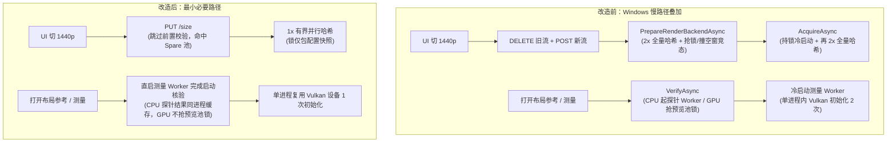

# Windows 侧 SHM 预览与场景测量优化方案（M4 前）

## 1. 背景与目标

Windows 侧 SHM 像素传输本身已在 M2/M3 `stress1000`（1440p30）与 `shm-resize30` 中验证通过；当前在桌面 UI 中出现的 **无法建立 1440p 预览流**、**无法启动测量画面** 以及 **偶发“测量请求太多”（HTTP 429）**，根因是跨平台存在的重复冷启动、高频全量哈希与池/清理竞态，在 Windows 的进程创建、Defender 扫描与 NTFS 句柄锁开销下被急剧放大。

本方案聚焦三个核心方向，并在每项改动上严守**最小必要变更、零协议破坏、不破坏既有隔离与防篡改测试不变量**的原则：

1. **减少 Worker 冷启动**：消灭“先起一次性探针 Worker、再起正式业务 Worker”的双重启动，以及 UI 切分辨率时销毁重建流的冗余路径。
2. **减少全量哈希**：在不削弱字节级防篡改语义的前提下，将单次流创建中的 4 遍串行全量扫描（1,680 次文件打开 / ~464 MB）压到 1 遍有界并行扫描，并消除 `script-refs` 重复计算。
3. **消除竞态与误隔离**：修复 `InspectReadyAsync` 空窗竞态、缩小 `_configurationGate` 锁粒度、补齐 `ScriptPreparedInputLease` 的 Windows 目录锁重试与解耦，以及补齐前端测量取消与 429 退避。

---

## 2. 核心优化设计

### 2.1 避免重复随时启动多个 Worker（减少冷启动）

#### ① 前端 720p ↔ 1440p 改走既有 `PUT /api/v1/gpu-preview-streams/{id}/size`
- **现状问题**：[PreviewPanel.tsx](file:///mnt/Data/Program/MakoKaraGenerator-App/frontend/src/editor/preview/PreviewPanel.tsx#L204-L213) 将 `size` 放入创建 `GpuPreviewController` 的 `useEffect` 依赖数组。切换 `720p · 24 fps` ↔ `1440p · 30 fps` 时会整套销毁控制器并走 `detach -> DELETE -> POST -> attach`，而 `POST` 会额外触发 `PrepareRenderBackendAsync` 与流配额争用。
- **改动方案**：
  - 在 [gpu-preview-controller.ts](file:///mnt/Data/Program/MakoKaraGenerator-App/frontend/src/editor/preview/gpu-preview-controller.ts#L146-L167) 暴露 `setSize(size: PreviewSize)`，将已验证的 `resizeForAcceptance` 逻辑纳入主 `run()` 循环：当活动流已存在且目标 `size` 变化时，串行执行 `detach -> PUT /size -> attach`；
  - 从 [PreviewPanel.tsx](file:///mnt/Data/Program/MakoKaraGenerator-App/frontend/src/editor/preview/PreviewPanel.tsx#L204-L214) 的控制器重建 `useEffect` 中移除 `size`，改为独立的 `useEffect(() => controller?.setSize(size), [controller, size])`。
- **合理性**：完全复用已冻结契约端点 `PUT /api/v1/gpu-preview-streams/{id}/size`，后端依然遵循单次绑定 `inputGeneration` 隔离规则并直接命中 `GpuWorkerSparePool` 预热好的 Spare，不新增任何协议字段。

#### ② 消除“前置探针 Worker + 正式业务 Worker”的双重启动
- **现状问题**：
  1. **连续预览流创建**：[PreviewBackendService.GpuStream.cs](file:///mnt/Data/Program/MakoKaraGenerator-App/backend/src/MakoKaraGenerator.Backend.Server/PreviewBackendService.GpuStream.cs#L118) 在调用 `GpuStreamWorkerSession.OpenAsync` 前先调用 `PrepareRenderBackendAsync(renderBackend)`。`cpu` 模式下这会先冷启动并销毁 1 个探针 Worker，随后 `OpenAsync` 再冷启动第 2 个 Worker；`gpu` 模式下则先调一次 `VerifyDeviceAsync`（2 次全量哈希 + 抢 `_configurationGate` + 撞 `InspectReadyAsync` 竞态），紧接着 `OpenAsync` 又调一次 `AcquireAsync`。
  2. **场景测量与前奏附着测量**：[ProjectSessionRegistry.SceneMeasurements.cs](file:///mnt/Data/Program/MakoKaraGenerator-App/backend/src/MakoKaraGenerator.Backend.Hosting/ProjectSessionRegistry.SceneMeasurements.cs#L84) 和 [L167](file:///mnt/Data/Program/MakoKaraGenerator-App/backend/src/MakoKaraGenerator.Backend.Hosting/ProjectSessionRegistry.SceneMeasurements.cs#L167) 先调 [SelectMeasurementRenderBackendAsync](file:///mnt/Data/Program/MakoKaraGenerator-App/backend/src/MakoKaraGenerator.Backend.Hosting/ProjectSessionRegistry.RenderBackends.cs#L45-L65) → `_renderBackends.VerifyAsync(backend)`，随后在 [MeasureCapturedAsync](file:///mnt/Data/Program/MakoKaraGenerator-App/backend/src/MakoKaraGenerator.Backend.Hosting/ProjectSessionRegistry.SceneMeasurements.cs#L211) 立刻冷启动一个全新测量 Worker（该 Worker 启动时自己就会执行 `render-backend-verify`）。
  3. **CPU 后端探测无缓存**：[BackendRenderBackendConfiguration.cs](file:///mnt/Data/Program/MakoKaraGenerator-App/backend/src/MakoKaraGenerator.Backend.Hosting/BackendRenderBackendConfiguration.cs#L71-L73) 每次 `CheckAsync("cpu")` 都现启现杀一个完整 .NET Worker 进程。
- **改动方案**：
  1. **CPU 探针同进程轻量缓存**：在 [BackendRenderBackendConfiguration.cs](file:///mnt/Data/Program/MakoKaraGenerator-App/backend/src/MakoKaraGenerator.Backend.Hosting/BackendRenderBackendConfiguration.cs#L55-L80) 中，对 `backend == "cpu"` 缓存首次**成功**的 `RenderBackendDeviceInfoDto`（仅缓存成功，失败与 `missing-worker` 仍实时返回不可用，不破坏任何负向单测）。同一 Host 进程内后续 `GET /render-backends`、静态预览、CPU 测量和 CPU 流不再反复起杀探针进程。
  2. **`CreateGpuStreamAsync` 去掉冗余前置 `PrepareRenderBackendAsync`**：保留 `renderBackend` 参数解析与 `_renderBackends` 配置校验；当真实 Worker 由 `GpuStreamWorkerSession.OpenAsync` 启动/取用时，其自身的 `WarmGpuAsync`（Vulkan）或 `StartAsync`（CPU）已完成强设备核验，仅在失败映射中确保不可用错误码与原行为一致。
  3. **测量路径合并设备校验到测量 Worker 自身**：当测量走真实受管理测量 Worker 时，不再于启动测量 Worker 前额外调用 `_renderBackends.VerifyAsync(backend)`，直接由测量 Worker 启动握手时的 `render-backend-verify` 完成设备核验（并在失败时映射为相同的 `WorkerRenderBackendUnavailable` / `TaskUnavailable`）。
     - *测试兼容性注意*：若某单元测试为 `_renderBackends` 注入了不可用配置（如 `missing-worker`）但测量器为独立假对象，可在 `SelectMeasurementRenderBackendAsync` 仅当 `_renderBackends` 与 `_sceneMeasurementWorker` 指向同一部署可执行文件时跳过前置探针，零回归风险。

#### ③ 消除单个 GPU 测量 Worker 内部的“两次 Vulkan 设备初始化”（高性价比）
- **现状问题**：启动 GPU 测量 Worker 时，`StartAsync` 发 `render-backend-verify` → [RenderBackendVerificationTask.cs](file:///mnt/Data/Program/MakoKaraGenerator-App/backend/src/MakoKaraGenerator.Backend.Worker/RenderBackendVerificationTask.cs#L15) → `RuntimeRenderBackendProbe.Probe("vulkan")` 会创建并立即销毁第 1 套 Vulkan+Skia 设备；紧接着 [SceneMeasurementWorker.cs](file:///mnt/Data/Program/MakoKaraGenerator-App/backend/src/MakoKaraGenerator.Backend.Worker/SceneMeasurementWorker.cs#L42-L43) 又创建第 2 套 Vulkan+Skia 设备。
- **改动方案**：在测量 Worker 启动且 `renderBackend == "vulkan"` 时，复用进程内首次 `render-backend-verify` 创建的 Vulkan/Skia 设备上下文（参照现成的 [GpuWorkerPreparationState.cs](file:///mnt/Data/Program/MakoKaraGenerator-App/backend/src/MakoKaraGenerator.Backend.Worker/GpuWorkerPreparationState.cs) 单次绑定语义），将单次 GPU 测量内的 Vulkan ICD 初始化从 2 次降为 1 次；同时将 [MeasureSceneAsync](file:///mnt/Data/Program/MakoKaraGenerator-App/backend/src/MakoKaraGenerator.Backend.Hosting/ProjectSessionRegistry.SceneMeasurements.cs#L44) 的 20s 截止时间放宽至 30s（与前端客户端超时对齐，留出 Windows 冷启动余量）。

---

### 2.2 减少全量哈希（严守防篡改不变量）

> [!IMPORTANT]
> [GpuDeploymentIdentityTests.cs](file:///mnt/Data/Program/MakoKaraGenerator-App/backend/tests/MakoKaraGenerator.Backend.Hosting.Tests/GpuDeploymentIdentityTests.cs#L10-L35) 与 M04 验收脚本 [Program.cs](file:///mnt/Data/Program/MakoKaraGenerator-App/backend/tools/backend-gpu-worker-pool-acceptance/Program.cs#L135-L149) 明确要求：即使 `mtime` 和 `deployment.json` 不变、只改 1 字节 DLL，下一次 `Read()` / `VerifyDeviceAsync()` 也必须感知并淘汰旧 Spare。因此**不做 mtime/清单跳过字节读取的假缓存**，而是从“砍重复调用 + 有界并行”切入。

#### ① 砍掉同一次操作内的重复全量扫描（4 次 → 1 次）
- **现状问题**：
  - `POST /api/v1/gpu-preview-streams` 调 1 次 `VerifyDeviceAsync`（前 1 次 + 后 1 次）+ 1 次 `AcquireAsync`（前 1 次 + 后 1 次）= **4 遍 × 420 文件 / 116 MB = 1,680 次文件打开 / 464 MB SHA-256**。
  - [GpuWorkerPool.cs](file:///mnt/Data/Program/MakoKaraGenerator-App/backend/src/MakoKaraGenerator.Backend.Hosting/GpuWorkerPool.cs#L66) 与 [L125](file:///mnt/Data/Program/MakoKaraGenerator-App/backend/src/MakoKaraGenerator.Backend.Hosting/GpuWorkerPool.cs#L125) 在毫秒级 `prepared-spare-hit` 或管道查询结束后，立即再扫一遍全部 420 个文件。
- **改动方案**：
  1. 配合 2.1② 去掉 `CreateGpuStreamAsync` 前置 `PrepareRenderBackendAsync`（直接省 2 遍）；
  2. 在 [GpuWorkerPool.cs](file:///mnt/Data/Program/MakoKaraGenerator-App/backend/src/MakoKaraGenerator.Backend.Hosting/GpuWorkerPool.cs#L54-L130) 中：
     - `VerifyDeviceAsync` 与 `AcquireAsync` 仅在入口处计算 1 次 `ConfigurationIdentity()` 并调用 `_pool.InvalidateAsync(configuration)`；
     - 仅当 `AcquireAsync` 实际走了慢路径（如 `admission != "prepared-spare-hit"` 或耗时超过阈值，如 250ms）时才在返回前复检一次 `ConfigurationIdentity()`；毫秒级 `prepared-spare-hit` 与 `InspectReadyAsync` 不再二次全盘重扫。
  - 这样正常切流/创建从 **4 遍全量哈希降为 1 遍**（减少 75% I/O 与 Defender 扫描触发）。

#### ② `GpuDeploymentIdentity.Read()` 有界并行 + Windows 友好文件共享
- **现状问题**：[GpuDeploymentIdentity.cs](file:///mnt/Data/Program/MakoKaraGenerator-App/backend/src/MakoKaraGenerator.Backend.Hosting/GpuDeploymentIdentity.cs#L12-L36) 单线程串行逐个哈希 420 个文件，且使用 `FileShare.Read`。
- **改动方案**：
  - 打开文件改为 `FileShare.Read | FileShare.Delete`（减少与 Windows 索引器/Defender 的共享冲突）；
  - 使用 `Parallel.For`（`MaxDegreeOfParallelism = Math.Min(Environment.ProcessorCount, 4)`）按排序索引并行计算每个文件的 `SHA256` 存入固定长度数组，再按原确定性顺序写入 `IncrementalHash`（保证哈希值与单线程 100% 字节一致，且仍保留 `RejectLink` 与首尾 `Inventory` 一致性校验）。代码改动仅 ~15 行，多核 Windows 下单次耗时预计下降 2～3 倍。

#### ③ 消除 `WarmGpuAsync` 链路中的 `ScriptReferenceIdentity` 二次扫描
- **现状问题**：[WorkerProcessProxy.cs](file:///mnt/Data/Program/MakoKaraGenerator-App/backend/src/MakoKaraGenerator.Backend.Hosting/WorkerProcessProxy.cs#L365) 在 `GetPackageCapabilitiesCoreAsync` 中刚扫完 167 个 `script-refs/net10.0/*.dll`（6.2 MB），紧接着 [WorkerProcessProxy.GpuWarmup.cs](file:///mnt/Data/Program/MakoKaraGenerator-App/backend/src/MakoKaraGenerator.Backend.Hosting/WorkerProcessProxy.GpuWarmup.cs#L36) 在同一次 `WarmGpuAsync` 内又完整扫一遍。
- **改动方案**：让 `GetPackageCapabilitiesCoreAsync` 返回（或通过内部参数传出）本次已计算的 `ScriptReferenceIdentity`，供紧随其后的 `WarmGpuAsync` 直接复用，免去 167 次重复文件打开与哈希。

---

### 2.3 消除竞态与 Windows 清理误伤

#### ① 修复 `GpuWorkerSparePool.InspectReadyAsync` 空窗竞态
- **现状问题**：[GpuWorkerSparePool.cs](file:///mnt/Data/Program/MakoKaraGenerator-App/backend/src/MakoKaraGenerator.Backend.Hosting/GpuWorkerSparePool.cs#L98-L130) 在活动流刚释放、同时 Spare 处于 30s TTL `Retiring` 或 `MaintainAsync` 尚未醒来补位时，`candidates` 和 `opening` 均为空，第 127 行直接抛出 `InvalidOperationException`，导致 `503 WorkerRenderBackendUnavailable`。
- **改动方案（~15 行，完全遵守 2 名额硬上限与全部现有单测）**：
  - 在 `lock (_gate)` 内，当 `candidates.Length == 0 && opening.Length == 0` 时：
    1. 若 `_spare is null && _slots.Count < 2 && !BackingOff()`：直接 `var spare = Reserve(bound: false);`，在锁外 `Start(spare)` 并等待 `spare.Ready.Task.WaitAsync(token)` 后继续循环；
    2. 否则若 `_slots` 中存在 `State.Retiring` 槽位：等待 `Task.WhenAny(retiringTasks).WaitAsync(token)` 后继续循环；
    3. 否则（如 2 个槽位均为旧配置 `Bound`、或 `Quarantined`、或处于 `BackingOff`）：保持原样立刻抛异常（确保 [StaleDeviceInspectionAsync](file:///mnt/Data/Program/MakoKaraGenerator-App/backend/tests/MakoKaraGenerator.Backend.Hosting.Tests/GpuWorkerSparePoolTests.cs#L107-L121) 与 [QuarantineCannotProvideDeviceProofAsync](file:///mnt/Data/Program/MakoKaraGenerator-App/backend/tests/MakoKaraGenerator.Backend.Hosting.Tests/GpuWorkerSparePoolTests.cs#L156-L168) 100% 通过）。

#### ② 缩小 `GpuWorkerPool._configurationGate` 锁粒度
- **现状问题**：[GpuWorkerPool.cs](file:///mnt/Data/Program/MakoKaraGenerator-App/backend/src/MakoKaraGenerator.Backend.Hosting/GpuWorkerPool.cs#L58-L78) 在 `AcquireAsync` 中跨整个 `_pool.AcquireAsync(token)`（包含冷启动 `WarmGpuAsync` 数秒耗时）一直持有 `_configurationGate`，把并发的 `VerifyDeviceAsync` 全部堵在锁外。
- **改动方案**：`_configurationGate` 仅保护“计算 `ConfigurationIdentity()` + 调用 `_pool.InvalidateAsync(configuration)`”这一小段配置切换临界区，拿到 `configuration` 后立刻释放锁，再执行 `_pool.AcquireAsync(token)` 或 `_pool.InspectReadyAsync(...)`。`_pool` 自身已有细粒度 `_gate` 并已完整处理并发失效（见 [ConcurrentInvalidationRejectsInFlightProofAsync](file:///mnt/Data/Program/MakoKaraGenerator-App/backend/tests/MakoKaraGenerator.Backend.Hosting.Tests/GpuWorkerSparePoolTests.cs#L137-L153)）。

#### ③ 补齐 `ScriptPreparedInputLease` 的 Windows 目录锁重试，解耦已确认退出进程的清理异常
- **现状问题**：提交 `eaf6d09` 漏掉了 [ScriptPreparedInput.cs](file:///mnt/Data/Program/MakoKaraGenerator-App/backend/src/MakoKaraGenerator.Scripting/Compilation/ScriptPreparedInput.cs#L61-L69) 的裸 `Directory.Delete(root, recursive: true)`。Windows 上一旦 Defender/系统句柄短暂占用该临时目录：
  - 在 [WorkerProcessProxy.cs](file:///mnt/Data/Program/MakoKaraGenerator-App/backend/src/MakoKaraGenerator.Backend.Hosting/WorkerProcessProxy.cs#L1007) 触发 `AggregateException` → 已确认退出的 Worker 被 `GpuWorkerSparePool.RetireAsync` 误标 `State.Quarantined`、配额锁死、返回 `GpuStreamDrainFailed`；
  - 在 [WorkerProcessProxy.SceneMeasurements.cs](file:///mnt/Data/Program/MakoKaraGenerator-App/backend/src/MakoKaraGenerator.Backend.Hosting/WorkerProcessProxy.SceneMeasurements.cs#L39) 触发未捕获 `AggregateException`，导致测量接口返回 500。
- **改动方案**：
  1. `ScriptPreparedInputLease.Dispose()` 增加有界短退避重试（最多 4 次，25/50/75ms，针对 `IOException | UnauthorizedAccessException`）；
  2. [WorkerProcessProxy.cs](file:///mnt/Data/Program/MakoKaraGenerator-App/backend/src/MakoKaraGenerator.Backend.Hosting/WorkerProcessProxy.cs#L990-L1008) 中当 `reaped == true`（进程树已确认终止）后，对 `ReleasePreparedScriptInputs()` 的目录删除失败只打结构化错误日志，不再将其升级为进程终止失败/隔离；
  3. [ProjectSessionRegistry.SceneMeasurements.cs](file:///mnt/Data/Program/MakoKaraGenerator-App/backend/src/MakoKaraGenerator.Backend.Hosting/ProjectSessionRegistry.SceneMeasurements.cs#L117) 与 [L202](file:///mnt/Data/Program/MakoKaraGenerator-App/backend/src/MakoKaraGenerator.Backend.Hosting/ProjectSessionRegistry.SceneMeasurements.cs#L202) 同样隔离临时目录清理的 `IOException | UnauthorizedAccessException`，保证不泄露 500 且必定释放 client 测量名额。

#### ④ 前端场景测量取消在途请求 + 429 有限退避
- **现状问题**：[mako-client.ts](file:///mnt/Data/Program/MakoKaraGenerator-App/frontend/src/client/mako-client.ts#L799-L809) 的 `projects.measureScene` 未传 `AbortSignal`（而 `this.send` 本身已原生支持 `signal`）；[scene-measurement.ts](file:///mnt/Data/Program/MakoKaraGenerator-App/frontend/src/editor/orchestration/scene-measurement.ts#L128-L143) 的 `dispose()` 无法取消在途测量请求，且 429 仅在 1s 后重试 1 次。
- **改动方案**：
  - `projects.measureScene` 增加可选参数 `signal?: AbortSignal` 并透传给 `this.send`（仅 2 行）；
  - `SceneMeasurementController` 维护当前 `AbortController`，在 `dispose()` 时立即 `abort()`（服务端通过 `RequestAborted` 尽快停止测量并归还每 client 1 个名额），并将 429 重试调整为有限次指数退避（`1s -> 2s -> 4s`，最多 3 次；期间如有新 `want` 直接放弃旧重试）。

#### ⑤ 补齐桌面主进程错误可见性（极低成本防黑盒）
- 在 [desktop/main.cjs](file:///mnt/Data/Program/MakoKaraGenerator-App/desktop/main.cjs) 的 `gpuFrameFailed`、`desktop-broker-error`、`desktop-attach-failed`、`mako-gpu:error` 位置输出脱敏截断后的 `error.message`（绝不打印 `handshake`/凭证），方便 Windows 实机第一时间定位任何剩余异常。

---

## 3. 明确不做（避免过度优化与工程化）

| 不做项 | 原因 |
|---|---|
| **不为场景测量新建第二个常驻 Worker 池** | 测量跨工程、涉及用户脚本 `AssemblyLoadContext` 卸载与严格同帧隔离；新建独立池需维护整套状态机/隔离/排空，风险远高于收益。消除双进程启动 + 双次 Vulkan 初始化 + 锁竞争后单次测量已足够快。 |
| **不引入 `FileSystemWatcher` 监听部署目录** | Windows 下 `FileSystemWatcher` 长期持有目录句柄（反而诱发删除锁），且存在缓冲区溢出丢事件风险；“4 次变 1 次 + 4 路并行哈希”已将延迟降一个数量级且零状态复杂度。 |
| **不改成 mtime / manifest 跳过字节校验** | 直接违背 `GpuDeploymentIdentityTests`（改字节还原 `mtime` 必须检出）与 M04 验收契约。 |
| **不改 `GpuWorkerSparePool` 默认 30s TTL 与单次绑定隔离** | M04 验收脚本硬检验 31s TTL 淘汰与每次 `inputGeneration` 独占原进程；改走 `PUT /size` 并修好 `InspectReadyAsync` 竞态后，30s 刷新不再诱发故障。 |
| **不改动 `WindowsShmBacking` 的 `SEC_COMMIT` 策略** | 1440p（42.19 MiB）已在 Windows M2/M3 `stress1000` 和 `shm-resize30` 验证通过；除非主进程诊断日志实证 Commit Charge 不足，否则不碰底层 SHM 映射。 |
| **不新增 HTTP / IPC 协议字段** | 全部复用既有 `PUT /size` 与错误码，零契约破坏，不触及既有浏览器静态预览路径。 |

---

## 4. 实施顺序与提交拆分建议

按“先止血、再提速、最后补诊断”的节奏拆成 3 个独立可验证提交（每步中文 `type(scope): 摘要`）：

1. **Step 1（核心竞态与清理止血 — 后端 Hosting & Scripting）**
   - `ScriptPreparedInputLease.Dispose` 重试 + `WorkerProcessProxy` / `SceneMeasurements` 清理异常隔离
   - `GpuWorkerSparePool.InspectReadyAsync` 空窗/Retiring 等待修复
   - `GpuWorkerPool._configurationGate` 缩小锁粒度 + 去掉毫秒级二次全量哈希
   - `GpuDeploymentIdentity.Read` 有界并行 + `FileShare.Read | FileShare.Delete`
   - `WorkerProcessProxy.GpuWarmup` 复用 `ScriptReferenceIdentity`
2. **Step 2（消除双重冷启动 — 后端 Server & Hosting & Worker）**
   - `BackendRenderBackendConfiguration` CPU 探针成功结果同进程缓存
   - `PreviewBackendService.CreateGpuStreamAsync` 去掉冗余前置 `PrepareRenderBackendAsync`
   - `ProjectSessionRegistry.SceneMeasurements` 合并测量 Worker 启动校验 + 放宽截止时间到 30s
   - *（需主人确认是否本步一并纳入）* GPU 测量 Worker 单进程内复用 `render-backend-verify` 创建的 Vulkan 设备（2 次初始化 → 1 次）
3. **Step 3（前端 1440p Resize、测量取消与桌面诊断）**
   - `GpuPreviewController.setSize` + `PreviewPanel.tsx` 切规格走 `PUT /size`
   - `mako-client.ts` `measureScene` 透传 `AbortSignal` + `SceneMeasurementController` `dispose` 中止与 429 指数退避
   - `desktop/main.cjs` 补齐脱敏错误日志

---

## 5. 验证计划

1. **后端单元测试（Linux 即可执行）**：
   - 新增单测：`ScriptPreparedInputLease` 重试与已确认退出进程不误进 `Quarantined`、`GpuWorkerSparePool.InspectReadyAsync` 空窗/Retiring 等待、`GpuDeploymentIdentity` 并行结果确定性与防篡改、`BackendRenderBackendConfiguration` CPU 成功缓存与失败不缓存；
   - 回归全量 `MakoKaraGenerator.Backend.Hosting.Tests`、`MakoKaraGenerator.Backend.Server.Tests`、`MakoKaraGenerator.Scripting.Tests`。
2. **前端类型与单元测试（Linux 即可执行）**：
   - 新增单测：`GpuPreviewController.setSize` 走 `PUT /size` 而非重建流、`SceneMeasurementController` `dispose()` 触发 `AbortSignal` 以及 429 指数退避；
   - 运行 `tsc --noEmit` 与 `vitest`。
3. **契约与 Linux 实机冒烟**：
   - 检查后端契约指纹校验脚本，确保零契约漂移；
   - 运行 Linux `MAKO_PREVIEW_TRANSPORT=shm` 桌面启动与 720p↔1440p / 布局参考回归。
4. **Windows 实机验收清单（由主人在 Windows 执行）**：
   - 打开桌面应用（SHM 模式）→ 720p 预览就绪 → 多次来回切换 `720p · 24 fps` ↔ `1440p · 30 fps`；
   - 快速切换“布局参考”与“成片预览”、连续点选多行触发测量，验证不再出现 503、500 或频繁“测量请求太多”。
