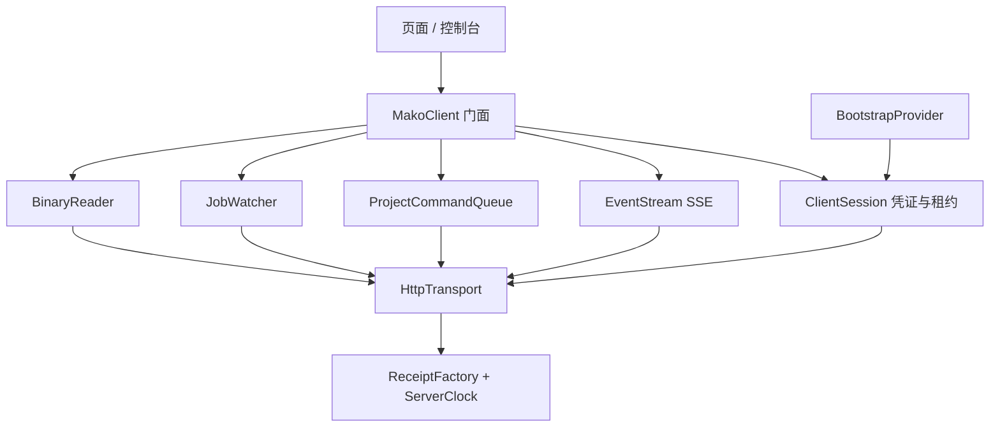

# Web 客户端 W0：协议客户端与开发底座设计方案

日期：2026-10-15。状态：**已实施（2026-10-16），实施记录与偏差见 §12**。
基线：后端仓库 NewMakoKaraGenerator 分支 `refactor/individual-backend`，产品 **0.75.1**／协议 `"1"`，冻结 API 合同 **1.0.0**（后端提交 `400145d`，副本在 `docs/backend/contract/`）。接口事实以该合同及其行为源 `docs/architecture/backend-api.md` 为准；本文只描述 Web 侧如何消费，不改变后端合同。

> 本文 §1～§11 保留原设计；实施时依据后端交接（`docs/backend/web-handoff.md`）与审查（`docs/backend/backend-review-20261016.md` F2～F4）做的修订，在相应小节用“**实施修订**”标出，汇总见 §12。

Web 前端是独立项目 `/mnt/Data/Program/MakoKaraGenerator-Web`，本文的维护版本位于该项目的 `docs/web-client-w0-design.md`；后端仓库 `docs/design/` 中的同名文件只保留作来源记录。

## 1. 定位

W0 是 Web 前端的第一步，**不做编辑器界面**。它交付三样东西：

1. **协议客户端库**：与 UI 框架无关的 TypeScript 模块，封装登记／恢复／心跳、请求回执、错误、SSE、二进制读取、任务等待和工程命令串行化。之后所有 Web 页面都只通过它访问后端。
2. **开发底座**：一条命令启动真实 `Backend.Server` 并把启动凭证安全地交给开发页面；Vite 开发服务器；单元测试与连真实 Server 的集成测试。
3. **协议控制台页面**：一个简陋的调试页，能把“上传 → 新建 → 读歌词 → 改一行时间 → 撤销／重做 → 静态预览一帧 → 保存”走通，并实时显示事件流。它是 W0 的验收载体，不是产品界面。

W0 完成后，W1（打轴最小链路）在此基础上写真正的界面。拆分方案 B6 要求的“最小浏览器协议客户端”也由 W0 提供。

### 1.1 非目标

- 歌词列表、时间轴、波形、播放、样式、场景、工坊等任何编辑界面。
- Electron／Tauri 打包；后端托管 SPA 静态文件。
- 生成 OpenAPI 或自动类型同步（W0 先手写类型，见 §5）。
- 修改后端协议。唯一建议的后端改动见 §9 G1，需要另行确认。

## 2. 代码位置与工具链

```text
MakoKaraGenerator-Web/    # 独立项目，与后端仓库并列
  package.json            # 单包起步，不先上 monorepo
  pnpm-lock.yaml
  vite.config.ts          # 含开发用 bootstrap 插件（§4.2）
  tsconfig.json           # strict、noUncheckedIndexedAccess
  scripts/
    dev-backend.mjs       # 启动真实 Server（§4.1）
  src/
    protocol/             # 手写 DTO 类型、错误码、Int64 字符串辅助（§5）
    client/               # 协议客户端库（§3），不得 import UI 框架
    console/              # 协议控制台页面（§8）
  test/
    unit/                 # 假 fetch 的单元测试
    integration/          # 连真实 Server
  .dev/                   # 本地运行产物，gitignore
  docs/                   # 本设计稿与后端 API 规范的副本
```

Web 项目不直接引用后端源码。`dev-backend.mjs` 通过环境变量 `MAKO_BACKEND_REPO`（默认 `../NewMakoKaraGenerator`）找到后端仓库。

- Node 使用本机现有 v26；包管理器 pnpm（本机 11.7）。
- Vite + TypeScript；测试 Vitest。
- `src/client` 与 `src/protocol` 之间只有单向依赖 `client → protocol`；`console` 可以依赖两者。后续若拆包，按这两条边界拆。
- W0 不做 CI，先跑通最小原型。

## 3. 协议客户端库结构



### 3.1 HttpTransport

对 `fetch` 的唯一封装，其他模块不直接调用 `fetch`。

- 拼接 baseUrl（Server 实际监听地址，不是页面 origin）。
- 统一附加 `Authorization: Bearer <accessToken>`、`X-Mako-Client-Id`、`X-Mako-Host-Instance-Id`。health 和登记路由按规范例外处理。
- 永不把任何凭证放进 URL（服务端也会拒绝）。
- 非 2xx 时解析 `application/problem+json` 的 `BackendErrorResponse`，抛出带 `status`、`code`、`field?`、`failureCode?` 的 `BackendError`。程序分支只看 `code`／`failureCode`，`message` 只用于显示。
- 416 等无 JSON 正文的状态单独构造错误，不尝试解析正文。
- 支持 `AbortSignal`；页面卸载时统一中止。

### 3.2 ServerClock 与 ReceiptFactory

所有有副作用的请求都要带回执三元组 `requestId / hostInstanceId / validUntilUtc`，而三种请求的放置位置不同（规范 §1.2）：嵌套 `metadata`、commands 的顶层字段、job cancel 的正文本身、二进制上传的请求头。ReceiptFactory 统一生成，由各个 API 方法决定放哪里，调用方不手写。

- `requestId`：`crypto.randomUUID()`，带操作前缀方便读日志，例如 `cmd-<uuid>`。
- `validUntilUtc`：服务端时间 + 60 秒，不能用浏览器本地时间。ServerClock 在每次收到 `serverTimeUtc`（capabilities、登记、心跳）时更新偏移量 `offset = serverTime - Date.now()`。
- 上限：不超过 capabilities 里的 `maxCommandRetryWindowSeconds`（当前 600）。

### 3.3 重试规则

| 情况 | 处理 |
|---|---|
| 网络错误、连接中断 | 有副作用请求：**复用同一 requestId 和同一 deadline 重试**，直到 deadline 前 5 秒；超时后报告“结果未知”，由调用方重新读取权威状态。连续失败时核对启动信息（§12.3） |
| 500 `internalError` | **实施修订**：有副作用请求直接报告“结果未知”——服务端会把可能已产生副作用后的错误固定在回执里，同 ID 重试只会读回原错误（审查 F4）。只读请求照常重试 |
| 401 `clientTokenExpired` | 触发一次 resume（§3.4），然后用**同一** requestId 重试。回执按 client 归属，resume 后 clientId 不变，所以重试安全 |
| 401 `unauthorizedClient` | **实施修订**：先 GET health 比较 hostInstanceId——变了即 `hostRestarted`（Server 重启后认证先于 host 检查，旧凭证常先得 401）；同一 host 则尝试一次 resume（G1 回收检查期间可能临时 401），失败或 60 秒内再次发生进入“需要重新登记”，不自动无限重试 |
| 409 `hostRestarted` | 服务已重启：清空所有本地身份和缓存，回到初始化流程 |
| 409 `requestIdReuse` | 客户端缺陷，直接抛出并记录，不重试 |
| 409 `revisionConflict` | 交给调用方（§3.6），W0 不自动 rebase |
| 429 各类 quota | 不自动重试，抛出给调用方显示 |
| 202 | 只表示已接受，必须通过 JobWatcher 或预览状态读结果 |

只读 GET 可以直接重试，不需要回执。

### 3.4 ClientSession：登记、恢复与心跳

服务端实际行为（`ClientLifecycle.cs`）：

- 新登记生成 clientId、accessToken、resumeToken；**resumeToken 不轮换**。
- resume 必须同时提供 bootstrap 凭证和 resumeToken，成功后轮换 accessToken，旧 accessToken 立即失效。
- 心跳会同时延长 accessToken 有效期（默认 120 秒）和 client 租约（默认 300 秒）。
- ~~client 永远不会从注册表移除~~。**实施修订**：0.75.1 已实现 G1——登记配额（默认 16）不足时回收已过租约且无保护依据的空闲 client；被回收后旧 access 与 resume 均 401，须新登记。刷新页面仍优先 resume。

据此设计：

1. 初始化：从 BootstrapProvider 取 `{baseUrl, hostInstanceId?, bootstrapToken}`，调用 health 校验可达，再查 `sessionStorage`。
2. 如果 `sessionStorage` 中有同一 `hostInstanceId` 下保存的 `{clientId, resumeToken}`，先走 resume；失败才新登记。这样开发时刷新页面不会消耗 16 个名额。
3. 只用 `sessionStorage`，**不用 `localStorage`**：两个标签页若共享同一 client，一边 resume 会轮换 accessToken，把另一边踢掉。每个标签页各自是独立 client。
4. 心跳间隔取 `min(tokenLifetime, leaseLifetime) / 3`，按服务端返回的过期时间计算，而不是写死。
5. 并发请求同时遇到 `clientTokenExpired` 时，只发起一次 resume（single-flight），其他请求等待结果后重试。
6. 页面 `visibilitychange` 回到前台时立即补一次心跳；如果 accessToken 已过期，直接 resume。
7. bootstrapToken 只保存在内存里（resume 需要它），不写入任何存储。

状态机对外暴露：`connecting → ready ⇄ refreshing → (needsRegistration | hostRestarted | failed)`，供页面显示连接状态。

### 3.5 EventStream：SSE

服务端 SSE 要求 `Authorization` 头，浏览器原生 `EventSource` 不能自定义请求头，所以用 `fetch` + `ReadableStream` 自己解析。

- 解析器按 WHATWG SSE 规则实现（`id:`、`event:`、`data:` 多行拼接、`:` 注释、空行分发），是一个纯函数模块，单独做单元测试。不引入第三方库。
- 重连时用 `Last-Event-ID` 头携带最近的事件 id。初次连接时如果已有 client state 返回的 `eventCursor`，用它作为起点。
- `: heartbeat` 注释约 15 秒一次。超过 45 秒没有收到任何字节就判定连接已死，主动中止并重连。
- 每个 client 最多 2 条 SSE 连接、全局最多 4 条：库保证**每个 ClientSession 只有一条** EventStream；页面 `pagehide` 时主动 abort。如果快速刷新导致旧连接还没被服务端释放而返回 429，按 1s、2s、4s…（上限 30s）退避重试。
- `event: resync.required`：对外发出 `resync` 信号，由 MakoClient 重新 `GET /clients/{id}/state`，用返回的新游标重新连接。
- `event: client.expired`：走 ClientSession 的 resume 流程，成功后重连。
- 事件分发给订阅者时只给“提示”，订阅者需要权威数据时自己去 GET。这与规范“GET 状态始终权威、预览提示可能丢”的约定一致。

### 3.6 ProjectCommandQueue

工程命令带 `expectedRevision`，同一工程上的命令如果并发发出，后发的必然 409。因此：

- 每个 projectSessionId 一条 FIFO 队列，同时只有一条命令在途。
- 队列记录最近一次已知的 `projectRevision`（来自创建、摘要、命令响应或 `project.changed` 事件中的 summary），下一条命令用它作为 `expectedRevision`。
- 收到 `revisionConflict` 时：清空该工程队列中尚未发出的命令，抛出给调用方，并提示需要重新读取。W0 不做自动重放，因为是否还能安全执行需要业务判断。
- `changed: false` 的响应不更新修订号。
- `changeSet.requiresFullRefresh` 原样传给调用方，由页面决定读取范围。

### 3.7 JobWatcher

open、save、close、recover、validation、export、analysis 都返回 202 + job。

- `waitForTerminal(jobId, {signal, onProgress})`：订阅 `job.changed`、`job.progress`、`job.terminal` 事件，同时以较低频率（例如每 5 秒）GET 一次，防止事件丢失。到达终态（succeeded、failed、cancelled、unknown）后返回完整 JobResponse。
- 取消调用 `POST /jobs/{id}/cancel`，返回值只代表“已请求取消”，仍需等待终态。
- `unknown` 原样返回，不当作失败也不当作成功。

### 3.8 BinaryReader

资源内容、预览 PNG、导出成片都需要 `Authorization` 头，不能直接写进 ``、`<audio src>`。

- `fetchBinary(url, {range?, ifNoneMatch?, signal})` 返回 `{blob, etag, contentType, status}`。`contentUrl` 是相对路径时用 baseUrl 拼接。
- 预览帧：`createImageBitmap(blob)`，由调用方负责 `close()`。帧过期（410 `previewFrameExpired`）属于正常情况，单独分类。
- 大文件（导出成片）W0 只提供“下载为 Blob 再触发保存”，W1 再考虑流式写入。
- `upload(file, {fileName})` 使用原始字节上传。**实施修订**：文件名放在 `?fileName=`（URLSearchParams 编码），不用 `X-Mako-Asset-Name` 头——Fetch 的 Headers 只接受 ByteString，中文名会直接抛错（审查 F3）。上传前对照 capabilities 的 `maxAssetBytes` 与 `assetMimeTypes` 做客户端预检，给出提前、可读的错误。

### 3.9 MakoClient 门面

对页面暴露按领域划分的方法，内部组合上述模块：

```ts
const mako = await MakoClient.connect(bootstrapProvider);
mako.state$;                       // 连接状态
mako.events.on('project.changed', handler);
const caps = await mako.capabilities();
const audio = await mako.assets.upload(file);
const project = await mako.projects.create({ name, audioAssetId, lyricsAssetId });
const lines = await mako.projects.readLyrics(project.projectSessionId, 'primary');
await mako.projects.command(project.projectSessionId, { type: 'lyrics.setTimeRange', ... });
const job = await mako.jobs.waitForTerminal(saveJob.jobId);
```

API 方法只覆盖规范中已实现的路由。没有的能力不在客户端里假装存在。

## 4. 开发底座

### 4.1 dev-backend 启动脚本

> **实施修订**：本机没有共享 ASP.NET runtime，且新建有音频工程需要匹配的 Worker 做音频准备（无 Worker 时 `audioPreparation.enabled=false`，核心流程不可用）。因此脚本改为调用后端交付的稳定启动器 `tools/backend-web-host/host.py run`（self-contained Server＋完整 Worker），解析其 `WEB_BACKEND_READY`，由本进程读取私有 `credentialFile`；不再自己生成凭证、不再调高 64 MiB（启动器清除继承的 `MAKO_BACKEND_*`，保持 16 MiB 等生产默认）。实际行为见 §12.2；下面是原设计，保留作对照。

`pnpm dev:backend` 运行 `scripts/dev-backend.mjs`：

1. 定位 Server 可执行体。默认用 `dotnet run --project $MAKO_BACKEND_REPO/src/MakoKaraGenerator.Backend.Server`；也可以通过参数指定 self-contained 发布目录。Worker 路径通过 `MAKO_BACKEND_WORKER_PATH` 传入；没有 Worker 时预览、验证、导出能力会是 disabled，控制台照常显示禁用原因。
2. 自己生成 32 字节随机 bootstrap 凭证，用 `MAKO_BACKEND_BOOTSTRAP_TOKEN` 传给子进程，所以不需要读凭证文件。
3. 设置其余环境变量：
   - `MAKO_BACKEND_ALLOWED_ORIGINS=http://localhost:5173`（Vite 端口）
   - `MAKO_BACKEND_RESOURCE_ROOT`、`MAKO_BACKEND_STATE_ROOT` 指向 Web 项目 `.dev/` 下的独立目录，与 App 和其他测试互不干扰
   - `MAKO_BACKEND_ALLOWED_ROOTS={"projects":"<.dev/projects 的绝对路径>"}`
   - `MAKO_BACKEND_MAX_ASSET_BYTES` 提高到 64 MiB，否则一首完整的 WAV 会超过默认 16 MiB
4. 监听 `--urls http://127.0.0.1:0`，解析标准输出中的 `BACKEND_READY <地址> <hostInstanceId>`。
5. 把 `{baseUrl, hostInstanceId, bootstrapToken}` 写入 `.dev/backend.json`，文件权限 0600，并确保 `.dev/` 在 `.gitignore` 中。
6. 收到 Ctrl+C 时向 Server 发送 SIGTERM 并等待退出（服务会先排水已接受的保存），然后删除 `backend.json`。不按进程名杀进程。

### 4.2 BootstrapProvider

浏览器页面无法读取服务端的凭证文件，所以凭证交付抽象为一个接口，不同宿主各自实现：

```ts
interface BootstrapProvider {
  get(): Promise<{ baseUrl: string; hostInstanceId?: string; bootstrapToken: string }>;
}
```

| 宿主 | 实现 |
|---|---|
| Vite 开发 | Vite 插件在开发服务器上提供 `GET /__mako/bootstrap`，读取 `.dev/backend.json`。只在 `vite dev` 中启用，生产构建里不存在该路由；插件只接受来自本机回环的请求 |
| 集成测试 | 直接读取 `backend.json` |
| 未来桌面壳 | Electron preload 或 Tauri command 从壳进程内存提供，不落盘（W0 不实现） |

页面与 Server 不同源，请求走真实 CORS 预检与 Origin 校验。**不使用 Vite proxy**，这样开发期间就在验证真实的安全路径，而且 SSE 不会受代理缓冲影响。

## 5. 协议类型

后端没有 OpenAPI，W0 在 `src/protocol/` 下手写 TypeScript 类型，与 `src/MakoKaraGenerator.Backend.Contracts/*.cs` 一一对应，每个文件头注明对应的 C# 文件。

- 修订号、代次、eventSeq、requestSeq、微秒时间这些 Int64 字段使用 branded string 类型，例如 `type Revision = string & { __brand: 'Revision' }`、`type Micros = string & { __brand: 'Micros' }`，防止和普通字符串、数字混用。
- 提供 `microsToNumber(m: Micros): number`，超出 `Number.MAX_SAFE_INTEGER` 时抛错；修订号、游标只比较相等，不做算术。
- 两个仍为 JSON number 的 Int64 字段（`composition.outputDurationUs`、`summary.audioDurationUs`）在类型上标注出来，解析时做安全整数检查。
- `BackendDiagnosticDto.severity` 声明为 `'Info' | 'Warning' | 'Error' | 'info' | 'warning' | 'error'`，处理时统一转小写（规范 §8 说明两种大小写都会出现）。
- 命令类型用判别联合 `{ type: 'lyrics.setTimeRange'; target; startUs; endUs } | { type: 'history.undo' } | ...`，只列当前实际开放的 5 个命令。后端现在是扁平 DTO，但 JSON 形状一致，不影响序列化。

类型漂移的防护：集成测试对每个已调用的路由用实际响应做运行时结构校验（只检查必需字段存在且类型正确），后端字段改名会让测试失败。等后端补上 OpenAPI 后再换成生成的类型。

## 6. 错误与连接状态的展示约定

客户端库只抛结构化错误，不负责文案。给后续页面的约定：

- 按 `code` 分成四类：**可恢复**（帧过期、revisionConflict）、**需要用户操作**（配额、文件过大、不支持的类型）、**连接问题**（主机重启、凭证失效）、**缺陷**（requestIdReuse、invalidRequest）。
- 后端 `message` 是中文，可以直接作为详情显示，但不能作为程序判断依据。
- 结果未知（重试窗口用完）要明确告诉用户“请稍候，正在核对状态”，然后重新读取，不能当作失败。

## 7. 测试

| 层 | 内容 | 环境 |
|---|---|---|
| 单元 | SSE 解析器（分块边界、多行 data、注释、CRLF）、ReceiptFactory、ServerClock、重试决策表、single-flight resume、命令队列、Int64 辅助 | Vitest + 假 fetch，不需要 Server |
| 集成 | 登记 → resume → 心跳；上传 → 新建 → 读歌词 → setTimeRange → undo/redo；SSE 收到 `project.changed` 并在断线后用 Last-Event-ID 续接；save job 到终态并 open 重开；有 Worker 时静态预览一帧并校验 PNG 尺寸与 sha256 | Vitest（Node）+ 由 dev-backend 启动的真实 Server；测试素材用代码生成短 WAV 和 LRC |
| 浏览器 | CORS 预检、Origin 拒绝、SSE 在真实浏览器中的流读取 | W0 只在控制台页面上人工检查；Playwright 自动化留到 W1 |

说明：Node 的 `fetch` 默认不发送 `Origin` 头，所以 Node 集成测试走不到 Origin 校验分支，这部分必须在浏览器里验证。

能力依赖的用例（预览、验证、导出、分析）在 capabilities 显示 disabled 时**明确标记为 skipped 并输出原因**，不能静默通过。

## 8. 协议控制台页面

一页式调试工具，界面朴素即可：

- 顶部：连接状态、hostInstanceId、clientId、令牌过期倒计时、心跳状态。
- 左栏：按步骤排列的操作按钮（上传两个文件、新建、读歌词、对选中行设置时间、撤销、重做、静态预览一帧、保存到授权目录、重开）。
- 中间：最近一次请求与响应的 JSON（凭证字段打码）。
- 右栏：SSE 事件实时日志，包括 resync 与重连记录。
- 预览帧直接显示为图片。

它的作用是让 W0 能被人工演示和检查，同时作为后续排查协议问题的工具保留下来。

## 9. 相关的后端缺口

| 编号 | 缺口 | 对 W0 的影响 | 建议 |
|---|---|---|---|
| **G1** | `ClientRegistry` 从不移除 client，一个 Server 进程最多 16 次新登记 | W0 通过 resume 规避；但多标签页或 sessionStorage 被清空时仍然会耗尽，只能重启 Server | **0.75.1 已实现**：登记配额不足时回收过期且无保护依据的空闲 client |
| G2 | Origin 只接受 http/https | W0 无影响；Tauri（`tauri://localhost`）和 Electron `file://`（Origin 为 `null`）打包时会被拒绝 | 打包阶段再决定：后端同源托管 SPA，或者扩展 Origin 规则 |
| G3 | 命令 DTO 是扁平字段袋 | W0 无影响 | W1 开放新命令前改成按 `type` 区分的多态 DTO |
| G4 | 没有 OpenAPI | W0 手写类型 | **已交付**冻结合同 1.0.0（OpenAPI 3.1）；W0 仍手写类型，用它做漂移检查（§12.4） |
| G5 | 默认资源上限 16 MiB | ~~开发脚本调高规避~~ 稳定启动器保持 16 MiB；W0 用生成的短 WAV | 产品默认值另行决定 |
| G6 | W1 需要的命令和读模型未开放（打点、清除时间、正文／注音、行操作、来源列表、工程设置、波形） | W0 无影响 | W1 开工前按清单补齐，Application 用例大多已存在 |
| **G7** | 事件流在没有可重放事件时，直到第一次 `: heartbeat`（约 15 秒）才发出响应头（2026-10-16 实测） | 客户端最长 15 秒无法区分“已连接”与“正在连接”；普通 15 秒请求超时会与之竞速。W0 把事件流响应头超时设为 45 秒空闲判死时间，控制台不以 `open` 作为连通判断 | 建议后端在接受连接后立即 flush 响应头（例如先写一行注释）。由用户另行安排后端代理处理 |
| **G8** | 有事件流连接打开时，Server 收到 SIGTERM 后要等约 30 秒才退出（无连接时 0.24 秒；2026-10-16 实测 30.2 秒，仍 exit 0） | 开发时 Ctrl+C `pnpm dev:backend` 而浏览器页面开着，要等 30 秒；集成测试重启前先断开事件流 | 建议事件流端点观察 ApplicationStopping 并结束流，让优雅关闭立即完成。由用户另行安排后端代理处理 |
| R1 | 合法无音轨工程能打开，但创建预览 404 `resourceNotFound`（后端合同 §3 已知缺陷） | W0 样例都有音轨，无影响 | 后端修复前，前端把无音轨工程的预览显示为不可用 |

## 10. W0 出口

1. `pnpm dev:backend` 与 `pnpm dev` 两条命令即可在浏览器打开控制台并连上真实 Server。
2. 控制台在真实浏览器中走通 §8 的全部步骤；没有 Worker 时预览步骤明确显示禁用原因。
3. 刷新页面后通过 resume 恢复同一 client，不新增登记；连续刷新 20 次不会触发 `clientQuotaExceeded`。
4. 手动断开 SSE（例如重启 Vite 页面或拔掉网络后恢复）能续接；人为制造游标缺口能走完 resync。
5. 重启 Server 后，页面识别 `hostRestarted` 并回到初始化，不残留旧身份。
6. 单元测试与集成测试全部通过；能力依赖的用例按实际 capabilities 通过或明确 skipped。
7. `src/client` 不依赖任何 UI 框架（用一条 lint 规则或依赖检查保证）。

## 11. 已确认的决策（2026-10-15）

1. **项目位置**：Web 前端拆成独立项目 `/mnt/Data/Program/MakoKaraGenerator-Web`，不放进后端仓库。
2. **工具链**：由代理决定，采用 pnpm + Vite + TypeScript + Vitest。
3. **控制台框架**：React。W1 的编辑界面也按 React 规划，控制台组件可复用。
4. **后端缺口**：G1（回收过期且空闲的 client）列为需要实施的后端决策，由用户另行安排后端代理修改；Web 侧在 G1 完成前按 §3.4 用 resume 规避。§9 其余缺口照表格中的阶段处理。Web 项目不修改后端代码。
5. **CI**：W0 不做，先跑通最小原型。

## 12. 实施记录（2026-10-16）

依据：本文 §1～§11、后端交接 `docs/backend/web-handoff.md`、冻结合同 `docs/backend/contract/`（1.0.0，SHA 与 manifest 一致，单元测试守护）、后端审查 `docs/backend/backend-review-20261016.md`。后端仓库代码未改动。

### 12.1 代码结构

| 位置 | 内容 |
|---|---|
| `src/protocol/` | 手写类型（`int64` branded string 与比较、`errors` 错误码与 §6 分类、`client`／`project`／`jobs`／`preview`／`events` DTO）。只依赖自身 |
| `src/client/` | `transport`（唯一 fetch 封装、打码日志）、`clock`（ServerClock＋ReceiptFactory）、`retry`（决策表）、`session`（登记／resume／心跳状态机）、`identity-store`（sessionStorage）、`sse-parser`＋`event-stream`、`command-queue`、`job-watcher`、`binary`（鉴权字节、上传预检、SHA／PNG 辅助）、`mako-client`（门面）。只依赖 protocol |
| `src/console/` | React 协议控制台（§8）：顶栏连接状态，左栏 9 个步骤，中栏请求／响应，右栏事件流 |
| `scripts/` | `backend-launcher.mjs`＋`dev-backend.mjs`（§12.2）、`vite-bootstrap-plugin.ts`（§4.2）、`browser-smoke.mjs`（§12.5） |
| `test/unit/` | 13 个文件 134 项，假 fetch，不需要 Server |
| `test/integration/` | 2 个文件 15 项，每个文件启动自己的真实 Server（独立 profile `.dev/it-*`） |

### 12.2 开发底座的实际行为

`pnpm dev:backend`：

1. 后端仓库取 `MAKO_BACKEND_REPO`（默认 `../NewMakoKaraGenerator`）；部署目录取 `--dist`／`MAKO_BACKEND_DIST`，缺省依次找 `artifacts/web-backend/0.75.1`、`artifacts/backend-g1-w0-0751/deployment-final2`。部署版本与合同产品版本（0.75.1）不一致时警告。
2. 以独立进程组运行 `python3 tools/backend-web-host/host.py run --dist … --profile .dev/backend-profile --origin http://localhost:5173 --origin http://127.0.0.1:5173`。profile 的 `state/`、`projects/` 跨重启复用，所以重启后能重开已保存工程。
3. 解析 `WEB_BACKEND_READY`，检查 `credentialFile` 为 0600 后读取 bootstrap，原子写入 `.dev/backend.json`（0600），内容为 `baseUrl／hostInstanceId／bootstrapToken` 与 pid、版本等非敏感信息。令牌不打印。
4. Ctrl+C／SIGTERM／SIGHUP：只向自己启动的启动器 PID 发送一次 SIGTERM，等待排水退出后删除 `backend.json`。后端意外退出时同样删除并以非零退出。

`/__mako/bootstrap`（`apply: 'serve'`，生产构建不存在）：只接受 GET、回环地址、Host 为 `localhost:5173`／`127.0.0.1:5173`、Origin（若有）同源、`Sec-Fetch-Site: same-origin`；响应 `no-store`、`nosniff`，不发 CORS 头。地址栏直接打开会得到 403，令牌不会出现在标签页里。

### 12.3 客户端行为补充

- **主机重启识别**：重启后端口随机，旧地址直接不可达，永远等不到 401／409。心跳失败、事件流退避、或请求连续网络失败时，`MakoClient.probeServer()` 重新向 BootstrapProvider 取启动信息；地址或 hostInstanceId 变化即 `hostRestarted`（节流 3 秒）。控制台随后按 1、2、4…（上限 10）秒自动 `reinitialize()`。
- **身份作废**：`hostRestarted`／重新登记时清空 sessionStorage 身份与命令队列，发出 `reset`，页面丢弃所有工程／预览／任务 ID。
- **复制标签页**：sessionStorage 会随“复制标签页”一起复制，两个页共享同一 client。一边 resume 会让另一边 401；后者尝试一次 resume，60 秒内再次发生即进入 `needsRegistration`，由用户点“重新登记”，不会互相无限轮换。
- **修订单调**：命令队列只接受十进制意义上更大的修订（同一 host、同一工程），迟到的旧事件或旧读取不能倒退。保存、关闭也经队列串行，使用队列的 expectedRevision。
- **两个 JSON number 的 Int64**：接收摘要时检查 `audioDurationUs` 为安全整数，发送前检查 `composition.outputDurationUs`。
- **事件流**：响应头阶段超时 45 秒（G7）；中止时显式取消 reader，不依赖 fetch 把中止传到正文流。
- **预览**：`renderStill` 按“以精确修订创建 → playback 请求 seq 1 → 事件提示＋500 ms 轮询等待匹配 previewId／generation／sourceRevision／序号的帧 → 鉴权读 PNG 并核对 SHA-256 与大小 → 关闭”执行；先读字节再关闭。

### 12.4 类型漂移防护

后端已交付 OpenAPI（G4），但 W0 仍按 §5 手写类型（保留 branded Int64），不引入生成器。防护分两层：

1. 单元测试 `contract.test.ts`：合同副本 SHA 与 manifest 一致；`BackendErrorCode`、`JobKind`／`JobState`、五种命令的 `type` 与 OpenAPI 完全一致；测试用 schema 校验器通过 `examples.json` 全部 35 个正反例。
2. 集成测试：每次真实 HTTP 往返的 JSON 响应（成功与错误）都用冻结 OpenAPI 校验，一处不符即失败。

### 12.5 验证结果（2026-10-16，部署 `deployment-final2`，产品 0.75.1）

| 项 | 结果 |
|---|---|
| `pnpm typecheck`、`pnpm build` | 通过 |
| `pnpm test:unit` | 13 文件 134 项通过 |
| `pnpm test:integration` | 2 文件 15 项通过，无 skipped（预览可用，真实 PNG 已校验）；所有 JSON 响应符合 OpenAPI |
| `pnpm smoke:browser --manage-backend` | 真实 Chrome（Chrome for Testing，DevTools 协议驱动）21/21：跨源 CORS 连接、中文文件名上传、新建、读歌词、setTimeRange、撤销／重做、SSE 事件、640×360 PNG 解码与 SHA、保存→关闭→重开、游标缺口 resync、刷新后 resume 同一 client、bootstrap 路由拒绝地址栏访问、非白名单 Origin 被拒、带事件流重启 Server 后自动重新初始化并重开持久工程、无未处理异常 |

### 12.6 §10 出口对照

| 出口 | 状态 | 依据 |
|---|---|---|
| 1 两条命令打开控制台连上真实 Server | 达成 | §12.2；浏览器冒烟 |
| 2 浏览器走通 §8 全部步骤；无 Worker 时显示禁用原因 | 达成（有 Worker 部署）；禁用分支只做了界面处理，未在无 Worker 部署上实跑 | 浏览器冒烟；控制台显示 `audioPreparation`／runtime-info 的禁用原因 |
| 3 刷新 resume 同一 client；连续刷新 20 次不触发配额 | 达成 | 集成 `session.test.ts`（20 次，只 1 次登记）；浏览器冒烟刷新检查 |
| 4 SSE 断开能续接；游标缺口走完 resync | 达成 | 集成（断线期间事件用 Last-Event-ID 补回、超前游标 resync）；浏览器冒烟；控制台第 9 步按钮 |
| 5 重启 Server 后识别 hostRestarted，不残留旧身份 | 达成 | 集成（无事件流时经心跳探测）；浏览器冒烟（带事件流） |
| 6 单元与集成测试全部通过 | 达成 | §12.5 |
| 7 `src/client` 不依赖 UI 框架 | 达成 | 单元测试 `dependency-boundaries.test.ts` 扫描 import：protocol 只依赖自身，client 只依赖自身与 protocol、不依赖任何外部包 |

仍需人工在日常使用的浏览器里过一遍（设计 §7 浏览器层“人工检查”），尤其是拔网线／休眠唤醒后的 `visibilitychange` 补心跳与 bfcache 恢复，这两条没有自动化。

### 12.7 已知限制

- 后端 G7（SSE 响应头延迟）、G8（带事件流时关闭慢 30 秒）、R1（无音轨预览 404）见 §9，未在前端绕过。
- 命令队列遇到 `revisionConflict` 只清空并上抛，不自动重放（与 §3.6 一致）。
- 预览只实现“一帧”链路；连续播放、seek、换输入的节流与帧回执容量（审查 F6）留给 W1。
- 浏览器冒烟依赖本机 Chrome for Testing（`CHROME_PATH` 或 `~/.cache/ms-playwright`），不是 CI。
