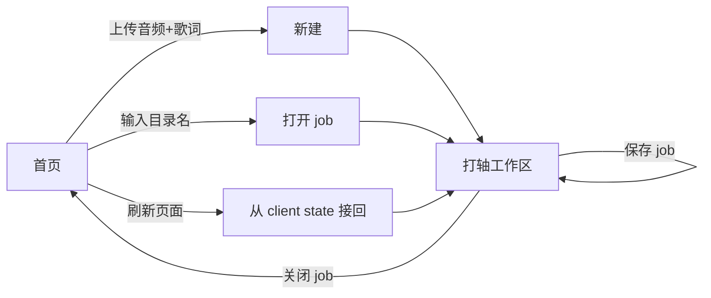

# Web 客户端 W1：打轴最小链路设计方案

日期：2026-10-16。状态：**已实施，待用户验收**（实施记录、出口对照与已知限制见 §9）。后端 S1、S2 已于 2026-10-16 交付（合同 1.2.1，产品 0.77.0）。
基线：W0 已验收（`docs/web-client-w0-design.md` §12），冻结 API 合同 **1.0.0**（产品 0.75.1，协议 `"1"`，后端提交 `400145d`）。本文只描述 Web 侧怎么做，以及要向后端提的需求。新接口的命名和语义以 Codex 回复的候选合同为准。

## 1. 定位与范围

W1 是第一个真正的编辑器界面：用户在浏览器里完成“新建／打开工程 → 边听边给歌词逐字打轴 → 检查和修正 → 保存”。UI 库用 **mdui 2**（Material You Web Components），框架沿用 React。

W1 的范围对应后端审查 §6 的 **S1（合同＋读模型）与 S2（时间＋波形）**：

| 功能 | 说明 | 后端依赖 |
|---|---|---|
| 工程入口 | 新建（上传音频＋歌词）、按目录名打开已保存工程、刷新后接回已打开的工程 | 已有；目录列表需 G12（可选） |
| 歌词浏览 | 来源选择、行列表、选中行的元素与注音、时间状态（未打轴／导入／估算／已修改／确认） | G9 |
| 播放 | 浏览器播放工程音频，播放／暂停／定位／变速，循环当前行 | 已有（鉴权字节＋Range） |
| 波形与时间轴 | 标尺、波形、行与元素块、播放头、缩放与滚动 | 波形 G11（过渡期浏览器自算） |
| 打点 | 播放中按键把播放头记为当前元素的起点／终点，自动前进 | G10 |
| 修正 | 拖动元素边界、相邻元素边界联动、按帧微调、清除元素时间、整行平移、在输入框里精确输入 | 拖动／输入已有 `setTimeRange`；其余 G10 |
| 历史与保存 | 撤销／重做、脏状态、保存、关闭 | 已有 |
| 画面预览 | 暂停或定位时显示当前时刻的静态帧；编辑后换输入 | 已有 |

### 1.1 非目标

- 正文、注音、行增删、拆分合并、来源管理、再次导入、工程设置编辑（S3，建议作为 W2）。
- 场景、样式、预设、效果包、工坊（S4／S5）。
- 导出成片（现有导出只到 10 秒／600 帧，W1 不接）。
- 连续实时预览（播放中只低频刷新，见 §4.7）。
- 打包桌面壳；后端托管 SPA。

## 2. 用户工作流



- 首页列出当前 client 已打开的工程（`GET /clients/{id}/state` 的 `sessions`），可以直接进入；刷新页面后经 resume 接回同一工程，不重新打开。
- 新建：选音频和歌词文件，填工程名，可选帧率／画布；上传两个资源后同步新建（服务端做真实音频准备，可能耗时数十秒，要显示进度提示）。
- 打开：没有 G12 时，用户输入授权根下的相对目录名；最近保存过的目录名记在 `localStorage`（只存目录名，不存任何凭证）。
- 保存：新工程第一次保存要选目标目录名；之后直接保存。关闭时若有未保存修改，提示“保存后关闭／放弃修改／取消”。

## 3. 界面结构

### 3.1 布局

参考桌面版“歌词与打轴”工作区（后端仓库 `docs/design/ui-0496-redesign-previews/lyrics.png`），改用 Material You 组件：

```text
┌ mdui-top-app-bar ─────────────────────────────────────────────────────────┐
│ MakoKara │ 工程名 · 已保存/未保存 │      撤销 重做 │ 保存 │ ⋮（关闭、控制台）│
├──────────────┬───────────────────────────────────────┬────────────────────┤
│ 来源 ▾        │ 第 3 行 · 00:12.300 – 00:15.800 · 估算 │  画面预览           │
│ 01 朝の光…    │ ┌──┐┌──┐┌──┐┌──┐┌──┐                  │  （静态帧，暂停时） │
│ 02 青い空…  ◀ │ │朝││の││光││浴││び│  元素 chip        │                    │
│ 03 …         │ └──┘└──┘└──┘└──┘└──┘  注音显示在上方   │                    │
│ （mdui-list） │ 所选元素：起 [00:12.300] 止 [00:12.800]│                    │
│              │ 微调 −1帧 +1帧 · 清除 · 整行平移…       │                    │
├──────────────┴───────────────────────────────────────┴────────────────────┤
│ ▶ 00:12.718 / 03:45.000 │ 速度 1.0× │ 循环本行 │ 打点模式 ● │ 吸附：帧       │
├───────────────────────────────────────────────────────────────────────────┤
│ 标尺  |00:12      |00:13      |00:14                                       │
│ 波形  ▁▃▅▇▅▃▁▂▄▆▄▂▁▃▅▇▅▃                                                 │
│ 元素  [朝][の][光]  [浴][び]           ← 可拖边界，播放头竖线              │
│ 行    [──── 第 3 行 ────]                                                │
├───────────────────────────────────────────────────────────────────────────┤
│ 状态栏：连接状态 · 修订号 · 最近错误                                         │
└───────────────────────────────────────────────────────────────────────────┘
```

窄屏（小于约 960 px）时，预览收进可开合的侧板，行列表改为抽屉。

### 3.2 mdui 使用约定

- 依赖 `mdui`（2.x）与 `@mdui/icons`（按需引入单个图标），不用 CDN。只按需 `import 'mdui/components/xxx.js'`，不整包引入。
- React 19 原生支持自定义元素：属性按 property 设置，事件用小写 `on<事件名>` 或 `ref` 加监听。我们自己封一层薄组件（`src/editor/ui/`），统一处理事件和受控值，页面不直接散写 `mdui-*` 的事件细节。
- 主题：`setColorScheme(种子色)` 生成 Material You 配色，`setTheme('auto')` 跟随系统明暗。
- 时间轴、波形用 Canvas 自绘，不用 mdui 组件；颜色从 mdui 的 CSS 变量（`--mdui-color-*`）读取，保证明暗主题一致。

## 4. 前端架构

### 4.1 目录与依赖

```text
src/
  protocol/   协议类型（W1 新类型按候选合同补，标注“候选／mock”）
  client/     MakoClient（新增 W1 路由方法）
  console/    W0 协议控制台，保留为调试工具，入口改为 /console.html
  editor/     W1 编辑器（新）
    main.tsx  App.tsx
    ui/       mdui 薄封装、主题
    model/    纯 TS：时间换算、帧吸附、时间轴几何、打点状态机、波形峰值（可单测，不依赖 React／DOM）
    session/  EditorSession：工程读模型缓存、选择、历史状态、命令发送与刷新
    audio/    AudioController：鉴权取字节 → Blob URL → <audio>，播放头时钟
    waveform/ 峰值来源（G11 或浏览器解码）与绘制
    timeline/ 时间轴 Canvas 组件与指针交互
    lyrics/   行列表、元素 chip、行详情
    preview/  PreviewController：静态帧请求、换输入、晚到帧丢弃
    home/     新建、打开、已打开工程列表
```

依赖方向 `editor → client → protocol`。`editor/model` 只依赖自身和 protocol。`editor` 与 `console` 互不依赖。`dependency-boundaries.test.ts` 增加这些检查。

页面入口：`/` 是编辑器，`/console.html` 是协议控制台。Vite 多页面构建；`browser-smoke.mjs` 改用 `/console.html`。

### 4.2 状态归属

沿用 W0 与后端审查 §5.2 的约定：

| 状态 | 归属 | 说明 |
|---|---|---|
| 工程内容、修订、历史、脏状态 | 后端 | 前端只缓存读模型，按修订整体替换，不本地改写 |
| 选择（来源、行、元素）、播放头、缩放、滚动 | 前端 | 选择按稳定 ID 保存；刷新后 ID 不存在就清空 |
| 正在拖动的临时时间、正在输入的文本 | 前端草稿 | 松手或确认时才提交一条命令；冲突时保留草稿并提示 |
| 波形峰值、预览帧 | 前端显示缓存 | 按音频身份／修订作废 |

### 4.3 EditorSession：读模型缓存与刷新

- 打开工程后读取：summary（拿到修订 R）→ 以 R 读来源列表、当前来源的全部行（`lyrics/window` 分页）、工程设置（均为 G9）；任一步 409 就从 summary 重来。G9 交付前用旧 `lyrics/lines`（来源固定 `primary`）。
- 所有读取都带 `projectRevision`。缓存记录“读模型修订”。命令响应 `changed: true` 后，按 `changeSet` 决定刷新：`requiresFullRefresh` 时重读整个来源，否则按缓存里的行下标只重读受影响的行（`lyrics/window` 的 `offset=i&limit=1`）。
- 刷新期间界面继续显示旧数据，并在受影响的元素上显示“同步中”；新数据到达后整体替换。
- `project.changed` 事件（例如另一个标签页或撤销）只触发同样的刷新，不从事件里拼数据。
- 命令一律经 W0 的 `ProjectCommandQueue` 串行发送。`revisionConflict` 时：清空待发命令、整体重读、保留用户草稿并提示“工程已在别处修改”。

### 4.4 播放与时钟（AudioController）

- 用鉴权 `fetchBinary` 读取工程音频资源，生成 Blob URL 交给 `<audio>`。资源上限 16 MiB（G5），整段读入内存可以接受。不用 MediaSource。
- 播放头：播放时每个 `requestAnimationFrame` 读一次 `audio.currentTime`，转成整数微秒（`Math.round(t * 1e6)`），只在打点和提交时把它转成 `Micros` 字符串。
- 打点捕获的是**按键当时**的播放头，不是请求发出的时间。
- 变速用 `playbackRate`（保持音高），打点时间仍是媒体时间。
- 浏览器与后端的时间基可能不一致（主要是 MP3 编码延迟），见 §8.5 问题 Q1。W1 先以 WAV 为主要验收格式。

### 4.5 波形

- 首选后端 G11（与后端准备时用的解码一致，金字塔已在 Hosting 内部生成）。
- 过渡方案：浏览器 `decodeAudioData` 后在 Worker 里算 min/max 金字塔（桶宽 64 样本，逐级二合一），算完丢弃 PCM。资源不超过 16 MiB，内存可控。代码标注“浏览器自算，等 G11 替换”。
- 绘制：按当前缩放选层级，只画可见窗口。

### 4.6 时间轴与交互

- 纯函数几何（`model/timeline.ts`）：微秒 ↔ 像素、可见窗口、命中测试、帧吸附（帧率来自工程设置 G9；没有时不吸附）。
- 拖动元素边界：本地实时显示，松手提交一条命令。单边界用 `lyrics.setTimeRange`；相邻两元素共享边界时同时移动，用 G10 的批量命令一次提交（G10 交付前只移动单个元素）。
- 历史粒度：一次确认的动作对应一条历史。拖动过程中不发命令（后端审查 §5.2，不跨 HTTP 悬挂手势）。
- 键盘（打点模式开启时生效，焦点在输入框时不生效）：

| 键 | 动作 |
|---|---|
| 空格 | 播放／暂停 |
| 按下 `J` | 当前元素起点＝播放头（G10 `stampTokenStart`） |
| 松开 `J` | 当前元素终点＝播放头（G10 `stampTokenEnd`），选中下一个元素 |
| ← → | 选中上／下一个元素；加 Alt 为按帧微调（G10 `nudgeTokenTime`） |
| Delete | 清除所选元素时间（G10 `clearTokenTime`） |
| Ctrl+Z／Ctrl+Shift+Z | 撤销／重做 |

  按住打点的手感需要实际试用后再定，以上是初稿。连唱（上一元素终点就是下一元素起点）是否需要专门的键，试用后再决定。

### 4.7 预览（PreviewController）

- 进入工作区时按当前修订创建预览会话（尺寸按面板大小，最大 1280×720）。
- 暂停、定位、选中行时请求一帧（`seek`）；播放中最多每 500 ms 请求一帧（`playback`），一条在途、只保留最新待发。按后端审查 F6 的估算，这个频率远低于回执容量。
- 工程修订变化后先 `PUT input` 再请求帧；丢弃 generation／sourceRevision／requestSeq 不匹配的晚到帧，释放旧 bitmap。
- 预览能力禁用时显示原因，不影响打轴。

### 4.8 错误展示

沿用 W0 §6 的四类错误。W1 新增“时间被拒绝”类（G10 的错误码，例如超出媒体时长、终点不晚于起点、超出行范围），在时间轴上就地提示，不弹对话框。

## 5. 分阶段计划

| 阶段 | 内容 | 依赖 |
|---|---|---|
| **W1a** | mdui 接入与主题；多页面入口；首页（新建／打开／接回）；工作区骨架；行列表与元素（用现有最小读模型，来源固定 `primary`）；音频播放；浏览器自算波形；时间轴缩放滚动与播放头；拖动边界和输入框 → `setTimeRange`；撤销重做；保存关闭；静态预览 | 无，现在可做 |
| **W1b** | 来源选择；时间状态显示；注音显示；帧吸附；按行刷新 | 后端 S1（G9） |
| **W1c** | 打点、微调、清除、批量边界、整行平移；后端波形 | 后端 S2（G10、G11） |
| W1 验收 | §6 | 全部 |

每一步按 AGENTS.md 一步一提交。后端候选合同到达后，前端可以按“候选／mock”先接；后端交付后再实跑。

## 6. 测试与验收

| 层 | 内容 |
|---|---|
| 单元 | `editor/model`：时间换算与吸附、几何与命中、打点状态机、峰值金字塔；EditorSession 刷新与冲突（假 client）；新协议类型对照候选 OpenAPI |
| 集成 | 新路由／命令的真实 HTTP 往返，响应全部用 OpenAPI 校验（沿用 W0 §12.4） |
| 浏览器 | 扩展 `smoke:browser` 或新增编辑器冒烟：新建 → 播放 → 拖动一个边界 → 撤销重做 → 打点三个元素 → 保存 → 关闭 → 打开，核对时间与状态 |

W1 出口：

1. 用生成的 WAV＋LRC 新建，在浏览器里给至少一行完成逐字打点，每次打点一条撤销。
2. 拖动、微调、清除、整行平移后，读模型、时间轴、预览帧对应同一修订。
3. 保存、关闭、重开后时间与状态完全一致。
4. 刷新页面接回同一工程；`revisionConflict` 时保留草稿并重读。
5. 单元、集成、浏览器冒烟全部通过；能力禁用的分支明确显示原因。

## 7. 待用户确认

1. **W1 范围**：按 §1 只做打轴（S1＋S2），正文／注音／行操作放到 W2。是否同意？
2. **波形来源**：长期用后端 G11，过渡期浏览器自算。若后端排期紧，是否接受 W1 一直用浏览器自算？
3. **音频格式**：W1 验收以 WAV 为主，MP3 待 Q1 结论。
4. **打点键位**：§4.6 的初稿，是否沿用桌面版的习惯（如有）？

## 8. 后端缺口

编号接续 W0（G1～G8、R1）。§8.1～§8.4 是前端最初提出的需求（2026-10-16，前端提交 `9fc708a`）。路由与 DTO 以 Codex 的候选合同为准：后端 `docs/backend-web-editing-plan.md`，提交 `ee6270c`。

| 编号 | 缺口 | 切片 | 优先级 | 状态（2026-10-16） |
|---|---|---|---|---|
| **G9** | 来源列表、完整歌词读模型、工程设置读取 | S1 | P0（W1b） | **已交付**（`5b23115`，合同 1.1.0）；前端真实 HTTP 通过，浏览器已用于读模型 |
| **G10** | 打轴命令：打点、微调、清除、批量元素时间、整行平移 | S2 | P0（W1c） | **已交付**（`bd537ad`，合同 1.2.0；`failureCode` 已采纳）；前端真实 HTTP 通过，界面接入中 |
| **G11** | 波形读取 | S2 | P1 | 排在 G10 之后；前端先用浏览器自算 |
| **G12** | 授权根下的工程目录列表 | S1 | P2 | 后端后置；前端先用手输目录名 |
| G7 | SSE 响应头延迟约 15 秒（W0 已登记） | S0 | P2：编辑器连接状态显示受影响 | 后端计划在时间编辑交付后单独修 |
| G8 | 有事件流时关闭 Server 要等约 30 秒（W0 已登记） | S0 | P3：开发体验 | 同上 |
| R1 | 无音轨工程预览 404（W0 已登记） | — | W1 不受影响 | 未排期 |

候选合同与前端原始需求的差异，前端已确认可以消费：

| 原始需求 | 候选合同 | 前端做法 |
|---|---|---|
| 扩充 `lyrics/lines` | 新增 `GET .../lyrics/window?branchId&expectedRevision&offset&limit`（每次最多 100 行，1 MiB／20000 条），旧 `lyrics/lines` 不变 | 沿 `nextOffset` 读完整个来源；413 时 limit 减半重试 |
| 读取不带修订 | branches／window／settings 的 `expectedRevision` 必填，过期 409 | 先拿修订再读；任一步 409 从头重读 |
| `lineIds` 部分读取 | 不提供 | 时间命令不改变行序，按缓存的行下标 `offset=i&limit=1` 重读 |
| `lyrics.nudgeTime`／`lyrics.clearTime` | `lyrics.nudgeTokenTime`／`lyrics.clearTokenTime`，只作用于元素 | 微调、清除只对元素开放 |
| 重复微调是否合并 | 每个 HTTP 请求最多一条历史，前后断开，不合并 | 界面不做合并 |
| 拒绝原因 | 422 `commandRejected`；领域原因暂放 `field` | 已请求改为稳定 `failureCode`（线程 `S2-timing-waveform`） |
| 设置里的音频时长 | `audioDurationUs` 为字符串；采样率随 G11 提供 | — |

版本：S1 为产品 0.76.0／合同 1.1.0，S2 为产品 0.77.0／合同 1.2.0，`e558f7e` 勘误为 1.2.1（`outputDurationUs` 省略表示“尚未确定”，不是自动时长）；协议仍 `"1"`。前端同步的是 1.2.1。

S2 实际语义的要点（规范 §6.5）：元素不会自动扩展所在行，也不能与前后已定时元素重叠或倒序，越界会被拒绝为 `DomainValidationFailed`；打点播放头夹在 0 到音频末尾之间；changeSet 超过 16 KiB 时 ID 数组清空且 `requiresFullRefresh=true`。

### 8.1 G9 来源列表、完整歌词读模型、工程设置读取

**用户场景**：打开任意工程后，看到它有哪些歌词来源（主歌词、翻译等），选择一个来源浏览全部行；每行和每个元素显示时间状态（未打轴、导入、估算、已修改、已确认）和注音；时间轴按工程帧率吸附，按帧微调。

**现有缺口**：`lyrics/lines` 必须指定 `branchId`，但没有来源列表，前端只能猜 `primary`；行和元素没有 `timingStatus`、注音、`primaryLineId`；没有设置读取，打开已保存工程后前端不知道帧率和画布尺寸。

**请求与响应（建议）**：

1. `GET /api/v1/project-sessions/{id}/lyrics/branches`

   ```json
   {"projectSessionId":"project-P","projectRevision":"3","primaryBranchId":"primary",
    "branches":[{"id":"primary","name":"主歌词","role":"primary","language":"ja-JP",
                 "timingMode":"independent","lineCount":24}],
    "protocolVersion":"1"}
   ```

2. `GET /api/v1/project-sessions/{id}/lyrics/lines?branchId=…` **兼容扩充**（只加字段）：

   ```json
   {"id":"line-1","text":"朝の光","time":{"startUs":"2000000","endUs":"5000000"},
    "timingStatus":"estimated","primaryLineId":null,
    "tokens":[{"id":"tok-1","text":"朝","time":{"startUs":"2000000","endUs":"2500000"},"timingStatus":"edited"}],
    "rubyAnnotations":[{"id":"ruby-1","baseTokenId":"tok-1","text":"あさ"}]}
   ```

   `timingStatus` 取 Core `TimingStatus` 的六个值（建议小写驼峰字符串）。同时建议支持 `lineIds=a,b,c`（有上限）只读部分行，供命令后按 `changeSet.lineIds` 刷新；整个来源读取继续可用。

3. `GET /api/v1/project-sessions/{id}/settings`：画布宽高、帧率分子／分母、背景色、输出时长（新字段请用字符串 Int64）、音频时长与采样率（如方便）。

**稳定 ID／Int64／精确修订**：三个响应都带 `projectRevision`；同一次刷新里修订不一致时前端丢弃并重读。行、元素、注音、来源 ID 都是稳定 ID。时间继续用字符串微秒。

**历史粒度／no-op／错误**：只读，不涉及。未知来源 404 或 400（请定）；`lineIds` 超上限 400。

**验收场景**：新建工程（含估算拆分 `estimateSplitTimes: true`）后，来源列表含 primary；元素状态为 estimated；打开含翻译来源的工程能列出两个来源；`setTimeRange` 之后该元素状态变为 edited，修订号与命令响应一致。

### 8.2 G10 打轴命令

**用户场景**：边听边打点，每按一次键记一个时间；打错了按帧微调或清除；整行整体偏了就平移；拖动两个相邻元素的共享边界时两边一起动。每个动作一次撤销。

**现有缺口**：只有 `lyrics.setTimeRange`，两端必填、不能清除、不能批量，也没有打点、微调和平移。Application 已有 `StampTokenStart`／`StampTokenEnd`、`Nudge`、`ClearToken`、`CommitTokenBatch`、`ShiftLine`。

**请求（建议，`command` 内按 `type` 区分，依赖 G3 多态 DTO）**：

| type | 字段 | 对应用例 |
|---|---|---|
| `lyrics.stampTokenStart` | `target`（含 tokenId）、`playheadUs` | `StampTokenStart` |
| `lyrics.stampTokenEnd` | `target`（含 tokenId）、`playheadUs` | `StampTokenEnd` |
| `lyrics.nudgeTime` | `target`、`frameDelta`（整数） | `Nudge` |
| `lyrics.clearTime` | `target`（含 tokenId） | `ClearToken` |
| `lyrics.setTokenTimes` | `changes: [{target, startUs, endUs}]`（有上限） | `CommitTokenBatch` |
| `lyrics.shiftLine` | `target`（行）、`deltaUs` | `ShiftLine` |

**需要合同写明的语义**：

- 打点起点在元素原本没有终点时会生成一帧估算终点（`EstimatedPlaceholder`）：响应里能否带这个标志，便于界面提示？
- 元素时间超出所在行范围时，行是否自动扩展，还是拒绝？
- 微调对行目标是否适用；重复微调在 HTTP 上是否合并成一条撤销（桌面用例有时间窗合并），请明确。
- 每条命令的 `undoName`。
- no-op（清除已缺失的时间、微调 0 帧、批量为空）应返回 `changed: false`，不增加修订和历史。
- 拒绝原因请给稳定的 `code`／`failureCode`，至少区分 `LyricTimingEditErrorCode` 的 `BeyondContentDuration`、`InvalidStart`、`InvalidRange`、`Untimed`、`DomainValidationFailed`、`TargetStale`，前端就地提示。
- `changeSet` 带受影响的 lineIds／tokenIds；结构未变时不要求整体刷新。

**稳定 ID／Int64／精确修订**：目标全部用稳定 ID；`playheadUs`、`deltaUs`、`startUs`、`endUs` 用字符串微秒；`frameDelta` 是小整数，可用 JSON number。沿用顶层 `expectedRevision`。

**验收场景**：对一个未打轴元素起点打点后，状态为 estimated、终点为起点加一帧；再打终点，状态为 edited；撤销两次回到原状态；微调 +1 帧时间加一帧（工程帧率）；清除后状态 missing、再清除为 no-op；批量移动相邻边界一次撤销还原两个元素；整行平移后行和全部元素同移；超出媒体时长的打点被拒绝并给出稳定错误码；旧修订 409。

**吞吐**：快歌打点可能每秒 5～8 条命令，命令串行发送。请确认单条命令的服务端耗时量级；若响应能直接带受影响行的新投影，可以省一次读取（可选，不强求）。

### 8.3 G11 波形读取

**用户场景**：时间轴上显示整首歌的波形，缩放到帧级仍清楚，滚动不卡。

**现有缺口**：音频准备时已生成完整 min/max 金字塔（桶宽 64 样本，后端审查 F5），但只把时长放进 ProjectSession，没有读取入口。

**请求与响应（建议）**：

- `GET /api/v1/project-sessions/{id}/waveform`：音频身份（sha256）、采样率、总样本数、时长（字符串微秒）、基础桶宽、层数、每层桶数。
- `GET /api/v1/project-sessions/{id}/waveform/peaks?level=L&start=S&count=N`：二进制，N 对 min/max（格式由后端定，int8 或 int16 就够显示用），`ETag` 绑定音频身份＋层级＋范围，单次 N 有上限。

**需要合同写明**：缓存归属与释放（随工程会话？打开、恢复后是否可用）；多声道如何合并；与浏览器播放的时间基是否一致（见 Q1）。

**验收场景**：新建与重开后都能读；最粗一层一次就能取完整首歌；任意窗口的峰值与同层整段读取的对应片段一致；ETag 命中 304。

### 8.4 G12 授权根下的工程目录列表

**用户场景**：打开工程时从列表里选，而不是手输目录名。

**建议**：`GET /api/v1/file-roots/{rootGrantId}/entries`：列出直接子目录中可打开的工程（目录名、修改时间、工程名、产品版本是否兼容），有上限。不给绝对路径。

**验收**：保存两个工程后能列出；不兼容版本的工程标记出来；不越出授权根。

### 8.5 待讨论的问题

- **Q1 浏览器与后端的时间基**：用户听到的是浏览器解码的音频，后端准备／导出用 FFmpeg 解码。WAV 两边一致；MP3 有编码延迟和填充，浏览器与 FFmpeg 处理 gapless 信息的方式可能不同，打点时间会整体偏几十毫秒。后端是否已有结论？可选办法：W1 限 WAV／FLAC；或后端提供一份浏览器可直接播放、与准备时间基一致的音频（例如解码后的 PCM WAV，受 16 MiB 外的独立预算）。
  **结论（2026-10-16，Codex）**：没有浏览器解码与 FFmpeg 时间基跨平台一致的证据，不能承诺 MP3 无偏移。W1 只验收 WAV，FLAC 也不当作已验证。与准备时间基一致的 PCM 播放衍生资源需要独立的预算和生命周期，在评估 G11 时一起考虑，不改动原上传资源。
- **Q2 W1 后端排期**：后端 W1 实施是否已获用户授权，S1 和 S2 能否并行。
  **结论（2026-10-16，Codex）**：后端用户已授权按 S1→S2→S3 推进；S1 与 G3／S2 已经并行实现。S3 后端可以提前做，前端放到 W2 消费。

## 9. 实施记录（2026-10-16）

依据：本文 §1～§8；后端合同 1.2.1（`e558f7e`，产品 0.77.0），部署 `artifacts/backend-web-s2-0770/deployment-final2`。后端仓库代码未改动。

### 9.1 代码结构

| 位置 | 内容 |
|---|---|
| `src/protocol/editing.ts` | S1 读模型（来源、可编辑行窗口、设置）与 S2 六条打轴命令、`timingResult`、`TIMING_FAILURE_CODES`；打轴命令并入 `ProjectCommand` |
| `src/client/mako-client.ts` | `projects.branches`／`lyricWindow`／`allLines`（沿 `nextOffset` 读完，413 减半重试）／`settings` |
| `src/editor/model/` | 纯 TS：`time`（格式化、解析、帧）、`timeline`（视口、缩放、刻度、边界命中）、`lyrics`（两种读模型归一、导航、选择校正）、`peaks`（64 样本桶的 min/max 金字塔） |
| `src/editor/session/` | `EditorSession`（读模型缓存、按 changeSet 重读、命令与冲突）、`project-files`（新建、打开、保存、关闭、最近目录） |
| `src/editor/audio/` | `AudioController`（鉴权字节 → Blob URL → `<audio>`，浏览器解码算波形）、`Transport` 播放条 |
| `src/editor/timeline/Timeline.tsx` | Canvas 时间轴：标尺、波形、元素轨、行轨、播放头；缩放、平移、定位、拖动边界、帧吸附 |
| `src/editor/preview/` | `PreviewController`（一条静态预览会话）与 `PreviewPanel` |
| `src/editor/home/`、`lyrics/`、`workspace/`、`ui/` | 首页、行列表与行详情、工作区与快捷键、mdui 薄封装与对话框 |
| `scripts/editor-smoke.mjs` | `pnpm smoke:editor`：真实 Chrome 走编辑器全链路 |
| `scripts/cdp.mjs`、`page-shot.mjs` | 共用 CDP 客户端；开发截图工具 |

### 9.2 与设计的差异

- **读模型路由**：S1 用新的 `lyrics/window`（`expectedRevision` 必填、每页最多 100 行），而不是扩充 `lyrics/lines`。差异见 §8 表格。
- **刷新**（§4.3）：命令响应和 `project.changed` 以修订去重。changeSet 只涉及时间区域时，按缓存下标用 `offset=i&limit=1` 重读受影响的行；最小投影、非时间区域、`requiresFullRefresh`、行缺失或读取 409 时整体重读。刷新循环单飞、顺序执行，结果按修订单调应用。
- **波形**（§4.5）：没有用 Web Worker。`OfflineAudioContext.decodeAudioData` 解码后在主线程算金字塔；资源上限 16 MiB，耗时很短。G11 交付后替换数据来源，绘制接口不变。
- **键盘**（§4.6）：按住 J 记起点、松开记终点，然后选中下一个元素（跨行）。←→ 选元素，Alt＋←→ 微调一帧，↑↓ 选行，Delete 清除，空格播放／暂停。连唱专用键没有做。
- **拖动**：拖动开始时选中被拖的元素。相邻元素共用的边界一起移动，元素拖动一律用 `lyrics.setTokenTimes`（一个或两个元素，一次撤销）；行边界用 `lyrics.setTimeRange`。默认按工程帧率吸附，按住 Alt 不吸附，Esc 取消。
- **预览**（§4.7）：宽 640，高按画布比例，`opaque`。播放头或修订变化时每 250 ms 检查一次；播放中最多每 500 ms 一帧。时间前进用 `playback`，后退用 `seek`。`revisionConflict`／`previewFrameExpired` 等下一次请求处理；代次或序号冲突时重建会话。
- **窄屏布局**（§3.1）：没有做。目前只适配桌面宽度。

### 9.3 验证结果（2026-10-16，部署 `backend-web-s2-0770/deployment-final2`，产品 0.77.0）

| 项 | 结果 |
|---|---|
| `pnpm typecheck`、`pnpm build` | 通过 |
| `pnpm test:unit` | 16 个文件，204 项通过 |
| `pnpm test:integration` | 3 个文件，28 项通过。新增 `editing.test.ts` 13 项：九项 feature、修订 0 读取、过期修订 409、分页、起点打点估算一帧、终点 edited、±帧微调与 0 帧 no-op、批量一次撤销、清除与二次 no-op、整行平移、422 `Untimed`／`DomainValidationFailed`；所有 JSON 响应通过冻结 OpenAPI 校验 |
| `pnpm smoke:browser` | 18/18（未加 `--manage-backend` 的子集） |
| `pnpm smoke:editor` | 24/24：中文文件名上传与新建、混合拆分、静态预览（修订 0／1）、输入框改时间、撤销／重做、鉴权音频播放、播放中按 J 打点两个元素（起点取按键当时的播放头）并自动前进、+1 帧、清除、整行平移、拖动元素终点、拖动相邻元素共用边界并一次撤销、刷新页面后接回同一工程、保存到新目录、关闭、按目录名重开、无未处理异常 |

浏览器截图人工核对：打点后 3.944 秒处的预览帧中，「青い」已经变色，「空見上げ」未变色，与打点结果一致。

### 9.4 §6 出口对照

| 出口 | 状态 | 依据 |
|---|---|---|
| 1 WAV＋LRC 新建，浏览器中逐字打点，每次打点一条撤销 | 达成 | `smoke:editor`；每条命令一条历史由集成测试和后端合同保证 |
| 2 拖动、微调、清除、平移后读模型、时间轴、预览对应同一修订 | 达成 | `smoke:editor`（预览按修订换输入） |
| 3 保存、关闭、重开后一致 | 达成 | `smoke:editor` |
| 4 刷新接回同一工程；`revisionConflict` 时保留草稿并重读 | 部分达成 | 刷新接回已经过浏览器验证；冲突处理只有单元测试，没有在浏览器里制造冲突 |
| 5 单元、集成、浏览器冒烟通过；能力禁用分支显示原因 | 部分达成 | 测试全部通过；预览、打轴命令、可编辑读模型的禁用分支只做了界面处理，没有在禁用部署上实跑 |

### 9.5 已知限制

- 来源切换需要多来源工程，要等 S3b 的 `addTranslationBranch` 才能在浏览器里构造，留到 W2 验证。
- 只验证了 WAV。MP3、FLAC 的浏览器与后端时间基没有核对（§8.5 Q1）。
- 打点手感、播放头精度、明暗主题和窄屏都只在无头 Chrome 中检查过。请在日常使用的浏览器里实际打一首歌。
- 时间被拒绝时只在状态栏提示（按 `failureCode` 给出中文），没有在时间轴上就地标出。
- 后端已交付 S3a（`61653d8`，合同 1.3.0）和 S3b（`8147493`，合同 1.4.0），S3c 有候选。前端 W1 仍固定 1.2.1，W2 范围待用户决定。
