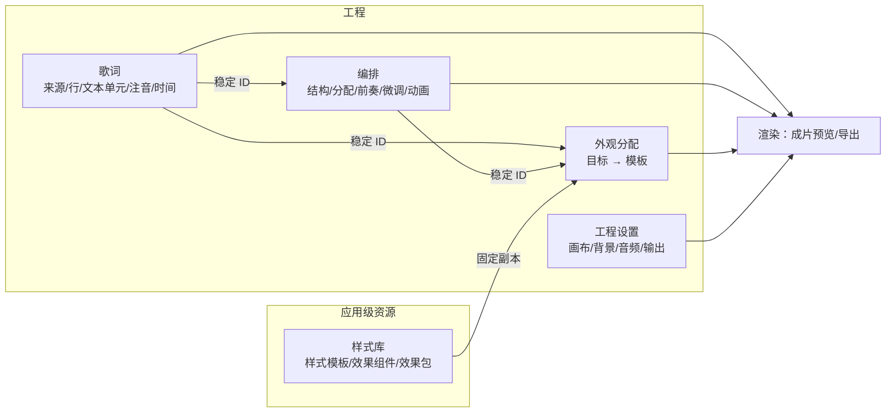

# MakoKara Web 前端设计稿：交互流程、页面与布局

日期：2026-10-16。状态：**用户已审阅通过（2026-10-16）**，§8 的意见全部接受，§11 记录了各项决定。按 §10 分期，各阶段另写设计文档；W2 见 `docs/web-client-w2-design.md`，W3 见 `docs/web-client-w3-design.md`。

依据：
- 用户 2026-10-16 给出的三条原则（§1）；
- W1 已验收的打轴界面（`docs/web-client-w1-design.md` §9）；
- 后端仓库的桌面 UI 文档。这些文档只作领域和教训参考，不照搬布局：`docs/design/ui-0496-redesign-spec.md`、`ui-0496-interaction-review.md`（36 项交互问题）、`ui-0496-natural-guidance.md`、`docs/ui-workspace-ownership-plan.md`、`style-data-model-unification-plan.md`、`unified-scene-element-plan.md`、`current-architecture.md` §0～§5、`scene-editor-ux-optimization-plan.md`、`karaoke-lead-in-plan.md`、`style-animation-system-plan.md` §7～§8、`scripting-effects-sdk-package-plan.md` §1～§4；
- 后端合同：审阅时为 1.7.0（产品 0.82.0），随后交付 1.8.0（产品 0.83.0，`387bca1`，静态样式底层 API）；模板库与分配的候选见后端 `c6bd5de`。

本文只讲界面和交互。路由与 DTO 由 Codex 决定；§9 只列出每个页面需要后端提供的能力。

---

## 1. 设计原则

### 1.1 用户给出的三条原则

1. **歌词分支、歌词编辑和打轴，与实际渲染样式、样式模板无关。**
2. **实际预览和布局编排不关心具体样式。**
3. **样式编辑器和脚本不关心样式模板会应用到哪里去。**

### 1.2 由此推出的界面规则

| 编号 | 规则 |
|---|---|
| R1 | **歌词**页只读写：来源、行、文本单元、注音、翻译关联和时间。页面上不出现字体、颜色、模板、效果相关的任何控件。 |
| R2 | **编排**页只读写：画面结构（组、歌词容器、槽位、前奏提示容器）、歌词分配（默认容器、片段、前奏）、本句微调和动画调度。页面上不出现样式控件。前奏提示标记只编辑“显示什么字”和“放在哪里”。 |
| R3 | **样式库**只读写模板和效果组件本身，预览用固定试样，看不到当前工程的行和容器，模板里也不保存任何目标。 |
| R4 | **外观**页是全应用唯一同时引用“目标”和“模板”的地方。它只写映射：应用、替换、停用、移除、更新、输入映射，不编辑模板内容。 |
| R5 | **预览**是只读的结果视图，可以出现在任何页面，但必须标明身份：成片、试看、试样或布局参考（§4.3）。 |
| R6 | 页面之间只做**导航**，例如“在样式库中编辑这个模板”，不做隐式写入。返回上下文只存在于界面状态，不写进模板或工程。 |

### 1.3 沿用桌面版已验证的交互规则

这些规则来自桌面审查，与三条原则不冲突，继续沿用：
- 先选目标，再选动作；目标只有一个真值，切换面板不改变目标。
- 试看和应用分开：试看不写工程，应用产生一次撤销。
- 保存对象要写明：保存工程、保存模板、保存组件。
- 操作本身提供引导：常驻信息只回答“当前对象、当前状态、可执行动作”。说明文字只在缺项、冲突、出错或用户主动查看时出现。
- 非法输入保留在原处，就地说明原因，不自动修正，也不把半成品写进工程。
- 只有删除、覆盖、丢弃这类有损操作才弹确认；普通可撤销操作不确认。

---

## 2. 领域分层与概念模型

### 2.1 四个领域加一层分配



- 箭头只表示引用。歌词不知道自己会被怎样编排或着色；编排只引用歌词行的稳定 ID；模板不引用任何工程对象。
- 外观分配引用两边：一边是目标（来源、行、文本单元、容器、片段、前奏标记），一边是模板。工程保存的是模板的**固定副本**，库里的模板以后再改，工程不会跟着变，要显式“更新”（沿用桌面语义）。
- 渲染是唯一把四者合在一起的地方，结果只读。

### 2.2 用户可见的概念与术语

| 术语 | 含义 | 后端对应（供实现参考） |
|---|---|---|
| 来源 | 一条歌词轨：主歌词、翻译、注音、自定义 | `LyricBranch`（role） |
| 行 | 来源里的一句 | `LyricLine` |
| 文本单元 | 打轴的最小单位，可以是一个字、一个词或一段 | `LyricToken` |
| 注音 | 跟随文本单元的读音，没有独立时间 | `RubyAnnotation` |
| 翻译关联 | 翻译行跟随某一句主歌词 | `PrimaryLineId`／`FollowPrimary` |
| 画面结构 | 组、歌词容器、槽位、前奏提示容器组成的树 | `nodes` |
| 歌词容器 | 显示歌词的区域，内部是“自由布局”或“槽位轮换” | `SceneContainerDefinition`＋`Layout` |
| 槽位 | 轮换容器里的一个显示位置 | SlotIds 引用的节点 |
| 片段 | 把连续几句交给某个容器显示 | `programs.clips` |
| 前奏提示 | 某句起唱前的倒计时提示 | `programs.leadIns` |
| 本句微调 | 单句的偏移、旋转、缩放和进入动画 | `lineOverrides` |
| 样式模板 | 外观描述：文字、填充、描边、阴影、材质和效果。简称“模板” | `StyleTemplate`（桌面称“预设”） |
| 用途 | 模板能用在哪类目标上：行、文本单元、标记 | 模板能力（Line／Token／Composite） |
| 效果组件 | 可复用的脚本效果配置，来自效果包 | 脚本配置库 |
| 外观分配 | 某个目标用了哪个模板 | `PresetApplication` |
| 工程默认 | 整个工程的兜底模板 | 工程目标上的分配 |
| 试样 | 样式库里用来预览模板的固定示例歌词 | 工坊固定试样 |

术语调整：桌面版的“预设”在 Web 上统一叫**样式模板**，与你的用词一致；桌面版“画面与编排”拆成**编排**和**外观**两页；“预设工坊”改叫**样式库**。

### 2.3 现有数据里与原则冲突的地方

这些不是界面能单独解决的问题，列出来供你和后端决定（§11）。

| 编号 | 现状 | 冲突 | 设计稿的处理 |
|---|---|---|---|
| C1 | 行、元素、来源上有 `StyleOverride` 字段，存在歌词文件里；后端 `styles.patch`／`styles.restore` 直接改它们 | 原则 1、3：样式写在了歌词上，而且要按具体目标编辑样式 | **用户已决定（2026-10-16）：直接样式 API 作为后端底层能力交付；外观页只提供分配，不提供任何模板内容或直接覆盖的编辑。**已有的直接覆盖在外观检查器里只读显示为“直接覆盖” |
| C2 | 前奏提示标记的颜色、字体存在编排节点里 | 原则 2：编排里有样式 | 编排页只编辑标记的文字和位置；标记外观通过外观页分配“标记”用途的模板。需要后端把标记纳入分配目标 |
| C3 | 样式模型里有 `horizontalAlignment`、`verticalCenterRatio`（默认纵向位置）、`scale` | 原则 2、3：对齐和位置属于布局，不该由模板决定 | 建议把对齐和纵向位置移到编排（容器内部布局）；模板只保留外观。这涉及数据模型，由你决定 |
| C4 | 工程有一份“工程基线样式”裸数据 | 与“工程默认也是一次分配”的模型并存，两套真值 | 界面把工程默认表现为“工程目标上的模板分配”；裸基线显示为“内置默认” |

---

## 3. 信息架构与导航

### 3.1 应用外壳

```text
┌───────────────────────────────────────────────────────────────────────────────────────────────────┐
│ MakoKara   我的歌 · 未保存                       ↶  ↷   [保存工程]  [导出视频]   ⋮   ● 已连接     │  顶栏 64
├──────┬────────────────────────────────────────────────────────────────────────────────────────────┤
│  ⌂   │                                                                                            │
│ 首页 │                                                                                            │
│  ♪   │                                                                                            │
│ 歌词 │                                                                                            │
│  ▦   │                                                                                            │
│ 编排 │                                                                                            │
│  ◐   │                                  工作区                                                    │
│ 外观 │                                                                                            │
│ ──── │                                                                                            │
│  ✦   │                                                                                            │
│样式库│                                                                                            │
│      │                                                                                            │
│  ⚙   │                                                                                            │
│ 设置 │                                                                                            │
└──────┴────────────────────────────────────────────────────────────────────────────────────────────┘
 导航栏 80（mdui-navigation-rail）
```

- **导航栏**分两组。工程组是“歌词／编排／外观”，按通常的制作顺序排列，但可以任意切换，不强制顺序。资源组是“样式库”，与工程无关，没打开工程也能进。最下方“设置”打开工程设置面板（§5.6）。
- **顶栏**：
  - 左侧是工程名和保存状态（已保存／未保存／保存中）。
  - 中间是撤销、重做，撤的是工程历史。
  - 右侧是“保存工程”“导出视频”和更多菜单（另存为、关闭工程、导出歌词文件、协议控制台），最后是连接状态。
  - 在样式库页，撤销、重做和保存按钮改为作用于当前模板草稿，按钮文字随之变成“保存模板”（§4.5）。
- 没有打开工程时，导航栏只有“首页”和“样式库”，顶栏不显示工程区。

### 3.2 共享的底部区

“歌词”“编排”“外观”三页共用一个底部区：

```text
├────────────────────────────────────────────────────────────────────────────────────────────────┤
│ ▶  00:12.718 / 03:45.000   速度 1.0×   循环本行   [本页专属开关]          吸附：帧 30fps       │  播放条 56
│ 标尺 ────────────────────────────────────────────────────────────────────────                  │
│ 波形 ▁▃▅▇▅▃▁▂▄▆▄▂▁▃▅▇▅▃▁▂▄▆▄▂▁▃▅▇▅▃▁▂▄▆▄▂                                                      │
│ [本页专属轨道]                                                                                 │  时间轴 140～260，可拖动调高
└────────────────────────────────────────────────────────────────────────────────────────────────┘
```

- 三页共用**同一个播放头和同一个音频**；切换页面不停止播放，也不跳动播放头。
- 标尺和波形固定显示。下方的轨道由各页决定：
  - 歌词页：元素轨、行轨，有多个来源时可以加翻译行轨；
  - 编排页：行轨、片段轨、前奏轨；
  - 外观页：带模板标记的行轨。
- 缩放和滚动位置在三页之间保持一致。底部区可以折叠成只剩播放条。

### 3.3 页面清单

| 页面 | 作用 | 写什么 | 预览 |
|---|---|---|---|
| 首页 | 新建、打开、接回、恢复 | 工程生命周期 | 无 |
| 歌词 | 编辑歌词内容并打轴 | 歌词域 | 逐行逐字预览（不含样式） |
| 编排 | 决定歌词在画面里的位置、轮换和出现时机 | 编排域 | 布局参考、时间预览 |
| 外观 | 决定每个目标用哪个模板 | 外观分配 | 成片、试看 |
| 样式库 | 制作和管理模板、效果组件 | 应用级资源 | 试样 |
| 工程设置 | 画布、背景、音频、输出时长 | 工程设置 | 无 |
| 导出 | 生成视频文件 | 导出任务 | 首帧和末帧缩略图 |

---

## 4. 全局交互规则

### 4.1 选择

- 每页有自己的选择。“当前行”在歌词、编排、外观三页之间同步，其他选择（文本单元、容器、外观目标）只属于本页。
- 选择用稳定 ID 保存。数据刷新后 ID 不存在了，选择就收窄到上一级或清空，不改去选别的对象。
- 多选：Ctrl／⌘ 点击加选，Shift 点击连选。行列表另有显式的“多选”开关，打开后每行出现复选框，并提供“全选／清空”。
- 选择只改变目标，不改变当前打开的面板或页签（桌面问题 P06）。

### 4.2 播放头与选择分开

- 选中一行不会移动播放头。要移动，点“定位到此行”或“试听此行”。
- 播放头在时间轴上点击或拖动即可移动。打点模式下，播放头只跟随音频走。

### 4.3 预览的身份

所有画布左上角都有一个身份标签，同一时刻只显示一个：

| 标签 | 含义 | 出现的页面 |
|---|---|---|
| `成片 · 修订 12 · 00:12.718` | 当前工程在这个时刻的真实渲染结果 | 编排、外观 |
| `逐字预览 · 00:12.718` | 当前时刻附近几行的文字和逐字进度，不含任何样式 | 歌词 |
| `试看 · 清晰描边 → 2 个对象` | 外观页里试用某个模板的临时结果，没有写入工程 | 外观 |
| `试样 · 整句` | 样式库里的固定示例 | 样式库 |
| `布局参考` | 每个容器和槽位里放一段代表性文字，不看当前时刻 | 编排 |
| `渲染中…`／`预览不可用：<原因>` | 状态 | 所有页面 |

### 4.4 撤销、保存与草稿

| 对象 | 历史 | 保存 |
|---|---|---|
| 工程（歌词、编排、外观、设置） | 后端工程历史；顶栏撤销／重做；每个明确动作一条历史 | “保存工程”。新工程第一次保存时询问目录 |
| 样式模板 | 浏览器端的草稿历史，只在样式库页有效 | “保存模板”写入库，不改变任何工程 |
| 效果组件 | 同上，另有源码修订 | “保存组件”；源码另有“保存修订、编译、采用” |

- **编排和外观的修改直接生效，没有草稿模式。**每个动作是一条工程命令，可以撤销。结构性的多步修改（例如把容器改为槽位轮换并选定槽位）由对话框一次收齐参数，提交时作为一条命令。理由见 §8 第 2 条。
- 离开有未保存草稿的模板或组件时，提示“保存／放弃／继续编辑”。
- 关闭有未保存修改的工程时，提示“保存后关闭／不保存／取消”（W1 已实现）。

### 4.5 快捷键

| 键 | 作用 | 范围 |
|---|---|---|
| Ctrl+Z／Ctrl+Shift+Z／Ctrl+Y | 撤销／重做 | 工程页作用于工程；样式库作用于当前草稿 |
| Ctrl+S | 保存当前上下文：工程页保存工程，样式库保存模板 | 全局 |
| 空格 | 播放／暂停 | 带底部区的三页 |
| ←→／↑↓ | 选上一个／下一个文本单元或行 | 歌词、外观 |
| Alt+←→ | 所选文本单元按帧微调 | 歌词 |
| 按住 J | 打点：按下记起点，松开记终点并前进 | 歌词页打点模式 |
| Delete | 歌词页清除文本单元时间；编排页删除所选对象（有引用时说明原因） | 歌词、编排 |
| 方向键（画布聚焦时） | 所选容器移动 1 px；加 Shift 移动 10 px | 编排 |
| Esc | 撤回输入、取消拖动、关闭弹层 | 全局 |

焦点在文字输入框里时，全部快捷键让给输入框（W1 已实现）。

### 4.6 反馈

- 成功：底部 snackbar 显示约 4 秒，例如“已应用到 2 行 · 撤销”。
- 错误：显示在出错的字段或对象旁，问题解决后才消失；不用会自动消失的提示表达错误。
- 后端领域拒绝：按 `failureCode` 给出中文说明（W1 已有做法），无法识别时显示后端 message。
- 长任务（导入、打开、保存、导出、验证）：在对象旁显示进度和“取消”。取消请求发出后显示“正在取消”，直到任务真正结束。

### 4.7 空态

只放一句状态和一个能开始工作的动作。例如：来源里没有歌词时，显示“还没有歌词 · [添加歌词]”；不要铺开一排禁用的控件。

---

## 5. 页面设计

### 5.1 首页

```text
┌──────┬────────────────────────────────────────────────────────────────────────────────────────┐
│ 首页 │  继续工作                                                                              │
│样式库│  ┌──────────────────────┐ ┌──────────────────────┐                                     │
│      │  │ 我的歌               │ │ 测试工程             │  ← 已打开的工程                     │
│      │  │ 修订 42 · 未保存     │ │ 修订 3 · 已保存      │                                     │
│      │  └──────────────────────┘ └──────────────────────┘                                     │
│      │                                                                                        │
│      │  [＋ 新建工程]   [打开…]   [从备份恢复…]                                               │
│      │                                                                                        │
│      │  工程目录                                                    搜索 [          ]         │
│      │  ┌──────────────────────────────────────────────────────────────────────────────────┐  │
│      │  │ my-song      我的歌     2026-10-16 14:20   0.82.0                      打开      │  │
│      │  │ old-song     旧工程     2026-09-01 10:00   0.75.1   版本不兼容                   │  │
│      │  └──────────────────────────────────────────────────────────────────────────────────┘  │
└──────┴────────────────────────────────────────────────────────────────────────────────────────┘
```

- **新建工程**：打开对话框，分两步。
  1. 第一步：选音频和歌词文件、填工程名。歌词文件识别出格式后显示“识别为：增强 LRC · UTF-8”。
  2. 第二步：画布和帧率；文本单元拆分规则，默认“混合”；是否按字数估算逐字时间。
  - 提交后显示上传和音频准备的进度。完成后进入**歌词**页。
- **工程目录**列出授权目录下的工程（需要后端 G12）。在那之前沿用 W1 的“输入目录名＋最近使用”。版本不兼容的工程标出来，但不让打开。
- **从备份恢复**：列出恢复候选，选中后恢复。

### 5.2 歌词

W1 的打轴界面在这里扩展为完整的歌词编辑。

```text
┌──────┬───────────────────────────┬────────────────────────────────────────────┬──────────────────────┐
│      │ 主歌词 ▾   管理来源       │ 第 3 行 · 0:12.300–0:15.800 · 已修改       │ 逐字预览 · 0:12.718  │
│ 歌词 │ [＋ 添加歌词 ▾]    多选   │                  定位到此行  试听此行      │                      │
│      │───────────────────────────│                                            │ 青い空見上げ         │
│      │ 01 朝の光浴びて      ✓    │ 正文 [朝の光浴びて              ]          │                      │
│      │    0:02.0–0:05.0          │                                            │ ▌風の声▐を聞く       │
│      │ 02 青い空見上げ      ◐    │ 文本单元              拆开 合并 ⋯          │   かぜ               │
│      │▶03 風の声を聞く      ✓    │  あさ                                      │ 沐浴着晨光           │
│      │ 04 君と歩く道に      ○    │ [朝][の][光][浴][び][て] 可拖动排序        │                      │
│      │    翻译：沐浴着晨光       │                                            │ 君と歩く道に         │
│      │ …                         │ 注音（所选「朝」） [あさ        ]          │                      │
│      │                           │ 翻译 沐浴着晨光（翻译 · 跟随本句）         │ 收起 ▸               │
├──────┴───────────────────────────┴────────────────────────────────────────────┴──────────────────────┤
│ 所选「朝」 起[0:12.300] 止[0:12.800] 时长 0.500  −1帧 +1帧 清除 │ 本行 起[…] 止[…] 整行平移…         │  时间栏
│ ▶ 0:12.718 / 3:45.000   速度 1.0×   循环本行   打点模式 ●                  吸附：帧 30fps            │
│ 标尺 / 波形 / 元素轨 / 行轨 /（翻译行轨）                                                            │
└──────────────────────────────────────────────────────────────────────────────────────────────────────┘
```

**区域**

| 区域 | 内容 | 宽度 |
|---|---|---|
| 行列表 | 来源选择和“管理来源”、“添加歌词”、多选开关；每行显示行号、正文、时间和时间状态图标；可选在主歌词下显示关联的翻译 | 280～340，可拖动 |
| 行编辑 | 正文、文本单元（上方显示注音）、所选文本单元的注音、关联翻译 | 弹性 |
| 逐字预览 | 当前时刻的上一行、当前行（逐字填充进度、注音）、关联翻译和下一行；纯文字，不含任何样式，可收起 | 280～360 |
| 时间栏 | 所选文本单元的起止和时长、±1 帧、清除；本行起止、整行平移 | 固定在时间轴上方 |

时间字段从 W1 的行编辑区移到时间轴上方的固定一行。这样无论行编辑区怎么滚动，时间字段都不会被挤走（桌面问题 L02）。

**行列表**
- 时间状态图标：✓ 已确认／已修改，◐ 估算或导入，○ 未打轴，⚠ 无效。图标旁有文字提示，不只靠颜色区分。
- 行的右键菜单和 ⋯ 菜单：在下方插入、复制本行、删除本行、按规则重切本行。多选时可以批量删除。
- 选中翻译来源时，每行显示它关联的主歌词；“跟随主歌词”的行，时间显示为“跟随 第 3 行”。

**添加歌词**（菜单里两项，各开一个对话框）
- **导入文件…**
  1. 选文件。
  2. 选目标：替换现有来源，或作为新来源（翻译、注音、自定义）。
  3. 选项：编码（默认自动识别）、拆分规则、是否估算逐字时间。
  4. 提交后显示导入报告：识别格式、编码、行数、跳过的行和问题清单。可以展开查看每条问题，并定位到源文件行号。
- **粘贴文本…**：一个多行输入框。目标是追加到现有来源末尾，或新建翻译来源。提交后选中新加入的第一行。

**管理来源**（侧边面板）
- 列出所有来源，显示名称、角色、语言、时间策略和行数。
- 操作：添加翻译来源；修改名称、语言、角色、时间策略；删除。主歌词不能删除，也不能改角色，界面上把这两个控件禁用并写明原因。
- **翻译关联**：在管理来源面板或翻译行的 ⋯ 菜单里“关联到主歌词某行”。打开一个两列对照视图：左边翻译行，右边主歌词行，逐行选择关联，可以“按顺序自动配对”，提交前能先看效果。

**正文编辑**
- 改正文后按 Enter 或离开输入框提交，Esc 撤回。
- 提交后 snackbar 显示“保留 4 个文本单元的时间，重新拆分 2 个”（后端 `preservedTokenCount`／`resetTokenCount`）。

**文本单元**
- 点击：选中。再点一次：回到整行。
- 拖动：排序。提交前询问“时间槽跟着新顺序重排／保持原时间”，对应后端 `reassignTimeSlots`。
- “拆开”：所选单元至少要有两个字才可用，否则按钮禁用并说明原因。
- “合并”：与后一个单元合并。
- ⋯ 菜单 →“按规则重切本行…”：输入框里用 `|` 标出切分位置，下面预览切分结果。
- 来源的 ⋯ 菜单 →“按规则重切整个来源…”：选规则、选是否估算时间，提交前显示会影响多少行。

**注音**：编辑所选文本单元的注音；清空即删除。

**打轴**：沿用 W1，包括打点模式、拖动边界、按帧吸附、整行平移、批量边界。

**不在此页出现的内容（R1）**：模板、颜色、字体、效果、画面位置、样式相关的提示。

### 5.3 编排

“编排”决定歌词出现在**哪里**、**何时**、**怎样轮换**。画布显示真实渲染结果，但编排本身不涉及外观。

```text
┌──────┬────────────────────┬────────────────────────────────────────────────┬─────────────────────┐
│      │ 画面结构      ＋ ▾ │ [布局参考|时间预览]  适合窗口 ▾  对齐线 ●      │ 前段 · 槽位轮换     │
│ 编排 │────────────────────│ 布局参考                       [快速布局…]     │ 画面/主歌词组/前段  │
│      │ ▾ 主歌词组    组   │ ┌────────────────────────────────────────────┐ │ ─ 位置 ───────────  │
│      │   ▾ 前段  轮换·2   │ │                                            │ │ X [50%]  Y [60%]    │
│      │      1 左侧  槽位  │ │  ┌─────────────┐                           │ │ 锚点 [中心 ▾]       │
│      │      2 右侧  槽位  │ │  │ 左侧 槽位1  │                           │ │ 旋转 [0°] 缩放 [1.0]│
│      │     副歌  自由     │ │  └─────────────┘      ┌─────────────┐      │ │ ─ 内部布局 ───────  │
│      │   ▸ 三点  前奏·3   │ │                       │ 右侧 槽位2  │      │ │ (•) 槽位轮换        │
│      │ ▾ 翻译组      组   │ │                       └─────────────┘      │ │ ( ) 自由布局        │
│      │     翻译  自由     │ │       ┌───────────────────────┐            │ │ 槽位：1 左侧 2 右侧 │
│      │                    │ │       │ 翻译                  │            │ │ 同时最多显示 [2]    │
│      │                    │ │       └───────────────────────┘            │ │ ─ 动画 ───────────  │
│      │                    │ └────────────────────────────────────────────┘ │ 进入 [淡入 0.3s ▾]  │
├──────┴────────────────────┴────────────────────────────────────────────────┴─────────────────────┤
│ 歌词分配  来源 [主歌词 ▾]  默认容器 [前段 ▾] · 未单独分配 18 句   [片段][前奏提示]  ＋ 新建片段  │
│ ▶ 0:12.718 / 3:45.000   速度 1.0×                                              吸附：行          │
│ 标尺 / 波形 / 行轨 / 片段轨（色块：前段 · 副歌 · 尾段）/ 前奏轨（▸ 3 秒）                        │
└──────────────────────────────────────────────────────────────────────────────────────────────────┘
```

**区域**

| 区域 | 内容 |
|---|---|
| 画面结构（左） | 组、歌词容器（自由／轮换·N）、槽位、前奏提示容器（前奏·N 个标记）的树。每个节点带角色徽标。用 ⋯／右键菜单新建子项、复制、删除、重命名、改父级；拖动可排序和改父级（沿用桌面 6.1～6.3 节） |
| 画布（中） | 模式切换：**布局参考**（每个容器和槽位里放代表性文字，不看时刻，用于摆位置）和**时间预览**（某一时刻的真实结果）。叠加层显示容器参考框、槽位框和选中手柄；手柄可拖动、缩放、旋转，松手提交一次 |
| 属性（右） | 可点击的对象路径；按对象类型显示属性：位置与变换；内部布局（自由／轮换，以及槽位列表和调度参数）；动画（进入、退出，轮换容器另有触发、保留、冲突策略）。选中前奏提示容器时显示定位方式（固定在父组内／跟随目标句）和标记列表。选中标记只显示**文字**和位置 |
| 歌词分配（下） | 来源选择、默认容器（显示“未单独分配 N 句”）、[片段] [前奏提示] 两个页签 |
| 时间轴 | 行轨、片段轨（按容器着色）、前奏轨。在行轨上框选连续几句，就能“为这几句新建片段” |

**片段**：片段列表和片段轨显示同一份数据，两边联动选中。
- 新建片段：可以在行轨上框选，也可以点“＋ 新建片段”。对话框里选连续的句和目标容器，确认按钮写“创建片段”。
- 删除片段后，这些句回到默认容器。
- 时间冲突（后端校验失败）在对话框里就地说明，不提交。

**前奏提示**：页签里是前奏列表，每项显示目标句、提示容器、时长和来源（手工／自动）。
- “添加前奏”。
- “自动生成…”：对话框里设置范围、提示时长、空档阈值和提示容器，下方列出新增、建议更新、保留和跳过（附原因）各几条，勾选后应用。

**快速布局…**：给只想套用常见布局的用户。
1. 对话框显示四张缩略图：单行居中、卡拉 OK 双行、双行居中、三行居中。
2. 选范围：某个来源的全部行，或在时间轴上框选的连续几句。
3. 应用。范围不连续时提示“需要连续歌词段”，不会悄悄扩大范围。
- 当前布局无法识别为这四种之一时，显示为“自定义”。

**本句微调**：时间预览模式下，在画布上选中某一句（或在行轨上选中）。属性区出现“本句微调”：偏移、旋转、缩放、进入动画覆盖，以及“清除本句微调”。

**不在此页出现的内容（R2）**：字体、颜色、描边、阴影、模板、效果。前奏标记的颜色由外观页分配“标记”模板决定；这里只编辑标记的文字（例如 ●、3／2／1）。

### 5.4 外观

“外观”是唯一把目标和模板连起来的页面：选目标，选模板，应用。

```text
┌──────┬──────────────────────┬────────────────────────────────────────────┬─────────────────────────┐
│      │ 目标           多选  │ 成片 · 修订 42 · 0:12.718                  │ 主歌词/第 2、4 行 · 2   │
│ 外观 │ 搜索 [          ]    │ ┌────────────────────────────────────────┐ │ ─ 当前模板 ──────────   │
│      │──────────────────────│ │                                        │ │ 混合：                  │
│      │ ◉ 工程默认  清晰描边 │ │                                        │ │  第 2 行 · 清晰描边     │
│      │ ▾ 歌词来源           │ │               （画面）                 │ │    继承自 工程默认      │
│      │   ▾ 主歌词       —   │ │                                        │ │  第 4 行 · 金色强调     │
│      │      01 朝の光…  —   │ │                                        │ │    本行直接分配         │
│      │    ☑ 02 青い空…  —   │ │                                        │ │ [更换模板…]             │
│      │      03 風の声…  金  │ └────────────────────────────────────────┘ │ ─ 更多 ──────────────   │
│      │    ☑ 04 君と歩…  金  │                                            │ 停用  移除  更新(有新版)│
│      │   ▸ 翻译         淡  │                                            │ 在样式库中编辑副本      │
│      │ ▾ 编排对象           │                                            │ ─ 外观来源 ▸ ────────   │
│      │    前段（容器）  —   │                                            │                         │
│      │    副歌（片段）  金  │                                            │                         │
│      │    三点（前奏）  点  │                                            │                         │
├──────┴──────────────────────┴────────────────────────────────────────────┴─────────────────────────┤
│ ▶ 0:12.718 / 3:45.000   速度 1.0×                                                                  │
│ 标尺 / 波形 / 行轨（行块上标出直接分配的模板名，可框选）                                           │
└────────────────────────────────────────────────────────────────────────────────────────────────────┘
```

**目标浏览器（左）**
- 分组：工程默认；歌词来源（来源 → 行 → 文本单元，逐级展开）；编排对象（容器、片段、前奏标记）。
- 每项右侧显示**直接分配**的模板简称，“—”表示继承上一级。
- 在时间轴行轨上点选或框选行，会同步选中这里的对应项。
- 可以按“有直接分配／未分配”筛选。

**外观检查器（右）**
- 顶部：精确的目标路径和数量，例如“主歌词 / 第 2、4 行 · 2”。
- 当前模板：单选时显示模板名，以及“本对象直接分配”或“继承自 X”；多选且模板不同时显示“混合”，并列出每个对象各自的情况。
- 动作：
  - **更换模板…**：打开模板选择器，下面详述。
  - **停用**：保留这条分配，暂时显示继承来的效果；可以重新启用。
  - **移除**：删除本对象的分配，回到继承。
  - **更新**：库里该模板有新版本时才出现。先显示差异，确认后更新；保留实例身份和随机种子。
  - **在样式库中编辑副本**：跳到样式库，编辑这份副本（§5.5）。
- 外观来源（展开）：逐个属性显示实际取自哪一层，例如“字号 72 · 来自 工程默认”“描边 · 来自 本行”。
- 效果需要的输入：模板里的效果需要读取另一个来源（例如“需要翻译歌词”）时，这里出现输入映射字段。映射没选好之前，不能试看，也不能应用。

**模板选择器**（宽屏时是右侧覆盖面板，窄屏时是全屏页）

```text
┌─ 选择模板 · 用于 2 行 ─────────────────────────────┐
│ 搜索 [        ]   用途：行 ▾   内置 / 我的         │
│ ┌─────────┐ ┌─────────┐ ┌─────────┐ ┌─────────┐    │
│ │ 缩略图  │ │ 缩略图  │ │ 缩略图  │ │ 缩略图  │    │
│ │ 清晰描边│ │ 金色强调│ │ 霓虹 ✦  │ │ 淡色    │    │
│ └─────────┘ └─────────┘ └─────────┘ └─────────┘    │
│ ✦ 含效果 · 灰显项：不适用于当前目标（原因）        │
├────────────────────────────────────────────────────┤
│ 将替换：第 4 行的“金色强调”                        │
│                         [取消]   [应用到 2 行]     │
└────────────────────────────────────────────────────┘
```

1. 缩略图用模板在固定试样上的渲染结果，与工程无关。
2. 只列出“用途”与目标匹配的模板。不匹配的模板灰显，并说明原因。
3. 点选某个模板后，画布切换为 `试看 · 霓虹 → 2 行`，不写工程。连续点选其他模板不会产生历史记录。
4. 提交区只写超出目标名称之外的影响，例如“将替换第 4 行的金色强调”。
5. 点“应用到 2 行”后写入一条历史，并显示“已应用 · 撤销”。点“取消”或离开页面，结束试看。

**不在此页出现的内容（R4）**：模板内容的编辑，包括字体、颜色、效果参数，一律去样式库改。

### 5.5 样式库

样式库是应用级资源，不属于某个工程。它有两个分区：**样式模板**和**效果组件**。

#### 5.5.1 样式模板

```text
┌──────┬──────────────────────┬──────────────────────────────────────────┬────────────────────────────┐
│      │ [模板] [效果组件]    │ 霓虹 · 未保存       ↶ ↷  [保存模板]      │ [外观][材质][效果][高级]   │
│样式库│ 搜索 [          ]    │ 试样 [整句 ▾] 背景 [深 ▾] 适合窗口 ▾     │ ─ 文字 ──────────────────  │
│      │ 用途 [全部 ▾]        │ ┌──────────────────────────────────────┐ │ 字体 [思源黑体 ▾]          │
│      │──────────────────────│ │                                      │ │ 字号 [72]  字重 [700]      │
│      │ 内置                 │ │       夜空中最亮的星                 │ │ 字距 [0]                   │
│      │  [缩略] 清晰描边 只读│ │        （试样画面）                  │ │ ─ 填充 ──────────────────  │
│      │  [缩略] 金色强调 只读│ │                                      │ │ 未唱 ■ #4A5060  渐变…      │
│      │ 我的                 │ └──────────────────────────────────────┘ │ 已唱 ■ #4C8DFF  渐变…      │
│      │ ▶[缩略] 霓虹      ●  │ 试样 ▶ 0:01.500 / 0:06.000  循环 ●       │ ─ 描边 ──────────── ● 开   │
│      │  [缩略] 淡色         │                                          │ 颜色 ■  宽度 [4]  圆角     │
│      │ [＋ 新建模板 ▾]      │                                          │ ─ 阴影 ──────────── ○ 关   │
│      │                      │                                          │ ─ 透明度 ────────────────  │
└──────┴──────────────────────┴──────────────────────────────────────────┴────────────────────────────┘
```

- **模板列表**：分“内置”（只读）和“我的”两组；可搜索，可按用途（行／文本单元／标记）筛选。
  - 新建：从空白新建，或复制所选模板。
  - 更多菜单：导出、导入模板文件，删除。只有“我的”模板可以删除，删除需要确认。
- **试样画布**：
  - 试样可以选：整句、多行、重复词、间奏、注音、前奏标记、文本单元强调。
  - 背景可以选深色、浅色、棋盘格（检查透明）。
  - 带试样音频的试播和循环。
  - 试样不是当前工程，也不受当前工程影响（R3）。
- **编辑面板**分四个页签：
  - **外观**：文字、填充（未唱／已唱，纯色或渐变编辑器）、描边、阴影、透明度。描边和阴影各有开关；关掉是“关闭”，不是“继承”。
  - **材质**：先选部位（未唱填充、已唱填充、描边），再从效果组件里选材质。
  - **效果**：模板里的效果列表，显示名称、作用于（整句、句中文字、标记）、启用开关和顺序。选中一项显示它的参数，参数用图形控件编辑；需要读取其他来源的效果，在这里声明“需要：翻译歌词”，不指定具体来源。
  - **高级**：原始数据（JSON）只读查看。
- 用途为“文本单元”的模板，只开放颜色、描边、阴影和透明度。其他字段禁用，并说明原因（沿用后端元素能力规则）。
- 内置模板只读。编辑面板顶部有醒目的“复制并编辑”。
- **从外观页跳过来时**，顶部多一条返回栏：“来自 外观 · 主歌词 / 第 2 行 [保存并返回试看]”。
  - 点它会先保存模板，再回到外观页，并以这个模板进入试看。工程仍然没有改变，要在外观页明确应用。
  - 原目标在此期间被删除时，返回后要求重新选择目标，不会应用到别的对象上。
  - 返回栏只是界面状态，模板里不记录它从哪里来（R3、R6）。

#### 5.5.2 效果组件

```text
┌──────┬──────────────────────┬──────────────────────────────────────────────────────────────────────┐
│      │ [模板] [效果组件]    │ 粒子拖尾 · 已保存 · 效果包 sparkle v3          [保存组件]  ⋯         │
│样式库│ 搜索 [          ]    │ [配置] [验证] [源码]                                                 │
│      │──────────────────────│ ─ 配置 ──────────────────────────────────────────────────────────    │
│      │ ▶ 粒子拖尾    效果   │ 包内效果 [trail ▾]     作用于 [句中文字 ▾]                           │
│      │   玻璃材质    材质   │ 参数   粒子数 [40]   寿命 [0.8s]   颜色 ■                            │
│      │                      │ 需要读取的来源：无                                                   │
│      │ [导入效果包…]        │ 高级 ▸（随机种子、叠加策略）                                         │
└──────┴──────────────────────┴──────────────────────────────────────────────────────────────────────┘
```

- 空态：“还没有效果包 · [导入效果包…]”。
- 三个页签沿用桌面 S7 的设计：
  - **配置**：包内效果、作用于、参数、需要读取的来源。
  - **验证**：在固定试样上运行，显示进度和完整报告。配置改动后，旧结果标为“需重新验证”。
  - **源码**：文件列表和编辑区；“保存修订 → 编译 → 采用修订 → 验证此修订”四个动作分开，每个动作写明会影响什么。
- 组件只描述作用于哪一类对象（相对目标），不涉及工程（R3）。
- 加入模板：在模板的材质或效果页签里，选一个组件，把它复制进模板。组件库以后更新，已有模板不会自动跟随。

### 5.6 工程设置

点导航栏底部“设置”，从右侧滑出面板，宽约 420。分四组：

| 组 | 内容 |
|---|---|
| 画布 | 尺寸：常用尺寸（1920×1080、1280×720、1080×1920）或自定义；帧率 |
| 背景 | 颜色；图片或视频：缩略图和名称，旁边是“选择、替换、移除”。视频才显示适配方式和播放策略 |
| 音频 | 文件名、时长、准备状态、“替换音频”；音频分析：未分析／已采用，“分析并采用”“清除” |
| 输出时长 | 当前值，或“未确定”（导出前必须确定）；“按音频时长”“按歌词末尾”是一次性取值，不会持续绑定；自定义 |

- 每组字段按 Enter 或离开提交，产生一条历史。
- 替换媒体失败时保留原媒体，并在该组里就地说明原因。

### 5.7 导出

导出是一个独立页面，从顶栏“导出视频”进入，左侧导航栏不变。

```text
┌──────┬────────────────────────────────────────────────────────────────────────────────────────────┐
│      │ 导出视频                                                                  返回编辑         │
│      │ ─ 准备检查 ─────────────────────────────────────────────────────────────────────────       │
│      │ ✓ 音频已准备   ⚠ 输出时长未确定 [去设置]   ✓ 效果已验证   ⓘ 当前最多导出 10 秒             │
│      │ ─ 格式 ─────────────────────────────────────────────────────────────────────────────       │
│      │ (•) MP4（H.264）    ( ) MOV 透明（ProRes 4444）                                            │
│      │ 范围 [0:00.000] – [0:10.000]                                                               │
│      │ ─ 摘要 ─────────────────────────────────────────────────────────────────────────────       │
│      │ 1920×1080 · 30 fps · 300 帧 · 含音轨                    [首帧] [末帧]                      │
│      │                                                                        [开始导出]          │
│      │ ─ 任务 ─────────────────────────────────────────────────────────────────────────────       │
│      │ 渲染中 120 / 300 帧 ███████░░░░░   取消                                                    │
│      │ 完成 · 12.3 MB  [下载]                                                                     │
└──────┴────────────────────────────────────────────────────────────────────────────────────────────┘
```

- 准备检查里每个未通过项都附带修复入口；有阻断项时，“开始导出”禁用。
- 后端当前的导出合同最多 10 秒、600 帧，页面如实说明这一点，不假装能导出整首。
- 导出歌词文件（增强 LRC）放在顶栏的更多菜单里，需要后端提供。

---

## 6. 关键流程

### 6.1 第一次做一首歌


一个只想快速出片的用户不需要进样式库，也不需要碰画面结构树。

### 6.2 只给副歌换一个外观

1. 外观页：在时间轴行轨上框选副歌的 4 句。
2. 点“更换模板…”，再点“金色强调”，画布进入试看。
3. 点“应用到 4 行”，写入一次历史。

### 6.3 改出自己的模板

1. 外观页选中目标，点“在样式库中编辑副本”。
2. 样式库：复制出一份可编辑的模板，改描边，状态变为“未保存”。
3. 点“保存并返回试看”，回到外观页并试看新模板。
4. 点“应用到 1 行”。

不从外观页进入时，主动作只有“保存模板”。

### 6.4 让第 9 句单独居中显示

1. 编排页：在行轨上选中第 9 句，点“为这几句新建片段”。
2. 目标容器选“居中”，或在对话框里新建一个自由布局容器。
3. 点“创建片段”。时间预览里可以看到：双行轮换在第 9 句暂停，结束后从槽位 1 重新开始。

这个流程完全不涉及外观。第 9 句要不要换颜色，是外观页的事。

### 6.5 给开头加三点前奏

1. 编排页 [前奏提示] 页签：点“自动生成…”，设置提示时长 3 秒。
2. 列表里会出现“新增：第 1 句”。没有提示容器时，在对话框里一并新建“三点提示”。
3. 勾选后应用。
4. 前奏标记的颜色在外观页设置：编排对象 → 三点（前奏标记）→ 选“标记”用途的模板。

---

## 7. 布局与视觉规格

### 7.1 断点

| 宽度 | 布局 |
|---|---|
| ≥ 1440 | 导航栏、左栏、画布或编辑区、右栏全部常驻 |
| 1200～1439 | 右栏改为可开合的覆盖面板，默认打开；左栏常驻 |
| 960～1199 | 左栏和右栏都改为覆盖面板，同一时间只开一个；当前目标路径固定在画布上方 |
| < 960 | 不保证可用，顶部提示“请使用更宽的窗口”；不针对手机设计 |

最小高度 720。底部区至少保留播放条加 140 高的时间轴；高度不足时，上方编辑区内部滚动。

### 7.2 尺寸

- 导航栏 80，顶栏 64，播放条 56，时间轴默认 180、可拖动调到 120～320。
- 左栏默认 300，范围 240～400；右栏默认 360，范围 300～440，两者都可拖动。宽度记在浏览器本地设置里（不是凭证，可以存 localStorage）。
- 控件高度沿用 mdui 默认：按钮 40，文本框 56。属性面板改用紧凑密度：按钮 32，文本框 40，通过统一的 CSS 变量设定，页面里不写死尺寸。

### 7.3 mdui 组件对应

| 部位 | 组件 |
|---|---|
| 导航栏 | `mdui-navigation-rail` |
| 顶栏 | `mdui-top-app-bar` |
| 页签（模板编辑、效果组件、片段／前奏） | `mdui-tabs` |
| 侧边面板（管理来源、工程设置、模板选择器） | `mdui-navigation-drawer`（placement="right"，modal） |
| 对话框（新建、导入、片段、自动生成、确认） | `mdui-dialog` |
| 列表（行、来源、模板、目标树） | `mdui-list`；长列表另做虚拟滚动 |
| 树（画面结构、目标浏览器） | 自绘，用 `mdui-list-item` 加缩进，并按 ARIA tree 规则支持键盘 |
| 模板缩略卡片 | `mdui-card` |
| 二选一、多选一 | `mdui-segmented-button-group` |
| 菜单 | `mdui-dropdown`＋`mdui-menu` |
| 成功反馈 | `mdui-snackbar` |
| 进度 | `mdui-linear-progress` |
| 颜色 | 自制颜色选择器（色板、HEX、HSV 平面），放在 `mdui-dropdown` 里 |

### 7.4 色彩

- 界面配色用 Material You 种子色生成（W1 已实现），跟随系统明暗。
- 画布、波形、时间轴的颜色取自 mdui 的 CSS 变量，明暗主题都能看清（W1 已实现）。
- 渲染画面本身的颜色只来自工程，不受界面主题影响。
- 状态不只靠颜色区分，都有图标或文字。

---

## 8. 与桌面版设计的差异和改进意见

以下是我的建议，需要你确认。

1. **把“画面与编排”拆成“编排”和“外观”两页。** 桌面版在同一页里既分配样式又改布局，审查里 A02、A05、B01、P06 等问题都来自目标和范围混在一起。拆开后：编排页完全不碰样式（原则 2）；外观页是唯一的映射入口（R4），检查器只回答一件事——这个目标用的是哪个模板。
2. **编排和外观直接生效，用撤销代替草稿模式。** 桌面版的编排草稿有两个成因：一是草稿预览只能用基础外观，二是需要“应用／放弃”。结果就是“未应用改动”和“画面不是最终效果”两个额外状态（C02）。Web 版的每个动作都是一条后端命令，预览直接是成片。多步结构修改由对话框一次收齐参数。代价是：后端编排命令要保证每一步都能产生有效工程，并且自己完成校验。
3. **把对齐和纵向位置从样式模板移到编排**（§2.3 C3）。否则同一个模板用在双行左槽和右槽时，会和槽位的对齐互相打架，也违背原则 2、3。
4. **前奏标记的外观也走分配**（§2.3 C2）。这样前奏标记和歌词一样，能用“标记”用途的模板统一调整。
5. **常规界面不提供按目标直接改样式字段**（§2.3 C1）。你已经决定把 `styles.patch` 作为底层能力交付，再补模板库与分配。前端的主路径仍然是“模板＋分配”。“目标最终外观”的解析要叠加模板分配、节点、片段等上下文，Codex 说明它会随模板和分配合同单独提供；`GET .../style` 只解释四层静态部分，不能替代。
6. **新增“外观方案”（可选，P2）。** 把一组按角色的分配存成方案，跨歌曲复用，例如：工程默认 → A、翻译来源 → B、注音 → C、前奏标记 → D。新歌套用一次就有整体外观。方案只引用角色和模板，不引用具体行，不违背三条原则。需要后端增加方案库。
7. **三页共用底部播放器和时间轴，按页换轨道。** 播放头和缩放在三页之间不丢；编排页的片段、前奏用时间轨编辑，比桌面版的列表直观。
8. ~~歌词页保留成片预览~~。**已决定：歌词页不提供成片预览，只提供逐行逐字的简单预览**（§5.2）。成片预览只在编排页和外观页出现。

---

## 9. 每页需要的后端能力

现状以合同 1.7.0（产品 0.82.0）为准。“缺”表示还没有公共 HTTP 接口。具体缺口在对应阶段开工时登记为 G13 及以后的编号。

> **2026-10-26 更新**：后端补齐计划 P1～P5 已完成（合同 1.38.1，产品 0.104.1，后端 `aef1af4`）。下表标“缺”的各项都已有公共接口（导出不再限 10 秒、600 帧，以部署公布的能力为准）；还没交付的只有 G25（W4 设计 §3.6）。各项由哪个阶段接入，见 §10 的新分期。

| 页面 | 能力 | 现状 |
|---|---|---|
| 首页 | 工程目录列表 | 缺（G12，已登记） |
| 首页 | 恢复候选、恢复 | 已有 |
| 歌词 | 正文、注音、行增删复制（S3a） | 已有（1.3.0） |
| 歌词 | 来源管理、翻译关联（S3b） | 已有（1.4.0） |
| 歌词 | 拆开、合并、排序、重切（S3c） | 已有（1.5.0） |
| 歌词 | 导入文件、粘贴追加、导入报告（S3d） | 已有（1.6.0） |
| 歌词 | 波形（G11） | 已有（1.7.0） |
| 歌词 | 导出歌词文件（增强 LRC） | 缺 |
| 编排 | 画面结构、默认容器、片段、前奏、本句微调、动画的完整读模型 | 缺 |
| 编排 | 上面各项的编辑命令（节点增删、改父级、槽位、片段、前奏、自动生成、快速布局），一次一条历史 | 缺 |
| 编排 | 画面几何：某时刻或布局参考下各容器、槽位、句子的画布矩形，用于叠加层和点选 | 缺 |
| 编排 | 布局参考渲染模式（代表文字、不看时刻） | 缺 |
| 外观 | 分配的读模型：目标 → 模板副本、启用状态、继承来源、输入映射 | 缺 |
| 外观 | 分配命令：应用、替换、停用、移除、更新，支持多目标一次提交 | 缺 |
| 外观 | 试看：渲染“当前修订＋临时分配”而不写工程 | 缺（需要扩展预览会话） |
| 外观 | 目标最终外观解析（逐属性来源，含模板分配和编排上下文） | 缺；随模板与分配合同单独提供。`GET .../style`（1.8.0）只覆盖四层静态部分 |
| 外观 | 直接样式覆盖的读取（只读显示“直接覆盖”） | 已有（1.8.0 `GET .../style`）；写接口界面不用 |
| 外观 | 编排对象和前奏标记作为分配目标 | 缺（C2） |
| 样式库 | 模板库的读写（内置、我的）、导入导出 | 缺 |
| 样式库 | 试样渲染（模板＋试样场景 → 帧或连续播放） | 缺 |
| 样式库 | 模板缩略图 | 缺（可以由试样渲染生成） |
| 样式库 | 效果组件库、效果包导入、源码修订、编译、采用 | 缺 |
| 样式库 | 组件运行验证 | 缺（后端已有工程级验证任务，组件级没有） |
| 工程设置 | 画布、帧率、背景色、输出时长（S3a） | 已有（1.3.0） |
| 工程设置 | 背景图片或视频、替换音频 | 缺 |
| 工程设置 | 音频分析与采用 | 已有 |
| 导出 | 导出任务、进度、下载、正式验证 | 已有（≤10 秒、600 帧） |

---

## 10. 分期建议

| 阶段 | 内容 | 后端依赖 |
|---|---|---|
| **W2** | 应用外壳改为导航栏和共享底部区；歌词页完整编辑（§5.2 全部，含逐字预览替换成片预览）；工程设置的画布、帧率、背景色、输出时长和音频分析；后端波形替换浏览器自算波形 | 全部已交付 |
| **W3** | 样式库的模板部分和外观页（§5.4、§5.5.1） | 模板库、分配命令、预设预览已交付（1.9.0～1.11.0）；分配读模型（G15）、试看（G16）、试样渲染（G17）缺 |
| W4 | 编排页（§5.3） | 编排读模型、命令、画面几何、布局参考渲染 |
| W5 | 效果组件和源码（§5.5.2）；背景媒体和替换音频；导出页完善；外观方案（如果采纳） | 组件库、包、编译、验证，媒体资源 |

W2 不依赖任何新的后端接口，可以和后端的 W3、W4 准备工作并行。

2026-10-17 用户决定：后端已交付模板库与分配，编排相关接口还没有，因此把原 W4（样式库模板、外观页）提前为 W3，编排页顺延为 W4；缺口先登记，前端先做现有接口能做的部分。

2026-10-26 用户决定：后端补齐计划 P1～P5 已完成（合同 1.38.1），上表的 W5 拆成以下几个阶段，按顺序进行：

| 阶段 | 内容 | 后端依赖 |
|---|---|---|
| 第 0 步 | 合同同步到 1.38.1；匹配部署 0.104.1；在新后端上回归 W1～W4 | 已交付 |
| **W4 收尾** | 第六批：属性编辑（G21）、叠加层、点选、拖动与布局参考（G22）；第七批：前奏提示（G23）、本句微调（G24）、进入动画；第八批：片段成员修改、拆分、合并。第三～八批做完后一起验收（2026-10-26 验收通过） | 已交付（G25 除外） |
| W5 | 工程闭环：首页目录浏览、四种新建组合、恢复；工程设置的背景图片或视频、替换与移除音频、改名；导出页（§5.7）与正式验证；导出歌词文件（设计见 `docs/web-client-w5-design.md`；2026-10-26 实施，2026-10-27 验收通过） | 已交付（G26～G29、R9 不阻断） |
| W6 | 歌词页补全：批量删行与批量关联改为一条历史（G13、G14，用 `project.applyEdits`）；导入规划；注音片段时间轴与 TTML（先单独设计时间轴扩展）（设计见 `docs/web-client-w6-design.md`；2026-10-27 实施并验收通过） | 已交付（G30 不阻断） |
| W7 | 外观与样式库的完整模板：外观来源、编排对象作为分配目标、高级模板可应用；完整定义编辑、效果包检查、多试样、字体、`.mktpl` 导入导出（设计见 `docs/web-client-w7-design.md`；2026-10-27 定稿：效果包在 W7 直接导入，提示组与标记只通过分配模板改外观，分三批、做完一起验收；2026-10-27 实施，2026-10-29 验收通过） | 已交付（G31、G32 不阻断） |
| W8 | 效果组件与作者流程（§5.5.2）：草稿、源码、编译、试样、验证、采用，个人配置库；CodeMirror 6，曲线和图片参数，模板选组件。2026-10-31 三批实施完成并通过用户验收，见 `docs/web-client-w8-design.md` §6～§8 | 已完成；合同 1.40.0／产品 0.108.0；新增草稿恢复等 UI 另列后续；R11 非阻断 |

2026-10-27 用户决定（W5 验收之后）：后端宣布收口，在 `dev/gpu-render` 分支冻结了合同 1.39.0（产品 0.106.0，源码基线 `9506942`）。1.39.0 只在 1.38.1 上加了 CPU/GPU 渲染选择，没有处理 G25～G29 和 R9。W6 之前插入两步：

| 阶段 | 内容 | 后端依赖 |
|---|---|---|
| 第 0 步（1.39.0） | 同步合同 1.39.0；从独立克隆发布匹配部署 0.106.0；在新后端上回归 W1～W5（类型检查、单元、集成、五个冒烟） | 已交付 |
| 渲染设备 | 设置里加“渲染设备”偏好（跟随后端默认、CPU、GPU，记在本机）；预览、正式验证、导出、测量都按偏好传 `renderBackend`；切换偏好时，已开的预览用 `PUT .../render-backend` 换设备；预览和导出报告标出实际用的设备；GPU 不可用时写明原因，不自动退回 CPU（设计见 `docs/web-client-render-backend-design.md`；2026-10-27 实施并验收通过） | `GET /render-backends`、`PUT /preview-sessions/{id}/render-backend`（1.39.0） |

W6 的范围按 1.39.0 的接口清单核对过，所需接口都已交付：
- **一条历史的批量操作**（G13、G14）：多选删除行、翻译关联对话框的提交，都改用 `project.applyEdits`，N 处修改只产生一条历史。
- **歌词页导入改用导入规划**：选文件后显示识别出的格式、编码和行数，可改选候选，并预览前几行；TTML 有多个来源时选择来源（`sourceBranchId`）。
- **注音片段**（1.27.0）：注音可以分成多个片段，片段可以增删、排序、改字，每个片段有自己的时间；时间栏能编辑所选片段的起止；逐字预览按片段进度高亮。旧的 `lyrics.setRubyText` 遇到多片段或已有时间的注音会被拒绝（`RubySegmentsRequireExplicitEdit`），这种情况改走片段命令。
- **时间轴扩展**：加注音片段轨和翻译行轨。翻译行轨是用户 2026-10-27 决定一起做的（W2 遗留）：独立计时的翻译行可以拖动，跟随主歌词的行只显示。时间轴扩展先单独设计，交用户审阅后再实施（2026-10-27 审阅通过：双击切换来源、看其他来源时加主歌词参考轨、注音轨在元素轨上方、翻译行轨只画“翻译”角色的来源）。
- **TTML**：歌词页导入项目 TTML（多来源）和 AMLL TTML；W5 导出的 `ttml.project` 能再导入回来。
- **不做**：编辑候选预览（`edit-previews`），因为按 §11 决定 5，歌词页不显示成片预览；G25 和 G26～G29 后端没有交付。

- 协议类型继续手写，按阶段增量补，集成测试用冻结 OpenAPI 校验每个真实响应；到 W7 遇到完整模板定义时再评估是否改为从 OpenAPI 生成（W7 评估后决定继续手写，理由见 W7 设计 §2.1）。
- Agent Mail 暂不使用：新发现的后端缺口和缺陷只登记在当前阶段设计文档里，由用户转达。

2026-11-01 用户决定：W8 之后做界面改版。选定设计稿“台前幕后”第二版（`docs/ui-style-drafts/`），改用紧凑的
Material You：React Aria Components 加自写样式，material-color-utilities 配色，用户可选主题色，最后移除 mdui。
交互和信息架构不变；本文 §3.1 外壳和 §7 视觉规格届时按新设计更新，§7.1 断点、§7.2 分栏拖动一起实现。
计划见 [`web-client-redesign-design.md`](web-client-redesign-design.md)。

---

## 11. 用户决定（2026-10-16）

§8 的改进意见全部接受。逐项决定：

| 问题 | 决定 |
|---|---|
| 1 四页拆分（歌词、编排、外观、样式库） | 接受，“这就是我的本意” |
| 2 编排页草稿模式 | 取消，改为直接生效＋撤销 |
| 3 数据模型调整 C2～C4 | 同意。**外观页不提供任何模板内容，只提供分配**：不开放“直接覆盖”编辑入口；已有的直接覆盖只读显示 |
| 4 外观方案 | 暂定，不是第一优先 |
| 5 歌词页预览 | 不再提供成片预览，只提供逐行逐字的简单预览 |
| 6 样式库存放 | 沿用应用级共用库 |
| 7 W2 范围 | 按 §10 开工；先不做静态原型，直接基于后端实现 |
